# AI智能问诊系统（基于LLM大模型）

> 来源：[https://qqs7y1hozd1.feishu.cn/docx/FW7JdxW9GoPOlsxUuvBcfVg1nrh](https://qqs7y1hozd1.feishu.cn/docx/FW7JdxW9GoPOlsxUuvBcfVg1nrh)

> 本系统通过意图识别、大语言模型及深度学习技术，系统支持用户在线完成智能问诊信息采集、个性化健康咨询等多元化服务。

## **一、意图识别与分类**

### 1.混合意图识别架构

#### **多模态输入解析：**

> 支持文本、语音（ASR转写）多模态输入，通过大模型语言提取语义特征。

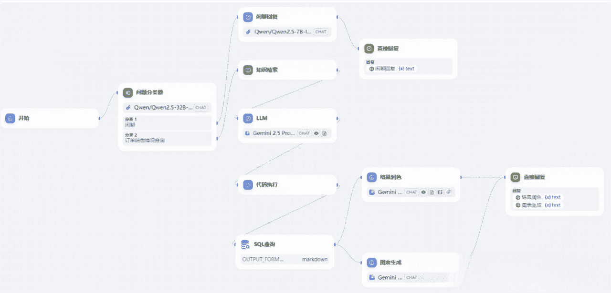

#### **三级分类体系：**

> **一级场景分类：**

> 基于意图识别输出概率融合，区分导诊、预问诊、健康咨询、推荐服务等6大类场景（准确率≥96%）。

> **二级需求细化：**

> 在场景内进一步分类（如“导诊”细分为内科/外科/急诊分诊），采用知识图谱路径匹配算法。

> **三级语义消歧：**

> 对模糊描述（如“心慌”）结合患者画像（年龄、性别）动态加权推理（如年轻女性优先考虑甲亢，老年男性侧重冠心病）。

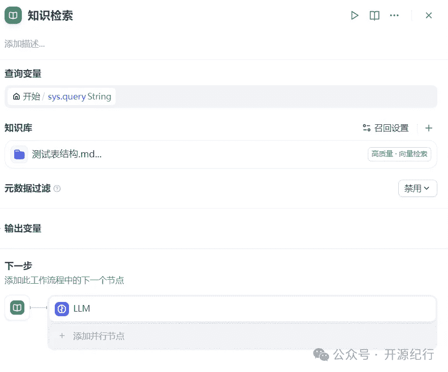

#### 基于传统NLP算法的智能客服交互痛点

> 在传统NLP技术体系下，有几个问题导致体验无法进一步提升。

> 比如复杂语境下的意图识别问题、上下文理解和多轮对话问题、泛化推理问题等。

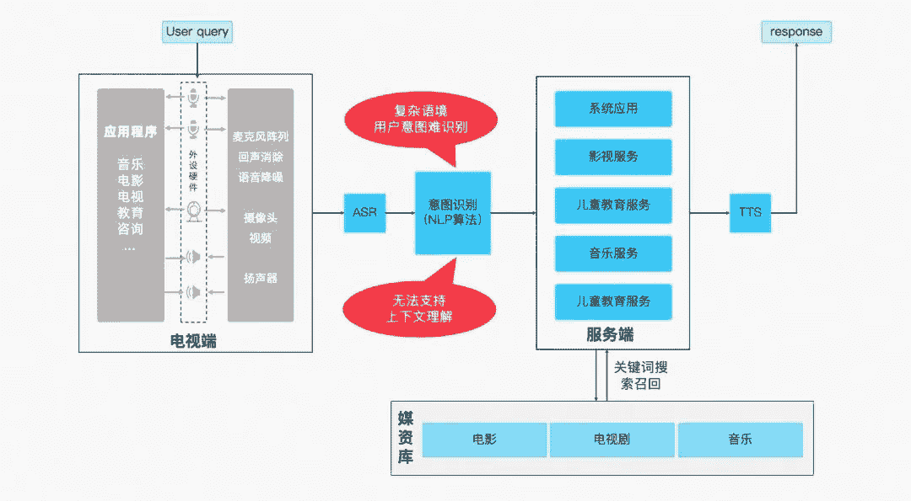

### 2.动态特征增强

#### 上下文感知模型：

> 基于上下文记忆构建长程记忆网络。

> 支持跨轮次对话状态跟踪（如追问“疼痛持续时间”后自动关联病程阶段）。

下面是一个常规对话机器人的例子：

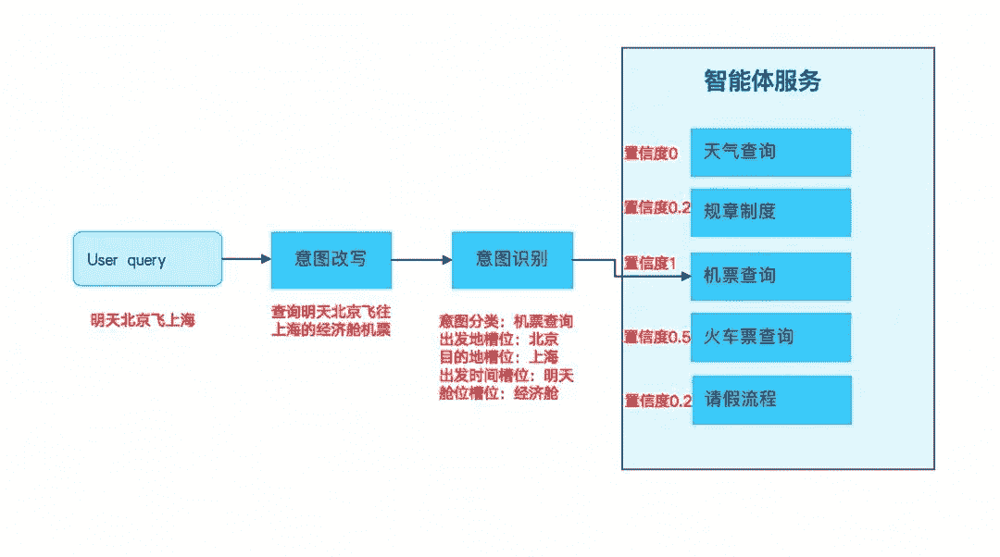

#### 实时知识注入：

> 对接医院HIS系统，动态加载当日急诊停诊信息等实时数据。

> 在患者询问某某专家哪天有号等场景，可以有效根据实时数据回答。

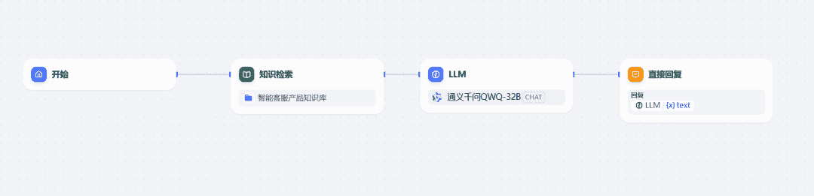

## **二、场景化任务编排**

### 1.工作流引擎设计

#### 1）可视化流程编排：

**基于工作量=流平台构建可拖拽式工作流，支持200+节点**类型（API调用、条件分支、数据转换）。

> 示例：导诊流程包含症状采集→科室匹配→医生推荐→导航引导4个核心节点。

##### 可选落地方案一：基模 + Prompt

> **方案特点：**

> 开发成本低，适用于需要快速上线，对延时要求不高，分类相对简单的场景。

>

> **模型选择：**

> 该方案主要靠基模的推理能力，需要根据分类难度和延时要求选择不同模型。建议至少使用32b以上的模型，如qwen-plus、qwen-max。

>

> **方案说明：**

> Prompt的实现也有较多写法，这里是一些常用的实现技巧。

###### CoT 思维链

> CoT的核心在于引导模型逐步构建一个逻辑链。

> 这个链由一系列相关的推理步骤组成，每个步骤都是基于前一步的结果。

这种方法有助于模型更好地理解问题的上下文和复杂性，并且增强了模型输出的解释性和可信度。

```
# 思考步骤为了完成上述目标，请按照下面的过程，一步一步思考后完成: 1.首先需要先理解候选的意图信息共有如下{}个类别，每个意图的含义或常见描述如下：{}
```

###### Few-Shot 少样本学习

大模型具备强大的少样本学习能力，通过在prompt中引入few shot少样本可有效提高大模型在意图识别分类任务中的能力。

**例如：**

```
2. 然后，观察以下意图识别分类案例，学习意图识别分类任务的能力：{}
```

###### 特定准则重点说明

```
3. 意图识别前，请重点学习并记住以下识别准则：{}
```

###### **输出示例**

```
4. 请以JSON格式进行输出，输出示例：{}
```

> **方案缺点：**

+   对垂类领域分类的识别有一定局限性

+   由于对模型推理能力有一定要求，选用大尺寸模型会带来一定延迟开销

基于以上原因，放弃了基模 + 提示词的方案，该场景更适合业务相对简单，延迟要求不敏感的业务场景。

#### 2）动态跳转逻辑：

预置15条跳转规则（如健康咨询中提及“预约体检”自动跳转推荐场景）。

支持基于患者情绪值（通过NLP情感分析）切换应答策略（焦虑患者启用安抚话术）。

##### 可选落地方案二：基模 + Prompt + RAG

+   **早期的神经网络模型**

> 在处理需要依赖外部知识或特定信息的任务时遇到了瓶颈。

>

+   **LLM的问题**

> 幻觉、依赖信息过时、缺乏专业领域知识。

>

+   RAG的提出，是为了解决如何将广泛的。

> 分布式的外部信息库与生成模型相结合，从而提高模型在问答、摘要等任务中的性能和准确度。

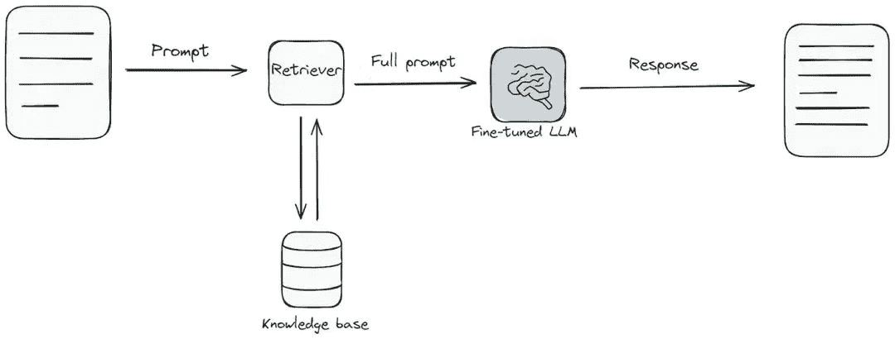

> **方案特点：**

> 鉴于方案一中垂类领域知识的问题，考虑加入RAG能力解决。

> 通过在知识库中上传大量的意图分类知识，使得该方案可以理解较为垂类或更个性化要求的分类判定逻辑。

>

> **模型选择：**

> 该方案引入了RAG能力，对模型推理要求不是很高，建议选用性能相对性价比较高的模型，如qwen-turbo、qwen-plus。

**方案说明：**

以下是一些建议的步骤：

###### 意图语料结构设计

需要定义不同意图的分类以及其槽位的设计，这些设计会和实际的业务场景以及后续承载具体实现的Agent密切相关。

**例如：**

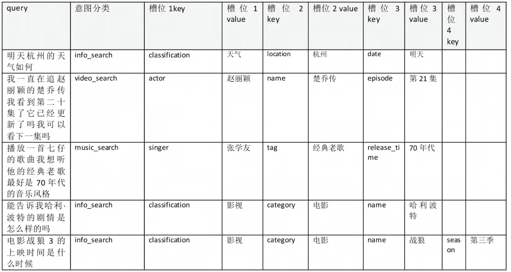

###### **数据生成**

+   **query语句生成：**

> 这里可以考虑给一些生产上用户可能问的query示例，用LLM生成一批同义句，此处不再赘述

>

+   **意图结果生成：**

> 根据前面设计的意图语料结构，使用大尺寸模型生成相关意图分类和槽位，并可加入在线搜索相关能力。

>

###### 知识上传和向量化

这里有非常多成熟的方案可以选择，可以考虑阿里云百炼平台的RAG方案，此处不再赘述。

**方案缺点：**

+   需要做数据预处理，有一定开发成本；

+   知识库内容较多或质量不佳时，可能引起模型幻觉和分类冲突；

+   相比方案1，会增加向量召回部分的延迟，且模型要求依然在14b以上，有一定延迟问题；

因此，该方案也不太适用于电视C端交互链路上，但是方案二关于数据增强的思路还是值得借鉴的，基于这个思路，我们可以尝试用小尺寸模型SFT的方案

###### 可选落地方案三：使用小尺寸模型进行SFT

**方案特点：**

通过小尺寸模型解决延迟问题，通过微调解决数据增强问题

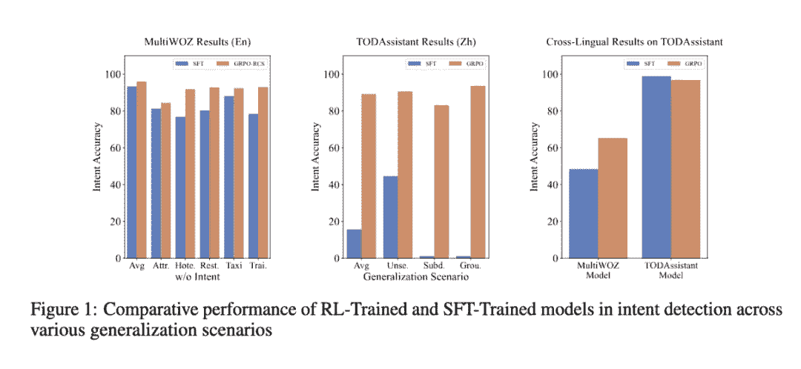

**模型选择：**

> **一般而言，模型底座越大，下游任务效**果越好，但是部署成本和推理代价相应增大。

> 针对意图识别的场景，建议从4B左右的大模型底座开始进行SFT和调参。

> 当效果较大同时通过调参无法进一步提升时，建议换成7B的更大底座。

> 超过10B的底座理论上能得到更好的结果，但是需要权衡实际的效果和成本问题。

> 因此本场景使用7B的底座性价比较高。

**微调方案：**

选用LoRA方式进行微调

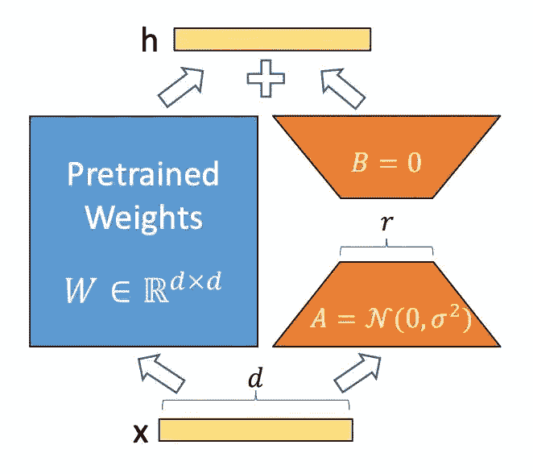

**方案说明：**

SFT的大致流程如下：

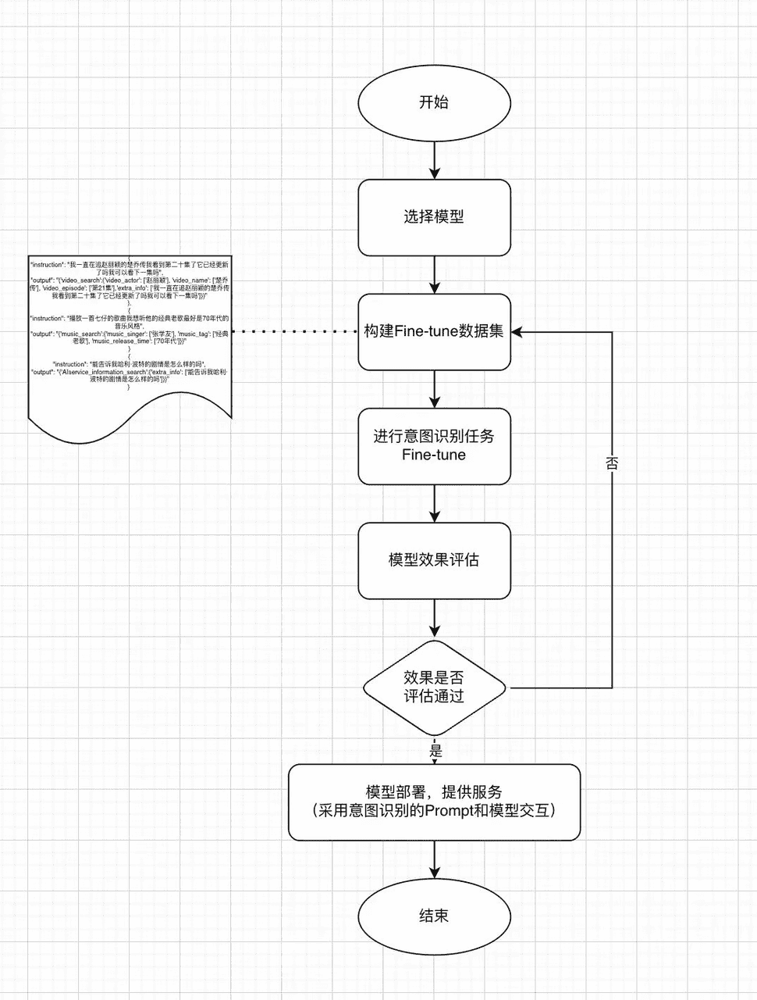

```
// 意图识别
const intent = await intentRecognition(evaluateData.question);

// 检索条件
const vectorFilter = {
  category: intent, // 将意图作为筛选条件
};

// 文档检索
const docs = await chromadb.similaritySearchWithScore(
  question,
  topK,
  vectorFilter
);
```

### 2.多场景协同机制

#### 1）跨流程数据共享：

通过全局上下文管理器，实现预问诊填写的过敏史自动同步至用药咨询场景。

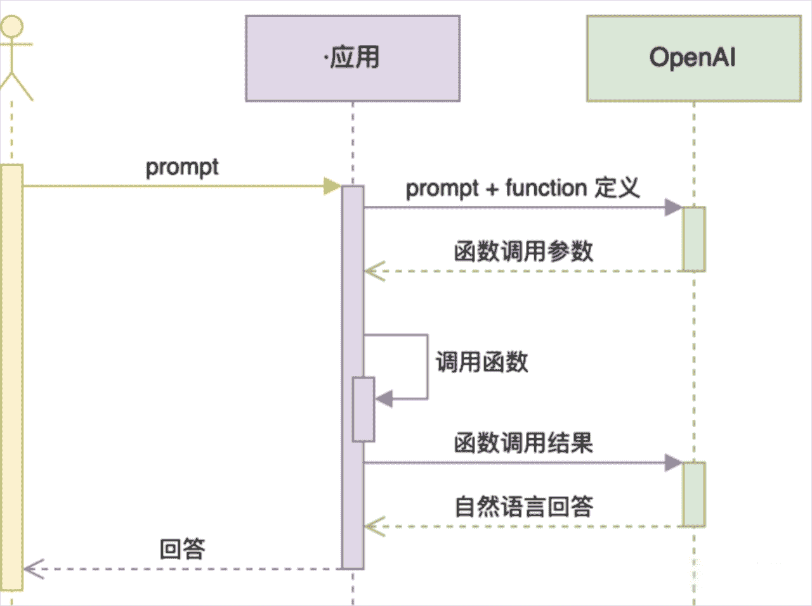

#### 2）多模态输出适配：

根据终端类型动态渲染结果：手机端推送图文卡片，互联网医院推送微信消息。

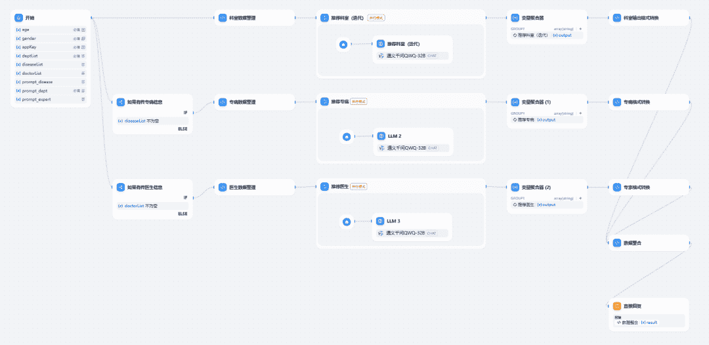

## 三、大模型推理与检索增强（RAG）

### 1.领域增强型模型架构

> **选用医助大模型72B，注入300G医疗文本（**电子病历、指南文献）进行领域增量预训练。

> 使用院10万条脱敏医患对话数据，优化咨询场景生成效果；

> 采用多任务学习：同步训练意图识别、实体抽取、报告生成任务。

```
const allQuestions = [evaluateData.question];

// 同义改写的问题
allQuestions.push(...evaluateData.synonymyQuestions);

// 检索条件
const vectorFilter = {
category: evaluateData.category,
};

const allDocs = [];
while (allQuestions.length &gt; 0) {
const question = allQuestions.shift();
const docs = await chromadb.similaritySearchWithScore(
    question,
    topK,
    vectorFilter
  );
  allDocs.push(...docs);
}

// 根据文档 id 去重并按文档相似度升序排列，最终取 topK 个文档作为上下文
const uniqueDocs = Array.from(
newMap(allDocs.map((doc) =&gt; [doc[0].id, doc])).values()
);
uniqueDocs.sort((a, b) =&gt; a[1] - b[1]);

// 最终的上下文
const retrievedContext = uniqueDocs
  .slice(0, topK)
  .map((doc) =&gt; doc[0].pageContent);
```

### 2.知识检索增强（RAG）

构建向量化医疗知识库，实时检索相关内容片段作为生成参考，降低模型幻觉率（实测下降41%）。

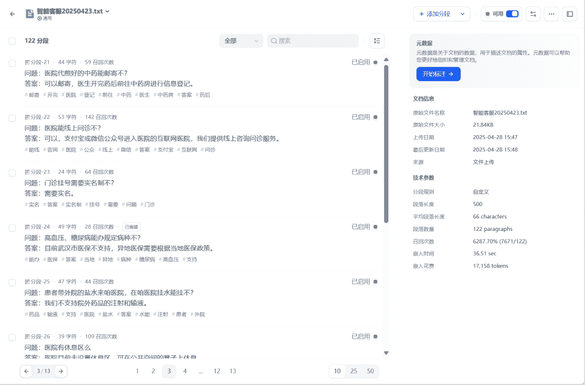

### 3.推理性能优化

> **分级响应机制：**

> 简单问题（如科室位置查询）直接调用知识库，响应时间<200ms。

>

> 复杂咨询（如疾病预后分析）启动大模型生成，通过模型蒸馏压缩技术控制响应时间<1.5s。

>

### 4.进阶方案：自动质检和自动微调链路

通过设计完整的离线质检工程链路。

> 持续自动训练和部署最新模型，解决生产准确率、训练集和微调模型成本的问题。

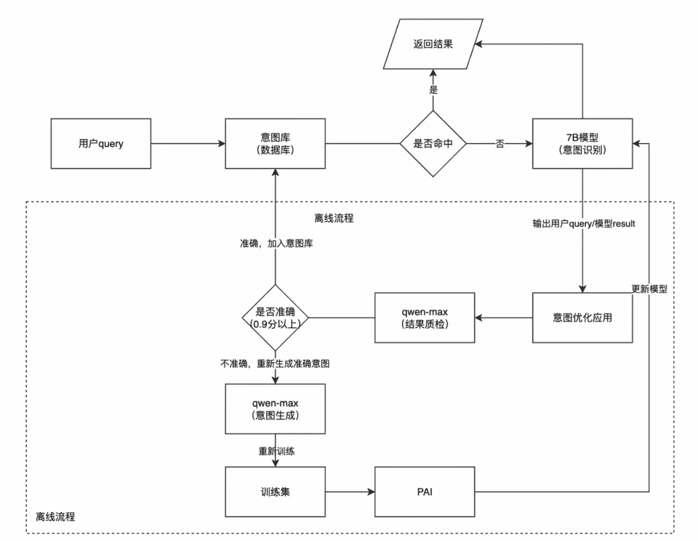

该方案通过多步骤处理流程，实现了自动对线上意图质检及自动重新训练的流程。总体上分为在线流程和离线流程两部分。

以下是详细的流程描述：

**在线流程：**

> **1**.用户的query先经过一道意图缓存库，该库直接以query为key，将曾经正确返回的意图结果存储在es中。

> 当缓存被命中时直接将结果返回，不再走后续链路，以此提高响应速度和保证准确性。该缓存库主要是为一些简单意图如系统指令、媒资名搜索做快速结果返回

>

> **2.如果未命中缓存，则走到后续的模型推理链路**。当前使用的是微调后的qwen-7b模型

>

**离线流程：**

> 1.当大模型输出意图推理结果后。

> 会异步将query+reponse传入给一个意图优化应用，作为整体质检的入口

>

> 2.调用一个大尺寸模型，例如qwen-max对结果进行质检。

> 质检规则是输出response相对于result的得分情况，满分为1分，只有0.9分以上的答案才认为是正确的

>

> **3.如果意图准确，**则重新将此次的意图结果写进缓存中，方便下次调用读取

>

> 4.如果意图得分低于0.9，认为该意图生成质量不佳。

> 此时会尝试使用大尺寸模型如qwen-max进行意图的重新生成。需要注意的是，此质检agent会引入LLM实时搜索能力，保证对一些较新的query信息做好理解

>

> 5.当意图生成agent的答案重新通过质检后，会更新到训练集中，以供下一次SFT使用

```
const allQuestions = [evaluateData.question];

// 多视角分解
allQuestions.push(...evaluateData.subQuestions);

// 检索条件
const vectorFilter = {
category: evaluateData.category,
};

const allDocs = [];
while (allQuestions.length &gt; 0) {
const question = allQuestions.shift();
const docs = await chromadb.similaritySearchWithScore(
    question,
    topK,
    vectorFilter
  );
  allDocs.push(...docs);
}

// 根据文档 id 去重并按文档相似度升序排列，最终取 topK 个文档作为上下文
const uniqueDocs = Array.from(
newMap(allDocs.map((doc) =&gt; [doc[0].id, doc])).values()
);
uniqueDocs.sort((a, b) =&gt; a[1] - b[1]);

// 最终的上下文
const retrievedContext = uniqueDocs
  .slice(0, topK)
  .map((doc) =&gt; doc[0].pageContent);
```