# 舆情分析Agent：AI 舆情 Agent

> 来源：[https://qqs7y1hozd1.feishu.cn/docx/Jqi6d8S3yoz6l3xDr9ccQiApn3c](https://qqs7y1hozd1.feishu.cn/docx/Jqi6d8S3yoz6l3xDr9ccQiApn3c)

### **系统设计**

+   原始网页存储库，这个库需要能支持海量数据，低成本，低延时写入。

+   计算引擎在做数据处理时，可能还需要从存储库中获取一些元数据。

+   除了实时的计算链路，对存量数据定期要做一些聚类。

+   舆情的结果数据集有不同类的使用需求。对于重大舆情，需要做实时的预警。

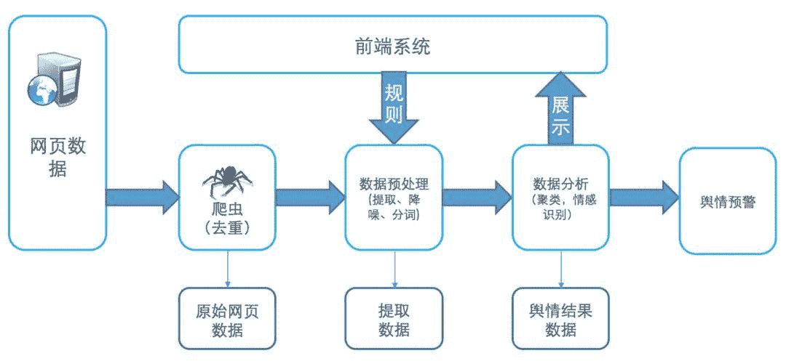

### 一次完整分析流程

首先打开谷歌旗下的Google Antigrativy，谷歌旗下的 ide 编译器，输入提示词：

```
我需要做一个舆情分析agent。需要先从热点的舆情数据进行抓取，然后再把分析结果做成报告来呈现出来，先根据我的需求和开源代码来，先设计下实现的方案，跟我讨论下
```

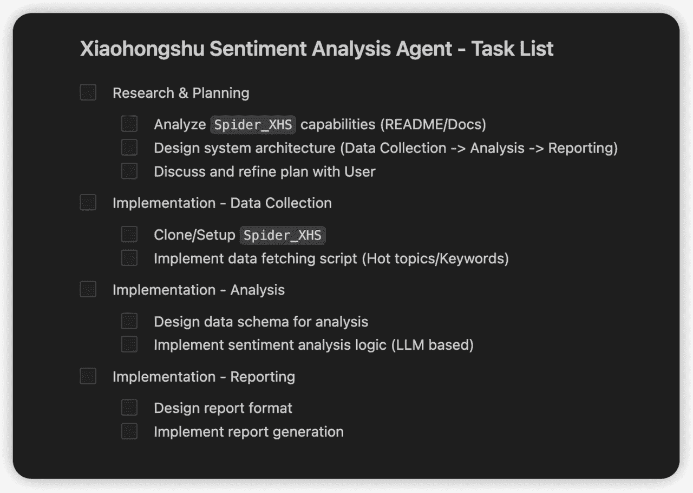

### 项目代码结构树

```
BettaFish/
├── QueryEngine/                            # 国内外新闻广度搜索Agent
│   ├── agent.py                            # Agent主逻辑，协调搜索与分析流程
│   ├── llms/                               # LLM接口封装
│   ├── nodes/                              # 处理节点：搜索、格式化、总结等
│   ├── tools/                              # 国内外新闻搜索工具集
│   ├── utils/                              # 工具函数
│   ├── state/                              # 状态管理
│   ├── prompts/                            # 提示词模板
│   └── ...
├── MediaEngine/                            # 强大的多模态理解Agent
│   ├── agent.py                            # Agent主逻辑，处理视频/图片等多模态内容
│   ├── llms/                               # LLM接口封装
│   ├── nodes/                              # 处理节点：搜索、格式化、总结等
│   ├── tools/                              # 多模态搜索工具集
│   ├── utils/                              # 工具函数
│   ├── state/                              # 状态管理
│   ├── prompts/                            # 提示词模板
│   └── ...
├── InsightEngine/                          # 私有数据库挖掘Agent
│   ├── agent.py                            # Agent主逻辑，协调数据库查询与分析
│   ├── llms/                               # LLM接口封装
│   │   └── base.py                         # 统一的OpenAI兼容客户端
│   ├── nodes/                              # 处理节点：搜索、格式化、总结等
│   │   ├── base_node.py                    # 基础节点类
│   │   ├── search_node.py                  # 搜索节点
│   │   ├── formatting_node.py              # 格式化节点
│   │   ├── report_structure_node.py        # 报告结构节点
│   │   └── summary_node.py                 # 总结节点
│   ├── tools/                              # 数据库查询和分析工具集
│   │   ├── keyword_optimizer.py            # Qwen关键词优化中间件
│   │   ├── search.py                       # 数据库操作工具集（话题搜索、评论获取等）
│   │   └── sentiment_analyzer.py           # 情感分析集成工具
│   ├── utils/                              # 工具函数
│   │   ├── config.py                       # 配置管理
│   │   ├── db.py                           # SQLAlchemy异步引擎与只读查询封装
│   │   └── text_processing.py              # 文本处理工具
│   ├── state/                              # 状态管理
│   │   └── state.py                        # Agent状态定义
│   ├── prompts/                            # 提示词模板
│   │   └── prompts.py                      # 各类提示词
│   └── __init__.py
├── ReportEngine/                           # 多轮报告生成Agent
│   ├── agent.py                            # 总调度器：模板选择→布局→篇幅→章节→渲染
│   ├── flask_interface.py                  # Flask/SSE入口，管理任务排队与流式事件
│   ├── llms/                               # OpenAI兼容LLM封装
│   │   └── base.py                         # 统一的流式/重试客户端
│   ├── core/                               # 核心功能：模板解析、章节存储、文档装订
│   │   ├── template_parser.py              # Markdown模板切片与slug生成
│   │   ├── chapter_storage.py              # 章节run目录、manifest与raw流写入
│   │   └── stitcher.py                     # Document IR装订器，补齐锚点/元数据
│   ├── ir/                                 # 报告中间表示（IR）契约与校验
│   │   ├── schema.py                       # 块/标记Schema常量定义
│   │   └── validator.py                    # 章节JSON结构校验器
│   ├── nodes/                              # 全流程推理节点
│   │   ├── base_node.py                    # 节点基类+日志/状态钩子
│   │   ├── template_selection_node.py      # 模板候选收集与LLM筛选
│   │   ├── document_layout_node.py         # 标题/目录/主题设计
│   │   ├── word_budget_node.py             # 篇幅规划与章节指令生成
│   │   └── chapter_generation_node.py      # 章节级JSON生成+校验
│   ├── prompts/                            # 提示词库与Schema说明
│   │   └── prompts.py                      # 模板选择/布局/篇幅/章节提示词
│   ├── renderers/                          # IR渲染器
│   │   ├── html_renderer.py                # Document IR→交互式HTML
│   │   ├── pdf_renderer.py                 # HTML→PDF导出（WeasyPrint）
│   │   ├── pdf_layout_optimizer.py         # PDF布局优化器
│   │   └── chart_to_svg.py                 # 图表转SVG工具
│   ├── state/                              # 任务/元数据状态模型
│   │   └── state.py                        # ReportState与序列化工具
│   ├── utils/                              # 配置与辅助工具
│   │   ├── config.py                       # Pydantic Settings与打印助手
│   │   ├── dependency_check.py             # 依赖检查工具
│   │   ├── json_parser.py                  # JSON解析工具
│   │   ├── chart_validator.py              # 图表校验工具
│   │   └── chart_repair_api.py             # 图表修复API
│   ├── report_template/                    # Markdown模板库
│   │   ├── 企业品牌声誉分析报告.md
│   │   └── ...
│   └── __init__.py
├── ForumEngine/                            # 论坛引擎：Agent协作机制
│   ├── monitor.py                          # 日志监控和论坛管理核心
│   ├── llm_host.py                         # 论坛主持人LLM模块
│   └── __init__.py
├── MindSpider/                             # 社交媒体爬虫系统
│   ├── main.py                             # 爬虫主程序入口
│   ├── config.py                           # 爬虫配置文件
│   ├── BroadTopicExtraction/               # 话题提取模块
│   │   ├── main.py                         # 话题提取主程序
│   │   ├── database_manager.py             # 数据库管理器
│   │   ├── get_today_news.py               # 今日新闻获取
│   │   └── topic_extractor.py              # 话题提取器
│   ├── DeepSentimentCrawling/              # 深度舆情爬取模块
│   │   ├── main.py                         # 深度爬取主程序
│   │   ├── keyword_manager.py              # 关键词管理器
│   │   ├── platform_crawler.py             # 平台爬虫管理
│   │   └── MediaCrawler/                   # 社媒爬虫核心
│   │       ├── main.py
│   │       ├── config/                     # 各平台配置
│   │       ├── media_platform/             # 各平台爬虫实现
│   │       └── ...
│   └── schema/                             # 数据库结构定义
│       ├── db_manager.py                   # 数据库管理器
│       ├── init_database.py                # 数据库初始化脚本
│       ├── mindspider_tables.sql           # 数据库表结构SQL
│       ├── models_bigdata.py               # 大规模媒体舆情表的SQLAlchemy映射
│       └── models_sa.py                    # DailyTopic/Task等扩展表ORM模型
├── SentimentAnalysisModel/                 # 情感分析模型集合
│   ├── WeiboSentiment_Finetuned/           # 微调BERT/GPT-2模型
│   │   ├── BertChinese-Lora/               # BERT中文LoRA微调
│   │   │   ├── train.py
│   │   │   ├── predict.py
│   │   │   └── ...
│   │   └── GPT2-Lora/                      # GPT-2 LoRA微调
│   │       ├── train.py
│   │       ├── predict.py
│   │       └── ...
│   ├── WeiboMultilingualSentiment/         # 多语言情感分析
│   │   ├── train.py
│   │   ├── predict.py
│   │   └── ...
│   ├── WeiboSentiment_SmallQwen/           # 小参数Qwen3微调
│   │   ├── train.py
│   │   ├── predict_universal.py
│   │   └── ...
│   └── WeiboSentiment_MachineLearning/     # 传统机器学习方法
│       ├── train.py
│       ├── predict.py
│       └── ...
├── SingleEngineApp/                        # 单独Agent的Streamlit应用
│   ├── query_engine_streamlit_app.py       # QueryEngine独立应用
│   ├── media_engine_streamlit_app.py       # MediaEngine独立应用
│   └── insight_engine_streamlit_app.py     # InsightEngine独立应用
├── query_engine_streamlit_reports/         # QueryEngine单应用运行输出
├── media_engine_streamlit_reports/         # MediaEngine单应用运行输出
├── insight_engine_streamlit_reports/       # InsightEngine单应用运行输出
├── templates/                              # Flask前端模板
│   └── index.html                          # 主界面HTML
├── static/                                 # 静态资源
│   ├── image/                              # 图片资源
│   │   └── ...
│   ├── Partial README for PDF Exporting/   # PDF导出依赖配置说明
│   └── v2_report_example/                  # 报告渲染示例
│       └── report_all_blocks_demo/         # 全块类型演示（HTML/PDF/MD）
├── logs/                                   # 运行日志目录
├── final_reports/                          # 最终生成的报告文件
│   ├── ir/                                 # 报告IR JSON文件
│   └── *.html                              # 最终HTML报告
├── utils/                                  # 通用工具函数
│   ├── forum_reader.py                     # Agent间论坛通信工具
│   ├── github_issues.py                    # 统一生成GitHub Issue链接与错误提示
│   └── retry_helper.py                     # 网络请求重试机制工具
├── tests/                                  # 单元测试与集成测试
│   ├── run_tests.py                        # pytest入口脚本
│   ├── test_monitor.py                     # ForumEngine监控单元测试
│   ├── test_report_engine_sanitization.py  # ReportEngine安全性测试
│   └── ...
├── app.py                                  # Flask主应用入口
├── config.py                               # 全局配置文件
├── .env.example                            # 环境变量示例文件
├── docker-compose.yml                      # Docker多服务编排配置
├── Dockerfile                              # Docker镜像构建文件
├── requirements.txt                        # Python依赖包清单
├── regenerate_latest_html.py               # 使用最新章节重装订并渲染HTML
├── regenerate_latest_md.py                 # 使用最新章节重装订并渲染Markdown
├── regenerate_latest_pdf.py                # PDF重新生成工具脚本
├── report_engine_only.py                   # Report Engine命令行版本
├── README.md                               # 中文说明文档
├── README-EN.md                            # 英文说明文档
├── CONTRIBUTING.md                         # 中文贡献指南
├── CONTRIBUTING-EN.md                      # 英文贡献指南
└── LICENSE                                 # GPL-2.0开源许可证
```

他开始根据我们的需求来给我设计方案了，他分析完后会给你计划，但计划也需要用户这边来确认需要做选择的东西，cookie 这玩意好弄，直接手机登录网页版📕然后手动获取 cookie 然后输入到配置文件中就行了，关于大模型分析，我个人是建议先用地的 NLP 库进行基础的关键词统计，等没问题了再改用大模型也可以。

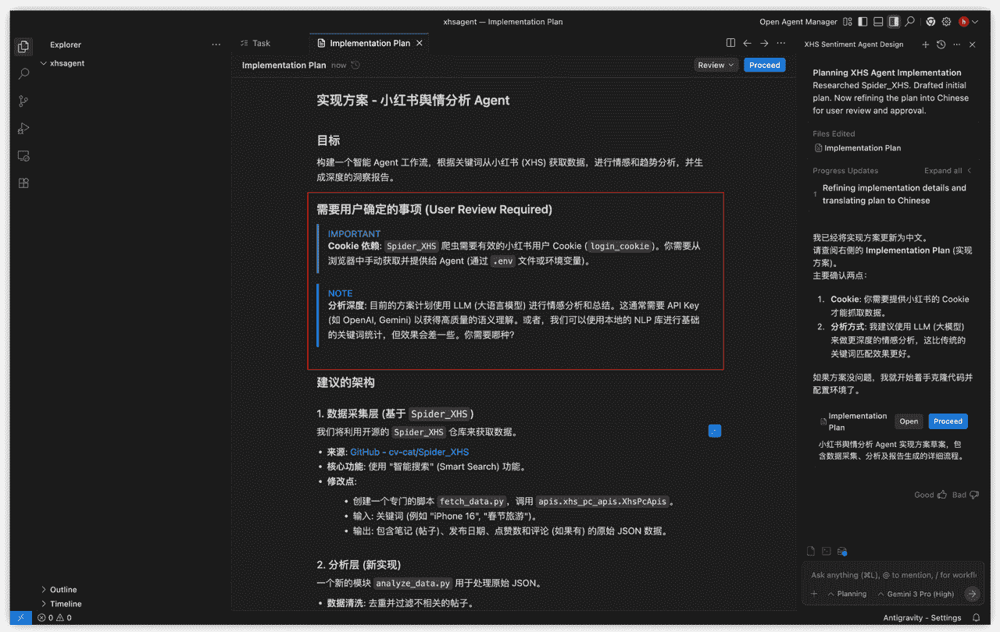

接下来看技术架构设计，分为数据层：主要采集📕数据，分析层：根据采集到的数据进行分析，报告层：根据分析出来的结果呈现出来给用户，这个架构设计很合理，没问题，我们继续往下看。

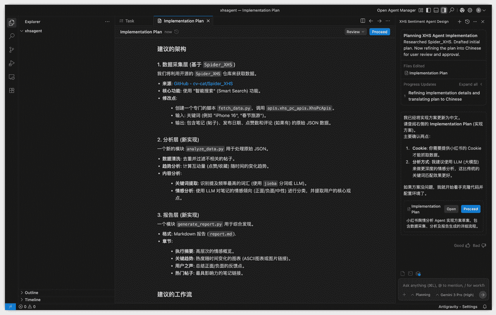

#### Agent配置参数

每个Agent都有专门的配置文件，可根据需求调整，下面是部分示例：

```
# QueryEngine/utils/config.py
class Config:
    max_reflections = 2           # 反思轮次
    max_search_results = 15       # 最大搜索结果数
    max_content_length = 8000     # 最大内容长度
    
# MediaEngine/utils/config.py  
class Config:
    comprehensive_search_limit = 10  # 综合搜索限制
    web_search_limit = 15           # 网页搜索限制
    
# InsightEngine/utils/config.py
class Config:
    default_search_topic_globally_limit = 200    # 全局搜索限制
    default_get_comments_limit = 500             # 评论获取限制
    max_search_results_for_llm = 50              # 传给LLM的最大结果数
```

确定工作流的具体文件和具体作用

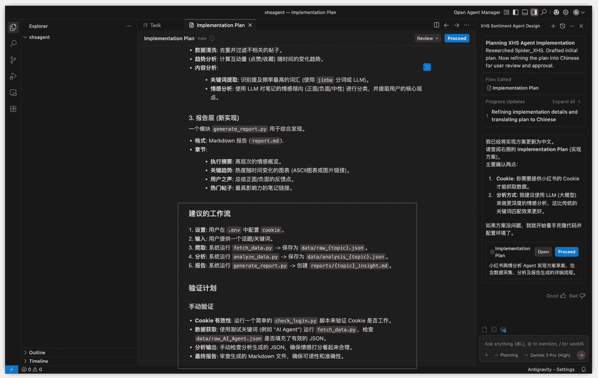

#### 情感分析模型配置

```
# InsightEngine/tools/sentiment_analyzer.py
SENTIMENT_CONFIG = {
    &#x27;model_type&#x27;: &#x27;multilingual&#x27;,     # 可选: &#x27;bert&#x27;, &#x27;multilingual&#x27;, &#x27;qwen&#x27;等
    &#x27;confidence_threshold&#x27;: 0.8,      # 置信度阈值
    &#x27;batch_size&#x27;: 32,                 # 批处理大小
    &#x27;max_sequence_length&#x27;: 512,       # 最大序列长度
}
```

### 接入不同的LLM模型

支持任意openAI调用格式的LLM提供商，只需要在/config.py中填写对应的KEY、BASE_URL、MODEL_NAME即可。

> 什么是openAI调用格式？下面提供一个简单的例子：

```
from openai import OpenAI

client = OpenAI(api_key=&quot;your_api_key&quot;, 
               base_url=&quot;https://aihubmix.com/v1&quot;)

response = client.chat.completions.create(
   model=&quot;gpt-4o-mini&quot;,
   messages=[
       {&#x27;role&#x27;: &#x27;user&#x27;, 
        &#x27;content&#x27;: &quot;推理模型会给市场带来哪些新的机会&quot;}
   ],
)

complete_response = response.choices[0].message.content
print(complete_response)
```

我觉得没啥问题，开始干就完事了，直接执行继续执行开始做这个舆情 agent 了。

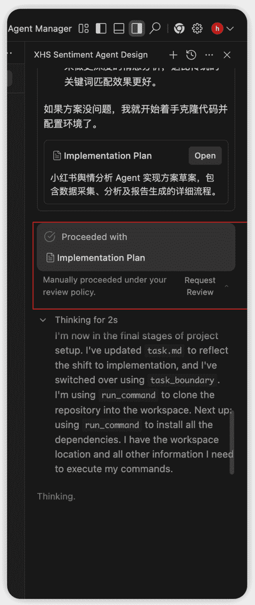

环境搭建完毕了，然后我们进行登录。

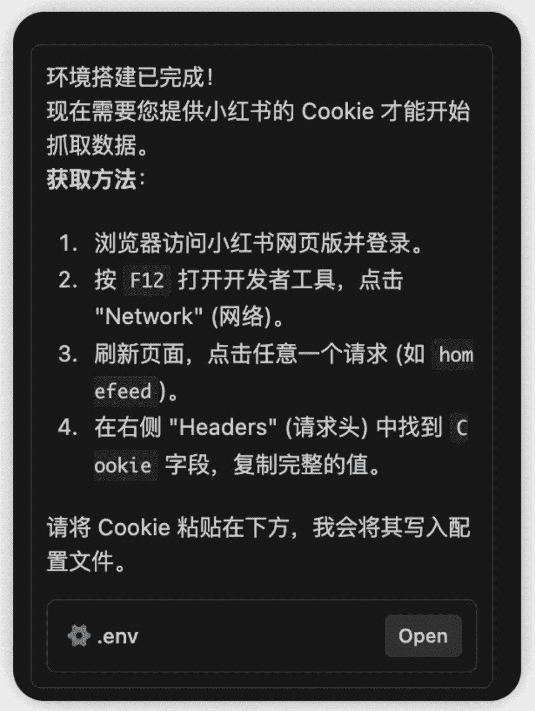

将复制好的 cookie 复制到代码中的.env环境配置里面的cookie 变量里面去，就可以了。

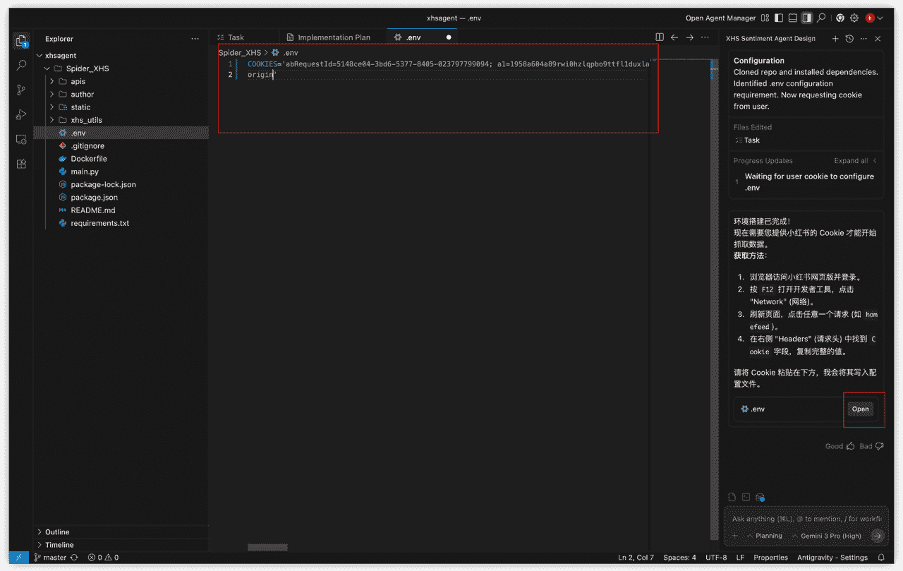

### 更改情感分析模型

#### 多语言情感分析

```
cd SentimentAnalysisModel/WeiboMultilingualSentiment
python predict.py --text &quot;This product is amazing!&quot; --lang &quot;en&quot;
```

#### 小参数Qwen3微调

```
cd SentimentAnalysisModel/WeiboSentiment_SmallQwen
python predict_universal.py --text &quot;这次活动办得很成功&quot;
```

#### 基于BERT的微调模型

```
# 使用BERT中文模型
cd SentimentAnalysisModel/WeiboSentiment_Finetuned/BertChinese-Lora
python predict.py --text &quot;这个产品真的很不错&quot;
```

#### GPT-2 LoRA微调模型

```
cd SentimentAnalysisModel/WeiboSentiment_Finetuned/GPT2-Lora
python predict.py --text &quot;今天心情不太好&quot;
```

#### 传统机器学习方法

```
cd SentimentAnalysisModel/WeiboSentiment_MachineLearning
python predict.py --model_type &quot;svm&quot; --text &quot;服务态度需要改进&quot;
```

执行过程中自动写代码，然后自动开始测试，没想到效果还挺好的，竟然真出来了数据。

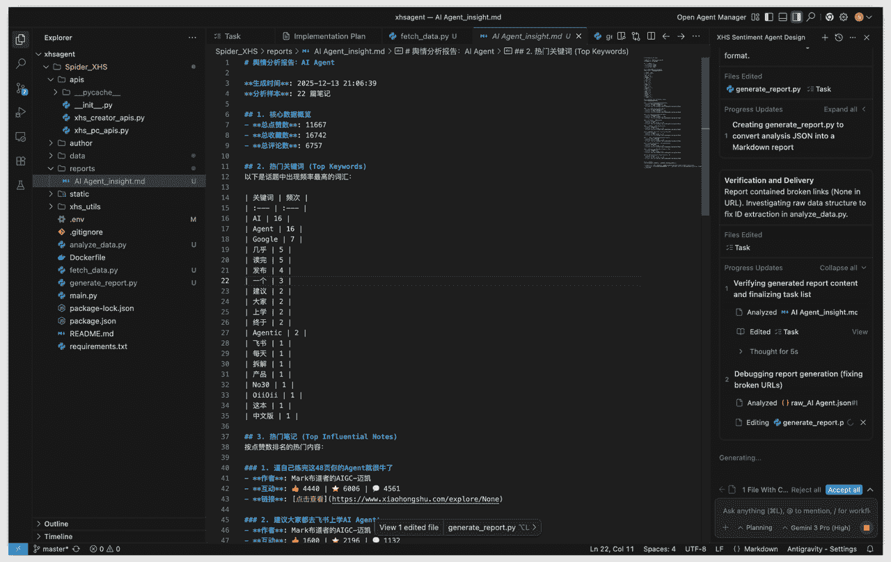

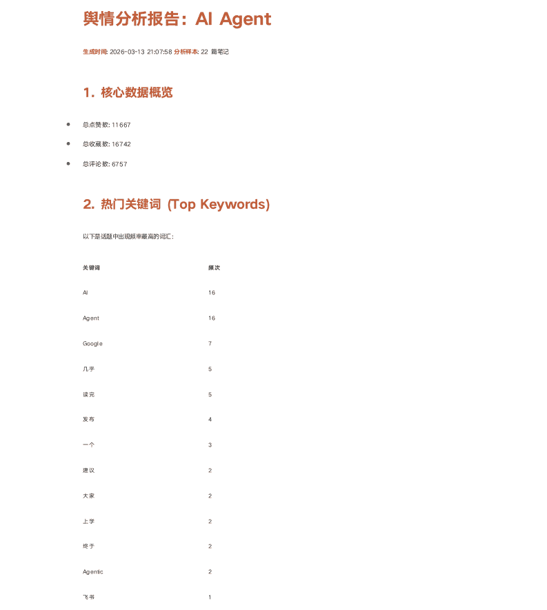

[舆情监控Agent.docx](https://internal-api-drive-stream.feishu.cn/space/api/box/stream/download/all/DDYDb1fNKooSm4xA89Bc5xUInKe)

等了一会，📕舆情 agent 开发完成了，只不过是数据版本，但Gemini3.1 还挺贴心写了个使用说明文档，告诉我咋用。

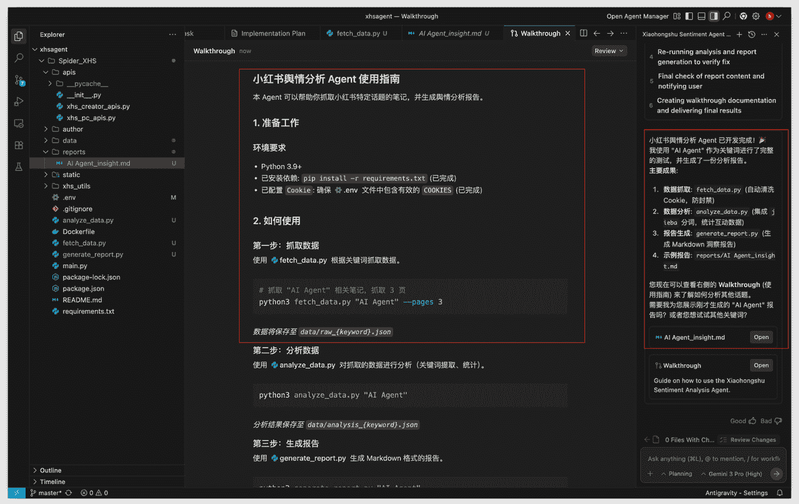

这种生成完的数据报告都是makdown格式看着有点费劲，我的让他给我变成可视化才行，来，我继续指挥他给我们优化升级。输入指令：

```
要用 web 页面来给我呈现数据和报告，而且要用 react 技术来开发。
```

### 接入自定义业务数据库

#### 修改数据库连接配置

```
# config.py 中添加您的业务数据库配置
BUSINESS_DB_HOST = &quot;your_business_db_host&quot;
BUSINESS_DB_PORT = 3306
BUSINESS_DB_USER = &quot;your_business_user&quot;
BUSINESS_DB_PASSWORD = &quot;your_business_password&quot;
BUSINESS_DB_NAME = &quot;your_business_database&quot;
```

#### 创建自定义数据访问工具

```
# InsightEngine/tools/custom_db_tool.py
class CustomBusinessDBTool:
    &quot;&quot;&quot;自定义业务数据库查询工具&quot;&quot;&quot;
    
    def __init__(self):
        self.connection_config = {
            &#x27;host&#x27;: config.BUSINESS_DB_HOST,
            &#x27;port&#x27;: config.BUSINESS_DB_PORT,
            &#x27;user&#x27;: config.BUSINESS_DB_USER,
            &#x27;password&#x27;: config.BUSINESS_DB_PASSWORD,
            &#x27;database&#x27;: config.BUSINESS_DB_NAME,
        }
    
    def search_business_data(self, query: str, table: str):
        &quot;&quot;&quot;查询业务数据&quot;&quot;&quot;
        # 实现您的业务逻辑
        pass
    
    def get_customer_feedback(self, product_id: str):
        &quot;&quot;&quot;获取客户反馈数据&quot;&quot;&quot;
        # 实现客户反馈查询逻辑
        pass
```

#### 集成到InsightEngine

```
# InsightEngine/agent.py 中集成自定义工具
from .tools.custom_db_tool import CustomBusinessDBTool

class DeepSearchAgent:
    def __init__(self, config=None):
        # ... 其他初始化代码
        self.custom_db_tool = CustomBusinessDBTool()
    
    def execute_custom_search(self, query: str):
        &quot;&quot;&quot;执行自定义业务数据搜索&quot;&quot;&quot;
        return self.custom_db_tool.search_business_data(query, &quot;your_table&quot;)
```

现在web 版本已经开发完事了，还挺快呀

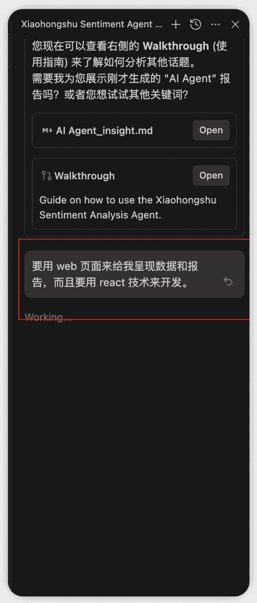

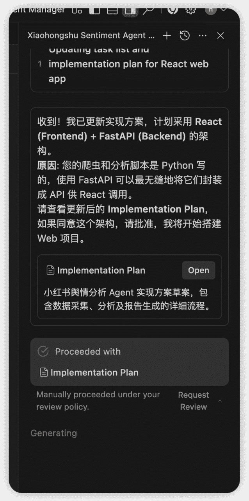

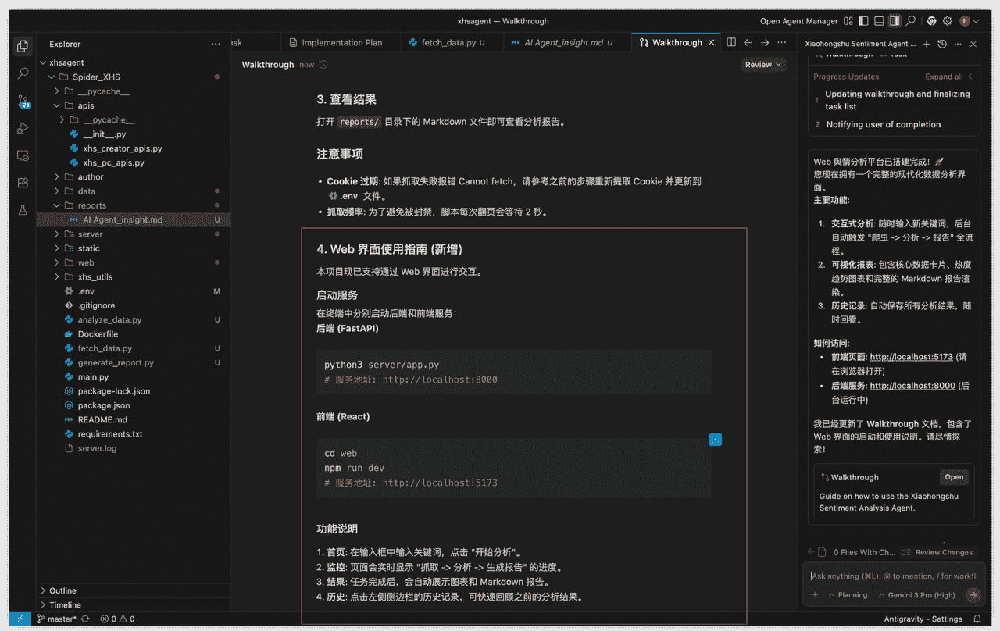

我们试一下看看效果怎么样，我输入 ai 查询一下。

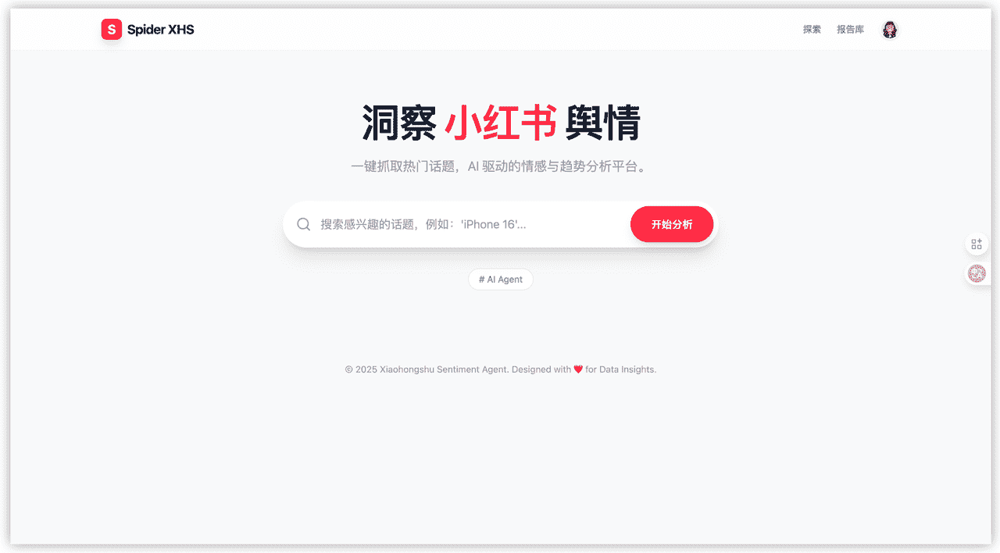

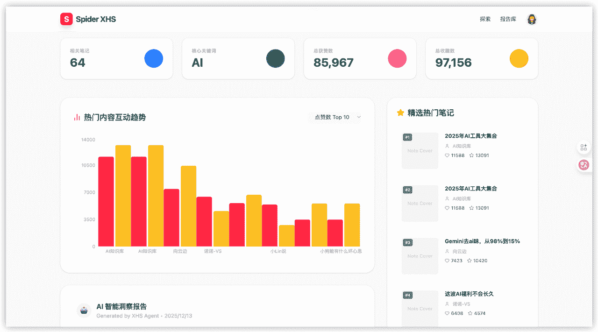

但是这个系统有两个问题，一个是下面的 ai 智能洞察报告格式很丑，需要优化一下

继续指挥Gemini3.1 给我干活：

```
你这个舆情 agent 有问题啊，AI 智能洞察报告下
```

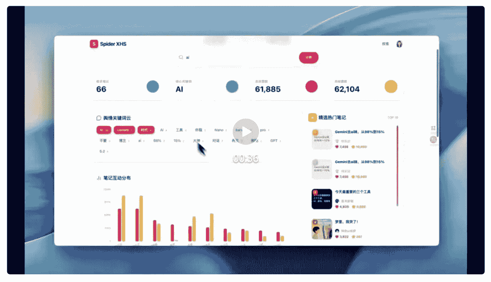

可以看到，效果已经达到预期了