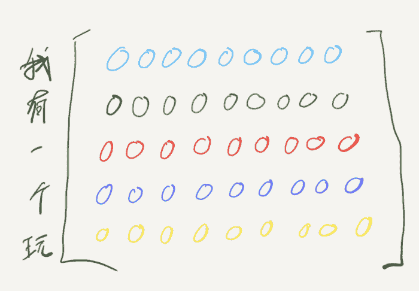
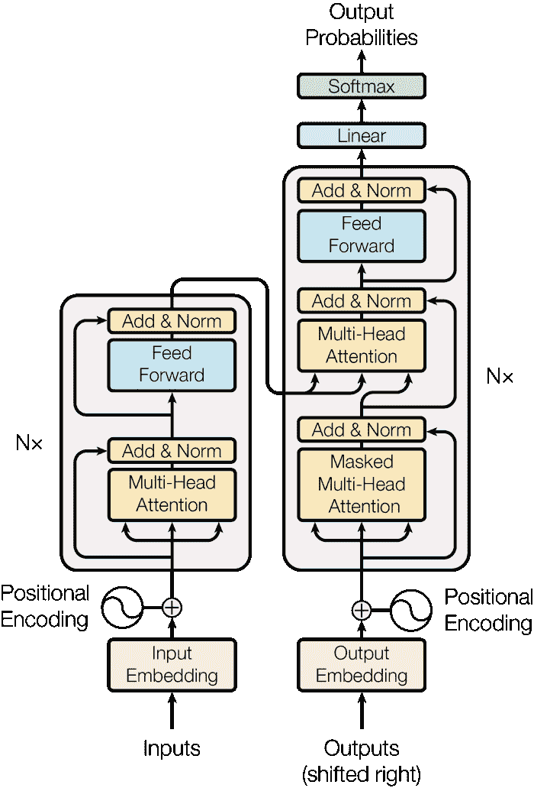
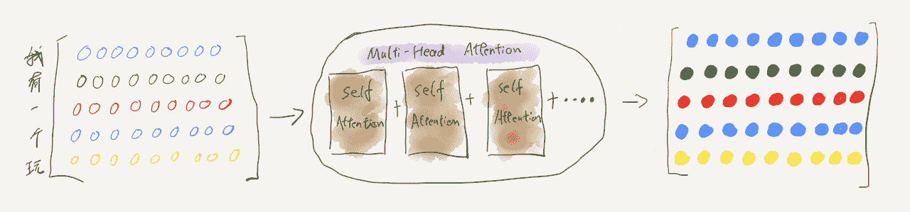
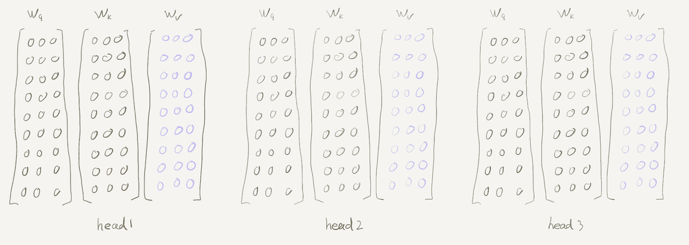
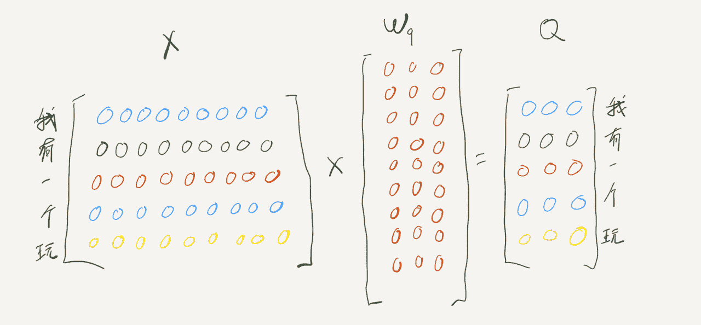
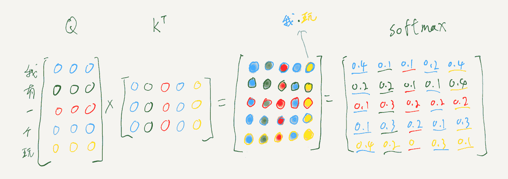
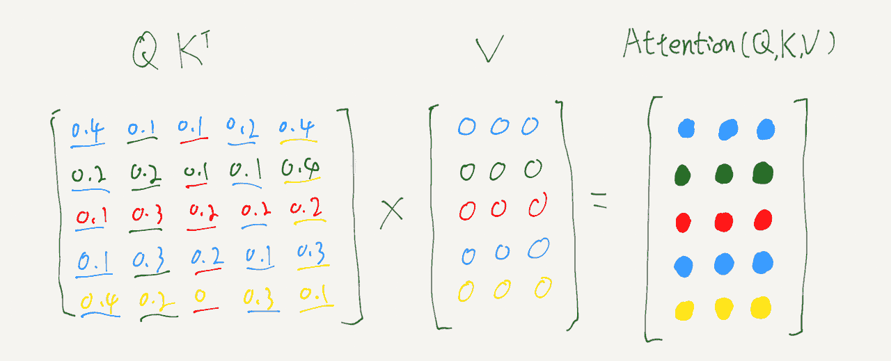
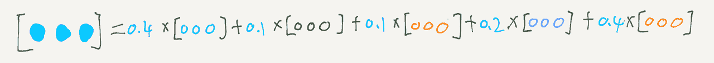
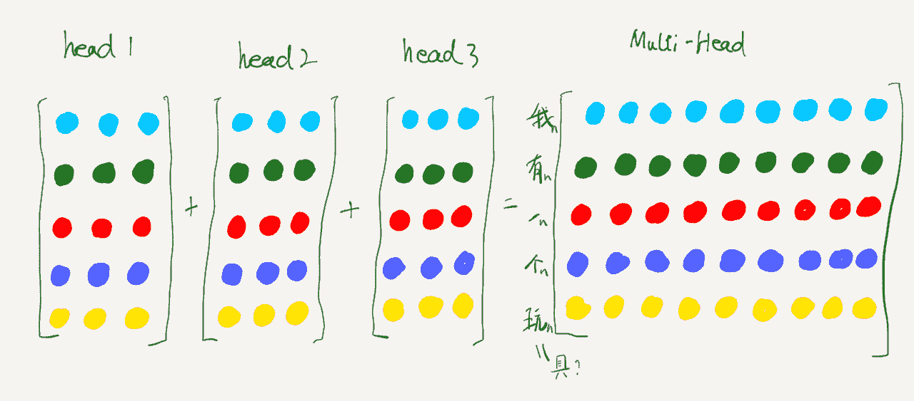

# Transformer 里的 Q K V 是什么

> 来源：[https://qqs7y1hozd1.feishu.cn/docx/KMdUd6WavoO784xKPHBc4I0CnYb](https://qqs7y1hozd1.feishu.cn/docx/KMdUd6WavoO784xKPHBc4I0CnYb)

+   **Transformer** **作为新 AI 时代的基石**，**有必要深入了解下**

+   **本文主要记录一下其中我觉得**比较容易混淆的 Attention模块运算过程，主要是里面的 Q K V 的概念/运算过程/作用

+   右边是** Tran****sfo**rmer 架构图，左边是 encoder，右边是 decoder，实际 LLM 大模型是只由右边 decoder 构成，这里面大部分是常用的 Feed Forward（前馈网络）/ Add（残差连接）/ Norm（层归一化），核心还是 Multi-Head Attention 模块

+   具体看看 Multi-Head Attention 模块里做了什么

# **输入**

假设一个字是一个 token，输入是”我有一个玩”（用于推测下一个字”具“），5 个字，每个字用一个向量表示，每个向量假设是 9 维（GPT3 是 12288 维），也就是用 9 个数值表示这个字，那每个词顺序排下来，就组成了 5 行 9 列的输入矩阵，称他为 X，每一行代表一个词。

**每一个圈圈代表一个数值**。“我”字由蓝色的9个数值表示，“有”字是绿色的9个数值。这 9 个数值组成一个 9 维向量，这里每个字对应的向量值是一开始定好的，至于怎么定的不细说，可以看看相关文章。

这个输入矩阵经过Multi-Head Attention 模块运算，输出另一个同宽高的矩阵，接下来详细看看这个运算过程：

# **权重矩阵**** & **Multi-Head Attention

Multi-Head Attention是由多个 Self Attention 模块拼接而成，如果它只有一个 head，就是一个 Self Attension 模块。

## **Self Attention**

**S**elf Attention 模块里，会包含 Wq Wk Wv 三个参数权重矩阵，模型训练过程就是不断调整 Wq Wk Wv 里的数值。

> 这几个权重矩阵的行和列数，需要满足：

1.  **行数：**输入矩阵 X 会与它们进行相乘，所以行数需要与输入词向量的维度匹配，也就是 9

1.  **列数：**Transformer 中整个 Attention 模块的输入数据和输出数据维度应该是一致的，才能多层重复叠加，从矩阵相乘特性知道，这些权重矩阵的列数也应该对齐词向量的维度，还是 9

所以如果这里是单个 Self Attention，Wq Wk Wv 就是行数和列数都是与词向量维度一致的矩阵，也就是 9×9

## Multi-Head Attention

但这里希望模型能捕获到单词间的多种不同注意力，所以会把它拆出来再拼接

> 假设把它拆成 3 个 head，那就是能捕获到 3 种单词之间不同的关系。这里拆出来的 3 个 head 就是 3 个 Self Attention 模块，每个模块有自己的 Wq Wk Wv 矩阵，行列数是 9 x 3。这里每个 Self Attention 独自进行注意力运算后，再组合拼接

## **Attention 运算过程**

先来看这里每个 Self Attention 模块的运算过程。

+   **这里**输入向量分别与 Wq Wk Wv 相乘，得到新的矩阵 Q K V，Q(query) K(key) V(value) 名字已经对应了它的含义，看完它的运算过程后，再来补充下对它含义的理解

可**以认为这里 Q K V 这几个新的矩**阵，每一行仍然是表示一个单词 token 向量，只是换了种表示 （矩阵的乘法特性，例如第一行里的每一个数据都是由原矩阵第一行与 W 矩阵运算得来，与其他行无关）

下图是 Q 矩阵的运算过程，K V 的过程一样，只是 W 权重矩阵的值不同，略过

+   **接着要做的是，计算每一个单词对于其他单词的 Attent**ion 系数，这是一个两两可重复排列组合

上面 5 个单词，每个单词都 K 矩阵里的自己以及其他所有单词逐一计算出一个值，生成一个 5 x 5 的矩阵。这个矩阵的计算方式就是 Q*KT(K的转置矩阵)，由矩阵乘法特性可以看出，这样算出来的矩阵，就是单词之间的关系值，比如第一行第五列数值，就是“我”和“玩”之间的注意力关系值。下图用颜色表示这个过程

+   **相乘后**对这个矩阵进行 softmax （在这之前还会除以 √dk 向量维度，可以先忽略），每一行的和都为1，这里的矩阵第 i 行的数据表示的是第 i 个单词与其他单词的关系，这里归一化后，数值可以表示理解为，从全文范围上，每个单词对这第 i 个单词的重要程度比例

+   **最**后这里的 Attention 系数矩阵，与矩阵 V 相乘，得到的是新的结合了每个单词之间 Attention 信息的矩阵

输出的矩阵中每一行还是表示一个单词，但这个单词向量经过这里注意力运算后，每个单词向量都集合了上下文每个单词的注意力信息

单独拆除这里的第一行看看它的意义，单词”我“跟每一个字的注意力权重，再乘以每个字在 V 矩阵里的向量表示，结果再相加，组成最后的结果

> 比如这里第一个字”我“跟第三个字”一“的权重是0.1，那”一“的向量值对运算后最后表示”我“这个字的向量结果影响很小，如果是 0 就是没有影响

上述整个过程，可以用这个数学公式表示：

Multi-Head Attention 模块里每个 Self Attention 模块都做同样的运算（但里面的 Wq Wk Wv 权重不同，数值结果不同），拼接起来，形成最终的结果，这个结果矩阵里，每一行每个字的表示，都已经集合了与其他所有字的注意力关系信息

+   整个过程实际上还有个掩码的机制，按上述运算，这里输出的每个单词向量都包含了上下文所有的信息，通过掩码机制，会变成每个单词只包含单词所在前面位置的信息，比如第二行“有”只包含了“我”和“有”的信息，没有后面”一“”个“”玩“的信息。这里不继续展开了

+   这里每一行包含了前面所有单词的注意力信息，也就可以通过这里的表示预测下一个单词，所以从这个矩阵最后一行“玩”的向量数值，就可以用于预测对应下一个单词是什么

+   整个 Multi-Head Attention 的运算过程大致是这样了。实际模型如 GPT3，单词向量维度是12288，上下文长度2048（每个 token 都要跟2048个token计算注意力），每个 Multi-Head Attention 分成 96 个 head，同时有 96 层叠加，也就是 96 个 Multi-Head Attention，运算量是巨大的

# **Q K V 的作用**

+   Q 可以理解为原输入的词数据，拿着这个数据找谁跟我有关系

+   K 是被找的数据，用于计算输入的每个词之间的关系

+   Q 和 K 是为了算出 Attention 关系系数，知道每个 K 的数据跟 Q 是什么关系

如果 Q 和 K 是同个输入变换来的，那就是自注意力，如果是不同输入变换来，那就是交叉注意力，比如 Stable Diffusion 里 Unet 的交叉注意力模块中，Q 是文字 prompt，K 和 V 是图片信息，Q 与 K 计算的是文字与图片信息的 Attention 关系系数

**K **和 V 是同个数据源，这个数据源，从 Q 和 K 的运算知道每个 Q 与数据源的关系系数，再与数据源做运算就是把这个关系数据作用到源数据上，源数据去做相应偏移，也就是可以在 Q 的作用下对源数据做相应推测

# **感想**

**为**什么这样一个算法架构，能衍生出智能，而且这个架构能扩展到多模态，语音、图像、视频基于它都有非常好的效果？我个人理解，最核心有两个点：

1.  **上下文信息充足**

1.  **并行计算能力强**

> 其他算法架构如果能充分融入上下文信息，规模大了也能有智能，只是 Transformer 可并行运算的特性，让目前的计算机算力可以触摸到涌现的那个点