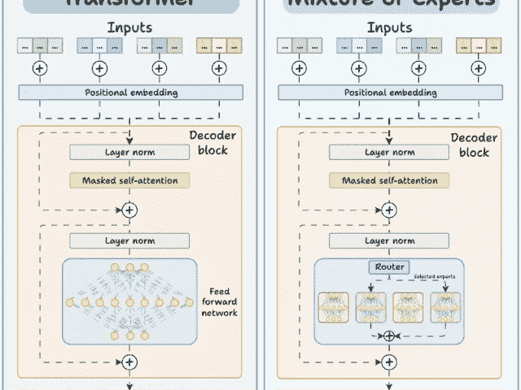
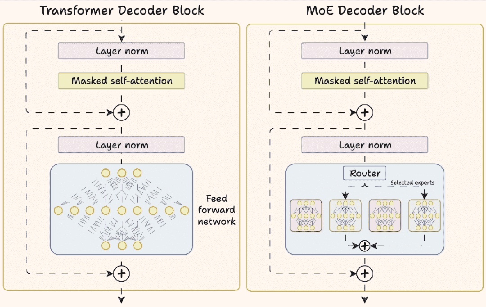
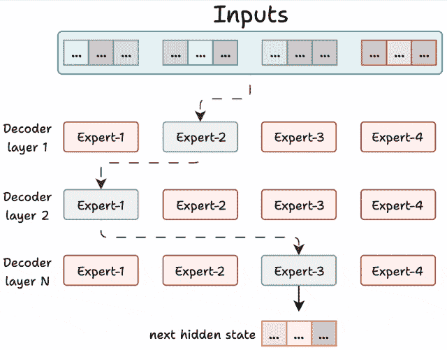
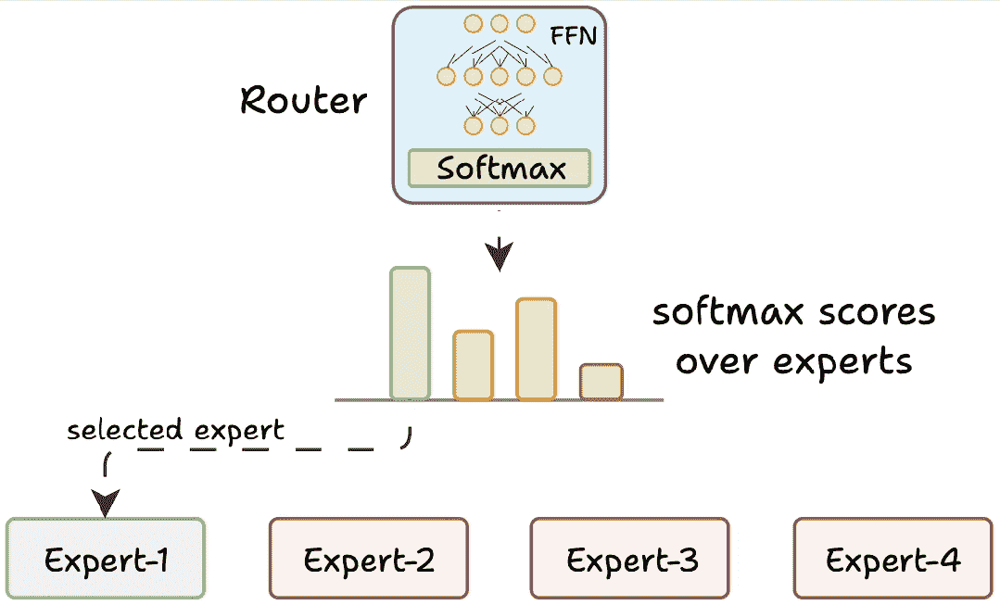
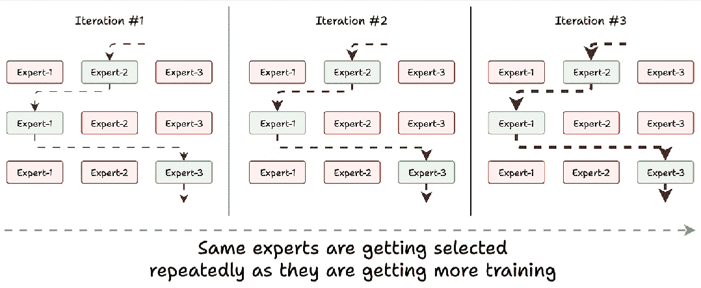
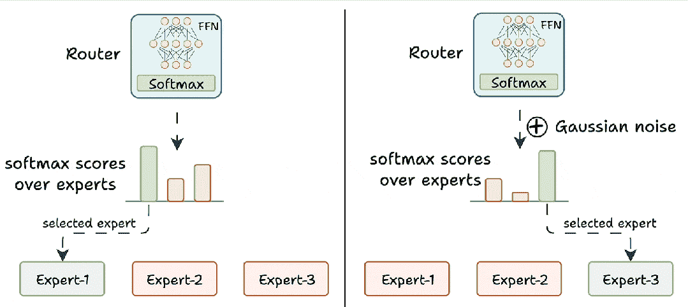

# Transformer与混合专家（MoE）：大型语言模型的架构对比

> 来源：[https://qqs7y1hozd1.feishu.cn/docx/GW6YdOqxIobz6LxDFWzcNAB4nMd](https://qqs7y1hozd1.feishu.cn/docx/GW6YdOqxIobz6LxDFWzcNAB4nMd)

> 在自然语言处理（**NLP**）领域，**Transformer模型**凭借其强大的性能成为主流架构。

> 然而，随着模型规模的不断扩大，**计算效率和推理速度成为新的瓶颈**。为了解决这些问题，混合专家（Mixture of Experts, MoE）架构应运而生。

> 它通过引入多个“专家”，在提升**Transformer模型**性能的同时，优化了推理效率。

> 本文将深入对比**Transformer**与**MoE**在大型语言模型中的异同，剖析MoE的工作原理、挑战及其优势。

## 一、Transformer与MoE的基本概念

#### 1.1 Transformer架构

**Transformer是一种基于自注意力机制的神经网络架**构，**广泛应用于机器**翻译、文本生成等任务。它由编码器和解码器组成，每个部分包含多个层。在每一层中，一个关键组件是前馈网络（Feed-Forward Network, FFN），它负责对输入数据进行非线性变换，增强模型的表达能力。

#### 1.2 混合专家（MoE）架构

混合专**家（MoE）是一种创新架构，****它在Tra**nsformer的基础上引入了多个“专家”来提升性能。在MoE模型中，传统的单一前馈网络被替换为多个并行的专家网络。这些专家网络同样是前馈网络，但相比Transformer中的FFN，它们的规模更小、更轻量。

**MoE的核心在于：****它并非让所有专家同时工作，而是通过一个路由**器（Router）为每个输入（例如文本中的token）动态选择一个或多个专家进行处理。这种机制显著提高了推理效率。

## 二、Transformer与MoE在解码器块上的区别

##### 2.1 Transformer的解码器块

在标准的Transformer模型中，每个解码器块包含以下组件：

+   自注意力层：捕捉输入序列中的依赖关系。

+   前馈网络（FFN）：对自注意力层的输出进行进一步处理。

这个FFN是一个全连接的神经网络，所有输入数据都会经过相同的计算路径。

##### 2.2 MoE的解码器块

MoE对解码器块进行了改造，主要区别在于：

**前馈网络被替换为多个专家网络：**这些专家是小型前馈网络，数量多但规模小。

**路由器的引入：**在推理过程中，路由器会为每个token选择一个专家子集（通常是前K个专家）进行处理。

**由于网络包含多个解码器层：**

+   文本在不同层中可能被分配给不同的专家。

+   同一层中，不同的token也可能被分配给不同的专家。

这种动态选择机制使得MoE在处理复杂任务时更加灵活，同时通过减少激活的参数量，提升了推理速度。

## 三、路由器的工作原理

路由器是MoE模型的“大脑”，负责决定每个token由哪些专家处理。其工作流程如下：

**生成分数：**路由器为每个专家生成一个未归一化的分数（logits）。

**softmax归一化：**将这些logits通过softmax函数转换为概率分布。

**选择专家：**根据概率分数，选择得分最高的前K个专家处理当前token。

路由器与整个网络一同训练，通过反向传播逐渐学会如何为不同的输入选择最佳专家。这种动态分配机制是MoE高效性的关键。

## 四、MoE面临的挑战与解决方案

尽管MoE架构设计巧妙，但在训练和实现过程中仍面临一些挑战。以下是两个主要问题及其解决方案：

##### 4.1 挑战1：专家训练不均衡

**在训练初期，所有专家的能力相似，路由器可**能会随机选择某个专家（例如“专家2”）。随着训练进行，这个专家会因频繁使用而变得更强，随后被更频繁地选中，形成恶性循环：

**“专家2”被选中 → 变得更好 → **再次被选中 → 变得更强 → 反复如此。

其他专家则因缺乏训练机会而表现不足。

**解决方案：**

1.  **添加噪声：**在路由器的输出logits中加入随机噪声，使其他专家有机会获得更高的分数，从而被选中。

1.  **屏蔽低分专家：**将除前K个logits外的所有logits设置为负无穷，经过softmax后这些专家的分数变为零，确保训练机会的公平分配。

##### 4.2 挑战2：专家负载不均衡

某些专家可能会比其他专家处理更多的token，导致训练资源分配不均，部分专家得不到充分优化。

**解决方案：**

限制专家容量：为每个专家设置一个处理token的上限。一旦某个专家达到限制，新的token将被分配给下一个得分最高的专家，从而保证所有专家都能参与训练。

## 五、MoE的优势

MoE架构在大型语言模型中展现出显著优势：

1.  更快的推理速度：**尽**管MoE模型加载的参数量比Transformer多，但在推理时只激活部分专家，计算量大幅减少，速度更快。

1.  更高的灵活性：通过动态选择专家，MoE能更好地适应不同的输入数据和任务。

1.  更大的模型容量：多个专家的引入提升了模型的表达能力，而不显著增加计算成本。

一个典型的例子是MistralAI的Mixtral 8x7B，它基于MoE架构，在保持高效推理的同时，展现了强大的语言生成能力。

## 六、总结

**Transformer**与混合专家（MoE）代表了大型语言模**型**发展的两个重要阶段。Transformer以其简洁高效的架构奠定了NLP的基础，而MoE通过引入专家机制，进一步突破了性能和效率的瓶颈。尽管MoE在训练中面临专家均衡性等挑战，但通过路由器优化和容量限制等解决方案，它已成为构建更强大语言模型的重要工具。未来，随着技术的不断进步，MoE有望在更多场景中大放异彩，推动NLP领域迈向新的高度。