# 万字长文讲透LLM核心：Transformer架构原理解析

> 来源：[https://qqs7y1hozd1.feishu.cn/docx/SuxUdOGwkodGqxxxDmUcvuc8n5c](https://qqs7y1hozd1.feishu.cn/docx/SuxUdOGwkodGqxxxDmUcvuc8n5c)

> 最近AI的发展实在是太快了，如图就是让Nano Banana Pro结合《Attention Is All You Need》给的架构图，让孙悟空讲解Transformer的原理，架构图完美还原，接下来还可以用来生成动漫视频，十分有趣。

> 近期B站上AI二创视频、AI让西游记角色唱歌的视频很火，也尝试做了简单复现，用银角大王唱个歌《奉命张狂》，还是感叹AI的强大。

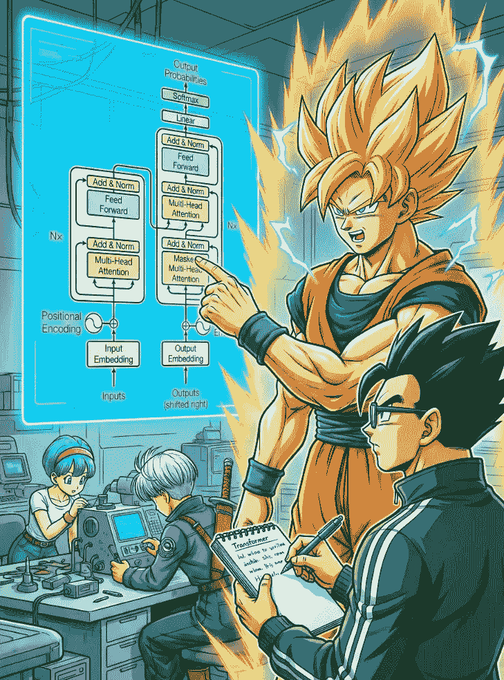

Nano Banana Pro的强大，特别是其出色的“思考”与“理解”能力，核心来源于它基于以Transformer架构为基础的大模型LLM。

**为**了更好地理解，本文会结合一个案例，看看Transformer如何把"Transformer is powerful."翻译成"Transformer很强大。"。

**机器是如何像人类一样**理解原文，并翻译成功，期间会遇到哪些挑战？

1.  机器只懂数字0和1，机器如何理解文字？请看分词章节。

1.  **机**器如拿到了数字坐标，但文字顺序会让句子含义天差地别，如“狗咬人”和“人咬狗”，机器如何理解文字顺序？请看位置编码章节。

1.  **机器知道了语序，但词与词之间的关联关系，如“powerful”是修饰前面**“Transformer”的？机器如何理解词与词之间的关系？请看注意力机制章节。

# **LLM 架构解析**

LLM重要论文《Attention Is All You Need》提出的Transformer架构，是当前深度学习模型的基础。其核心架构就是开头孙悟空讲解的架构图，核心思想就是注意力机制。

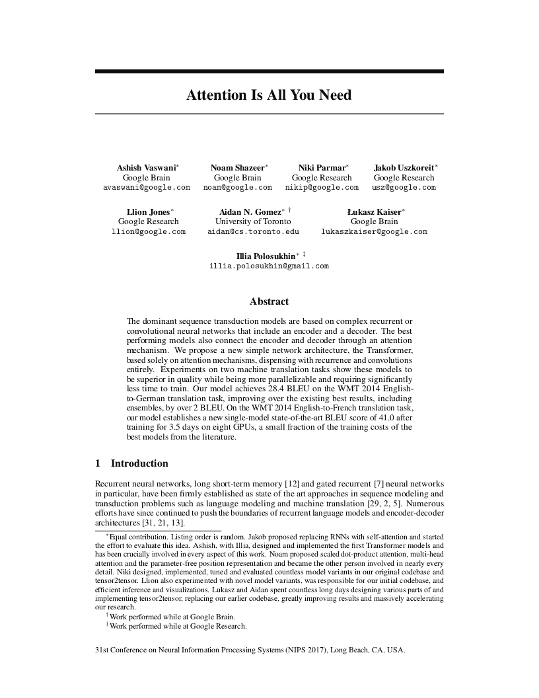

[attention is all you need Paper.pdf](https://internal-api-drive-stream.feishu.cn/space/api/box/stream/download/all/DkB9bAfDUow7yMxNbqLc4lu8nOb)

**Transformer架构的核心是Encoder-Decoder结构，编码器负责将输入**序列转换为上下文表示，解码器则基于编码器的输出和已生成的输出序列生成下一个输出。

当前主流的LLM架构是只有解码器的模型（Decoder-only Transformer）。

> 但是，模型太深，计算量太大，导致训练困难，所以层数通常是经验和实战的选择。

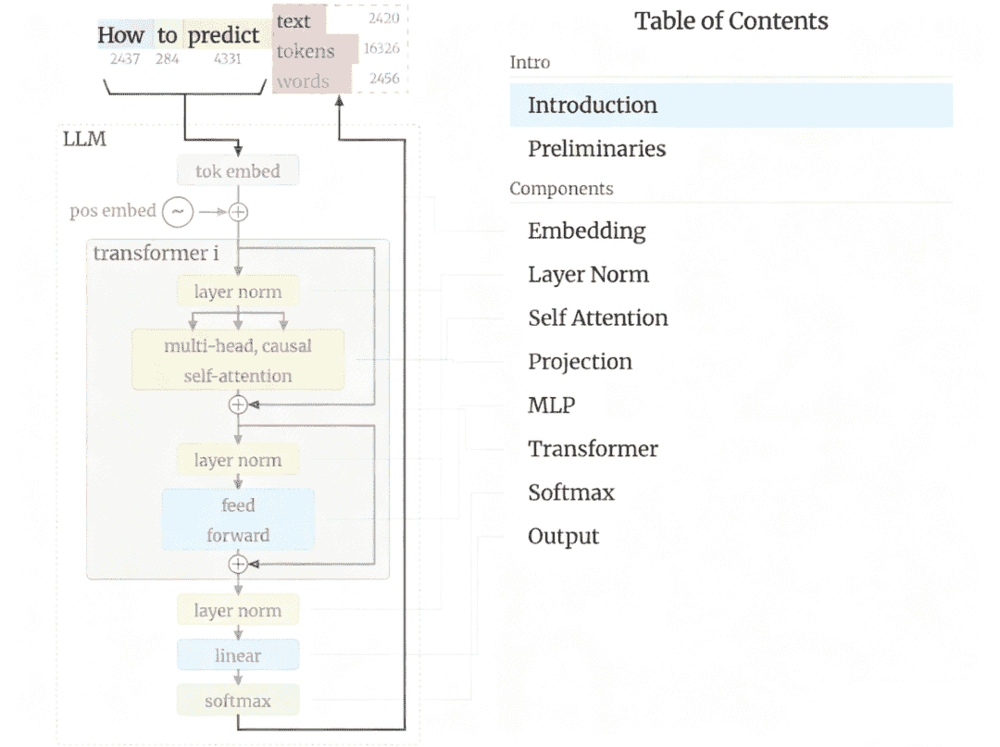

在确认LLM架构后，就可以开始构建模型了，构建模型时，需要做三件事以把大象装进冰箱：数据、模型、训练。

> 数据的处理包括：文本数据采集、文本数据预处理、文本数据嵌入。

> 模型包括：模型架构、模型参数。

> 训练包括：模型训练、模型评估、模型优化。

为了更好理解 Transformer，还要从另一个视角讲一下文本数据预处理和文本数据嵌入，有助于理解Transformer。

文本数据预处理包括：分词、词嵌入。

## **Token数据流示例**

举例把"Transformer is powerful."翻译成"Transformer很强大。"时，翻译到"Transformer很"时，解码器已经生成了序列。

> 此时解码器需要根据已生成序列和上下文向量，预测下一个中文词，即"强"，已知的Tokens "Transformer很"输入时，数据流是如则经过每一层的。

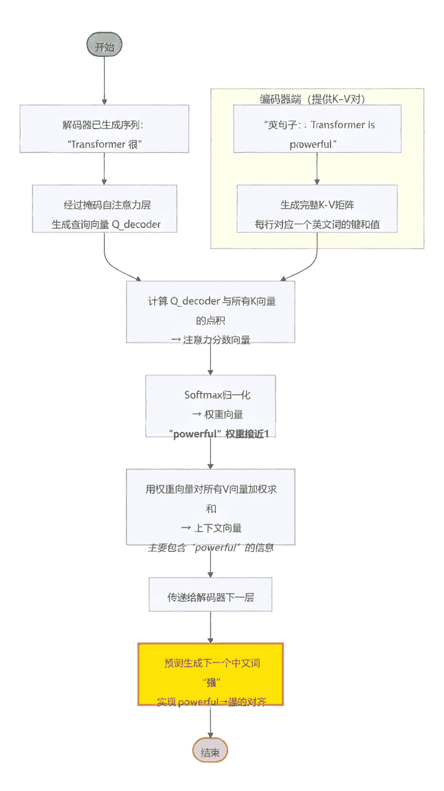

> **生成Q向量：**

> 此时，解码器已经生成了“Transformer 很”。这个已生成的部分序列经过解码器内部的掩码自注意力层处理后，会生成一个代表当前状态（即准备生成下一个词）的查询向量 Q_decoder。

> **提供K、V向量：**

> 编码器已经为英文句子“Transformer is powerful.”生成了一个完整的输出矩阵。这个矩阵中的每一行都是一个K-V对，分别代表了“Transformer”、“is”、“powerful”和“.”的键和值信息。

> **计算注意力权重：**

> 模型会计算 Q_decoder 与所有英文词的K向量的点积，得到一个注意力分数向量。经过Softmax归一化后，这个分数向量就变成了权重向量。我们期望在这个权重向量中，对应“powerful”的权重会非常高。

> **加权求和：**

> 最后，模型用这个权重向量对所有英文词的V向量进行加权求和，得到一个上下文向量。这个向量主要包含了来自“powerful”的信息，并被传递给解码器的下一层，用于最终预测出下一个中文词“强”。

通过这个过程，模型成功地将源语言中的“powerful”与目标语言中的“强”对齐了起来，实现了精准的翻译。

**这个过程把一层Transformer过了一遍。自此，Transformer的主流程已经讲**清楚，接下来，我们再来看看Transformer的细节，如果对Transformer的每个“零件”感兴趣，可以接着看本章内容。

## **分词（token）**

举个例子，比如“Transformer is powerful.”，分词后得到“Transformer”、“is”、“powerful”、“.”，其中“.”是句子结束符，表示句子结束，不参与预测。

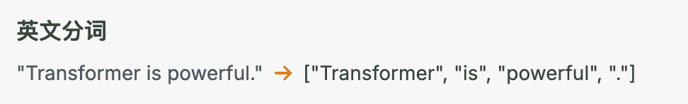

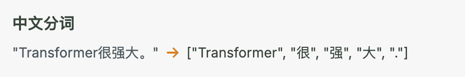

还想补充的是一种理解方式，可以认为分词就是为了得到一本字典的索引（目录），在transformer预测下一个词时，根据当前用户的输入以及已有的预测输出，去匹配字典中的词，找到最匹配的词，然后输出。

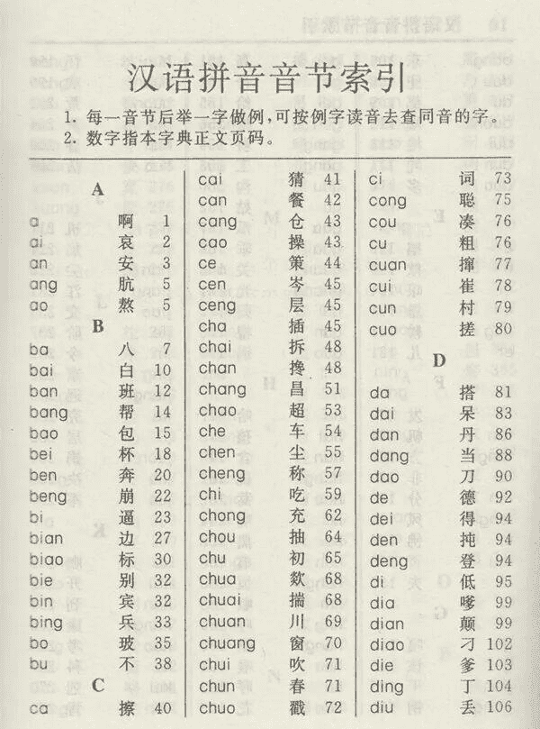

在分词之后，下一步是为所有可能出现的词元构建一个词汇表（Vocabulary）。词汇表是一个从词元到唯一整数ID的映射。

例如，可以为英文和中文分别构建词汇表：

**英文词汇表示例：**

**中文词汇表示例：**

## **嵌入（embedding）**

把我们的示例词嵌入向量 (维度=4)：

### **字典的类比**

分词是得到了一本字典的目录，想要知道下一个词是什么，就需要去字典里找与上下文最相关的那个词。

> 但如果只有字典目录，也就是只有字，没有词的释义，很难匹配出最相关的词，于是只能随机表达，让肌肉无规律抽搐。

> 所以我们需要给每个词一个 “释义”，这个释义就是词嵌入，也就是把词（token）转换为数学表示映射到高维空间中，这样就可以通过计算两个词的距离，来计算两个词的相关性。

中文字典的索引和字的解析如下图：

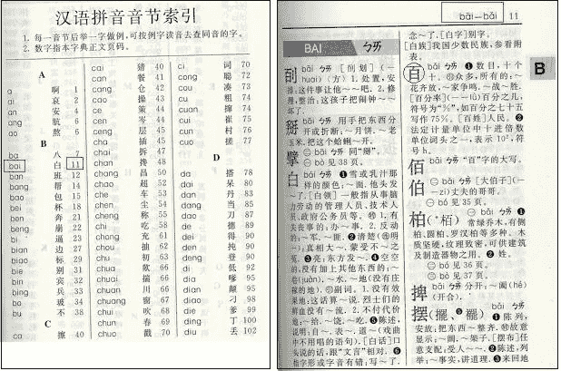

包括大语言模型在内的深度神经网络模型，没法直接处理我们平时看到的原始文本。

> 为什么呢？因为文本数据是 “离散” 的 —— 简单说就是一个字、一个词都是单独的个体，不像数字那样能直接算，所以没办法直接用它做神经网络训练时需要的数学运算。

这时候就需要一个办法：把单词变成一种 “连续值向量” 的格式，这样才能让模型用起来。

### **词嵌入的过程**

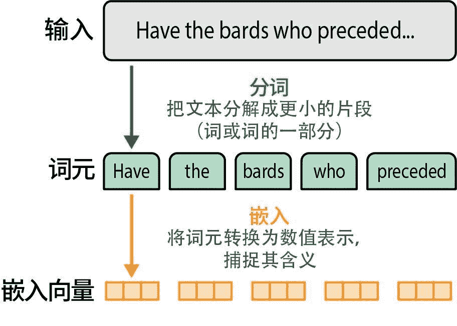

详细的过程以看下面的动图，是一个3个词元，48维度的词元嵌入过程：

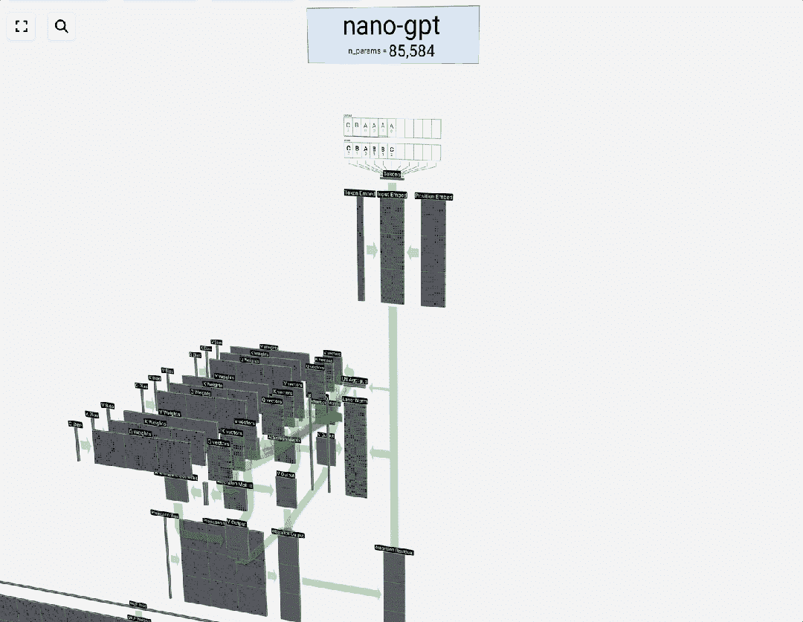

[3个词元，48维度的词元嵌入过程.gif](https://internal-api-drive-stream.feishu.cn/space/api/box/stream/download/all/GY9xb8F1ioGpKZxXS5mcdikjnfc)

这里维度占据存储空间取决于模型运行时使用的数值精度（数值数据类型）。在深度学习领域，最常见的数据类型是32位浮点数（FP32）和16位浮点数（FP16/BF16）。

> 不仅是文本，像视频、音频这些不同类型的数据，也能通过专门的神经网络层，或者借助另一个提前训练好的神经网络模型，转换成这种神经网可用的数据格式，这个过程就叫 “嵌入”。

**嵌入的分类：**

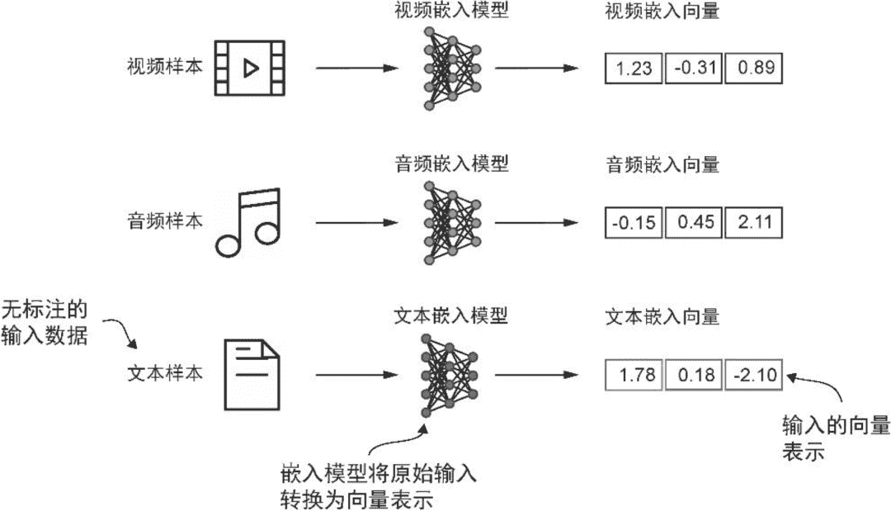

**说**到底，嵌入的本质其实很简单： 把那些离散的东西（比如单个单词、一张图片，甚至一整篇文档），对应到一个连续的向量空间里，变成一个个 “点”。 这么做的主要目的，就是把文字、图像这种非数值的数据，转成神经网络能读懂、能处理的格式。

另外，词嵌入中 “维度” 可以从 1 维到几千维不等。一般来说，维度越高，越能捕捉到数据里那些细微的关系 —— 比如单词之间更复杂的关联。维度越高我们的计算代价就更高，计算起来会更慢，效率会下降，所以还需要做出权衡。

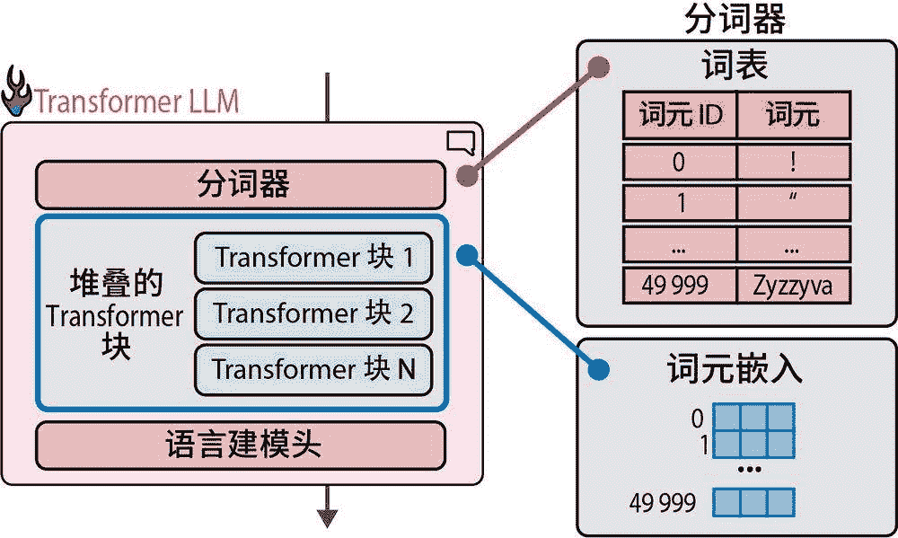

为更清晰直观理解词嵌入，这里举例tensorflow上Word2Vec词嵌入模型在200维度的情况对71291个词元的嵌入结果，再降维到3D，并可视化后的情况，可以直观的看到词元之间的空间情况。可以跳转网页上直观感受动画效果。

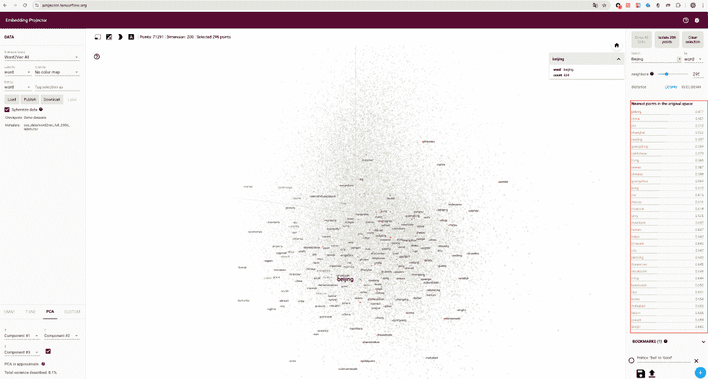

词嵌入外，在AI常见应用中，还有句子嵌入、段落嵌入、文档嵌入等，如RAG应用。

### 位置编码（Positional Encoding）

Transformer模型的一个核心特点是其并行计算能力，它不像循环神经网络（RNN）那样按顺序处理序列。

> 然而，这种并行性也带来了一个问题：模型本身无法感知词语在序列中的位置或顺序。

**为了解决这个问题，Transformer引入了位置编码（Pos**itional Encoding）机制。

以下为案例中的句子“Transformer is powerful.”添加位置编码。假设嵌入维度是4，可以使用简化的位置编码函数来生成每个位置的编码向量。

在这个例子中，每个位置的词元生成了一个独特的位置编码向量，并将其与词嵌入向量逐元素相加，输入嵌入=词元嵌入矩阵+位置编码矩阵。

位置编码的实现方式有很多种，大致分为两种：

+   绝对位置编码：直接与序列中的特定位置相关联。

+   相对位置编码：关注的是词元之间的相对位置或距离，而非它们的绝对位置。输入嵌入经过归一化后，可以传递到注意力层。

## **神经网络**

神经网络（Neural Network，NN）是受生物神经网络启发而建立的一种数学模型，它由大量的人工神经元相互连接构成。

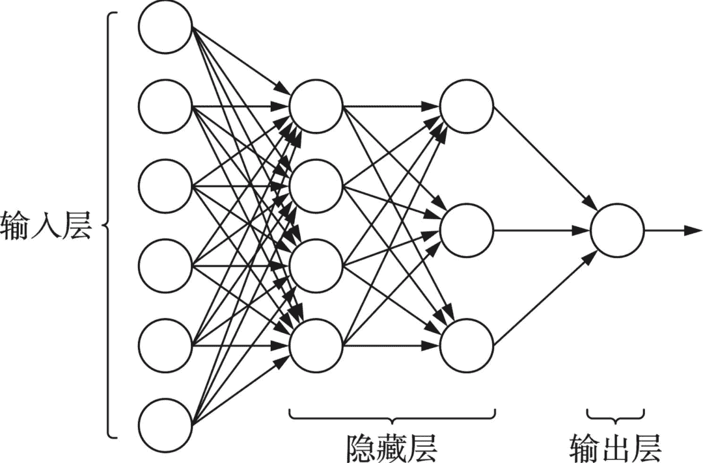

4层神经网络

1.  输入层 ——输入层由 n 个神经元组成，即 x1、x2、x3、……、x_n。

1.  隐藏层 ——第一个隐藏层由 n-1 个神经元组成，即 h21、h22、h23、……、h_n-1，第二个隐藏层由两个神经元组成，即 h31 和 h32。

1.  输出层 ——输出层有输出 O1，O2，……，On-2。

1.  并初始化一些随机权重 W1，W2，………，W_n。

1.  输入层由偏差 b1 组成。

**再来看一个复杂的神经网络：**

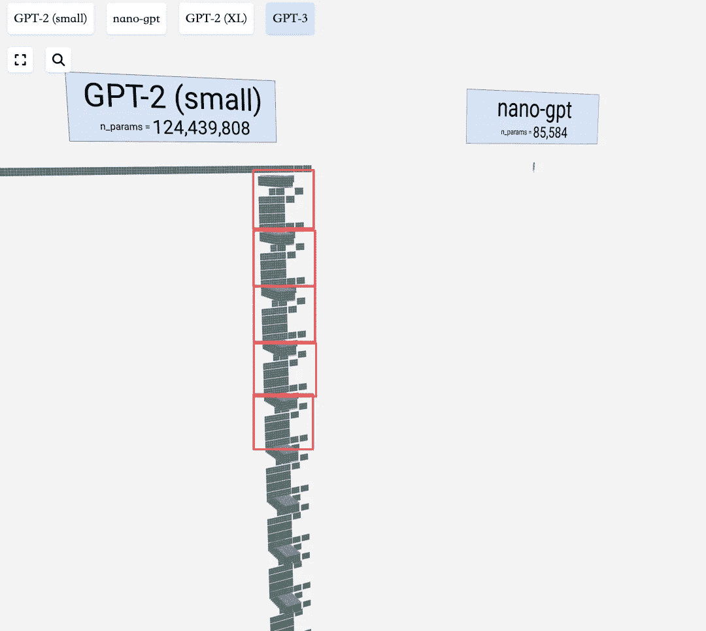

> 图中每一个红框都是一层神经网络，如davinci版本包含96层神经网络，DeepSeek R1的61层MoE + 前3层密集层Kimi K2的神经网络层数为61层，其中1层为密集层，其余60层为MoE层，最近发布的Kimi K2 thinking也是一样的层数设计。

## **注意力机制**

编码器（Encoder）是Transformer模型的核心组件之一，其主要任务是接收经过预处理的输入序列（即融合了位置信息的词嵌入向量），并将其转换为一个富含上下文信息的特征表示。这个特征表示捕捉了输入句子中所有词语之间的复杂关系，包括语法结构和语义依赖。

为什么需要注意力机制？解决的是在预测下一个词时，要理解上下文的关系，才能更好的预测下一个词，让模型表现更好。

这就需要使用注意力机制捕捉数据依赖关系，是现代深度学习模型中非常常见的做法。

注意力机制包括：自注意力机制、多头注意力机制、位置编码、注意力机制的变体等。

### **注意力机制**

**原理**

传统的注意力机制关注的是两个不同序列元素之间的关系。在自注意力机制中，“自”指的是该机制通过关联单个输入序列中的不同位置来计算注意力权重的能力。

核心思想：让每个词关注句子中的其他词。

它可以评估并学习输入各个部分之间的关系和依赖，如句子中的单词或图片中的像素。如下图中的"doc"就需要计算整个输入序列中各个元素之间的关系，从而计算出每个元素对应的权重 ，再以此计算出上下文向量 。

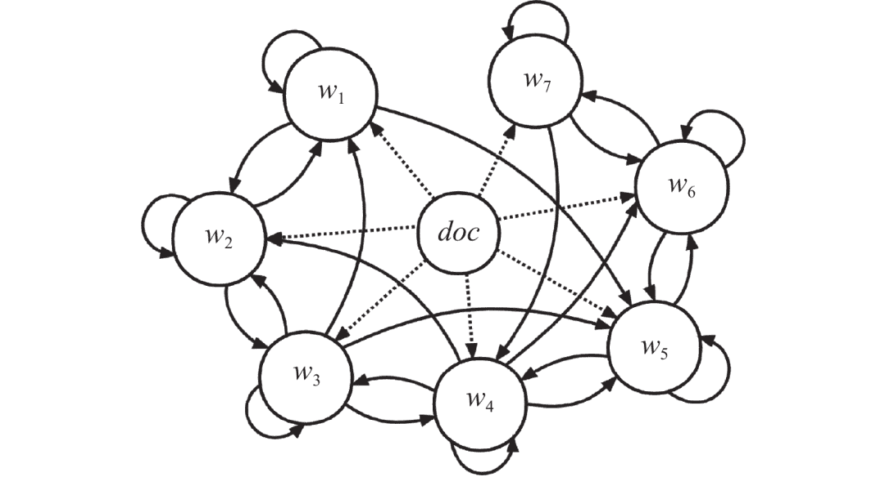

在自注意力机制中，我们的目标是为输入序列中的每个元素计算上下文向量。上下文向量(context vector)可以被理解为一种包含了序列中所有元素信息的嵌入向量。

+   一个输入序列，记为x，它由T个元素组成，分别表示为x((1))到x((t))。

+   嵌入化词元序列之间的注意力权重α= 注意力分数w的归一化

+   注意力分数w=词元x((n))与其他词元的点积而得；点积值越大则这两个词元相似度越高（即对齐度越高）

+   注意力分数归一化softmax后得到每一个词元的注意力权重α，即获得总和为1的注意力权重

+   最后上下文向量Z((n))=SUM(所有X((i))与其注意力权重α ✖️ 嵌入化词元本身的矩阵)，即注意力权重和词元嵌入矩阵相乘后，再求和。

+   位移词元下标i，循环以上步骤，将所有词元的注意力权重都计算出来。

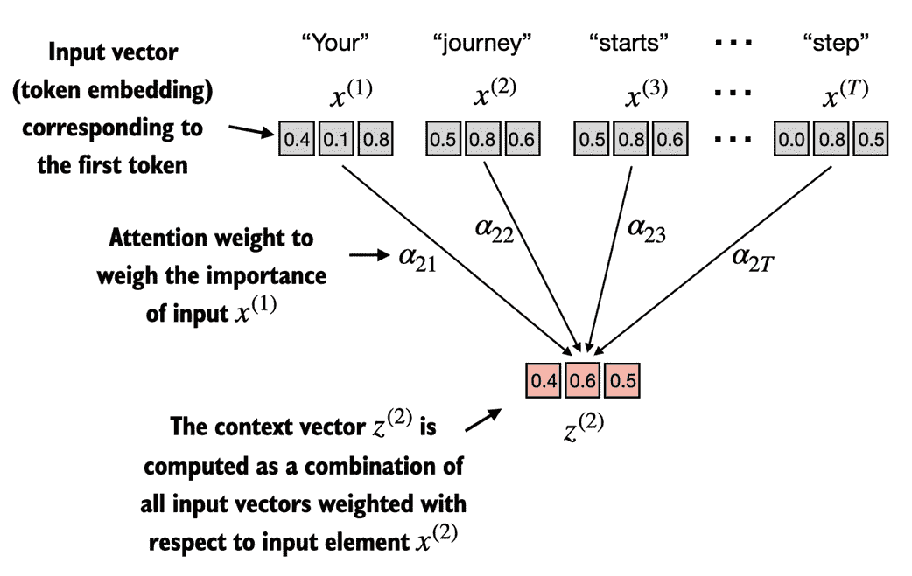

图中是列举i=2的此词元注意力上下文向量。

**从RNN的缺陷到自注意力机制**

与传统的 RNN 和 CNN 相比，Transformer 具有两大显著优势：

+   **长距离依赖问题解决：**

> 传统的 RNN 难以捕捉序列中相距较远词语的关系，而 Transformer 的自注意力机制可以直接建模任意位置之间的依赖关系，就是允许解码器访问编码器的所有隐藏状态。

+   **并行计算能力：**

> RNN 的时序依赖特性导致无法充分利用 GPU 并行能力，而 Transformer 的并行处理能力使其能够高效利用现代硬件资源。

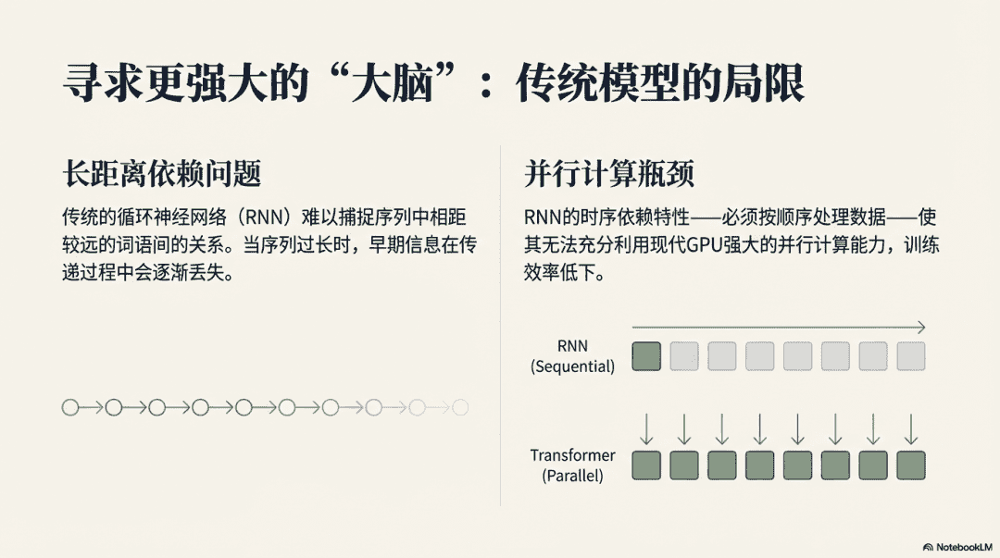

自注意力机制也叫做点积缩放点积注意力（scaled dot-product attention）。

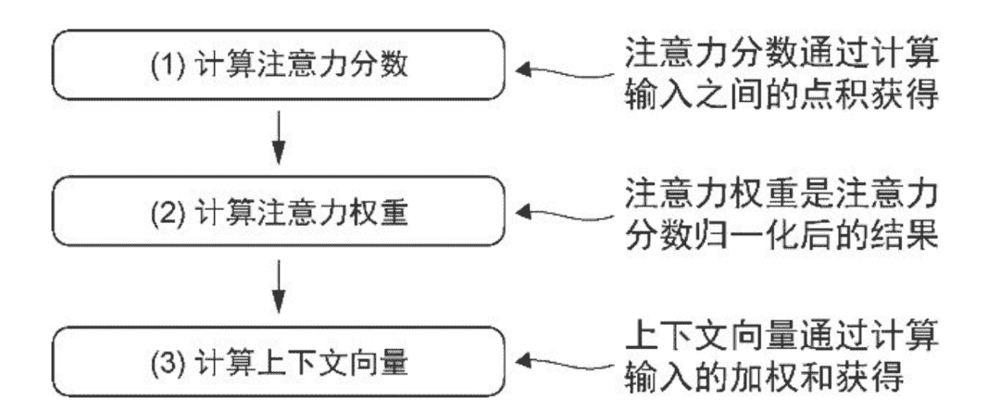

具有可训练权重的自注意力机制，引入了在模型训练期间会更新的权重矩阵（Wq、Wk、Wu），这三个矩阵用于将嵌入的输入词元x((i))投影为查询向量、键向量和值向量，使得模型（特别是模型内部的注意力模块）能够学习产生“良好”的上下文向量。

案例拆解：分析“powerful”如何关联到“Transformer”

回到案例“Transformer is powerful.”，并聚焦于单词“powerful”。在自注意力机制中，当模型处理“powerful”这个词时，它会生成一个查询向量Q_powerful。

> 同时，句子中的每个词（包括“Transformer”、“is”和“.”）都会生成自己的键向量K和值向量V。接下来，Q_powerful会与K_Transformer、K_is、K_dot进行点积运算，计算出“powerful”与句子中其他每个词的相关性得分。

由于“powerful”是用来描述“Transformer”的，我们可以预期Q_powerful与K_Transformer的点积结果会是一个较高的值。这个得分经过Softmax函数归一化后，会得到一个较高的注意力权重。

因此，“powerful”的最终表示将主要包含“Transformer”的信息，从而建立起“powerful”和“Transformer”之间的强关联。

**为什么是Q、K、V？**

在注意力机制的上下文中，K“键”、Q“查询”和V“值”这些术语是从信息检索和数据库领域借鉴来的，在这些领域中，类似的概念被用于存储、搜索和检索信息。

+   “查询”（query）类似于数据库中的搜索查询。它代表模型当前关注或试图理解的项目（例如，句子中的一个词或 Token）。查询用于探查输入序列的其他部分，以确定应该给予它们多少注意力。

+   “键”（key）类似于数据库中用于索引和搜索的键。在注意力机制中，输入序列中的每个项目（例如，句子中的每个词）都有一个关联的键。这些键用于与查询匹配。

+   “值”（value）在这个上下文中类似于数据库中键值对的值。它代表输入项目的实际内容或表示。一旦模型确定哪些键（哪些输入部分）与查询（当前关注项目）最相关，它就检索相应的值。

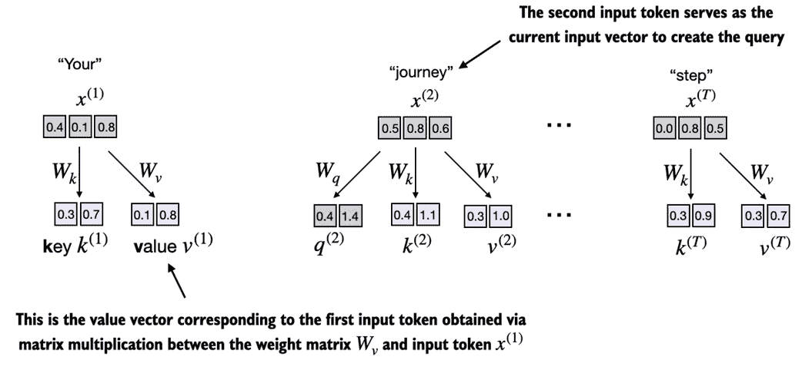

在计算得到注意力分数w((21))-w((2T))后，我们要进一步计算出注意力权重α((21))-α((2T))，再将注意力分数转换为注意力权重，通过缩放注意力分数并应用softmax函数来计算注意力权重。

最后，将每个词元的值向量u((1))-u((t))-分别与权重矩阵α((21))-α((2T))相乘再求，得到上下文向量z((2))。

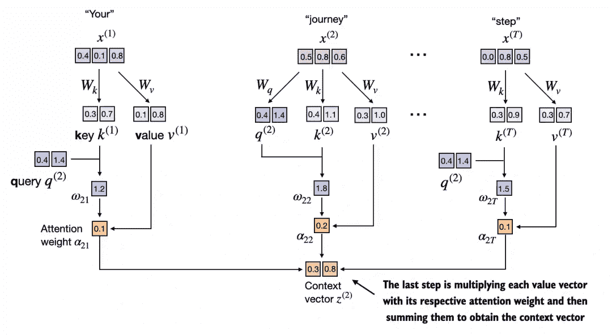

回顾整个计算过程，总结为一张图：

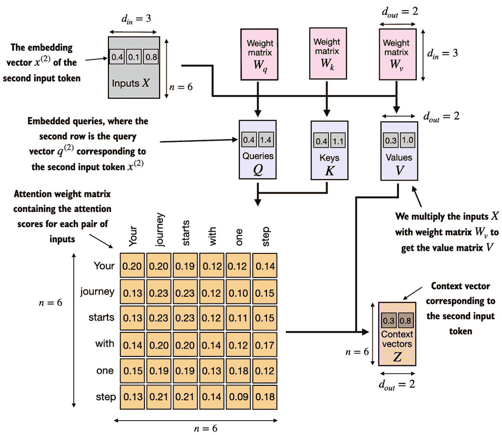

### **因果注意力机制**

因果注意力，也称为遮蔽注意力（masked attention），是自注意力的一种特殊形式。它限制模型在处理任何给定 Token 时，只考虑序列中之前和当前的输入。这与标准的自注意力机制形成对比，后者允许一次访问整个输入序列。

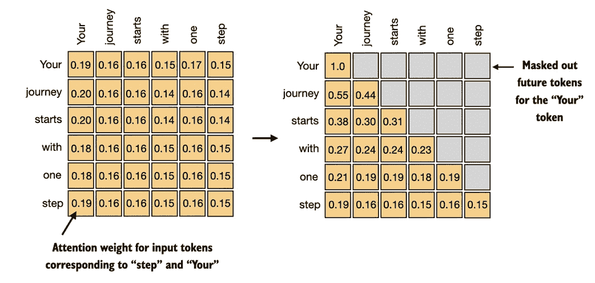

当然还存在利用dropout随机掩码的机制，来减少大语言模型中的过拟合问题。

### **多头注意力机制**

接下来将多头注意力机制引入到模型中，以获得更强的表示能力。

案例说明：一个头关注语法，另一个头关注语义

以“Transformer is powerful.”为例，来具体说明多头注意力是如何工作的。假设有两个注意力头（Head 1 和 Head 2）。

+   Head 1 (关注语法结构) : 这个头可能会学习到句子的语法结构。当它处理“is”这个词时，它可能会将大部分注意力权重分配给“Transformer”和“powerful”，因为它识别出这是一个“主语-系动词-表语”的结构。它的输出将主要编码这种语法关系。

+   Head 2 (关注语义关系) : 这个头可能更关注词汇之间的语义关系。它会发现“powerful”是描述“Transformer”的一个形容词，因此当处理“Transformer”时，它会特别关注“powerful”这个词。它的输出将主要编码这种语义上的修饰关系。

通过组合这两个头的输出，模型可以获得一个更丰富、更多维度的上下文表示，从而更全面地理解句子的结构和含义。

**以下是两个注意力头的例子：**

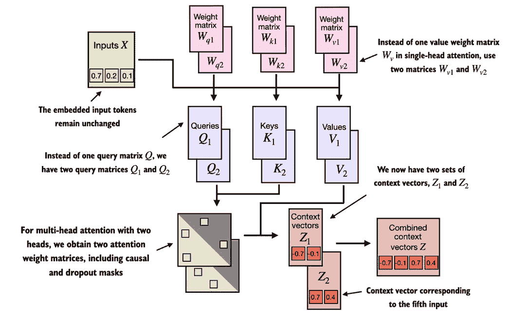

一个注意力头数为3，词元数量为3，嵌入维度为48的注意力计算过程：

1、注意力层是由N多个头组成的，举例GPT-2注意力头数是12，GPT-3注意力头数是96头，GPT-4、GPT-5尚未公开，DeepSeek R1也未公布，估计与GPT-3相当。我们为了方便，仅看其中一个注意力头，这里列出了列出注意力投的Q、K、V权重。

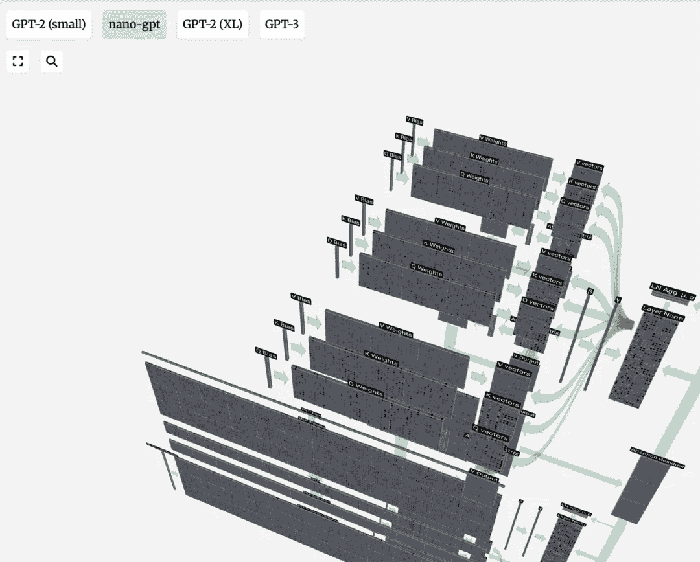

2、我们先只看其中一列的V向量计算过程；为了生成其中一个向量，我们执行矩阵向量乘法并添加偏差。每个输出单元都是输入向量的某种线性组合。例如，对于 Q 向量 ，这可以通过 Q 权重矩阵的一行与输入矩阵的列之间的点积来实现。

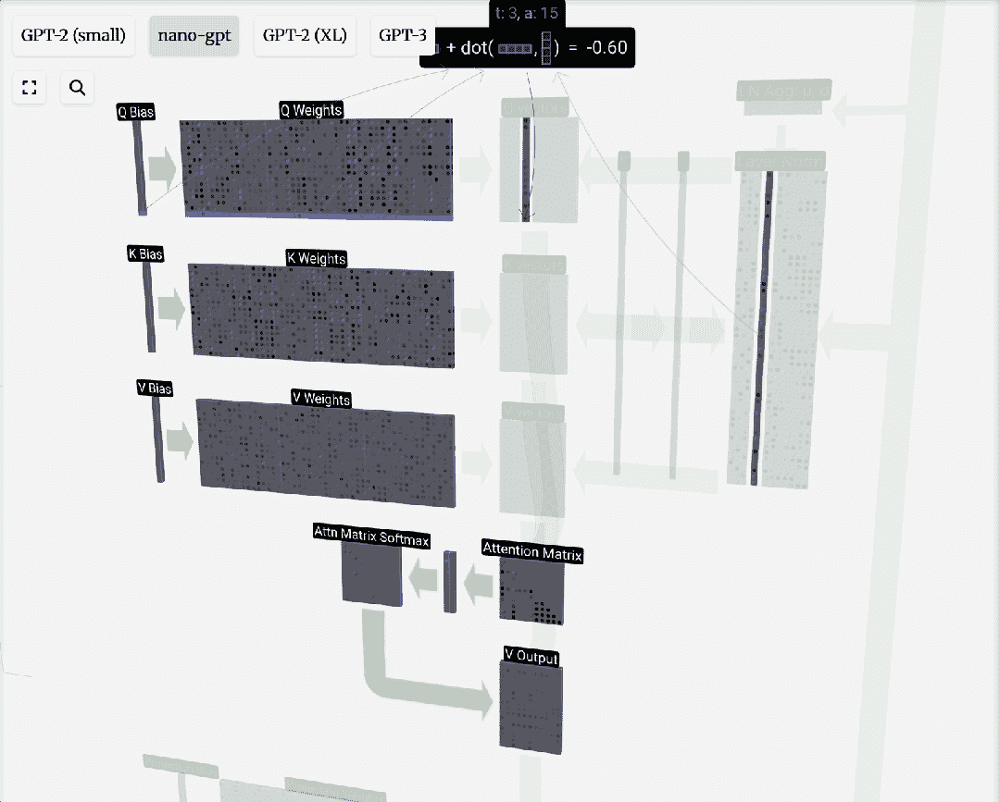

[V向量计算过程.gif](https://internal-api-drive-stream.feishu.cn/space/api/box/stream/download/all/OsvWbGF8co0rl4xQTTrcHx6tntg)

3、我们重复上一步，将Q、K、V与输入的点积度计算出来。

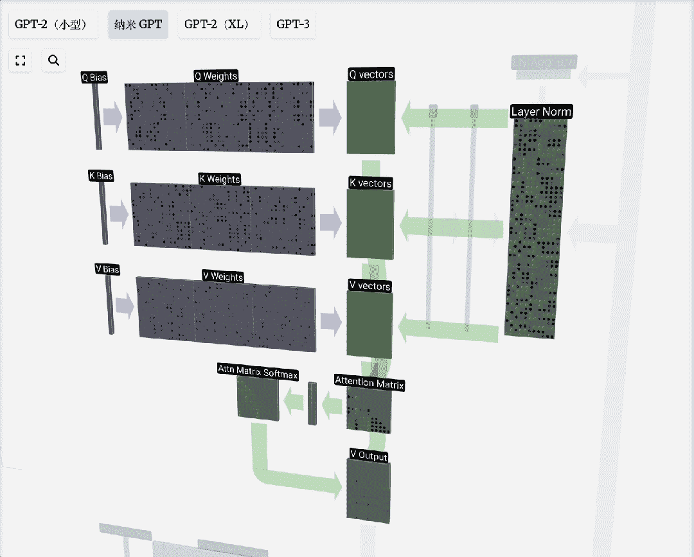

[Q、K、V与输入的点积度计算.gif](https://internal-api-drive-stream.feishu.cn/space/api/box/stream/download/all/Vab3b9HP5o8Sh2xnFJLcVSypnbd)

4、然后再将Q与K的向量求和，得到注意力权重矩阵，再将权重矩阵做softmax归一化，将归一化的注意力权重矩阵的每个元素与V向量矩阵对应的相乘，最终我们的到了这一列的V向量矩阵。

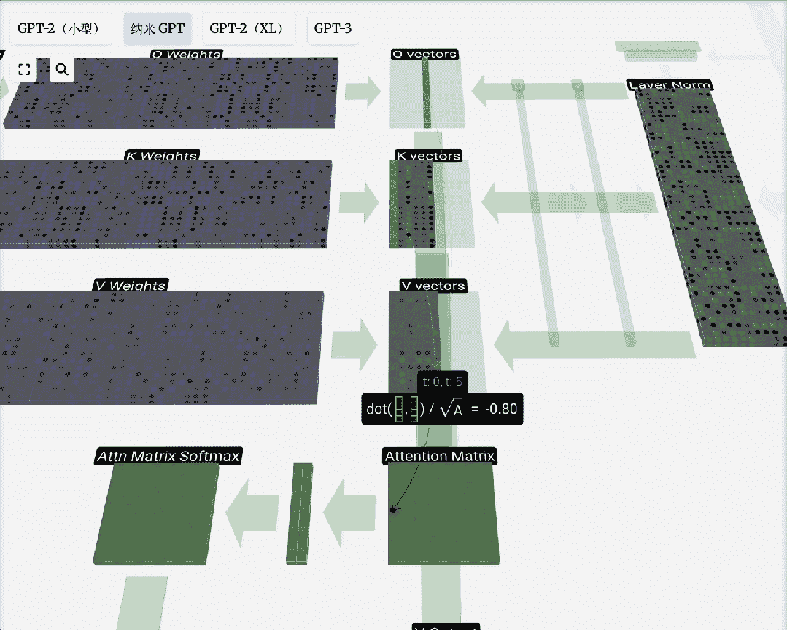

[Q与K的向量求和.gif](https://internal-api-drive-stream.feishu.cn/space/api/box/stream/download/all/CH7sbYTAmo3TGGxUNZ2ct375nVd)

5、接着我们将其他列的向量也计算出来，如此一来，我们将其中一个注意力头的注意力分数算出来了。

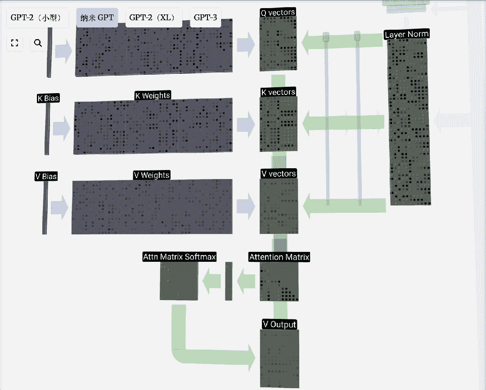

[注意力头的注意力分数.gif](https://internal-api-drive-stream.feishu.cn/space/api/box/stream/download/all/JIS1bCpDHogYvextdF2cFwefnQe)

6、我们要把每一个注意力头的注意力分数叠在一起，然后执行投影来获得该层的输出。这是一个简单的矩阵向量乘法，基于每列进行，并添加了一个偏差。现在我们得到了自注意力层的输出。我们不是将其直接传递到下一个阶段，而是将其逐个元素地添加到输入嵌入中。这个过程用绿色垂直箭头表示，称为残差连接或残差通路 。

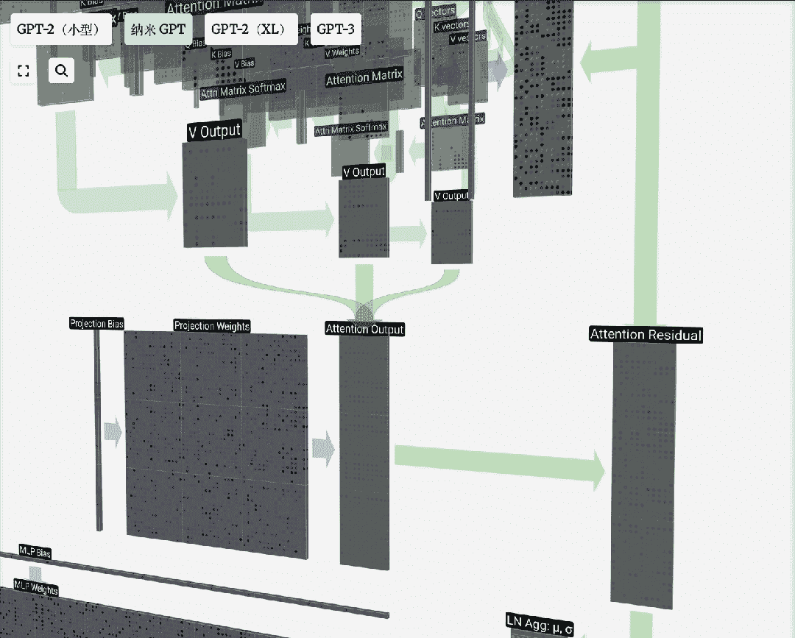

[矩阵向量乘法.gif](https://internal-api-drive-stream.feishu.cn/space/api/box/stream/download/all/LmjLbnoipoCFxzx8jm9c2fSsnaf)

往后还有一层MLP和归一化之后再输出本层输出。

## **FFN/MLP(多层感知机)**

举例一个两层神经网络的MLP，追踪其中一个向量的MLP计算过程：

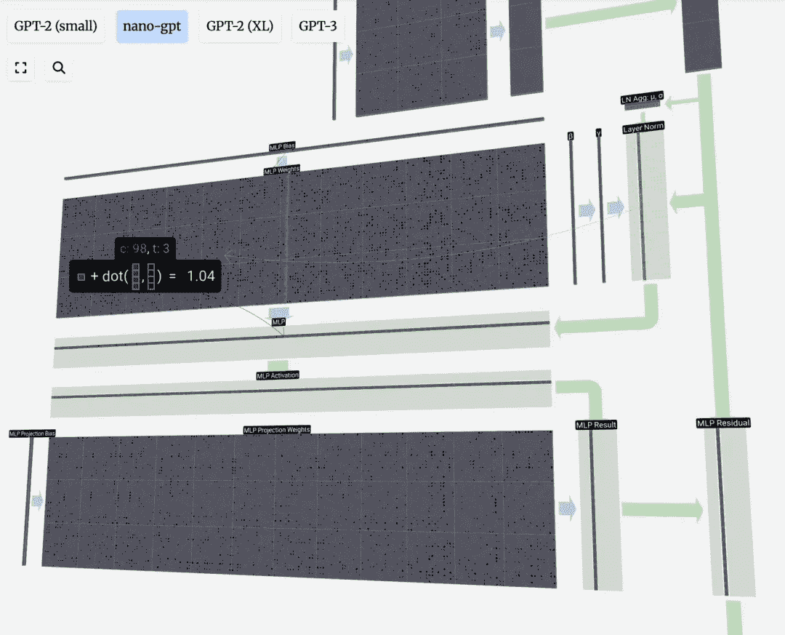

在 MLP 中，将每个 C = 48 长度的列向量（独立地）放入每个 MLP 层。然后，我们应用 GELU 激活函数，然后再次将向量投影回长度 C。GELU 是一个非线性激活函数，它将输入向量中的每个元素映射到 0 到 1 之间的值。这有助于模型学习更复杂的函数，而不仅仅是线性函数。

1、首先进行矩阵向量乘法，将向量扩展为长度 4 * C 的向量(动图中示例为92)，添加了偏差（MLP Bias）的线性变换 。

2、对向量中的每个元素应用 GELU 激活函数。这是所有神经网络的关键部分，通过它为模型引入一定的非线性特性。所使用的 GELU 函数看起来与 ReLU 函数（计算方式为 max(0, x)）非常相似，但它具有平滑的曲线而非尖锐的转角。

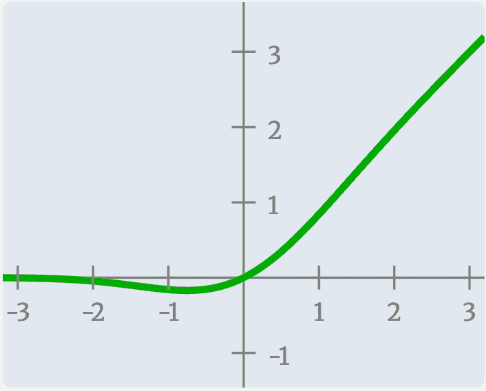

3、然后，通过另一个带偏置的矩阵向量乘法，将向量投影回长度为 C 的维度。与自注意力+投影部分类似，将多层感知器的计算结果逐元素地加到其输入上。

接下来，对输入中的所有列重复此过程，最终多层感知机部分已完成。于是，我们现已获得Transformer 其中一层的输出结果，该结果已准备就绪，可传递至下一层。

## **堆叠Transformer层**

> 正如深度学习中常见的情况一样，很难确切地说出每一层的具体功能，但有一些大致的思路：

>

> 较靠前的层往往专注于学习较低级别的特征和模式，而较靠后的层则学习识别和理解较高级别的抽象概念和关系。

>

> 在自然语言处理的语境中，较低层可能学习语法、句法和简单的词语联想，而较高层可能捕捉更复杂的语义关系、篇章结构以及依赖于上下文的含义。

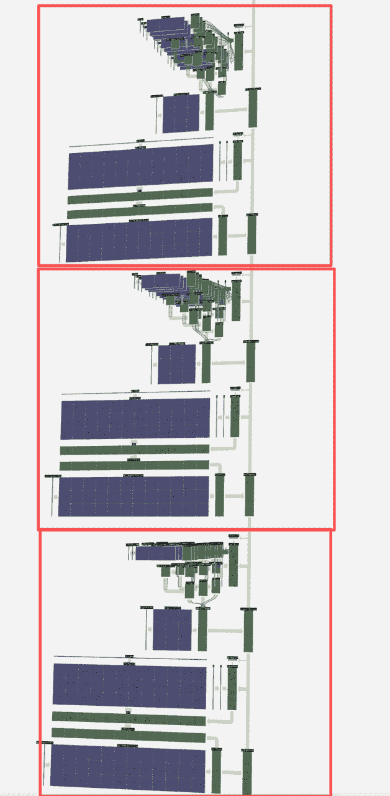

图中每一个红框是一层Transformer，每个Transformer包含N个头，以及一个前馈神经网络（FFN/MLP）子层。

## **案例讲解：逐步生成翻译**

现在，让我们完整地模拟解码器是如何一步步生成“Transformer很强大。”这个翻译结果的。这个过程是自回归的，每一步都依赖于前一步的输出。

第一步：生成“Transformer”

+   **输入：**<START> 标记。

+   **过程：**解码器接收到<START>标记，并结合编码器提供的关于整个英文句子的上下文信息。通过编码器-解码器注意力机制，模型发现当前最相关的信息是整个句子的主语“Transformer”。

+   **输出：**模型预测出第一个词是“Transformer”。

**第二步：生成“很”**

+   **输入：**<START> Transformer。

+   **过程：**解码器现在知道已经生成了“Transformer”。它通过掩码自注意力机制处理这个部分序列，并通过编码器-解码器注意力机制关注英文句子。此时，模型需要决定如何翻译系动词“is”。在中文里，“is”在这里被翻译为程度副词“很”，用来修饰后面的形容词。

+   **输出：**模型预测出下一个词是“很”。

**第三步：生成“强”**

+   **输入：**<START> Transformer 很。

+   **过程：**解码器处理已生成的部分，并通过编码器-解码器注意力机制，将注意力高度集中在英文单词“powerful”上。模型开始翻译“powerful”这个形容词，并首先生成其第一个字“强”。

+   **输出：**模型预测出下一个词是“强”。

**第四步：生成“大”**

+   **输入：**<START> Transformer 很 强。

+   **过程：**解码器继续处理，并再次关注“powerful”。它意识到“强大”是一个更完整的翻译，因此生成第二个字“大”来完成这个形容词。

+   **输出：**模型预测出下一个词是“大”。

**第五步：生成句号“。”**

+   **输入：**<START> Transformer 很 强 大。

+   **过程：**解码器注意到英文句子以句点“.”结束，并且根据已生成的完整中文句子，判断翻译已经完成。因此，它会生成一个对应的中文句号“。”。

+   **输出：**模型预测出下一个词是“。”。

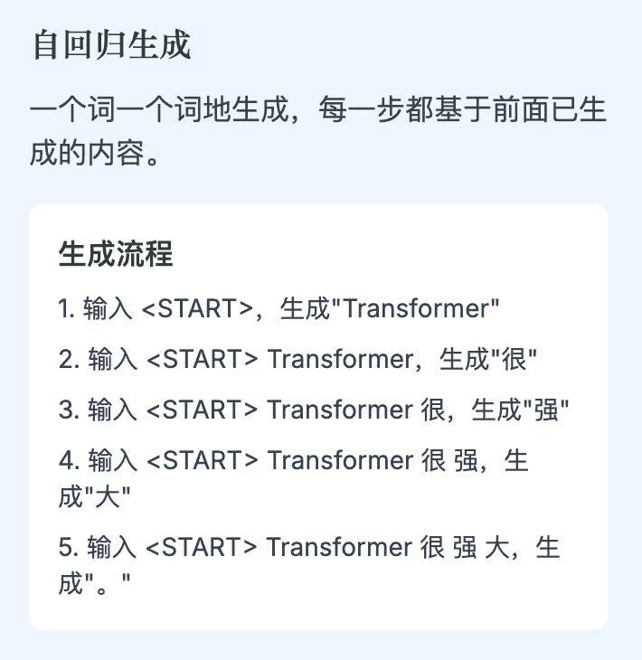

至此，整个翻译过程结束。

**可视化注意力权重**

下面是一个模拟的注意力热图，展示了英文源句“Transformer is powerful.”与中文目标句“Transformer很强大。”之间的对齐情况。

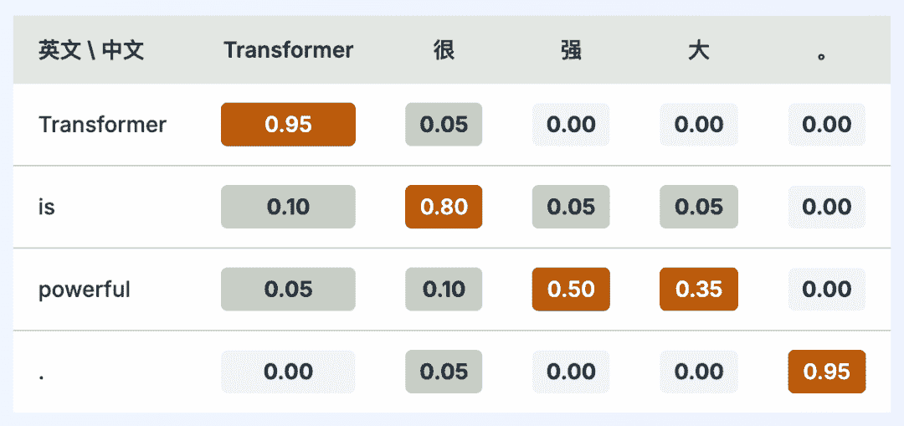

> 注：*颜色越深表示注意力权重越大，数值代表注意力权重的概率分布。

+   “Transformer”与“Transformer”的高权重连接

> 从上表可以看出，当解码器生成第一个中文词“Transformer”时，它对英文单词“Transformer”的注意力权重高达0.95（深色区域）。

> 这表明模型正确地识别出这是一个专有名词，应该被直接“复制”到目标句子中，而不是翻译成“变形金刚”。

> 这种高权重的连接清晰地展示了模型如何进行直接的词汇对应。

+   “powerful”与“强”、“大”的权重连接

> 在生成中文形容词“强大”时，模型的注意力主要集中在英文单词“powerful”上。

> 具体来说，生成“强”时，对“powerful”的权重是0.50，生成“大”时，对“powerful”的权重是0.35。

> 这表明模型将“powerful”的语义信息拆分并映射到了中文的两个字上。这种一个源语言词对应多个目标语言词的情况，在翻译中非常常见，注意力机制能够很好地处理这种复杂的对齐关系。

+   **“is”与“很”的权重连接**

> 英文中的系动词“is”在中文里被翻译为程度副词“很”。在注意力热图中，我们可以看到当生成“很”时，模型对“is”的注意力权重达到了0.80。

> 这揭示了模型超越了简单的字面翻译，而是理解了“is”在这里的语法功能，并找到了其在中文里最恰当的对应表达。

> 这种对语法和语义的深层理解，正是Transformer强大能力的体现。

在理解了transformer最核心的知识注意力机制、FFN 、多层感知机（MLP）、规范层(Layer Norm)、归一层（Softmax）。就可以开始构建大语言模型架构了，之后就是预训练、微调、部署模型了。

# **当前LLM架构**

## **主流LLM**

主流大模型版本迭代速度非常快，很多模型甚至都带来了独特的创新，能在特定领域达到SOTA。其中特别是开源的模型，给AI平权带来很大的力量。如下图所示：

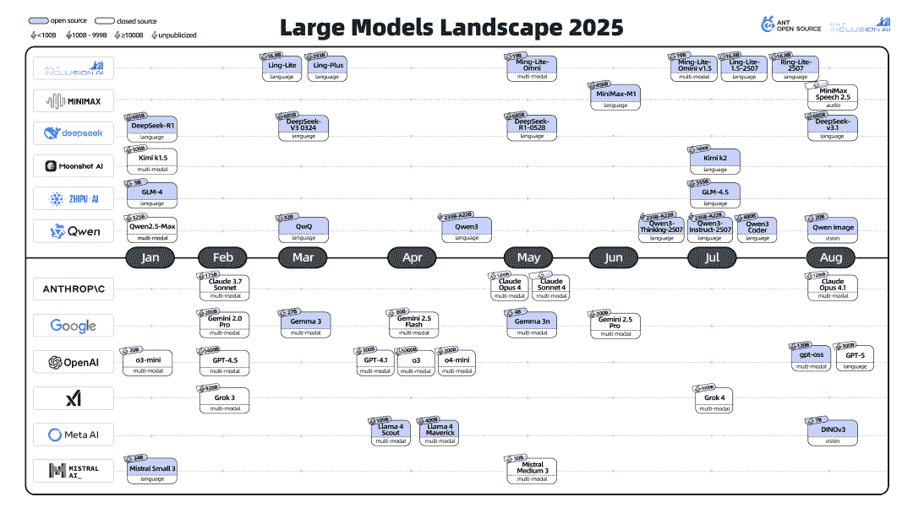

## **LLM架构变化**

一篇详细比对LLM架构的文章：

[Th](https://sebastianraschka.com/blog/2025/the-big-llm-architecture-comparison.html)e Big LLM Architecture Comparison From DeepSeek-V3 to Kimi K2: A Look At Modern LLM Architecture Design

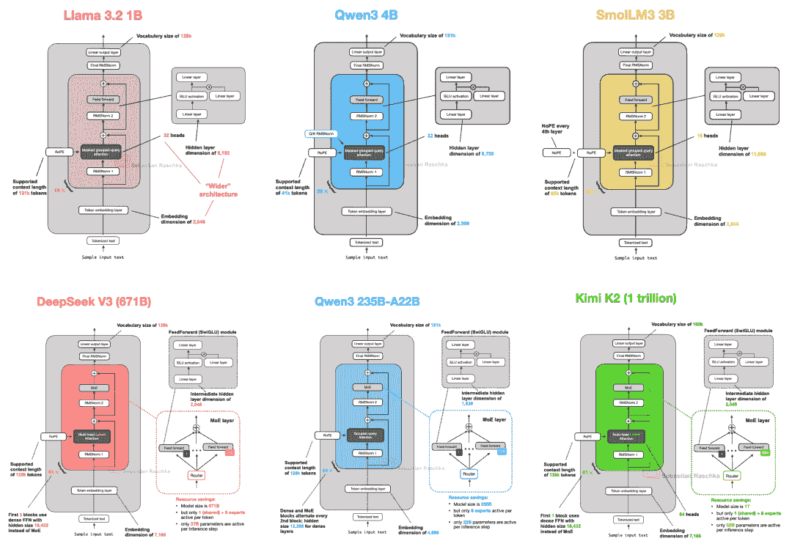

文中观点一些旗舰开源大语言模型（LLM）在架构上的发展变化。虽部分组件如位置编码、注意力机制、激活函数有改进，但整体架构基础变化不大。当前头部的LLM架构都是在Decoder-only Transformer上不断做优化，使得训练出来的模型表现越来越好。

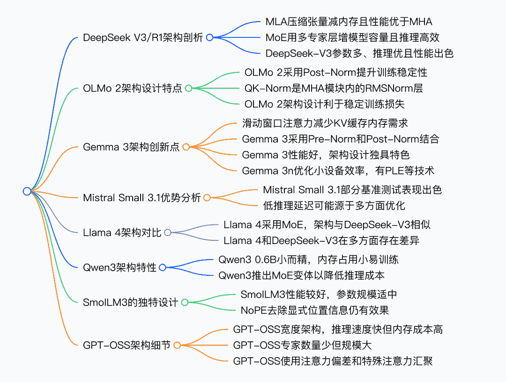

# **小结**

在理解AI应用的时候，可以思考模型本身为什么需要这种应用模式才能表现出这样的能力，从而更深入触及模型的原理，知其长短优劣，知其然知其所以然。

如下图，蚂蚁集团9月份发布的《大模型开源开发生态全景》报告可以看到，100天的时间，很多应用出局了，甚至很多基础设施项目也在不断更迭，大名鼎鼎的TensorFlow已经被抛弃了，而PyTorch却越来越受欢迎。

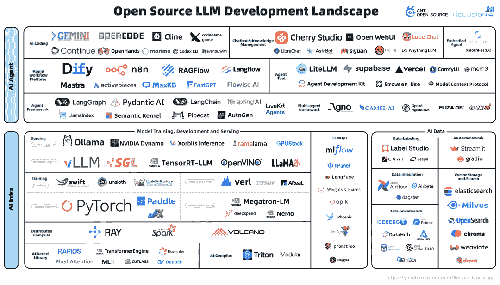

> 有很多观点认为某种应用形态是伪需求，是过度设计，这是基于当前模型能力而言的。如最近在提的Context Engineering，许多人就提出RAG很快就会消亡的观点。

万变不离其宗，模型能力是根本，应用形态是是上层建筑。 在模型能力不足的情况下，应用形态会不断演变，以弥补模型能力的不足。在模型能力足够的情况下，应用形态会逐渐消亡。

于是，既要关注模型能力的提升，也要关注应用形态的演变。只有两者结合，才能让模型发挥出最大的价值。