# MiniMax M2.7：核心亮点解析 + 真实Agent实战测试

> 来源：[https://qqs7y1hozd1.feishu.cn/docx/PQntdTQNtoWqv3xCu61cjexenZM](https://qqs7y1hozd1.feishu.cn/docx/PQntdTQNtoWqv3xCu61cjexenZM)

就在最近，距离上一次发布 MiniMax M2.5 仅过去一个月，MiniMax 再次迎来重磅更新！

MiniMax M2.7 是 MiniM**ax 最新**发布的旗舰大模型版本，它提出了“**模型自我进化（Self‑Evolutio**n）”的全新范式。与以往版本相比，它首次实现了 深度参与自身训练与优化过程的能力，标志着 AI 模型从“被动工具”向“具备自我进化能力的智能系统”迈出了关键一步。


## 一、核心技术亮点解析-**模型自我进化机制**

> M2.7 最重要也是最创新的特点是——它能参与自身的训练/优化流程，而不是单纯依靠工程师去改代码和调参

###  1、什么叫“模型自我进化”？

**对比人类传统的大模型训练****流程，M2.7 直接参与到了** 对自身的训练与提升循环中。这让它不仅是“工具”，更像是一个 自己会学习的“智能体”级系统。

### 2、“自我进化”的执行循环直观模型

**可以把 M2.**7 的自我进化想象成一个 持续反馈循环，每一轮循环都会让模型逐步逼近更优结果：

```
执行任务 → 评估结果 → 分析失败点 → 生成反馈 → 更新策略 → 再次执行 → 重复
```

**在官方提供的例子中，M2**.7 实际运行过 超过 100 轮这种循环：

模型不**断分析失败轨迹、制**定修改策略、执行评测，然后决定是保留更改还是回退，从而实现了最终约 30% 的性能提升。

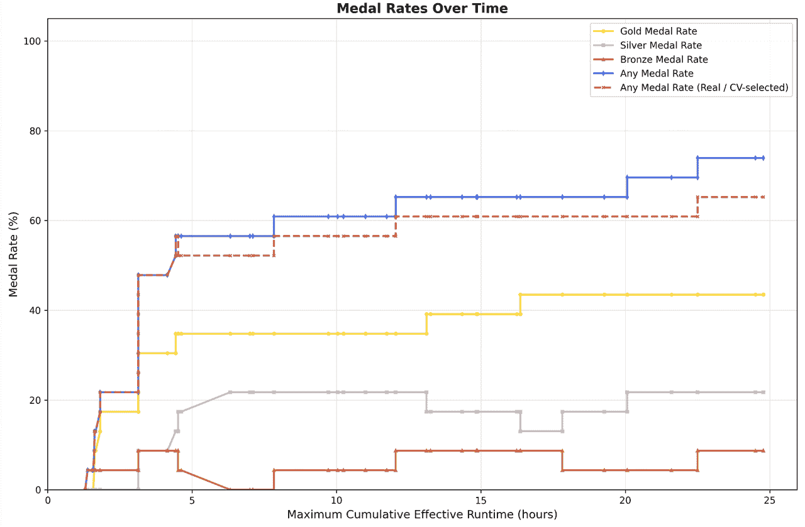

## 二、MiniMax M2.7 真实性能评分

从官方公布的多项测试来看，MiniMax** M2.7 在本**次更新中的最大亮点依旧是代码能力显著提升。

在衡量编程实力的 **SWE Bench Pro** 测试中，M2.7 取得 **56.2 分**，几乎与 Opus 4.6 的 57.3 分 和 GPT-5.4 的 57.7 分 持平，可见其在真实开发任务中的竞争力。

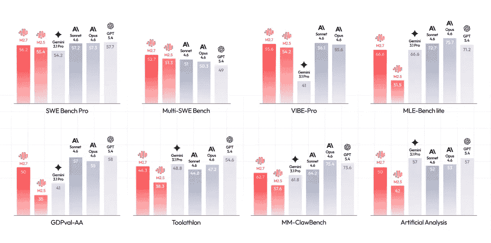

更值得注意的是，在 **Multi-SWE Bench****（更贴近真实**开发场景的综合测试）中，M2.7 得分 52.7 分，不仅超过 MiniMax M2.5 的 51.3 分，还反超 Sonnet 4.6、Opus 4.6，甚至 GPT-5.4，直接跃升至该测试排行榜前列。

> 针对最近热门的 **OpenClaw**** 应用场景，M**i**niMax** 基于其中常用任务构建了评测集 MM-Claw，覆盖个人学习规划、办公文档处理、定时信息调研与投资建议、代码开发与维护等工作与生活场景。在该测试中，M2.7 的正确率达到 62.7%，接近 Sonnet 4.6 的水平，显示了模型在实际多任务处理中的可用性与稳定性。

> 当然，M2.7 在部分项目（如 GDPval-AA、Toolathlon）上仍略低于 GPT-5.4、Opus 4.6，但考虑到 仅用一个月时间迭代完成的性能提升，其增长速度已经相当惊人。

> 附表：MiniMax M2.7 的各个 Benchmark 测评内容：

## 三、快速使用 MiniMax M2.7

最简单的方法，就是去 MiniMax Agent 的官网，目前已经全部放量，所有用户都可以免费用上最新的 MiniMax M2.7 模型。


### **1、输入任务**

在输入框输入你的任务指令，例如：

+   **办公类**：制作 Excel 表格、Word 文档、PPT 汇报

+   **金融类**：分析报表、生成投资简报

+   **编程类**：代码生成、调试、任务自动化

点击提交，MiniMax M2.7 会立即开始处理任务，并根据任务类型自动调用内部 Agent 或专家套件。

### **2、使用专家套件**

页面下方提供分类 **专家套组**：

+   **办公**：Word / Excel / PPT / PDF 等日常文档处理

+   **金融**：数据分析、报表生成

+   **编程**：代码生成、调试、自动化

可以直接点击套组图标，快速启动任务模板，降低学习成本。

## 四、在 Claude Code 使用 MiniMax M2.7

### 1、订阅套餐

如果你是有 Coding Plan 的专业用户，那可以马上切换到 M2.7 模型，如果没有的话，可以买一个，最便宜的一个月才 29 元。

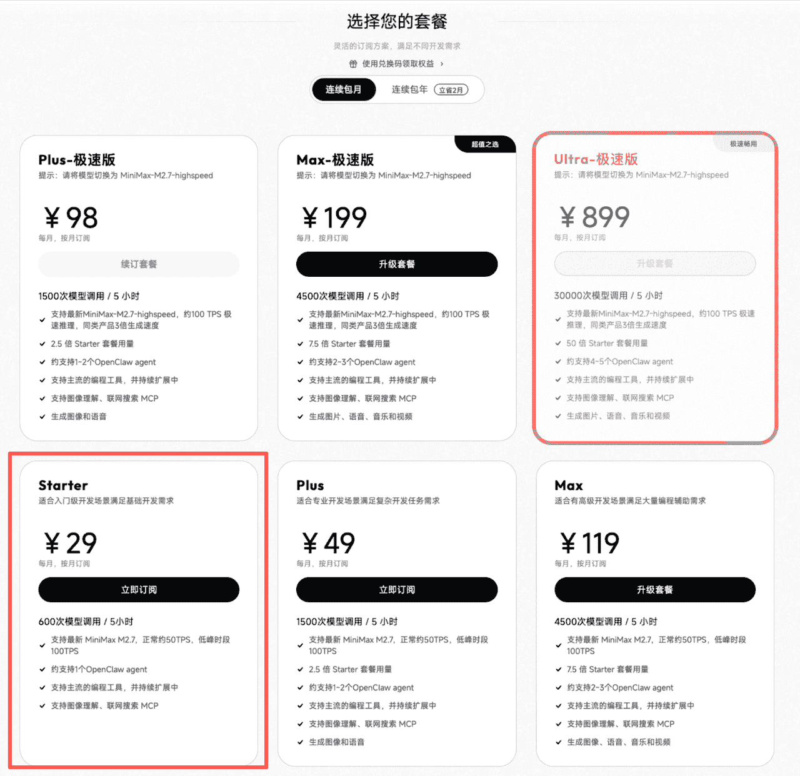

### 2、获取 **API Key**

访问 接口密钥 > 创建 Token Plan Key

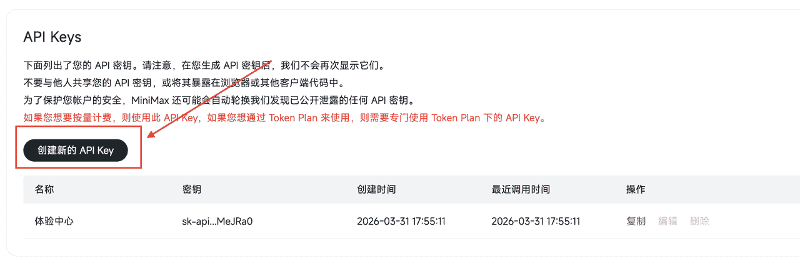

### 3、测试 API 调用（可选）

**通过 Anthropic** API 兼容，快速测试 MiniMax M2.7

1.  安装 Anthropic SDK

```
pip install anthropic
```

1.  **配置环境变量**

```
export ANTHROPIC_BASE_URL=https://api.minimaxi.com/anthropic
export ANTHROPIC_API_KEY=${YOUR_API_KEY}​
```

1.  **调用 API**

```
import anthropic

client = anthropic.Anthropic()

message = client.messages.create(
    model=&quot;MiniMax-M2.7&quot;,
    max_tokens=1000,
    system=&quot;You are a helpful assistant.&quot;,
    messages=[
        {
            &quot;role&quot;: &quot;user&quot;,
            &quot;content&quot;: [
                {
                    &quot;type&quot;: &quot;text&quot;,
                    &quot;text&quot;: &quot;Hi, how are you?&quot;
                }
            ]
        }
    ]
)

for block in message.content:
    if block.type == &quot;thinking&quot;:
        print(f&quot;Thinking:\n{block.thinking}\n&quot;)
    elif block.type == &quot;text&quot;:
        print(f&quot;Text:\n{block.text}\n&quot;)
​
```

### 4、接入 Claude Code

在 Claude Code 中使用 MiniMax-M2.7 模型进行 AI 编程。

1.  安装 Claude Code

输入以下命令：

```
curl -fsSL https://claude.ai/install.sh | bash
```

1.  配置 MiniMax API

[为了方便切换模型，](https://zhida.zhihu.com/search?content_id=271679601&content_type=Article&match_order=1&q=CC-Switch&zhida_source=entity)最好再安装一个 CC-Switch。

```
brew tap farion1231/ccswitch
brew install --cask cc-switch
brew upgrade --cask cc-switch
```

1.  添加 MiniMax 配置

在 CC-Switch 里面，点击右上角 ”+” ，选择预设的 MiniMax 供应商，并填写 MiniMax API Key。

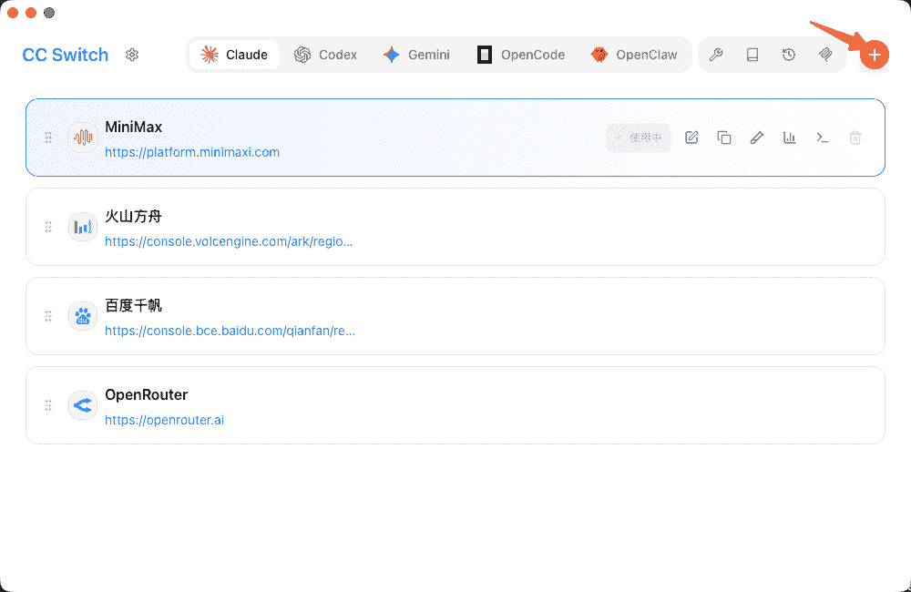

1.  配置模型名称

将模型名称全部改为 MiniMax-M2.7，完成后点击右下角的 “添加”。


1.  测试使用

一切配置就绪，在命令行输入 Claude 打开 Claude Code，问它背后用的是什么模型，就发现已经用上了 MiniMax-M2.7。

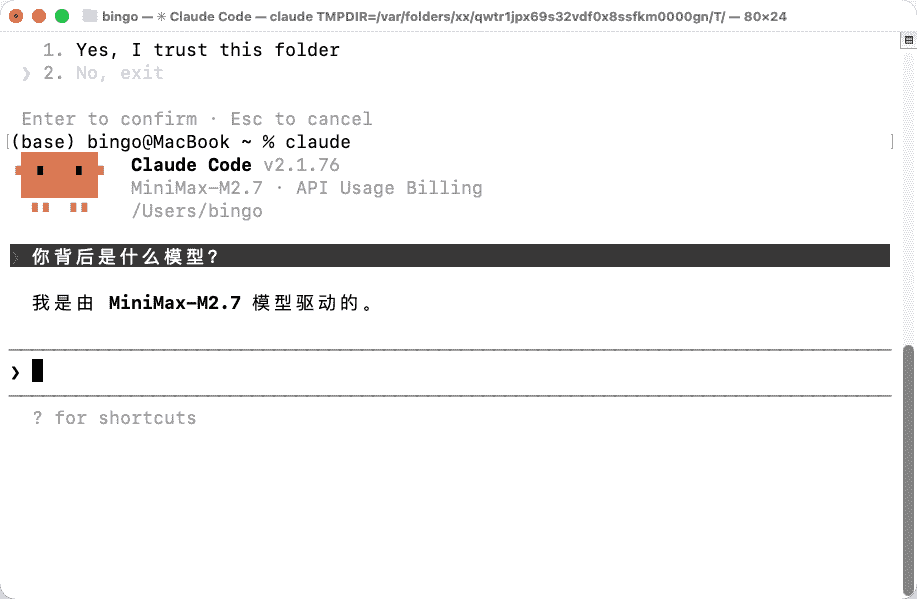

## 五、真实案例测试

### 1、办公任务：出报告、图表和PPT

办公任务，直接用MiniMax Agent网页端进行测试。复刻MiniMax官方案例，任务是：

```
提示词：基于快手2025年财报信息，构建快手的营收模型，读取多个研报，设计对应的假设，基于最新的信息对快手营收建模，然后选择合适的 PPT 模版产出 PPT ，并写一个 Word 文档研究报告和 Excel 图表。
```

+   关于财务分析模型，生成的内容是非常全面的，包括财务数据概览、营收模型预测、甚至可灵AI业务分析，需要的部分都提到了，而且图表布局非常合理，几乎无需人工调整，已经是一个初级分析师的水平了，而且在具体的数据方面也没有差错，极大得减少了人工审查成本。

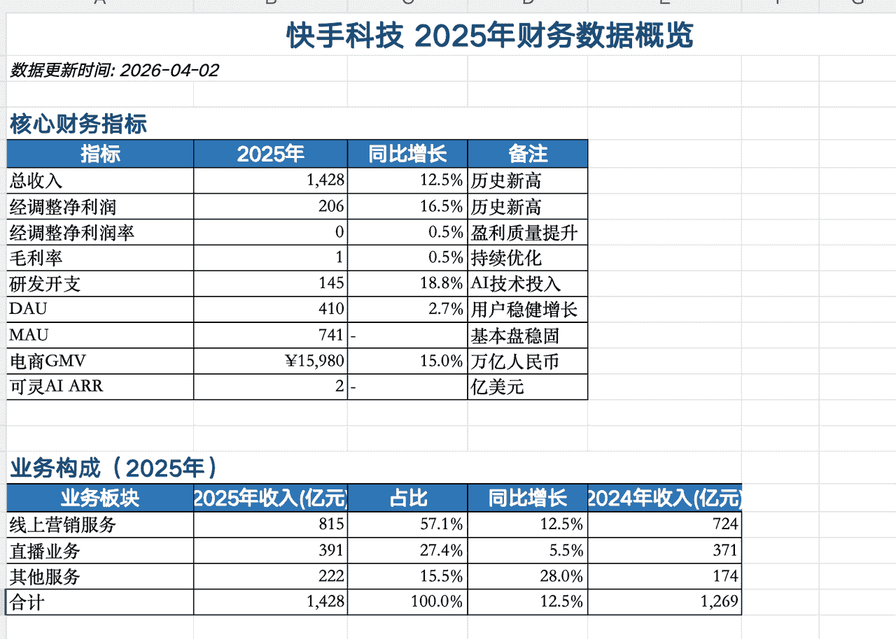

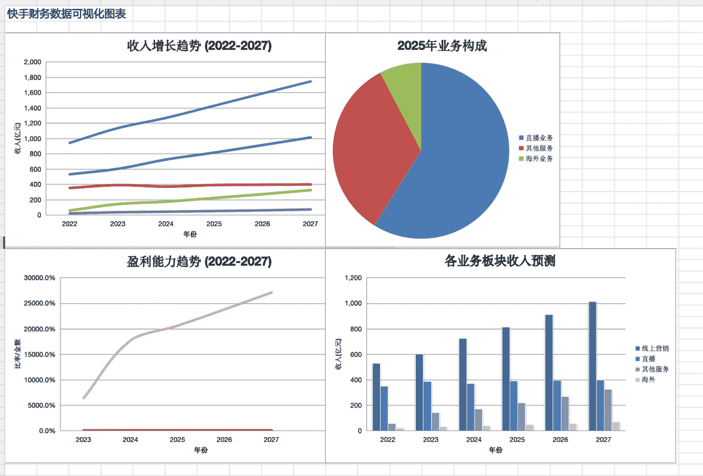

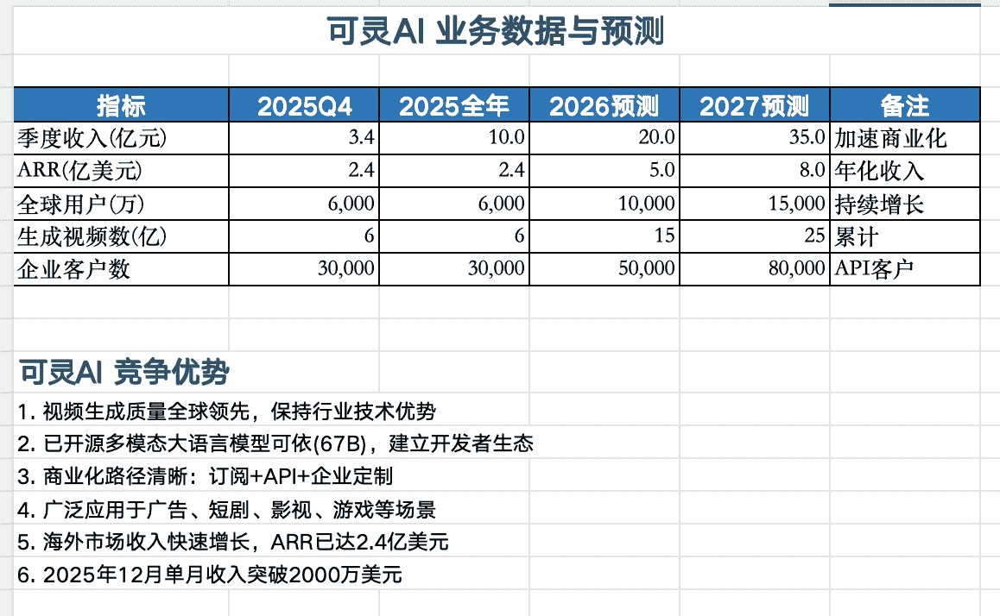

+   关于Word研究报告，整整10页，字数超2k，结构完整，数据准确，研报该有的它都有。虽然部分字体、格式、排版还是会有点小问题，但整体上问题不大。 以及，这份两千字的研报，它竟然没有出现任何的幻觉问题，这说明M2.7 会根据上下文和内部反馈自动修正格式和逻辑，它让产出结果真实、可信，可以直接走进我们的真实工作流。

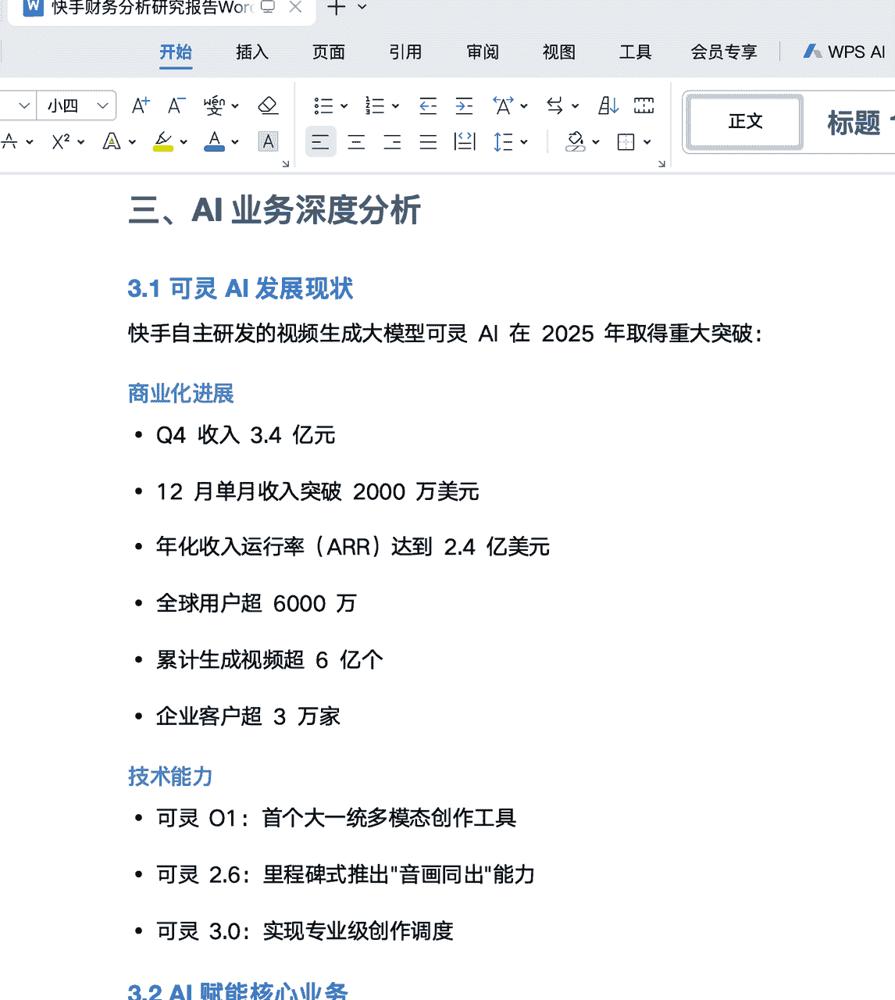

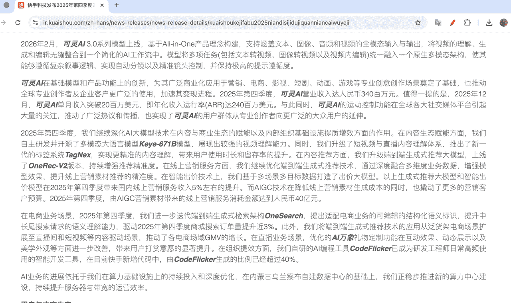

+   关于生成的PPT，样式专业、高端，几乎可直接用于管理汇报了。

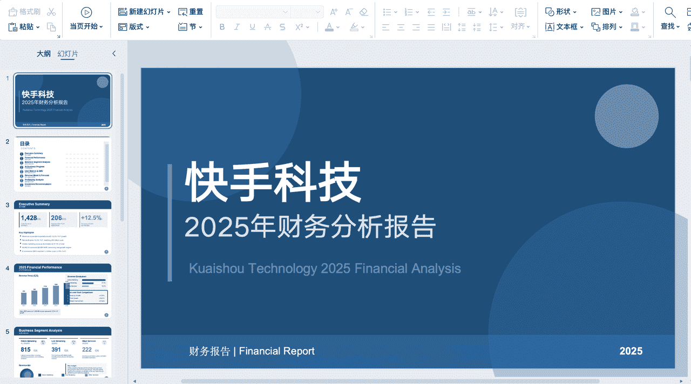

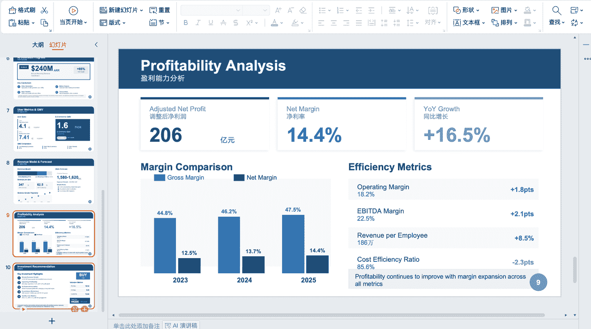

+   最重要的是，以上的全部内容，是一个Prompt完成。M2.7在复杂任务上的指令遵循能力得到了非常大的提升，它可以同时处理数据分析、文档生成和视觉排版。

### 2、编程任务-3D

通过测试3D的Case，我们可以判断模型的空间想象和逻辑推理能力，看它能否准确理解指令，并创建一个零BUG的视觉图形。案例使用经典的3D魔方，提示词如下：

```
提示词：Create a single HTML file containing a fully functional 3D Rubik&#x27;s Cube simulation using Three.js (via CDN). The cube must be able to automatically solve itself. 
中文：创建一个HTML文件，其中使用Three.js（通过CDN方式引入）来实现一个功能完备的3D魔方模拟程序。该魔方必须能够自动完成自己的“解谜”过程。
```

结果非常符合预期，所有功能实现正确，生成速度快，精度高，几乎无需人工修改，而且可直接在浏览器运行。再次证明了M2.7 的复杂任务处理能力，能够处理多线程逻辑和 3D 渲染任务。

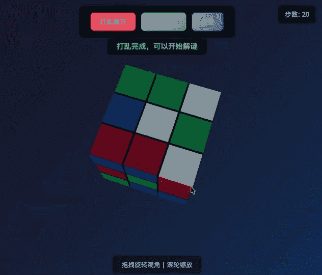

[3D魔方.mov](https://internal-api-drive-stream.feishu.cn/space/api/box/stream/download/all/GNzHbcixcoOY5yxNda8cozhyn1g)

### 3、编程任务-前端

同步测试一下它写前端的能力，我们虚构一个AI 键盘“小key”，让M2.7创建它的的产品宣传页，需要视觉美观、功能完备、响应式布局。

```
提示词：给一款AI键盘「小key」设计产品宣传页。
```

结果也非常好，页面交互逻辑完整，按钮和链接可直接使用，几乎可作为实际产品宣传页直接发布了。