# 从零开始搞定 LLM 搭建全流程

> 来源：[https://qqs7y1hozd1.feishu.cn/docx/Bkqad7wBoo4oxFxj6q6czcY0nNg](https://qqs7y1hozd1.feishu.cn/docx/Bkqad7wBoo4oxFxj6q6czcY0nNg)

本教程完整展示 ai 大语言模型的搭建全流程，以及在实际应用中的能力边界、如何更好的使用。

<https://qqs7y1hozd1.feishu.cn/sync/WsLwdK9UMsOqdhb16EFcUL0qn4d>

## 目录

- [第一章：工具使用](https://qqs7y1hozd1.feishu.cn/wiki/XtxPwcayrixEh8kKYO2ceyqpn0g)
- [第二章：分词器](https://qqs7y1hozd1.feishu.cn/wiki/T9JZwNPiZiQGSakGavmc7US8nfk)
- [第三章：pytorch 与资源核算](https://qqs7y1hozd1.feishu.cn/wiki/AggNwPSHKicSdXkhuzScZjHNnie)
- [第四章：语言模型架构和训练的技术细节](https://qqs7y1hozd1.feishu.cn/wiki/T7ltwyDJoinWvak5D6VcAYKrntb)
- [第五章：混合专家模型](https://qqs7y1hozd1.feishu.cn/wiki/XIbrwy5yKiAXHqkGqX0cHGfpnah)
- [第六章：GPU和GPU相关的优化](https://qqs7y1hozd1.feishu.cn/wiki/DRB2w98RKiiXxxkattHc5tjVnGc)
- [第七章：GPU高性能编程](https://qqs7y1hozd1.feishu.cn/wiki/UtzQwZdsZiLJaNkGeAIcfJqTnHf)
- [第八章：分布式训练](https://qqs7y1hozd1.feishu.cn/wiki/EswUwzOd4iUlqVkZdvGcrbrgnSg)
- [第九章：缩放定律（scaling laws）](https://qqs7y1hozd1.feishu.cn/wiki/WAhYw7FJ3iMTVukv6HXcbHvfnVb)
- [第十章：推理](https://qqs7y1hozd1.feishu.cn/wiki/UgOYwBWYOiCqfakt5IhccNg3njb)
- [第十一章：数据工程](https://qqs7y1hozd1.feishu.cn/wiki/N1XJwAaw2iaAT2kJ4p1cEio1nPh)
- [第十二章：评估与基准测试](https://qqs7y1hozd1.feishu.cn/wiki/VaStwPG4ViMBdvkfOb9cnZnBn9f)
- [第十三章：大模型的基本训练流程](https://qqs7y1hozd1.feishu.cn/wiki/Knu8wLzoyinowkkK7cScePnznPe)
- [第十四章：可验证奖励的强化学习](https://qqs7y1hozd1.feishu.cn/wiki/ZzTswkqAdi6D2nke1vDcmxTNnRh)

# 一、模型输入

## 1.1 模型输入

首先我们知道的是，输入给到大语言模型的是一个组合文本（称之为上下文）。

包括：

+ 系统提示词（对应"你是个智能助手，回答时要可爱些"这种）
+ 可用工具列表描述（对应`Function Call`能力）
+ 历史对话（包括之前的问题和回答）
+ 用户最新提问

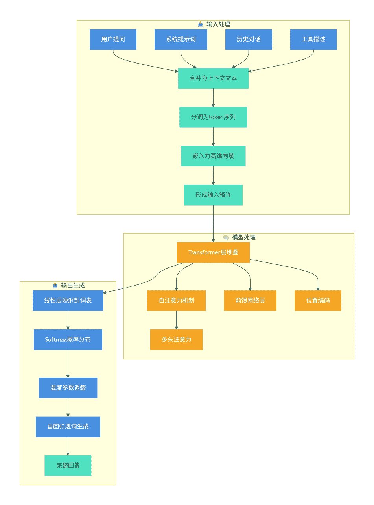

### 示例：

如下为目前共识的`OpenAI API`协议输入示例，这些都将合并作为大模型调用的一次输入（省略了部分工具描述信息，仅做理解）：

```
messages = [
    {&quot;role&quot;: &quot;system&quot;, &quot;content&quot;: &quot;你是个智能助手，回答时要可爱些&quot;},    // 系统提示词
    {&quot;role&quot;: &quot;user&quot;, &quot;content&quot;: &quot;你好&quot;},                           // 历史提问
    {&quot;role&quot;: &quot;assistant&quot;, &quot;content&quot;: &quot;你好，有什么能帮到你呀&quot;},        // 历史回答
    {&quot;role&quot;: &quot;user&quot;, &quot;content&quot;: &quot;查询下今日天气&quot;},                 // 最新提问
]
tools = [{&quot;type&quot;:&quot;function&quot;,&quot;function&quot;:{&quot;name&quot;:&quot;get_weather&quot;,&quot;description&quot;:&quot;Get current weather information&quot;}}]
```

> 敲黑板：这部分需要理解的是输入实际是个文本，并且每次调用大模型都是独立的，能够与用户互动是因为工程上在每次调用时将历史对话加了进去。因此在一轮对话中每次调用时输入的组合文本（即上下文）会越来越长，这点很重要。

## 1.2 分词与嵌入

理解了输入文本，那么文本如何实际转换为大模型计算时需要的矩阵呢（这里需要知道的是，大模型核心是进行大量的数学运算，主要是矩阵乘法），这里主要是分词和嵌入两步。

### 分词

相当于把文本"切碎"成更小的单元`token`。比如：

+ 中文文本中，"北京"可能被切分为1个`token`，"的"也是1个`token`
+ 英文，单词"unhappy"可能被拆成"un"和"happy"两个`token`
+ 每个符号、数字都会单独处理作为一个`token`

需要注意的是这里分词的规则在不同的大模型里是不一样的，有的模型可能一个汉字平均1`token`，有的可能平均要0.5`token`。

### 嵌入

嵌入过程则更加精妙。模型通过一个可学习的嵌入矩阵，将每个`token`的数字ID转换为固定维度的向量。

如此，输入文本开始先转换为`n`个`token`，经过嵌入后转换为`n`个512维的向量，合并即为`n×512`的输入矩阵。

> 敲黑板：这部分需要理解的是文本在给到模型计算之前会转换为`token`序列，这里对应`token`的长度`n`就是文本中“词”的数量，这里`n`就是最终输入的上下文长度。

## 1.3 上下文长度的限制

需要注意的是，目前大模型都会对上下文长度有严格限制，当给到的上下文长度超过限制大小时会直接报错（这里是对应`DeepSeek V3`开源代码的实现），不过大部分工程实践上在累计内容超过上下文窗口时，会自动丢弃最早的数据，保留最新的内容，确保总长度不超过模型的处理能力。

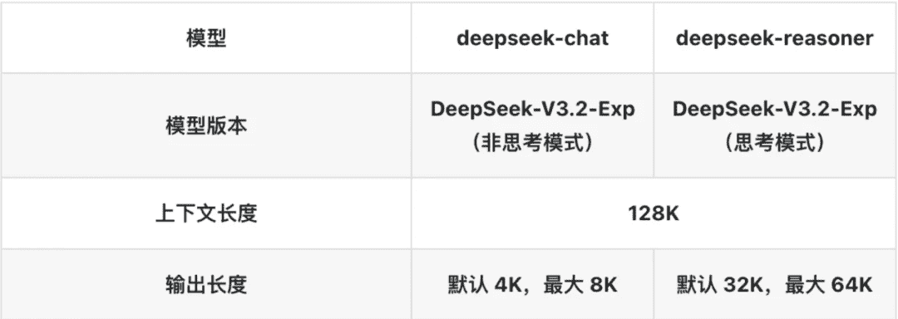

> 敲黑板：上下文长度有限制，不能无限增加，而且需要注意的是这里上下文长度限制是包含输出长度的，即理论上最大的输入上下文长度为`128k - 4k = 124k`（以`DeepSeek-Chat`默认为例），为什么后面会解释。

通过这一系列精密的转换过程，人类的自然语言最终变成了模型能够进行数学计算的矩阵形式，为后续的理解和生成奠定了基础。

# 二、Transformer架构与自注意力机制

现在我们已经有了一个包含词义的输入矩阵，接下来就要进入大模型的核心计算环节——`Transformer`架构。这个架构的精髓在于自注意力机制，它让模型能够真正“理解”文本中各个词语之间的复杂关系。

## 2.1 自注意力

想象一下你阅读一段文字时，大脑会自动关注与当前理解最相关的词语，自注意力机制就是让模型实现类似的能力。

### `Q`、`K`、`V`矩阵

每个输入`token`经过与上述三个不同的权重矩阵相乘，分别生成三个矩阵：

+ `Query`（`Q`）矩阵：代表"我想要什么信息"，用于主动询问其他`token`
+ `Key`（`K`）矩阵：可以理解为"该`token`拥有什么信息"，用于回应其他`token`的询问
+ `Value`（`V`）矩阵：可以理解为该`token`的包含内容信息的多少

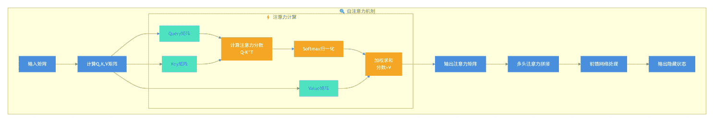

### 信息的三种角色

这三个矩阵可以理解为信息交流的三个角色：`Q`是提问者，`K`是应答者，`V`是实际要传递的内容。

1. 计算注意力分数：用当前`token`的`Query`和之前所有`token`的`Key`内积计算得到对应注意力分数，可以理解为当前`token`与之前`token`在这个注意力模块下的关联程度。分数越高，代表该部分信息越重要。
2. 生成加权平均输出：最后，用上一步得到的注意力分数作为权重，分别与之前所有`token`的`Value`相乘并求和得到最终的注意力信息（注：实际计算要复杂些，这里不做展开），这里可以理解为融合了之前所有序列上下文信息的新的向量。

经过上面的计算后，得到了每个`token`与上下文关联的信息，这个过程确保了模型的回复是基于整个上下文生成的，而不仅仅是孤立的最新问题。

> 敲黑板：简单来讲，自注意力机制就是将每个`token`与之前所有`token`通过计算得到相关信息，需要着重理解的是最后一个`token`的注意力信息包含了整个上下文所有信息。

## 2.2 多头注意力

单一注意力机制可能不够全面，因此`Transformer`采用了多头注意力设计。

> 不同注意力头就像不同的“专家”，各自关注文本的不同方面，所有头的计算结果最终拼接在一起，通过线性变换融合成完整的输出。

> 这种设计让模型能够同时从多个角度理解文本，大大增强了表达能力。

## 2.3 前馈网络层

一个完整的`Transformer`层主要包括多头自注意力层以及前馈网络层（还有别的模块，偏技术细节不影响理解这里不做展开）。

### 理解过程

+ 自注意力层：相当于你听取了一场讨论，了解了每个人（每个词）的观点以及它们之间的关联。
+ 前馈网络层：相当于你回到自己的办公室，独自消化和深入思考刚才听到的所有信息，形成自己更深刻、更抽象的理解。

如此，一个 `transformer` 层结构可以简略表示为下图：

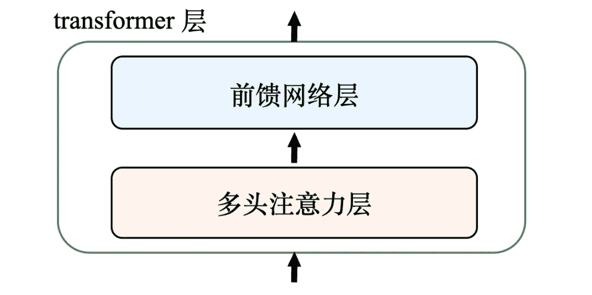

> 敲黑板：实际上可以简单理解，通过注意力机制让模型能够学到利用并关联上下文信息，通过前馈网络层让模型能学到特征的进一步提取和转换。

## 2.4 大模型

都说大模型，大模型到底大在何处？

### 参数量

参数量是衡量模型复杂度的核心指标，`Transformer`架构的大模型通常拥有数百亿甚至数千亿参数，这么多参数都体现在哪？

> 以`DeepSeek V3`为例，其注意力层为潜在多头注意力层（`MLA`，这个是为了减少缓存的使用，不展开介绍），头数为128，对应有128个自注意力模块，
>
> 前馈网络层包括257个专家（包括一个共享专家，256个可选专家，这里可以理解为257个前馈网络层并行，这跟多头很类似，区别是这里专家是选择使用的），
>
> 然后这样的`Transformer`层在`DeepSeek V3`中有58层，还有3层无专家的`Transformer`层，共61层。

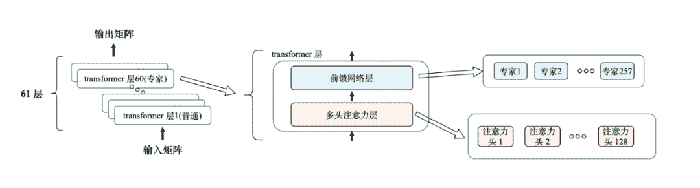

其中参数量主要由专家组成，一共14906个专家，每个专家有`7168×2048×3 = 44,040,192`个参数，一共有6564.6亿个参数，算上其他的参数，总共是6710亿。

### 训练量

大模型这么大的参数量，每个参数的取值都是逐渐调整的，训练数据要求非常大。

以`DeepSeek V3`为例，其预训练阶段就使用了14.8万亿`token`的数据集进行预训练，需要知道的是，大模型在训练时每条数据都不会只用来训练1次，而是训练多次。

# 三、模型输出

接下来需要完成最关键的一步：将这些抽象的高维向量“翻译”回人类能够理解的自然语言。

## 3.1 线性层

隐藏状态矩阵中的每个向量都浓缩了对应`token`的上下文信息，但这些向量仍然处于模型内部的表示空间。

为了生成人类可读的文字，模型需要通过线性层将这些向量映射到词汇表空间。

线性层将每个`token`对应的高维向量转换为一个长度等于词汇表大小的新向量。

> 如果词汇表包含5万个词，那么线性层的输出就是一个5万维的向量，每个维度对应词汇表中一个特定词的可能性得分。
>
> 因为我们输入时`n`个`token`，所以这里会得到`n`个向量，分别对应该位置下一个词的得分向量，在最终输出时使用最后一个。

## 3.2 Softmax

线性层输出的向量包含的是原始得分（raw scores），这些得分被称为`logits`。每个`logits`数组看起来可能像这样：`[2.1, -0.3, 1.8, ..., 0.02]`，其中每个数值代表对应词汇的"倾向程度"。

### 核心作用

`Softmax`的核心作用是将`logits`转换为标准的概率分布：

+ 将所有`logits`值映射到0到1之间
+ 确保所有概率值的总和恰好等于1
+ 保持数值间的相对大小关系（得分高的词概率仍然高）

经过`Softmax`处理后，原来的`logits`数组变成了类似`[0.15, 0.02, 0.25, ..., 0.001]`的概率分布，每个数值明确表示对应词汇被选中的概率。

> 到这里大模型终于能返回一个词了，具体输出哪个呢，一般是根据上面的概率分布来随机抽取，每个位置的值对应输出词表中这个位置的词的概率。
>
> 需要注意的是，一般情况这个概率分布会比较集中，即某个词或某几个词的概率很大，其他很小。

## 3.3 自回归生成

经过上面那么复杂的计算，我们发现大模型只输出了一个词，那么完整输出对应的后面的词是怎么来的呢。

### 生成过程

这里大模型生成文本的过程是自回归的，这意味着模型不是一次性生成整个回答，而是像人类思考一样，一个词一个词地逐步构建：

1. 初始预测：基于完整的输入上下文，模型预测第一个词的概率分布（即上面的过程）
2. 词选择：根据概率分布选择一个词（可能是概率最高的词，也有可能是概率低的词）
3. 迭代扩展：将已生成的词作为新的输入的一部分，预测下一个词
4. 重复直到结束：持续这个过程，直到生成完整的回答或达到长度限制

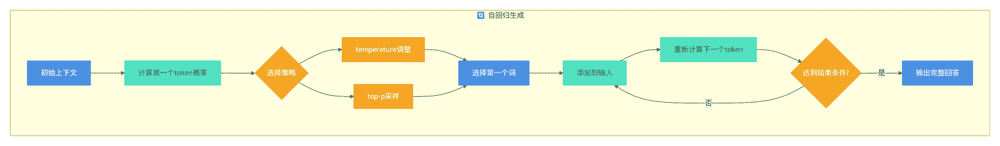

这种“滚雪球”式的生成方式确保了前后文的连贯性，每个新词的产生都基于之前所有已生成的内容。

> 敲黑板：大模型经过`Transformer`层提取的特征在经过计算后最终输出的是词表中每个词的概率分布，根据相应概率抽取最终输出的词。接下来将生成的词添加到输入后继续上述流程接着预测输出，整体上是一个一个`token`输出。这也是为什么上下文限制要包括输出长度的原因。

## 3.4 生成策略

对于概率分布，模型有多种选择策略，一般是按照概率分布进行抽取。在创造性的场景中可能体现为每次的输出结果不同，这对诗词创造等比较有用。

目前来说，模型一般会提供两个参数来给用户用以调整，这在我们平时使用的元宝等平台都会开放给用户修改。

### `temperature`：

> 调整模型原始输出的概率分布（`logits`）的"尖锐"或"平滑"程度，通过改变概率分布的形状来控制随机性。可以理解为值小于1时原本概率高的调整后会更高，进而更容易被选择，等于0时就变成了只选择概率最高的词

### `top-p`：

+ 像一个动态的候选词筛选器，从概率最高的词开始累加，仅从累积概率达到阈值`p`的最小候选集合中采样。可以理解为在抽取时只从概率较高的前几个词中抽取

在实际应用中可以结合使用场景来调整参数以达到我们期望的性能，这里不做展开。

> 注：这里在`DeepSeek V3`的代码中只看到了`temperature`参数的支持。

# 四、位置编码和长文本外推

到这里我们已经谈得上大致理解了大模型从输入到输出的基本工作原理，不过在介绍中刻意忽略了一个细节，斟酌再三还是决定单独介绍这部分，因为这个非常重要！

## 4.1 位置编码

上面我们提到了`Transformer`架构核心在自注意力机制，通过计算每个`token`和其他`token`的相关性得分来获取相关信息。

其中核心计算是`token`之间的矩阵运算，然而这种计算方式丢失了位置信息，要知道"我咬狗"和"狗咬我"这种相同词组成的短句含义是相差甚远的。

因此引入了位置编码的概念，将位置信息添加在输入矩阵中，一般分为绝对位置编码和相对位置编码。

### 绝对位置编码：

> 给每个位置一个"唯一身份证"，`Transformer`架构原版的实现。核心是通过编码的方式将位置信息添加到每个`token`的输入向量中，缺点是当输入长度超过模型训练长度时，模型没见过对应位置编码，会导致性能急剧下降。

### 相对位置编码：

> 关注的相对距离而不是绝对距离。在计算注意力分数时，注入两个词之间的相对距离信息。

这里只介绍目前主流方案`RoPE`（旋转位置编码），核心思想是将每个`token`的位置信息转换为对应高维空间的角度信息。

相比于绝对编码，相对编码中模型学到的是相对位置关系，即使输入长度超过模型训练长度时，模型也能复用训练中学到的相对位置规律。

> 敲黑板：核心是通过巧妙的数学编码将相对位置信息加在了自注意力得分的计算上，有个很重要的细节是，在编码上通过设计使得相对位置越远的`token`间注意力得分会相对较低。

## 4.2 长文本外推

但是，即使相对编码比绝对编码在长文本时更具优势，但是其学到的相对位置关系的距离也是有限的，当输入长度过长时，其性能也会下降，这时候就需要外推策略。


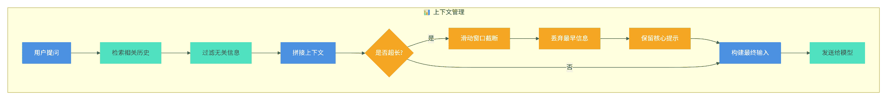

为了保证模型对长输入文本也能有个较高的性能，研究人员相继提出了多种方法。这里简单介绍：

### 一种是基于插值的方式

基本思想是对于训练时的0-4k这样的距离，在实际使用时将0-32k压缩到0-4k的表示（模型更熟悉这个范围的距离）。

> 当然这个方式不够灵活，目前业界较优的方案是YaRN，可以理解为对不同长度的相对距离进行不同的插值策略。

### 一种是基于选择策略的方式

基本思想是对超长文本，在计算时不再计算与全局所有token的注意力关系，避免超长文本计算的耗时过长。

> 比较典型的方案是滑动窗口计算的方式，每个词只关注固定窗口长度中相邻词的信息，也有通过某些策略从全局中挑选部分区间进行计算，整体方案是有损的，不过通过设计尽量降低对模型效果的影响。

## 4.3 长文本训练

也许你会疑惑如果大模型学到了相对距离的概念，那理论上距离变长也应该可以的才对。

> 这就要提到前面说的大模型的大在训练量了。

> 模型的性能直接取决于训练量，在4k长度下训练的模型即使学会了相对位置的概念，到了32k甚至更长的距离时表现也会变差，因为缺乏训练。

> （这可以类比于，在人机模式打了很多把游戏，你的能力有了显著提升，并且已经学会了技能的使用和对线的技巧，但接下来让你跟真人高玩对线，用的技能和英雄还是那些，但就是打不过）

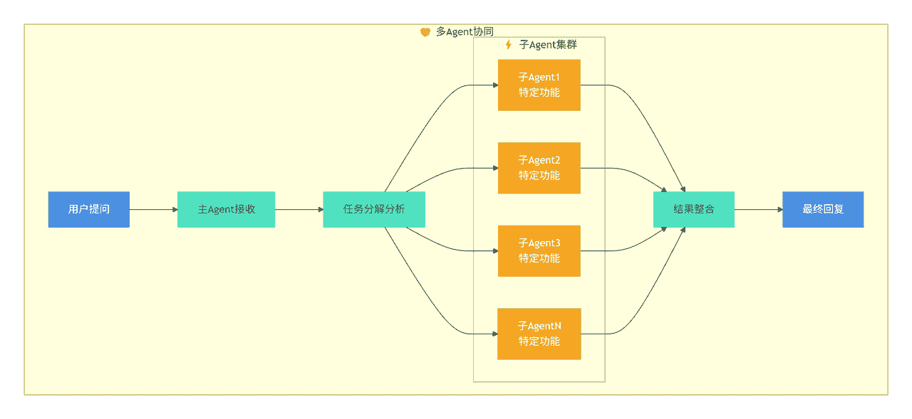

既然如此，为什么不直接用长文本进行训练呢？这里主要有两个原因：

### 计算复杂度与成本爆炸

> 基于前面的自注意力机制计算的原理，我们知道每个token都要和上下文中前面的所有token进行注意力计算，因此上下文越长，计算量和中间结果就会越多，这直接与长度的平方成正比。因此在大训练量的需求下，直接对长文本进行训练的资源和时间消耗都是非常大的。

### 训练数据的稀缺性和质量难题

> 即使是互联网时代，长文本的训练数据仍然本身较少，大部分还是短文。并且高质量的可训练数据更为稀缺。

### 短文本预训练 + 长文本微调（主流方法）

目前主流方式都是在短文本下进行大量训练得到基础模型，然后通过少量的长文本数据进行微调。

+ 阶段一（基础预训练）：在大量高质量的较短文本（如2K、4K、8K）上完成核心的语言模型预训练。这个阶段让模型学会基本的语言能力、常识和推理逻辑。成本相对可控。

+ 阶段二（长度扩展微调）：使用外推技术，在相对较少的长文本数据上对模型进行微调。这里DeepSeek V3是先扩展至32k，然后扩展至128k。

### 为什么有效？

因为模型在阶段一已经学会了"如何思考"。阶段二只是教它"如何在更长的上下文中运用这种思考能力"。这比从零开始学习所有东西要高效得多。

注：大模型的发展日新月异，目前有些模型已经支持了 1M 长度上下文了

> 敲黑板：针对长文本的支持，主流方式仍是采用大量短文本数据进行预训练的方式，并在此基础上通过少量长文本的训练来提高模型对长文本输入的支持。这里重点是什么，重点在于即使做了非常多的工作来增加长文本的支持。

# 五、模型实现

到这里你已经大致了解大语言模型的工作原理和实现细节，那么知道了这些对我们实践应用有哪些指导意义呢？

## 5.1 多模态输入

已知使用的DeepSeek V3输入是文本，那猜测这里大概率的工程实现是对图片做图像识别，得到一个识别结果的文本，将这个文本和问题一起给到大模型作为输入。

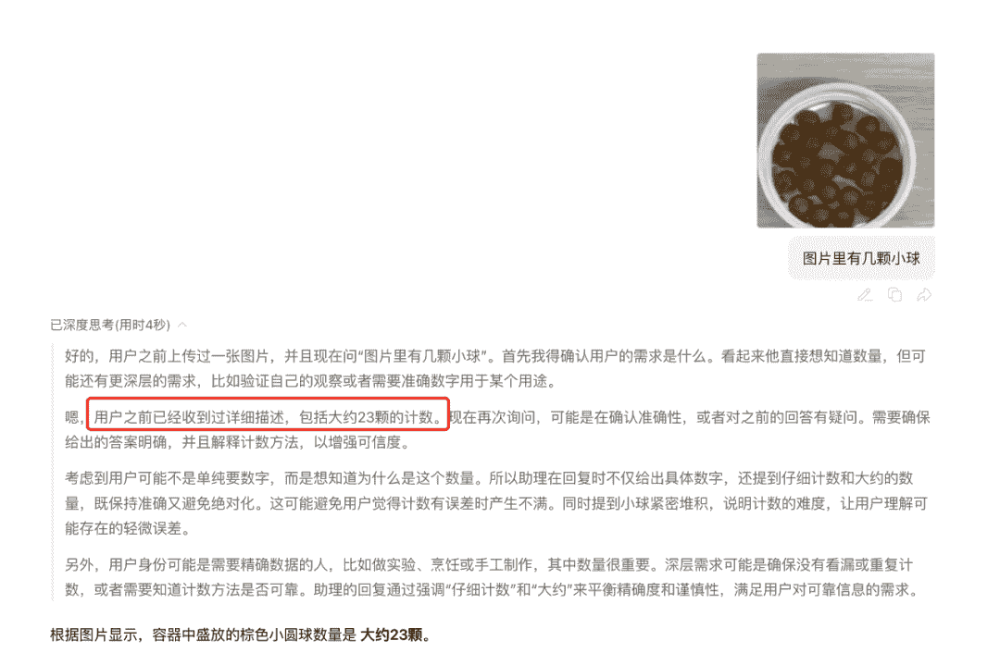

这里也测试了混元（已知混元是多模态的大模型，在输入时是支持输入图像的，简单理解应该是通过编码器将图片转换成跟token类似的输入向量给到Transformer架构），结果也是不对，而且看思考过程很难看出来是真的用了图片特征token还是单纯的在瞎说。


这里想说的是，像DeepSeek这类大语言模型目前主要还是以输入文本为主，对于非文本的需求大概率是通过特殊的工程方案来实现的。

## 5.2 上下文限制

我们知道模型在短文本（一般是4k）进行了大量训练，理论上这个区间模型效果和稳定性都是最高的，那么在工程实践中应尽量避免长上下文的情况。以Agent为例，关键就是他的prompt（系统提示词）和可用工具列表描述，这部分不应过多（提示词一般对应规则，工具描述对应能力）。

并且过多的规则和可用工具容易导致模型出现混乱，最终输出的格式不符合预期，如下示例实际模型是想输出的调用工具的能力，但是由于输出时格式不对，导致解析失败。

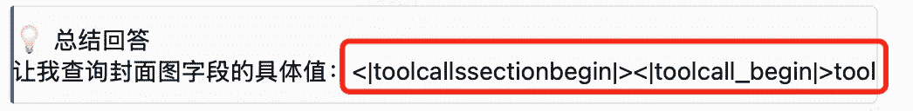

这只是不稳定的变现的一种，有时还会出现循环输出的情况如下图，看完文章你应该能理解这种问题出现的原因(输出是概率预测）

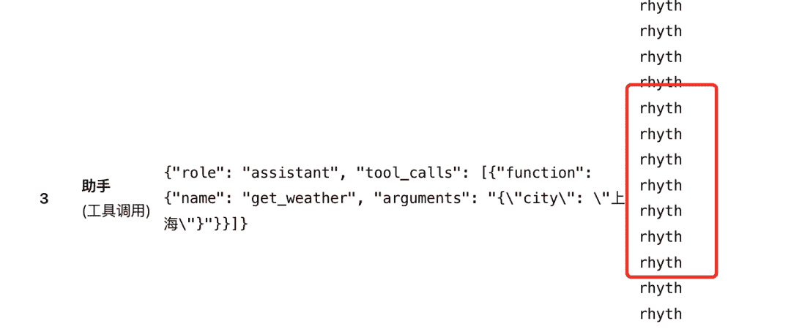

## 5.3 耗时影响

每次调用的耗时由什么决定呢，以上理解我们知道第一个token的输出需要将所有输入上下文全部计算后得到。

> 这个耗时完全取决于上下文长度，越长则耗时越高（并且是与长度的平方成正相关），随后依次输出。

> 每个token输出的间隔耗时取决于上下文长度（这里会利用之前计算过的缓存，但仍需要将新的token与上下文所有token进行计算）

> 所有token输出总耗时取决于输出的字数。因此一次调用耗时的曲线近似可以理解为如下图所示，其中`t1`与上下文长度平方成正比，直线斜率`k`与上下文长度成正比。

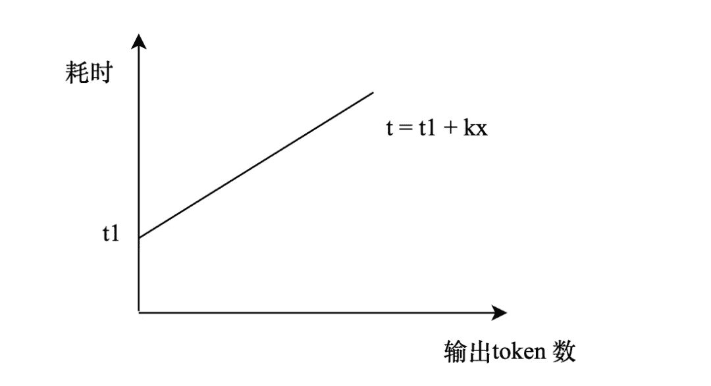

知道了耗时组成，那么在实践中如果想每次调用耗时降低，我们能做什么呢？

1. 还是减少上下文长度，因为总耗时与长度平方成正比

2. 限制模型单词输出的长度，这里一般可以通过prompt规则或者接口参数限制，因为很多时候大模型会有啰里啰嗦的特性！

## 5.4 有效减少上下文

实践中我们会发现很多时候模型不总会按预期输出，因此我们会增加很多的规则来提醒模型怎么做，当我们就是有这么多要求怎么办呢，也许你需要拆分了。

通过多Agent协同的方式将你期望的功能进行拆分，每个子Agent对应一部分能力，通过一个主Agent进行统筹规划。

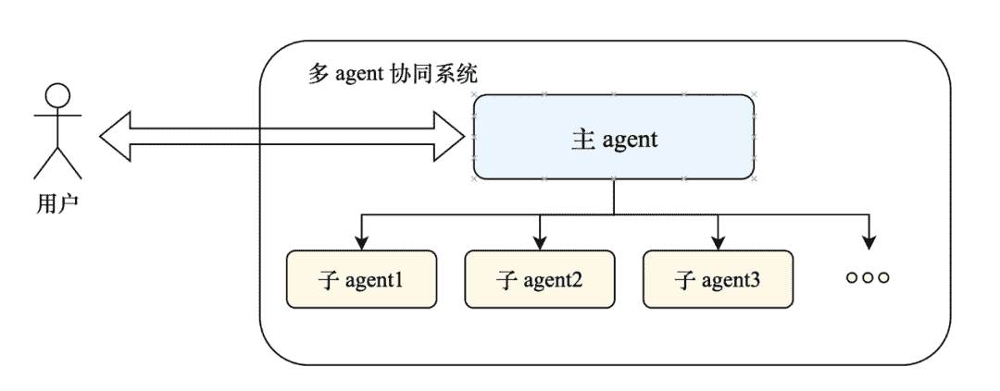

这里主Agent只需要知道每个子Agent能做什么，而不需要知道其对应prompt的具体规则，因此其上下文可以做到尽量的缩小，耗时也会有效降低。

> 在使用时主Agent只需要将用户提问拆分为不同子任务交由子Agent执行即可。同时每个子Agent的功能相对简单，因此上下文也不会太长。

## 5.5 历史对话

历史对话过多也会导致上下文的膨胀，不过很多时候用户的问题并不需要历史信息做参考，或者历史信息里包含的有用信息很少，用户很多时候单纯是懒得清理上下文。

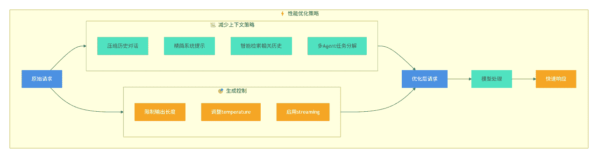

因此工程上可以通过一些方式减少历史对话，一种可行的方案可能是，将历史对话存储起来，在用户提问时，先检索有没有相关记录，并仅将相关记录附在历史对话里。
