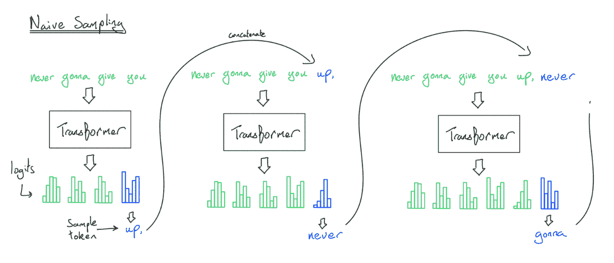
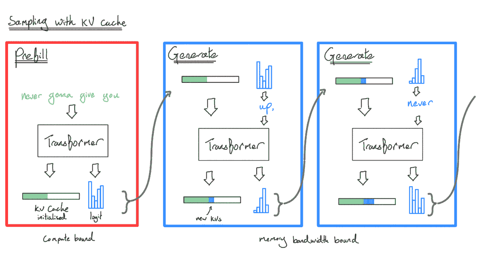
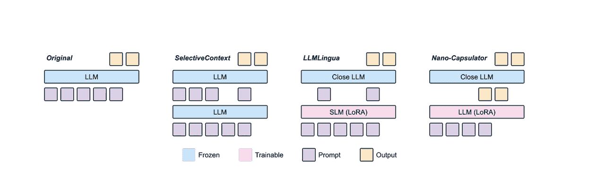
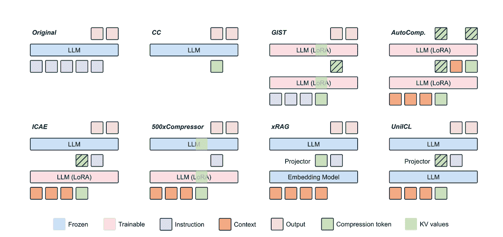
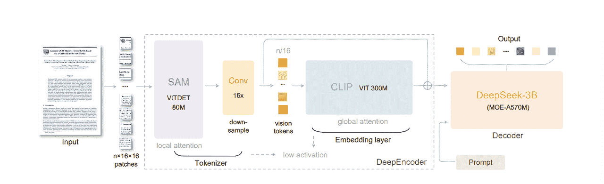
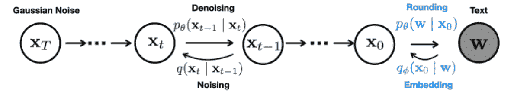
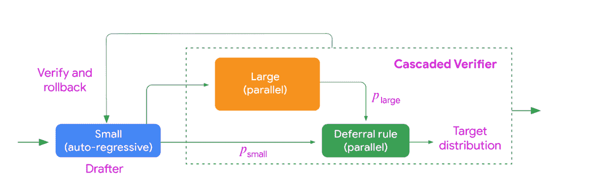
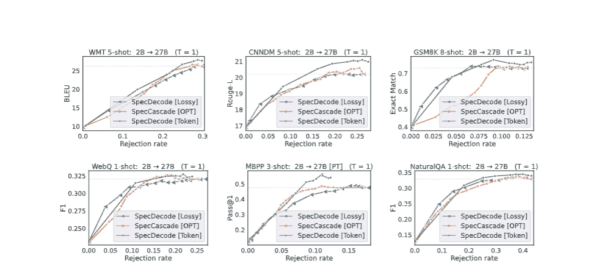

# 第十章：推理

> 来源：[https://qqs7y1hozd1.feishu.cn/docx/Q1aCdJObZo5BUTx3Pl5ccdCjnJh](https://qqs7y1hozd1.feishu.cn/docx/Q1aCdJObZo5BUTx3Pl5ccdCjnJh)

推理是大型语言模型真正发挥价值的核心环节，是训练中积累的知识得以转化为实际输出的唯一途径。无论对话、搜索、问答或代码生成，所有能力都在推理中被激活与呈现。

## 10.1 推理与训练

训练与推理虽各自受不同瓶颈约束，却并非独立阶段；训练塑造能力，推理呈现能力，而推理的需求又反过来影响训练设计。二者共同构成了构建大规模语言模型的完整系统循环。

### 10.1.1 推理与训练的差异

在LLM中，训练与推理都涉及模型的前向计算，但它们的目标、计算模式和资源瓶颈存在本质差异。对于自回归推理或并行化训练，假设需要生成第 ii 个token，则模型在该位置的条件概率可以统一写为：

`P(tokeni∣token1,token2,…,tokeni−1)P(tokeni∣token1,token2,…,tokeni−1)`

> 训练与推理在单步预测的数学形式上相同 —— 都是对词表做概率分布估计并从中选择，但差别在于 `tokeni` 前文的来源（真实vs生成）以及是否把预测结果作为后续输入和是否能并行化。

训练与推理的预测下一个词的依据对比

| 阶段 | 下一步预测 `tokeni` 的输入来源 |
|------|----------------------------------------------------------------------|
| 训练 | 来自真实标签（ground-truth）及其之前的输入序列，模型可利用完整序列并行计算，同时通过因果掩码保证每个位置只访问前面token。 |
| 推理 | 来自模型先前预测生成的token及其之前的文本，每步预测依赖前一步输出必须逐步生成（auto-regressive）。 |

1. 训练阶段

训练阶段的主要目标是 优化模型参数，训练需要执行完整的前向与反向传播，保留中间激活用于梯度计算，并在多 GPU 间同步梯度。因此训练过程高度依赖算力，瓶颈主要来自：

+ 大规模矩阵乘法的FLOPs；
+ 多张显卡并行运行涉及的跨设备、统一设备内通信量；
+ 激活、梯度和优化器状态带来的额外内存占用。

> 训练阶段的显存占用主要由四部分组成：激活、梯度、优化器状态以及模型参数。

对于训练阶段的自回归 [`Transformer`](https://www.bilibili.com/video/BV1TZ421j7Ke/?spm_id_from=333.1387.search.video_card.click&vd_source=17b9d3dcea2f2934b89c09ac53cc1d64)，我们输入完整目标序列并使用 因果掩码（causal mask）：每个位置只能访问前面token（真实标签），无法看到未来token。由于训练输入是已知的完整序列，模型可以将整个序列视作一个大批次，通过一次或少量大矩阵乘法并行计算所有位置的前向表示，同时因果掩码保证自注意力的顺序依赖。中间激活会被保留用于反向传播与参数更新。正因如此，尽管自注意力涉及成对位置的注意力计算，训练仍能在时间维度高度并行，这也是`Transformer`在大规模训练中高效利用GPU的关键原因。

1. 推理阶段

推理阶段的目标使用固定参数生成输出序列。推理通常采用自回归生成方式，生成每个token时，模型需要参考之前预测生成的所有token的信息，也就是每一层的`Key`、`Value`（`KV cache`）。

可以把LLM的推理过程想象成在写作文：每写一个字都要回头看前面已经写好的内容。随着上下文长度增加，这些“参考资料”（`KV cache`）也越来越多，占用的显存越来越大，而且每次访问都需要时间，就像翻阅厚厚笔记本一样慢。因此，推理的速度并不主要受算力限制，而是受显存容量和内存带宽的制约。

总的来说就是：训练的瓶颈在算力，而推理的瓶颈在显存与带宽。

> 为什么在自回归LLM的训练阶段，模型预测下一个token时通常以真实标签的前序tokens作为输入即`teacher-forcing`，而不是以模型先前预测的token作为输入？

> 在训练阶段，使用`teacher-forcing`有两个主要原因：一方面，它提供稳定且明确的监督信号，便于模型快速收敛；另一方面，它允许对整段序列进行并行计算，从而大幅提高训练效率。如果在训练中将模型先前预测的token作为下一步输入，则可能导致隐藏状态中累积预测偏差。此外，由于采样（预测生成的token）操作是非微分的，会破坏标准的基于最大似然的逐位置损失计算和反向传播，从而增加训练难度。

举例：训练 vs 推理并行对比图

```
训练阶段（全序列并行化，使用ground-tru原有的前文）
----------------------------------------------------
输入序列：     x1            x2           x3            x4
模型前向：    ┌────┐      ┌────┐       ┌────┐         ┌────┐
             │f(x1)│     │f(x1,x2)│   │f(x1,x2,x3)│  │f(x1,x2,x3,x4)│
             └────┘      └────┘       └────┘         └────┘
输出序列：     y1           y2           y3             y4
说明：
1. 所有token的预测y_i可并行计算（Transformer一次前向即可得到全部y_i）。
2. 位置i的预测条件为真实前文（x1...x{i-1}），因causal mask保证无法看到未来token。
3. 预测y_i仅用于计算训练损失例如cross-entropy，不会作为下一步输入。

----------------------------------------------------
推理阶段（自回归生成，逐token依赖模型生成的前文）
初始输入：   x1  
Step 1:     y1 = f(x1)
Step 2:     y2 = f(x1, y1)
Step 3:     y3 = f(x1, y1, y2)
Step 4:     y4 = f(x1, y1, y2, y3)
说明：
1每一步都必须等待上一步完成，无法并行。
2. 位置 i 的前文是模型自己已生成的token（不是ground-truth）。
3. y_i用作下一步输入并不断扩展序列。

----------------------------------------------------
Copy to clipboardErrorCopied
```

在LLM的推理阶段，每一次生成一个token都依赖于之前已经生成的所有token，因此生成token的流程在时间维度上具有严格的顺序性，无法并行一次性输出多个token。但需要强调的是，这并不意味着推理内部的计算无法并行，每一步在计算新的`KV`、注意力权重以及前馈网络时，这些操作本质上仍是大型矩阵运算，完全可以在GPU上进行高度并行化处理。因此，推理阶段的特点可以概括为在时间维度上是顺序的（自回归约束），在计算维度上是并行的（矩阵运算加速），训练阶段可以并行处理整个序列而推理阶段只能顺序处理生成token，但每个token的计算内部依然高效并行化。

### 10.1.2 训练与推理的联系

尽管训练与推理在操作机制、性能瓶颈和优化方向上存在明显差异，但二者在整个模型生命周期中紧密关联。

+ 训练的根本目的在于优化推理行为。 无论采用监督学习、预训练、监督微调还是对齐方法，其结果最终体现在推理阶段的生成质量、稳定性和一致性上。推理是模型面向用户呈现所有能力的方式，因此训练过程的每一项设计——数据选择、损失函数、正则化方法等方法最终都影响推理表现。

+ 推理本身是训练过程不可或缺的一部分。 模型验证、能力评估、指令遵循测试等都依赖推理过程。在训练中，模型必须通过推理生成响应，再利用这些响应计算奖励或者损失并更新参数。因此，从系统角度来看推理并非仅出现在部署环节，而是贯穿训练的整个迭代周期。

+ 训练中对模型结构的设计决定推理的可优化性。 推理阶段受限于显存、`KV`缓存大小、延迟要求、带宽等多方面瓶颈，因此模型在训练阶段的结构设计必须为推理的可执行性和性能提供保障。

+ 结构设计影响推理的资源占用。 例如`Transformer`的结构、注意力复杂度、参数规模、`MoE`的专家布局、是否有`KV`压缩等，都会在推理时决定显存占用与延迟表现。设计不当的结构可能在训练时表现良好，但在推理时根本无法高效运行。

+ 结构设计影响推理的可优化空间。 是否能够使用`FlashAttention`、长上下文机制、推理加速策略等，都依赖模型结构在训练阶段是否为这些优化留下空间，一个推理友好的结构设计能在部署阶段获得更高吞吐、更低延迟和更强的扩展性。这些设计往往必须在训练前便已确定，而无法在推理阶段临时补救。因此，推动模型推理效率的提升，需要在训练阶段就纳入系统性的结构设计考虑。

> `FlashAttention`依然是全局注意力机制，但将原本需要一次性计算和存储的大型注意力矩阵拆分为多个可在高速片上缓存中处理的小块，通过分块计算显著减少显存读写量，从而降低内存访问开销并显著提升推理与训练效率。

## 10.2 推理原理分析

为了更清晰地理解推理的效率好不好，我们通常从三个指标来衡量——首标记生成时间（`TTFT`）、延迟（`Latency`）、吞吐量（`Throughput`）。

+ `TTFT`：用户从发出请求到看到第一个token的时间，是交互体验中最关键的等待成本。

+ `Latency`：在首标记生成后，后续token的输出速度，决定了模型“说话是否流畅”。

+ `Throughput`：系统在单位时间内能生成的总token数，适用于批量处理和服务整体效率评估。

### 10.2.1 Transfomer



在[自回归`Transformer`](https://jax-ml.github.io/scaling-book/inference/)的LLM推理中，一个核心优化点在于对已经存在的上下文，不需要每生成一个token就重新做完整前向计算。为此，推理通常分为两个阶段：预填充和逐步生成。



+ 预填充阶段，模型一次性处理用户输入的所有prompt token，并在每一层、每个注意力头中计算出这些token的`Key`与`Value`，记为 `K`、`V` 。

+ 生成阶段，模型用上一步得到的新token embedding生成它的`Query`，执行

`Attention(Q,K,V)=softmax(QK⊤dk)VAttention(Q,K,V)=softmax(dkQK⊤)V`

其中 (`K`,`V`) 全部来自`KV Cache`，得到的输出`logits`是模型对词汇表中每个token的未归一化分数，其经过`softmax`归一化后就是词汇表的概率分布，用于采样生成下一个token。然后把这个新token在各层的新 (`K`,`V`) 继续追加到缓存中，循环直到终止符或达到最大长度。

> `KV Cache`会占用显存，其规模大致与token数 × 层数 × 注意力头数 × 隐藏层维度成正比。

需要注意——`KV Cache`适用于自回归的推理模式，因为在自回归设置中过去的token一旦计算完成就不会被未来token改变，故其对应的 `K`、`V` 可以复用。

①对于双向注意力如`BERT`、`encoder-only`等或者频繁修改输入上下文的场景如掩码语言模型、文本编辑器等，任一token的变动都会影响其他token的表示与`Query–Key`的相对关系，从而改变注意力权重即 `QK⊤` 和应加权的 `V` 。因此在这些非自回归推理场景中，已缓存的 `K`、`V` 不能保持有效——一旦序列有改动就必须重新计算全部 `K`、`V` ，其不适合使用`KV Cache`。

②在扩散模型中，注意力模块同样会计算`Key`、`Value`，但其含义与自回归模型中的 `KV cache`并不相同。扩散模型中的`KV`是针对所有空间位置在一次前向计算中并行生成的，并且通常在每一个扩散步骤（diffusion step）中重新计算，因此不会像自回归生成那样在时间维度上随生成过程逐步累积。当模型引入外部条件如文本条件时，由条件编码器产生的`KV`可以在多个扩散步骤之间复用，以减少重复计算，但这种缓存仅针对不随扩散步骤变化的条件表示，并不等同于自回归模型中随序列长度不断增长，并在整个生成过程中持续占用显存的`KV Cache`。

> 为什么当前大多数生成型模型如`GPT`系列、`LLaMA`系列、`DeepSeek`系列等采用自回归注意力架构，而不是像`BERT`那样的双向注意力?

1.  高效逐步生成：自回归模型按顺序预测下一个token，可用`KV Cache`前面计算的`Key`、`Value`，避免重复计算，实现流式生成和在线交互的高效推理。

1.  全局一致性 vs 计算开销：双向`attention`能访问前后上下文，提高理解和连贯性，但生成时需要多次全序列`attention`、迭代更新，计算和内存开销大，交互延迟高。

1.  工程折中与扩展性：自回归架构训练易扩展，虽然牺牲了即时全局修改能力，但在大规模部署中是最实用的折中方案。

LLM自回归方式推理简易代码实现


# 大语言模型推理与注意力机制

## KV Cache 与自回归生成

```python
import numpy as np
# 词表
vocab = ["I", "love", "deep", "learning", "<EOS>"]
token2id = {w: i for i, w in enumerate(vocab)}
id2token = {i: w for i, w in enumerate(vocab)}
vocab_size = len(vocab)  # embedding 维度
d_model = 8
np.random.seed(42)
E = np.random.randn(vocab_size, d_model)  # 每个 token 对下一个 token 的概率分布（行：当前 token，列：下一个 token）
manual_logits = np.array([
    [0.0, 3.0, 0.0, 0.0, 0.0],   # I -> love
    [0.0, 0.0, 0.0, 3.0, 0.0],   # love -> learning
    [0.0, 3.0, 0.0, 0.0, 0.0],   # deep -> love
    [0.0, 0.0, 0.0, 0.0, 3.0],   # learning -> <EOS>
    [0.0, 0.0, 0.0, 0.0, 0.0]    # <EOS> -> nothing
])

def softmax(x):
    e = np.exp(x - np.max(x))
    return e / e.sum()

def generate_kv_readable(prefix, max_len=10, min_len=3):
    print(f"输入前缀: {prefix}")
    ids = [token2id[w] for w in prefix]

    K_cache = np.zeros((0, d_model))
    V_cache = np.zeros((0, d_model))
    for step in range(max_len):
        last_id = ids[-1]
        x = E[last_id]
        # Q, K, V
        q = x @ np.eye(d_model)  # 简化: Q=K=V=embedding
        k = x
        v = x

        # 更新 KV Cache
        K_cache = np.vstack([K_cache, k])
        V_cache = np.vstack([V_cache, v])
        # 注意力
        att_scores = K_cache @ q
        att_scores /= np.sqrt(d_model)
        att_weights = softmax(att_scores)
        context = att_weights @ V_cache

        # 使用手动 logits + softmax
        logits = manual_logits[last_id]
        probs = softmax(logits)
        # 用 argmax 确保可控生成
        next_id = int(np.argmax(probs))
        next_token = id2token[next_id]
        print(f"第 {step+1} 步预测 → {next_token} (p={probs[next_id]:.2f})")
        print(f"  Attention 权重: {np.round(att_weights, 2)}")

        # 最小生成长度控制 <EOS>
        if next_token == "<EOS>" and step + 1 < min_len:
            # 强制选择概率第二高的 token
            sorted_ids = np.argsort(probs)[::-1]
            for sid in sorted_ids:
                if sid != token2id["<EOS>"]:
                    next_id = sid
                    next_token = id2token[next_id]
                    break
        if next_token == "<EOS>":
            ids.append(next_id)
            break
        ids.append(next_id)

    print("\n最终生成序列:", " ".join(id2token[i] for i in ids))

# 测试
generate_kv_readable(["I"])
```

输入
> ["I", "love", "deep", "learning", ""], `generate_kv_readable(["I", "deep"])`

输出
> 最终生成序列: I deep love learning

输出生成序列有问题不是 KV Cache 或代码逻辑本身的问题，而是随机采样 + 未训练参数矩阵造成的。

目前主流的大语言模型推理体系采用的是 [`decoder-only`](https://github.com/xuhu0115/CS336-Chinese-co-construction/blob/main/docs/chapter4/chapter4_%E7%AC%AC%E5%9B%9B%E7%AB%A0%E8%AF%AD%E8%A8%80%E6%A8%A1%E5%9E%8B%E6%9E%B6%E6%9E%84%E5%92%8C%E8%AE%AD%E7%BB%83%E7%9A%84%E6%8A%80%E6%9C%AF%E7%BB%86%E8%8A%82.md)、基于自回归的 Transformer。这种结构在推理过程中可以使用 KV Cache 来复用历史 token 的 Key、Value，从而避免重复计算。但随着上下文变长，KV Cache 会带来显著的显存与带宽开销，因此近年来出现了许多为改进长上下文推理效率或降低 KV 负担等问题的 Transformer 变体，比如 GQA、MHA、MLA、稀疏注意力机制、DSA 等。以及 MINMAX 研究的混合注意力机制对推理明显加速，其架构以一种结构化模式融合了线性注意力机制和 Softmax 注意力机制，即在每 7 个采用线性注意力的 Transformer 之后，插入一个使用 Softmax 注意力的 Transformer 模块，总共构成 80 层。

## MINMAX 的线性注意力机制 + 局部注意力机制

`img/875d02893d8ef2d5c4e255ab4497f1e8.png`

图 10.3 MINMAX 混合注意力机制

线性注意力机制通过将传统的点积 Softmax 注意力线性化，实现了在序列处理中的高效计算。在训练阶段，其复杂度为 `O(nd^2)`，并且在推理阶段可以通过递归更新累积项 `∑K⊤V` 来高效生成序列，这相比传统 Softmax 注意力在推理阶段仍然需要 `O(n^2d)` 的计算，显得尤为高效。

[https://github.com/user-attachments/assets/307be2b9-6795-4198-9aba-da299c2b3886](https://github.com/user-attachments/assets/307be2b9-6795-4198-9aba-da299c2b3886)

图 10.4 推理时间对比

在自回归生成场景中，我们希望模型在生成每个词时只能看到前面已经生成的词，不能“偷看”后面的词。如果直接使用 `ϕ(Q)(∑K⊤V)` 的方法，相当于把整句话的所有词的关键信息一次性混在一起再去计算每个词的输出，这会导致模型在计算当前词时意外看到未来的词信息，违反了自回归规则。为了避免这种情况，需要在计算时一步一步累加：每生成一个词，就把当前词的 key、value 加到累加器里，下一步生成下一个词时只使用已经累加过的前缀信息。这样，每个词的输出都只依赖前面已经生成的词，而看不到未来。

> 逐步累加的方法不能像训练或全句并行那样一次性快速计算所有词，必须按顺序一点一点生成，因此推理速度比全序列并行慢。但相比局部注意力机制，线性注意力仍然在推理阶段具有明显的计算优势，因为它在每一步的计算量是线性增长的，而非平方增长。

因此，尽管线性注意力早在九年前就被提出，由于其设计比较复杂，目前主流开源大语言模型——包括 LLaMA3、Qwen2.5、DeepSeekV3 和 Mistra 等——仍未将线性注意力作为自回归生成的默认方案。

[https://github.com/user-attachments/assets/13a43c6b-f5db-4b62-9a03-34a362e97e01](https://github.com/user-attachments/assets/13a43c6b-f5db-4b62-9a03-34a362e97e01)

图 10.5 全局注意力机制 vs 线性注意力机制

## 线性注意力机制的生成任务影响

```python
import numpy as np

# ---- 配置 ----
L = 5          # 序列长度
d = 2          # 特征维度
np.random.seed(42)  # 设置随机种子以保证结果可复现

# 随机生成 Q, K, V 矩阵，形状都是 (L, d)
Q = np.random.rand(L, d)
K = np.random.rand(L, d)
V = np.random.rand(L, d)

# 核映射 φ(x)，这里用 ReLU 激活函数作为核函数的近似。
# 在线性注意力中，使用核函数来近似 softmax
# 目的是将 QK^T 形式的二次复杂性 O(L^2) 降低为 O(L * d)
def phi(x):
    # ReLU
    return np.maximum(x, 0)

# ---- 错误方式：右乘 K^T V (包含未来信息、非因果计算) ----
# phi(K) 是形状 (L, d) 的矩阵，phi(K).T 是形状 (d, L) 的矩阵，V 是形状 (L, d) 的矩阵
KV_all = (phi(K).T @ V)

# 计算输出 Y
# 分子：phi(Q) (L, d) 乘以 KV_all (d, d) 得到 (L, d)，这是未经归一化的 Attention 结果。
Numerator = phi(Q) @ KV_all

# 计算全局归一化因子 Z
# phi(K).sum(axis=0, keepdims=True) 对 K 沿着序列长度 L 求和，得到 (1, d)
# .T 转换为 (d, 1)
# 这里的归一化因子 Z 也是全局计算的，没有考虑因果性。
Denominator = phi(Q) @ phi(K).sum(axis=0, keepdims=True).T

# Y_wrong：最终结果 (L, d)，每一行 Y_wrong[i] 都受到了整个序列 K 和 V 的影响
Y_wrong = Numerator / Denominator
print("错误方式 (包含未来信息):")
print(np.round(Y_wrong, 3))

# ---- 正确方式：前缀累加器 (只用前缀、因果计算) ----
# 这种方式是自回归模型在推理时应采用的线性注意力计算方法。
# S: 累加器，用于存储 K^T V 的前缀和，S 的形状是 (d, d)，用于累积 K^T V 的乘积
S = np.zeros((d, d))
# Z: 归一化因子累加器，Z 的形状是 (d, 1)，用于累积 K 向量之和
Z = np.zeros((d, 1))
Y_correct = []

# 遍历序列中的每一个位置 i
for i in range(L):
    # 取出当前位置 i 的 K, V, Q 向量，并应用核映射
    # ki, vi, qi 形状均为 (d, 1)
    ki, vi, qi = phi(K[i:i+1]).T, V[i:i+1].T, phi(Q[i:i+1]).T

    # 增量更新 S：S += K[i]^T @ V[i]
    # 累积所有历史 token 的 (Kᵢᵀ Vᵢ)，构建前缀信息池，用来在当前步骤从所有过去信息中“读”出需要的内容
    S += ki @ vi.T

    # 增量更新 Z：Z += K[i]^T
    # 前缀累加所有 K_i，作为注意力归一化因子；只包含所有过去的信息，确保当前 token 不会看到未来内容
    Z += ki

    # 计算当前位置 i 的输出 y_i，分子：qi^T @ S_i；分母：qi^T @ Z_i
    # y_i 形状是 (1, d)，只依赖于 i 之前（含 i）的信息
    y_i = (qi.T @ S) / (qi.T @ Z)

    Y_correct.append(y_i.flatten())

Y_correct = np.array(Y_correct)
print("\n正确方式 (只用前缀):")
print(np.round(Y_correct, 3))

# ---- 对比差异 ----
print("\n差异 (错误 - 正确):")
# 理论上，Y_wrong[i] 应该包含 Y_correct[i] 加上未来信息的影响。
print(np.round(Y_wrong - Y_correct, 3))
```

输出（线性注意力机制的影响）

> 差异 (错误未添加累加 - 正确添加累加)：

> `I` -> [ 0.05 -0.196]

> `like` -> [-0.097 -0.037]

> `deep` -> [-0.058 0.028]

> `😄` -> [-0. -0.]

这段代码展示了自回归模型 LLM 推理中，“偷看未来”会产生编码偏差，以及前缀累加如何保证因果性，差异向量（错误方式未使用累加 - 正确前缀累加）量化了未来信息泄露对每个 token 的影响，错误方式使用一次性全局计算 `KV_all`，在每步输出中引入了未来 token 的信息。结果显示：

+   第一个 token `I` 受到所有 4 个未来 token 的影响，偏差最大。
+   随着序列推进，中间 token 受到未来 token 数量的影响逐渐减少，偏差依次减小。
+   最后一个 token `😄` 没有未来 token，正确和错误方式输出完全一致，差异为零。

前缀累加是线性注意力在自回归任务中的核心技术，它通过增量更新在保持 `O(L)` 计算复杂度的同时，严格保证因果性，防止未来信息泄露，从而确保每个 token 的表示仅依赖已生成的前文。因果掩码阻止模型看到未来，预测任务迫使模型根据前文推断下一个 token，而注意力机制则帮助模型从前文抓取关键线索，三者协同作用使模型能够自动学习语言规律，实现高效且准确的自回归预测。

## 10.2.2 分析算术强度

其中：

+   `B` 表示批大小，表示一次处理的文本序列数量（推理通常 `B=1`）；
+   `D` 表示模型的隐藏维度，即 token embedding 维度；
+   `F` 是前馈网络中的中间维度，通常约为 `D` 的四倍。

算术强度是一个核心指标，用于衡量一个计算任务的计算密集程度，并预测该任务的性能是受限于计算能力还是内存带宽，其计算原理为：

`I = FLOPs / Bytes Transferred`

+   `FLOPs`：浮点运算次数，即算法或任务中所需的加法、乘法等操作的总量。
+   `Bytes Transferred`：显存数据传输量，即执行该任务时，需要从主存（例如 GPU 的 HBM 显存）或缓存中读取和写入的数据总量（以字节为单位）。


```
"""
计算操作量与数据传输量的比值，来评估一个矩阵乘法操作是计算受限（Compute-bound）还是内存带宽受限（Memory-bound），并与特定硬件 NVIDIA H100 的理论算术强度进行比较。
"""
def arithmetic_intensity(B, D, F, bytes_per_elem=2):
    """
    计算矩阵乘法 X(BxD) @ W(DxF) 的算术强度

    返回值:
    flops: 浮点运算次数。
    bytes_transferred: 显存数据传输总量（读 X + 读 W + 写 Y）。
    intensity: 算术强度。
    """
    # 统计进行矩阵乘法 X @ W 需要从显存中读取和写入的数据总量
    # 读取输入矩阵 X(B x D) 的数据量
    read_X = bytes_per_elem * B * D

    # 读取权重矩阵 W(D x F) 的数据量
    # bytes_per_elem -> 每个元素占有的字节数量，FP16 时为 2，FP32 为 4
    read_W = bytes_per_elem * D * F

    # 写入输出矩阵 Y(B x F) 的数据量
    # 矩阵乘法结果 Y 的维度是 (B x D) @ (D x F) = (B x F)
    write_Y = bytes_per_elem * B * F

    # 总的显存数据传输量
    bytes_transferred = read_X + read_W + write_Y

    # FLOPs 统计（浮点运算次数）
    # 矩阵乘法 X(B, D) @ W(D, F) 的总 FLOPs 为 2 * B * D * F
    flops = 2 * B * D * F

    # 衡量计算密集程度的关键指标
    intensity = flops / bytes_transferred

    return flops, bytes_transferred, intensity


def h100_intensity():
    """
    H100 代表了硬件从内存受限切换到计算受限的理论“临界点”，硬件算术强度估计：
    定义为：峰值 FLOPs 吞吐量 / 峰值显存带宽 (FLOPs/byte)
    """
    # 989 TFLOPs/s (FP16 峰值性能，来自官方数据或规格估算)
    flops_per_second = 989e12
    # 3.35 TB/s（HBM3 显存带宽峰值）
    memory_bandwidth = 3.35e12
    # 达到这个值硬件才能充分利用其计算能力，即不被内存带宽拖慢
    return flops_per_second / memory_bandwidth


# 示例运行
if __name__ == "__main__":
    B = 1         # 批大小 B=1，对应单个 token 的生成推理情况
    D = 4096      # 隐藏层维度，例如 Llama2-7B/13B 的 D=4096
    F = 11008     # FFN 中间的维度，通常为 4 * D 或 8/3 * D

    # 计算给定参数下的操作特性
    flops, bytes_moved, intensity = arithmetic_intensity(B, D, F)
    print("==== 算术强度分析 ====")
    print(f"批大小 B = {B}")
    print(f"FLOPs = {flops:,.0f}（总浮点运算次数）")
    # 将字节数转换为 MB
    print(f"显存数据传输量 = {bytes_moved / 1e6:.3f} MB")
    print(f"算术强度 = {intensity:.4f} FLOPs/byte")

    # 获取 H100 的理论算术强度临界值
    h100_ai = h100_intensity()
    print(f"\nH100 所需算术强度（临界值） ≈ {h100_ai:.1f} FLOPs/byte")

    # 比较操作的算术强度与硬件的临界值：
    # 如果 intensity > h100_ai，操作的计算密度足够高，瓶颈是计算
    # 如果 intensity < h100_ai，操作的计算密度不够高，瓶颈是数据传输
    if intensity > h100_ai:
        print("结论：计算受限 —— 意味着计算单元是瓶颈。")
    else:
        # 在生成推理阶段，B=1 使得算术强度很低，因此常被内存带宽限制。
        print("结论：内存带宽受限 —— 这正是生成推理中 B=1 时的常见情况。")
    print("\n尝试不同 batch size，观察强度变化：")

    # 随着 B 增大，FLOPs 增加速度快于 bytes_transferred 的增加速度（因为权重 W 只读一次）。
    # 当 B 增大时，强度 intensity 会逐渐增大，操作会从 Memory-bound 转向 Compute-bound。
    for B_test in [1, 16, 64, 256, 512]:
        _, _, ai = arithmetic_intensity(B_test, D, F)
        print(f"B={B_test:4d} → 算术强度 = {ai:.1f}")
```

+   算力饱和与“拼车效应” 增大批次大小 `BB` 是让 GPU 从“空闲”转向“饱和”的关键手段。可以把 GPU 推理想象成一辆大客车：模型权重是沉重的车身，输入数据是乘客。如果一次只拉一个乘客（`B = 1`），每趟行程都要拖动几十 GB 的车身，非常浪费；而一次拉满 `BB` 个乘客，固定成本就被分摊。在底层这意味着矩阵运算的并行性得到充分利用，算术强度显著提高——每从显存搬运一次数据，就能进行更多计算，从而充分发挥 GPU 的并行能力，提高整体吞吐量。

```
LLM推理阶段（自回归生成 + KV Cache）

          ┌─────────────┐
          │ 输入请求队列 │  ← 多个请求
          └─────┬───────┘
                │  
        ┌───────┴─────────┐
        │ 拼合多条请求一起 │  ← 提高总体吞吐
        └───────┬─────────┘
                │
        ┌───────┴─────────┐
        │  GPU 计算单元    
        │  ┌─────────┐    
        │  │Token_1  │<── K[K_1] V[V_1]
        │  └─────────┘  
        │  ┌─────────┐   
        │  │Token_2  │<── 必须等Token_1完成
        │  └─────────┘
        |       |
        |       ↓   KV cache 更新为 K[K1,K2] V[V1,V2]
        │  ┌─────────┐
        │  │Token_3  │<── 必须等Token_2完成
        │  └─────────┘
        |       |
        |       ↓   KV cache 更新为 K[K1,K2,K3] V[V1,V2,V3]
        |    ......
        └───────┬─────────┘
                │
        ┌───────┴─────────┐
        │   KV Cache      │  ← 存储已生成token的键值对
        │   Token_1...N   │  ← 每步生成都要访问全部历史
        └───────┬─────────┘
                │
          单条请求延迟 ↑
          （串行生成 + 记忆负担）

说明：
1. 动态合批提升系统吞吐，但单条请求延迟仍受KV Cache访问限制。
2. 随序列长度增长，KV Cache越大，延迟越高。
3. 每生成一个新的token直接在原有KV Cache上追加这个的KV即键值对，不会生成新的cache。
```

+   串行诅咒与记忆负担 然而，LLM 的自回归生成特性决定了它无法像传统神经网络那样完全并行，也不同于训练阶段可以并行计算 token。无论批次多大，生成过程都像“成语接龙”：必须先写完上一个字，才能决定下一个字。更麻烦的是为了保持上下文连贯，GPU 每生成一个 token，都需要访问此前所有 token 的状态。`KV Cache` 存储了每个已生成 token 的键值对，用于下一步注意力计算。随着序列长度增加，这个“记忆库”会越来越大，使原本轻量的计算变成频繁查阅历史信息的重负，严重影响单条请求的延迟。

+   内存墙与速度瓶颈 这就引出了推理的终极瓶颈——内存墙。在解码阶段，GPU 的计算单元往往空闲等待显存将庞大的 `KV Cache` 数据搬运过来，而实际计算时间非常短。虽然动态合批可以通过同时处理多条请求提升整体吞吐量，但这只是让“大客车一次拉更多乘客”，并不能让车速本身变快。对于单个用户，其生成延迟仍然被显存带宽限制：GPU 算力再强，如果数据读取速度供不上，生成速度就无法提升。

解码阶段会依据模型输出的词汇表概率分布，选取一个 `token` 作为生成结果，如取最大概率、按分布采样等，并将其作为下一步的输入继续生成。

> 总的来说就是，批量 `BB` 可以显著提升系统总体吞吐，但自回归生成和不断增长的 `KV Cache` 决定了单条请求的延迟最终受显存带宽限制。随着生成推进，即使系统仍能对多条请求进行合批，单条请求自身每一步解码的计算仍然只能处理 1 个 `token`，并且随着 `KV Cache` 变大，其算术强度不断下降，性能表现会逐渐逼近单独处理即 `B` ≈ 1 时的有效计算强度。

## 10.2.3 延迟 vs 吞吐量

在 LLM 的自回归（生成式）推理场景中，性能优化直接影响用户体验和系统成本，核心指标包括延迟和吞吐量。

### 核心性能指标

> 值得注意的是，追求极致延迟通常针对单请求优化；追求极致吞吐量通常倾向于增加批次，但批次大小并非吞吐量或延迟的唯一决定因素——大批次不一定带来高吞吐量，小批次也不必然意味着低延迟，实际效果还取决于 GPU 利用率、请求长度分布、`KV Cache` 效率以及调度策略等多重因素。

### 批量处理

`KV Cache` 减轻了计算和带宽压力后，GPU 核心利用率提升，可以通过批量处理进一步优化吞吐量。

### 批量处理方式

1.  静态 `Batching`：将固定数量的请求或 token 打包。

1.  动态、持续 `Batching`：

    +   在等待生成新 token 时立即打包下一个请求。

    +   多请求拼 `Batch`：不同长度和进度的请求动态组合，提高 GPU 并行利用率。

```
请求1: T1,T2,T3
请求2: T1,T2
→ 动态拼成 Batch
→ GPU 并行计算
```

增益：提高整体吞吐量，特别适合在线服务、请求长短不一的场景。

### 权衡

总结：

1.  `KV Cache` 提升单请求延迟，保证因果性。

1.  批量处理提升整体吞吐量。

1.  结合两者可在高吞吐量和低延迟之间实现工程平衡。

1.  工程优化必须考虑显存、序列长度、请求长度分布等实际因素。

## 10.2.4 提示词压缩

在自回归 LLM 中，用户输入的提示词（`prompt`）并不是“免费”的——模型首先将提示分词并映射为嵌入，然后在每一层计算对应的 `Key`、`Value` 并把这些中间 `KV` 存入缓存，以便后续逐步生成时复用。因此，过长或过于详尽的 `prompt` 不仅会占用大量显存，尤其是在上下文窗口变长时，还会增加每个 `token` 的注意力计算量，从而拉长延迟并降低整体推理效率。此外，过多、冗余或无关的信息还可能“稀释”模型的注意力分配，导致输出质量并不随上下文长度线性提高，反而变差。为在尽量缩短 `prompt` 的同时保留关键信息，常见的提示压缩策略可分为两类：

### 1. 硬提示压缩

硬提示压缩旨在通过缩短长度或降低复杂度来简化自然语言提示，同时仍能有效引导模型生成期望的响应。常用方法包括两类：



图 10.6 硬提示词压缩

+   选择 `prompt` 中的关键内容：

    +   基于句子、`token` 相关性筛选，利用句子编码器或文本嵌入，将 `prompt` 的句子或 `token` 与查询内容进行匹配，按相关性排序，剔除低相关性部分；对于大型 LLM，可根据模型容量限制适当减少 `token` 数量，保留语义最相关的 `token`。

    +   动态控制 `token` 数量，可以通过强化学习训练一个 `token` 控制器，根据查询难度动态调整 `prompt` 长度，以兼顾效率与输出质量。

+   改写与压缩提示：

    +   简洁化表达，将冗长提示压缩为更短、清晰的表述，同时遵守生成长度限制，保持原句子语义不变；

    +   保留核心上下文，通过动态注意力或文档摘要策略，从大量文档中提取最重要的内容，融合到简化后的 `prompt` 中。

### 2. 软提示压缩

软提示词摆脱了对离散 `token` 的依赖，通过学习一组连续向量来替代或补充自然语言提示。在训练阶段，这些向量作为可学习参数，通过反向传播引导模型产生期望输出；在推理阶段，这些向量可直接作为 `Transformer` 输入的前缀或以特定方式注入注意力机制，无需映射回离散 `token`，直接以 `embedding` 的形式参与计算，常见的软提示词策略可分为两类：



图 10.7 软提示词压缩

+   固定 LLM 参数的方法：通过优化输入表示，在保持原始 LLM 参数冻结的同时，提供了多样化的提示压缩策略，这些方法显著提升了计算效率与内存利用率，使得 LLM 能更高效地应用于广泛的任务场景。

+   基于要点词元的方法：通过将上下文转化为紧凑且可复用的词元，提供了一种强大的输入长度缩减框架，这类方法带来了显著的效率提升，但通常需要更新 LLM 的参数，以实现有效的压缩与集成。

其中软提示的优点是参数量小、可复用，并且在不微调模型主体权重的情况下即可获得良好性能。然而，需要注意的是：

+   推理开销：软提示并不自动降低推理计算，因为它们仍需参与整个模型的前向传播和注意力计算；

+   可解释性：软提示是连续向量，在冻结 LLM 主体的情况下被优化为引导模型生成特定输出，但向量本身不对应任何可读的词语或语义概念。每个向量存在于高维空间中，不同维度的组合共同作用于模型行为，因此可解释性较低且不直观；

+   泛化能力：软提示通常是针对特定任务或训练数据学习的，引导效果对训练数据之外的情况较敏感，泛化能力通常不如显式的自然语言提示或对模型主体的微调，对 `prompt` 风格变化尤其敏感。

> 从推理机制上看，硬提示词与软提示词都会扩展输入序列长度，并参与自注意力计算。其不同之处在于，硬提示词由离散 `token` 经 `embedding` 映射得到，而软提示词则以通过学习好的额外可学习参数得到的连续向量（不改变 LLM 原有结构）直接注入模型输入表示中。

### 3. 在视觉层面进行 prompt 压缩



图 10.8 DeepSeek-OCR 结构

在视觉层面进行 `prompt` 压缩可以分为三个步骤：

Step1 文本 → 图像：将原始文本 `prompt` 转化为一张图片，可以是文字渲染图或经过特殊视觉编码的图像表示；

Step2 模型读取：通过 OCR 或视觉编码模块如 `CLIP` 的文本编码器或专门的图像文本理解模块提取图像中的信息；

Step3 压缩效果：视觉编码将长文本压缩为固定维度的图像表示，从而减少序列长度或 `token` 数量对自回归模型的计算压力。

# 10.3 相关研究

接下来，我们将探究多种面向大语言模型的优化技术，包括空间状态模型、扩散模型、草案模型设计，以及面向模型压缩与推理效率的手段如架构量化、剪枝、蒸馏和推测解码。

## 10.3.1 空间状态模型

[https://github.com/user-attachments/assets/762ea6e1-4f6e-4399-8a71-729a4d328cdf](https://github.com/user-attachments/assets/762ea6e1-4f6e-4399-8a71-729a4d328cdf)

图 10.9 空间状态模型

空间状态模型（SSM）可以被视为对传统 RNN 的一种扩展，其在信号处理和长序列建模方面表现出色。近年来，有研究尝试将 SSM 应用于自然语言上下文建模，尤其在捕捉远程依赖方面具有优势。与自回归 Transformer 依赖显式 KV 缓存不同，SSM 通过隐状态的连续更新以及训练阶段学习得到的权重矩阵实现对长期依赖信息的建模。在长序列处理上，SSM 的计算复杂度低于标准自回归 Transformer，因此速度通常更快。

然而，部分 SSM 实现仍可能在处理极长序列时面临长期依赖保持的挑战。具体而言，在训练过程中，隐藏状态的反向传播可能出现梯度消失或爆炸，导致长期信息衰减从而在某些文本生成或理解任务中影响模型的整体性能。为了改善 SSM 在长期依赖建模中的能力，出现了一些新的线性注意力机制，例如：

+   `Mamba`：在标准 SSM 的基础上优化了状态矩阵和数值稳定性，提升长序列建模能力。

+   其他基于 RNN 的方法（如 `LSTM`）：不是 SSM 的直接变体，其通过门控机制解决长期依赖问题。

+   `S5`：在 `S4` 的基础上，`S5` 对连续时间状态空间进行离散化，使卷积核能够高效作用于整个序列。这种离散化方法在自然语言处理等任务中非常有效，同时通过调整输出结构和状态更新方式，在一定程度上缓解了长期依赖信息衰减的问题。

## 10.3.2 扩散模型



图 10.10 扩散模型


# 扩散语言模型与大语言模型

## 扩散模型在 LLM 中的应用挑战

在10.2.1 Transformer中提到，虽然扩散模型也可以存储一些不随扩散更新的KV状态信息，但由于扩散模型可以在空间位置上并行生成多个token，因此其推理速度在很大程度上不受显存限制影响，特别是在处理大批量生成任务时优势明显。

然而，扩散模型的设计擅长处理空间维度的信息，而自然语言本质上是时间序列，存在严格的因果依赖关系。这就导致扩散模型在生成长文本或有逻辑依赖的内容时容易出现问题，例如生成一段代码时可能速度很快，但容易出现明显的逻辑错误或语法错误。

换句话说，扩散模型在完成推理的速度上有优势，但在保证上下文一致性和因果逻辑方面不如自回归模型。因此，想要把扩散模型运用于LLM中需要面临的挑战：

1. 上下文一致性不足

   + 扩散模型本质上是非自回归（NAR）并行生成，难以严格保证长序列的因果依赖与全局语义连贯性。
   + 对于LLM任务，尤其是长文本生成或复杂推理，单纯并行生成的token容易出现逻辑或语义不一致。

2. 离散token对齐问题

   + 传统扩散模型依赖预测噪声或`score`，再映射回离散token，这会在token分布空间引入额外偏差。
   + 若直接将扩散生成序列作为LLM输入，需要处理token对齐和概率分布匹配问题。

3. 推理效率与 `KV Cache` 调度 尽管扩散模型并行生成可降低逐token前向计算，但在与自回归模型结合时，需要设计合理的`proposal-verify`流程，保证`KV Cache`调用次数显著减少，否则仍可能产生高延迟或显存压力。

## LLaDA 2.0 发展与训练范式

### LLaDA 2.0 率先将扩散语言模型做到千亿体量

`LLaDA 2.0`率先将扩散语言模型做到千亿体量发展过程

### 掩码去噪语言模型（MDLMs）背景

掩码去噪语言模型提供了一种新的文本生成思路。与AR模型不同，MDLM将文本生成视为一个迭代去噪的过程：在每次前向传播中，部分词元会被随机掩码，模型的任务是根据未被掩码的上下文恢复原始词元。

这种范式的转变让研究者开始尝试从零训练MDLM，以探索其潜力。例如，`LLaDA`表明——一个完全从零训练的8B规模MDLM在表现能力上可以与同等规模的自回归模型相媲美。进一步地，`LLaDA-MoE`首次将混合专家架构 引入MDLM，结果显示基于MoE的MDLM在效率和能力上均优于密集模型，证明了MDLM与先进MoE架构的兼容性和可扩展性。

需要注意的是，由于MDLM与AR模型在训练动态上存在根本差异，AR模型常用的训练策略和超参数往往不适用于MDLM。为此，一些研究工作如 `Quakka`和`OpenMoE2`专门研究了MDLM的缩放特性和训练策略，为新兴的去噪生成范式提供了系统性指导。

### 利用自回归模型初始化去噪模型

考虑到AR模型具备强大的知识容量和优秀性能，近期研究尝试用预训练AR模型初始化MDLM或DLM，以降低训练成本并缩小性能差距，例如：

+   `DiffusionLLaMA`和`Dream-7B`：

+   在训练过程中采用掩码退火策略，逐步将因果注意力过渡为双向注意力。

+   同时结合基于`CART`的损失重加权方案，平衡词元级学习动态。

+   `RND1`

+   在初始化阶段就将AR模型的因果注意力直接转换为双向注意力。

+   为保留原AR模型的知识密集能力，训练时限制了密集层参数更新，防止灾难性遗忘。

### 块扩散语言模型（BDLMs）

块扩散语言模型提出了一种混合生成范式，将扩散建模与自回归建模结合起来：

+   块内部：通过扩散过程恢复被掩码的词元。
+   块之间：以自回归方式顺序生成。
+   优点：

   +   支持可变长度文本生成。
   +   可以复用`KV-cache`，提高推理效率。

基于AR模型初始化的BDLM，例如`SDAR`在不同块大小和优化策略下，能够达到与AR基础模型相当的性能。

### 块（Block）的定义说明

> LLM中引入的扩散模型，所谓的“块”指的是在文本序列的位置维度上严格连续的一段token，其划分目的是在保持语言因果结构的前提下引入并行去噪。这一概念不同于Transformer中基于语义相似性、结构信息或计算效率所进行的分块。

### 扩散块的划分示意

```
token索引值:   1    2    3    4    5    6    7    8    9   10   11
               │    │    │    │    │    │    │    │    │    │   │
片段:          x1   x2   x3   x4   x5   x6   x7   x8   x9  x10  x11
              └───────条件输入不参与扩散───────┘   └──── block ────┘
```

同一个block中的token会被并行处理即同时生成、修改。

### 现有局限

虽然这些方法在中小规模（7B~30B）上表现良好，但仍存在几个挑战：

+   可扩展性有限，基于AR初始化的扩散模型在超大规模上训练的可行性尚未充分验证。
+   训练效率低，块扩散训练步骤多，限制了在大规模语料上训练超大模型的效率。

### LLaDA 2.0 训练范式

研究不是从零开始训练扩散模型，而是采用在AR模型训练过程采用扩散风格输入数据，也就是AR迁移学习转换为扩散模型，这一范式转换有3个阶段：(1) 从AR到全序列掩码扩散模型的持续预训练；(2) 块扩散预训练，实现从标记级到块级扩散建模的过渡；(3) 后续进行有监督微调、直接偏好优化，以实现对齐并进行任务专项优化。

`https://github.com/user-attachments/assets/ebe6c0af-ed4f-4c90-a5e2-547b44d21dce`

### 图10.11 LLDaA2.0训练过程图示

### Step 1：渐进式块大小预热

渐进式块大小预热阶段的核心思想，是通过逐步增大生成块的大小，引导模型逐渐适应更大范围的并行去噪与上下文建模能力。

在训练初期，模型以接近自回归的方式工作： 每个block的大小较小在极端情况下等价于单个token，模型主要学习在严格因果约束也就是遵循时间序列情况下进行稳定预测。随着训练推进block大小逐步增大，模型开始在块内并行预测多token，同时仍保持块间的自回归顺序，这一过程可以理解为：

+   块内感受域逐步扩大 随着block大小的增加，模型需要在同一个block内联合建模多个连续位置的token。这些token在训练时通常处于被噪声扰动、被`mask`的状态，模型通过一次前向传播block内的多个位置进行并行预测与一致性建模，而不再局限于单一token的逐步生成；

+   注意力结构逐步转变 训练早期，模型主要遵循严格的token级自回归因果注意力，随着 block扩大模型在block内允许使用非因果（双向）注意力或去噪式建模，以充分利用块内上下文信息进行联合恢复。同时，block与block之间仍然保持自回归的因果顺序，从而在保证长程依赖建模稳定性的以及训练模型有边思考边修正的能力。

通过这种渐进式训练策略，模型无需在早期就直接面对大规模并行去噪的困难任务，而是平滑地从自回归建模过渡到扩散、去噪风格的表征学习。这有助于：

+   稳定训练过程，避免大block带来的优化不稳定；
+   逐步提升模型对长上下文、复杂掩码模式以及块内联合一致性的建模能力；
+   使AR初始化的模型权重更自然地适配后续的扩散模型生成范式。

> 由于不同块之间的token可能在语义上不相关，但注意力机制仍会尝试分配权重，这使得扩散模型在跨块建模时存在形成虚假依赖关系的风险，从而可能引发语义混淆以及双向注意力机制训练不稳定。为避免这种跨块干扰，我们引入文档级注意力掩码（`mask`），将自注意力限制在单个块内部，从而保证上下文建模的一致性和训练稳定性。

### Step 2：对第一阶段得到的模型进行稳定训练

在第一阶段的大规模训练完成后，当块大小固定为4096并且模型切换至MDLM模式时，每个块都会占用一定的KV缓存。此时，跨块注意力计算中与当前块关联度较低的信息可以被屏蔽，从而显著降低计算开销，使数据在MDLM范式下得以更高效处理。

随着模型适应该模式，稳定训练阶段的重点转向在经过筛选的大规模语料库上进行广泛训练，以进一步提升第一阶段模型的扩散表征能力。在此阶段，每个输入序列作为单个块进行处理，块大小固定为4096，使块内注意力覆盖整个序列，从而保证块内上下文完整建模，并等效于经典的MDLM设置。

### Step 3：全局注意力转化为局部注意力

在前两个阶段的大规模MDLM训练完成后，模型已经学会了全局上下文信息。接下来，通过逐步将块大小从4096缩小到更小的值，模型逐步从全局块条件化过渡到局部块条件化BDLM模式。块大小减小意味着注意力计算只在单个块内进行，这显著降低了显存消耗并加快推理速度，同时保留局部块内的上下文信息以理解语义。为了不完全丢失长距离依赖，模型在衰减过程中仍有部分全局注意力，使其能够一定程度上捕捉跨块关系，从而在提高效率的同时保留对远距离文本的建模能力。

> BDLM和MDLM都是扩散语言模型中的注意力策略。MDLM强调捕获全局依赖，支持块内与跨块的全局注意力以建模长程关系；而BDLM则侧重局部上下文，主要将注意力限制在单个块内，从而在满足必要因果约束的前提下显著提高计算效率并降低显存开销。

### LLaDA 2.0 成果

在更大模型`LLaDA2.0-flash`中，这一潜力尤为明显。该模型平均得分达73.18，与`Qwen3-30B-A3B-Instruct-2507`（73.60）等顶尖AR模型不相上下。更重要的是，`LLaDA2.0-flash`在复杂生成任务、编码能力、智能体能力以及高级数学等方面均优于同类AR模型，显示出扩散架构的潜在优势。

注意的是，`LLaDA 2.0`系列展示了基于扩散的语言模型的巨大潜力。它们不仅可以作为AR的可扩展替代方案，而且还能与AR兼容。虽然在一些通用测试上，它们与传统模型的差距正在快速缩小，但在代码生成和工具使用等复杂、结构化、智能体任务中，扩散模型已经表现出更强的能力。这意味着，未来在语言生成领域中扩散模型有望成为一个非常有前景的研究方向。

## 10.3.3 草案模型（draft model）



### 图10.12 大模型与小模型协作

大型语言模型在完成一些文本任务时以牺牲推理延迟为代价取得显著效果，因此有大小模型协作完成任务的思路解决在尽可能保持能力的前提下，减少延迟问题。关于大小模型协作有两个策略，它们虽然都在解决同一个问题，但是有着本质的不同：

+   `推测解码（Speculative Decodeing）`：小模型以自回归方式一次生成一段候选token序列，大模型对该序列进行并行前向计算并验证其与目标分布的一致性；若在某一位置出现不一致，则接受此前一致的token前缀，并从该位置回滚然后大模型接管生成，这一过程不断重复直到完成相应问题为止。

+   级联解码：小模型对当前生成步骤进行一次前向计算，并基于其预测token分布（生成token之前）的不确定性（如最大概率或熵）决定该步token的生成是由小模型直接生成还是交由大模型生成一个置信度，整个过程就是小模型预测相关概率是否达到阈值，达到则继续按照预测让小模型生成token，否则由大模型重新响应计算生成token，重复直到完成相应的问题为止。

> 一句话总结：推测解码通过“并行验证生成token的一致性”来减少大模型的串行解码步数；级联解码通过“基于token分布的不确定性进行风险感知路由”来减少大模型的调用频率。

`https://github.com/user-attachments/assets/e4354763-8790-4261-a85f-f26909d31d61`

动画演示：对`GSM8K`数据集中一道算术题（玛丽一共有30只羊。她每天从其中一半那里取1公斤牛奶，另一半从另一半那里取2公斤牛奶，那么她每天收集多少牛奶？）的推测级联和推测解码方法进行比较。草稿token以黄色显示，已验证token以红色显示。推测级联方法得出了正确答案，且速度比推测解码更快。

Google团队在分析推测解码与级联解码两种策略时发现：推测解码通过允许小模型生成与目标分布可能存在偏差的草稿序列，并由大模型并行进行可接受性验证，从而显著减少大模型的串行解码开销；而级联解码则通过路由机制在生成前判断当前步骤是否需要调用大模型，以保证最终生成质量不低于大模型本身，但该策略由于引入了额外的决策与模型切换过程，在延迟上的优化幅度通常不如推测解码显著。



### 图 10.13 不同数据集中的 Gemma 2B 与 Gemma 27B 使用的质量与拒绝率曲线图（   ）

图 10.13表明，大模型一致性检验小模型生成token拒绝率高于大模型置信度检验小模型预测token分布，因此通过大模型概率判断小模型生成block的可接受性，比直接比较模型分布更能平衡质量与延迟。于是Google团队在分析推测解码与级联解码的质量–成本权衡后提出了推测级联（`Speculative Cascades`）——该方法构建由多个规模递增的模型组成的级联结构，小模型以自回归方式生成草稿block，并由更大的模型对该block进行并行可接受性验证；若验证通过，则直接接受该block并由小模型继续生成后续草稿，否则丢弃该block并升级由更大模型重新生成。通过这种方式，在保证最终输出质量由最大模型兜底的前提下，最大化利用小模型完成可接受生成从而实现推理阶段质量、成本与延迟的折中。

推测级联中block指的是：由某一个模型在一次自回归草稿阶段连续生成的、长度为`k`的token序列。

> 推理级联和级联解码有相似的思路，前者处理对象是block，而后者处理的是token。

### 举例说明推理级联的使用

假设问题为：“`Datawhale` 成立的时间是什么时候？”

1. 小模型草拟起步 小模型快速生成候选block，例如：[`Datawhale`, 成立, 时间, 于, …]，相当于一次性block作为草稿。

1. 大模型验证 大模型对该block做前向计算判断其可接受性，而不是逐token强制生成。

1. 递延规则判定

   + 接受：小模型生成的block被认为可靠 → 继续生成下一个block。
   + 拒绝：小模型block被认为不可靠 → 由大模型重生成该block，并由小模型继续生成后续block同时大模型继续验证。

1. 迭代生成 该过程不断循环，直到生成完整答案，保证最终输出由大模型兜底，而小模型尽量完成可接受生成。

> 优势说明：这种“起草 + 验证 + 回退”的方法非常灵活，递延规则可针对不同场景定制。例如可以优先保证重要信息由大模型审核，而非关键位置由小模型直接生成，从而在提升推理速度的同时保持答案质量。

`https://github.com/user-attachments/assets/30ecce55-25c9-46ab-b37d-91194cf3af61`

### 图10.14 大模型与小模型协作效果

图10.14中推测级联变体（蓝色和橙色）在数学推理和总结任务中，相较于标准推测解码（绿色星）实现了更好的质量与延迟权衡

根据上图可以分析到，在相同token产生的速度情况下，大小模型协作的方法在token预测准确度、内容顺序一致性评估明显更好，证明这种方法的有效性，也为加速LLM推理提供了一种新的思路。

## 思考

### 1）扩散模型（DMs）应用于LLM推理时，展现出非自回归（NAR）的并行生成优势，有效降低了推理延迟和KV Cache显存占用。然而，NAR特性牺牲了序列的上下文强依赖性，有什么办法能将扩散模型的并行效率与自回归模型的上下文连贯性相结合？

> 通过离散扩散模型并行提出token候选，并由自回归模型进行上下文一致性验证，在保证生成质量的同时显著降低推理延迟与KV Cache开销，同时跳过传统噪声预测步骤，使`proposal`与AR的目标空间对齐。

扩散模型生成的token作为预选序列（proposal）

### 2）在长上下文推理中，Transformer的自注意力具有 `O(n2)O(n2)` 复杂度，并且KV Cache随上下文长度线性膨胀。为了降低推理显存占用并缓解长序列“遗忘”问题，是否存在更高效的方法在减少KV储存成本的同时维持甚至提升模型的长程依赖建模能力？

> 为了解决长上下文推理中Transformer自注意力的 `O(n2)O(n2)` 计算复杂度以及KV Cache随上下文长度线性膨胀的问题，可以探索构建一种选择性、分层化、预测驱动的KV Cache管理框架。该框架在 Transformer中引入可学习的多层参数模块类似MoE，用于在编码阶段提取`Prompt`中的关键信息，从而减少冗余token进入KV Cache并降低提示词带来的缓存开销。同时，通过门控机制控制信息保留，采用多时间尺度的层级记忆区分短期与长期信息，并结合预测需求对KV Cache进行动态增删。在显著降低推理显存占用与计算成本的同时，该方法有望维持甚至增强模型对长距离文本依赖的建模能力。

### 3）自回归生成是一种严格的逐步依赖机制，一旦模型在某个步骤生成错误token，就会把错误传递到后续所有步骤，当前模型只能“继续生成”，无法“回溯修正”。是否存在结构性改进，使模型能够在发现局部错误后，只修改必要的前文token并重新继续生成，而无需从头开始？

> 是否可以通过改进双向注意力机制或构建双向+自回归的混合架构，让推理过程具备可回溯、可纠错能力......
