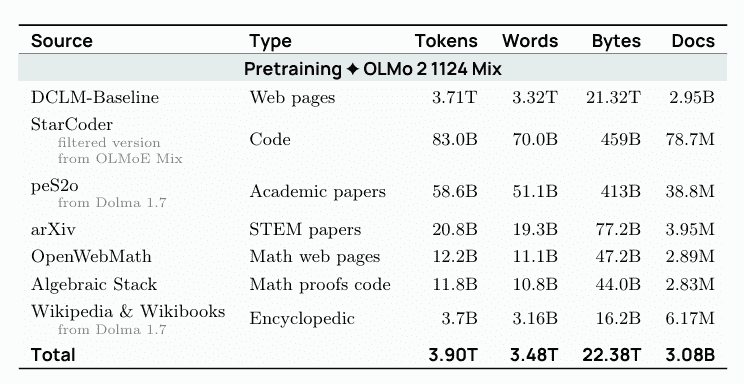
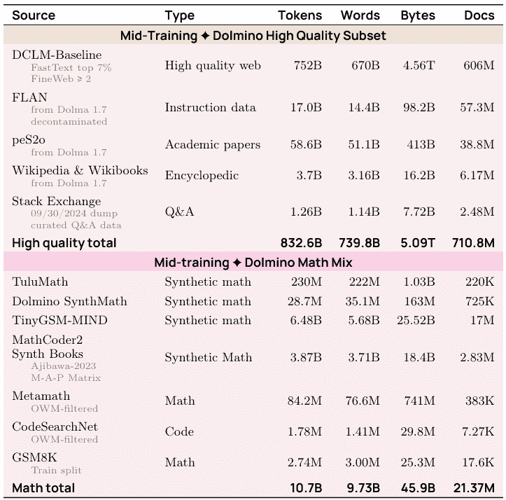
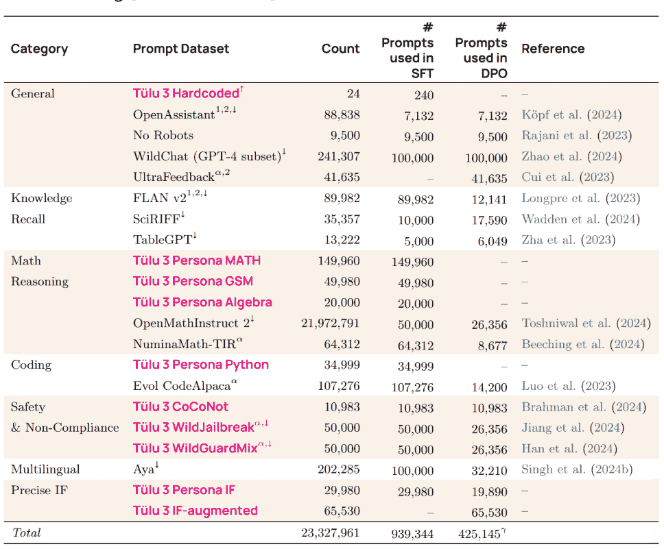
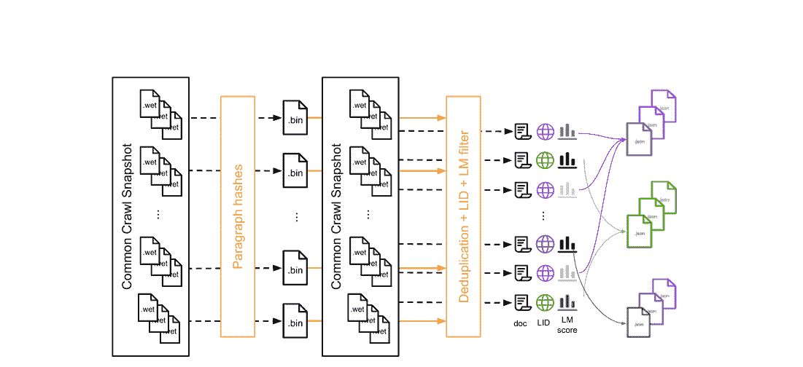
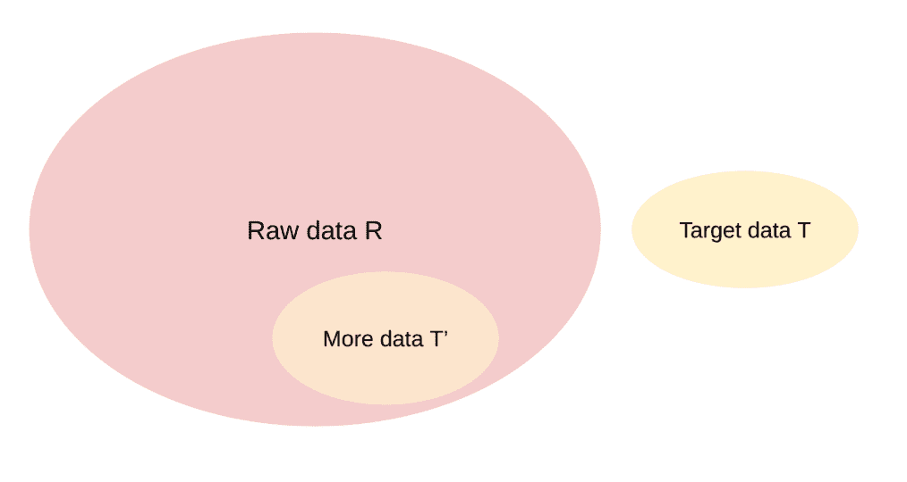
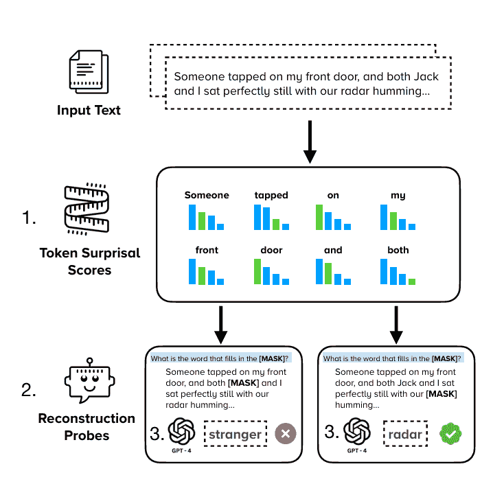

# 第十一章：数据工程

> 来源：[https://qqs7y1hozd1.feishu.cn/docx/EFdDdBsPOosikzxpL7vcikoWntb](https://qqs7y1hozd1.feishu.cn/docx/EFdDdBsPOosikzxpL7vcikoWntb)

在前面的课程中，讨论的是在训练数据已经给定的前提下，如何通过架构设计、优化方法、分词技术和规模扩展来训练更强的模型；而从这一讲开始，我们将转向一个更根本的问题：语言模型究竟应该用什么数据来训练。

# 11.1 数据获取

无论是Llama 3还是DeepSeek，他们不仅开源权重，甚至公开架构细节，但唯独对数据闭口不谈。除了商业机密和法律风险外，更因为数据清洗和配方 才是现代LLM的核心。

为了理解数据在LLM中的作用，需要从整体上把握大模型训练的生命周期，与早期“端到端一次性训练”的范式不同，现代大语言模型的构建过程呈现出明显的分阶段特征。通常而言，其训练流程可划分为三个相互衔接、目标各异的阶段：预训练（Pre-training）、中期训练（Mid-training）以及后训练（Post-training），不同阶段对数据类型、规模与质量的要求存在显著差异，共同决定了模型的通用能力、领域适应性与最终可用性。

+   预训练： 数据主要来源于大规模原始语料，包括网络抓取数据如Common Crawl、书籍与维基百科等，数据规模通常达到万亿级Token约3T–15T。该阶段的核心目标是让模型系统性地学习自然语言的统计规律、语法结构以及广泛的世界知识，奠定通用语言建模能力。本教程将重点围绕这一阶段展开。

+   中期训练： 数据来源于经过严格筛选的高质量文本，尤其强调 STEM 类数据（数学、代码）以及长上下文文档，规模一般为百亿至千亿级Token。该阶段主要用于在保持通用能力的同时，定向强化模型在推理、数学、代码生成和长文本理解等方面的能力，起到连接预训练与后续对齐训练的桥梁作用。

+   后训练： 数据以人工构造或标注数据为主，包括指令数据（SFT）、多轮对话数据以及基于人类偏好的反馈数据如RLHF。该阶段的目标不在于扩展知识规模，而是引导模型学习遵循指令、进行安全且有帮助的交互，并在行为层面与人们的价值观和使用期望保持一致。

## 11.1.1 训练数据

当今被广泛采用的数据与训练标准，并非凭空产生而是在长期实践与不断试错中逐步演化而来的。

1.  BERT

BERT的预训练并非简单地“堆数据量”，而是有明确的数据结构假设。其训练语料来自BooksCorpus约8亿词和英文维基百科约25亿词，两者的共同特点是包含大量长、连续、自然形成的文档级文本。 在维基百科中，仅使用正文段落并刻意剔除了列表、表格和标题等结构化内容，以避免干扰语言的自然上下文流动，这一选择直接服务于BERT的核心目标——学习跨句甚至跨段的语义依赖关系。

> BERT 的预训练强调使用文档级语料库，而非仅由随机打乱的句子级独立样本构成的语料?

> 相比之下，诸如Billion Word Benchmark这类将句子级独立样本随机打乱的语料虽然规模庞大，但BERT的双向Transformer需要文档级文本才能充分利用上下文信息，而短句子或被打乱的句子会削弱模型学习跨句依赖和语义表示的能力。

1.  GPT-2从网页中“淘金”

早期的语言模型训练多依赖单一、高质量但规模有限的语料，例如图书和维基百科。虽然网络数据覆盖面广，但噪声严重直接使用会影响模型效果。为此，OpenAI提出了一种巧妙的启发式数据筛选方法：

+   WebText数据集构建：并非直接抓取整个网络，而是从Reddit社区精选外部链接。

+   筛选标准：仅收录那些出现在获得至少3个赞 的帖子中的链接对应网页。

+   设计逻辑：如果至少有3个用户认为该链接有价值，那么该网页被认为具有一定可信度从而有效排除了大量垃圾广告和低质量内容。

> 这一策略在保证网络数据规模的同时有效提升了数据质量，为大规模语言模型训练奠定了早期经验基础。

1.  GPT-3规模化与多样性

随着模型规模不断扩大，单一的数据源已经无法满足训练需求，GPT-3引入了更大规模、更复杂的数据策略：

+   Common Crawl的引入 Common Crawl爬取整个互联网的网页，为语言模型提供海量原始文本。虽然覆盖面广，但其中存在大量噪声。

+   GPT‑3 的质量控制策略 为了从庞大的网络抓取数据中提取高价值语料，OpenAI对原始文本进行了系统的数据清理与预处理：

+   去重：删除重复内容，避免模型过度记忆单一文本。

+   去HTML标签：剔除网页标记、广告脚本等非文本信息。

+   清理非文本内容：移除乱码、低质量文本或非自然语言数据。

> 这一处理策略在保持海量数据规模的同时有效提升了语料质量，减少了噪声对模型训练的干扰，为GPT‑3的高性能和强泛化能力奠定了基础。

+   The Pile开源多样化语料集 EleutherAI社区提出The Pile，进一步增强训练数据的多样性：

+   数据覆盖22个高质量领域，包括ArXiv科研论文、GitHub代码、StackExchange问答、技术邮件数据等。

+   这种做法不仅保留了网络文本的规模优势，还补充了学术、专业和对话文本，从而提高模型对不同任务和领域的适应能力。

> GPT-3的经验表明单纯追求数据规模不足以训练高性能模型，数据的质量控制和多样性覆盖同样关键，这也是现代 LLM 数据策略设计的重要启示。

1.  近期大语言模型训练数据来源

+   OLMo 2训练数据



图11.2 预训练数据来源

1)预训练阶段

包含大量通用文本，这个阶段目的建立模型的通用语言理解和基础知识能力。

+   数据占比：占总训练计算量的90%–95%。

+   数据组合：约3.9 万亿 tokens，其中超过95%来源于网页文本。

+   DCLM-Baseline：提供基础网页文本，占大部分。

+   StarCoder：提供高质量代码数据，剔除了低星项目和非文本文件。

+   其他来源：包括学术论文、arXiv（STEM论文）、OpenWebMath 和Algebraic Stack（数学与证明）、Wikipedia（百科知识）。

2)中期训练阶段

数据占比是占总训练计算量的5%–10%，数据组合为注入特定领域知识并强化数学能力，这个阶段目的是提升模型在特定领域的推理、数学和专业能力。



图11.3 中期训练数据来源

+   高质量网页：从DCLM中筛选得分最高的7%数据，以及FineWeb指标高的内容。

+   课程数据：包括FLAN指令数据、Stack Exchange问答数据、学术论文和 Wikipedia。

+   数学增强：约107 亿 tokens，包括TuluMath（合成数学题）、TinyGSM-MIND（合成数学对话）、MathCoder2（合成书籍）。

3)后训练阶段



图11.4 后期训练数据来源

该阶段的目标是提升OLMo 2在真实交互场景中的表现，重点包括指令遵循**能力、人类偏好对**齐能力，以及在数学推理等高可靠性任务上的稳定性与正确性，其采用了Tülu 3框架下的多策略对齐训练流程：首先通过SFT（监督微调），使用基于PersonaHub方法生成的规模化合成指令数据约86.6万条，并混合WildChat等真实对话数据，使模型学会规范响应各类指令；随后采用DPO（直接偏好优化），从20个不同模型家族中采样候选回答，并由GPT-4o进行偏好评估，构建UltraFeedback偏好数据集，以对齐模型输出与人类偏好；最后引入RLVR（基于可验证奖励的强化学习），在数学等具有客观正确答案的任务上，使用GSM8K、MATH等数据集进行强化训练，从而显著提升模型推理结果的可靠性。

+   Qwen3训练数据集

1)预训练阶段

在这一阶段，Qwen3大规模预训练语料主要以通用网页文本和多语种内容为主，总规模达到约36万亿tokens几乎是Qwen2.5的两倍，覆盖了119种语言和方言。 为了构建高质量且多样的基础语料集，团队不仅收集了互联网文本，还从大量PDF类文档中提取结构化文本。提取过程使用了微调以后的Qwen2.5‑VL这类视觉‑语言模型来识别PDF内嵌文字，再通过 Qwen2.5基础模型进行清洗与质量提升，从而获得高质量的训练tokens。此阶段的核心目标是让模型建立坚实的通用语言能力和世界知识基础。

2)中期训练阶段

第二阶段的重点转向高质量知识密集型内容，显著提高科学、技术、工程、数学(STEM)、逻辑推理、编程等数据的占比。 在这个阶段，除了引入精选真实语料外，还利用特定领域专家模型合成训练数据：

+   使用Qwen2.5‑Math生成数学问题及解析语料；

+   使用Qwen2.5‑Coder生成代码示例和程序语料；

+   还可能生成诸如教科书式文本、问答对等丰富内容。 第二阶段额外补充了约5万亿高质量tokens，以增强模型的专业推理和问题解决能力。

3)后训练阶段

在Qwen-3的最后训练阶段，模型的重点是处理长文本的能力。为了让模型能理解更长的文档、对话或复杂内容，训练时使用了大量长上下文语料，并将模型的最大上下文长度从4,096 tokens扩展到了32,768tokens。 为了获得足够的训练样本，其中一部分文本是由大模型生成的合成数据Qwen-3还在这个阶段做了指令微调和对齐操作：

+   使用合成数据训练模型如何理解和执行指令；

+   教模型进行多步推理，并对齐人类偏好。

总结： Qwen-3的后训练结合了真实数据和合成数据：真实数据奠定基础，合成数据高效增强模型在长文本理解和指令执行上的能力，让模型在处理超长内容时更稳、更智能。

合成数据已成为加速模型训练、增强对稀缺与长尾场景泛化能力的重要手段。 其作用可类比于学生的练习题：题目由教师或专家系统精心设计，虽不完全等同于真实考试情境，但能够在可控、安全的环境中系统性地训练逻辑推理能力与问题解决技能。近年来，大语言模型（LLMs）的训练范式呈现出清晰的数据功能分工：

+   基础预训练阶段 主要依赖大规模真实世界文本，以学习语言结构、世界知识与统计共现规律；

+   指令对齐与后训练阶段 则高度依赖合成数据，通过专家模型或规则系统生成高质量指令—响应样本，系统性地教授模型如何遵循指令、进行多步推理，并对齐人类偏好与价值约束。

这种“真实数据奠基、合成数据精调”的数据协同范式，已成为当前大模型训练流程中的关键组成部分

> 为什么现在流行用一个大模型生成的数据去训练另一个模型？

不同大模型在处理语言和推理任务时，会表现出类似的模式或“思考方式”。这并不是说模型真的会思考，而是它们在学习语言规律和逻辑关系的方式很相似。借助一个已经具备良好语言理解能力的大模型去生成训练数据，就像给新模型提供了一套示范答案或解题模板，让新模型知道“应该怎么做”，这种方法有两个明显的好处：

1.  提供高质量示例 大模型生成的数据通常逻辑清晰、语言自然，比随机抓取或人工拼凑的数据更适合训练模型学习推理和回答问题的能力。

1.  节省人工标注成本 不必花费大量人力去编写或审核数据，就能得到丰富且多样的训练样本。

> 换句话说这是在用“有经验的老师”（大模型）的经验指导“新学生”（新模型）学习，让新模型更快、更稳地掌握复杂任务，同时降低成本和时间消耗。

## 11.1.2 特殊领域数据

通用网页文本，比如维基百科、新闻、社交平台的交流记录等，只能让模型掌握基础常识和日常语言模式。要让模型真正“聪明”，能够解决复杂问题、进行逻辑推理或掌握专业知识，就需要引入一些高质量、专业化的数据源，覆盖逻辑推理、科学知识、编程、数学等领域。

1.  代码

来源与特点 GitHub是目前最大的开源代码平台，包含各种编程语言、项目类型和应用场景，但是直接clone全仓库不可取，原因是大量非代码文件（文档、图片等）会增加噪声，且存在重复内容或模板代码会影响模型多样性学习，自动生成代码和低质量仓库可能引入错误模式。

处理方式

+   去重：删除重复代码片段或相似仓库，确保数据多样性。

+   许可证过滤：解析每个仓库的 License，避免训练使用未授权的代码。

+   质量筛选：剔除自动生成代码、空仓库或没有 README 的低质量项目。

作用与意义

+   写代码能力：模型可以生成、补全、调试和优化代码。

+   逻辑推理能力：研究显示，训练在代码上的模型，在多步骤推理、问题分解和抽象思维方面能力显著增强。

+   示例：Python 算法实现、SQL查询优化、数学公式计算等都能从代码数据中学到模式和结构。

1.  书籍

意义

+   书籍通常提供比网页更长的上下文，叙事连贯、结构完整。

+   有助于模型学习：

+   长文本理解：追踪情节、推理人物动机或逻辑关系。

+   故事逻辑：理解事件顺序、因果关系和论证链条。

版权

公版书：如Gutenberg项目提供的经典书籍，版权明确、安全可用； 非公版书籍：如Books3数据集，可能来源于影子图书馆，存在版权风险。

使用提示

+   优先使用公版或授权书籍，既保证法律合规，又确保高质量文本。

+   可以对书籍进行章节拆分、段落标注，便于模型学习上下文关系。

+   示例：小说、科普书、专业教材等，尤其适合训练长上下文理解和叙事生成能力。

1.  数学与科学

ArXiv论文

提供经过LaTeX转换的高密度科学文本，包括公式、图表和结构化推理内容，适合训练模型的：

+   科学理解能力：学习术语、概念和推理方法。

+   专业问答能力：解决科学、技术、工程、数学等问题。

StackExchange问答

+   问答形式天然适合指令遵循训练。

+   每个问题通常附带最佳答案、评论和多步推理过程，有助于模型： 学习问题拆解与推理流程； 提升生成准确、清晰回答的能力。

使用注意

对科学数据可进行公式解析、文本清洗、问题-答案对齐，提升训练效果，可结合ArXiv与StackExchange，让模型既掌握理论知识，又具备实战问题解决能力。

总结

> 总结一句话，对于刚开始一无所知的大模型，就像一个不怎么了解世界的小孩子——通用文本教它如何“看世界”，认识各种事物和日常常识；而特殊领域数据则教它如何“理解世界”，分析问题、推理判断。两者结合，让模型逐渐学会独立思考，能够面对复杂任务做出更智能的决策。

## 11.1.3 数据安全问题

在大模型的数据工程中，安全问题是无法回避的雷区。不处理好这些问题，可能会导致法律风险、模型偏差，甚至被攻击者利用。

1.  版权困境

现状： 几乎所有互联网内容，即便没有明确声明版权，也默认受到保护包括博客、新闻、书籍、代码等。训练大模型使用这些内容，可能涉及版权问题。

合理使用： AI公司通常给出一些合理的解释： 模型不是简单复制内容，而是从大量文本中学习统计规律和语言模式； 输出的是生成文本，而不是直接再现训练数据的原文， 比如OpenAI和其他大模型公司在法庭上主张训练属于合理使用的一部分。

风险：

+   各大新闻机构如《纽约时报》正在对OpenAI提起版权诉讼，如果败诉则AI训练可能需要大量购买版权许可，成本显著上升。

+   对开发者的启示：使用有版权的数据进行训练或微调时，要特别注意授权，优先选用公版、开源或自有数据。

1.  数据投毒

概念： 数据投毒指攻击者在公开数据源中注入特定“恶意触发模式”或错误信息，当这些数据被抓取并用于训练时，模型可能学习到错误行为或生成不安全输出。

实例：

+   维基百科或论坛帖子中，攻击者可能插入恶意文本或虚假信息。

+   即便有数据回滚机制，一些恶意内容已经被CommonCrawl等爬虫抓取，进入训练集。

影响 模型可能生成带偏见或错误的回答，这在一些高风险领域（如医疗、金融、法律）可能导致严重后果。

应对策略：

+   数据清洗与过滤：移除明显异常或恶意内容；

+   数据验证：对关键领域数据进行人工或半自动审核；

+   持续监控：训练后对模型输出进行安全评估。

> 总结在大模型训练中，安全问题主要包括版权风险、数据投毒和爬虫协议合规。

## 11.1.4 互联网数据清洗

互联网数据常用的数据清理方法包括：

+   启发式（规则） 通过人工设计的简单规则对网页文本进行过滤如C4数据集的清洗策略，主要依据文本的表面特征进行筛选。该方法实现简单、计算效率高，能够在大规模数据处理中快速去除明显噪声，适合用于数据清洗的早期预处理阶段。然而，由于规则覆盖能力有限，启发式方法容易误删代码、诗歌等非典型文本，从而限制了其在高质量语料筛选中的效果。

基于代码实现的启发式清洗数据

```
import re
from bs4 import BeautifulSoup

def clean_web_text_strict(html_text):&quot;&quot;&quot;
    启发式清洗网页文本（参考部分C4原则）：
    &quot;&quot;&quot;# 使用BeautifulSoup解析HTML内容
    soup = BeautifulSoup(html_text, &#x27;html.parser&#x27;)# 剔除非正文性质的HTML标签# table: 表格, pre、code: 代码块, ul、ol、li: 列表# blockquote: 引用的脚注或上下标for tag in [&#x27;table&#x27;, &#x27;pre&#x27;, &#x27;code&#x27;, &#x27;ul&#x27;, &#x27;ol&#x27;, &#x27;li&#x27;, &#x27;blockquote&#x27;, &#x27;sup&#x27;, &#x27;sub&#x27;]:for element in soup.find_all(tag):
            element.decompose()  # 彻底删除该元素及其子元素# 获取纯文本，separator=&#x27;\n&#x27; 确保块级元素之间有换行，避免文字粘连
    text = soup.get_text(separator=&#x27;\n&#x27;)# 按行拆分，并去除每一行首尾的空格，过滤掉空的行
    paragraphs = [p.strip() for p in text.split(&#x27;\n&#x27;) if p.strip()]

    filtered_paragraphs = []for para in paragraphs:# 过滤规则 A：删除不以标点结尾的段落# 这里的正则表达式匹配中文的 。！？ 和英文的 .!?# 如果段落结尾没有这些符号，通常认为是不完整的句子或导航栏、标题if not re.search(r&#x27;[。！？\.!?]$&#x27;, para):continue# 过滤规则 B：删除少于三句话的段落，通过统计段落中出现的终止标点数量来估算句子数量# re.findall会返回所有匹配标点的列表，len()计算其长度
        sentence_count = len(re.findall(r&#x27;[。！？\.!?]&#x27;, para))if sentence_count &lt; 3:continue# 经过层层筛选，保留高质量段落（同时满足A、B规则）
        filtered_paragraphs.append(para)# 后处理：合并段落，使用单个换行符连接所有保留的段落
    cleaned_text = &#x27;\n&#x27;.join(filtered_paragraphs)# 正则替换：将两个或更多连续的换行符替换为单个换行符，确保输出文本格式整洁
    cleaned_text = re.sub(r&#x27;\n{2,}&#x27;, &#x27;\n&#x27;, cleaned_text)return cleaned_text


# --- 测试区域 ---
html_example = &quot;&quot;&quot;
&lt;html&gt;
&lt;body&gt;
    &lt;h1&gt;网页标题&lt;/h1&gt; 
    &lt;p&gt;这是第一段，内容完整。第二句。第三句。&lt;/p&gt; 
    &lt;p&gt;短段落。仅两句不保留。&lt;/p&gt; 
    &lt;pre&gt;代码块内容，不保留&lt;/pre&gt; 
    &lt;table&gt;&lt;tr&gt;&lt;td&gt;表格内容&lt;/td&gt;&lt;/tr&gt;&lt;/table&gt;
    &lt;ul&gt;&lt;li&gt;列表内容，不保留&lt;/li&gt;&lt;/ul&gt;
    &lt;blockquote&gt;引用内容，不保留&lt;/blockquote&gt; 
    &lt;p&gt;另一段自然语言。第二句。第三句。&lt;/p&gt; 
    &lt;p&gt;第三段，保留。第二句。第三句。&lt;/p&gt;
&lt;/body&gt;
&lt;/html&gt;
&quot;&quot;&quot;# 执行清洗并打印结果
cleaned_text = clean_web_text_strict(html_example)print(&quot;--- 清洗后的文本 ---&quot;)print(cleaned_text)Copy to clipboardErrorCopied
```

+   基于模型困惑度的文本质量清洗数据

一种常用的文本质量筛选方法是利用n‑gram模型或预训练语言模型计算文本的困惑度（Perplexity），核心思想是：

+   低困惑度文本 通常语法正确、语义合理，质量接近百科级，有助于减少训练噪声。

+   高困惑度文本 可能包含乱码、语法错误或不连贯内容。

优点：提高语料质量，减少模型训练中的噪声；保留规范书面语，适合对文本质量要求高的场景。

缺点：可能丢失长尾、口语化或创新表达；降低数据多样性。

实践： CCNet通过语言模型困惑度对文本质量进行自动评估，利用低困惑度文本更符合自然语言分布的特性，实现了无需人工规则的大规模多语言文本清洗。

+   [CCNet研究](https://arxiv.org/pdf/1911.00359)发现，不同语言的困惑度分布差异显著：

+   一些语言困惑度分布峰值很高，而另一些语言困惑度分布分散。

+   这种差异主要与训练语言模型时的维基百科语料量有关，而不是高质量内容不足。

因此，对多语言语料库，需要为每种语言设置不同的困惑度阈值 阈值选择可以采用分位数策略，例如将语料库按困惑度平均分为三部分，仅保留中间部分，以兼顾文本质量和覆盖度。



图11.6 CCNet工作原理

CCNet的简易实现

```
import torch
import numpy as np
from transformers import GPT2LMHeadModel, GPT2Tokenizer
from typing import List

class AutoPerplexityFilter:def __init__(self, model_name=&#x27;distilgpt2&#x27;):&quot;&quot;&quot;
        初始化：distilgpt2是GPT-2的蒸馏版，体积更小，运行更快。
        &quot;&quot;&quot;print(f&quot;正在加载语言模型: {model_name}...&quot;)
        self.tokenizer = GPT2Tokenizer.from_pretrained(model_name)# 语言模型：计算文本概率分布
        self.model = GPT2LMHeadModel.from_pretrained(model_name)# 开启显式Loss计算模式
        self.model.config.loss_type = &quot;ForCausalLMLoss&quot;# 设为评估模式
        self.model.eval()# 用于存储不同语种的校准阈值(字典结构)
        self.thresholds = {}def calculate_score(self, text: str) -&gt; float:&quot;&quot;&quot;
        核心数学计算：自动计算一段文本的困惑度(PPL)。
        公式：PPL = exp(Cross-Entropy-Loss)
        &quot;&quot;&quot;# 将文本编码并转换为PyTorch张量
        inputs = self.tokenizer(text, return_tensors=&quot;pt&quot;)# 如果文本太短（Token数量少于或等于1），模型无法计算预测概率，返回最大困惑度if inputs[&#x27;input_ids&#x27;].size(1) &lt;= 1:return 999.9# 禁用梯度计算，节省显存并加快速度with torch.no_grad():# labels=inputs[&quot;input_ids&quot;] 告诉模型我们要根据当前词预测下一个词
            outputs = self.model(**inputs, labels=inputs[&quot;input_ids&quot;])# loss是交叉熵损失
            loss = outputs.loss
            # 困惑度是Loss的指数形式，反映了模型对这段话的“疑惑程度”
            ppl = torch.exp(loss).item()return ppl

    def calibrate(self, lang: str, sample_texts: List[str]):&quot;&quot;&quot;
        CCNet核心校准：设定该语种的动态阈值。
        即便模型对某种语言天然不熟悉（导致PPL普遍偏高），
        通过分位数方法（Quantiles），我们依然能挑出该语种中“相对较好”的部分。
        &quot;&quot;&quot;print(f&quot;正在进行 [{lang}] 语种校准...&quot;)# 计算该语种样本集中每一条文本的 PPL
        scores = [self.calculate_score(t) for t in sample_texts]# 将样本按PPL从小到大排序，并取出33%和66%处的值# t1 (33.33%): 优质界限，低于此值的属于该语种中最像自然语言的部分
        t1 = np.percentile(scores, 33.33)# t2 (66.66%): 噪声界限，高于此值的通常被认为是格式混乱或乱码
        t2 = np.percentile(scores, 66.66)

        self.thresholds[lang] = (t1, t2)print(f&quot;[{lang}] 校准完成 -&gt; 优质界限: {t1:.2f}, 噪声界限: {t2:.2f}&quot;)def filter_text(self, lang: str, text: str) -&gt; str:&quot;&quot;&quot;
        执行分类：根据计算出的PPL与校准阈值进行比对。
        &quot;&quot;&quot;
        score = self.calculate_score(text)# 容错：如果该语种没经过calibrate校准，则无法分类if lang not in self.thresholds:return f&quot;PPL={score:.1f} (该语种尚未建立阈值标准)&quot;

        t1, t2 = self.thresholds[lang]# 分类逻辑if score &lt;= t1:return f&quot;PPL={score:.1f} -&gt; [优质] (符合模型分布的精华语料)&quot;elif score &lt;= t2:return f&quot;PPL={score:.1f} -&gt; [中等] (一般的自然语言)&quot;else:return f&quot;PPL={score:.1f} -&gt; [噪声] (乱码、广告或非典型文本)&quot;# 模拟CCNet运行流水线# 提供“黄金参考数据”（通常采样自维基百科），这些数据用于告诉模型：在这个语言里，什么样的文本是“正常”的。
zh_reference = [&quot;人工智能是计算机科学的一个分支，旨在模拟人类智能。&quot;,&quot;今天北京的天气非常晴朗，适合户外运动。&quot;,&quot;深度学习模型需要大量的高质量标注数据进行训练。&quot;,&quot;故宫是中国古代宫廷建筑的精华，每年吸引大量游客。&quot;,&quot;Python 是一种广泛应用于数据分析和机器学习的编程语言。&quot;]

en_reference = [&quot;Machine learning is the study of computer algorithms that improve automatically.&quot;,&quot;The capital of France is Paris, known for its iconic Eiffel Tower.&quot;,&quot;Quantum computing is a type of computation that harnesses collective properties.&quot;,&quot;Healthy eating and regular exercise are key to a long life.&quot;,&quot;Open-source software allows anyone to inspect, modify, and enhance the code.&quot;]# 初始化自动过滤器，此时会下载\加载模型，可能需要几分钟（视网速而定）
cleaner = AutoPerplexityFilter()# 校准阈值CCNet的精华所在：“因地制宜”
cleaner.calibrate(&quot;zh&quot;, zh_reference)
cleaner.calibrate(&quot;en&quot;, en_reference)# 测试实际抓取的网页数据print(&quot;\n&quot; + &quot;=&quot; * 60)print(f&quot;{&#x27;语种&#x27;:&lt;4} | {&#x27;文本片段&#x27;:&lt;25} | {&#x27;检测结果&#x27;}&quot;)print(&quot;-&quot; * 60)

test_data = [(&quot;zh&quot;, &quot;机器学习是研究计算机如何模拟人类学习行为的科学。&quot;),(&quot;zh&quot;, &quot;123 !! #￥%…… 乱码测试456&quot;),(&quot;en&quot;, &quot;Machine learning is the cornerstone of artificial intelligence.&quot;),(&quot;en&quot;, &quot;asdfghjkl qwert yuiop zxcvbnm&quot;),]for lang, text in test_data:
    result = cleaner.filter_text(lang, text)# 截取前20个字符显示，方便观察表格
    short_text = text[:20] + &quot;...&quot; if len(text) &gt; 20 else text
    print(f&quot;{lang:&lt;6} | {short_text:&lt;28} | {result}&quot;)Copy to clipboardErrorCopied
```

以上代码中的简易CCNet清洗网络文本数据的原理为——高质量的自然语言文本通常符合语法和语义规律，语言模型对其预测较为容易，因此困惑度较低；而乱码、广告文本或非自然语言内容往往偏离自然语言分布，模型预测难度较大，对应的困惑度较高。

> 选取GPT-2轻量级模型进行语言分布计算的原因：GPT-2轻量级模型便于快速计算文本困惑度，其原理是基于语言模型对文本序列的预测难度衡量语料质量。尽管GPT-2对中文的困惑度绝对值并非完全精确，但在简易CCNet的语言内校准框架下，困惑度仍能有效区分自然语言文本与明显噪声文本，因此该模型可以用于方法原理的示例演示和概念验证。

# 11.2 数据智能筛选

研究各类基于模型的数据筛选算法——即通过训练分类器或其他预测模型来对数据进行智能筛选，展示这些基础方法在不同筛选任务中的广泛应用，并探讨几种高效的策略。



图11.7 原始数据与处理后的数据关系

其中给定某些目标数据 TT 和大量原始数据 RR ，从 RR 中找出与 TT 相似的子集 T′T′ 。

## 11.2.1 数据过滤

当原始数据量很大比如Common Crawl网络数据，而且我们希望既得到高质量信息又保持处理速度时，直接用大型模型并不划算，下面介绍3种高效的数据处理方法：

### Kenlm

Kneser–Ney平滑是一种常用的n-gram平滑方法，能够有效提升语言模型在低频或未见n-gram上的概率估计精度。其核心思想是利用低阶n-gram的分布信息，通过插值与概率重分配对高阶n-gram进行调整，从而缓解零概率问题，并改善长尾 n-gram的估计效果。

> n-gram模型的缺点在于某些n个token的组合在语料中可能极少甚至未出现，从而导致其概率估计不可靠；此外，随着n 的增大，模型需要存储和计算的n-gram数量呈指数增长，面临维度灾难问题。

### FastText

FastText是一种文本线性分类器，通过对文本进行嵌入和降维，显著减少模型参数并加速计算，同时借助n-gram词袋增强文本表示，为避免n-gram数量过大导致的存储和计算开销，采用哈希映射进行高效处理。

> FastText处理流程：文本 → n-gram → 哈希桶（索引映射到embdding） → embedding → 平均 → 分类。

n-gram词袋以及哈希映射解释

n-gram是把文本拆成连续的n个词的组合。

举例文本："I like AI"

+   1-gram：["I", "like", "AI"]

+   2-gram：["I like", "like AI"]

+   3-gram：["I like AI"]

n-gram词袋就是把这些n-gram当作特征向量，统计它们在文本里出现的次数：

每个维度对应一个n-gram。

当文本很大时，n-gram的数量可能爆炸因为存储每个n-gram非常浪费内存，哈希映射的思路是：

+   不存n-gram的完整词表，而是用一个哈希函数把n-gram映射到固定数量的桶（bin）里。

+   不同的n-gram可能映射到同一个桶即哈希冲突可以接受，LLM仍能学习到规律。

举例假设我们只准备8个桶（0~7），用简单哈希映射：

```
n_grams = [&quot;I like&quot;, &quot;like AI&quot;, &quot;I&quot;, &quot;like&quot;, &quot;AI&quot;]
num_bins = 8 
hashed = [hash(g) % num_bins for g in n_grams]print(hashed)  # 可能输出：[3, 1, 4, 2, 7]Copy to clipboardErrorCopied
```

> 即便不同n-gram即单个token或者连续几个token组成的特征向量映射到同一个桶，也不会影响整体模型学习。

FastText的关键功能函数

```
# 词袋n-gram获取函数def get_ngrams(tokens, n):&quot;&quot;&quot;
    生成n-gram词组，这是FastText捕捉词序的关键。
    &quot;&quot;&quot;
    ngrams = []for i in range(len(tokens)):for j in range(1, n + 1): # 循环生成 1-gram到n-gramif i + j &lt;= len(tokens):# 将词组拼接成字符串，作为特征
                ngrams.append(&quot; &quot;.join(tokens[i:i + j]))return ngrams

def hash_ngrams(tokens, num_buckets, ngram):&quot;&quot;&quot;
    哈希映射
    &quot;&quot;&quot;
    ngrams = get_ngrams(tokens, ngram)# 对每一个生成的特征求hash并取模，得到对应的Embedding索引return torch.tensor([hash(g) % num_buckets for g in ngrams], dtype=torch.long)def hash_ngrams(tokens, num_buckets, ngram):
    ngrams = get_ngrams(tokens, ngram)# 使用内置hash并取模，转化为Tensor格式return torch.tensor([hash(g) % num_buckets for g in ngrams], dtype=torch.long)class TextDataset(Dataset):&quot;&quot;&quot;
    数据封装：将原始文本转化为哈希索引序列。
    &quot;&quot;&quot;def __init__(self, texts, labels):
        self.texts = texts
        self.labels = torch.tensor(labels)def __len__(self):return len(self.texts)def __getitem__(self, idx):# 预处理：统一转小写并按空格分词
        tokens = self.texts[idx].lower().split()# 将词和n-gram映射为哈希桶索引
        hashed_ids = hash_ngrams(tokens, num_buckets, ngram)
        label = self.labels[idx]return hashed_ids, label

def collate_fn(batch):&quot;&quot;&quot;
    整理函数：因为每句话包含的n-gram数量不同，需要对齐长度才能放入Batch训练。
    &quot;&quot;&quot;# 找到当前Batch中最长的序列长度
    max_len = max(len(x[0]) for x in batch)
    padded = []
    labels = []for hashed_ids, label in batch:# 计算需要填充的长度
        pad_len = max_len - len(hashed_ids)# 在序列末尾填充0
        padded_ids = F.pad(hashed_ids, (0, pad_len), value=0)
        padded.append(padded_ids)
        labels.append(label)# 堆叠[Batch_Size, Max_Len]形状的张量return torch.stack(padded), torch.tensor(labels)class FastTextClassifier(nn.Module):def __init__(self, num_buckets, embed_dim, num_classes):super().__init__()# 嵌入层：包含所有哈希桶的词向量矩阵，随机初始化并在训练中学习
        self.embedding = nn.Embedding(num_buckets, embed_dim)# 全连接层：直接将平均后的嵌入向量映射到类别概率（线性分类）
        self.fc = nn.Linear(embed_dim, num_classes)def forward(self, x):# 查表：[Batch_Size, Seq_Len] -&gt; [Batch_Size, Seq_Len, Embed_Dim]# 将每个哈希索引变成一个特征向量
        embedded = self.embedding(x)          
        
        # 平均池化将句子中所有词和n-gram的向量求平均，得到句子的全局表示# 这种做法忽略了远距离词序，但在文本分类任务中极其高效
        avg_embedded = embedded.mean(dim=1)   # [Batch_Size, Embed_Dim]# 输出层：计算每个类别的得分 (Logits)
        logits = self.fc(avg_embedded)        
        return logitsCopy to clipboardErrorCopied
```

完整可运行的[FastText](https://github.com/1iyouzhen/CS336-Chinese-co-construction/blob/main/docs/chapter11/FastText.py)

输出示例

> 输入文本: I hate this product

> 预测概率: 正面=0.0034, 负面=0.9966

> 预测类别: 负面

这里的训练文本信息的样本规模较小，模型参数初始化、随机哈希映射以及训练过程中的样本顺序都会引入较强的随机性，FastText难以形成稳定有效的判别规则进而导致多次训练结果不一致。

1.  DSIR

[https://github.com/user-attachments/ass](https://github.com/user-attachments/assets/0cdd6689-5747-4a81-bffc-5f3923b346ab)ets/0cdd6689-5747-4a81-bffc-5f3923b346ab

图11.8 DSIR处理

用低成本的统计特征近似语言分布，通过重要性重采样实现大规模语料的分布对齐，是一种无监督数据选择方法。

+   目标数据集 DpDp 规模较小但质量高的数据集比如维基百科，用于刻画我们希望语言模型最终学习到的目标分布 p~(x)p~(x) 。

+   候选数据池 DqDq 规模巨大、来源广泛但质量参差不齐的数据集合比如网页抓取文本，近似服从候选分布 q~(x)q~(x) 。

+   核心目标为重要性重采样 对候选池中的每个样本 x∈Dqx∈Dq ，估计其在目标分布与候选分布下的近似密度比 w(x)=p~(x)q~(x)w(x)=q~(x)p~(x) ，其中 w(x)w(x) 衡量样本 xx 与目标分布的“相似程度”。

+   w(x)w(x) 较大：样本在目标分布中较常见，而在候选分布中相对稀有 → 更值得保留。

+   w(x)w(x) 较小：样本偏离目标分布，或在候选数据中常见 → 降低采样概率或丢弃。

> DSIR的本质是：用一个小而干净的数据集告诉我们“什么样的文本是好文本”，再从海量原始数据中按这个标准把这些文本挑出来。

```
import numpy as np
from collections import Counter
def dsir_main(n):# n: n-gram 的大小# 特征构建 - Hashed n-grams
    training_text = &quot;the cat in the hat&quot;  # 模拟目标数据集D_p
    num_bins = 4  # 哈希桶数量（真实场景中通常 1e4 ~ 1e6）def get_hashed_ngrams(text: str, n: int):#将文本转换为 n-gram，并映射到固定哈希空间
        tokens = text.lower().split()# 构造 n-grams
        ngrams = [&quot; &quot;.join(tokens[i:i+n])for i in range(len(tokens) - n + 1)]# 哈希映射到 [0, num_bins)return [hash(ngram) % num_bins for ngram in ngrams]# 目标数据D_p的特征
    training_hashed_ngrams = get_hashed_ngrams(training_text, n)print(f&quot;目标数据哈希索引 D_p (n={n}):&quot;, training_hashed_ngrams)# 分布建模 - 估计p_hat
    counter = Counter(training_hashed_ngrams)
    total = len(training_hashed_ngrams)
    probs = np.array([counter[i] / total for i in range(num_bins)])print(&quot;学习到的目标分布 p_hat:&quot;, probs)# 样本评分 - 候选数据D_q
    test_text = &quot;the cat&quot;
    hashed_ngrams = get_hashed_ngrams(test_text, n)print(f&quot;测试文本 &#x27;{test_text}&#x27; 的哈希索引:&quot;, hashed_ngrams)
    eps = 1e-8
    prob = np.prod([probs[x] + eps for x in hashed_ngrams])print(f&quot;文本 &#x27;{test_text}&#x27; 在目标分布下的估算概率:&quot;, prob)if __name__ == &quot;__main__&quot;:# 默认 n=1（unigram）
    dsir_main(n=1)print(&quot;\n--- 使用 2-gram ---&quot;)
    dsir_main(n=2)Copy to clipboardErrorCopied
```

> 由于代码中的目标数据规模极小，且哈希映射本身存在随机性，该示例处于DSIR（通常适用于大规模样本）的极端小样本退化情形，多次运行可能产生不同的结果。因此示例中给出的概率数值本身并不具有实际统计意义，仅用于说明DSIR的计算流程。

## 11.2.2 数据去重

[在大规模语言模型的数据工程](https://arxiv.org/pdf/2202.06539)中，原始语料通常需要经过系统性的去重处理。Google研究团队的工作指出大规模训练原始的数据中普遍存在大量重复或近重复文[本，而高频重复样](https://arxiv.org/pdf/2107.06499)本会使模型更容易产生“机械记忆”，降低其对语言规律的泛化学习能力，并带来潜在的隐私风险。因此，去除重复数据有助于引导模型从“死记硬背”转向对统计模式和结构性知识的真正学习。进一步的研究表明，在相同甚至更低的训练计算量下，使用去重后的数据进行训练，模型在困惑度指标上表现更好或至少不下降，说明数据去重能够有效提升模型的训练效率与泛化能力。

在大规模数据处理中，哈希函数常被用作一种高效的索引映射与特征压缩方法，通过将高维或高基数的离散特征映射到固定大小的哈希空间可以显著降低存储与计算成本，从而提升整体数据处理效率。 需要注意的是，哈希映射不可避免地会产生哈希冲突即多个不同特征被映射到同一哈希桶中。但是这种冲突并不会系统性地引入偏差，而是将不同特征的统计量以近似随机的方式混合在一起，因此在统计意义上表现为噪声而非确定性误差。 因此，在实际应用中通常需要在哈希空间规模、存储开销与统计精度之间进行权衡，合理选择哈希函数及桶数量，以在计算效率与建模准确性之间取得折中。

接下来介绍3种去重算法：

1.  精确去重

精确去重基于完全一致的匹配原则，即对每一个数据样本（如一条文本）计算一个确定性的标识符（例如字符串本身或其哈希值），并通过比较标识符是否相同来判断样本是否完全一致（例如“hi”和“hi”会得到相同的标识）。 对于具有相同标识的样本仅保留其中一个，其余样本被移除。该方法实现简单、计算效率高，能够有效消除完全重复的数据样本，但无法识别语义相同或高度相似的重复内容例如轻微改写、格式变化或局部修改的文本。

```
import mmh3
def exact_deduplication():# 原始数据
    items = [&quot;Hello&quot;, &quot;hello&quot;, &quot;hello there&quot;, &quot;hello&quot;, &quot;hi&quot;, &quot;bye&quot;, &quot;🤔&quot;, &quot;🤔&quot;]print(&quot;原始数据:&quot;)print(items)# 使用哈希进行精确去重
    seen_hashes = set()
    deduped_items = []for item in items:
        h = mmh3.hash(item)if h not in seen_hashes:
            seen_hashes.add(h)
            deduped_items.append(item)print(&quot;\n去重处理以后:&quot;)print(deduped_items)if __name__ == &quot;__main__&quot;:
    exact_deduplication()Copy to clipboardErrorCopied
```

1.  [bloom过滤器](https://en.wikipedia.org/wiki/Bloom_filter)

[https://github.com/user-attachments/ass](https://github.com/user-attachments/assets/79682269-46cd-476a-9f0f-6ff2e877847d)ets/79682269-46cd-476a-9f0f-6ff2e877847d

图11.9 Bloom Filter示意图

Bloom Filter通过哈希函数将对象映射到位数组中并置位，用于判断对象是否曾经出现过。它不存储对象本身，只记录样本的出现痕迹。使用多个哈希函数可以将对象映射到多个位置，查询时需要所有位置都为 1 才判定“出现过”。在大规模数据处理中，这种设计可以显著降低哈希冲突导致的假阳性概率（即把未出现过的对象误判为出现过），而不是为了消除随机性。但在小样本或位数组非常小的情况下，增加哈希函数可能会导致更多位置被提前置1反而增加误判概率，使Bloom Filter的查询正确率下降。

示例分析：判断单词是否出现过

假设我们有一组单词：

```
items = [&quot;cat&quot;, &quot;dog&quot;]Copy to clipboardErrorCopied
```

并准备一个长度为 8 的位数组：

> bit_array = [0, 0, 0, 0, 0, 0, 0, 0]

使用两个简单哈希函数：

+   hash1(word) = len(word) % 8

+   hash2(word) = (sum(ord(c) for c in word)) % 8

Step1 表示单词 "cat"

+   hash1("cat") = 3 % 8 = 3 → 设置bit_array[3] = 1

+   hash2("cat") = (99+97+116) % 8 = 312 % 8 = 0 → 设置bit_array[0] = 1

> bit_array = [1, 0, 0, 1, 0, 0, 0, 0]

Step2 表示单词 "dog"

+   hash1("dog") = 3 % 8 = 3 → bit_array[3] 已经是1，不变

+   hash2("dog") = (100+111+103) % 8 = 314 % 8 = 2 → 设置bit_array[2] = 1

> bit_array = [1, 0, 1, 1, 0, 0, 0, 0]

Step3 查询新单词 "bird"

+   hash1("bird") = 4 % 8 = 4 → 查询bit_array[4] = 0

+   hash2("bird") = (98+105+114+100) % 8 = 417 % 8 = 1 → 查询bit_array[1] = 0

> 由于至少有一个位置为0，Bloom Filter可以确定"bird"一定没出现过，这是“一票否决”特性。

Step4 查询另一个新单词"god"

+   hash1("god") = 3 % 8 = 3 → 查询bit_array[3] = 1

+   hash2("god") = (103+111+100) % 8 = 314 % 8 = 2 → 查询bit_array[2] = 1

> 两个位置都为1则Bloom Filter判断"god"可能出现过，但实际上"god"并未出现在items = ["cat", "dog"]中，这也就是假阳性（误判）。

可以运行的代码Bloom Filter简化实现示例。

1.  局部敏感哈希（LSH）

LSH的核心目标是：在大规模文本集合中，快速找出相似文档，而无需对所有文档两两计算相似度，整个流程可以拆成三个核心步骤：

Step1 特征提取从文本到集合

为了计算相似度，我们首先需要把文本量化为集合k-Shingling：

+   将文本切分为长度为k的连续片段，例如文本"今天天气很好"的分为连续两个词为一组{"今天", "天天", "天气", "气很", "很好"}。

+   原理：如果两个文本相似，它们会共享很多相同的词组。

+   数学表示： 文档A → 集合 SASA ，文档B → 集合 SBSB ，相似度衡量Jaccard相似度。

+   Jaccard 相似度定义为：

+   J(A,B)=∣SA∩SB∣∣SA∪SB∣J(A,B)=∣SA∪SB∣∣SA∩SB∣

+   它衡量两个集合的重叠程度，取值范围为 [0, 1]。

Step2 MinHash降维生成签名

当处理的集合太大、直接比较效率低时，可以生成“MinHash签名”来代替原集合。MinHash签名是将文本经过k-shingling得到的元素集合，通过多个哈希函数映射成一个固定长度的数字向量，每个数字对应集合在该哈希下的最小值，用来近似表示文本的相似度。每个shingle元素代表文本的一小段内容，因此MinHash签名实际上是文本的“特征向量”。

> 核心特性:两个集合的MinHash值相等的概率 ≈ 它们的Jaccard相似度

1). 随机排列，将所有可能的词项随机排序。

2). 取最小值，对集合 SS 中的词项，找到在随机排列中序号最小的那个元素，它的序号或哈希值就是MinHash值。

3). 生成“签名向量”，使用 nn 个不同随机排列（或不同哈希函数），得到长度为 nn 的签名向量：

Signature(S)=[h1(S),h2(S),...,hn(S)]Signature(S)=[h1(S),h2(S),...,hn(S)]

> 优点：比较两个长度为100的签名向量相较于比较10万词集合快得多。

Step3 LSH分桶过滤

即便有了“签名向量”，如果文档数百万两两比较仍然很慢LSH用分桶策略进一步加速。

核心思想： 将“签名向量”切分为 bb 个band组，每band包含 rr 行。 规则：只要两个文档在任意一个band中完全一致，就将它们投入同一个“桶”，成为候选相似对。

假设两个文档对应集合的Jaccard相似度为 ss 。根据MinHash的性质任意一个哈希函数在两个文档上的取值相等的概率为 ss ，将MinHash签名划分为 bb 个 band，每个band包含 rr 行则：

1). 一个band全匹配的概率： Pband=srPband=sr .

2). 一个band不匹配的概率： 1−sr1−sr .

3). 所有b个band都不匹配的概率： (1−sr)b(1−sr)b .

4). 至少有一个band匹配的概率（候选相似对）： Pcollision=1−(1−sr)bPcollision=1−(1−sr)b .

LSH中band级别的匹配概率，用的不是一个新的相似度，而是整体相似度 ss 的概率。这里的不同band之间的匹配事件是相互独立，这些公式描述了LSH中典型的S型碰撞概率曲线，用于区分高相似度与低相似度文档。

> 这就是LSH的S型曲线效果：

+   低相似度文档：几乎不碰撞。

+   高相似度文档：碰撞概率接近1。

调整阈值

[https://github.com/user-attachments/ass](https://github.com/user-attachments/assets/ec47a2fb-dc47-4d9c-9598-6b9452921fd9)ets/ec47a2fb-dc47-4d9c-9598-6b9452921fd9

图11.10 bank与相似度关系

+   增加r :提高单个band的全匹配门槛，使只有高相似度文档才可能发生碰撞，阈值右移。

+   增加b ：增加发生碰撞的“尝试次数”，使较低相似度文档也可能成为候选，阈值左移。

三步分工合作

> 特征提取构建集合，MinHash压缩集合，LSH快速筛选候选相似对。

```
import mmh3
from typing import List, Set

# 文本 → k-Shinglingdef text_to_set(text: str, k=2) :&quot;&quot;&quot;
    k-shingling，将文本转为集合
    &quot;&quot;&quot;return {text[i:i+k] for i in range(len(text) - k + 1)}def jaccard(A: Set[str], B: Set[str]):return len(A &amp; B) / len(A | B)# 示例文本
text1 = &quot;今天天气真好，我很想出去散步&quot;
text2 = &quot;今天天气很好，我想去散步&quot;
A = text_to_set(text1)
B = text_to_set(text2)print(&quot;真实Jaccard相似度:&quot;, jaccard(A, B))# MinHashdef minhash_signature(S: Set[str], n_hash: int):&quot;&quot;&quot;
    为集合生成MinHash签名
    &quot;&quot;&quot;
    sig = []for seed in range(n_hash):
        sig.append(min(mmh3.hash(x, seed) for x in S))return sig

# 参数
b = 30
r = 2
n_hash = b * r
sigA = minhash_signature(A, n_hash)
sigB = minhash_signature(B, n_hash)# LSH Band切分+exact matchdef lsh_candidate(sigA, sigB, b, r) -&gt; bool:&quot;&quot;&quot;
    判断两个签名是否在LSH中成为候选对
    &quot;&quot;&quot;for i in range(b):
        start = i * r
        end = start + r
        bandA = sigA[start:end]
        bandB = sigB[start:end]# band级别exact matchif bandA == bandB:print(f&quot;命中band:{i}&quot;)return Truereturn False

is_candidate = lsh_candidate(sigA, sigB, b, r)print(&quot;是否成为LSH候选相似对:&quot;, is_candidate)# “是否成为LSH候选相似对”就是两个文档通过LSH过滤器后，是否需要进入精确相似度计算阶段。Copy to clipboardErrorCopied
```

在大规模数据处理中，LSH可以快速筛选相似文档。

# 11.3 数据相关

### 数据评估与大模型记忆行为



在最新的[LLM数据评估研究](https://arxiv.org/abs/2503.12072)中，针对大语言模型训练数据透明度不足的问题，信息引导探针提出了一种无需访问模型内部权重或输出概率分布的高效“黑盒”审计方法。该方法基于香农信息论：

Surprisal(wt)=−log⁡P(wt∣ht)Surprisal(wt)=−logP(wt∣ht)

其中：

+   htht 表示输入到语言模型中的上下文信息，其通常由大模型的隐藏状态表示；

+   wtwt 表示从上下文中人为删除的、具有较高信息量的关键token如特定人名、地名或专有术语；

+   Surprisal(wt)Surprisal(wt) 表示在香农信息论框架下，token wtwt 在给定上下文 htht 时所携带的信息量，该值表现LLM对 wtwt 的“意外程度”——数值越大，表示模型对该token的预测概率越低即该token在当前上下文中携带的信息量越高。

> token的信息量可以理解为模型在给定上下文下预测该token的难度，人名、专有名词和领域术语等token通常位于语言分布的长尾区域，候选空间大且难以通过上下文压缩，因此具有较低的先验预测概率，尽管它们在出现前不易被准确预测，但一旦生成往往能够显著减少句子在语义层面的不确定性，从而在语言建模中承担主要的信息负载。换言之，模型通常能够判断“这里应出现什么类型的信息”，但难以提前确定“具体是哪一个”，而高信息量token正是帮助模型明确具体类型的关键。

通过在输入文本中识别并移除具有较高Surprisal值的token来构建受扰动的上下文，并进一步观察模型在自由生成过程中，是否能够以显著高于随机或语言先验水平的成功率重构这些原本具有低先验概率的内容，从而对模型中是否存在训练数据记忆痕迹进行统计意义上的评估。 实验结果表明，在版权内容识别如小说与新闻文本以及数据污染检测如评测基准泄露等任务中，该方法相较于传统的前缀补全策略，展现出更高的判别精度与更强的对过滤与安全机制的鲁棒性，为模型合规性审计、作者权益保护以及评测结果真实性验证提供了关键的技术支撑。

> 需要注意的是信息引导探针并不直接证明模型存储了完整训练样本，而是提供了一种在“黑盒”条件下检测异常记忆行为的统计证据。

# 思考

1）虽然对优质数据有概念，但尚未具体讨论其实际形态，比如优质文档应该具备什么特征？

2）如何从语义层面对数据进行去重处理？