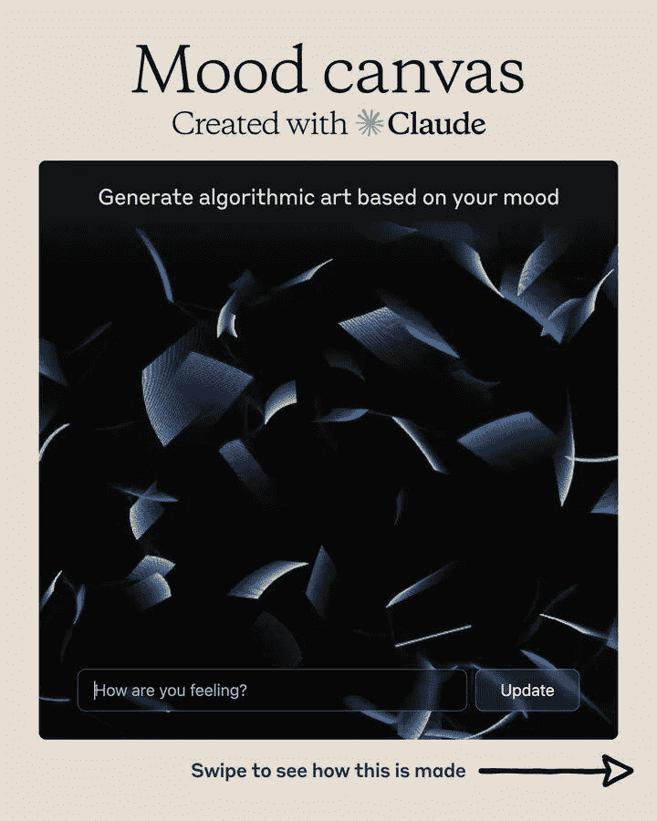

# 深度拆解 Claude 官方 Skills

> 来源：[https://qqs7y1hozd1.feishu.cn/docx/SDvQd1P7boyRjrxnmpuco2NNncd](https://qqs7y1hozd1.feishu.cn/docx/SDvQd1P7boyRjrxnmpuco2NNncd)

## Skill 的核心价值是什么？

Skill 的核心价值：它不是聊天内容，而是"打包好的能力"。

P**rompt **往往是一次性的对话指令，斜杠命令更像按一次按钮，解决的是"现在做什么"。而 Skill 是系统中常驻的 “能力模块”，它等待被模型发现、读取并复用，解决的是"以后遇到这类事情该怎么做"。

# “

> Prompt：一次性的聊天指令

> Command ：常用的「代码片段」

> Skill：一整套 「SOP + 工具包」

## 什么是好的 Skill？

首先当然是看是否满足需要。skill 文档的 name + description 部分需回答三个问题：

> ① 它帮我干什么活？② 什么时候它该出场？③ 和我现在的项目有没有关系？

官方与高质量社区 Skill，很喜欢用几种固定的“骨架模式”：

好的 skill 要遵循 Claude 官方建议的 progressive disclosure 信息组织原则：

+   **SKILL.md 主体**：保持简洁，建议控制在 500 行左右，多了就拆文件，但要注意避免多层嵌套引用。

+   Bundled Resources，需要时再读取：

+   scripts/：重复写的代码、需要确定性执行的逻辑。

+   references/：大块文档、API、schema、长规范。

+   assets/：模板、pptx、html boilerplate、字体等。

## 如何写好设计类 Skill？

### algorithmic-art



完整的 skill 请访问：https://github.com/anthropics/skills/blob/main/skills/algorithmic-art/SKILL.md

通读这个 skill 文档，00 为你总结了几个炸裂💥的技巧：

1.  提高天花板：不是“画一张图”，而是“创立一个流派”

一上来就不是说“帮我用 p5.js 画图”，而是：

# “

> Algorithmic philosophies are computational aesthetic movements that are then expressed through code.

把任务从“生成一张作品”提升到“创建一个美学流派 + 对应的算**法体系”。这可太高明了，这是在**提醒模型：输出要成体系，而不是一次性灵感。让后续所有指令都围绕“这是一门流派”展开，而不是“某个 pattern”。

1.  双阶段结构：哲学 → 实现

Skill 明确要求分两步：

1.  Algorithmic Philosophy Creation (.md)

1.  Express by creating p5.js generative art (.html + .js)

而且强调：“理念先行，代码只是表达工具”。这里值得借鉴的地方是：

+   **强制抽象层在前**：避免模型直接掉进“写代码、调数值”的局部最优。

+   把“哲学”规定为 4–6 段，有明确结构和要素（噪声、粒子、场、时间、参数、涌现）。

1.  哲学写作范本：又诗性又工程化

这一段特别能体现领域专家的深厚功底：

# “

> To capture the ALGORITHMIC essence, express how this philosophy manifests through:

+   Computational processes and mathematical relationships

+   Noise functions and randomness patterns

+   Particle behaviors and field dynamics

+   Temporal evolution and system states

+   Parametric variation and emergent complexity

值得借鉴的地方：

1.  用**问句/维度**约束内容，告诉模型思考的方向。

1.  每个点都同时是**美学语言 + 技术对象**（噪声、粒子、场），方便后面直接映射成代码结构。

1.  避免空洞的“文艺废话”，因为每句都要可算法化。

1.  重要的规则集中在 “CRITICAL GUIDELINES” 中强调：

+   Avoid redundancy：硬性规避同一个概念反复啰嗦。

+   Emphasize craftsmanship repeatedly：强调“精工细作、顶级匠人、无数次迭代”。告诉模型不是在写某个 demo，而是在写一个看起来花了几百小时精心打磨出的算法。

1.  示例：概念 → 数学结构 的翻译模板

比如 “Organic Turbulence”：

+   概念句：Chaos constrained by natural law…

+   算法句：Flow fields driven by layered Perlin noise… thousands of particles following vector forces… color emerges from velocity and density…

在 Skill 中没有直接说“用 flow field”，而是用例子示范一遍，留下可泛化的模式。我们写 skill 时也可以用这种“一个哲学 + 一段算法表达”的结构 举 3–5 个例子。

1.  “概念种子”：把主题嵌进参数，而不是嵌进文案

这段非常妙：

# “

> The concept is a subtle, niche reference embedded within the algorithm itself – not always literal, always sophisticated… Think like a jazz musician quoting another song through algorithmic harmony.

把用户原始主题定义为“quiet **conceptu**al DNA”，要求嵌在参数、行为、模式里，而不是写在画面上。并且用比喻（爵士乐里偷引用一段旋律）告诉模型：要有致敬，但要藏得深。同时兼顾“懂行的人能感觉到，不懂的人只会觉得好看”。

这对任何创意类任务都非常好用。

1.  模版化：把自由创作嵌在系统里

“STEP 0: READ THE TEMPLATE FIRST”，这里明确要求：不要自己新写 HTML，必须读取 templates/viewer.html，保持品牌样式。同时要明确自由度，清楚划分哪些是 FIXED（布局、品牌、seed 控件、按钮），哪些是 VARIABLE（p5 算法、参数 UI、颜色区域）。


这样每次生成的作品都有统一 UI 体验，对模型来说也知道“改哪里 / 不动哪里”，减少预期外的”惊喜“。

1.  把“匠人审美”写成 checklist

下面几段基本是把 generative art 的 best practices 变成了规则清单：

+   必须使用 seed：randomSeed / noiseSeed，保证可复现。

+   参数设计以“物理属性”为中心（数量、尺度、概率、比率、阈值），不要用“pattern 类型”这种靠近结果的概念。

+   工艺要求：平衡、层次、色彩和谐、性能优化、复现性。

# “

> This is NOT random noise – this is CONTROLLED CHAOS refined through deep expertise.

这句话也是点睛之笔，把随机性 → 可控混沌 → 专业度整个路径串起来。PUA 说不上，但指挥模型干活的鼓励师是没跑了。

---

### canvas-design

这个 skill 跟 algorithmic-art 结构类似。

1.  拔高定位：这是视觉哲学，不是 PPT 模板

# “

> These are instructions for creating design philosophies – aesthetic movements that are then EXPRESSED VISUALLY. Output only .md, .pdf, .png.

短短一句话，信息量不少：

+   只允许视觉相关格式（pdf/png），禁止模型跑偏去写长文。

+   再次使用“两步走”：Visual philosophy → Canvas creation。

+   强调：文本是视觉的从属，不是内容的主体。

1.  “MINIMAL TEXT” 的强约束

哲学部分提出"让信息活在设计里"：

# “

> Minimal text as visual accent...

> Information lives in design, not paragraphs.

这会让模型任何时候都先考虑“构图/空间/色块/节奏”，文案只是“点睛的线条”，而不是“堆字”。

1.  哲学 + 示例

和前一个 skill 类似，它给了几个极具画面感的例子：Concrete Poetry / Chromatic Language / Analog Meditation / Organic Systems / Geometric Silence。每个都是一句 philosophy 总领，然后是一整段 visual expression：

+   形状（massive blocks, rounded forms, grids）

+   色彩（chromatic fields, natural palettes）

+   字体角色（huge single words / tiny labels / whispered typography）

+   参考风格（Polish poster, Swiss formalism, Japanese photobook…）。

它的聪明之处在于既给参照，又不具体到“抄某个设计师”，注重原创性。

1.  强调“匠心” & “留白”

# “

> Repeatedly emphasize “meticulously crafted”, “painstaking attention”, “master-level execution”。 Text is always minimal and visual-first… nothing falls off the page, nothing overlaps, proper margins are non-negotiable.

平面设计里的专业感，其实就在细节中：不出血、不挤压、不重叠；版心、边距、对齐都被严格校验。这样就把设计师心里的洁癖规范翻译成模型可执行的 checklist，把抽象审美拆成具象行为（不要 overlap / 保留边距 / 检查所有文本）。

1.  科学文本 + 情绪主题

Canvas creation 这一段非常有意思：

# “

> Treat the abstract philosophical design as if it were a scientific bible, borrowing the visual language of systematic observation — dense accumulation of marks, repeated elements, layered patterns… sparse, clinical typography, reference markers…

它在做一个概念拼贴：

+   主题：人类经验 / 情绪 / 抽象哲学 → 很虚。

+   视觉语言：科学手册 / 技术图解 / 实验记录 → 很实。

这引导模型把“不可见的东西”当“可测量的数据”去做信息图。

1.  字体与资源

Skill 强制要求必须去 ./canvas-fonts 目录找字体，字体要作为画面元素，而不是普通排版。

这体现了来自实践的设计经验：字体从来不是“默认变量”，而是核心设计决策。对模型来说，“请认真选字体”需要具体行为约束（去某个目录、用不同 font），不然可能就出现 AI 味很重的 Arial、Inter 字体了。

1.  最后一轮精修：不做加法做乘法

最后的 FINAL STEP 部分让我觉得有点眼熟：

# “

> It isn’t perfect enough. It must be pristine…

> To refine the work, avoid adding more graphics; instead refine what has been created… If the instinct is to call a new function or draw a new shape, STOP…


用 SKILL 把这种“最后 10% 的工艺感”也编码进去，是非常聪明的做法。

比如我们可以让模型自行检查：

```
如果下一步的本能是“多加一个 icon / 多加一层特效”，请暂停。

问自己：有没有可以删掉的东西？有没有可以对齐、合并、强化的关系？
 
只允许修改已有元素的位置、间距、权重和颜色。
```

这能让作品整体观感直接提升一档。