# Coze-Skills，完整使用教程看这里！

> 来源：[https://qqs7y1hozd1.feishu.cn/docx/HJFXdJCm0oEsKQxJcpFcxBNjnTh](https://qqs7y1hozd1.feishu.cn/docx/HJFXdJCm0oEsKQxJcpFcxBNjnTh)

字节的速度真的是太快了，Skills才火1个月的样子，就在Coze平台上线了技能商店

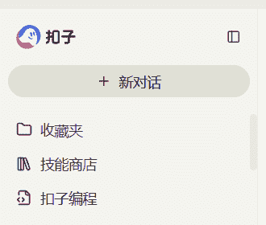

和之前的coze工作流一样，不但提供技能商店供买卖还可以自定义技能

# 01

** **直接使用技能

在商店中选择一个技能进行安装

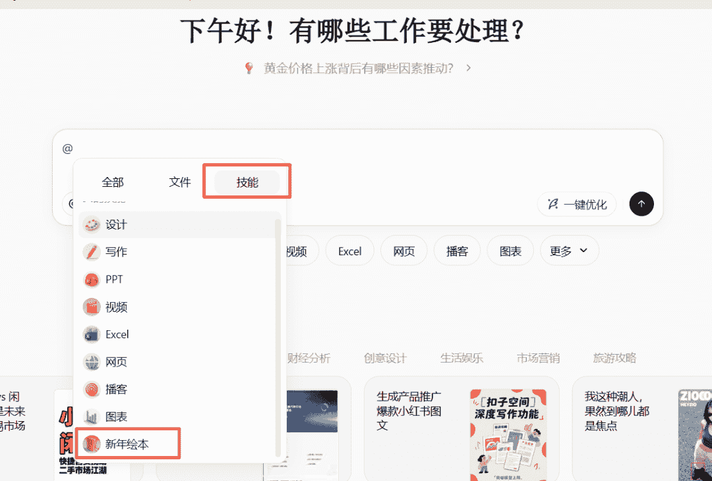

最终生成网页版的绘本，并且自带了配音。

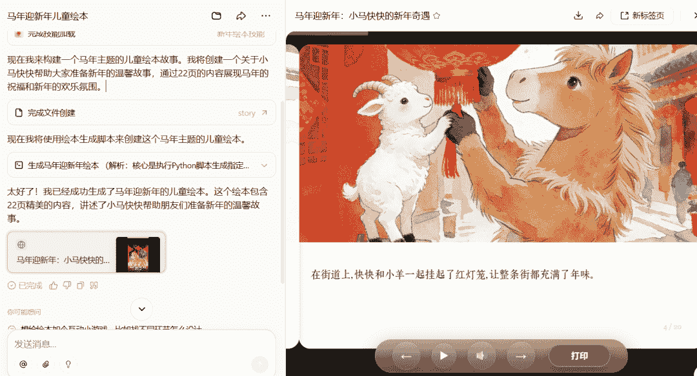

# 02

** **通过Skills文件创建

进入coze编程界面自定义技能

https://code.coze.cn/

有两种方式，一种是上传skills文件包，一种是通过自然语言

也就说，你在本地调试好的skill工程，可以上传到coze平台形成技能。

这里我用Anthropics官方提供的skills来测试。我把PDF的这个skills文件包上传到coze上

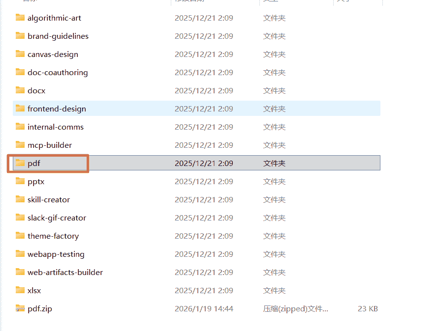

coze第一步进行压缩包解压，并且通过阅读工程中的文件完成了Skill的结构分析

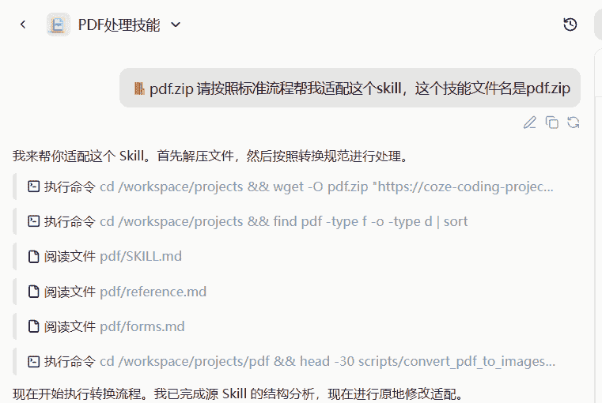

从这个分析报告可以看出，coze完全是遵照Claude Skills的官方使用说明来的。也就是说，coze安装了官方提供的skill-creator

缺少的字段，不符合结构的文件，以及归档错误的文件，都能识别出来

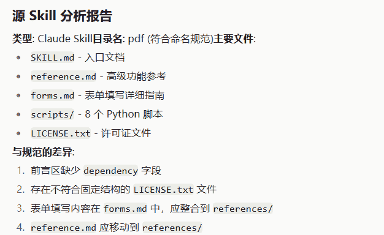

接下来就是在后台沙盒中，根据我上传的skill文件来1:1的复刻整个工程。

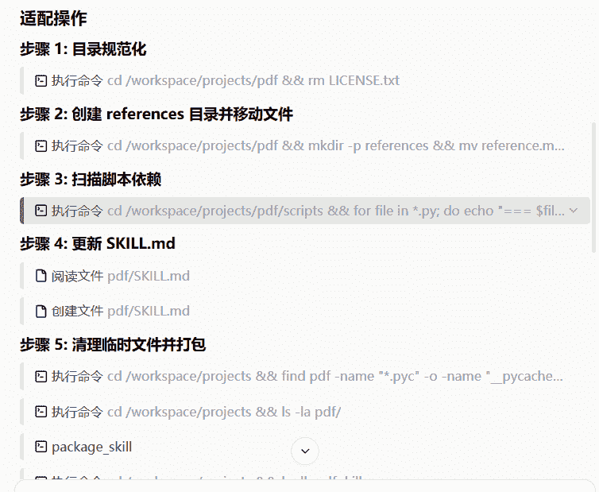

只要你的Skills工程没啥大问题，基本上都可以顺利部署。

所有工程完成后，点击部署就可以正常使用了

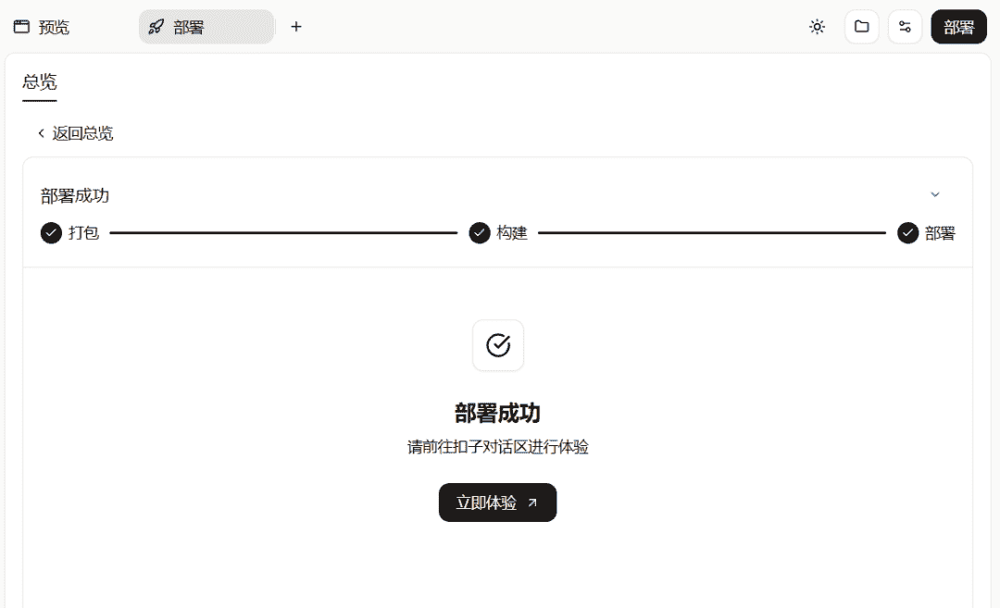

部署完成，在技能中直接使用。在我的技能->我的创建中，也可以找到创建的这个技能

我觉得这个功能非常的赞，这样会吸引更多的Skills创作者加入到字节这个生态去上传Skills

且字节开通了付费渠道，变现也变得非常容易。

# 03

#  自然语言创建

最近x官方不是出了一篇文章，讲如何写出高质量且被x推流

文中列出了好几个写作要点，我正准备把这个封装成一个skills的。现在正好通过coze的技能包来做一个现成的

这8个要点，翻译成中文后，让coze根据要点给我封装一个x爆文技能

很快就按照Skill的结构生成了对应的文件。

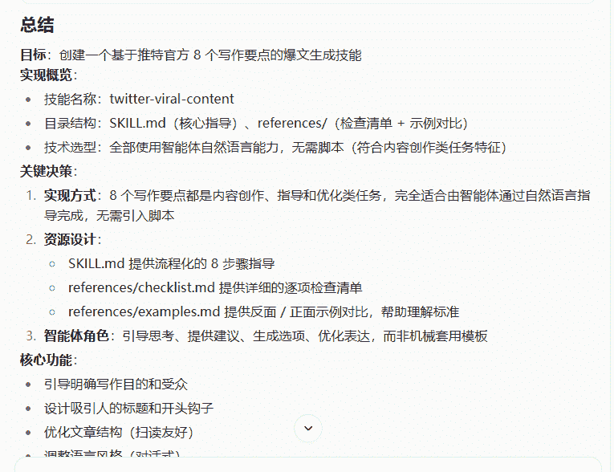

Skill.md中的内容生成得还挺专业的。文件支持下载，不想写亲自写Skill的完全可以交给coze来做。

来试下效果如何，用罗永浩和西贝事件来写一篇吐槽文

首先就是加载技能，然后是事件内容的精准搜索

注意:要打开深度思考，这样搜索会更全面一点

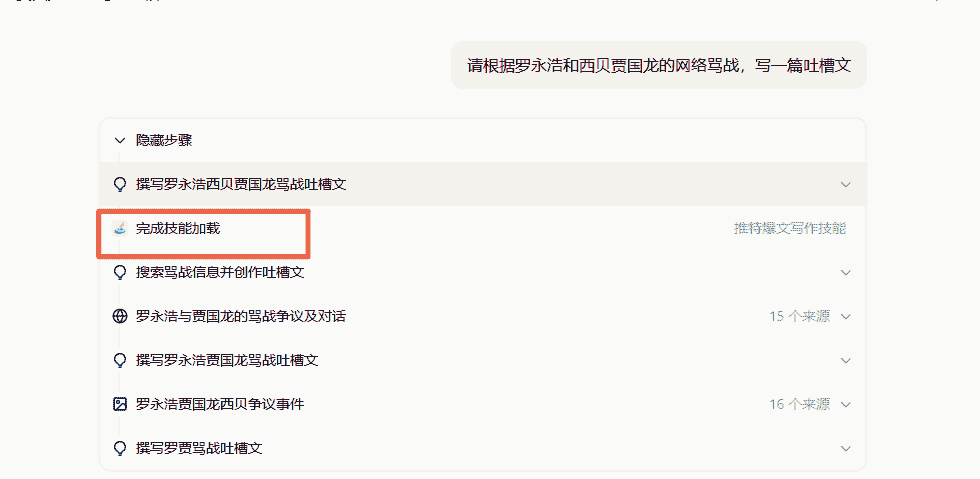

生成的x推文，有点长，只截了部分。

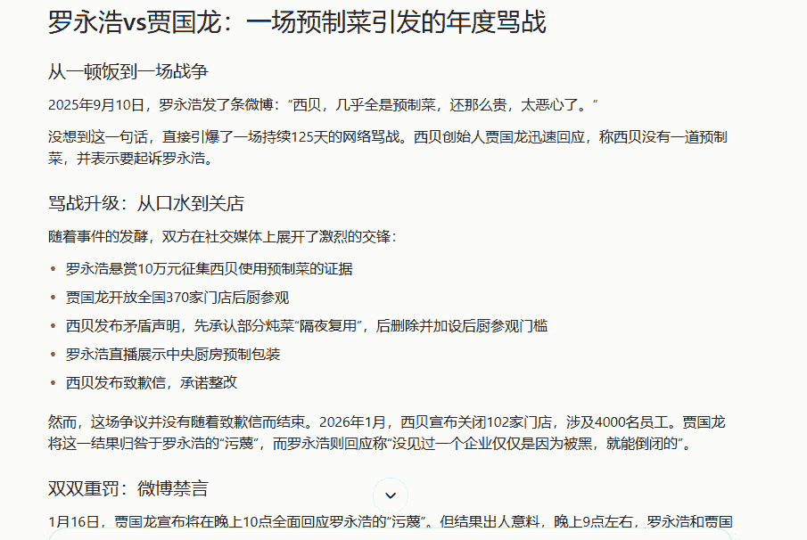

没想到的是，居然还给生成了封面图。效果还不错，哈哈。

