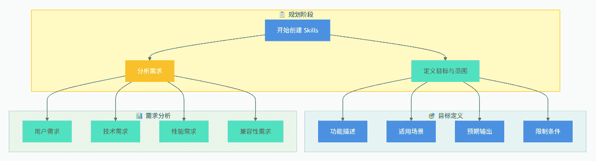
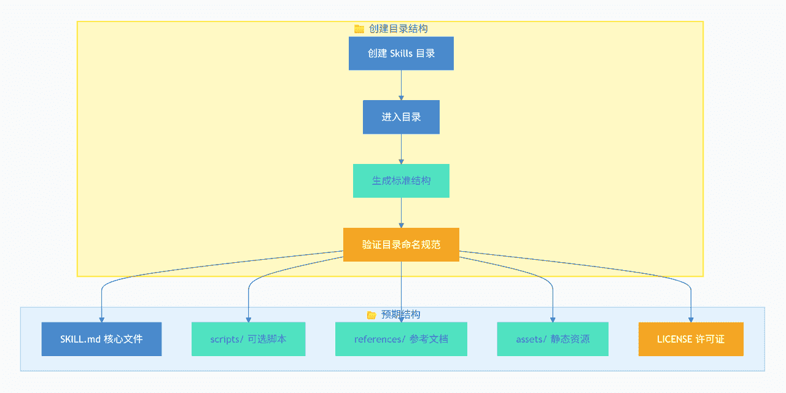
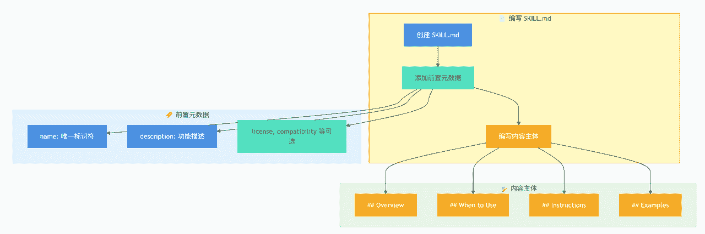
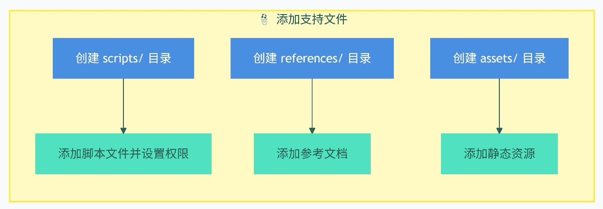
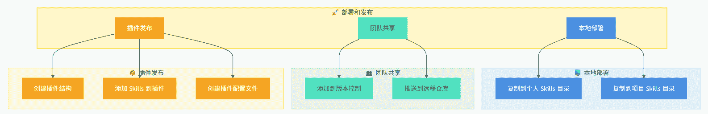

# Skills创建--全流程

> 来源：[https://qqs7y1hozd1.feishu.cn/docx/KoOgdn9nkoA1Toxgi7Ecn11Cnef](https://qqs7y1hozd1.feishu.cn/docx/KoOgdn9nkoA1Toxgi7Ecn11Cnef)

### 规划 Skills

#### 定义目标和范围

在创建 Skills 之前，需要明确定义其目标和适用范围：



```
## 目标定义
- 功能描述：Skills 解决的具体问题
- 适用场景：何时应该使用这个 Skills
- 预期输出：使用后的结果和价值
- 限制条件：Skills 的局限性和边界
```

#### 分析需求

```
## 需求分析
- 用户需求：目标用户的使用场景
- 技术需求：所需的工具和资源
- 性能需求：响应时间和资源消耗要求
- 兼容性需求：支持的平台和环境
```

### 创建目录结构

#### 标准目录结构

```
# 创建 Skills 目录
mkdir my-skill
# 进入目录
cd my-skill
# 查看标准结构
tree -a
```



预期结构：

```
my-skill/
├── SKILL.md          # 必需：核心指令文件
├── scripts/          # 可选：可执行脚本
│   └── helper.py
├── references/       # 可选：参考文档
│   └── api-docs.md
├── assets/           # 可选：静态资源
│   └── template.json
└── LICENSE           # 可选：许可证文件
```

#### 目录命名规范

+   使用小写字母、数字和连字符

+   长度不超过64个字符

+   避免连续连字符或以连字符开头/结尾

+   目录名应与 SKILL.md 中的 name 字段一致

### 编写 SKILL.md 文件



#### 文件结构

SKILL.md 是 Skills 的核心文件，必须遵循特定的格式：

```
---
name: my-skill
description: Brief description of what this skill does and when to use it
---

# My Skill

## Overview

Detailed description of the skill&#x27;s purpose and functionality.

## When to Use

Specific scenarios and conditions for using this skill.

## Instructions

Step-by-step guidance for the AI agent.

## Examples

Concrete examples of input and expected output.
```

#### 前置元数据详解

##### 必需字段

```
---
name: pdf-processing
description: Extract text and tables from PDF files, fill forms, merge documents. Use when working with PDF files, forms, or document extraction.
---
```

+   name: 唯一标识符，遵循命名规范

+   description: 功能描述和使用时机，应包含关键词帮助 AI 发现

##### 可选字段

```
---
name: pdf-processing
description: Extract text and tables from PDF files, fill forms, merge documents.
license: Apache-2.0
compatibility: Designed for Claude Code (or similar products)
metadata:
  author: example-org
  version: &quot;1.0&quot;
allowed-tools: Read, Grep, Bash(python:*)
---
```

### 添加支持文件



#### 脚本文件 (scripts/)

```
# 创建脚本目录
mkdir scripts

# 添加 Python 脚本
cat &gt; scripts/process_data.py &lt;&lt; &#x27;EOF&#x27;
#!/usr/bin/env python3
&quot;&quot;&quot;
数据处理脚本
&quot;&quot;&quot;
import sys
import json

def process_data(input_data):
    &quot;&quot;&quot;处理输入数据&quot;&quot;&quot;
    # 处理逻辑
    return processed_data

if __name__ == &quot;__main__&quot;:
    input_data = sys.stdin.read()
    result = process_data(input_data)
    print(json.dumps(result))
EOF

# 设置执行权限
chmod +x scripts/process_data.py
```

#### 参考文档 (references/)

```
# 创建参考文档目录
mkdir references

# 添加 API 文档
cat &gt; references/api_reference.md &lt;&lt; &#x27;EOF&#x27;
# API 参考文档

## 可用端点

### GET /api/data
获取数据列表

参数：
- `limit` (可选): 返回结果数量限制
- `offset` (可选): 偏移量

响应：
```json
{
  &quot;data&quot;: [...],
  &quot;total&quot;: 100
}
```
EOF
```

#### 静态资源 (assets/)

```
# 创建资源目录
mkdir assets

# 添加配置文件模板
cat &gt; assets/config_template.json &lt;&lt; &#x27;EOF&#x27;
{
  &quot;database&quot;: {
    &quot;host&quot;: &quot;localhost&quot;,
    &quot;port&quot;: 5432,
    &quot;name&quot;: &quot;myapp&quot;
  },
  &quot;features&quot;: {
    &quot;caching&quot;: true,
    &quot;logging&quot;: true
  }
}
EOF
```

### 编写指令内容


#### 结构化指令编写

```
# My Skill Name

## 概述

[简要介绍 Skills 的功能和价值]

## 使用时机

[明确说明何时应该使用这个 Skills]
- 场景1：具体的使用情况
- 场景2：另一种使用情况

## 详细说明

### 步骤1：准备工作
[具体的执行步骤]

### 步骤2：主要处理
[核心处理逻辑]

### 步骤3：结果验证
[验证和确认结果]

## 示例

### 示例1：基本用法
输入：
```
用户请求示例
```

执行步骤：
1. 解析输入
2. 处理数据
3. 生成输出

输出：
```
预期结果
```

### 示例2：高级用法
[更复杂的示例]

## 注意事项

### 限制条件
- [已知限制]
- [不支持的场景]

### 错误处理
- [常见错误及解决方法]

### 性能考虑
- [性能特征和优化建议]

## 相关资源

- [API 文档](references/api_reference.md)
- [配置模板](assets/config_template.json)
```

### 测试和验证

#### 本地验证

```
# 验证 SKILL.md 格式
python -c &quot;
import yaml
import os

# 检查文件存在
assert os.path.exists(&#x27;SKILL.md&#x27;), &#x27;SKILL.md not found&#x27;

# 读取并解析
with open(&#x27;SKILL.md&#x27;, &#x27;r&#x27;, encoding=&#x27;utf-8&#x27;) as f:
    content = f.read()

# 分离元数据和内容
parts = content.split(&#x27;---&#x27;, 2)
assert len(parts) &gt;= 3, &#x27;Invalid SKILL.md format&#x27;

metadata = yaml.safe_load(parts[1])
assert &#x27;name&#x27; in metadata, &#x27;Missing name field&#x27;
assert &#x27;description&#x27; in metadata, &#x27;Missing description field&#x27;

print(&#x27;SKILL.md format validation passed&#x27;)
&quot;
```

#### 功能测试

```
# 测试脚本执行
python scripts/process_data.py &lt; test_input.json

# 验证输出格式
python scripts/process_data.py &lt; test_input.json | jq .data
```

### 部署和发布



#### 本地部署

```
# 复制到个人 Skills 目录
cp -r my-skill ~/.claude/skills/

# 或复制到项目 Skills 目录
cp -r my-skill .claude/skills/
```

#### 团队共享

```
# 添加到版本控制
git add my-skill/
git commit -m &quot;Add my-skill for data processing&quot;

# 推送到远程仓库
git push origin main
```

#### 插件发布

```
# 创建插件结构
mkdir my-plugin
cd my-plugin

# 添加 Skills 到插件
cp -r ../my-skill skills/

# 创建插件配置文件
cat &gt; package.json &lt;&lt; EOF
{
  &quot;name&quot;: &quot;my-plugin&quot;,
  &quot;version&quot;: &quot;1.0.0&quot;,
  &quot;skills&quot;: [&quot;skills/my-skill&quot;]
}
EOF
```

## 创建最佳实践

### 从简单开始

+   从解决单个具体问题开始

+   避免一开始就设计过于复杂的 Skills

+   基于实际使用场景逐步扩展

### 编写清晰的描述

```
# 好的描述示例
description: Analyze Excel spreadsheets, create pivot tables, and generate charts. Use when working with Excel files, spreadsheets, or .xlsx files.

# 不好的描述示例
description: Helps with data
```

### 提供丰富的示例

+   包含多种使用场景的示例

+   展示输入输出格式

+   解释每一步的目的

### 测试驱动开发

+   在编写过程中持续测试

+   验证在不同场景下的表现

+   收集反馈并改进

### 遵循命名规范

+   使用描述性的名称

+   保持一致的命名风格

+   避免名称冲突

## 使用 skill-creator 辅助创建

Anthropic 提供了官方的 skill-creator Skills，可以帮助用户快速创建新的 Skills。这个 Skills 提供了完整的创建流程指导，从需求分析到最终打包。

### skill-creator 概

skill-creator 是 Anthropic 官方提供的 Skills，专门用于指导和辅助创建其他 Skills。它的主要功能包括：

1.  理解需求：通过分析具体示例来理解 Skills 应该实现的功能

1.  规划内容：识别可重用的脚本、参考文档和资源文件

1.  生成结构：自动创建 Skills 的标准目录结构

1.  编写文档：帮助编写 SKILL.md 和相关文档

1.  打包验证：验证并打包 Skills

1.  迭代优化：基于实际使用改进 Skills

### 使用 skill-creator 创建新 Skills

#### 步骤1：准备示例

在使用 skill-creator 之前，需要准备一些具体的使用示例：

```
## 示例准备
- 场景描述：用户请求和预期行为
- 输入输出：具体的输入数据和期望结果
- 执行流程：手动执行时的步骤
- 特殊情况：边界条件和错误处理
```

#### 步骤2：调用 skill-creator

在 Claude Code 中使用 skill-creator：

```
# 直接使用 skill-creator
claude --skill skill-creator

# 或在对话中使用
&quot;请使用 skill-creator 帮助我创建一个处理 PDF 文件的 Skills&quot;
```

#### 步骤3：提供需求描述

向 skill-creator 提供详细的需求信息：

```
## 需求描述
- 功能目标：创建一个处理 PDF 文件的 Skills
- 具体任务：
  - 提取 PDF 中的文本内容
  - 识别表格数据
  - 合并多个 PDF 文件
- 使用场景：
  - &quot;请从这个 PDF 中提取表格数据&quot;
  - &quot;合并这些 PDF 文件&quot;
- 技术要求：
  - 支持中文文本
  - 处理扫描版 PDF
  - 输出结构化数据
```

#### 步骤4：跟随指导创建

skill-creator 会提供分步指导：

1.  需求理解：分析提供的示例和工作流程

1.  资源规划：识别需要创建的脚本和文档

1.  结构初始化：生成标准的 Skills 目录结构

1.  内容编写：帮助编写 SKILL.md 和实现脚本

1.  测试验证：验证 Skills 的功能和格式

1.  打包发布：创建可分发的 Skills 包

#### 步骤5：迭代优化

基于实际使用情况进行优化：

```
# 测试 Skills
claude --skill my-pdf-skill --test

# 收集反馈并改进
&quot;这个 Skills 在处理中文 PDF 时有问题，请帮我优化&quot;

# 重新打包
skill-creator 会指导重新打包和发布
```

### skill-creator 的优势

#### 结构化指导

+   提供完整的创建流程

+   确保遵循最佳实践

+   避免常见错误

#### 自动化生成

+   自动创建目录结构

+   生成模板文件

+   验证配置正确性

#### 质量保证

+   内置验证机制

+   提供测试指导

+   确保文档完整性

#### 学习辅助

+   解释每个步骤的目的

+   提供示例和模板

+   帮助理解 Skills 设计原则

### 适用场景

#### 适合使用 skill-creator 的情况：

+   新手创建者：第一次创建 Skills 的用户

+   复杂功能：需要多个组件配合的 Skills

+   标准化需求：需要遵循最佳实践的项目

+   团队协作：多人协作开发 Skills

#### 不适合使用 skill-creator 的情况：

+   简单脚本：只需几个命令的简单任务

+   已有模板：基于现有成熟模板的 Skills

+   高度定制：需要完全自定义结构的特殊需求

### 最佳实践

#### 准备充分的示例

+   提供多样化的使用场景

+   包含边界条件和错误情况

+   描述预期的输出格式

#### 遵循指导逐步执行

+   不要跳过任何步骤

+   仔细阅读每个指导说明

+   如有疑问及时寻求 clarification

#### 充分测试和验证

+   在创建过程中进行测试

+   验证所有功能正常工作

+   检查文档和示例的准确性

#### 基于反馈持续改进

+   收集实际使用中的问题

+   根据用户反馈进行优化

+   定期更新和维护 Skills

## 常见问题和解决方案

### 文件格式问题

问题：YAML 前置元数据格式错误

解决：使用 YAML 验证工具检查语法

### 路径引用问题

问题：相对路径引用不正确

解决：确保所有路径都是相对于 Skills 根目录的

### 权限问题

问题：脚本文件没有执行权限

解决：使用 chmod +x 设置执行权限

### 编码问题

问题：文件编码导致的解析错误

解决：统一使用 UTF-8 编码保存文件

## 总结

创建 Skills 是一个系统化的过程，需要仔细规划、规范编写和充分测试。通过遵循标准结构和最佳实践，可以创建出高质量、可维护的 Skills，为 AI 代理提供强大的专业能力扩展。