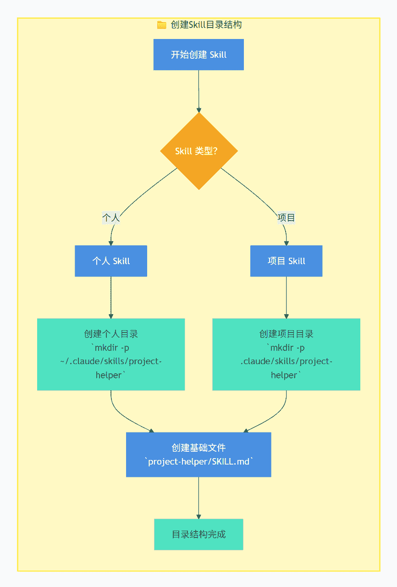
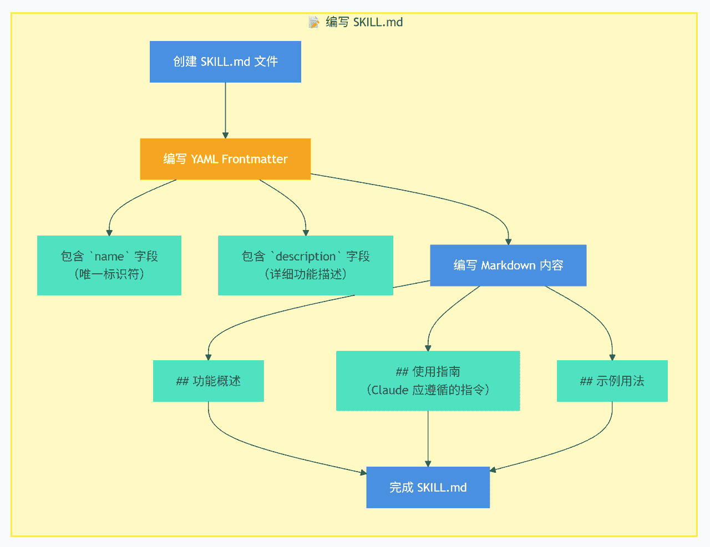

# 创建你的第一个Skill

> 来源：[https://qqs7y1hozd1.feishu.cn/docx/XQWjduqEBoQdvdxgPeocBORCnhh](https://qqs7y1hozd1.feishu.cn/docx/XQWjduqEBoQdvdxgPeocBORCnhh)

## 创建Skill目录结构

### 创建目录

让我们创建一个简单的Skill来处理项目文档：

```
# 对于个人Skill
mkdir -p ~/.claude/skills/project-helper

# 或者对于项目Skill
mkdir -p .claude/skills/project-helper

```



### 创建基础文件

每个Skill最少需要一个SKILL.md文件：

```
project-helper/
└── SKILL.md
```

## 编写基础SKILL.md文件



### YAML Frontmatter

SKILL.md文件必须以YAML frontmatter开头：

```
---
name: project-helper
description: 帮助处理项目文档和代码结构。当用户需要项目概述、代码分析或文档生成时使用此Skill。
---

# 项目助手 Skill

## 功能概述

这个Skill帮助开发者更好地理解和管理项目结构。
```

YAML字段说明：

+   name: Skill的唯一标识符，只能包含小写字母、数字和连字符

+   description: 详细描述Skill的功能和使用时机，这是Claude判断何时使用这个Skill的关键

### 添加基本指令

在frontmatter之后，添加Claude应该遵循的指令：

```
## 使用指南

当用户询问项目相关问题时：

1. 首先查看项目的整体结构
2. 识别主要的文件类型和组织方式
3. 提供清晰的项目概述
4. 根据需要深入特定文件或目录

## 示例用法

- &quot;这个项目是做什么的？&quot;
- &quot;帮我分析一下代码结构&quot;
- &quot;生成项目文档&quot;
```

## 测试Skill加载

### 验证Skill被识别

创建SKILL.md文件后，重启Claude Code或运行：

```
claude /skills
```

你应该能看到你的Skill出现在列表中。

### 基本功能测试

在Claude中询问与你的Skill相关的问题，观察是否被触发。

## 常见初学者错误

### 忘记YAML frontmatter

错误示例：

```
# 我的Skill

这里是描述...
```

正确示例：

```
---
name: my-skill
description: 描述Skill功能
---

# 我的Skill

这里是描述...
```

### 描述不够具体

不好的描述： "一个有用的工具"

好的描述： "处理JSON数据文件，当用户需要格式化、验证或转换JSON数据时使用此Skill"

### Skill名称不符合规范

错误名称： "My Skill"、"my_skill_v1"

正确名称： "my-skill"、"json-processor"