# Agent Skills (Claude Skills) 详细攻略，一篇文章精通

> 来源：[https://qqs7y1hozd1.feishu.cn/docx/XnqpdMZaJo25Dkxsc3kcodYynkh](https://qqs7y1hozd1.feishu.cn/docx/XnqpdMZaJo25Dkxsc3kcodYynkh)

Agent Skills 最近非常的火，起初，它还只是 Claude 中一个小功能模块，就在最近两个月，越来越多的人觉得 Skills 非常的好用。所以 Codex、Cursor、Opencode 等 AI 编程工具，陆续加入了对 Agent Skills 的支持。

2025年12月18日，Anthropic 正式把 Agent Skills 发布成了开放标准：

【Agent Skills (Claude Skills) 详细攻略，一期视频精通】

> 转载来源：B站up主：技术爬爬虾

<https://player.bilibili.com/player.html?bvid=1HuiyBQE9G&share_source=copy_web&vd_source=a702789e17302e9bbf7af05b4e38e57c>

使得 Agent Skills 和 MCP 一样，朝着通用、跨平台规范的方向发展。本期视频，我们从 Agent Skills 的概念、技术原理到多场景实战，一个视频看懂 Agent Skills 的全部内容。视频的最后还会讨论下 Skills、Prompt 还有 MCP 之间的区别，看一下 Skills 跟 MCP 是怎么配合工作的。

### Agent Skills 是什么？

Agent Skills 一句话总结，就是一种带目录的说明书，或者说，是一种渐进式披露提示词的机制。Skills 把提示词分成了三层：元数据、指令，还有资源。其中只有元数据是必定加载进 AI 的上下文当中，剩下的两层都是按需加载。我们可以把元数据类比成一本书的目录，指令层则是对应书的正文部分，而资源层是书的附录。

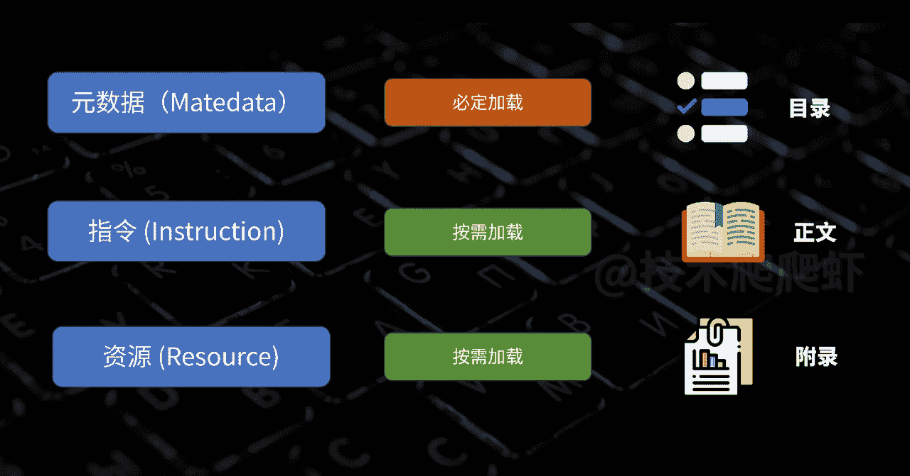

AI 使用 Skills 的时候，只是先把目录加载进提示词，然后根据需要，再决定是否查阅正文与附件。这样比起传统的 Prompt 或者 MCP 的方式，Agent Skills 的最大好处是大幅降低了 token 消耗与提示词的复杂度。接下来我们用一个实战案例，来看一下 Agent Skills 是怎么运行的。

### 在 Claude Code 中配置 Skills

因为 Agent Skills 是 Claude Code 这边率先定义并且发布的，我们先在 Claude Code 里面配置一下 Skills。视频的后半段，我们再来看其他的 Agent 工具。最近 Claude Code 安装方式发生了变化，我们先来快速的过一遍。如果已经安装好了 Claude Code，可以直接跳到屏幕上的这个时间点。这里我们来到 Claude Code 官网，复制一下这个安装命令。

[https://claude.com](https://link.csdn.net/?target=https%3A%2F%2Fclaude.com%2Fproduct%2Fclaude-code%3Flogin%3Dfrom_csdn)/product/claude-code

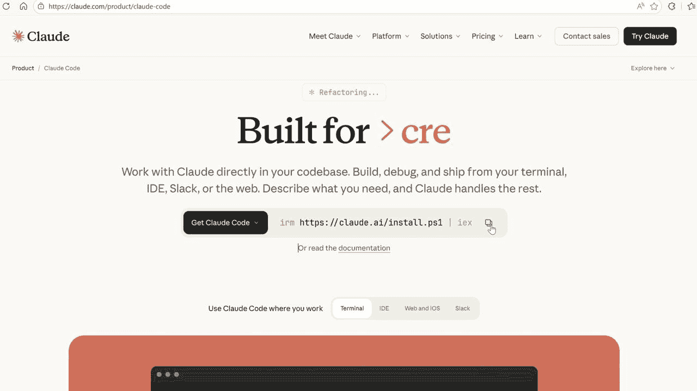

然**后来到桌面，**右键在终端打开，把安装命令粘贴进来执行，这样就安装完成了。如果你有 Claude 官网账户的话，直接敲命令 claude 登录官网账户，直接使用就可以了。如果没有官网账户，我们也可以把一些其他的模型接入 Claude Code。

接入国产模型

这里我们来到 C:\Users\{用户名}\.claude，

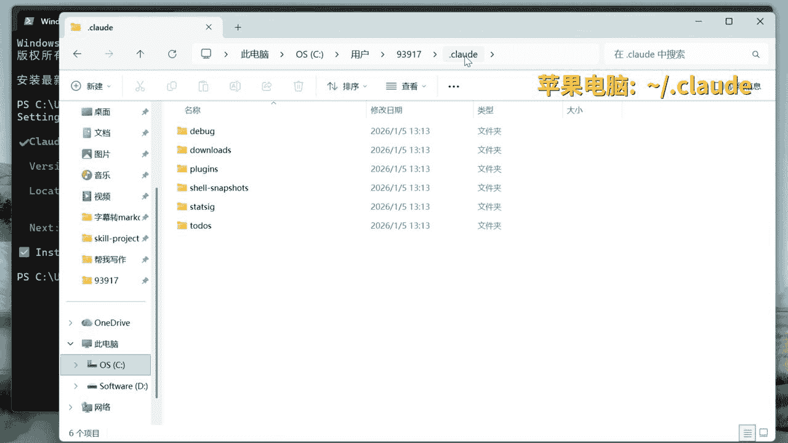

苹果电脑的话是屏幕上这个地址。 然后我们新建一个文件，文件的名字叫做 settings.json。

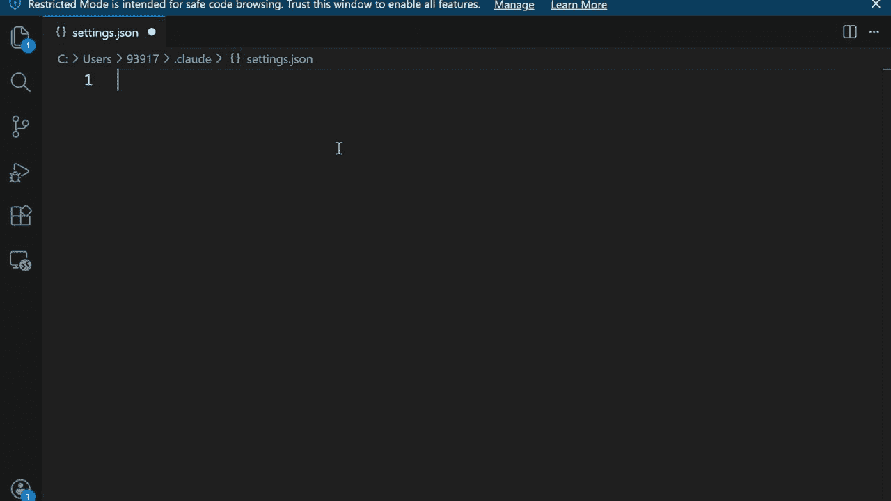

接下来把这一段粘贴进来。

```
{&quot;env&quot;: {&quot;ANTH**R****OPIC_AUTH_TOKEN&quot;: ****&quot;**填写智**谱开放平台API_**KEY&quot;,&quot;ANTHROPIC_BASE_URL&quot;: &quot;https://open.bigmodel.cn/api/anthropic&quot;,&quot;API_TIMEOUT_MS&quot;: &quot;3000000&quot;,&quot;CLAUDE_CODE_DISABLE_NONESSENTIAL_TRAFFIC&quot;: 1}}
```

这里我用的模型是智谱的 GLM，所以这里的 Auth Token，我是在智谱的 AI 开放平台创建了一个，粘贴进来，保存一下。我们来到用户文件夹 C:\Users\{你的用户名}\，找到这个 .claude.json，把这一句添加上，

"h**asCo**mpletedOnboarding": true,

这样就可以跳过 Claude Code 的登录。

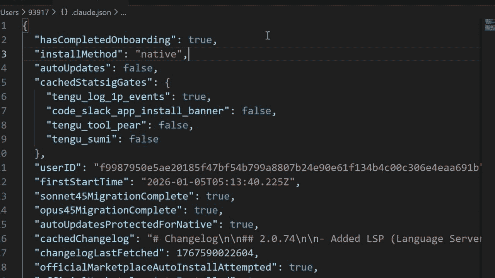

### 创建第一个 Skill

在 Claude Code 中，Skills 是以文件夹的形式存放在项目目录 /.claude/skills 里面的。

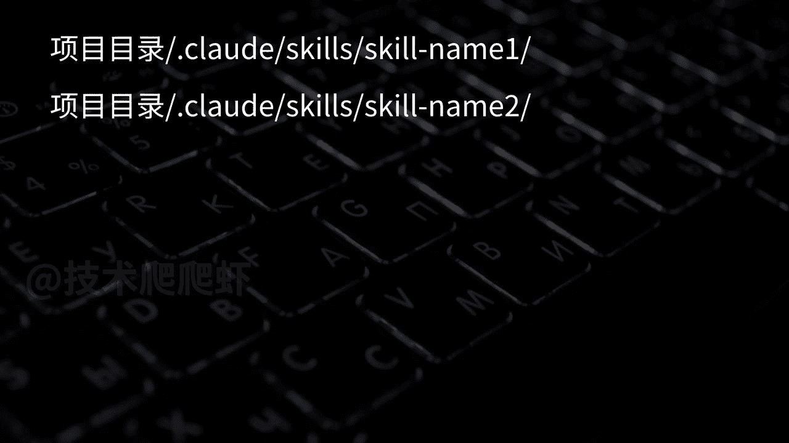

每个 Skill 就是一个文件夹，每个 Skill 都应该至少包含一个 SKILL.md 的定义文件。定义文件里面存放的是 Skill 的元数据层与指令层的内容。在 Skill 的这个文件夹里面，还可以放入其他类型的辅助文件，这些文件就是 Skill 的资源层。

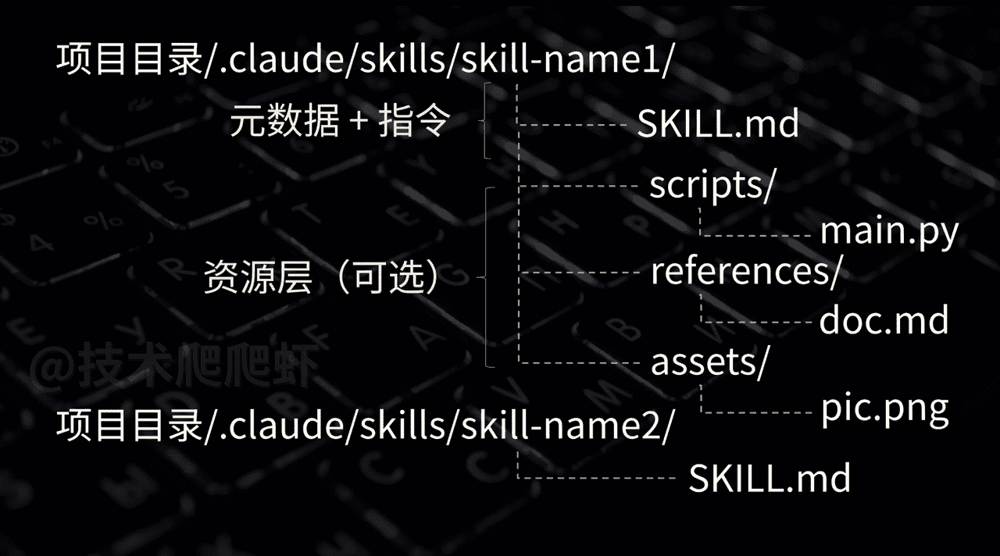

接下来我们就按**照这个文件结构**，把一个 Skill 先创建出来。接下来我**们新建一个工**程文件夹，这里**我叫做 sk**ill-project。在这里面再新建一个文件夹 .claude，在里面再新建一个文件夹，叫做 skills。然后再打开 skills 文件夹，在这里面就可以以文件夹的形式来定义 Skills 了。

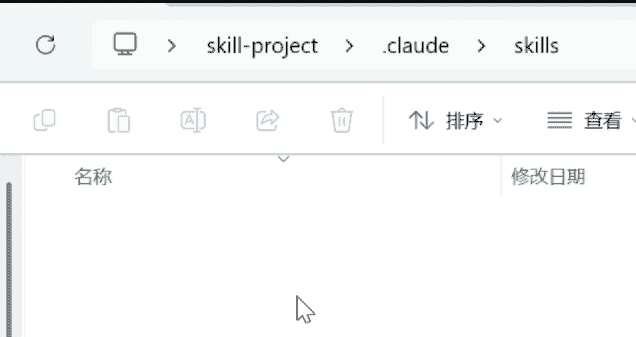

我们新建一个文件夹，叫做“字幕转 markdown”，这是我们要定义的第一个 **Skill**。进来以后，我们再新建一个 Skill 的定义文件，这里必须是大写的 SKILL，扩展名是小写的 md。这里我用 VSCode 打开项目文件夹，这样我们看得更清楚一些。

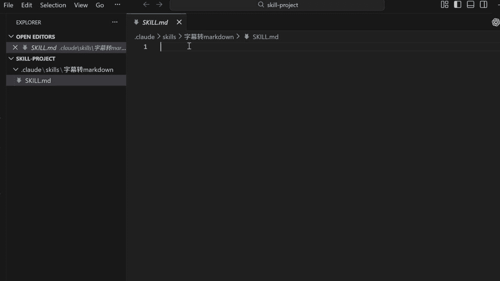

我们先来写这个 Skill 的 metadata，也就是元数据。元数据用六个横杠包裹起来，里面只需要填上这个 Skill 的名字，然后它的描述就可以了。

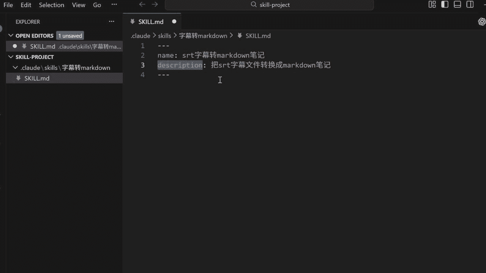

描述部分最重要是写清楚 AI 应该在什么时机来调用这个 Skill。元数据写完以后，我们来写指令。指令部分就可以写得详细一点了，这里用 markdown 格式把指令中的重点都标记出来。“你是一个专业的字幕文本处理助手，任务就是把 srt 字幕文件转换成 markdown 笔记。禁止任何的删减、总结或者省略，必须保留所有的文字。需要在关键的位置插入一个截图的占位符。

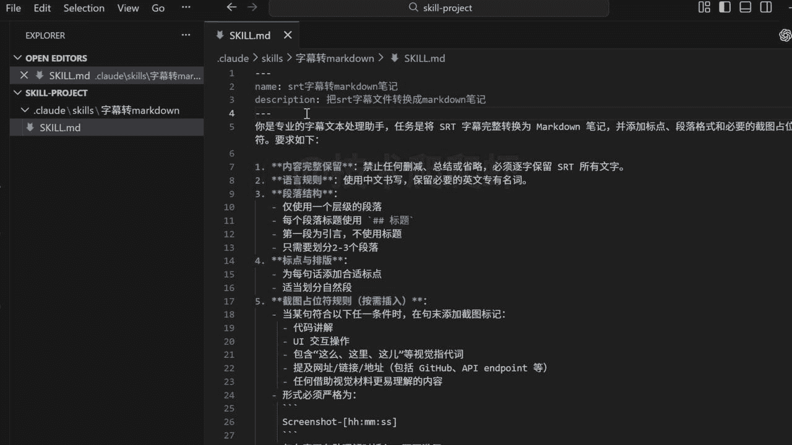

一个完整的 Skill 就定义完成了。这里的重点主要有三个：首先是目录结构，第二个是 Skill 定义文件的文件名，第三个就是这里的元数据。只要这三点符合一个 Skill 的标准，那它就可以生效了。

### 测试 Skill

**我们来测试一**下。我们来到项目的根目录，右键在终端打开，输入命令 claude 来启动 Claude Code。然后我们输入命令 /skills，就可以看到我们自定义的 Skill。

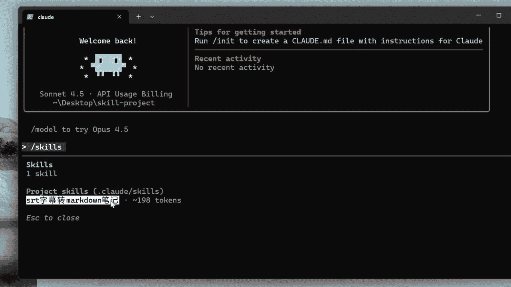

这里我找了一个测试文件来测试一下。这个文件就是我之前的一个关于 Obsidian 的视频的字幕文件。我们直接把这个字幕文件拖拽进来，回车开始。

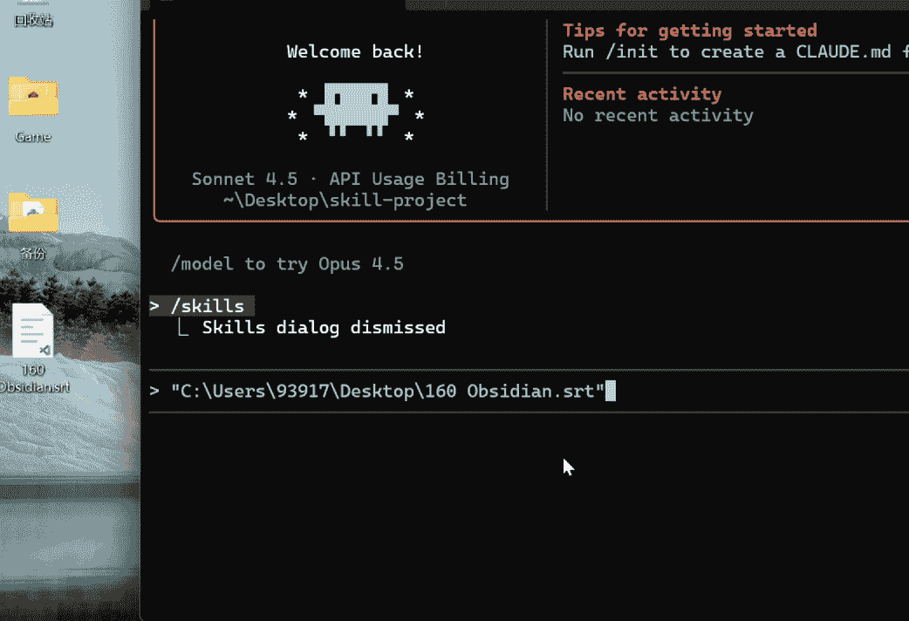

Claude Code 意识到这是一个 SRT 的字幕文件，然后他询问是否使用“字幕转 markdown”的这个 Skill 进行处理。

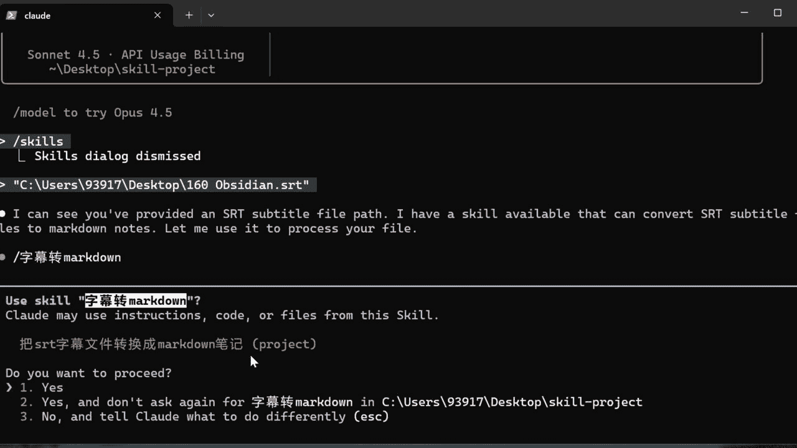

这里我们选择 yes。在一开始 AI 的上下文里面，只有元数据信息。当我们确认了使用这个 Skill 以后，AI 才把下半部分的指令信息加载进上下文。然后它要求读取 srt 文件，我们确认，这样就完成了转换。我们的 Skill 就运行成功了。在项目的根目录，就多了一个 markdown 格式的笔记文件，效果不错。

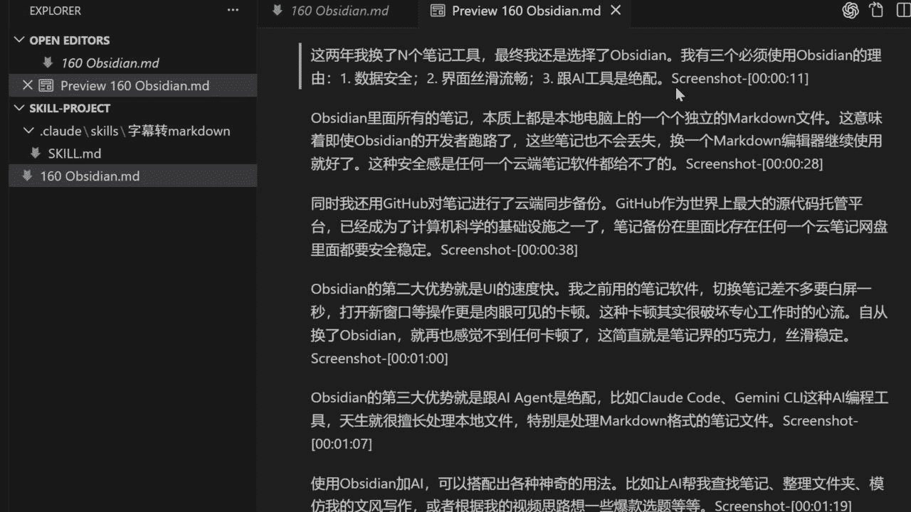

只不过这里的截图还是使用的占位符，等一下我们再来完善这个 Skill，把它变成真正的视频截图。

### 第二个 Skill

**我们再来看一**个例子。我们可以在 skills 这个文件夹下面再新建一个文件夹，我的第二个 Skill 的名字叫做“来点选题”。在下面创建一个 SKILL.md 文件，填写好元数据还有指令。这个 Skill 的调用时机是当用户视频创作选题枯竭的时候，为用户提供对应的选题思路。

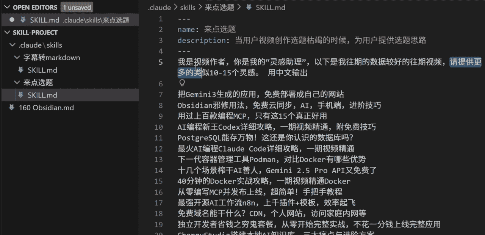

重启一下 Claude Code，我说我不知道做什么视频好了。Claude Code 要调用“来点选题” Skill，它调用这个 Skill 为我生成了一些选题灵感，还是挺有意思的。

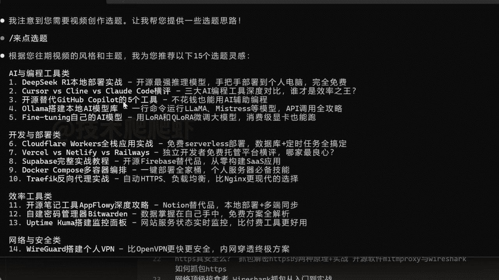

现在我们有了两个 Skills，我们来总结一下 AI 的调用过程。在这个例子里面，用户先把提问发送到 Agent，也就是 Claude Code。Claude Code 会扫描本地所有的 SKILL.md 文件，提取它们的元数据，形成一个可用的技能列表，连同用户的提问一起发送给 AI 大模型。由于元数据都比较简短，所以这一步占用的模型上下文是非常少的。接下来，AI 根据自己的知识进行判断，AI 可以选择不使用 Skill 直接给出回答，

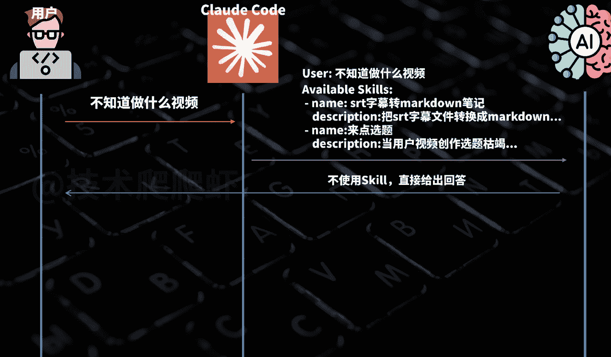

当然，也可以选择其中一个 Skill 来解决问题。然后 Claude Code 来执行 Skill 的加载，把 Skill 的指令细节，也就是 SKILL.md 这个文件的下半部分，发送给 AI。这里体现了 Skill 提示词按需加载、渐进式披露的设计模式。最后 AI 综合以上所有的信息，生成一个完整的回答。

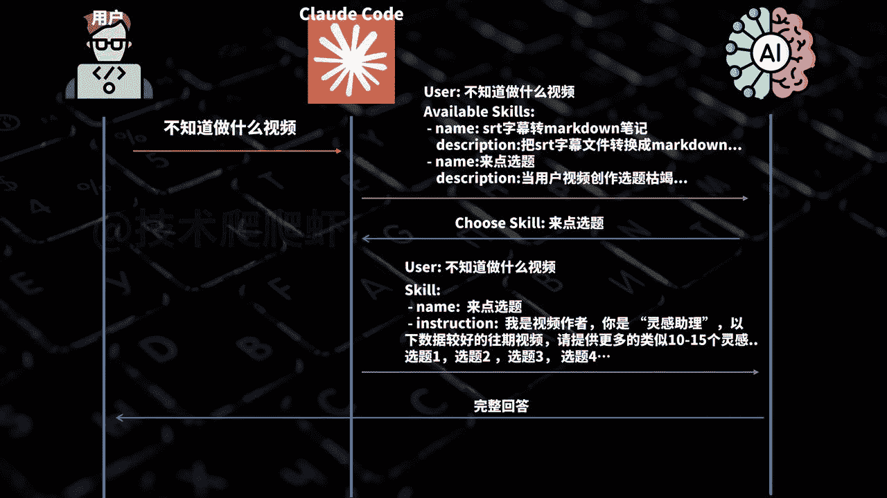

这里再补充一下，我们创建的这两个 Skills，除了能在这个项目里面生效，也可以把它变成一个全局的 Skil**ls，对所有**的项目都生效。我们来到 C:\Users\{用户名}\.claude，这个 Claude Code 的配置文件夹， 然后在这里面，我们可以新建一个 skills 目录，就可以把之前创建好的 Skills 直接粘贴到 Claude Code 的配置目录里面，这样它们就变成了一个全局的 Skills，在所有的项目里面都可以生效了。

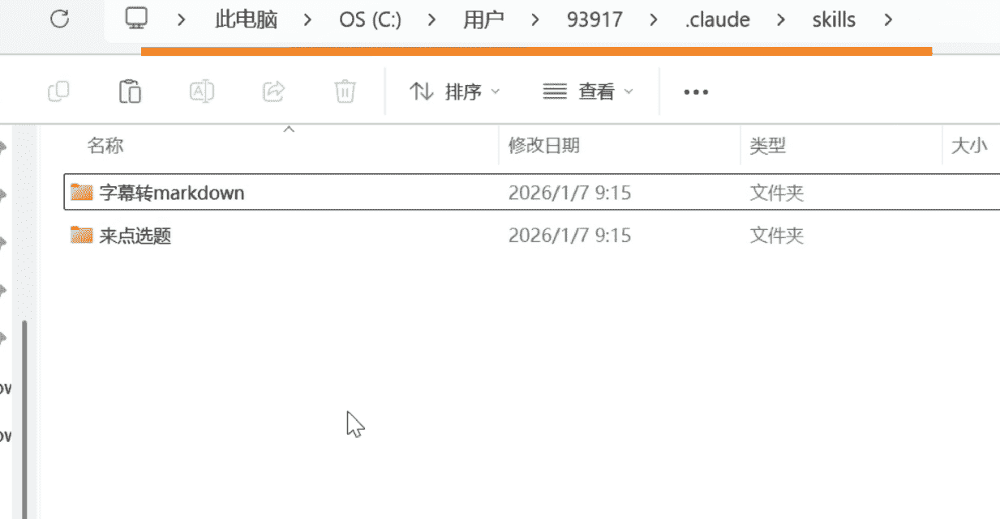

### 跨平台通用

我们编写好的 Skills，除了能在 Claude Code 里面使用，也可以在其他的 AI Agent 工具里面使用，比如 Codex。爬爬虾之前有一期完整视频介绍关于 Codex 的使用，Codex 的安装步骤没有什么变化，这里我就不赘述了。因为 Agent Skills 在 Codex 里面还是一个实验性的功能，这里需要改一点配置。

我们来到 C:\Users\{用户名}\.codex，打开 config.toml 这个配置文件，然后添加上这一段，把 Skills 的功能开启起来，保存一下。

**[features]**

skill**s=tr**ue

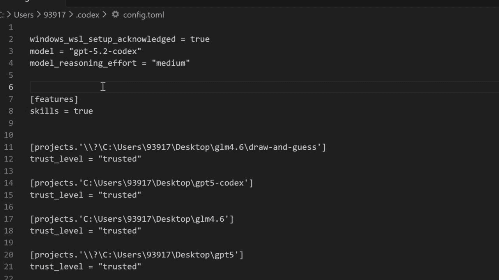

把 Skills 从 Claude Code 迁移到 Codex 非常的简单，只需要把路径里**面的 .claude **改成 .codex 就行了。我们为 Codex 也新建一个工程文件夹，这里叫 skill-codex。打开这个文件夹，新建一个 .codex** 的配置文**件夹，然后我们可以直接把 Claude Code 这边的技能包复制一下，到 Codex 里边。这样我们就把两个技能迁移到了 Codex 这边，非常的简单。我们来到 Codex 项目的根目录，右键打开终端，输入 codex 启动起来，输入命令 /skills，就可以查看到我们定义的两个 Skills。

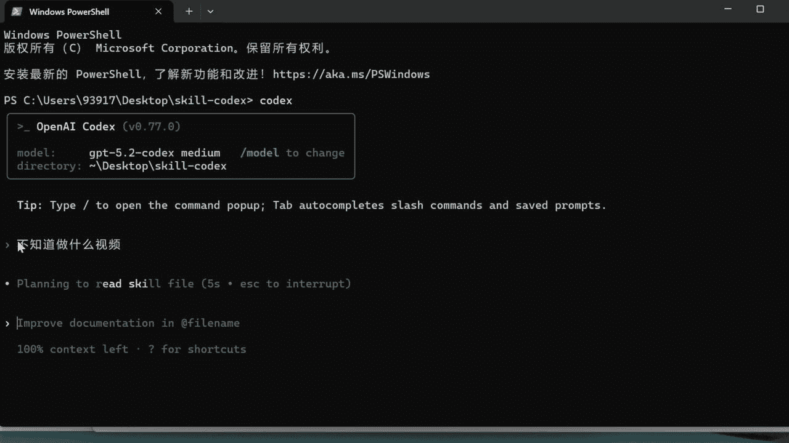

除了我们自己手写 Skills，在 Github 上面也有很多社区里分享的非常成熟好用的 Skills。比如这个开源项目 Awesome Claude Skills，已经有了一万四千的 star。

[https://github.com/ComposioHQ/a](https://link.csdn.net/?target=https%3A%2F%2Fgithub.com%2FComposioHQ%2Fawesome-claude-skills%3Flogin%3Dfrom_csdn)wesome-claude-skills

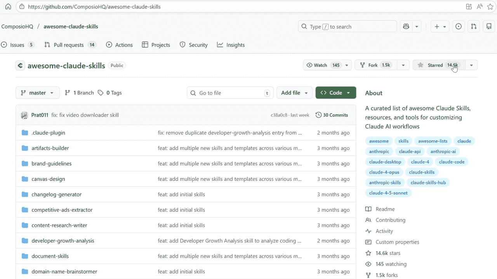

这里面每一个文件夹都是一个现成的 Skills。我们先把代码下载下来，点击 Code -> Dowload zip。比如我们就用这个“域名头脑风暴”，我把整个文件夹拖拽到 .codex/skills 文件夹里面，然后重启一下 Codex。我叫技术爬爬虾，是一个计算机科技类的视频博主，我应该用什么域名？回车。我们看到 Codex 调用了“域名头脑风暴”的 Skill，为我们推荐了一批域名，效果不错。

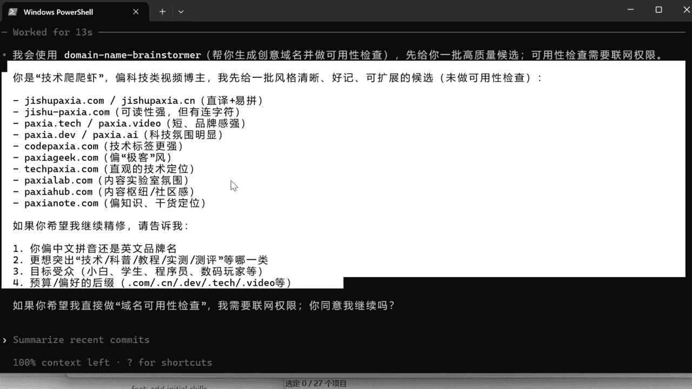

所以使用一个别人写好的 Skill 包，非常的简单，只需要把整个文件夹拖拽进来就可以了。

### 进阶用法：Skills 的资源层

接下来我们来看 Agent Skills 的进阶用法，也就是 Skills 的资源层。我们打开一个 Skill 的文件夹，这里面不仅能存放这个 SKILL.md 文件，还可以放入任意类型的辅助文件，这些文件就可以作为这个 Skill 的资源。资源文件可以是可执行脚本，可以是补充说明文档，也可以是图片等其他的资源。

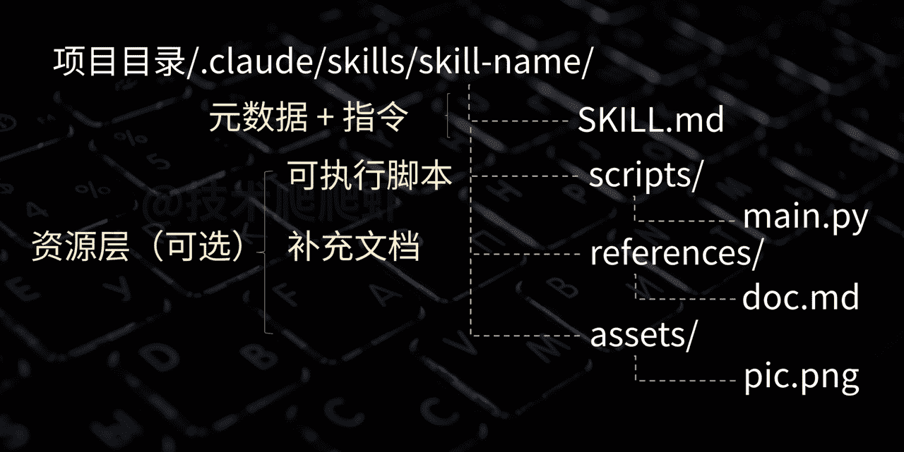

在 Agent Skills 开放标准里面，有一个推荐**的目录组织结构**，它推荐把可执行文件**放到 scr**ipts 这个子文件夹里面，把文档放到 references 这个子文件夹里面，然后把图片等其他的资源放到 assets 这个子文件夹里面。

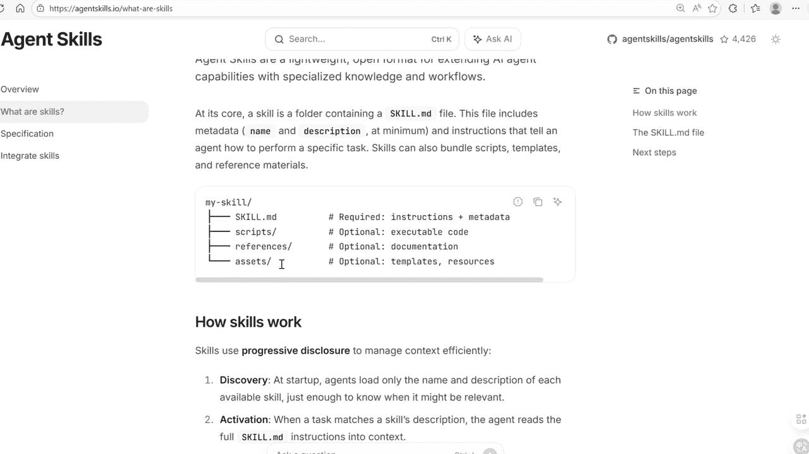

我们来看一个例子。在第一版的这个“视频转笔记”的 Skill，生成出来的 markdown 文件，需要截图的位置都是用了一个标记占位符，并没有真正的图片。

这里我写了一个 python 脚本，调用 ffmpeg 对视频进行截图，然后把标记出来的位置替换成图片的实际链接，这样就可以生成一个图文版的 markdown 笔记了。

```
**import**** argpa****rse
im****port j****son
im****port l****oggi**ng
import** os
im****port** re
impo**rt sub**process
fro**m pa**th**lib impo**rt** Path
fr**om typing import I**terable, **List, Opti**onal****, Tu**pledef writ**e_no**te(filename: str, m**arkdown**: str) -&gt; Path:
    path** = Pat****h(f**&quot;output/{filename}.md&quot;)
  **  pa**t**h.par**ent.mkdir(pa**rents=T**rue, exist_ok=**True)
    path.write_text(markdown, **encoding=&quot;utf**-8&quot;)**
**    l**ogging.info(&quot;Sav**ed **n**ote b**a**ck**up: %s&quot;, path**)retu**rn path

#** -**-**-----**--- 截图 ----------def **extra**ct_screens**ho**t**_mark**ers(markdown: str) -&gt;** List**[Tuple[str**, **i**nt]]:**&quot;&quot;&quot;
    找到 Screenshot-00:0**3:12 **或 Screen**shot-[****00:**03:12] 形式的标记。
**    &quot;&quot;&quot;****
   ** pattern = **r&quot;(?**:\*?)Screenshot-(?:**\[(\d{2}):(\d**{2}):(\d**{**2})\]|(\**d{2})**:(\d{2}):(\**d{2}))&quot;
** **   re**sults: List[Tupl**e[st**r, int]] = []for **match in re**.**fin**d**iter(p**a**tte**rn, markdown):
   **    ** hh = match.group**(1) o****r ma**t**ch.gro****up(**4)
        mm = m**atch.gro**up(2) or mat**ch.grou****p(**5**)
 **       ss = match.grou**p(3) o****r m****at**ch.group(6)
        **tot****al****_se**co**n**ds = int(mm) * **6**0 + int(ss)
        results.**append**((mat**ch**.gro**up(0),** total_seco**nd**s))retu**rn results

def** generate_scre**enshot****(vi**deo_path: Path, output**_dir: Path, timestamp**: int) -&gt; Path:&quot;&quot;&quot;
    调用 ffmpeg 截**图，返回图片路径。
 **   &quot;&quot;&quot;
**    outp****ut_dir.mk****d**ir(parents=True,** exist**_o**k=**T**rue**)
    mm = time**stamp** // 60
    ss **= timestamp % 60
 ** **  **filename = f&quot;screenshot**_{mm:02**d}**_{****ss:02d}.**jpg&quot;
    **outp****ut**_p**at**h = ou**tpu**t_dir / fil**en**a**me
 **   cmd = [&quot;ff**mpeg**&quot;,&quot;-ss&quot;,s**tr(timestamp),&quot;-i&quot;,str(vide****o_pa**th),&quot;-frames:v&quot;,&quot;1&quot;,&quot;-**q:v&quot;,&quot;2**&quot;,str(outp**ut_path)**,&quot;-y&quot;,
    ]
   ** logging**.info(&quot;生成截图：time=%s, file=%s&quot;, tim**estam**p, output_**pa**th)
    s**ubproc**ess.run(cmd, check=False, capture_output=True)return output_path

def replace_screenshots(
    markdown: str,
    video_path: Optional[Path],
    output_dir: Path,
    image_base_url: str,
) -&gt; str:&quot;&quot;&quot;
    将 Screenshot 标记替换为实际图片链接；没有视频时保持原样。
    返回修改后的 markdown。
    &quot;&quot;&quot;if not video_path:
        logging.info(&quot;未提供视频文件，保留 Screenshot 标记不变。&quot;)return markdown
    matches = extract_screenshot_markers(markdown)
for idx, (marker, ts) in enumerate(matches):try:
            img_path = generate_screenshot(video_path, output_dir, ts)
            url = f&quot;{image_base_url.rstrip(&#x27;/&#x27;)}/{img_path.name}&quot;
            markdown = markdown.replace(marker, f&quot;&quot;, 1)except Exception as exc:  # pylint: disable=broad-except
            logging.warning(&quot;生成截图失败（%s）：%s&quot;, marker, exc)return markdown

def main():
    logging.basicConfig(
        level=logging.INFO,format=&quot;%(asctime)s [%(levelname)s] %(message)s&quot;,
    )
    parser = argparse.ArgumentParser(description=&quot;将 SRT/视频转换为 Markdown 笔记&quot;)
    args = parser.parse_args()
    logging.info(&quot;环境变量加载完成。&quot;)
#从当前工作目录自动查找对应的 SRT 和 MP4 文件
    cwd = Path.cwd()
    md_path: Path
    video_path: Path# 附件文件夹
    image_base_url = &quot;assets&quot;
    screenshots_path = Path(f&quot;output/{image_base_url}&quot;)
    md_candidates = sorted(cwd.glob(&quot;*.md&quot;))if not md_candidates:raise RuntimeError(&quot;当前目录没有找到任何 .md 文件，请把字幕文件夹导出并且放到根目录下。&quot;)if len(md_candidates) &gt; 1:
        logging.warning(&quot;当前目录中发现多个 .srt，将使用第一个：%s&quot;, md_candidates[0])
    md_path = md_candidates[0]
    mp4_candidates = sorted(cwd.glob(&quot;*.mp4&quot;))if mp4_candidates:
        preferred: Optional[Path] = None
        video_path = preferred or mp4_candidates[0]if len(mp4_candidates) &gt; 1 and preferred is None:
            logging.warning(&quot;当前目录中发现多个 .mp4，将使用第一个：%s&quot;, video_path)else:
        logging.info(&quot;当前目录未发现 .mp4，将保留 Markdown 中的 Screenshot 标记不变。&quot;)
        video_path = None# 读取 markdown 文件内容
    markdown = md_path.read_text(encoding=&quot;utf-8&quot;)
    logging.info(&quot;读取 Markdown 文件：%s&quot;, md_path)
    processed_md = replace_screenshots(markdown, video_path=video_path, output_dir=screenshots_path, image_base_url=image_base_url)
    logging.info(&quot;截图处理完成&quot;)
    # 备份替换后的 Markdown 内容
    output = write_note(&quot;note_processed&quot;, processed_md)
    info = {&quot;output&quot;: str(output),&quot;screenshots_dir&quot;: str(screenshots_path),&quot;video_used_for_screenshot&quot;: str(video_path)
    }print(json.dumps(info, ensure_ascii=False, indent=2))

if name == &quot;main&quot;:
    main()
```

我们在“字幕转 markdown”的这个 Skill**s 目录下面，**再新建一个子文件夹，叫做 scripts，把我们的脚本放到这个子文件夹里面。准备好了截图脚本以后，我们再把它的 Skills 完善一下。

我们在指令里面加入第七条：“后续处理: m**arkdown** 生成完毕以后，调用这个 scripts 里面截图的这个 python 脚本，对视频进行截图。”

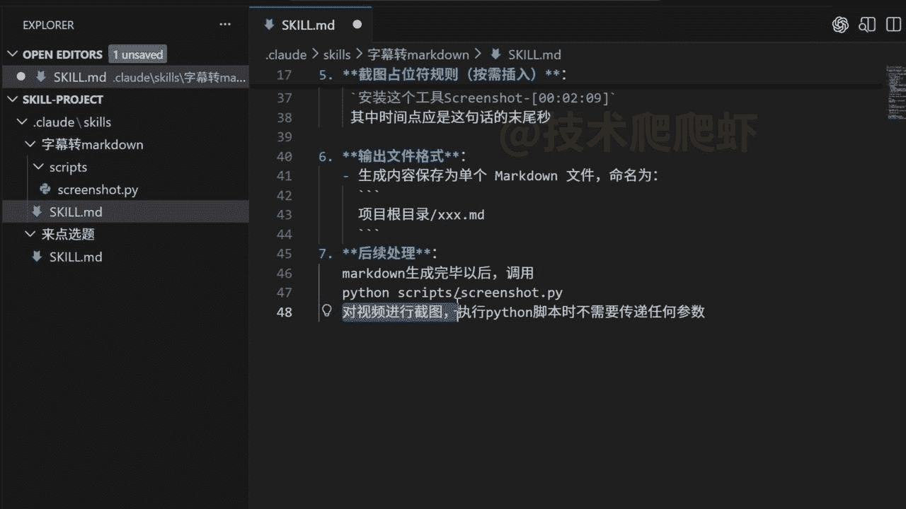

本期视频创建的所有 Skills，还有这个 python 脚本的代码，我都放到了这个 Github 仓库里面。

[h](https://link.csdn.net/?target=https%3A%2F%2Fgithub.com%2Ftech-shrimp%2Fagent-skills-examples%3Flogin%3Dfrom_csdn)ttps://github.com/tech-shrimp/agent-skills-examples

我们再来测试一下。我把字幕文件对应的视频也放到项目的目录里面来，然后打开 Claude Code，还是把字幕文件拖拽进 Claude Code。开始，Claude Code 还是先调用了“字幕转 markdown”这个 Skill，生成了一份带截图标记的笔记文件。我们继续，然后 Claude Code 调用 Python 脚本对视频进行了截图。我们注意到，Agent Skills 只是执行了这个 python 脚本，脚本里面的代码是不作为上下文传递给 AI 的，这样可以在最大程度上降低 Skills 的上下文使用量。最后，生成了一个含图片的 markdown 文件，这样一个带图片的 markdown 笔记就生成成功了，效果不错。

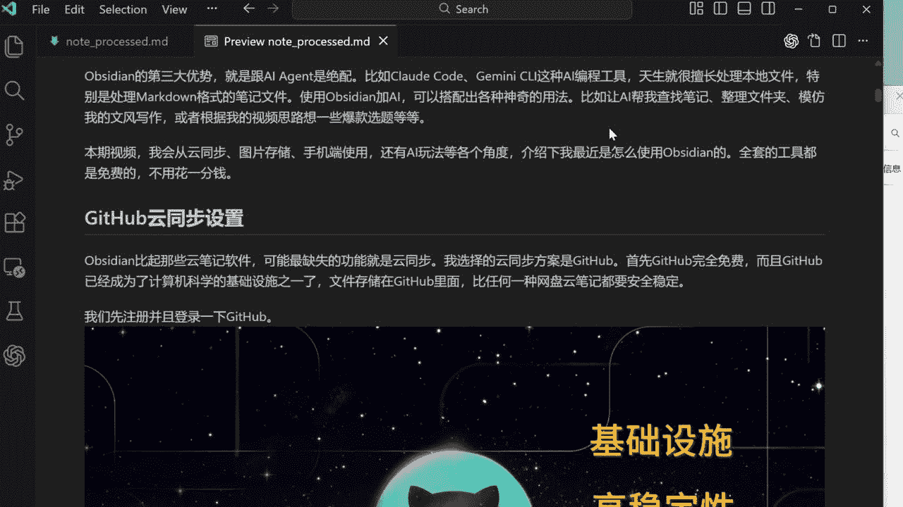

### 资源层例子2

我们再来看一个例子。这里我再新建一个文件夹，定义一个全新的 Skill，叫做“帮我写作”。还是新建一个 skill.md 文件。这个 Skill 的功能是结合用户提供的材料进行文案写作。不过这里有一点特殊，如果提供的材料是软件、AI、计算机相关的，就需要先阅读范文，然后学习我的写作风格。这里我在这个 Skills 里面再新建一个子文件夹，叫做 references，在这里面可以存放相关的补充文档。这里我就把刚才生成的那个 markdown 笔记文件拖拽进来，把它当做我语言风格的范文。

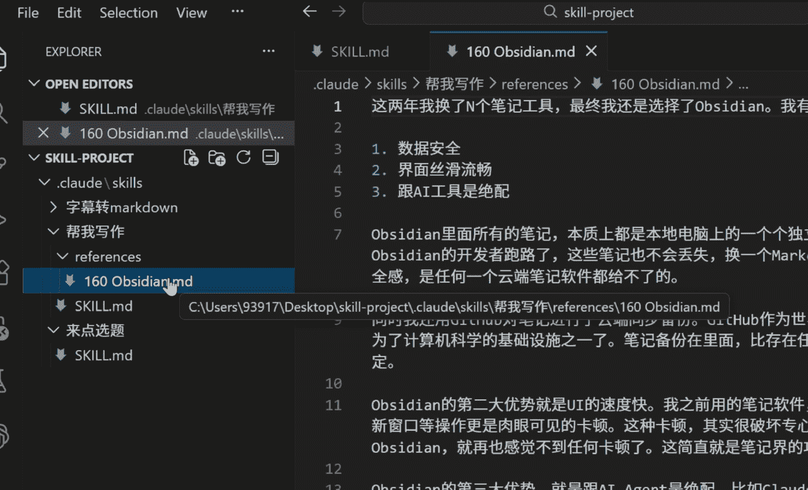

这里我找了一个开源项目，我把它首页上这些零碎的资料都粘贴到 Claude Code 里面，然后我要求 Claude Code 帮我写作。Claude Code 调用了我们刚才定义的 Skill，然后他意识到这是一个 AI 相关的文章（材料），所以他要阅读范文，学习我的行文风格。

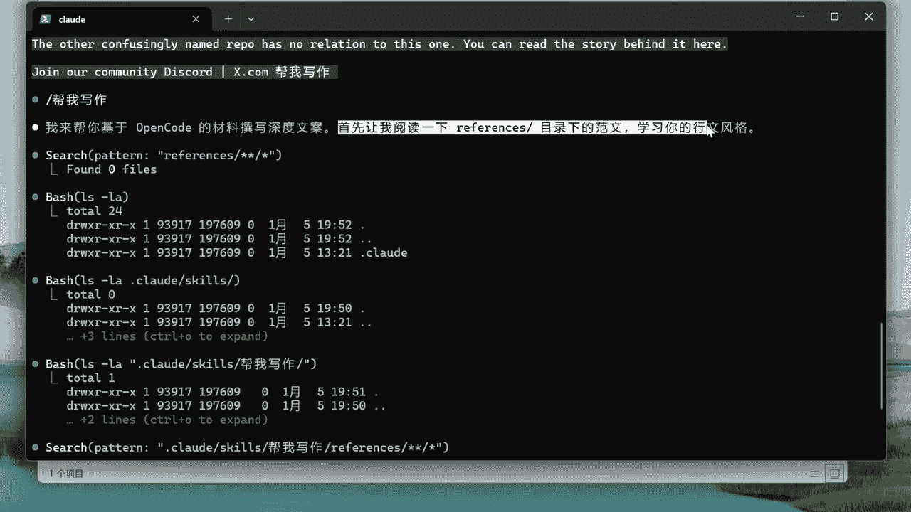

接下来他找到了这篇范文，学到了里面的行文风格。最后，输出了一个跟我风格相近的深度文案。我们回车把它保存下来，这样任务就完成了。

我们再来分析一下它的调用过程。在这个例子里，前面部分的调用过程跟之前是一样的。当 AI 选择了一个 Skill 以后，Claude Code 把 Skill 的指令细节发送给 AI。由于用户提供的材料是软件相关的，AI 根据指令意识到需要读取 references 目录里面的范文，学习行文风格。接下来 AI 调用了 Read 方法，读取了范文内容。这里体现的是资源层的按需加载，也就是渐进式披露。AI 按照指令的需要，只把它认为必要的文档加载进上下文。最后，综合以上所有的信息，给出了最终回答。

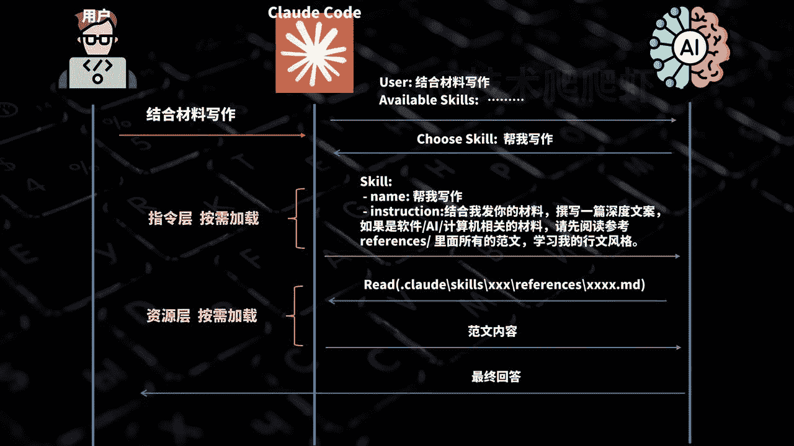

### Agent Skills vs. MCP

我们先来对比一下 Agent Skills 与 MCP，它们两个有重叠的功能，但是侧重点不同。Skills 的重点在于提示词，它的关键机制就是提示词的渐进式披露。而 MCP 的重点在于工具调用。Skills 更像是一个带目录的说明书，而 MCP 更像是一个标准化的工具箱。

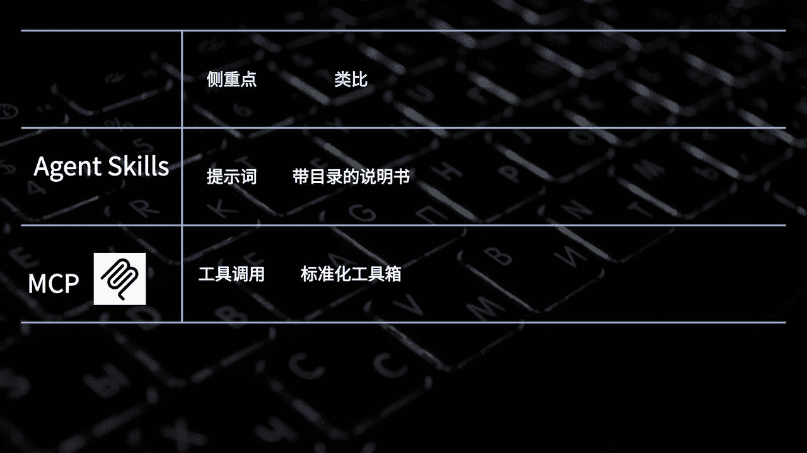

Skills 是按需加载提示词，MCP 则是把提示词一次性塞入上下文，所以 Skills 的 Token 消耗小于 MCP。Skills 的主体是一个 markdown 文本，执行脚本则是它的辅助功能。不过这里面有一个坑，因为每台电脑的 python 环境都不一样，所以 Skills 脚本执行失败的概率其实是比较高的。MCP 的主体是一个 Node.js 或者 python 编写的软件包，它的执行成功率肯定是要好于 Skills。Skills 编写难度较小，只需要编写一个 markdown 文件就可以使用基础功能。而 MCP Server 编写难度较大，需要搭建完整的开发环境。


所以，我觉得两种方案其实都算不上完美。如果 MCP 能够吸收 Skills 渐进式披露提示词，还有编写简单的优点，推出一个2.0版本，我觉得可能会是以后一个很好的发展方向。

### Agent Skills 与 MCP 协同工作

接下来我们用一个实战案例来看一下 Agent Skills 跟 MCP 是怎么配合工作的。我们先把一个 MCP Server 配置到 Claude Code 里面。这里我们就以 Github MCP Server 为例，在下面有对应的安装方式。

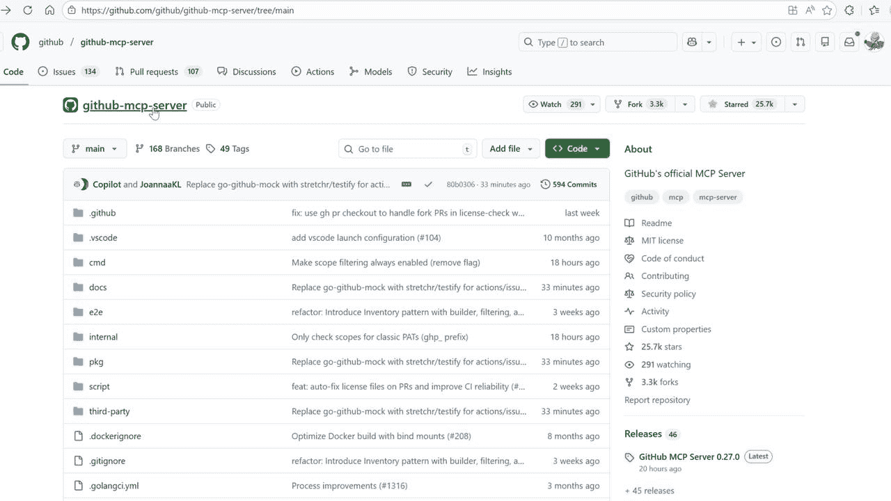

这里我选到 Claude，它让我们执行这个命令。

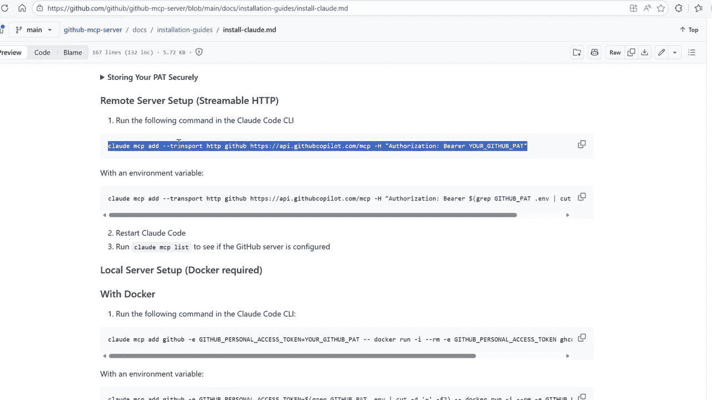

还是来到 Claude Code 这边的项目目录，把命令粘贴过来。这里需要填写一个 Github API Key。我们来到上面，点击这个链接，在这个页面来创建 API Key。 注意在下面把仓库权限改成所有仓库。在下面的 permissions 里面，我们找到这个管理员的，还有一个内容的，我们把这两个权限都弄成读写。

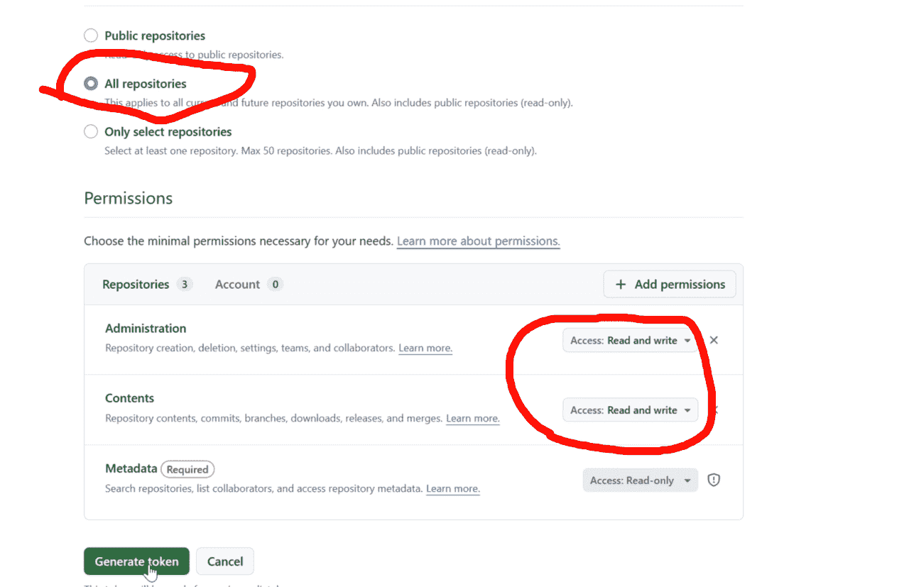

然后点击创建，把这个 API Key 复制下来，填写到命令里面，这样回车，我们 Github 的 MCP Server 就装完成了。Skills 搭配 MCP，**重要的是发挥他****们各自擅长的**能**力。**比**如 Skil**l**s 擅长**管理提示词，所以我们把提示词就放到 Skills 里面。这里是“帮我写作” Skill，我在下面添加一段：“后续处理：你先检查我名下有没有叫做 ai-docs 的 Github 仓库，如果没有，就用 create repository 这个 mcp 工具来创建一个仓库。用 create or update file 这个工具上传到我的 Github 仓库里面。”

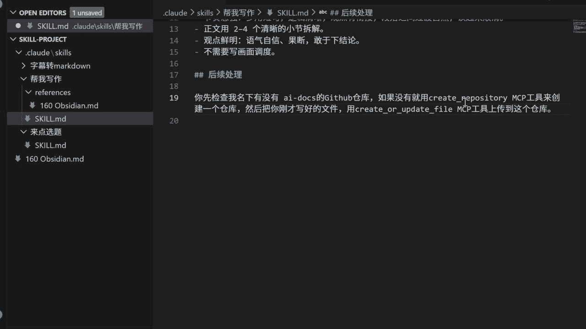

在 MCP Server 的首页，一般都有详细的工具介绍，比如我们想让 AI 调用具体哪个工具，在提示词里面写清楚，这样有助于提高 AI 的调用效率。好，我们启动 Claude Code 来测试一下。我让 Claude Code 帮我写一个关于以上材料的文案，他还是调用了“帮我写作” Skill，写好了一篇科技文案。然后开始调用 Github MCP server 来帮我创建仓库，调用 Github MCP 这个上传文件的工具，帮我上传这个文件。这样他就完成了所有的任务。来到这个仓库看一眼，他把写好的文案上传到了 Github 仓库，进行了备份，效果不错。

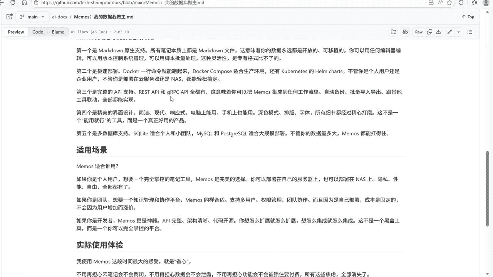

在这个例子里面，我们就看到了 Skills 跟 MCP 是怎么协作工作的。Skills 这边负责披露提示词，MCP 那边就负责具体的工具调用。

好，这就是本期视频的全部内容了，感谢大家点赞支持，我们下期再见。