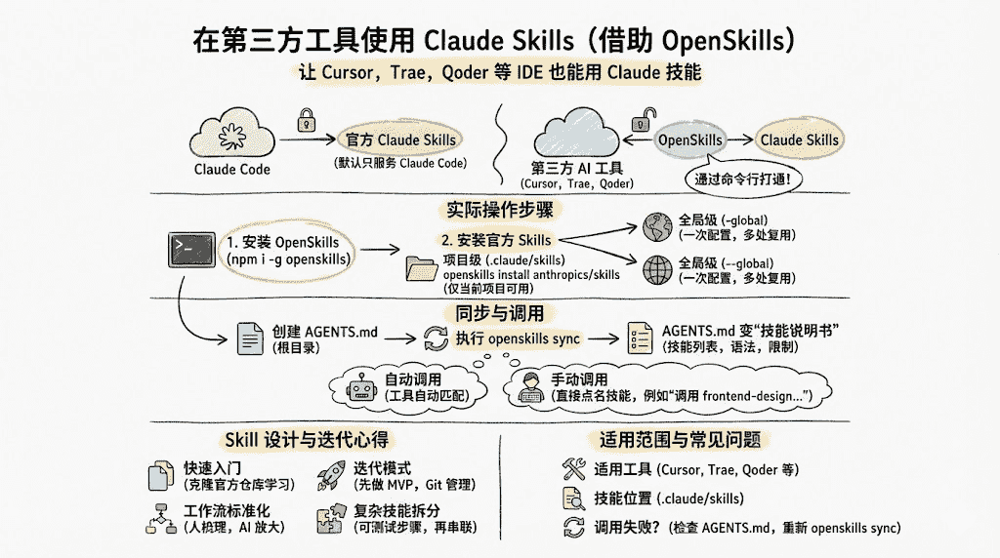

# 基于 OpenSkills 的 Claude Skills 体系化落地方案

> 来源：[https://qqs7y1hozd1.feishu.cn/docx/SuEudpvR5owWBWxASnwcVUA8nVd](https://qqs7y1hozd1.feishu.cn/docx/SuEudpvR5owWBWxASnwcVUA8nVd)

## 文章目录

- [Pre](https://link.csdn.net/?target=%23Pre_7%3Flogin%3Dfrom_csdn)
- [一、背景：为什么非 Claude Code 工具也需要 Claude Skills？](https://link.csdn.net/?target=%23_Claude_Code__Claude_Skills_16%3Flogin%3Dfrom_csdn)
- 二、方案概览：用 OpenSkills 打通“技能层”与“工具层”
- 三、环境准备：安装 OpenSkills
  - [3.1 安装命令与运行环境](https://link.csdn.net/?target=%2331__66%3Flogin%3Dfrom_csdn)
  - 3.2 为什么选择 CLI 形态？
- 四、安装官方 Claude Skills：项目级 vs 全局级
  - [4.1 两种安装范围](https://link.csdn.net/?target=%2341__96%3Flogin%3Dfrom_csdn)
  - [4.2 技能选择与体积差异](https://link.csdn.net/?target=%2342__115%3Flogin%3Dfrom_csdn)
- 五、关键配置：用 AGENTS.md 打通工具与技能
  - 5.1 为什么要有 AGENTS.md？
  - [5.2 创建与同步流程](https://link.csdn.net/?target=%2352__146%3Flogin%3Dfrom_csdn)
  - 5.3 AGENTS.md 的最佳实践
- 六、在非 Claude 工具中实际调用 Skills
  - [6.1 两种主要调用方式](https://link.csdn.net/?target=%2361__181%3Flogin%3Dfrom_csdn)
  - [6.2 调用结果与调试信息](https://link.csdn.net/?target=%2362__199%3Flogin%3Dfrom_csdn)
- [七、从“会用”到“会写”：构建自定义 Claude Skills 的方法论](https://link.csdn.net/?target=%23_Claude_Skills__216%3Flogin%3Dfrom_csdn)
  - 7.1 快速入门：借助官方仓库与 skill-creator
  - 7.2 工作流标准化：AI 不能替代领域建模
  - 7.3 迭代模式：先 MVP，再扩展
  - 7.4 复杂技能拆分：以 PPT 生成技能为例
- [八、常见问题与排错思路](https://link.csdn.net/?target=%23_276%3Flogin%3Dfrom_csdn)
  - 8.1 技能无法调用或工具“看不到”技能
  - [8.2 技能行为与预期不一致](https://link.csdn.net/?target=%2382__294%3Flogin%3Dfrom_csdn)
- 九、应用场景：把 Skills 用在真实项目里
- 十、结语：把 Claude Skills 变成你的“跨工具能力层”

## Pre

过去一年里，大模型编程工具几乎成了开发者的“标配”：Cursor、Trae、Qoder、Claude Code 各显神通，但真正做到“像用插件一样复用技能”的，还要看 Claude Skills。然而一个现实问题是：官方 Skills 默认只服务 Claude Code，其他工具很难“无感接入”。

接下来将基于开源项目 [OpenSkills](https://link.csdn.net/?target=https%3A%2F%2Fgithub.com%2Fnumman-ali%2Fopenskills%3Flogin%3Dfrom_csdn)，给出一套可落地、可扩展的跨工具接入方案，帮助你在任意支持上下文文件的 AI 编程环境中使用 Claude Skills。

---

## 一、背景：为什么非 Claude Code 工具也需要 Claude Skills？

Claude Skills 是 Anthropic 官方提出的一套“可复用任务组件”机制，用来封装复杂的工作流，例如前端页面生成、文档理解与重写、画布设计等。对于经常跨项目、跨技术栈开发的工程师而言，把通用能力抽象成技能，可以显著减少“从零写提示词”的重复劳动。

在当前生态中，存在几个典型矛盾：

- 官方支持范围有限
  - Claude Skills 默认绑定在 Claude Code 的项目体系内，依赖其特定目录结构和集成方式。
  - Cursor、Trae、Qoder 等第三方 IDE 无法直接识别和调用官方技能定义。
- 工具越来越多，技能却难以复用
  - 每个 IDE 都在实现自己的“自定义指令”“工作流”机制，开发者不得不在不同工具里重复造轮子。
  - 这导致知识和经验被锁在具体工具中，跨工具迁移成本很高。
- 企业与个人都需要“统一的技能层”
  - 企业希望把规范化的代码风格、文档模板、审查流程沉淀成统一的技能，供多种工具共享。
  - 个人开发者则希望“我写好一套 PPT 生成技能，在 Cursor 和 Claude Code 里都能用”。

OpenSkills 的价值正是在于：提供一个独立于具体 IDE 的公共技能层，让技能的编写、分发与调用脱离单一工具绑定。

---

## 二、方案概览：用 OpenSkills 打通“技能层”与“工具层”

[OpenSkills](https://link.csdn.net/?target=https%3A%2F%2Fgithub.com%2Fnumman-ali%2Fopenskills%3Flogin%3Dfrom_csdn) 是一个开源项目，核心目标是将 Skills 以文件+说明文档的形式落地，使任何可以读取项目文件的 AI 工具都能理解并调用这些技能。这背后的设计思路可以概括为三层结构：

- 工具层（Tool Layer）
  - 各类 IDE / 编辑器 / 命令行助手：Cursor、Trae、Qoder、Claude Code 等。
  - 负责提供对话界面、上下文管理、模型调用等基础能力。
- 技能描述层（Skill Description Layer）
  - 由 OpenSkills 生成和维护的 `AGENTS.md` 文件，用 Markdown 描述可用技能、调用规范和约束。
  - 对 AI 工具而言，这个文件就是“插件市场里的 README 列表”。
- 技能实现层（Skill Implementation Layer）
  - 实际的 Claude Skills 文件，存放在 `.claude/skills` 目录（项目级）或全局路径中。
  - 每个技能封装一个相对独立的工作流逻辑，例如 `frontend-design`、`canvas-design`、`pdf` 等。

在使用上，开发者只需做三件事：

1. 安装 OpenSkills。
1. 安装官方 Claude Skills（项目级或全局）。
1. 生成并维护 `AGENTS.md`，让工具“读懂”有哪些技能可用以及如何调用。

下面进入实操部分。

---

## 三、环境准备：安装 OpenSkills

### 3.1 安装命令与运行环境

OpenSkills 通过 npm 发布，安装方式非常简单：

`npm i -g openskills`

- 命令含义：全局安装 `openskills` CLI 工具，只需执行一次。
- 安装成功标志：终端出现类似 changed 50 packages in 476ms 的提示，说明依赖已就绪。

建议环境要求：

- Node.js：建议版本在 18 及以上，以保证对新特性的兼容与 CLI 的稳定性（可自行用 `node -v` 检查）。
- 权限：在部分 Linux / macOS 环境下，全局安装可能需要 `sudo` 权限，可按团队规范调整。

### 3.2 为什么选择 CLI 形态？

相比在每个工具中写特定插件，CLI 有几个明显优势：

- 与 IDE 解耦：不用为每个 IDE 编写专用扩展，降低维护成本。
- 更易集成到 CI / 自动化脚本中，例如在构建前自动同步最新技能列表。
- 统一管理：同一套技能可以同时服务于命令行 Agent、IDE 插件以及服务端 Agent 系统。

---

## 四、安装官方 Claude Skills：项目级 vs 全局级

OpenSkills 的第二步是安装 Anthropic 官方维护的一组 Skills，这些技能覆盖了设计、文档、前端等常见场景。

### 4.1 两种安装范围

官方提供了两种主要安装方式，对应不同的应用场景：

- 项目级安装
  - 适用于有特殊安全或合规需求的仓库，例如金融、政企项目。
  - 可以在不同项目中安装不同版本或子集的官方技能，避免互相干扰。
- 全局级安装
  - 一次安装，所有项目可用，体验最佳。
  - 对个人开发者或小团队尤其友好，减少重复配置工作。

在实际使用中，可以采用“全局为主、项目级补充”的组合策略：全局安装通用技能，项目内仅保留企业定制技能或敏感能力。

### 4.2 技能选择与体积差异

安装官方技能时，OpenSkills 提供交互式选择界面：

- 默认全选 16 项官方 Skills，比如 `canvas-design`、`frontend-design`、`pdf` 等。
- 可通过空格键单独勾选/取消，最后回车确认安装列表。

不同技能的体积差异较大：

- `canvas-design` 大约 5.3 MB，包含较多示例与复杂工作流定义。
- `template` 等技能仅约 140 B，更偏向轻量模板能力。

从工程实践角度看，建议：

- 初学阶段：先保持全选，便于体验完整生态。
- 团队落地阶段：根据业务场景精简技能集，减少无关内容对模型思考的干扰。

---

## 五、关键配置：用 AGENTS.md 打通工具与技能

### 5.1 为什么要有 AGENTS.md？

`AGENTS.md` 是 OpenSkills 的“桥接文件”，通过自然语言+结构化提示的形式，向模型解释：

- 当前项目有哪些技能可用；
- 每个技能适合用在什么场景；
- 如何调用、有哪些限制与注意事项。

由于大多数 AI 工具都支持将项目里的 Markdown 文件加入上下文，`AGENTS.md` 实际上扮演了插件系统的“注册表”和“说明书”角色。

### 5.2 创建与同步流程

完整流程分三步：

1. 在项目根目录手动创建 `AGENTS.md` 文件（可为空）。
1. 在该目录执行同步命令：`openskills sync`。
1. 在交互式菜单中勾选需要同步的技能，OpenSkills 会自动把技能说明写入 `AGENTS.md`。

同步后的 `AGENTS.md` 通常包括：

- 技能简介
- 调用语法示例（如 `openskills read` 等）
- 使用限制说明（例如 “Only use skills listed below” 等提示语）

一些 AI 工具（如 Cursor）可以通过“阅读项目文档 + 代码”的方式，让模型自动学习这个文件，进而在合适的场景中主动提议或调用技能。

### 5.3 AGENTS.md 的最佳实践

为了让工具更“聪明”地使用技能，可以在默认内容基础上做适度增强：

- 为关键技能补充更多场景示例：
  - 例如在 `frontend-design` 下增加“企业官网着陆页”“SaaS 控制台”等典型场景描述。
- 明确禁止使用的场景或边界：
  - 如声明“本项目禁止自动修改数据库 schema，只能生成迁移脚本供人工审核”。
- 对团队自定义技能增加责任人、变更记录链接，方便协作与回溯。

---

## 六、在非 Claude 工具中实际调用 Skills

有了技能文件和 `AGENTS.md`，接下来就是让 Cursor、Trae、Qoder 等工具“用起来”。

### 6.1 两种主要调用方式

当前实践中主要有两种调用模式：

- 自动调用
  - 工具根据用户任务和上下文内容，自动判断是否使用某个技能。
  - 前提是工具会把 `AGENTS.md` 加入模型上下文，并允许模型提出类似“调用 X 技能”的内部操作。
- 手动调用
  - 用户在提示词中显式点名技能，例如：“请调用 `frontend-design` skill，用 HTML 开发一个视频剪辑 SaaS 的介绍页，包含功能展示和价格区域。”
  - 工具在收到技能名后，可通过额外规则或插件机制，将调用意图映射到具体执行动作。

在实践中，建议：

- 对任务强约束的企业场景（如合规模板输出）：优先手动调用，保证可控性。
- 在探索和试验阶段：允许模型自动选择技能，观察其行为模式，后续再加约束。

### 6.2 调用结果与调试信息

当工具正确识别并调用某个技能后，一般会在终端或日志中输出类似信息：

`Skill read: frontend-design Success`

这表示：

- 工具已成功读取对应技能定义（通常是 `.claude/skills` 中的某个文件）；
- 模型接下来会按该技能的工作流处理当前任务，例如生成页面结构、样式建议等。

如果在调用过程中遇到异常（如技能不存在、路径错误等），则可以通过这些日志定位问题。

---

## 七、从“会用”到“会写”：构建自定义 Claude Skills 的方法论

官方 Skills 只能解决通用问题，真正体现团队优势的，是把自身业务工作流抽象为自定义 Skills。原文作者结合实践，总结了四个非常值得参考的经验：

### 7.1 快速入门：借助官方仓库与 skill-creator

- 核心策略：克隆官方 Skills 仓库，其中包含 `skill-creator` 这个元技能，用于辅助创建新技能。
- 实际做法：
  - 让 AI 工具阅读官方 Skills 示例，包括结构、字段、工作流设计方法等。
  - 在此基础上，用自然语言描述自己的业务流程，借助 `skill-creator` 生成初版技能定义。

优点在于：

- 不需要自己从零设计技能配置格式，减少学习成本。
- 可以沿用官方风格和最佳实践，降低走偏的风险。

### 7.2 工作流标准化：AI 不能替代领域建模

作者特别强调：构建 Skills 之前，必须先由人把目标工作流梳理清楚。

- 人来做的事情：
  - 明确输入输出；
  - 拆分关键步骤；
  - 总结领域规则和质量标准。
- AI 来做的事情：
  - 提供更多候选步骤或检查项；
  - 帮助发现遗漏场景；
  - 生成初版文档和配置文件。

一句话：AI 放大的是既有的流程质量，而不是凭空“创造业务逻辑”。

### 7.3 迭代模式：先 MVP，再扩展

在工程实践中，自定义技能应当遵循 MVP 思路：

- 第一阶段：实现最小可用版本，只覆盖 1–2 个高频场景，验证整体闭环是否可用。
- 第二阶段：根据实际使用反馈，逐步增加分支、异常处理和更多配置参数。

同时建议用 Git 做版本管理：

- 把技能文件和 `AGENTS.md` 一起纳入版本控制；
- 为重要变更打 tag，例如 `skill-v1.0.0`；
- 在提交信息中说明“新增步骤：自动生成评审 checklist”等。

### 7.4 复杂技能拆分：以 PPT 生成技能为例

对于复杂任务（例如“一键生成完整 PPT 项目说明书”），作者给出的策略是“分步实现 + 逆向推导”。

以 PPT Skills 为例，推荐的迭代路径是：

1. 先编写一个能生成 PPT 的脚本或功能模块，在本地独立测试确保质量。
1. 再把 PPT 生成过程拆解为多个步骤，如大纲生成、结构分配、内容填充、视觉风格应用等。
1. 针对每个步骤，编写单独的小技能或子流程，并分别验证结果是否稳定。
1. 最后使用 `skill-creator` 或手写配置，将这些经过验证的子流程串联成一个复杂技能。

这种方式避免了一开始就把所有逻辑塞进一个“巨型技能”里，降低调试和维护成本。

---

## 八、常见问题与排错思路

在落地过程中，可能会遇到一些典型问题，可以按以下思路排查。

### 8.1 技能无法调用或工具“看不到”技能

优先检查以下几项：

- `.claude/skills` 目录是否存在，并已包含对应技能文件（确认安装命令执行成功）。
- 当前项目是否位于正确路径下，工具是否加载了该目录结构。
- `AGENTS.md` 是否已经通过 `openskills sync` 同步最新技能列表。
- 工具配置中，是否将 `AGENTS.md` 纳入模型上下文（或添加到“知识库/文档源”）。

若仍无法解决，可尝试：

- 删除 `AGENTS.md` 并重新执行 `openskills sync`。
- 在 IDE 日志或开发者工具中查看请求/响应内容，确认模型是否读到了该文件。

### 8.2 技能行为与预期不一致

当技能没有按照预期工作时，可以从两个层面分析：

- 技能定义层
  - 检查技能步骤是否过多、指令是否冲突；
  - 适当收紧描述，避免“既要…又要…”导致模型难以取舍。
- 工具集成层
  - 有的工具会对用户输入进行二次处理（例如自动加前缀提示），可能与技能设定冲突；
  - 可以尝试在提示词中明确指示“严格按照 `AGENTS.md` 中的 X 技能执行”。

## 九、应用场景：把 Skills 用在真实项目里

结合 Cursor、Trae、Qoder 等非 Claude Code 工具，下面给出几个可落地的场景思路。

+ 前端落地页生成（`frontend-design`）

+ 在 Cursor 中选中一个产品需求文档，提示：
“请阅读当前文档，并调用 `frontend-design` skill，生成一个符合文案风格的登录页 HTML 结构及基础样式。”

+ 用于快速产出初版页面，再由前端工程师精修。

+ 文档理解与改写（`pdf` 等技能）

+ 在 Trae 中对接长 PDF 技术文档，利用相关技能快速提取结构化摘要或重写为团队内部 wiki 条目。

+ 产品原型与画布设计（`canvas`-design）

+ 配合 Figma / 白板工具，生成线框图描述或布局说明，为设计师提供快速起稿参考。

通过这些实践，可以逐步把团队的“隐性流程”固化为可复用的技能资产。

## 十、结语：把 Claude Skills 变成你的“跨工具能力层”

借助 `OpenSkills`，Claude Skills 不再只属于 Claude Code，而是可以作为一个独立的“能力层”，被不同的 AI 编程工具共享和复用。对于个人开发者，这意味着可以在熟悉的 IDE 中享受更强大的技能生态；对于团队和企业，这则意味着可以在工具多样化的前提下，依然构建统一、可治理的智能工作流体系。

如果你已经习惯了 Cursor、Trae 或 Qoder 的工作流，不必迁移到 Claude Code，也可以通过本文的方式，让这些工具“长出” Claude Skills 的能力。下一步，可以尝试为自己的项目设计第一个定制 Skill，从一个最简单的 MVP 开始，然后在日常使用中不断打磨它。
