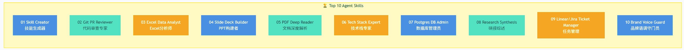
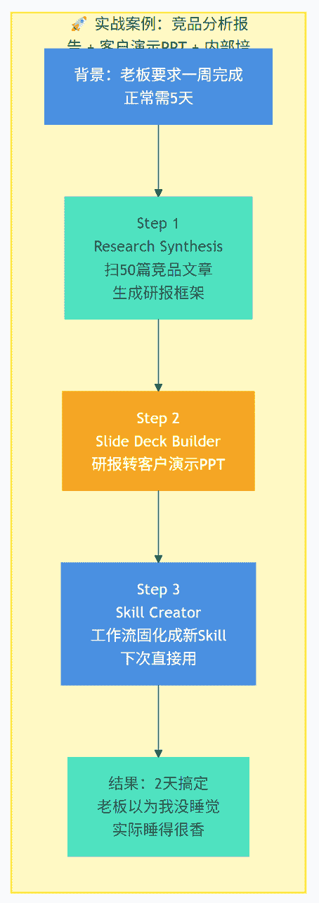

# 用好这10个Agent Skills，效率直接翻倍！

> 来源：[https://qqs7y1hozd1.feishu.cn/docx/DIXldB8OvoOtqzxdL1HcL7XsnX4](https://qqs7y1hozd1.feishu.cn/docx/DIXldB8OvoOtqzxdL1HcL7XsnX4)

最**近 GitHub **上有人做了个采样调查，统计了哪些 Skills 质量最佳、最受欢迎。于是整理了这份 Top 10 榜单，加上真实使用场景，帮你快速找到最适合的那几个。

---

## 01 Skill Creator - 技能生成器（元技能中的元技能）

**这玩意是啥？**

Agent 的"祖师爷"技能。通过引导式对话，把你脑子里的想法或者纸面上的 SOP()，自动转化成标准的 SKILL.md 文件。

**如何使用？**

上个月公司内部要做个对接 ERP 的自动化工具，我直接用 Skill Creator 生了个 Skill，现在整个团队都能用，不用每次都跟 AI 解释一遍我们 ERP 的字段规则。

**适合谁？**

+   • 开发者（想把自己工作流固化的）

+   • Prompt 工程师（懒得从零写的）

+   • 企业 IT 管理员（要统一标准的）

+   • 超级个体（想打造自己AI工具箱的）

> **传送门：** https://github.com/anthropics/skills/tree/main/skills/skill-creator

---

## 02 Git PR Reviewer - 代码审查专家

**这玩意是啥？**

集成 CI/CD 的代码审查工具，严格遵循 Google/Airbnb 规范，能扫安全漏洞，还能对 PR 提出行级修改建议。

**智哥咋用的？**

以前 Tech Lead 审代码得花大半天，现在这个 Skill 先过一遍，低级错误直接拦下来，TL 只需要看架构和逻辑就行。这玩意省下来的时间，够我多写两个Feature了。

**适合谁？**

+   • 软件工程师（怕上线翻车的）

+   • Tech Lead（忙不过来的）

+   • DevOps 工程师（要自动化CI/CD的）

**传送门：** https://agentskills.io/skills/git-pr-reviewer

---

## 03 Excel Data Analyst - Excel 分析师

**这玩意是啥？**

基于 Python Pandas 的数据处理专家，能自动洗脏数据、处理缺失值、转换格式，还能生成专业的数据透视表和图表。

**智哥咋用的？**

上个月财务甩给我一堆格式混乱的销售流水，我当时就崩溃了。结果这 Skill 直接给我清洗好，还顺手做了个趋势图。财务小姐姐看我的眼神都变了，卧槽。

**适合谁？**

+   • 财务会计（要处理报表的）

+   • 运营经理（要分析数据的）

+   • 数据分析师（想偷懒的）

+   • 小微企业主（雇不起数据团队的）

**传送门：** https://github.com/anthropics/skills/tree/main/skills/data-analysis

---

## 04 Slide Deck Builder - PPT 构建者

**这玩意是啥？**

自动化演示文稿生成器，能把 Markdown 大纲或长文章直接转成设计精美的 pptx 文件，还支持企业模版。

**智哥咋用的？****

上周有个紧急的客户演示，**我用这玩意把技术文档直接转成 PPT，从大纲到成品只用了15分钟。老板问我啥时候做的，我说"刚喝完咖啡就搞定了"。

**适合谁？**

+   • 咨询顾问（天天做PPT的）

+   • 产品经理（要汇报的）

+   • 市场人员（要做方案的）

+   • 售前工程师（要快速响应的）

**传送门：** https://agentskills.io/skills/presentation-builder

---

## 05 PDF Deep Reader - 文档深度解析

**这玩意是啥？**

针对长文档（100页+）的智能阅读器，用分块索引技术，能精准提取条款、跨页表格数据，还能跨文档对比。

**智哥咋用的？**

之前要审一个几百页的技术合同，**律师报价要5万。我用这 **Skill 一扫，把所有风险条款都标出来了，最后找律师只花了5000块确认一下就行。这波省下来的钱，够我买个新显卡了。

**适合谁？**

+   • 律师/法务（要审合同的）

+   • 投资分析师（要读财报的）

+   • 科研人员（要做文献综述的）

+   • 学生（要写论文的）

**传送门：** https://agentskills.io/skills/pdf-deep-reader

---

## 06 Tech Stack Expert - 技术栈专家

**这玩意是啥？**

封装了特定技术栈（比如 Next.js 15+）最新最佳实践的编程助手，防止 AI 用过时语法，还能给架构级建议。

**智哥咋用的？**

最近项目要从 Next.js 13 升到 15，我本来以为要踩一堆坑，结果这 Skill 直接告诉我哪些 API 废弃了、哪些新特性必须用。升级过程丝滑得像抹了油，零报错完成。

**适合谁？**

+   • 前端工程师（想跟上版本的）

+   • 全栈开发者（要快速搭建的）

+   • 架构师（要最佳实践的）

**传送门：** https://github.com/vercel/agent-skills

---

## 07 Postgres DB Admin - 数据库管理员

**这玩意是啥？**

安全的 SQL 操作专家，默认开启**只读保护，支**持查询性能分析和索引优化建议，杜绝删库风险。

**智哥咋用的？**

以前线上出问题，DBA 不在的时候我只能干瞪眼，现在这 Skill 帮我做性能分析，还能给优化建议。最爽的是默认只读，再也不用担心手抖删库了（别问我怎么知道的）。

**适合谁？**

+   • 后端工程师（要查线上数据的）

+   • DBA（想偷懒的）

+   • 运维人员（要故障排查的）

**传送门：** https://agentskills.io/skills/postgres-admin

---

## 08 Research Synthesis - 研报综述

**这玩意是啥？**

严谨的研究助理，执行"搜索-筛选-验证-引用-撰写"的标准化流程，输出包含真实参考文献的深度报告。

**智哥咋用的？****

上个月要调研一个新赛**道，我用这 Skill 扫了100多篇文章，自动生成了带引用的研报。投资总监看完问我"你招了新分析师？"，我说"不，这是我AI写的"。

**适合谁？**

+   • 行业研究员（要写研报的）

+   • 投资经理（要做尽调的）

+   • 策划人员（要写方案的）

+   • 专栏作者（要找素材的）

**传送门：** https://github.com/anthropics/skills/tree/main/skills/research-assistant

---

## 09 Linear/Jira Ticket Manager - 任务管理

**这玩意是啥？**

需求转化专家，能把模糊的口头需求拆解成结构化的开发工单，自动补全验收标准（AC）和技术细节。

**智哥咋用的？**

产品经理开会说完需求，我直接用这 Skill 生成 Jira 工单，PM 都惊了，说"比我自己写的还清楚"。从此以后，需求评审会再也不用开两小时了。

**适合谁？**

+   • 产品经理（要写PRD的）

+   • 项目经理（要拆任务的）

+   • Scrum Master（要管迭代的）

**传送门：** https://agentskills.io/skills/linear-integration

---

## 10 Brand Voice Guard - 品牌语调守门员

**这玩意是啥？**

内容合规与润色专家，基于企业 Tone of Voice 指南，自动审核并改写文案，确保对外发声风格统一。

**智哥咋用的？**

我们市场部之前发小红书，每个运营风格都不一样，用户以为账**号被盗了。现在用这** Skill 统一语调，品牌识别度直接拉满，粉丝留存率提高了30%。

**适合谁？**

+   • 社交媒体运营（要批量发内容的）

+   • 市场营销（要统一风格的）

+   • 公关PR（要管控风险的）

+   • 客服主管（要检查回复语气的）

**传送门：** https://agentskills.io/skills/brand-voice-guard

---

## 实战案例：用 3 个 Skills 搞定一周的工作

【背景】

上周老板让我做个竞品分析报告 + 客户演示PPT + 内部培训文档，正常估计得干一周。结果我用了 Agent Skills 的组合拳，两天就搞定了，剩下三天我在摸鱼（不是）。

【操作步骤】

1.  Research Synthesis 扫了 50 篇竞品文章，生成研报框架

1.  Slide Deck Builder 把研报直接转成客户演示 PPT

1.  **Skill Creator** 把这个工作流固化成新 Skill，下次直接用

【结果】

老板看完报告问："你这几天没睡觉吧？" 我说："不，我睡得挺香，感谢 AI。"

---

## 怎么安装这些 Skills？

安装方法超简单，三步搞定：

Step 1：找到你的 AI 工具目录

+   • Claude Code / Codex 用户：~/.claude/skills/ 或 ~/.codex/skills/

+   • Gemini CLI 用户：~/.gemini/skills/

Step 2：下载 Skill 文件

把对应的 Skill 文件夹丢进去就行

Step 3：重启 AI 工具（现在支持热重载了！）

而且现在 Claude Code 已经支持 Skill 热重载了，不用每次修改都重启，这个改动真的爽到炸。相信后面 Codex 和 Gemini 一定会跟进。

---

## 写在最后：使用建议

如果你刚开始接触 Agent Skills，推荐先试试这三个：

### 文档三件套（Docx / PDF / XLSX）

**日常办公刚需**，谁用谁知道。处理 Excel、读 PDF、写文档，这三个能覆盖你 80% 的办公场景。

### Git PR Reviewer

**如果你是开发者，这个必须装**。代码质量不用愁，还能学习最佳实践，相当于带了个 24 小时在线的 Tech Lead。

### Brand Voice Guard

**如果你负责内容输出，这个能保命**。再也不用担心客服回复语气生硬导致投诉了，品牌一致性直接拉满。

### 如果你想自己开发 Skill？

从 **Skill Creator** 开始，参考格式把自己的工作流固化进去。智哥现在已经攒了十几**个自己的** Skills，效率提升说实话，至少翻倍。