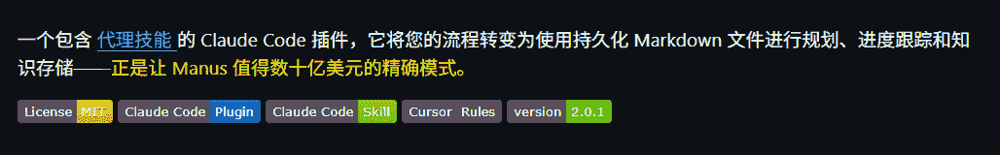
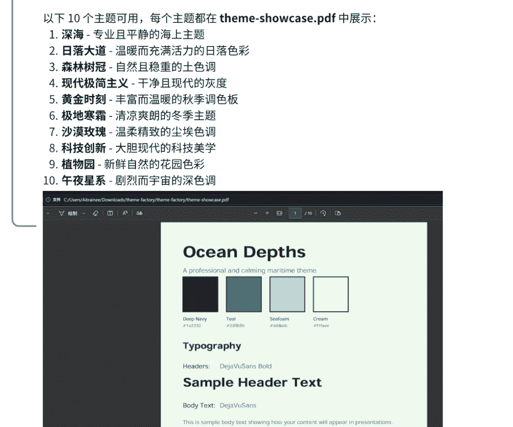
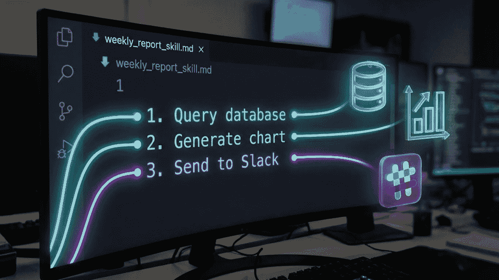

# 2分钟上手创建好用的skills

> 来源：[https://qqs7y1hozd1.feishu.cn/docx/KRKrduVoLo1uZtxLAeycK1jvn3c](https://qqs7y1hozd1.feishu.cn/docx/KRKrduVoLo1uZtxLAeycK1jvn3c)

现在的通用大模型（智商很高，可能有 300 IQ，但不知道具体的报税流程）；领域专家（有丰富的税务处理经验）。

+   **现状：**** 我们现在的 Age**nt 就像通用大模型，很聪明但缺乏特定领域的过程性知识和专业技能。

+   **以前的做法：** 以前为了解决这个问题，大家会为每一个垂直领域（如税务、编程、写作）单独构建一个全新的 Agent。Anthropic 认为这不对，底层的Agent（大脑）应该是通用的，我们只需要给它“安装”不同的专业技能。

MCP()很好，现在AI编程，我不可能不使用它。我很早之前就写过很多关于MCP的。

Skills() 现在挺火。配合MCP就会更好。

### Skills 与 MCP 的区别

它们是互补的：

**MCP (工具箱)：** 侧重于**连接**。它负责连接外部的数据和工具（比如连接数据库、连接 Notion、连接 GitHub）。它像是给 Agent 提供了手和眼。

Skil**ls (说明书**/大脑皮层)： 侧重**于专**业知识和流程。它教 Agent 如何使用这些工具来完成特定的复杂任务。它像是给 Agent 提供了特定领域的经验。

**结合：** 一个强大的 Agent = 通用模型 + MCP 连接外部工具 + Skills 提供操作流程。

**今天我想向你介绍Skills。**我将用最**简单精炼**的方式告诉它是什么、怎么创建、构建一个好的skills要有哪些技巧？存放skills的社区网站有哪些？

## 开篇

Manus 被20亿美元收购，有人参考Manus的Agent方法写了一个Skill

为了确保你在创建幻灯片、文档、报告、HTML 着陆页这些艺术品的时候，能保持相同的主题风格化。又有一个名叫theme-factory的skills。

为了让你明白这有多爽，看这个“全自动数据周报机器人”的例子：

**以前，我是这样使用mcp的：**

+   对话：“帮我连数据库查一下上周销售额。”（调用 SQL MCP）

+   对话：“好，把这个数据画成柱状图。”（调用 Python 脚本）

+   对话：“把图发到公司 Slack 群里。”（调用 Slack MCP）

每周五都要废话三遍。

现在（爽快的 Skills 流）：

+   **Skill (SOP)：** weekly_report.md            
文档里写死： “每周五触发 -> 查 SQL -> 画图 -> 发 Slack”。

+   **操作：** 你只说一句：“发周报”。

+   **结果：** **Skill** 自动指挥 SQL MCP 查数，指挥 Python 画图，指挥 Slack MCP 发送。一气呵成。

S**kill **就是推倒第一块骨牌的手指。剩下的，交给 MCP 去自动连锁。 看，我把复杂的周报流程，写成了就几行 Markdown。这就叫经验固化。

好吧，也许你会说你自己可以写很长的一段提示词，然后里面包含三个mcp这样子。

是**的，不过你现在封装成s**killls相当于一个具体的sop打包好了，这样可以作为一个单独的被调用， Agent也能进行更长链路交付，（你还需要manus吗?） 所以skills那个描述写好一点，准一些还是挺重要的。

并且社交网络上，其他人分享自己的工作流提示词也很少是一段长提示词加多个MCP。现在分享的都是Skills，包含参考的资料，又包含整个SOP。

**S**kills 它把“**重复的劳动”**变成了“一次性的资产”，让 AI 具备了“长链路执行力”。它能像员工一样，规划 -> 执行 -> 纠错 -> 交付。

你应该知道Skills最开始是 Anthropic 那边提出来的，现在，Codex 也支持，只需要把.claude里的skills文件夹整个复制到.codex目录即可：

，时长00:08

## Skills是啥

之所以放在这里讲，也许开篇没几个人会关心，或者觉得不好理解。

Skills的本质是文件和文件夹这种形式非常简单。

一个 Skill 通常包含：

+   **SKILL.md：**核心文件，包含元数据（名称、描述）和给 AI 的自然语言指令（SOP/操作手册）。

+   **scripts/：**脚本文件夹，包含 Python 或 Bash 脚本，作为 AI 可以调用的工具。（比如自动把 PDF 转 Word）。

+   **其他资源文件：**（比如 references：给它看的以前的案例（比如你写的爆款文章）。）。

这些可以用 Git 管理、用网盘分享、直接发给同事，甚至直接放代码当工具（比纯文字指令更清晰、更可靠）

## 写一个简单的Skills

写 Skill **只需要**你会写 Markdown（写文档）。

**结果：** 财务总监可以写“报税 Skill”，行政可以写“订票 Skill”。

不，我觉得更多的是要有Vibe的思维。我们只需要告诉ai：我们想要写一个xx skills，那它就能生成一个skills，不需要任何经验。至于写的好不好，是我们后面会说的。

我觉得入门一个玩意儿最好的就是直接做起来。

在这篇[文章](https://mp.weixin.qq.com/s?__biz=MzkyMzY1NTM0Mw==&mid=2247510390&idx=1&sn=c9a355bc61c64908ce0ec8c0312d7651&scene=21#wechat_redirect)介绍的这个的这个网站中安装：skill-creator() ，这个skills包含了创建skills的最佳实践

，时长00:31

我是在Cursor终端[中打](https://mp.weixin.qq.com/s?__biz=MzkyMzY1NTM0Mw==&mid=2247510123&idx=1&sn=790b33b6f3be233105f4c8576ced304d&scene=21#wechat_redirect)开Claude Code()安装完的，我用的是智谱：

$env:ANTHROPIC_BASE_URL = "https://open.bigmodel.cn/api/anthropic"

$env:ANTHROPIC_API_KEY = "xx"

claude --dangerously-skip-permissions

然后你就可以提示他你想创建怎样的skills，但是一个好的skills，我觉得应该是不同领域的人可能有自己的微调方式，但是没关系，你可以自己先尝试用自然语言让他创建一个，你不需要关心具体的变化，你去盯着左边文件夹有什么改变就行了。

所以你可以在Cursor中或者任何IDE中用终端的方式，看着他有什么改变，挺好的。不至于在CLaude Code终端中看不到什么。

我在AI 写作、AI 视频、AI **编程上有经验，**所以很**多时候也会想把**某一个聊天记录，或者过往的一些知识，当作素材，让它能够被调用或记忆起来。我觉得，一个高质量的聊天记录，本身就是一件很专业的事情。

把这些内容整理成素材，作为 **skills 点**，是一个很自然的出发点：用自然语言描述需求、营造氛围、引导它去“编码式思考”，就可以先让它跑起来。

后续我们再去筛选、沉淀真正好用的 skills。

后面几个推荐Skills的网站记得好好收藏，后面我也会继续给你推荐实用的skills。    记得关注。

## 写一个牛逼的Skills

为什么有的 Skill 很笨，有的很聪明？

+   因为笨的 Skill 只写步骤（Instructions）。

+   聪明的 Skill 写入了**判断标准、审美倾向、思维模型**（Expertise Transfer）。

+   **例子：** “如果你是会计，你写的 Skill 不应该只是‘填表’，而应该包含‘如何识别税务风险’的直觉。”

### 控制层：区分“硬约束”与“软引导”

+   **容易**出 Bug 的操作（如部署、数据库迁移）：“把自由度压得很死，给固定步骤（Workflow）。” —— 这里的 Skill 就像脚本，不许 AI 自由发挥。

+   **偏 **Review/创作的操作（如代码审查、写文案）：“只给原则和输出结构，让模型自己发挥。” —— 这里的 Skill 就像导师，只给方向。

+   **深层解析：**

+   如果你把这两种逻辑混在一个 Skill 里（既要它像机器一样**死板，又**要它像人一样有创意），AI 就会精神分裂。

+   拆分开来：一个 Skill 叫 Strict-Deployer（严谨），一个 Skill 叫 Creative-Reviewer（发散）。

**“**不要试图训练一个既是‘会计’又是‘艺术家’的 Skill。把它们拆开，让上帝的归上帝，凯撒的归凯撒。”

### 进化层：“补丁思维”

Skill 不是设计出来的，是“痛”出来的。         你不应该坐在那里空想“我要做一个完美的 Skill”。

“每做完一个项目，就把这次**反复强调的规则**抽出来补进 Skill。”“把**每个项目都会翻车的地方**单独拆成 Skill。”

**我写****文章的 ****skills 初期可**能只是一个起点。后续在不断交互中得到的体悟、感想，或者出现了新的写作方式，我再把这些叠加进去，直接告诉它我的想法，它就会去修改 skills 文件夹里的内容。

**你可以清楚****地看到它的变化；同时你也**可以在它自动修改的基础上再手动调整，不断来回、反复调试。         本质上，这就是一个人和系统共同打磨写作能力的过程。

演示：“我有一个想法→Claude写成Skill→测试→发现不足→让Claude修改Skill”的闭环。展示一个Skill是如何从“能用”变成“极其好用”的。

### 触发层：提高“语义命中率”

不要搞“全能神 Skill”，要搞“手术刀 Skill”。

Claude 决定是否使用 Skill，完全依靠“阅读 Skill 的 Description”来进行推理决策（LLM Reasoning），没有任何代码层面的硬路由。         “Description写得越像人话越好，明确什么时候该用。”

** 深层解析：**

+   **大而全的 Skill：** 描述通常很模糊，比如“辅助编程开发”。AI 会很困惑：我现在只是改个变量名，需要启动这个重型武器吗？

+   **小而精的 Skill：** 描述很精准，比如“当用户遇到 CORS 跨域报错时使用”。

+   **效果：**** 这种“原子化”的描述，能瞬间击中 AI **的意图识别。微小的 Skill 就像狙击枪，指哪打哪；巨大的 Skill 像散弹枪，容易脱靶。

我这个skills的描述还可以：

⚠️ 但如果要达到我说的"语义命中率"最大化，优化方向是：

+   需要更"原子化"的触发词

+   需要更明确的"什么时候用"

+   需要排除通用场景

## Skills 核心机制：渐进式披露

为了防止一次性加载太多 Skill 导致上下文（Context Window）爆炸，Skills 采用了“渐进式披露”机制：

1.  **初始阶段：**** Ag**ent 只加载 Skill 的元数据（名字和简介），占用极少的 Token。

1.  **运行时：** 当 AI 判断需要用到某个 Skill 时，才会读取完整的 SKILL.md 和相关指令。

1.  **执行时：** AI 根据指令去调用具体的脚本或工具。

Skills 就像一本带目录的说明书。每一个skills的描述就作为目录的章节。AI 使用 Skills 的时候，只是先看目录，觉得需要了，再去翻正文（加载指令）。

+   **节省 Token（省脑子）：**            
❌ 如果每次都加载完整 skill：浪费 10k+ tokens            
✅ 用目录机制：只在需要时加载，节省 90%+ tokens

+   **提升效率（快速判断）：**            
- AI 不需要读完每个 skill 的全部内容            
- 只看 description 就能判断是否相关

+   **可扩展性（无限扩展）：**            
- 可以有几十甚至上百个 skills            
- 不会因为 skill 数量过多而影响性能

## Skills网站

https://skillsmp.com/search 好像，最好用吧。

官方及社区自建的 Claude 技能合集：

https://github.com/VoltAgent/awesome-claude-skills/

https://github.com/ComposioHQ/awesome-claude-skills 主打星多。

