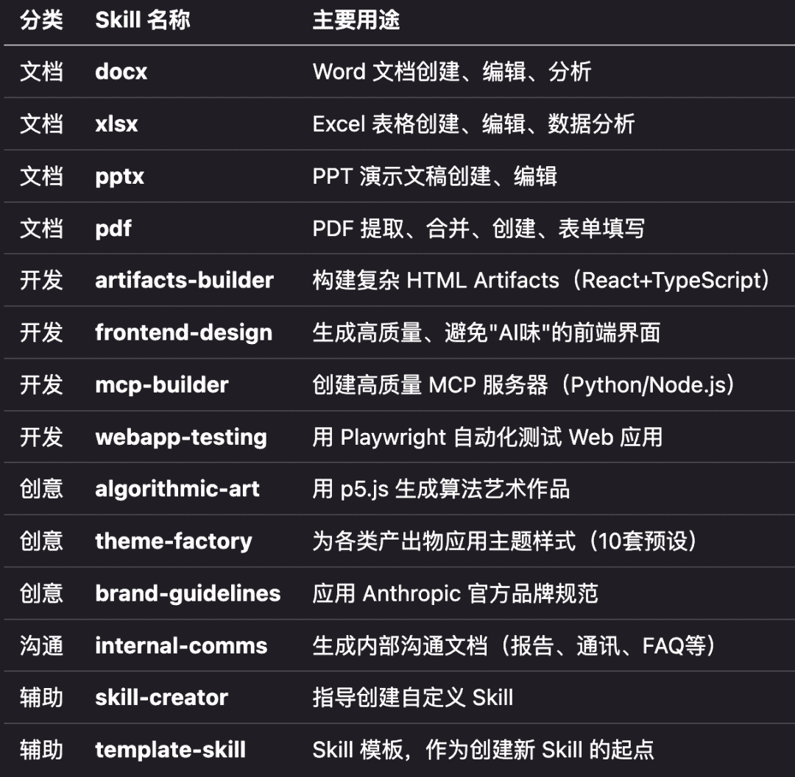
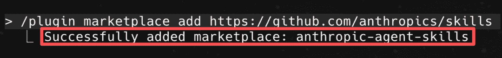
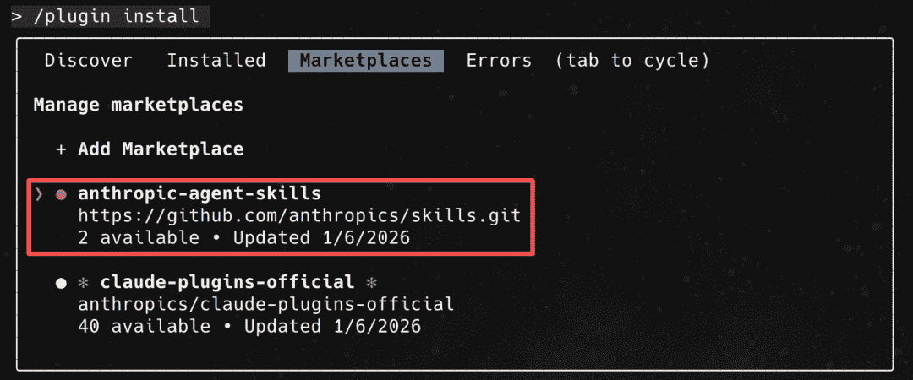
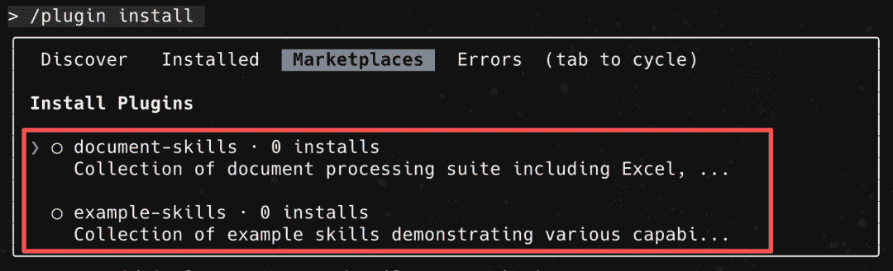
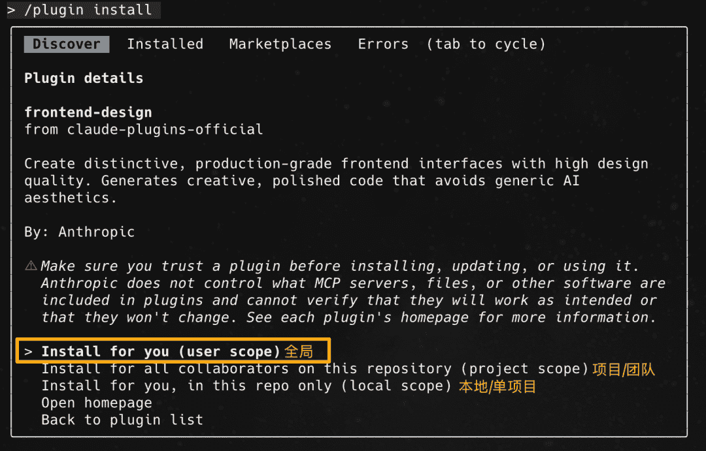
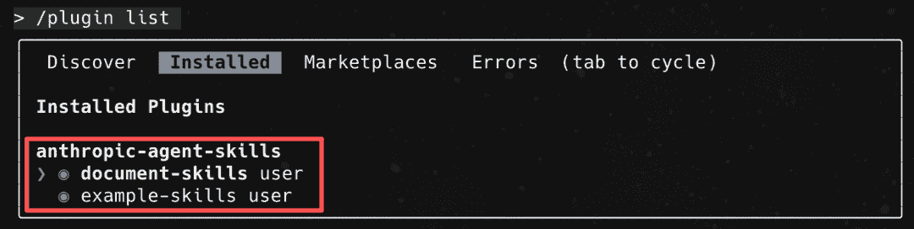
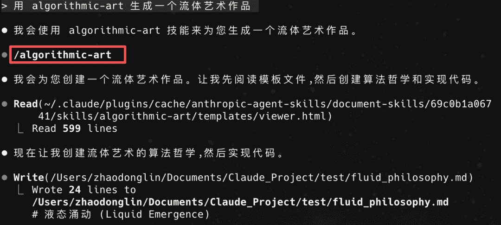
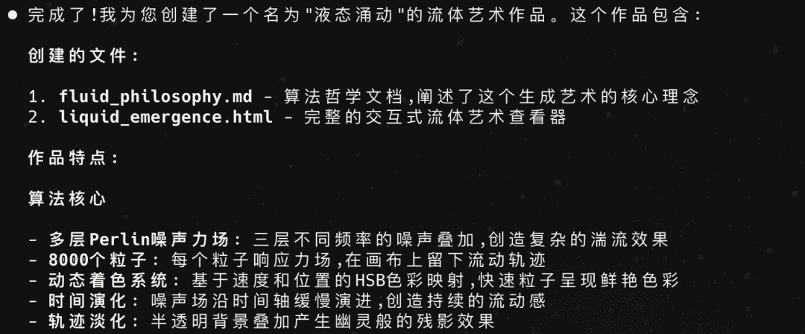
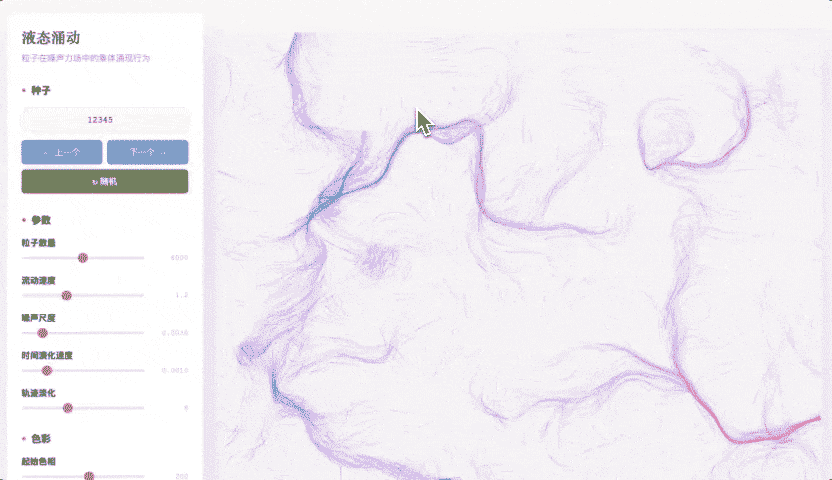

# 14 个官方 Skills 宝藏清单， Claude 正确打开方式！

> 来源：[https://qqs7y1hozd1.feishu.cn/docx/UUkkdjBjmohZ21xoq2fcNFgynhc](https://qqs7y1hozd1.feishu.cn/docx/UUkkdjBjmohZ21xoq2fcNFgynhc)

# 一、官方 Skills 速览

所有 Skills 均来自 **Anthropic 官方仓库**。文档类 Skills（docx/xlsx/pptx/pdf）为闭源，其他为 Apache 2.0 开源。



# 二、5 大类官方Skills详解

## 01 | 文档类 Skills

Claude() 压箱底的文档实现能力，覆盖办公四大件（Word/PDF/PPT/Excel）。说白了，就是 Claude.ai 里那些能直接生成 Word、Excel、PPT 的功能，背后都是它们在干活。

##### docx - Word 文档处理

Word 文档的创建、编辑、分析。支持批注、修订追踪、格式保留。你让 Claude 帮你写个报告，它就会自动调用这个 Skill，直接给你一个 .docx 文件。

##### xlsx - Excel 表格处理

Excel 表格操作。支持公式、格式、数据分析、可视化。处理 .xlsx、.csv、.tsv 都行。让 Claude 帮你做个销售数据分析，它能直接给你带公式的表格。

##### pptx - PowerPoint 演示文稿处理

PPT 的创建和编辑。支持模板、图表、自动生成幻灯片。你给它一份大纲，它能直接给你一套完整的演示文稿。

##### pdf - PDF 文档处理

PDF 操作全家桶。提取文本、提取表格、合并拆分、表单填写，都能搞定。特别是表单填写这个功能，之前 Claude 是做不到的，有了这个 Skill 就行了。

## 02 | 开发类 Skills

这是开发者工具箱，全部开源（Apache 2.0），不仅能用，还能直接看源码学习。

##### artifacts-builder（复杂 Artifacts 构建）

用来构建复杂的 Claude.ai Artifacts。技术栈是 React 18 + TypeScript + Tailwind CSS + shadcn/ui。如果你需要做一个有状态管理、有路由的复杂交互组件，用这个。它还特别强调要避免"AI 味"设计，有完整的初始化和打包脚本。

##### frontend-design（高质量前端界面设计）

生成高质量的前端界面。这个 Skill 的核心理念就是避免"AI slop"——那种一眼看上去就是 AI 生成的东西：过度居中、紫色渐变、统一圆角、Inter 字体。它会引导 Claude 做出更有设计感的界面。

##### mcp-builder（MCP 服务器创建指南）

指导创建 MCP 服务器。支持 Python（FastMCP）和 Node/TypeScript（MCP SDK）两种方案。如果你想让 Claude 连接外部 API 或服务，这个 Skill 能帮你快速搭建。

##### webapp-testing（Web 应用自动化测试）

用 Playwright 测试本地 Web 应用。能验证前端功能、调试 UI、截图、查看浏览器日志。自动化测试的好帮手。

## 03 | 创意类 Skills

这是用来提升Claude Code 艺术设计能力的，同样开源。

##### algorithmic-art（算法艺术生成）

用 p5.js 创建算法艺术。这个 Skill 很有意思，它不是让你直接画画，而是先让你创建一个"算法哲学"（用 .md 文件描述你想要的美学风格），然后再生成代码。支持种子随机，同一套算法可以生成无限变体。还有交互式查看器，可以实时调参数。

##### theme-factory（主题样式应用工厂）

主题工厂。内置 10 套预设主题（颜色 + 字体），可以应用到幻灯片、文档、报告、网页等各种产出物上。需要统一视觉风格的时候很好用。

##### brand-guidelines（品牌规范应用）

应用 Anthropic 官方品牌规范。包含品牌色彩（Dark #141413、Light #faf9f5、Orange #d97757 等）和字体规范。如果你想做 Anthropic 风格的设计可以直接用，也可以参考它的结构，做一套自己公司的品牌 Skill。

## 04 | 沟通类 Skills

##### internal-comms（内部沟通文档生成）

内部沟通模板。支持状态报告、领导更新、3P 更新、公司通讯、FAQ、事故报告、项目更新等各种格式。需要写内部邮件或文档的时候，Claude 会自动套用你公司习惯的格式。

## 05 | 辅助类 Skills

##### skill-creator（Skill 创建指南）

指导你创建自己的 Skill。直接跟 Claude 说"帮我创建一个 xxx 的 Skill"，它会一步步引导你完成。

##### template-skill（Skill 模板）

Skill 模板。包含基础的 SKILL.md 结构和 YAML frontmatter 示例。想自己写 Skill 的话，可以从这个模板开始。

# 三、怎么安装 Skills？

很简单，直接在 Claude Code 里安装就行。

## 01 | 从 Marketplace 插件市场安装

**第 1 步**，将官方仓库添加为插件市场

```
/plugin marketplace add https://github.com/anthropics/skills 
```

看到这条消息，anthropic-agent-skills 就添加成功了。



**第 2 步**，输入 /plugin install，Tab 键切换到 **Marketplace**



选择并安装 Skills 包

```
# Skills 包说明：
1. document-skills (文档类)：包含 docx, xlsx, pptx, pdf
2. example-skills (开发/创意类)：包含 artifacts-builder, frontend-design, algorithmic-art 等
```



**第 3 步**，选择 Skills 包，回车安装，几秒就装上了

选择全局安装。



重启 Claude Code，输入 /plugin list，验证安装生效。



到这，官方的 Skills 包就装好了。

**tips**：

+   这些命令需要在 Claude Code 的对话界面中以 / 开头输入

+   插件安装后需要重启 Claude Code 才能生效

# 四、如何使用 Skill？

安装完之后，不需要手动调用。Claude 会根据你的任务自动判断要不要用。

直接在对话中提及即可：

+   "帮我提取这个 PDF 文件的表单字段"，它就会自动调用 PDF Skill

+   "帮我创建一个销售数据分析 Excel 表格"，它就会自动调用 xlsx Skill

+   "帮我生成一个算法艺术作品"，它就会调用 algorithmic-art Skill

当然，你也可以指定："用 xxx skill 帮我生成这个应用"。

## 实战 1：Frontend Design

使用 Frontend Design Skill 生成高质量前端界面。

**第 1 步**，输入以下 Prompt：

```
使用 frontend-design Skill，为一个&quot;在线笔记应用&quot;设计一个现代化的首页界面。

要求：
1. 设计风格：极简主义 + 深色主题
2. 包含：导航栏、笔记列表、创建按钮、搜索框
3. 使用 React + Tailwind CSS
4. 避免&quot;AI味&quot;设计（不要紫色渐变、过度居中、Inter字体）
5. 最后生成一个可以直接在 Claude.ai 中使用的 HTML Artifact

设计思路：
- 配色：深灰色背景 + 亮色强调
- 排版：左侧导航 + 右侧内容区
- 交互：悬停效果、平滑过渡
```

**第 2 步**，任务执行

Claude 调用 frontend-design Skill，生成完整的 React 代码。不再是千篇一律的紫色渐变，细节设计和排版都很精细。


## 实战 2：Algorithmic Art

使用 Algorithmic Art Skill 生成算法艺术。

**第 1 步**，输入 Prompt：

```
使用 algorithmic-art Skill，创建一个&quot;流体艺术&quot;作品。

步骤 1：先创建&quot;算法哲学&quot;
- 美学风格：流动、有机、自然
- 配色：蓝色系 + 白色
- 动画：缓慢流动，循环
- 交互：鼠标移动影响粒子

步骤 2：生成 p5.js 代码
- 使用 Perlin 噪声生成流场，粒子跟随流场运动
- 支持参数调整（速度、密度、颜色），支持种子随机（可复现）

步骤 3：生成交互式查看器
- 实时参数调整滑块，重新生成按钮，下载图片功能
```

**第 2 步**，调用 algorithmic-art Skill，执行任务



**第 3 步**，任务执行完成。生成"算法哲学"文档和 p5.js 代码



**第 4 步**，效果演示。循环动画，流动的粒子效果，还能实时参数调整（速度、密度、颜色）



# 五、创建 Skill 与常用推荐

## 01 | 手动创建 Skill 模板

这是我的结构，可照抄：

```
---
name: writing-workflow
description: 技术博客写作工作流
---
# 写作工作流
## 核心流程
1. 理解需求
2. 信息调研
3. 选题讨论
...
## 风格要求
详见 [style-guide.md](./style-guide.md)
```

就两个必填字段：

+   **name**：名字

+   **description**：描述，Claude 靠这个判断什么时候用

## 02 | 我的常用 Skill 清单

官方一共提供了 14 个 Skill，我自己常用的是下面这几个，推荐给大家。

1.  **frontend-design**：用来生成高质量的前端界面

1.  **algorithmic-art**：用来跑算法艺术作品Demo

1.  **skill-creator**：用来帮助自己创建自定义 Skill