# 用Skills 3分钟制作精美PPT

> 来源：[https://qqs7y1hozd1.feishu.cn/docx/LzuSd20YiozqeQxRra1cBGusnKd](https://qqs7y1hozd1.feishu.cn/docx/LzuSd20YiozqeQxRra1cBGusnKd)

步骤一：安装 OpenSkills

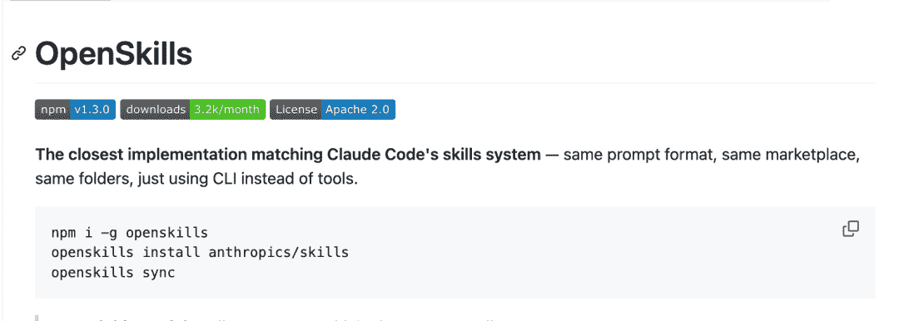

在安装node环境的前提下，执行以下指令

```
npm i -g openskills
```

步骤二：加载官方Skills

接下来我们来到工作目录下，执行这个指令

```
openskills install anthropics/skills
```

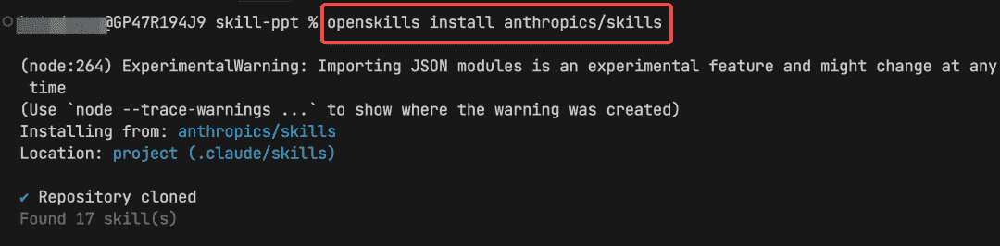

然后就可以选择要安装的Skills了，随便按下回车选择就好

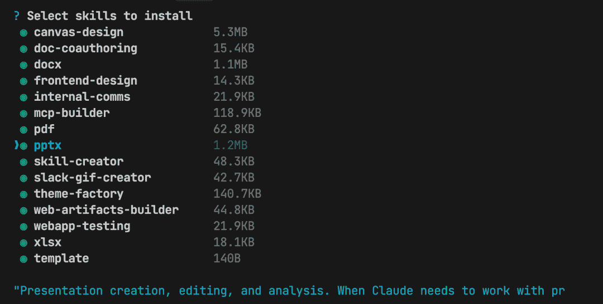

然后就可以看到当前工作目录下多出了一个.claude目录


步骤三：教会AI工具使用Skills

**执行这个指令**

```
openskills sync
```

会发现多出一个AGENTS.md文件

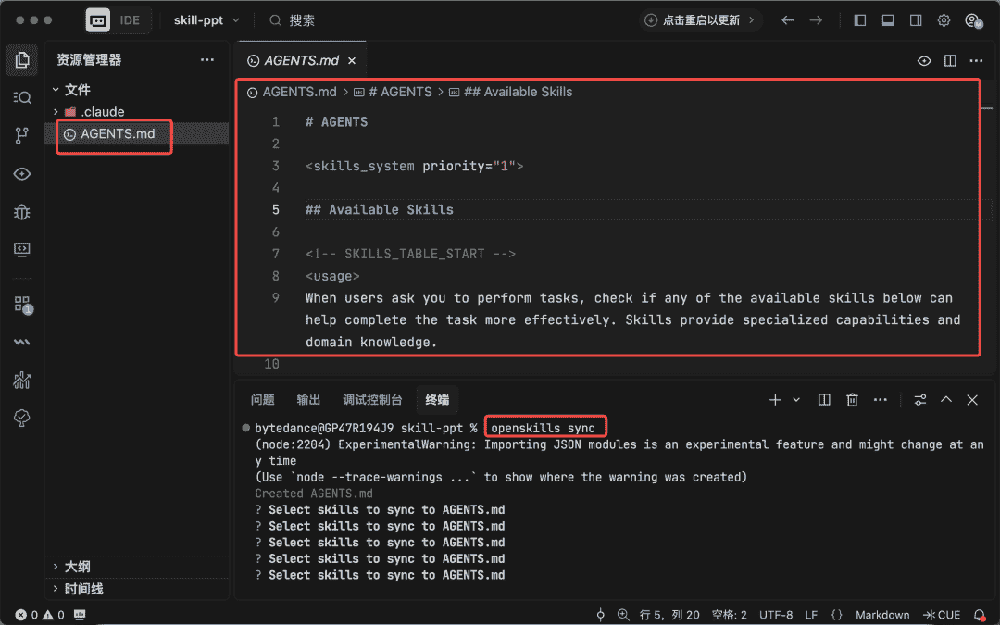

熟悉AI编程的大伙应该不陌生，这个其实就是：Rule👆

只不过在不同的AI编程工具里有不同的叫法，比如Claude Code中叫claude.md，Codex 中叫AGENTS.md，TRAE中叫user_rules.md,project_rules.md

在Rule中，详细的定义了每个Skill的功能描述以及调用时机

**Cursor的同学到这**一步就可以了，TRAE的同学留堂一下🧑‍🏫

把AGENTS.md文件中的提示词，原封不动的粘贴到project_rules.md就可以了

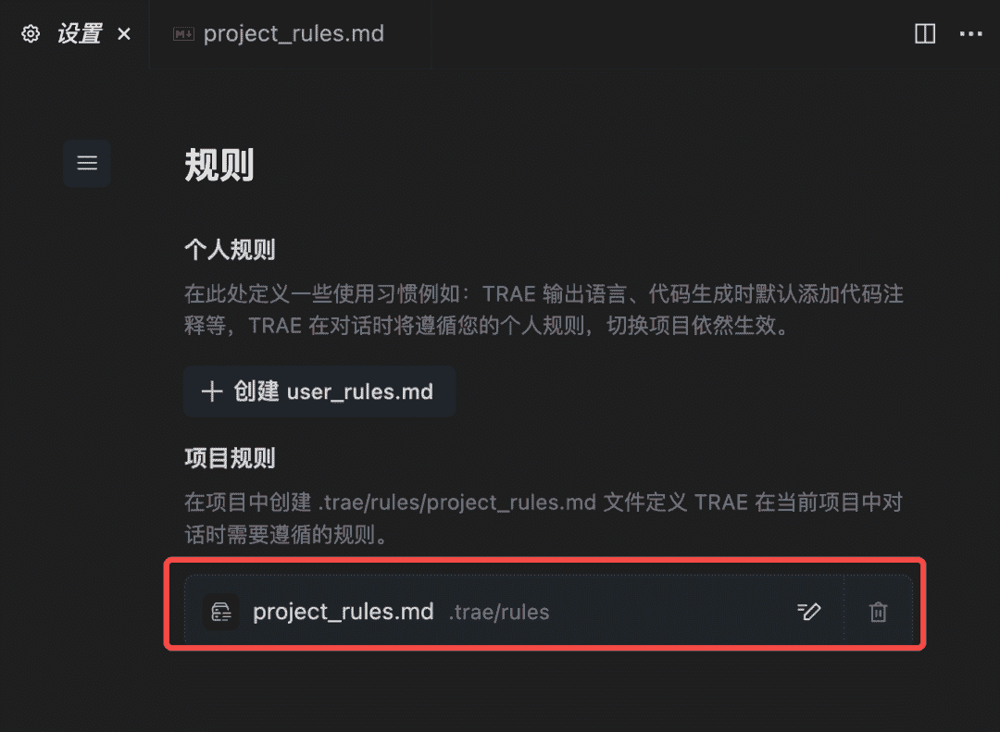

**齐活儿，干整！**🤓

# 用Skill来做一个精美的PPT

直接跟AI说明需求就好，开头加上一个“use xx skills”

有哪些Skills可以直接看.claude/skills下的文件，也可以直接看Rule

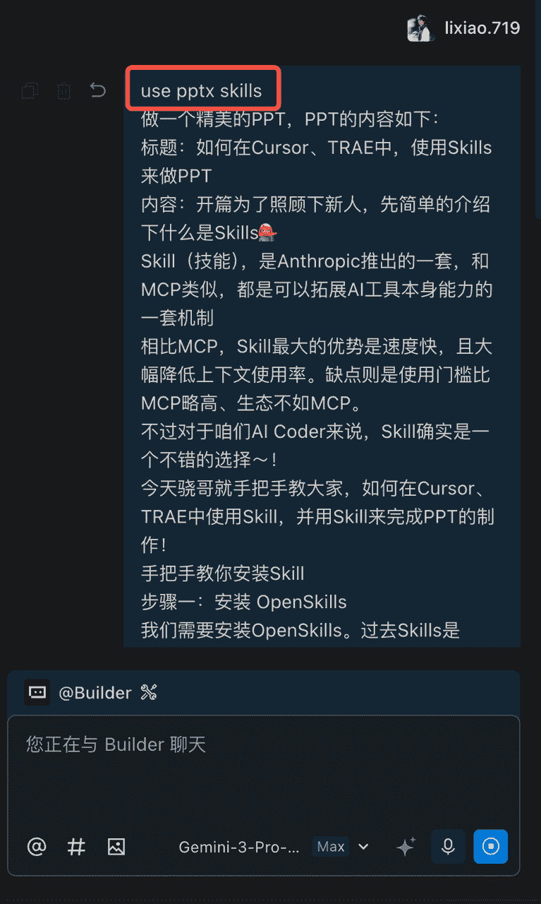

（骁哥小Tips：做PPT用Gemini-3-Pro，食用效果更佳哟🤓）

使用就这么简单，可以看到，AI已经在开始使用技能了👇

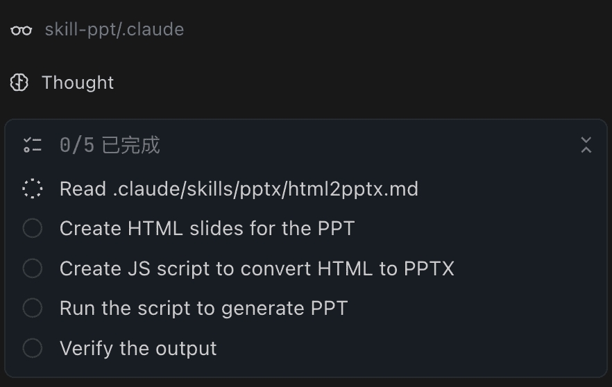

**PPT就这么水灵灵的做完啦！**🎉

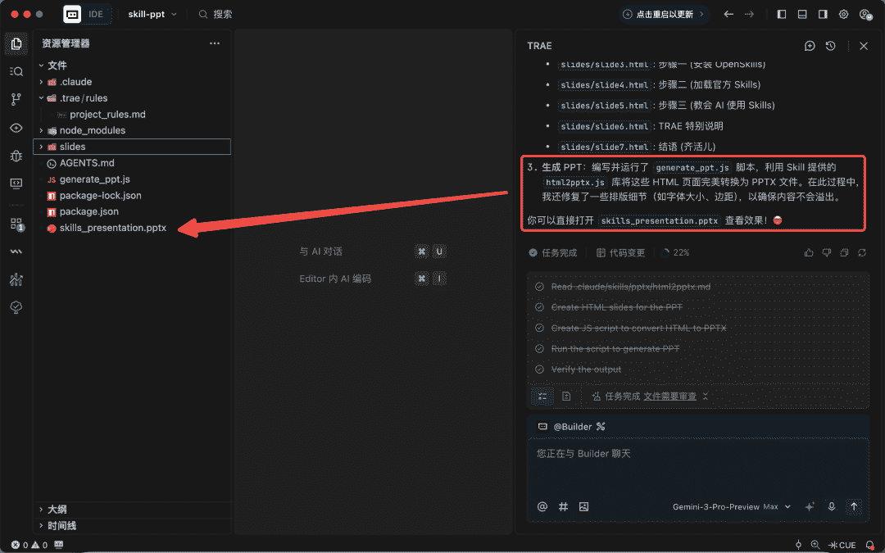

**看看效果如何～**👇

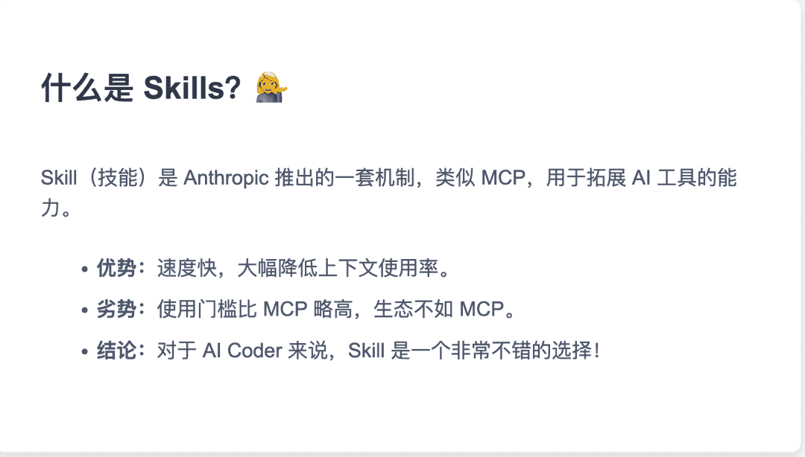

说实话，有点小翻车，样式有点太素了！😬

不过没关系！我们还有frontend-design这个Skill，看看能不能救一手🧏

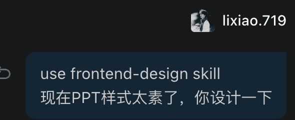

准备好了吗～～请上眼！🤓

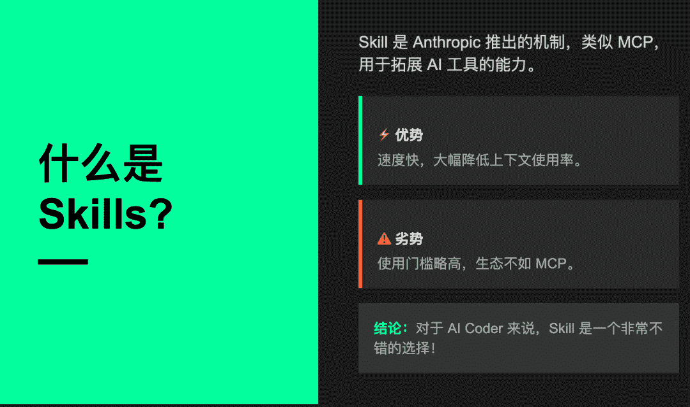

此处应有小嗨曲儿💃

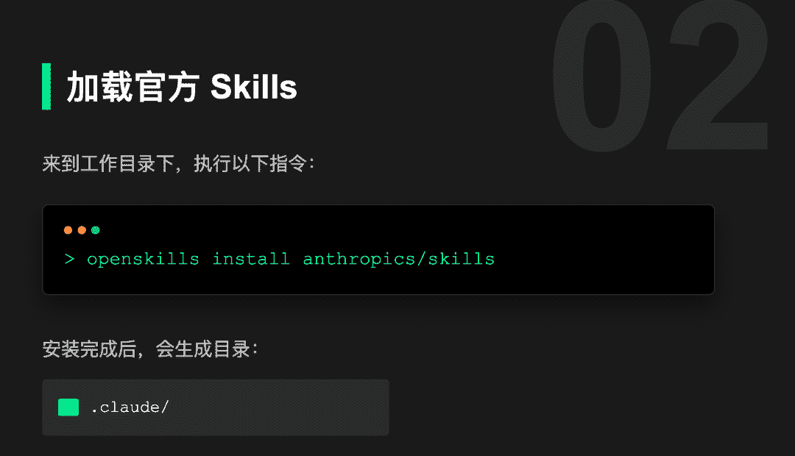