# 手搓3个能自我进化的Skills管理器

> 来源：[https://qqs7y1hozd1.feishu.cn/docx/YonadteYjoUiBMxbaKacyQ9Vnbe](https://qqs7y1hozd1.feishu.cn/docx/YonadteYjoUiBMxbaKacyQ9Vnbe)

**我们搓的这三件套，分别是：**

+   github-to-skills：专用的Github项目转Skills的Skill。

+   skill-manager：一个专用的管理本地所有SKills的Skill。

+   skill-evolution-manager：一个能将过程中的对话和经验，自动以外挂的形式，对某Skill进行迭代升级。

帮我检查一下所有的Skills状态。

下一秒，一个清晰的报告就甩在了我脸上：

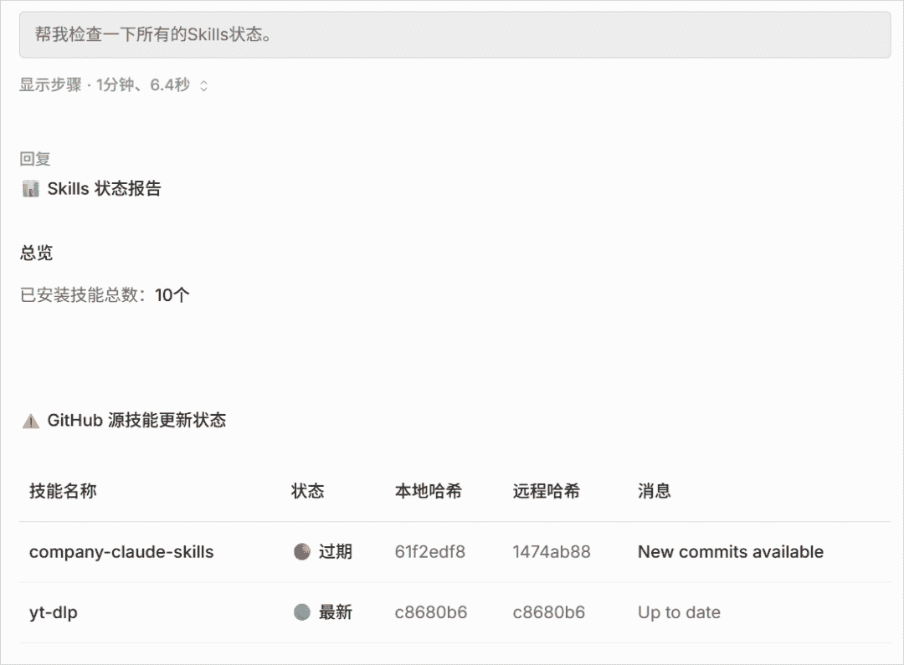

可以看到，截图中的两个Skill，有两种状态。

company-claude-skills的状态：过期。

yt-dlp的状态：最新。

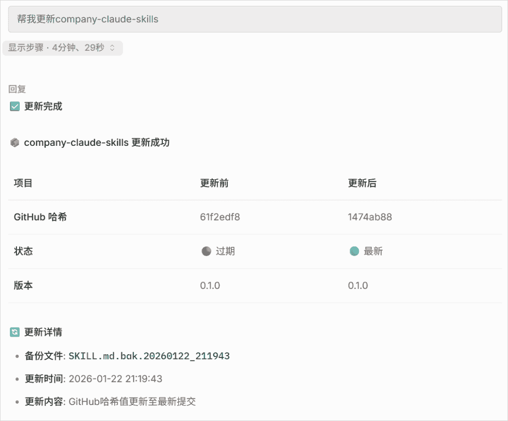

而这个时候，聪明的你可能就会问了。

GitHub 更新了，旧版的SKILL.md不就被覆盖掉了，那我平时调教Skills优化不断迭代的各种修改和经验不就直接也没了吗？这特么不是巨坑吗，完全用不了啊。

你说的对。

因为我自己用Skills，在运行的过程中，难免会出现一些BUG，而这些BUG其实都是这个SKill的经验，理论上下一次运行，是完全可以避免的，所以我经常会在跑完之后，把这个聊天过程，让Skill-Creator，重新根据整个对话记录，把这些经验，写入到原来的SKill里，让这个Skill，变得越来越牛逼。

比如我之前这个yt-dlp的Skill，第一次报错并就解决以后，就根据聊天记录，让它自主的修改迭代了一些东西。

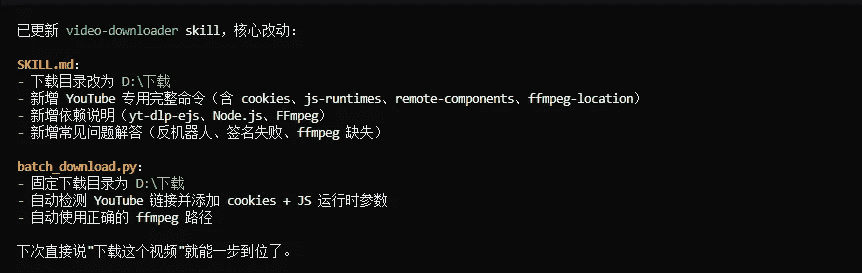

但你要知道，这个迭代的结果，优化的是SKills里面的主文件也就是Skill.md文件，而我们上面提到的，拉取最新的Github项目，修改的也就是Skill.md文件。这时候，冲突就来了。两波人，目标完全不一样，但是每次都按照自己的目标，对一个文件进行修改，那不彻底乱套了吗。所以我想了想，想到了还算稍微好一点的方法。就是分开。拉群最新的Github项目，还是修改主SKill.md文件不变，而我们所有的迭代、报错的经验，不放在Skill.md里，而是直接存到一个全新的、我们自己自定义的evolution.json文件里。也就是，一个专门用来存，“进化”的文件。类似于我们的一个经验备份，或者说游戏存档。无论你的主进程如何更新，版本号升级到了多少，我们的游戏存档，肯定都不应该变得对吧，这个evolution.json其实在Skills里，就是我们自己定义的游戏存档。

当SKILL.md被新版本覆盖时，它便会发挥它的作用，将存档里的经验，重新注入回到Skill.md里。

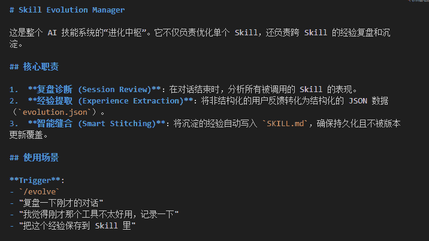

效果如下：

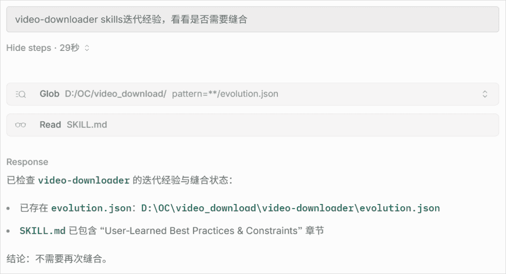

全程几十秒，不用我动一下脑子。

这样，整个Skills的管理，就形成了飞轮，建一个Skill坦率的讲，其实特别简单。但是我们在使用过程中，发现其实最麻烦的，是Skills的管理和迭代。所以，我们造了这些东西。我把这三件套里的每一个Skill，再拆开来，稍微细一点点的给大家介绍一下，大家相信我，只是这些东西看着代码一些，但是真的不复杂！希望能对大家的思路，起到一些抛砖引玉的作用。

一.github-to-skills做这个目的，其实就是希望，我们能给从Github上打包的那些Skills，一个身份证明。

我发现之前用的官方skill-creator，虽然能打包，但是它生成的 SKILL.md文档里，没有关于GitHub的相关数据。

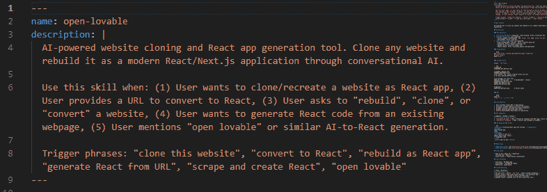

就是，我们用倒是可以用，但是其实极度不方便这个Skill进行后续迭代，因为没有版本号，没有Github地址，你都关联不回去。

这就好比你去超市买东西，商品上没条形码，你咋盘点库存啊对吧。

对于后续的Skills管理器来说，它去扫描这些Skills的时候，根本不知道这玩意对应Github上的哪个仓库，更别提对比版本了。

如果强行去扫去匹配，失败率极高，效果极其不稳定。

所以，这三件套的第一个解决方案，自然就是需要对SKills生成器开刀，也就是，要针对SKIIL.md元数据头下手。

我魔改了skill-creator，做了一个github-to-skills。

它的功能也很简单：在打包Github项目的时候，强制注入一些关于github的信息。

这个信息包含这两样东西：

github_url：它从哪来的。

github_hash：它是哪个版本。

这样，每一个经由这个github-to-skills产出的Skill，都自带了身份ID。

可能还有的人没明白这样设计有什么用，对我们后续管理有什么帮助，直接上图对比，大家应该就可以明白了。

这事原版Skill.md里的信息。

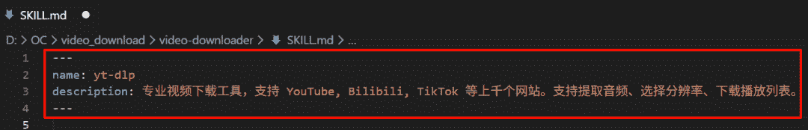

这是改进后的SKILL.md里的信息。

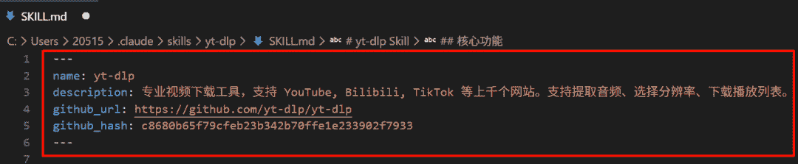

你会发现，多了东西。

而这个，就可以非常简单的，跟后续的Github仓库更新进行关联了，并且可以用哈希值()进行版本号对照。

相当于，我们给每个SKill，都做了一个身份系统。

有了身份ID，后续的自动化管理，才有了可能，可以这么说，它就是整个系统的地基了。

而之所以为啥这个github-to-skills和原有的skill-creator共存，其实特别简单，因为不是所有的Skills，都是封装的Github项目，还有很多，是我们自己经验和工作流，这种其实没必要注入Github的信息了。

# 二.skill-manager

有了身份ID的Skill，接下来就是重头戏了，skill-manager。

这玩意就是你skills的大管家，负责你所有本地Skills的管理和更新。

它的功能有这些。

1.  **Skills查询：**主要是最近不管是学习还是测试，经常装的Skills太特么多了，常年看着一堆文件夹，我都忘了这些Skills到底是干啥的。。。

不过现在通过这个skill-manager，它可以直接给我吐出一个好看点的表格，列出所有Skills的类型、描述、版本，而且是可以自己区分哪些是GitHub打包的skill，哪些是正常的skill，真就是可以列出我所有家底。

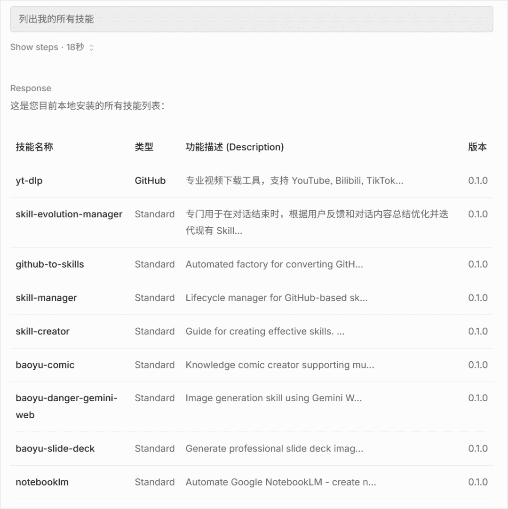

**2.Skills版本监控：**这就是开头说的，看Github仓库有没有更新的、非常实用的功能。它会请求Github的接口，拿着本地Skill头部的github_hash去跟远程仓库进行对比。

最终的结果中，如果输出的对应状态为过期，那就说明需要更新对应的Skills了，若为状态为最新则说明无需更新。

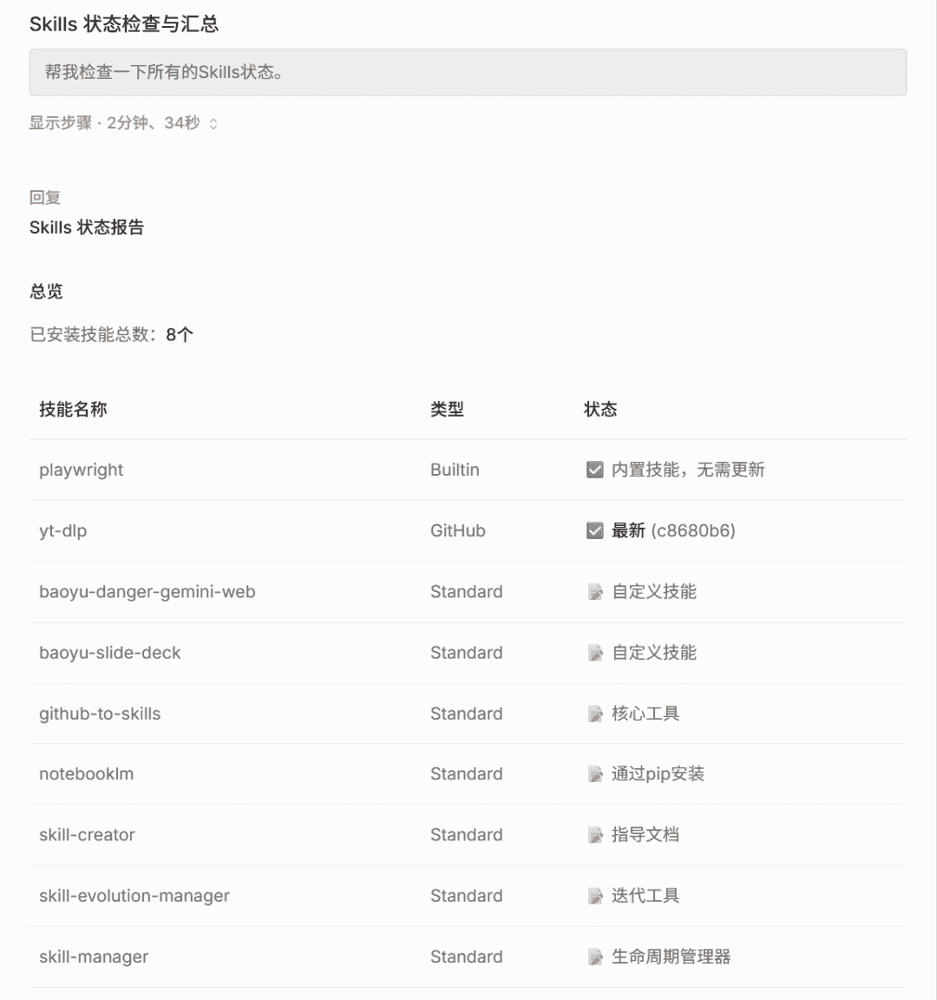

1.  **Skills管理：**一个非常简单的小功能，就是...如果有不需要的或者用不上的，可以用它，来一句话直接删除。

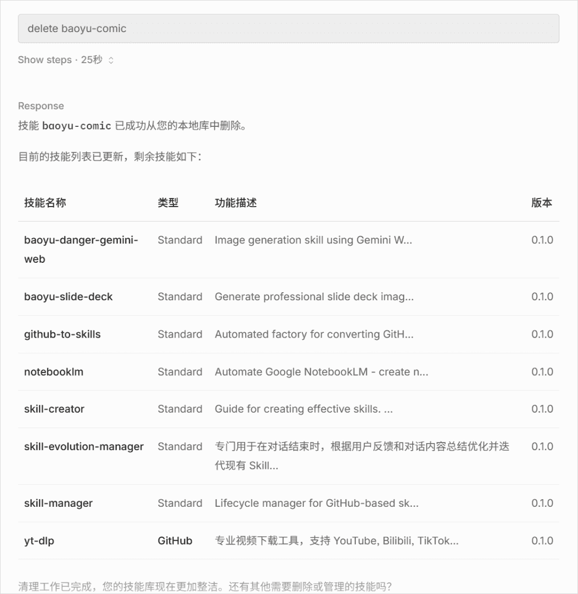

这个小Skill，非常的有用，相当于我们以前的Mod或者插件管理器，只不过把更新迭代的过程也放在了对话里。

我个人认为，还是非常方便的。

现在经常打开OpenCode，没事就先扫一遍Skills是不是有更新，然后再开始干活。

# 三.skill-evolution-manager这个就是我开头用了蛮多的篇幅，讲的根据对话或者经验，对Skills进行自动迭代的功能。所以设计了这个第三个Skill，通过外挂的存档文件evolution.json，来进行迭代和进化管理。他的作用就一个，就是只负责根据对话内容吸取经验，然后迭代skill。

你可以理解错，这个Skill会在对话的时候，会默默记笔记，Skill哪里搞砸了、哪里需要改进，它全记在小本本上。

对话结束，它把这些经验保存到一个叫evolution.json的文件里，然后写进Skill.md，下次再遇到同样的坑，Skill就会直接绕过，一坑不踩两次。

说真的，我一直觉得，这才是真正的自我进化，也可以理解为我们常说的复盘。

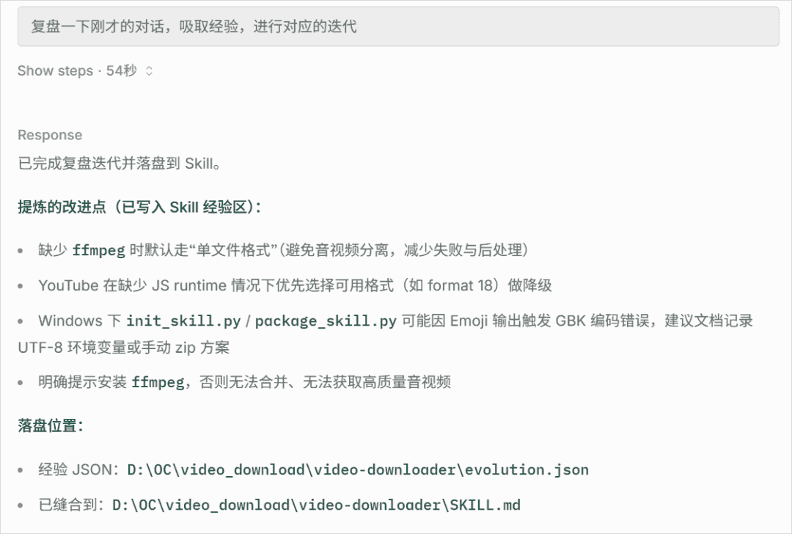

这样，我们的Skills，终于就不再是一个静态的东西，而是随着我们的使用、我们的迭代，也跟随着我们一起升级了。这个年代，持续的进化，才是唯一的真理。

写在最后这篇文章，可能阅读量数据量啥的，会非常差。我其实想了很久，到底要不要分享出来。一个确实是有点小众了，另一个，也确实我不知道，我们这种做法到底对不对。但是我们自己用了一天，还是觉得蛮有意思的，真的就是那种越用越聪明，越用越懂你的感觉。这三个Skill，我也完全毫无保留的分享给大家。它肯定没有很完美，但是我们也希望，能对大家有一些抛砖引玉的作用。目前已上传到了我的Github上，大家可以自由下载，未来在这个上面，可能也会持续不断的分享一下我们自己搞的，感觉稍微有点用的SKills。仓库地址在此：

https://github.com/KKKKhazix/Khazix-Skills

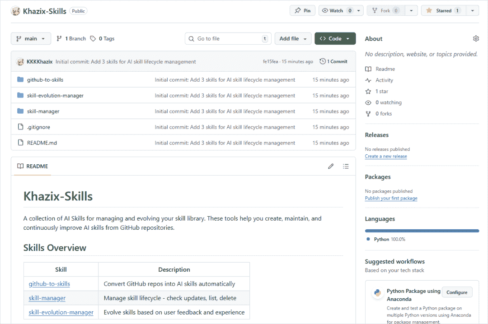