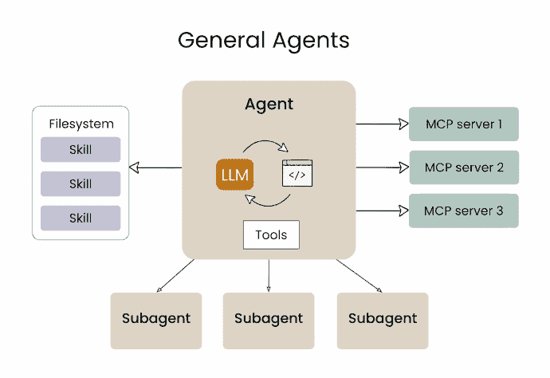
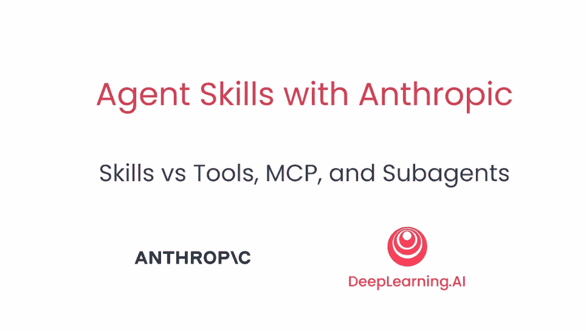
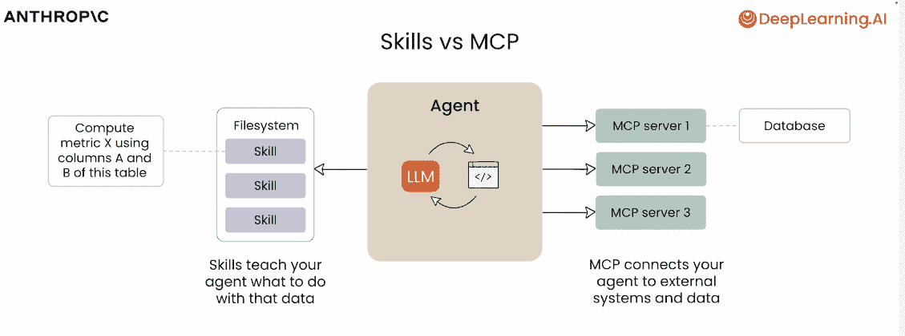
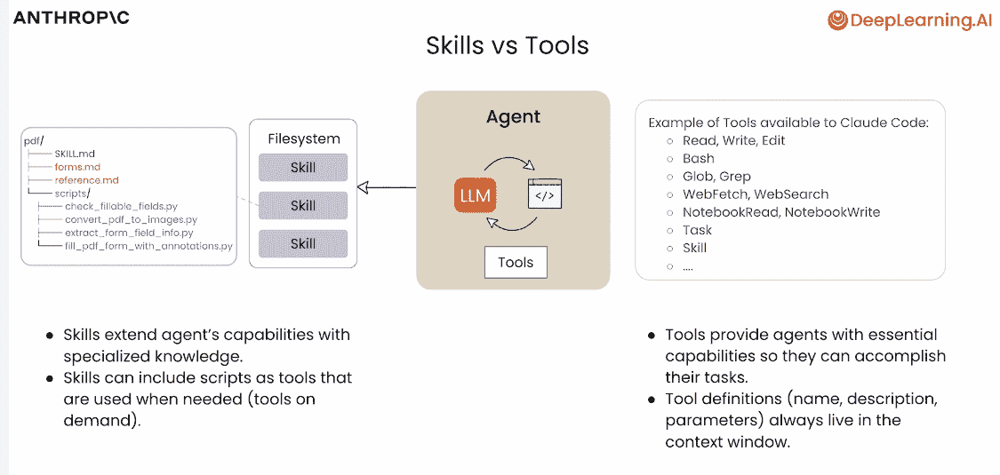
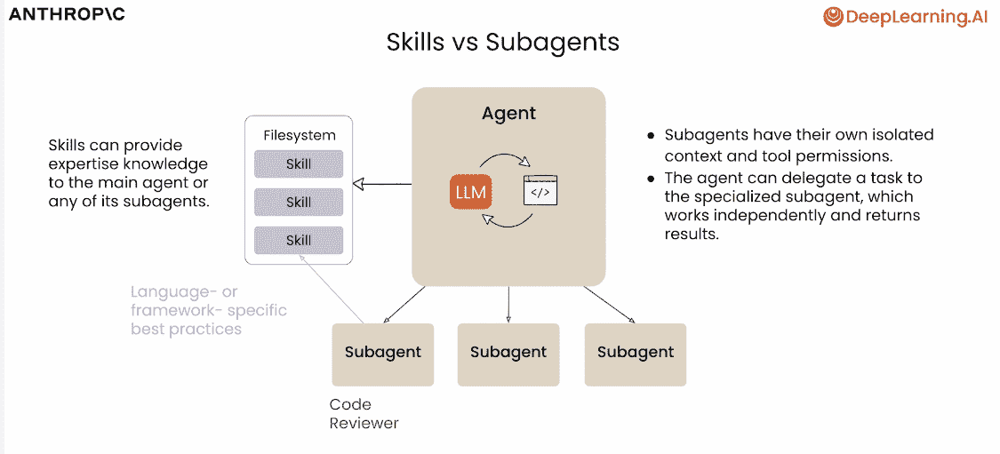
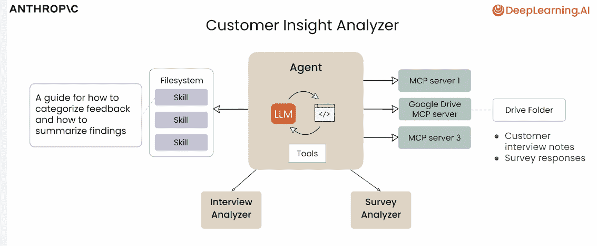
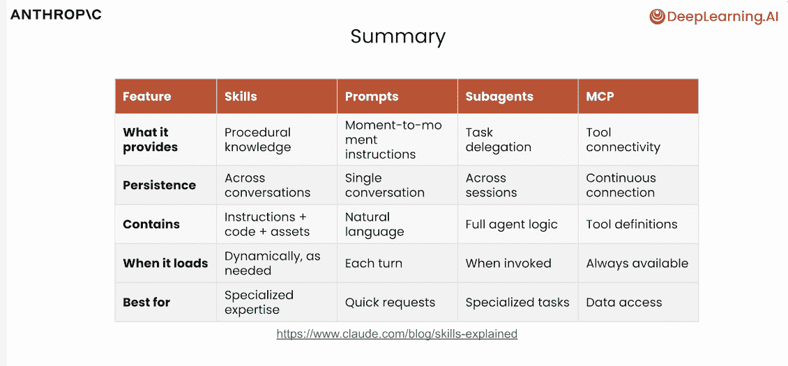

# 第四节：Skills vs Tools, MCP, and Subagents（技能 vs 工具、MCP 和子代理）

> 来源：[https://qqs7y1hozd1.feishu.cn/docx/VjEodB7sto0w5vxj4b9cfzdYn0I](https://qqs7y1hozd1.feishu.cn/docx/VjEodB7sto0w5vxj4b9cfzdYn0I)

本节课将讲解如何使用 Skills（技能） 与 Tools（工具）、MCP 和 Subagents（子代理） 结合使用，创建强大的智能工作流。



逐一介绍每个组件，了解它们如何协同工作，以及学习何时使用什么。

---

## 1、智能体生态系统概览

在智能体生态系统中，各种技术如 MCP、Skills、Tools 和 Subagents 共同协作：

+   MCP 服务器：提供所需的上下文

+   Subagents：用于多线程和并行处理

+   Skills：用于可重复的主线程工作流



---

## 2、Skills vs MCP（模型上下文协议）

+   MCP 就像带来所有底层工具和资源的连接器

+   Skills 就像使用这些工具构建特定工作流的可重复流程 当利用外部数据计算指标、研究和计算数据时，所有底层工具和资源都可以通过 MCP 服务器外部提供



---

## 3、Skills vs Tools

想象你有一些工具：锤子、锯子和钉子。

你有一个技能：如何建造书架。

### 区别

### 重要特性

+   工具定义（名称、描述、参数）始终存在于上下文窗口中

+   技能是渐进式加载的，只在需要时加载

+   如果某个工具不是每次对话都需要，通过仅在需要时加载可以节省大量 token



---

## 4、Skills vs Subagents

什么是Subagents？

Subagent是一种为执行单一、明确定义的任务而专门构建的特化AI Agent。它并非孤立工作，而是通常在一个Orchestrator（编排器）的协调下，与其他Subagent协同完成复杂的用户请求。

Subagents在多智能体系统中扮演着重要角色，它们通过专业化分工、独立上下文、可定制性和多种交互模式，提升了开发效率和代码质量

### Subagents的工作方式

主智能体可以生成或创建Subagents，子代理可以向父智能体报告。这些子代理可以通过以下方式创建：

+   Claude Code

+   Agent SDK

+   自定义实现

### Subagents的价值

### 应用场景

主智能体可以作为编排器，利用所需的技能。子代理可以实现相同理念，使用特定技能。

示例：一个专门的代码审查子代理，其唯一任务是分析和审查代码库，并利用技能来指定你、你的团队或公司如何进行代码审查。



---

## 综合示例：客户洞察分析器



Agent 是整个架构的大脑与指挥中心，LLM 作为推理引擎，能够理解复杂指令、进行多步思考和决策规划；同时配备代码执行环境，支持动态调用工具和执行脚本。

Agent 的主要职责是接收高层任务目标，将其拆解为可执行的子任务，协调下方的 Interview Analyzer 和 Survey Analyzer 两个子分析器并行工作，最后整合各分析器的输出结果，生成统一、结构化的客户洞察报告。Agent 还负责管理与多个 MCP 服务器的通信，确保数据流的顺畅传输。

Interview Analyzer & Survey Analyzer 是 Agent 的执行手臂；Interview Analyzer 专注于处理非结构化的客户访谈记录，运用自然语言理解技术提取关键观点、情感倾向和深层需求；Survey Analyzer 则针对结构化的问卷数据进行统计分析、模式识别和趋势归纳。这两个工具相互独立又可并行运行，各自接收 Agent 分配的任务后，调用 Filesystem 中的 Skills 和 LLM 能力进行深度处理，最终将结构化分析结果返回给 Agent 进行汇总。这种分工设计使得系统能够高效处理不同类型的数据源，同时保持模块化的可扩展性。

Filesystem 与 Skills 层构成了系统的能力基础设施；Filesystem 作为技能容器，封装了多个可复用的 Skill 模块，这些 Skill 是经过抽象的业务能力单元。左侧的指导文档（"A guide for how to categorize feedback and how to summarize findings"）作为元指令（Meta-prompt），定义了系统处理数据的标准方法论——包括分类维度、总结框架和质量标准。实现了"知识即配置"的理念：通过修改指导文档即可调整系统行为，无需改动底层代码，Skills 层向下为分析器提供标准化工具支持，向上为 Agent 提供可编排的能力单元，确保分析过程的一致性和可维护性。

MCP 服务器层是系统的外部连接关键，这一层包含三个 MCP 服务器：通用型的 MCP server 1 和 MCP server 3，以及专门对接云存储的 Google Drive MCP server，Agent 能够以统一的方式调用不同服务商的 API，无需关心底层接口差异；

### 工作流程

```
主智能体（配备工具）
    ↓
通过 MCP 服务器获取工具
    ↓
分派子代理分析客户
    ↓
并行分析客户访谈和调查
    ↓
使用 Skills 进行可预测的分析
```

### 各组件作用

---

## AI 生态系统组件对比表

