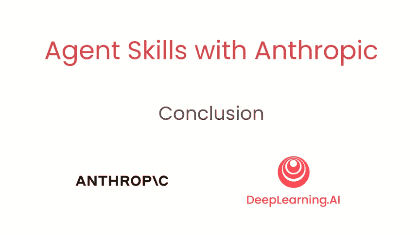

# 第十节：Conclusion（总结）

> 来源：[https://qqs7y1hozd1.feishu.cn/docx/LFNadMt5tolQxExdKlzcPf4un7e](https://qqs7y1hozd1.feishu.cn/docx/LFNadMt5tolQxExdKlzcPf4un7e)

从基础概念到实践应用，从内置 Skills 探索到自定义 Skills 开发，课程系统地介绍了如何利用 Skills 扩展 AI agent 的能力边界，构建智能化、专业化的工作流程。

---

## 课程深度回顾：构建智能体的“第二大脑”

回顾整门课程，我们不仅仅是在学习一个名为 "Skills" 的功能，更是在探索大模型时代下“知识工程”的新形态。

### 从指令到资产 (From Instructions to Assets)

我们在 [Chapter 2](https://github.com/datawhalechina/agent-skills-with-anthropic/blob/main/2.Why%20Use%20Skills%201%EF%BC%88Skills%E7%9A%84%E6%84%8F%E4%B9%89%EF%BC%89.md) 和 [Chapter 3](https://github.com/datawhalechina/agent-skills-with-anthropic/blob/main/3.Why%20Use%20Skills%202%20-%20Agent%20and%20Skills%EF%BC%88%E4%BB%8EAgent%E8%A7%92%E5%BA%A6%E6%80%9D%E8%80%83Skills%EF%BC%89.md) 中定义了 Skills 的本质：它不是一次性的 Prompt，而是标准化的领域认知。通过 YAML 元数据与 Markdown 正文的解耦，我们将“业务逻辑”封装为可复用、可迁移的数字资产。这正是将人类隐性知识显性化的过程。

### 系统架构的演进 (Evolution of Architecture)

[Chapter 4](https://github.com/datawhalechina/agent-skills-with-anthropic/blob/main/4.Skills%20vs%20Tools,%20MCP,%20and%20Subagents%EF%BC%88%E6%8A%80%E8%83%BD%20vs%20%E5%B7%A5%E5%85%B7%E3%80%81MCP%20%E5%92%8C%E5%AD%90%E4%BB%A3%E7%90%86%EF%BC%89.md) 揭示了智能体生态的三驾马车：

+   Skills：定义标准作业程序 (SOP)，是智能体的“技能树”。

+   MCP：连接外部世界的实时脉搏，是智能体的“感知器”。

+   Subagents：实现任务的并行与隔离[，是智能体的“分身](https://github.com/datawhalechina/agent-skills-with-anthropic/blob/main/9.Skills%20with%20the%20Claude%20Agent%20SDK%EF%BC%88Claude%20Agent%20SDK%20%E4%B8%AD%E7%9A%84%E6%8A%80%E8%83%BD%EF%BC%89.md)”。 这种架构思想在 Chapter 9 的“研究智能体”实战中得到了完美验证——主智能体作为“大脑”编排，子智能体作为“手脚”执行。

### 开发范式的跨越 (Paradigm Shift)

课程带领我们跨越了三个维度，这也映射了 AI 应用开发的进阶之路：

+   GUI 时代：在 Claude Desktop 中通过 Pre-Built Skills 快速验证想法，体验“开箱即用”的便利。

+   CLI 时代：利用 [Claude Code](https://github.com/datawhalechina/agent-skills-with-anthropic/blob/main/8.Skill%20with%20Claude%20Code(%E7%86%9F%E7%BB%83%E8%BF%90%E7%94%A8%20Claude%20Code).md) 将编码与终端操作智能化，在 CLAUDE.md 中沉淀项目规范，实现人机协同的极致效率。

+   SDK 时代：通过 Claude Agent SDK 进入纯代码领域，以编程方式构建复杂的、非确定性的智能体系统，实现真正的工程化落地。

---

如果某项技术能将大模型的通用推理能力，低成本地转化为稳定可靠的业务交付能力，它就一定能成为行业标准。

AI Agent 技术从早期的单纯 Prompt 工程，发展到如今以 Tool Use 和 MCP 为核心的生态，终于找到了落地的抓手。

> 现在企业不仅需要一个会聊天的 Chatbot，更需要能遵循 SOP、稳定输出的数字员工——Skills 正是填补了“通用智能”到“专业交付”之间的鸿沟，这也是为什么在众多 AI 概念中，Agentic Workflow（智能体工作流）能迅速在大厂落地并产生实效的重要原因。

**当然，当前的 Skills 形态（YAML+**Markdown）也不可能是一颗常青树。

> 随着模型自身意图识别与规划能力的进化，也许未来我们不再需要手动编写显式的定义文件，Agent 就能通过观察自我习得技能。

> 世界是运动的，任何技术栈都受到模型能力边界与工程复杂度之间矛盾的制约与推动，在 Agent 从“探索”走向“基建”的过程中，现有的 Skills 框架也势必会演化出更高效的载体。

**所**以，当我们在学习 Agent Skills 时，我们不应局限于语法本身，而应聚焦于它背后的工程化思维：

> 如何将非结构化的业务经验抽象为结构化的 SOP，如何通过编排（Orchestration）让多个智能体像流水线一样协作，以及如何利用 MCP 打通数据孤岛。

> 同时，在深耕 Agent 开发的过程中，也要时刻保持对模型原生能力进化的敏感度——具体的框架会过时，但驾驭复杂系统、定义人机协作边界的能力，才是持续掌握新技术的人真正的护城河。