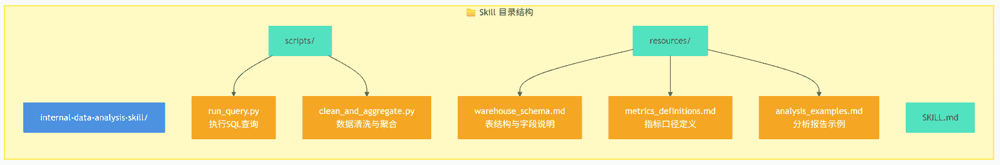
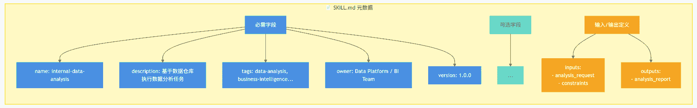

# LLM-Agent Skills 案例：内部数据分析

> 来源：[https://qqs7y1hozd1.feishu.cn/docx/E1XjdRHEDoJCCExzdIWcgaHdnMb](https://qqs7y1hozd1.feishu.cn/docx/E1XjdRHEDoJCCExzdIWcgaHdnMb)

下面给出一个面向「内部数据分析」场景的完整 Skill 示例，包括：

+ 典型场景设定：基于数据（如 PostgreSQL / ClickHouse 等）做指标分析

+ SKILL.md 模板：教会 Agent 如何与数据团队协作、怎样写 SQL、怎样产出分析结论

+ 两个脚本示例：一个执行 SQL 查询、一个做简单数据清洗与统计聚合

---

## Skill 目录结构示例



```
internal-data-analysis-skill/
  SKILL.md
  scripts/
    run_query.py
    clean_and_aggregate.py
  resources/
    warehouse_schema.md
    metrics_definitions.md
    analysis_examples.md

```

`warehouse_schema.md`：整理关键表结构、字段含义、分区/分桶习惯等。

`metrics_definitions.md`：内部统一的指标（如 DAU、留存、GMV 等）

`analysis_examples.md`：高质量分析报告示例（结构与表达方式）。

---

## SKILL.md 模板（内部数据分析 Skill）



```
---
name: "internal-data-analysis"
description: "基于公司数据仓库执行标准化的数据分析任务：理解需求、编写 SQL、调用查询脚本、对结果进行清洗与指标分析，并生成结构化分析报告草稿。"
tags:
  - "data-analysis"
  - "business-intelligence"
  - "analytics"
owner: "Data Platform / BI Team"
version: "1.0.0"
inputs:
  - name: "analysis_request"
    description: "用户的分析需求描述，例如：分析最近 30 天按渠道的新增用户与留存情况。"
  - name: "constraints"
    description: "可选：时间范围、产品线、地区等过滤条件，以及是否有性能或隐私限制。"
outputs:
  - name: "analysis_report"
    description: "结构化数据分析报告草稿，包含结论摘要、关键指标表格、图表建议与后续跟进建议。"
---

# 技能目标

本技能用于支持内部数据分析类工作，主要目标是：
- 将业务同学模糊的分析诉求，转化为清晰可执行的数据问题。
- 在理解数据仓库表结构与指标口径的前提下，编写可执行的 SQL 并调用脚本跑数。
- 对查询结果进行基础清洗、聚合与 sanity check，输出结构化的分析报告草稿。

你应始终遵循以下优先级：数据安全与合规 > 指标口径正确 > 结论清晰 > 表达优雅。

---

# 使用前提与适用范围

仅在满足以下条件时使用本技能：
- 任务明确与内部数据分析相关（如用户行为、转化漏斗、营收、留存等）。
- 用户可以访问相应的数据域，且分析范围在内部合规规定之内。

本技能不适合：
- 涉及个人敏感信息的细粒度分析（应转交隐私合规或专用安全分析流程）。
- 完全战略层面的开放式问题（如「我们明年应该做什么新业务？」）。

---

# 总体工作流程

## 步骤 1：澄清分析需求

1. 阅读 `analysis_request` 与 `constraints`。
2. 用自己的话在心中总结任务，包含：
   - 分析对象（用户 / 订单 / 会话 / 广告等）。
   - 时间范围与分组维度（天 / 周 / 月、渠道 / 地区 / 版本等）。
   - 关键指标（新增、活跃、留存、转化率、ARPU 等）。
3. 若关键信息缺失（例如缺少时间范围、指标定义不清），先向用户提出具体问题进行澄清，而不是自行假设。

## 步骤 2：了解数据结构与指标口径

1. 打开 `resources/warehouse_schema.md`：
   - 找到与当前分析对象相关的表（例如 `dw_user_events`, `dw_orders`, `dim_channel` 等）。
   - 确认主键、分区字段和常用过滤条件（如 `event_date`, `created_at`）。
2. 打开 `resources/metrics_definitions.md`：
   - 确认所需指标的标准定义与计算口径。
   - 如果业务表述与官方定义不一致，应在报告中说明采用的口径，并建议统一定义。

在不清楚表含义或指标口径时，不要直接编写 SQL；应先请求数据团队或用户确认。

## 步骤 3：设计查询方案与 SQL

根据已确认的需求与数据结构：

1. 拆解成 1–3 个「问题子块」，例如：
   - 最近 30 天每日新增用户数，按渠道分组。
   - 最近 30 天的次日留存率，按渠道分组。
2. 对每个子块分别设计 SQL 查询：
   - 明确输入过滤条件（时间范围、渠道、地区等）。
   - 明确分组维度与聚合函数。
   - 避免在单条 SQL 中混入过多逻辑，必要时拆成中间结果再 join。
3. 使用项目约定的 SQL 风格（例如全小写、snake_case、JOIN 写法等），并在必要处添加注释解释复杂逻辑。

**注意**：SQL 语句必须是可执行的，不要包含伪代码或自然语言。

## 步骤 4：调用查询脚本获取数据

对于每个设计好的 SQL 查询：

1. 将 SQL 保存为临时文件，或直接作为标准输入传递给脚本：
   - `python scripts/run_query.py --sql-file path/to/query.sql --output path/to/result.csv`
   - 或：`python scripts/run_query.py --sql "SELECT ..."`
2. 等待脚本执行，获取输出的 CSV 文件路径。
3. 若脚本报告错误（如语法错误、权限不足、超时）：
   - 阅读错误信息，尝试修正明显错误（如字段名拼写、表名错误）。
   - 无法自行修正时，在报告中说明原因并提示需要数据工程师介入。

## 步骤 5：数据清洗与聚合

对获取的原始结果进行基础清洗与检查：

1. 调用 `scripts/clean_and_aggregate.py`：
   - 输入：原始 CSV 文件路径。
   - 输出：清洗后的 CSV 文件路径以及简要统计摘要（行数、缺失值比例、异常值计数等）。
2. 检查：
   - 记录条数是否在预期范围内（例如用户规模级别）。
   - 关键字段是否存在大量缺失或异常值（如负数金额、日期在未来）。
3. 如发现明显数据质量问题：
   - 在分析报告中单独设立「数据质量说明」小节。
   - 避免在结论中给出过于确定的业务判断。

## 步骤 6：生成分析报告草稿

基于清洗后的数据与统计结果，输出一个结构化分析报告草稿，建议结构如下：

1. 标题行：例如 `XX 产品 - 渠道新增与留存分析（YYYY-MM-DD ~ YYYY-MM-DD）`
2. 摘要（Executive Summary）：
   - 2–4 句话，概述主要发现，如整体趋势、显著异常、关键结论。
3. 分析对象与方法说明：
   - 简要说明使用的数据表、指标口径、时间范围与筛选条件。
4. 关键指标与图表建议：
   - 以 1–3 个表格展示核心指标（例如按日期 × 渠道的新增与留存）。
   - 给出应当绘制的图表类型建议（折线/柱状/堆叠等），而不是生成实际图片。
5. 观察与洞察：
   - 以条目形式列出观察到的趋势与可能原因，区分「事实」与「猜测」。
6. 风险与局限：
   - 说明数据质量问题、样本偏差、异常峰值等潜在风险。
7. 后续建议与待验证假设：
   - 列出 1–3 条可执行的跟进建议（如补充特定维度分析、做 A/B 实验等）。

---

## 脚本说明

### 查询脚本：`scripts/run_query.py`

负责连接内部数据仓库（例如 PostgreSQL、ClickHouse、Snowflake 等）并执行 SQL 查询。以 CSV 格式输出结果，便于后续处理。

使用示例：
- `python scripts/run_query.py --sql "SELECT ... LIMIT 100" --output /tmp/result.csv`
- `python scripts/run_query.py --sql-file queries/new_users_by_channel.sql --output /tmp/new_users.csv`

你应：
- 仅在用户和当前环境有相应权限时执行查询。
- 避免执行明显危险或超大范围的查询（例如缺少时间过滤的大表全量扫描）。

### 清洗与聚合脚本：`scripts/clean_and_aggregate.py`

对 CSV 数据进行基础清洗（去掉完全空行、转化类型、过滤明显异常值等）。
提供常见聚合操作（按天/周汇总、按渠道分组计算指标等）。
输出清洗后的 CSV 文件与简短统计信息（行数、缺失情况等）。

使用示例：
- `python scripts/clean_and_aggregate.py --input /tmp/result.csv --group-by date,channel --metrics new_users,retention_rate --output /tmp/cleaned.csv`

---

## 输出风格与沟通原则

- 面向业务与数据同学，使用清晰、客观、避免过度修饰的中文描述。
- 对于不确定的推断，使用「可能」「需要进一步验证」等措辞，并说明依据。
- 把「事实」与「解释」区分开：数据描述在前，业务解释在后。
- 如发现问题无法通过现有数据回答，应该坦诚指出，并建议补充数据或设计实验。

---

## 常见错误与纠正策略

- 错误：直接根据业务描述猜测指标口径。
  - 纠正：始终以 `metrics_definitions.md` 中的定义为准；若业务描述不一致，需在报告中说明。
- 错误：只给 SQL 和数据表，不给结论。
  - 纠正：报告必须包含结论摘要与洞察，即便是初稿。
- 错误：忽略明显的数据质量问题。
  - 纠正：优先检查缺失值、异常值和数据量级，必要时单列「数据质量说明」。

---

## 评估与持续改进

每次使用本技能生成分析报告后，可以从以下维度评估表现：

- 业务同学是否能在阅读 3 分钟内理解核心结论与建议？
- 数据团队复核 SQL 与口径时，是否发现严重错误或偏差？
- 报告中对数据质量与局限的说明是否充分？

当发现某类分析任务反复出现，可以：
- 在 `metrics_definitions.md` 中增加相应指标定义。
- 在 `analysis_examples.md` 中添加对应类型的优质示例报告。
- 在本 Skill 中增加「场景化子流程」，例如「漏斗分析」「留存分析」「渠道对比分析」专节。

```

## 查询脚本：`scripts/run_query.py`

此脚本演示如何执行 SQL 并输出 CSV，你需要根据公司实际使用的数据库驱动改写连接配置（例如改成 ClickHouse / Snowflake 等）。

```
#!/usr/bin/env python
# coding: utf-8

"""
简单 SQL 查询执行脚本示例

用法：
  python scripts/run_query.py --sql "SELECT 1" --output /tmp/result.csv
  python scripts/run_query.py --sql-file path/to/query.sql --output /tmp/result.csv
"""

import argparse
import csv
import os
import sys

import psycopg2  # 根据实际数据库替换驱动，例如 clickhouse_connect / snowflake.connector

def get_connection():
    """
    从环境变量读取数据库连接信息。
    请在部署环境中配置：
      DB_HOST, DB_PORT, DB_NAME, DB_USER, DB_PASSWORD
    """
    try:
        conn = psycopg2.connect(
            host=os.environ["DB_HOST"],
            port=int(os.environ.get("DB_PORT", "5432")),
            dbname=os.environ["DB_NAME"],
            user=os.environ["DB_USER"],
            password=os.environ["DB_PASSWORD"],
        )
        return conn
    except KeyError as e:
        print(f"缺少数据库环境变量: {e}", file=sys.stderr)
        sys.exit(1)


def run_query(sql: str, output_path: str):
    conn = get_connection()
    cur = conn.cursor()
    cur.execute(sql)
    col_names = [desc[0] for desc in cur.description]
    rows = cur.fetchall()

    with open(output_path, "w", newline="", encoding="utf-8") as f:
        writer = csv.writer(f)
        writer.writerow(col_names)
        writer.writerows(rows)

    cur.close()
    conn.close()
    print(f"查询完成，共返回 {len(rows)} 行，已写入: {output_path}")


def main():
    parser = argparse.ArgumentParser()
    parser.add_argument("--sql", type=str, help="要执行的 SQL 语句")
    parser.add_argument("--sql-file", type=str, help="包含 SQL 的文件路径")
    parser.add_argument("--output", type=str, required=True, help="输出 CSV 文件路径")
    args = parser.parse_args()

    if not args.sql and not args.sql_file:
        print("必须提供 --sql 或 --sql-file 之一", file=sys.stderr)
        sys.exit(1)

    if args.sql_file:
        with open(args.sql_file, "r", encoding="utf-8") as f:
            sql = f.read()
    else:
        sql = args.sql

    # 非常简单的保护：防止无 WHERE 的全表扫描（仅示例，实际可做更严格限制）
    if " from " in sql.lower() and " where " not in sql.lower():
        print("警告：检测到可能的全表扫描，请确认是否需要添加 WHERE 条件。", file=sys.stderr)

    run_query(sql, args.output)


if __name__ == "__main__":
    main()
```

## 数据清洗与聚合脚本：`scripts/clean_and_aggregate.py`


此脚本做「轻量数据工程」，方便 `Agent` 获得更干净的分析输入。[5]

```
#!/usr/bin/env python
# coding: utf-8

"""
数据清洗与聚合脚本示例

用法：
  python scripts/clean_and_aggregate.py \
    --input /tmp/result.csv \
    --group-by event_date,channel \
    --metrics new_users,retention_rate \
    --output /tmp/cleaned.csv
"""


import argparse
import sys
from pathlib import Path

import pandas as pd


def clean_data(df: pd.DataFrame) -> pd.DataFrame:
    # 去掉完全空的行
    df = df.dropna(how="all")

    # 去掉全重复行
    df = df.drop_duplicates()

    # 可以在这里添加一些通用清洗逻辑，例如去掉非法日期等
    return df


def aggregate_data(df: pd.DataFrame, group_by_cols, metric_cols):
    if not group_by_cols:
        return df, {}

    # 检查列是否存在
    missing_cols = [c for c in group_by_cols + metric_cols if c not in df.columns]
    if missing_cols:
        print(f"警告：以下列在数据中不存在，将跳过聚合：{missing_cols}", file=sys.stderr)
        # 尽量返回原始数据
        return df, {}

    grouped = df.groupby(group_by_cols, dropna=False)[metric_cols].sum().reset_index()

    stats = {
        "rows_before": len(df),
        "rows_after": len(grouped),
        "group_by": group_by_cols,
        "metrics": metric_cols,
    }
    return grouped, stats


def main():
    parser = argparse.ArgumentParser()
    parser.add_argument("--input", type=str, required=True, help="输入 CSV 文件路径")
    parser.add_argument("--group-by", type=str, default="", help="按哪些列分组，逗号分隔")
    parser.add_argument("--metrics", type=str, default="", help="需要聚合的指标列，逗号分隔")
    parser.add_argument("--output", type=str, required=True, help="输出 CSV 文件路径")

    args = parser.parse_args()

    input_path = Path(args.input)
    if not input_path.exists():
        print(f"输入文件不存在: {input_path}", file=sys.stderr)
        sys.exit(1)

    df = pd.read_csv(input_path)
    df = clean_data(df)

    group_by_cols = [c.strip() for c in args.group_by.split(",") if c.strip()]
    metric_cols = [c.strip() for c in args.metrics.split(",") if c.strip()]

    if group_by_cols and not metric_cols:
        print("提示：提供了 group-by 但没有 metrics，将只做去重/清洗。", file=sys.stderr)

    if group_by_cols:
        df_agg, stats = aggregate_data(df, group_by_cols, metric_cols)
    else:
        df_agg, stats = df, {"rows_before": len(df), "rows_after": len(df)}

    output_path = Path(args.output)
    df_agg.to_csv(output_path, index=False, encoding="utf-8")

    print(f"清洗与聚合完成，结果已写入: {output_path}")
    print(f"统计信息: {stats}")


if __name__ == "__main__":
    main()
```
