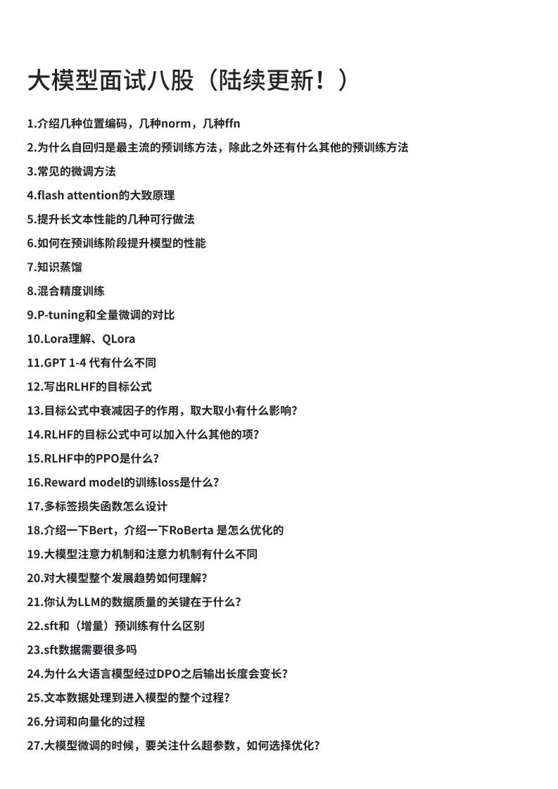

# 大模型架构原理

> 来源：[https://qqs7y1hozd1.feishu.cn/docx/Zu2Qdy3iyoVU8Gxru90c9UTHn3d](https://qqs7y1hozd1.feishu.cn/docx/Zu2Qdy3iyoVU8Gxru90c9UTHn3d)

# 大模型面试八股

[大模型面试八股.pdf](https://internal-api-drive-stream.feishu.cn/space/api/box/stream/download/all/OtU3bvnyDocXBixVO41caukQnHg)

# 实战➕原理

| ###### [10种大模型微调方法一次给你说清楚！.pdf](https://qqs7y1hozd1.feishu.cn/wiki/UzvZw1MRRikfNCkRydwcE5aanlX) | ###### [Pre-Training、SFT、LoRA、RLHF之间有什么关系？.pdf](https://qqs7y1hozd1.feishu.cn/wiki/TDXnw57iqi4GXGkZtK4cWyxmnmh) |
| --- | --- |
| ###### [保姆级HuggingFace 的 transformer 教程.pdf](https://qqs7y1hozd1.feishu.cn/wiki/YCLNwuHRdiLAcJkjhAscxL4wnQf) | ###### [从LLaMA1到LLaMA3.3的技术全解.pdf](https://qqs7y1hozd1.feishu.cn/wiki/EPdMwRoGCi4upPkwhx2csYNenRg) |
| ###### [大模型推理加速KVCache详解.pdf](https://qqs7y1hozd1.feishu.cn/wiki/LD1rwJKPLi1k7LkGtqtcx8GMn6z) | ###### [大模型推理慢？用好vLLM，提速24倍！.pdf](https://qqs7y1hozd1.feishu.cn/wiki/Qm2RwDCyIiOC45kYleOcZgrqnSc) |
| ###### [揭秘PPO算法：大模型背后的优化黑科技！.pdf](https://qqs7y1hozd1.feishu.cn/wiki/UsuMwjELHiwtoUkd3t9clDJBnPe) | ###### [深⼊浅出的 DPO 算法简介.pdf](https://qqs7y1hozd1.feishu.cn/wiki/APgWwGIbriiK6ckJb6FcAQzRnMh) |
| ###### [深入浅出的LoRA原理，看这篇就够了.pdf](https://qqs7y1hozd1.feishu.cn/wiki/OWvWwW0mBijYBxk95a3c0BZ3ngc) | ###### [为什么要做 RLHF？SFT 不够吗？.pdf](https://qqs7y1hozd1.feishu.cn/wiki/BRfzwY6hsit0b6k8LrRcjNTLnEd) |
| ###### [一口气看懂Flash Attention v1、v2、v3.pdf](https://qqs7y1hozd1.feishu.cn/wiki/EHMIwGIxwi5rAikWzLMcaXKwnLm) | ###### [一文看懂大模型 DPO 和 PPO 区别.pdf](https://qqs7y1hozd1.feishu.cn/wiki/NCTyw4etLiUJUxk6K8vcDbULnRf) |
| ###### [一文入门大模型RAG的3大经典架构.pdf](https://qqs7y1hozd1.feishu.cn/wiki/OFVowEhzAipowxk4wtccoY7Pnhb) | ###### [ChatGLM技术详解.pdf](https://qqs7y1hozd1.feishu.cn/wiki/U4aIwyUNzi3YybkIs32csaN5npg) |
| ###### [DeepSeek V3到底强在哪.pdf](https://qqs7y1hozd1.feishu.cn/wiki/ASQRwuxheiqSDUkt5Exc4oQ8n1d) | ###### [HuggingFace哪有这么难，常见函数就这么多！.pdf](https://qqs7y1hozd1.feishu.cn/wiki/GVm0w650ZiEV3akZqjbcFrUHn1f) |
| ###### [LLaMA架构技术全解.pdf](https://qqs7y1hozd1.feishu.cn/wiki/ShaEwEJFAi9mIgkLUB3ceYcYn0b) | ######  |

# 图解大模型系列

| ###### [【图解大模型系列】一口气看懂 4 种常见的思维链.pdf](https://qqs7y1hozd1.feishu.cn/wiki/Ng0Ew3RKkiJi3EkGewjclB4fn0x) | ###### [【图解大模型系列】一文看懂DeepSpeed原理.pdf](https://qqs7y1hozd1.feishu.cn/wiki/WWMywLs9DiQWmKkqrgHcCJBrn8d) |
| --- | --- |
| ###### [【图解大模型系列】LangChain快速入门.pdf](https://qqs7y1hozd1.feishu.cn/wiki/Ycthw7yX8iUBJykZ2IscSBFOn8g) | ######  |