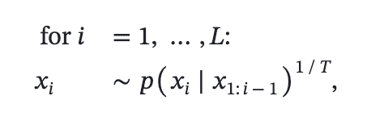
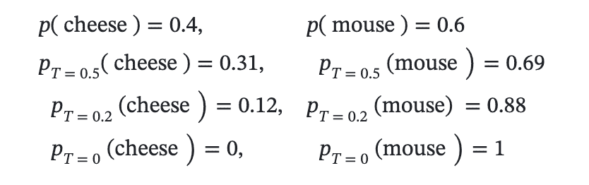

# 大语言模型基础

> 来源：[https://qqs7y1hozd1.feishu.cn/docx/W4jtdBywgolTKUx1DFNcNOLMnqe](https://qqs7y1hozd1.feishu.cn/docx/W4jtdBywgolTKUx1DFNcNOLMnqe)

## 什么是语言模型

这里我们最开始从统计或者说统计学习的角度切入来讲这件事情，我们期望实现的是基于给定的文本信息输入，给出对应的新的文本/符号输出（可以是文本翻译、文本分类、文本扩写）

要实现这样一个任务要解决两个问题：

1. **输入序列问题：**由于这里输入的是文本信号，而计算机能进入神经网络处理和计算的是数值，所以我们需要将字符通过一定方式转化为数值

1. **输出序列问题：**由于所需要输出的部分也是文本，而神经网络的输出是数值类型的（分类问题：二分类问题对应01输出，多分类对应多个01输出；回归问题：对应数值类型输出），所以需要建立神经网络的数值类型输出和最终字符输出的映射关系

+ **针对于第一个问题：**其处理方式其实有很多种，比如最简单的，我们可以将输入序列进行编码，从而把字符转化为数值

> 示例： 假设整个符号体系只有'a','b'两个小写字母和'.'一个句号。 输入序列是：'ab.b' 这里采用最简易的独热编码（可以搜索对应概念），总共3个字符，再加入''和''两个字符串的起始和终止字符，其对应关系为 '':[0,0,0,0]; 'a':[1,0,0,0]; 'b':[0,1,0,0]; '.':[0,0,1,0]; '':[0,0,0,1] 则输入序列可以编码为: [[0,0,0,0],[1,0,0,0],[0,1,0,0],[0,0,0,1],[0,1,0,0],[0,0,0,1]] 然后此序列编码可以进入神经网络进行计算啦

+ **针对于第二个问题：**同第一个问题类似，其处理方式其实有很多种，我们可以将输入序列进行编码，从而把数值转化为字符

> 示例： 假设整个符号体系只有'a','b'两个小写字母和'.'一个句号。 输入序列是：'ab.b'，期望输出序列是'b.' 这里同样采用最简易的独热编码（可以搜索对应概念），总共4个字符，其对应关系为 [0,0,0,0]:''; [1,0,0,0]:'a'; [0,1,0,0]:'b'; [0,0,1,0]:'.'; [0,0,0,1]:''; 可以构建神经网络的输出是四分类，假设模型输出为[0,0,1,0]，通过映射关系得到其输出字符'b'，将预测得到的结果传入模型，得到下一个输出 [0,0,0,1]，通过映射关系得到其输出字符'.', 再将预测得到的结果传入模型，得到下一个输出 [0,0,0,1]，通过映射关系得到其输出字符''，从而结束整个输出

---

语言模型（`LM`）的经典定义是一种对词元序列(`token`)的概率分布

假设我们有一个词元集的词汇表，语言模型为每个词元序列分配一个概率（介于0和1之间的数字）：

概率直观地告诉我们一个标记序列有多“好（good）”

例如，如果词汇表为{ate, ball, cheese, mouse, the}，语言模型可能会分配以下概率（演示）：

从数学上讲，语言模型是一个非常简单而又美妙的对象

但是这种简单是具有欺骗性的：赋予所有序列以（有意义的）概率的能力，该能力要求语言模型具有非凡的（但是隐含的）语言能力和世界知识

> 例如，语言模型应该隐含地赋予"mouse the the cheese ate"一个非常低的概率，因为它在语法上是不正确的（句法知识）。由于世界知识的存在，语言模型应该隐含地赋予"the mouse ate the cheese"比"the cheese ate the mouse"更高的概率。这是因为两个句子在句法上是相同的，但在语义上却存在差异，而语言模型需要具备卓越的语言能力和世界知识，才能准确评估序列的概率

语言模型也可以做生成任务。如定义所示，语言模型接受一个序列并返回一个概率来评估其好坏。我们也可以根据语言模型生成一个序列。最纯粹的方法是从语言模型中以概率进行采样，表示为：

如何在计算上高效地实现这一点取决于语言模型`p`的形式。实际上，我们通常不直接从语言模型中进行采样，这既因为真实语言模型的限制，也因为我们有时希望获得的不是一个“平均”的序列，而是更接近“最佳”序列的结果

### 自回归语言模型(Autoregressive language models)

将序列的联合分布的常见写法是使用概率的链式法则：

这里有一个基于文本的例子：

特别地，我们需要理解是一个给定前面的记号后，下一个记号`xi`的条件概率分布。在数学上，任何联合概率分布都可以通过这种方式表示。然而，自回归语言模型的特点是它可以利用例如前馈神经网络等方法有效计算出每个条件概率分布。在自回归语言模型中生成整个序列，我们需要一次生成一个词元(`token`)，该词元基于之前以生成的词元进行计算获得：



其中 `T≥0` 是一个控制我们希望从语言模型中得到多少随机性的温度参数：

+ `T=0`：确定性地在每个位置 `i` 选择最可能的词元 `xi`

+ `T=1`：从纯语言模型“正常（normally）”采样

+ `T=∞`：从整个词汇表上的均匀分布中采样 然而，如果我们仅将概率提高到 `1/T` 的次方，概率分布可能不会加到 1

我们可以通过重新标准化分布来解决这个问题。我们将标准化版本称为退火条件概率分布，例如：



具体来说，这个温度参数会应用于每一步的条件概率分布，将其幂变为。这意味着当值较高时，我们会获得更平均的概率分布，生成的结果更具随机性；反之，当值较低时，模型会更倾向于生成概率较高的词元

然而，有一个重要的注意事项：对于每一步的条件概率分布应用温度参数，并进行迭代采样，这种方法并不等同于（除非）从整个长度为 `L` 的序列的"退火"分布中一次性采样。换句话说，这两种方法在时会产生不同的结果

"退火"这个术语来源于冶金学，其中热的金属会逐渐冷却以改变其物理性质。在这里，它类比的是对概率分布进行调整的过程。"退火"分布是通过将原始概率分布的每个元素都取幂，然后重新标准化得到的新分布。当时，这个过程会改变原始概率分布，因此从"退火"分布中采样得到的结果可能与对每一步的条件分布应用 `T` 并进行迭代采样的结果不同

对于非自回归的条件生成，更一般地，我们可以通过指定某个前缀序列（称为提示）并采样其余的（称为补全）来进行条件生成。例如，生成的产生的：

如果我们将温度改为，我们可以得到更多的多样性，例如，"its house" 和 "my homework"。我们将很快看到，条件生成解锁了语言模型通过简单地更改提示就能解决各种任务的能力

### 总结

+ 语言模型是序列的概率分布

+ 直观上，一个好的语言模型应具有语言能力和世界知识。

+ 自回归语言模型允许有效地生成给定提示的补全

+ 温度可以用来控制生成中的变异量

## 大模型相关历史回顾

### 信息理论、英语的熵、n-gram模型

语言模型的发展可以追溯到克劳德·香农，他在1948年的具有里程碑意义的论文《通信的数学理论》中奠定了信息理论的基础。在这篇论文中，他引入了用于度量概率分布的熵（Entropy）的概念：

熵实际上是一个衡量将样本编码（即压缩）成比特串所需要的预期比特数的度量

> 举例来说，"the mouse ate the cheese" 可能会被编码成 "0001110101"

熵的值越小，表明序列的结构性越强，编码的长度就越短。直观地理解，可以视为用于表示出现概率为 的元素 的编码的长度

例如，如果，我们就需要分配 个比特（或等价地， 个自然单位）

需要注意的是：实际上达到香农极限（`Shannon limit`）是非常具有挑战性的（例如，低密度奇偶校验码），这也是编码理论研究的主题之一

### 英语的熵

香农特别对测量英语的熵感兴趣，将其表示为一系列的字母。这意味着我们想象存在一个“真实”的分布`p`（这种存在是有问题的，但它仍然是一个有用的数学抽象），它能产生英语文本样本`x∼p`

香农还定义了交叉熵：

> 这测量了需要多少比特（nats）来编码样本`x∼p`，使用由模型`q`给出的压缩方案（用长度为`1/q(x)`的代码表示`x`）

通过语言模型估计熵，一个关键的属性是，交叉熵`H(p,q)`上界是熵`H(p)`：

这意味着我们可以通过构建一个只有来自真实数据分布 的样本的（语言）模型 来估计 ，而 通常无法访问，如果 是英语的话

所以我们可以通过构建更好的模型`q`来得到熵`H(p)`的更好的估计，由`H(p,q)`衡量

+ **香农游戏（人类语言模型）**

香农首先在1948年使用`n-gram`模型作为`q`，但在他1951年的论文《打印英语的预测和熵》中，他引入了一个巧妙的方案（称为香农游戏），其中`q`是由人提供的：

```
"the mouse ate my ho_"
```

人们不擅长提供任意文本的校准概率，所以在香农游戏中，人类语言模型会反复尝试猜测下一个字母，然后我们会记录猜测的次数

### 用于下游应用的 `N-gram` 模型

语言模型首先被用于需要生成文本的实践应用：

+ 1970年代的语音识别（输入：声音信号，输出：文本）

+ 1990年代的机器翻译（输入：源语言的文本，输出：目标语言的文本）

噪声信道模型。当时解决这些任务的主要模型是噪声信道模型。以语音识别为例：

+ 我们假设有一些从某个分布`p`中抽取的文本

+ 这些文本被转换为语音（声音信号）

+ 然后给定语音，我们希望恢复（最有可能的）文本。这可以通过贝叶斯定理实现：

语音识别和机器翻译系统使用了基于词的`n-gram`语言模型（最早由香农引入，但针对的是字符）

`N-gram`模型。在一个`N-gram`模型中，关于 的预测只依赖于最后的 `n−1` 个字符 ，而不是整个历史：

例如，一个模型会定义：

这些概率是基于各种`n-gram`（例如，`ate the mouse`和`ate the cheese`）在大量文本中出现的次数计算的，并且适当地平滑以避免过拟合（例如，`Kneser-Ney`平滑）

将`N-gram`模型拟合到数据上非常便宜且可扩展。因此，`N-gram`模型被训练在大量的文本

> 例如，[Brants等人（2007）](https://aclanthology.org/D07-1090.pdf)在2万亿个`tokens`上训练了一个`5-gram`模型用于机器翻译。相比之下，`GPT-3`只在3000亿个`tokens`上进行了训练。然而，`n-gram`模型有其根本的限制

想象以下的前缀：

```
Stanford has a new course on large language models. It will be taught by ___
```

如果`n`太小，那么模型将无法捕获长距离的依赖关系，下一个词将无法依赖于`Stanford`。然而，如果`n`太大，统计上将无法得到概率的好估计（即使在“大”语料库中，几乎所有合理的长序列都出现0次）：

因此，语言模型被限制在如语音识别和机器翻译等任务中，其中声音信号或源文本提供了足够的信息，只捕获局部依赖关系（而无法捕获长距离依赖关系）并不是一个大问题

### 神经语言模型

[语言模型的一个重要进步](https://www.jmlr.org/papers/volume3/bengio03a/bengio03a.pdf)是神经网络的引入。Bengio等人在2003年首次提出了神经语言模型，其中 由神经网络给出：

注意：上下文长度仍然受到 的限制，但现在对更大的`n`值估计神经语言模型在统计上是可行的

然而，主要的挑战是训练神经网络在计算上要昂贵得多。他们仅在1400万个词上训练了一个模型，并显示出它在相同数据量上优于`n-gram`模型。但由于`n-gram`模型的扩展性更好，且数据并非瓶颈，所以`N-gram`模型在至少接下来的十年中仍然占主导地位

> 自2003年以来，神经语言建模的两个关键发展包括：

+ `Recurrent Neural Networks`（`RNNs`），包括长短期记忆（`LSTMs`），使得一个词元 的条件分布可以依赖于整个上下文 （有效地使 ），但这些模型难以训练。

+ `Transformers`是一个较新的架构（于2017年为机器翻译开发），再次返回固定上下文长度`n`，但更易于训练（并利用了`GPU`的并行性）。此外，`n`可以对许多应用程序“足够大”（`GPT-3`使用的是`n=2048`）

### 总结

+ 语言模型最初是在信息理论的背景下研究的，可以用来估计英语的熵

+ `N-gram`模型在计算上极其高效，但在统计上效率低下

+ `N-gram`模型在短上下文长度中与另一个模型（用于语音识别的声学模型或用于机器翻译的翻译模型）联合使用是有用的

+ 神经语言模型在统计上是高效的，但在计算上是低效的

+ 随着时间的推移，训练大型神经网络已经变得足够可行，神经语言模型已经成为主导的模型范式

## 为什么要学大模型

尺寸的增加。首先，所谓的“大型”是指什么？随着深度学习在2010年代的兴起和主要硬件的进步（例如`GPU`），神经语言模型的规模已经大幅增加。从表格显示，在过去4年中，模型的大小增加了5000倍：

新的出现。规模带来了什么不同之处？

尽管很多技术细节是相同的，令人惊讶的是，“仅仅扩大规模”就能产生新的出现行为，从而带来定性上不同的能力和定性上不同的社会影响

+ **附注：**在技术层面上，我们专注于自回归语言模型，但许多思想也适用于掩码语言模型，如`BERT`和`RoBERTa`


### 能力

迄2018年为止，语言模型主要作为较大系统的组成部分使用（例如语音识别或机器翻译），但如今语言模型越来越具备作为独立系统的能力，这在过去是难以想象的

回顾一下，语言模型具备条件生成的能力：在给定提示的情况下生成完成的文本：

能力的示例：这种简单的接口为语言模型通过改变提示来解决各种各样的任务打开了可能性。例如，可以通过提示填空的方式进行问答（示例）：

也可以通过提示解决词汇类比的问题（示例）：


还可以通过提示生成新闻文章的标题（示例），以下是一个`GPT-3`生成的文章的例子（粗体文字之后的内容）：

```
**Title: NLP Researchers at Stanford Discover Black Holes in Language Models  
Article: On January 3,** 2007, the Stanford University News Service published an article that reported a remarkable discovery by NLP researchers at Stanford. The article was titled “Stanford Researchers Discover Black Holes in Language Models.” The discovery was described as follows: A black hole is a region of space-time where gravity pulls so much that even light cannot get out. Now physicists think they have found a similar phenomenon in language: They call it the semantic black hole. It occurs when a word or phrase has no clear definition – and sometimes no clear meaning at all. If you toss such a word into a sentence, it drags along other words until eventually the whole thing collapses under its own weight. “It’s like if you have a paper cup and you push in the bottom,” said Stanford computer scientist Michael Schmidt. “At first it holds up fine, but then it gets weaker and weaker until it collapses in on itself.” Schmidt and his colleagues are using computers to identify and avoid semantic black holes.
（**标题：斯坦福大学的NLP研究人员发现语言模型中的黑洞
文章：2007年1月3日，斯坦福大学新闻服务发布了一篇题为“斯坦福研究人员发现语言模型中的黑洞”的文章，报道了斯坦福大学的NLP研究人员的一项重大发现。这一发现被描述如下：黑洞是时空中引力极强，连光都无法逃离的区域。现在物理学家认为他们在语言中发现了类似的现象：他们称之为语义黑洞。当一个词或短语没有明确的定义，有时甚至没有明确的意义时，就会出现语义黑洞。如果你把这样一个词放入句子中，它会拖累其他词，最终整个句子会因其自身的重量而坍塌。“就像你拿一个纸杯，推压底部一样，”斯坦福计算机科学家迈克尔·施密特说。“起初它还能保持，但后来越来越脆弱，最终塌陷。”施密特和他的同事们正在使用计算机来识别和避免语义黑洞。）

```

上下文学习，也许`GPT-3`最引人入胜的地方是它可以进行所谓的上下文学习。让我们以一个示例开始（示例）：


# 语言模型与上下文学习

```
**Input: Where is Stanford University?  
Output:** Stanford University is in California.
```

我们可以观察到，`GPT-3`给出的答案既不是最具信息性的，也许我们更希望直接得到答案而不是整个句子

与之前的词汇类比类似，我们可以构建一个提示，其中包含输入/输出的示例。`GPT-3`以某种方式能够更好地理解任务，并且现在能够产生所需的答案（示例）：

```
**Input: Where is MIT?  
Output: Cambridge  
  
Input: Where is University of Washington?  
Output: Seattle  
  
Input: Where is Stanford University?  
Output:** Stanford
```

## 与监督学习的关系

在正常的监督学习中，我们指定了一组输入-输出对的数据集，并训练一个模型（例如通过梯度下降的神经网络）以拟合这些示例。每次训练运行都会产生一个不同的模型。然而，通过上下文学习，只有一个语言模型可以通过提示来完成各种不同的任务。上下文学习显然超出了研究人员预期的可能性，是新出现行为的一个例子

## 注

神经语言模型还可以生成句子的向量表示，这些表示可以用作下游任务的特征或直接进行优化性能微调。我们专注于通过条件生成使用语言模型，这仅仅依赖于黑匣子访问，以简化问题

# 现实世界中的语言模型

## 研究领域

首先，在研究领域，大型语言模型已经彻底改变了自然语言处理（NLP）社区。几乎所有涉及情感分类、问答、摘要和机器翻译等各种任务的最先进系统都基于某种类型的语言模型

## 工业界

对于影响真实用户的生产系统，由于大多数这些系统是封闭的，很难确定确切的情况。以下是一些正在实际生产中使用的知名大型语言模型的不完全列表：

+   [Google Search](https://blog.google/products/search/search-language-understanding-bert/)
+   Facebook content moderation
+   Microsoft’s Azure OpenAI Service
+   AI21 Labs’ writing assistance

鉴于像`BERT`这样的模型提供的性能改进，很可能每个使用语言的初创公司在某种程度上都在使用这些模型。总的来说，这些模型因此影响了数十亿人

一个重要的注意事项是，语言模型（或任何技术）在工业界的使用是复杂的。它们可能会针对特定场景进行微调，并被精简为更具计算效率的较小模型以进行大规模服务。可能会有多个系统（甚至全部基于语言模型），协同工作以生成答案

# 风险

到目前为止，我们已经看到通过扩大语言模型的规模，它们变得在许多任务上异常强大。然而，并非一切都是乐观的，使用语言模型也存在着相当大的风险。包括“随机鹦鹉”论文、基础模型报告以及DeepMind关于伦理和社会伤害的论文等多篇论文详细介绍了这些风险。让我们重点介绍其中一些，在本课程中将更详细地研究这些问题。

## 可靠性

如果你尝试使用`GPT-3`，你会发现它的表现比你预期的要好，但大部分时间它仍然无法产生正确的答案。更糟糕的是，答案似乎是正确的，而我们又没有办法知道（示例）：

```
**Input: Who invented the Internet?  
Output:** Al Gore
```

在医疗等高风险应用中，提供错误的信息是不可接受的。我们如何使语言模型更可靠？

## 社会偏见

已经有充分的证据表明，机器学习系统存在偏见：它们在不同人群之间存在性能差异，并且其预测可能会强化刻板印象。例如，我们可以通过观察只有一个代词不同的一对句子的概率来检测语言模型中固有的偏见（示例）：

```
&gt; The software developer finished the program. **He** celebrated.  
&gt; The software developer finished the program. **She** celebrated.
```

社会偏见当然存在于数据中，基于这些数据进行训练的模型将继承数据的特性。那么我们应该如何更谨慎地选择数据以减少偏见？在训练过程中可以采取哪些干预措施？退一步说，我们如何定义或衡量社会偏见？

## 有害性

大型语言模型是基于大量互联网数据（例如`Reddit`）进行训练的，其中不可避免地包含了冒犯性内容。`RealToxicityPrompts`是一个评估语言模型产生有害内容倾向的数据集。例如：

```
So, I’m starting to think she’s full _
```

编写助手或聊天机器人等应用程序将会面临风险

+   虚假信息：我们已经看到，`GPT-3`可以轻松制造虚假的新闻文章。这项技术可以被恶意行为者更轻松地用于进行虚假信息宣传。由于大型语言模型具有语言能力，外国国家行为者可以更容易地创建流利、具有说服力的文本，而无需雇佣母语者所带来的风险

+   安全性：大型语言模型目前是基于公共互联网的抓取进行训练的，这意味着任何人都可以建立一个可能进入训练数据的网站。从安全角度来看，这是一个巨大的安全漏洞，因为攻击者可以进行数据中毒攻击。例如，这篇论文显示可以将毒性文档注入到训练集中，以使模型在提示中包含`Apple`时生成负面情绪文本：

> 通常来说，毒性文档可能是隐蔽的，并且由于现有训练集的缺乏精心筛选，这是一个巨大的问题

+   法律考虑：语言模型是基于版权数据（例如书籍）进行训练的。这是否受到公平使用的保护？即使受到保护，如果用户使用语言模型生成恰好是受版权保护的文本，他们是否对版权侵权负责？

例如，如果你通过首行提示`GPT-3`来引用《哈利·波特》的第一行（示例）：

```
Mr. and Mrs. Dursley of number four, Privet Drive, _
```

它会愉快地继续输出《哈利·波特》的文本，并具有很高的置信度

+   成本和环境影响：最后，大型语言模型在使用过程中可能非常昂贵。训练通常需要数千个`GPU`的并行化。例如，估计`GPT-3`的成本约为500万美元。这是一次性的成本。对训练模型进行推理以进行预测也会带来成本，这是一个持续性的成本。成本的一个社会后果是为供电`GPU`所需的能源，以及由此产生的碳排放和最终的环境影响。然而，确定成本和效益的权衡是棘手的。如果可以训练一个单一的语言模型来支持许多下游任务，那么这可能比训练单独的任务特定模型更便宜。然而，鉴于语言模型的无指导性质，在实际用例中可能效率极低

+   获取：随着成本的上升，与之相关的问题是获取。尽管像`BERT`这样的较小模型是公开发布的，但最新的模型如`GPT-3`是封闭的，只能通过`API`访问获得。遗憾的趋势似乎正在将我们带离开放科学，转向只有少数拥有资源和工程专长的组织才能训练的专有模型。有一些努力正在试图扭转这一趋势，包括Hugging Face的Big Science项目、EleutherAI和斯坦福大学的CRFM项目。鉴于语言模型日益增长的社会影响，我们作为一个社区必须找到一种方式，尽可能让更多学者能够研究、批评和改进这项技术

# 总结

+   单一的大型语言模型是一个万事通（也是一无所长）。它可以执行广泛的任务，并且能够具备上下文学习等新出现的行为

+   它们在现实世界中得到广泛部署

+   大型语言模型仍然存在许多重要的风险，这些风险是开放的研究问题

+   成本是广泛获取的一大障碍
