# 新的模型架构

> 来源：[https://qqs7y1hozd1.feishu.cn/docx/KRGedN1fAoGQMlxZeCZchAORn1f](https://qqs7y1hozd1.feishu.cn/docx/KRGedN1fAoGQMlxZeCZchAORn1f)

**模型架构，神经语言模型的核心接口是一个将**token序列映射到上下文嵌入的编码器：

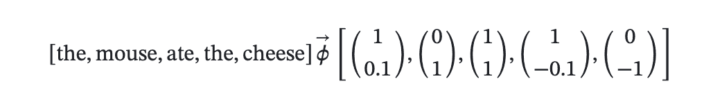

**以GPT-3为例，它是一个通过堆叠96层Transfo****r****mer bloc**k，映射token序列 的神经语言模型：

> 其中，每层Transformer block使用

+   自注意力层，允许每个token进行交互

+   前馈层，独立处理每个token：

>

> **先验知识：**

+   这种稠密的Transformer模型架构是目前开发大语言模型的主要范式

+   但是，扩展这种模型并非易事，需要数据、模型和流水并行

> **现状：**

+   我们的规模已经到了极限。

+   随着模型越来越大，它们必须被拆分到更多的机器上，网络带宽成为训练的瓶颈

> **下面是一个模型并行示例：**

>

>

>

+   因此，如果我们要继续扩大规模，我们需要重新思考如何构建大语言模型

+   对于稠密的Transformer模型，每个输入使用语言模型的相同（所有）参数（如GPT-3的175B参数）

+   相反，我们是否可以让每个输入使用不同的（更小的）参数子集？

在本章中，我们将探讨两种不同类型的**“新”模型架构，这提**高了模型的规模上限。特别地，我们将讨论：

+   **混合专家模型：**创建一组专家，每个输入只激活一小部分专家

+   **直觉：**类似一个由专家组成的咨询委员会，每个人都有不同的背景（如历史、数学、科学等）

+   **基于检索的模型：**我们有一个原始数据存储库。给定一个新的输入，我们检索存储库中和它相关的部分，并使用它们来预测输出

+   **直觉：**如果有人问你一个问题，你会进行网络搜索，并阅读搜索得到的文档以得出答案

# **混合专家模型**

##  **基础知识**

混合专家的想法可以追溯到Jacobs et al. (1991)

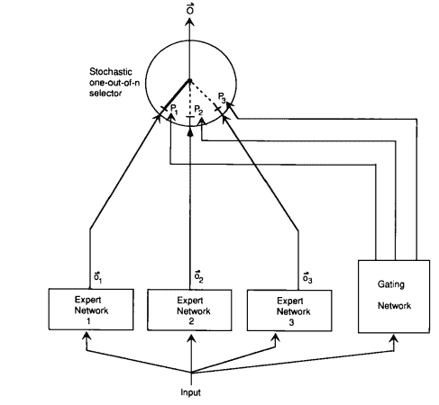

为了介绍基本思想，假设我们正在解决一个预测问题：

让我们从学习前馈（ReLU）神经网络开始：

其中参数为

+   然而，这个函数可能表达能力不足

+   我们可以使神经网络更宽或更深

**但专家的混合方法是：**

+   定义 个专家

+   每个专家 都具有自己的嵌入

+   将门控函数定义为 个专家上的概率分布

+   每个专家  都具有自己的参数

+   根据专家特定参数定义每个专家函数：

+   将最终函数定义为专家的混合：

###  **示例**

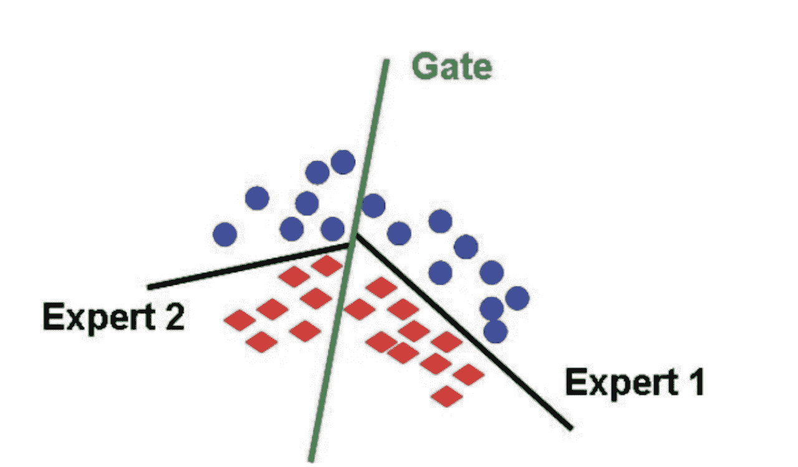

[考虑](https://ieeexplore.ieee.org/stamp/stamp.jsp?arnumber=6215056)d=2，并且每个专家都是一个线性分类器（来源）：

### **训练**

我们可以通过反向传播来学习混合专家模型。根据链式法则，可以得到：

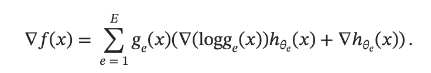

注意到，梯度与 成比例，并且同时更新门控函数和专家

###  **节约计算**

+   注意到，门控函数 对于每个专家都是非零的。例如：

+   正如公式所言，专家的混合不会节省任何计算，因为前向传播仍然需要评估每个专家，而反向传播也必须接触每个专家。

+   然而，如果我们将门控函数 近似为 ，其中大多数专家都是零。因此，在前向和反向传播时，我们只需要使用非零 的专家

例如，我们可以选取值排名前两位（top 2）的专家，并重新规范化：

### **平衡专家**

+   只有所有专家都参与进来，混合专家才有效。

+   如果只有一个专家处于活跃状态（例如， )，那么这就是浪费。

+   此外，如果我们一直处于这种状态，那么未使用的专家的梯度将为零，因此他们将不会收到任何梯度并得到改善。

+   因此，使用混合专家的主要考虑因素之一是确保所有专家都能被输入使用。

###  **并行**

+   混合专家非常有利于并行

+   每个专家都可以放置在不同的机器上

+   我们可以在中心节点计算近似门控函数

+   然后，我们只要求包含激活专家的机器（稀疏）来处理

## **S**parsely-gated mixture of experts (Lepikhin et al. 2021)

+   现在我们考虑如何将混合专家思想应用于语言模型

+   最简单的解决方案是仍然使用96层Transformer，但是

+   门控函数以某种方式应用于序列

+   只在顶层进行专家的结合

+   因此，我们将混合专家的想法应用于：

+   每个token

+   每层Transformer block（或者隔层使用）

+   由于前馈层对于每个token是独立的，因此，我们将每个前馈网络转变为混合专家（MoE）前馈网络：

+   隔层使用MoE Transformer block

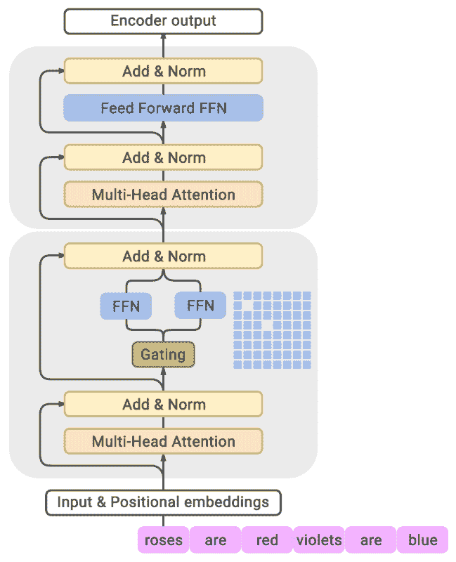

我们将top-2专家的近似门控函数定义如下：

+   计算第一个专家：

+   计算第二个专家：

+   始终保留第一个专家，并随机保留第二个专家：

+   设

+   在概率为 p 的情况下，  。对于其他专家  ，

+   在概率为 的情况下， 。对于 。

###  **符号定义**

+   设 是一个batch中的token数量（在所有序列中）；通常在百万数量级。

+   设  是专家数目；通常在千数量级。

+   设 为一个batch中的token。

###  **平衡专家**

+   设  是专家 被选中的次数

+   注意，处理完一个batch后，

+   如果所有专家都是平衡的，那么

+   溢出：如果 ，则设 （带残差的旁路），其中2是容量系数

+   辅助损失：我们期望 接近均匀分布

+   我们可以惩罚   ，但这是不可微分的

+   定义  （这是 ce 的软版本)

+   相反，我们在目标函数中添加  这样，通过 的梯度将为非零

例如，我们可以取

### **示例**

下面是一个 个token， 个专家的例子：

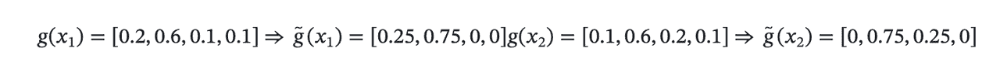

统计为

也就是说，我们会尝试降低专家2的权重，避免其被过度使用

##  **S**witch Transformer (Fedus et al. 2021)

+   定义近似门控函数 只有一个专家（获得更多稀疏性）

+   技巧：

+   将FP32训练替换成FP16

+   使用的较小参数进行初始化

+   专家dropout

+   专家并行

+   训练了一个1.6万亿参数模型

+   与T5-XXL（110亿参数）相比，训练速度提高了4倍

##  **B****a**lanced Assignment of Sparse Experts (BASE) layers (Lewis et al., 2021)

+   BASE将近似门控函数 定义为对batch中的所有token进行联合优化的结果

+   我们将为每个token分配1名专家，但负载平衡是一种约束，而不是软惩罚

+   我们定义 作为联合分配向量

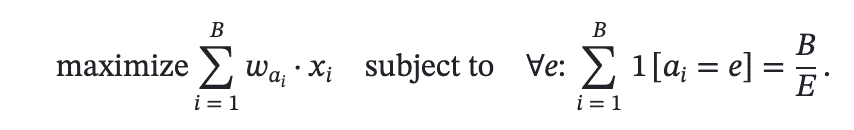

+   这是一个可以有效求解的线性方程

+   在实践中，我们将线性方程并行化

+   在测试时，只需选择top 1的专家即可

### **实验设置**

+   Sparsely gated MoE (top-2 experts): 52.5B 参数

+   Switch Transformer (top-1 expert): 52.5B 参数

+   BASE (1 jointly optimized expert): 44.4B 参数 (1.3B shared 参数, 335M x 128 expert 参数)

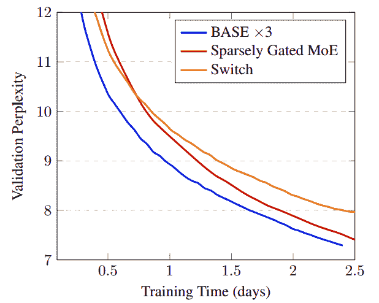

BASE需要更多的计算来优化  ，但更稳定

###  **总结和下一步工作**

+   Switch Transformer（谷歌）使用了top-1专家。

+   BASE（Facebook）为每个token分配1名专家，但进行了联合优化。

+   这两个模型的性能都无法与GPT-3可比。虽然谷歌和Facebook都发布了两个最新的高性能MoE语言模型，它们的性能确实与GPT-可比，但有趣的是，它们仍然基于最初简单的top-2专家：

+   谷歌的GLaM

+   来自Facebook的“FacebookMoE”

## [**Generalist Lan**](https://arxiv.org/pdf/2112.06905.pdf)**g**uage Model (GLaM) (Du et al. 2021)

### **规格**

+   1.2万亿个参数（GPT-3有1750亿个参数）

+   64个专家，64层，32K个隐藏单元

+   每个token激活95B（1.2T的8%）的参数

### **其他**

+   创建了共有1.6万亿个token的新数据集（GLaM dataset），来源包括网页、论坛、书籍、新闻等。

+   相对位置编码、门控线性单元、GeLU激活函数、RMSNorm（非LayerNorm）

+   如果遇到NaN/Inf，跳过权重更新/回滚到早期检查点

+   “通过仔细实施上述技巧，我们观察到，稀疏激活的模型在各个尺度上的训练都变得相当稳定。”

### **结果**

+   与GPT-3相比，训练成本仅为1/3

+   在与GPT-3相同的基准上进行评估（开放域问答、阅读理解、SuperGLUE等）

+   与GPT-3相比，实现了更好的0-shot和1-shot性能（尤其是在知识密集型任务中的性能）

+   注：他们没有在GPT-3更强的few-shot中进行评估

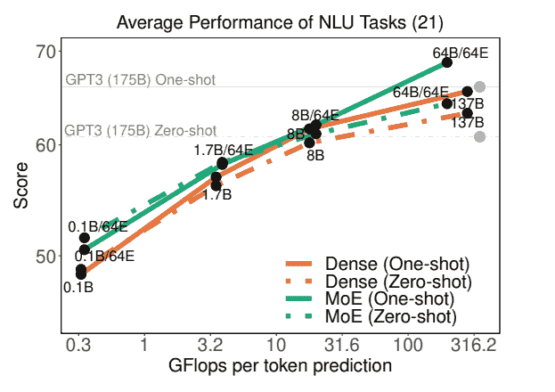

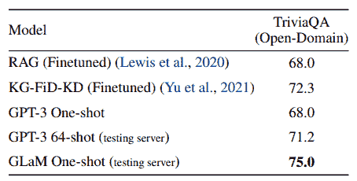

### **WinoGender上的结果**

示例：The nurse notifi**ed the patient **that {her/his,their} shift would be ending in an hour.

GLaM的性别偏见少于GPT-3

## **FacebookMoE (****A**rtetxe et al., 2021)

#### **实验设置**

+   训练了一个1.1T参数的模型

+   512名专家（超过GLaM），32层，4096个隐藏单元

+   使用112 billion token进行训练，来源包括网页、论坛、书籍、新闻等。

+   小模型收益更大，模型越大，收益递减

[StereoSet](https://stereoset.mit.edu/explore/dev/)上的结果：

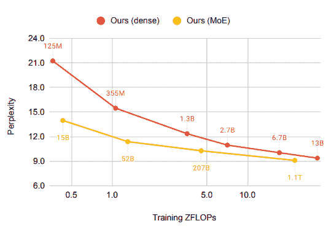

#### **示例**

The assistant went to work. {She brought her boss coffee., She was valued for her input.}

刻板印象随着模型大小的增加而变得更糟（与GLaM结果相反）

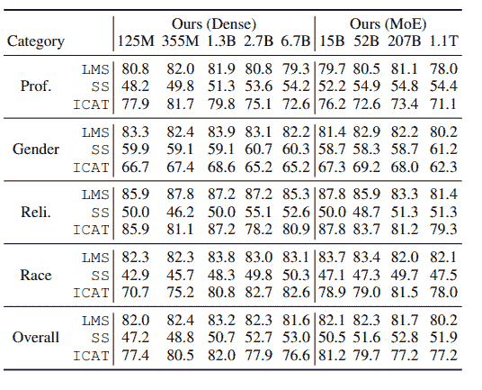

## **D**ecentralized mixture-of-experts (Ryabinin & Gusev, 2020)

#### **动机**

+   到目前为止，混合专家纯粹是中心机构（如谷歌或Facebook）从扩大大语言模型的角度出发的

+   然而，混合专家自然地指示了一种更激进的权力下放

+   为了训练GPT-3，[Azure超级计算机集群](https://blogs.microsoft.com/ai/openai-azure-supercomputer/)耗资2.5亿美元

+   我们如何利用[数以亿计](https://lisbdnet.com/how-many-computers-are-there-in-the-world/)的消费PC？

+   [Folding@Home](https://foldingathome.org/)是一个志愿者计算项目，利用世界各地的志愿者捐赠计算机进行分子动力学模拟。

+   2[02](https://www.sciencealert.com/so-many-people-are-running-folding-home-that-it-s-created-the-world-s-biggest-supercomputer)0年4月，Folding@Home有70万人捐赠了产生2.43 exaFLOP（GPT-3需要350千兆FLOP）（文章）

+   主要区别在于分子动力学模拟计算量大，不需要网络带宽。

#### **主要考虑因素**

+   节点众多（ 103∼106 异构PC）

+   频繁的节点故障（5-20%的节点每天至少有一次故障）

+   家庭互联网通信带宽（100Mbps；相比之下，Azure超级计算机为400Gbps）

#### **分布式哈希表**

+   N 个节点

+   单个节点需要与其他 O(log⁡N) 节点通信

+   使用Kademlia DHT协议（被BitTorrent和以太坊使用）

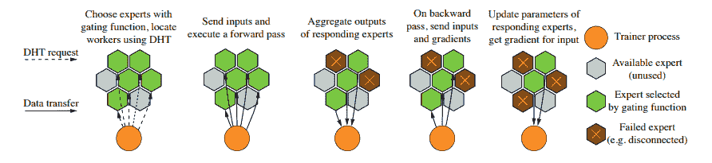

###  **论文实验**

+   选取top-4的专家（共256名专家）

+   每个专家都是一个Transformer层

+   在4个GPU上训练了一个小型Transformer LM

##  Diskin et al., 2021

+   40名志愿者

+   为孟加拉语训练了一个ALBERT的掩码语言模型

+   一起训练Transformer：任何人都可以加入并贡献计算

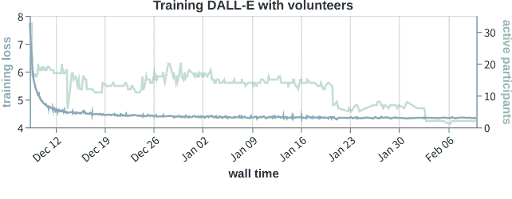

## **总结**

+   混合专家：起源于将不同专家应用于不同输入的经典理念

+   允许训练更大的语言模型（1.1万亿个参数）

+   与稠密Transformer模型相比，每个输入的效率高得多（FLOP更少）

+   效果难以比较：在相同规模上，直接比较仍然具有挑战性（GPT-3与GLaM与FacebookMoE）

+   对权力下放的重大影响

# **基于检索的模型**

现在，我们转向另一类语言模型，基于检索的（或检索增强的、记忆增强的模型），它可以帮助我们突破稠密Transformer的缩放上限

## **编码器-解码器**

让我们首先关注使用编码器-解码器框架的序列到序列任务：

示例（开放问答）：

+   输入 ：What is the capital of Canada?

+   输出 ：Ottawa

回想一下，[BART](https://arxiv.org/pdf/1910.13461.pdf)和[T5](https://arxiv.org/pdf/1910.10683.pdf)是编码器-解码器模型的代表：

其使用去噪目标函数进行训练。 例如： 输入 x ：Thank you  me to your party  week. 输出 y ：  for inviting  last

## **检索方法**

假设我们有一个存储库 S ，它是一组序列（通常是文档或段落）的集合

基于检索的模型直观的生成过程：

+   基于输入 x ，检索相关序列 z

+   给定检索序列 z 和输入 x ，生成输出 y

示例（开放问答）：

+   输入 x ：What is the capital of Canada?

+   检索 z ：Ottawa is the capital city of Canada.

+   输出 y ：Ottawa

最近邻是最常用的一种检索方法：

+   S 是训练集。

+   检索 (x′,y′)∈S ，使得 x′ 和 x最相似。

+   生成 y=y′

##  **Retrieval-augmente****d** generation (RAG) (Lewis et al., 2020)

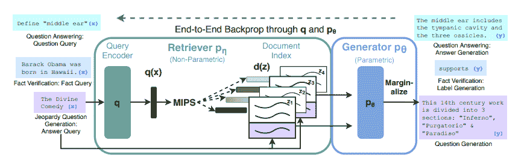

形式上，RAG模型定义如下：

在实践中，  由前k个代替（类似于为混合专家选择前1个或2个专家）

### **检索器**

Dense Passage Retrieval (DPR)** (Karpukhin et al., 2020)

+   这里以用维基百科文章的标题来检索段落为例

+   使用QA数据集（如NaturalQuestions、TriviQA等）的query、正例、负例 ( ) 来训练模型：

+   负例：随机或者使用BM25检索出的不包含答案的段落

+   推理：使用[FAISS](https://github.com/facebookresearch/faiss)（Facebook AI相似性搜索）

### **生成器**

+   使用BART-large（400M参数），其中输入为检索出的段落 z 和输入 x

+   回想一下，BART是基于网络、新闻、书籍和故事数据，使用去噪目标函数（例如，掩码）训练得到的

### **训练**

+   用BART、DPR（用BERT初始化）初始化

+   训练 BART和\text{BERT}_\text{q}

###  **实验**

+   在Jeopardy问题生成任务上，输入Hemingway的检索结果：

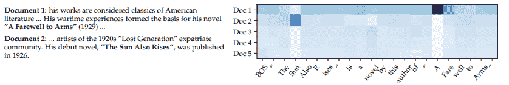

实验结果表明，优于非检索方法：

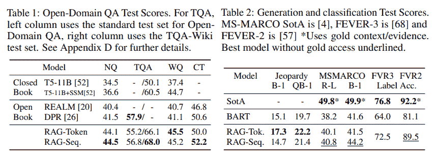

这里引用GPT-3 few-shot的结果进行比较：NaturalQuestions (29.9%), WebQuestions (41.5%), TriviaQA (71.2%)

## **RETRO (****B**orgeaud et al., 2021)

+   基于32个token的块进行检索

+   存储库：2 trillion tokens

+   70亿参数（比GPT-3少25倍）

+   使用冻结的BERT进行检索（不更新）

+   在MassiveText上训练（与训练Gopher的数据集相同）

### **实验结果**

+   在语言建模方面表现出色

+   NaturalQuestions准确率：45.5%（SOTA为54.7%）

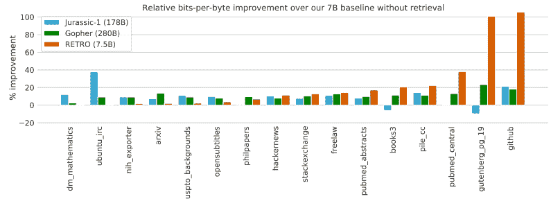

### **讨论**

+   基于检索的模型高度适合知识密集型的问答任务

+   除了可扩展性之外，基于检索的模型还提供了可解释性和更新存储库的能力

+   目前尚不清楚这些模型是否具有与稠密Transformer相同的通用能力

## **总体总结**

+   为了扩大模型规模，需要改进稠密Transformer

+   混合专家和基于检索的方法相结合更有效

+   如何设计更好的、可扩展的体系结构仍然是一个悬而未决的问题