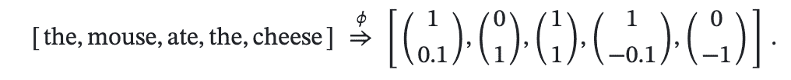
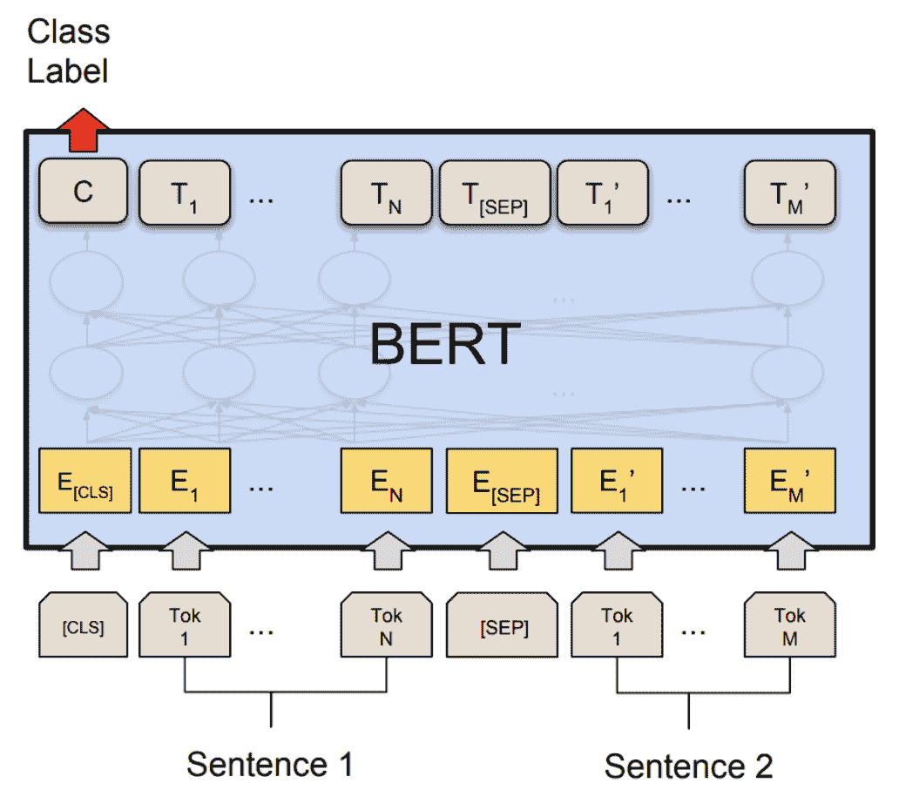
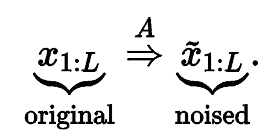
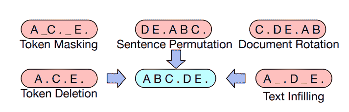
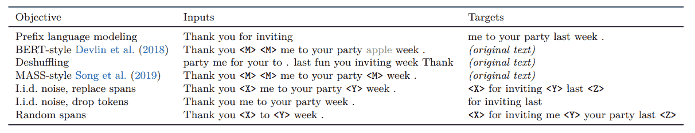
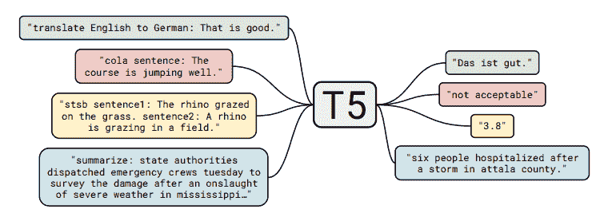
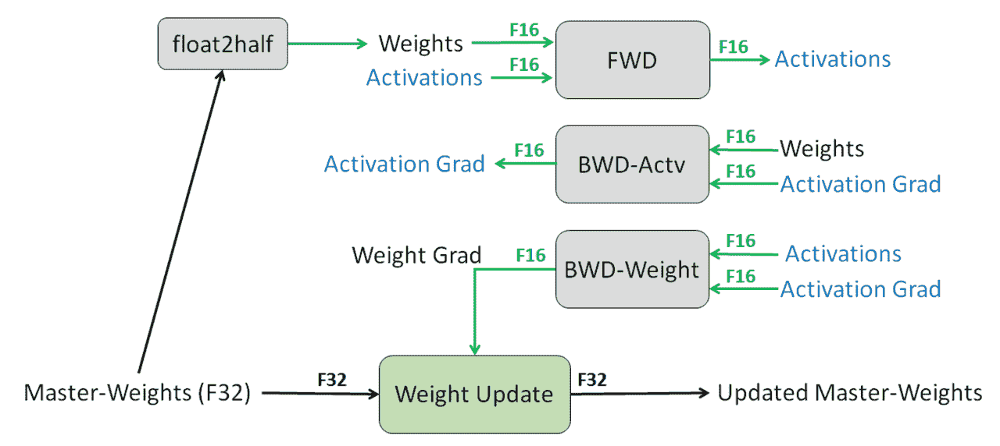

# 模型训练

> 来源：[https://qqs7y1hozd1.feishu.cn/docx/RG6Qd5UH3oJoWtxG5yEcjoZfngB](https://qqs7y1hozd1.feishu.cn/docx/RG6Qd5UH3oJoWtxG5yEcjoZfngB)

# **目标函数**

我们研究三类语言模型的目标函数：

1.  只包含解码器（Decoder-only）的模型（例如，GPT-3）：计算单向上下文嵌入（contextual embeddings），一次生成一个token

1.  只包含编码器（Encoder-only）的模型（例如，BERT）：计算双向上下文嵌入

1.  编码器解码器（Encoder-decoder）模型（例如，T5）：编码输入，解码输出

我们可以使用任何模型将token序列映射到上下文嵌入中（例如，LSTM、Transformers）



## **Decoder-only 模型**

回想一下，自回归语言模型定义了一个条件分布：

我们将其定义如下：

+   将 映射到上下文嵌入

+   应用嵌入矩阵 来获得每个token的得分

+   对其进行指数化和归一化，得到预测 xi的 分布

简洁地：

### **最大似然**

设 是大语言模型的所有参数。设 是由一组序列组成的训练数据。 然后，我们可以遵循最大似然原理，定义以下负对数似然目标函数：

并且，有很多的方法可以有效地优化这一目标函数

## **Encoder-only 模型**

### **单向到双向**

使用上述最大似然可以训练得到Decoder-only模型，它会产生（单向）上下文嵌入。但如果我们不需要生成，我们可以提供更强的双向上下文嵌入

### **BERT**

我们首先介绍[BERT](https://arxiv.org/pdf/1810.04805.pdf)的目标函数，它包含以下两个部分：

+   掩码语言模型（Masked language modeling）

+   下一句预测（Next sentence prediction）

以自然语言推理（预测隐含、矛盾或中性）任务中的序列为例：

其中有两个特殊的token：

+   [CLS] ：包含用于驱动分类任务的嵌入

+   [SEP] ：用于告诉模型第一个序列（例如，前提）与第二个序列（例如，假设）的位置

根据上一章的公式，BERT模型定义为：

其中，   根据序列返回以下两个矢量之一

+   对于 左边的，返回

+   对于 右边的，返回



BERT-large有 个注意头，并且  ，总共355M个参数

#### **掩码语言模型**

掩码语言模型的基本思想是通过加噪然后预测来进行训练：

更普遍地说，我们可以将其视为类似于去噪自动编码器，其中我们映射有噪声/不完整版本  ，并尝试重建原始

**建模**：我们首先定义模型分布。给定输入 及其上下文嵌入，模型独立地预测每个token：

**掩码：** 我们定义了一个（随机）噪声函数



以下是 的定义：

+   假设  代表所有位置中随机的15%

+   对于每个  ：

+   以0.8的概率，

+   以0.1的概率，

+   以0.1的概率，

**减少分布偏移：** 如果我们总是使用 来替换 I 中选定的token，则：

+   在训练期间，输入到BERT的都是带 的序列

+   而在测试时，我们会输入没有  的句子，这将导致分布发生变化。一种启发式的解决方法是在20%的时间内(此处指训练的时间)用真实单词替换

#### **下一句预测**

回想一下，BERT是在拼接好的成对句子上训练的。下一句预测的目标是预测第二句是否跟随第一句

然后使用 的嵌入来做二分类

#### **数据集**

D 是按如下方式构造的一组样本 ( ) ：

+   令  是语料库中的一个句子

+   以0.5的概率， 是下一句话

+   以0.5的概率， 是语料库中的一个随机句子

+   令

+   令 表示 是否是下一句

#### **训练目标**

BERT的训练目标是：

稍后我们将讨论训练，这里简要总结一下BERT：

+   BERT（以及ELMo和ULMFiT）表明，一个统一的体系结构（Transformer）可以用于多个分类任务。

+   BERT真正将NLP社区转变为预培训+微调的范式。

+   BERT显示了深度双向上下文嵌入的重要性，尽管[通过模型大小和微](https://arxiv.org/pdf/2103.10385.pdf)调策略可能会弥补这一点（p-tuning）。

#### **RoBERTa**

[RoBERTa](https://arxiv.org/pdf/1907.11692.pdf)对BERT进行了以下改进：

+   删除了下一句预测这一目标函数（发现它没有帮助）

+   使用更多数据训练（16GB文本 ⇒ 160GB文本 ）

+   训练时间更长

+   RoBERTa在各种基准上显著提高了BERT的准确性（例如，在SQuAD上由81.8到89.4）

##  Encoder-decoder 模型

任务示例（表格生成文本）：

回想一下编码器-解码器模型（例如，BART、T5）：

+   首先像BERT一样对输入进行双向编码

+   然后像GPT-2一样对输出进行自回归解码

###  **BART (Bidirectional Auto-Regr**essive Transformers)

BART (Lewis et al. 2019)是基于Transformer的编码器-解码器模型

+   使用与RoBERTa相同的编码器架构（12层，隐藏维度1024）

+   使用与RoBERTa相同的数据进行训练（160GB文本）

BART使用了以下变换



基于BERT的实验，最终模型进行以下了变换：

+   掩码文档中30%的token

+   将所有子句打乱

最后，通过微调，BART在分类和生成任务上都展示了强大的效果

### **T5 (Text-to-Text T**ransfer Transformer)

T5 (Raffel et al., 2020)是另一种基于Transformer的编码器-解码器模型。

预训练任务： 给定一段文本，在随机位置将其分割为输入和输出：

论文尝试了许多不同的无监督目标：



并发现“i.i.d. noise, replace spans”效果最好（尽管许多目标相似）。

论文还将所有经典的NLP任务放在一个统一的框架中，称为“Text-to-Text”任务：



以分类任务任务为例，不同模型的差异如下：

+   BERT使用 [CLS] 的嵌入来预测

+   T5、GPT-2、GPT-3等（生成模型）将分类任务转换成自然语言生成

**注意：**

+   论文对整个pipline的许多方面（数据集、模型大小、训练目标等）进行了深入研究

+   基于这些见解，他们训练了一个11B的模型

# **优化算法**

现在，我们将注意力转向如何优化目标函数。

为了简单起见，让我们以自回归语言模型为例：

##  **随机梯度下降（SGD）**

最简单的优化算法是用小批量进行随机梯度下降，该算法的步骤如下：

+   初始化参数

+   重复以下步骤：

+   采样小批量

+   根据梯度更新参数

优化的关键点包括：

1.  我们希望参数 θ 可以快速收敛

1.  我们希望优化在数值上是稳定的

1.  我们希望内存高效（尤其是对于大模型）

这些点往往相互矛盾（例如，通过低精度训练，可以实现快速收敛、减少内存占用，但是会导致训练不稳定）

因此，我们可以从几个层次来进行优化：

1.  针对经典优化：二阶方法、约束优化等。

1.  针对机器学习：随机方法、隐式正则化+早停法

1.  针对深度学习：初始化、归一化（更改模型架构）

1.  针对大语言模型：由于稳定性问题，学习率和一些直觉（例如，二阶方法）仍然有用，但要使大语言模型有效训练，还需要克服许多其他独特的挑战。不幸的是，其中大部分内容都是特别的，人们对此了解甚少

## Adam (adaptive moment estimation)

[Adam](https://arxiv.org/pdf/1412.6980.pdf)算法拥有以下两个创新：

1.  引入动量（继续朝同一方向移动）

1.  参数 的每个维度都有一个自适应（不同）的步长（受二阶方法启发）

它的步骤如下：

+   初始化参数

+   初始化动量

+   重复以下步骤：

+   采样小批量

+   按照如下步骤更新参数：

+   计算梯度

```
    - 更新一阶、二阶动量
```

```
    - 对偏差进行修正
```

```
    - 更新参数
```

存储占用分析：

Adam将存储从2倍的模型参数（ ）增加到了4倍（   ）

## **AdaFactor**

[AdaFactor](https://arxiv.org/pdf/1804.04235.pdf)是一种为减少存储占用的优化算法。它有如下特点：

+   它不储存 这样的 矩阵，而是存储行和列的和 并重构矩阵

+   去除动量

+   它被用来训练T5

+   [AdaFactor可能使训练](https://twitter.com/_arohan_/status/1468673364889726985?s=20&t=i7E0NN5ytysukMGVWG7lfQ)变[得困难（见Twit](https://blog.ceshine.net/post/adafactor/)ter thread和blog post）

## **混合精度训练**

[混合精度训练](https://arxiv.org/pdf/1710.03740.pdf)是另一种减少存储的方法

+   通常来说，默认的精度是：FP32（32位浮点）

+   其他可选精度：FP16（16位浮点），但问题是任何小于 2−24 的值都会变为0

+   解决方案：将主权重存储在FP32中，并在FP16中执行其他所有操作

+   损失缩放：按比例放大损失，以避免梯度数值太小

+   结果：存储减少了一半



## **学习率**

+   通常情况下，学习率会随着时间的推移而衰减

+   对于Transformer模型，我们实际上需要通过预热（warmup）提高学习率

+   Huang et al., 2020表明，一个潜在的原因是防止层归一化的梯度消失，导致使用Adam优化器训练时不稳定

## **初始化**

+   给定矩阵 ，标准初始化（即，xavier初始化）为

+   GPT-2和GPT-3通过额外的 缩放权重，其中 N 是残差层的数量。

+   T5将注意力矩阵增加一个 ([代码](https://github.com/tensorflow/mesh/blob/master/mesh_tensorflow/transformer/attention.py#L459)）

以GPT-3为例，使用的参数如下：

+   Adam参数：

+   批量小：320万个token（约1500个序列）

+   使用梯度剪裁

+   线性学习率预热（前3.75亿个token）

+   [余弦学习率](https://arxiv.org/pdf/1608.03983v5.pdf)衰减到10%

+   逐渐增加批大小

+   权重衰减设为0.1