# 神经网络

> 来源：[https://qqs7y1hozd1.feishu.cn/docx/QEJBdnWvzoB1kHxKDmLc4NCHnwT](https://qqs7y1hozd1.feishu.cn/docx/QEJBdnWvzoB1kHxKDmLc4NCHnwT)

# **神经网络****组成部分**

## **神经网络**

### **神经元**

**人工神经网络：**灵感来自于**大脑中的生物神经网络**

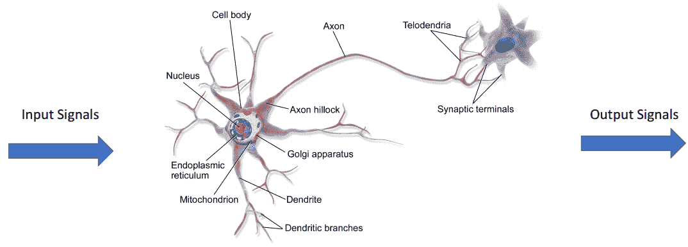

**神****经****元****是一个具有**输入和一个输出和参数 , 的计算单元

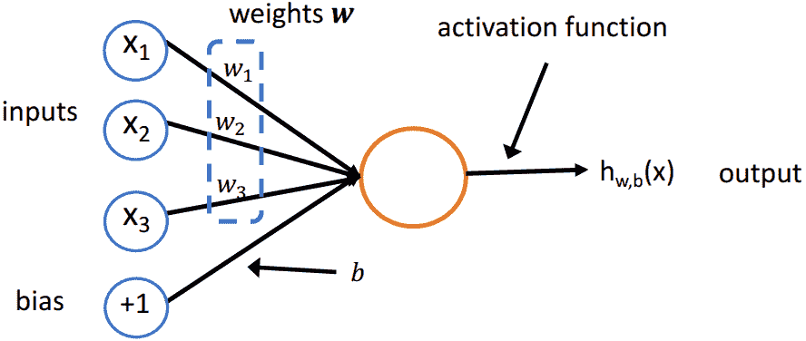

### **单层神经网络**

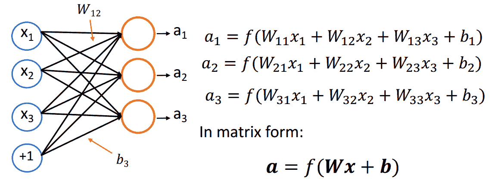

### **多层神经网络**

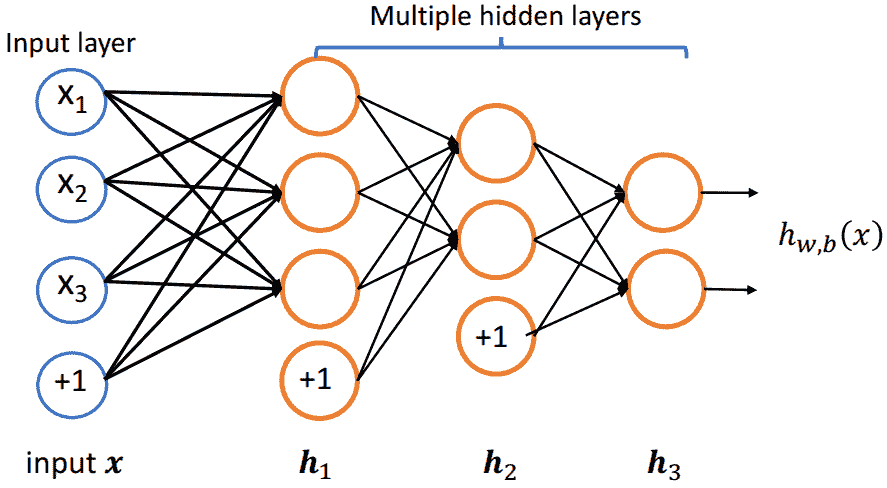

## **激活函数**

如果神经网络中只存在线性运算的话，那么多层的神经网络其实可以被转化为单层的神经网络

所以我们使用非线性的激活函数，防止多层的神经网络塌缩成单一的神经网络

### **Sigmoid**

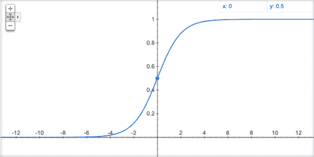

### **Tanh**

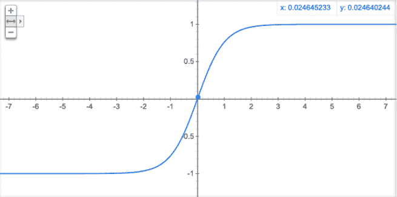

### **ReLU**

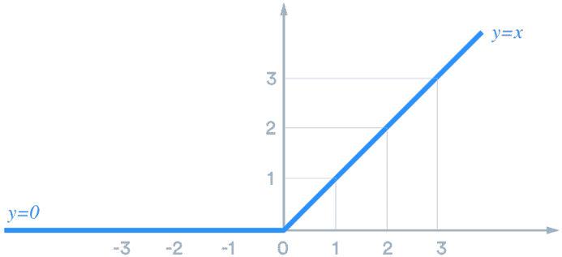

## **输出层**

增加若干个隐层可以提高网络的表达能力，如果想要得到我们想要**的输出**结果，就需要添加网络的最后一层，即输出层

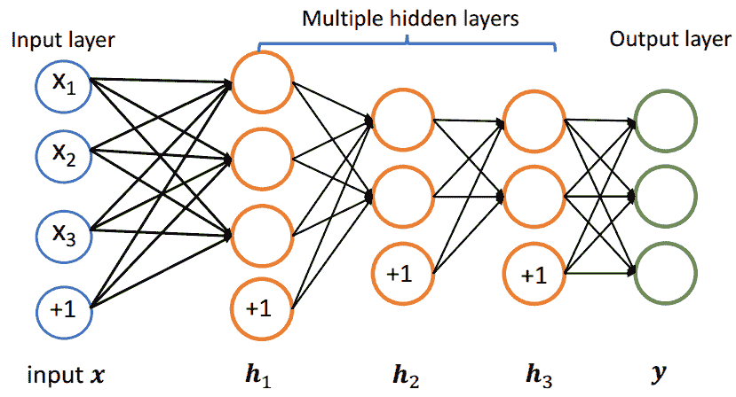

# **训练方式**

## **训练目标**

### **均方根误差**

**其中，**** ****是神经网络参数**

### **交叉熵**

其中， 是神经网络参数

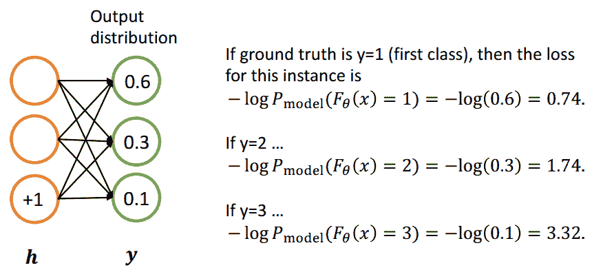

## **随机梯度下降**

**更新规则：**

**其中，**** ****是学习率**

### **梯度**

给定 个输入， 个输出的函数：

则输出为 的雅可比矩阵

其中， 表示第i个输出对第j个输入求梯度

### **链式求导法则**

求

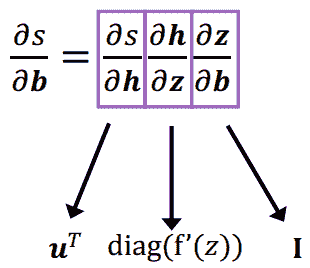

## **反向传播**

### **计算图**

**计算图：**将神经网路的传播以图的形式表示

+   **源节点：**输入

+   **内部节点：**操作

+   **边传递操作：**结果

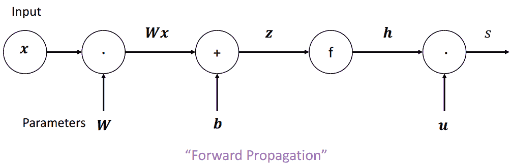

**梯度回传：**沿着边往回走，沿着梯度传递

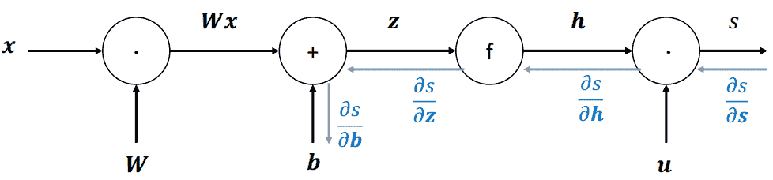

### **单个结点**

+   节点接收到一个“上游梯度”

+   目标是传递正确的“下游梯度”

+   每个节点都有一个局部梯度（ local gradient ），输出相对于输入的梯度

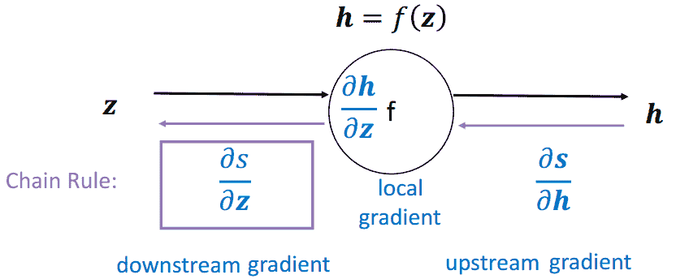

### **示例**

**函数：**

\begin{array}{c}f(x, y, z)=(x+y) \max (y, z) , x=1, y=2, z=0\end{array}

**前向传播：**

本地梯度（Local gradients）：

**初始计算图：**

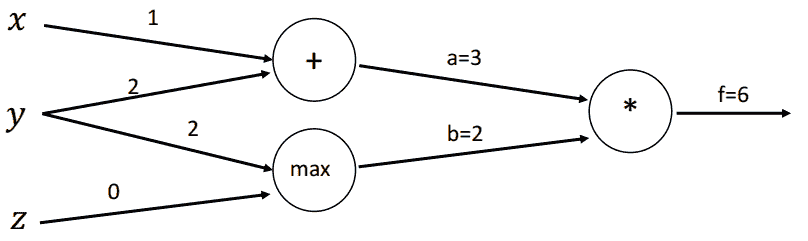

**回传第一步：**

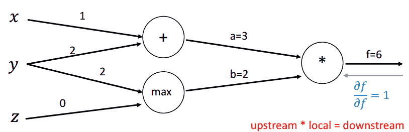

**回传第二步（*********）：**

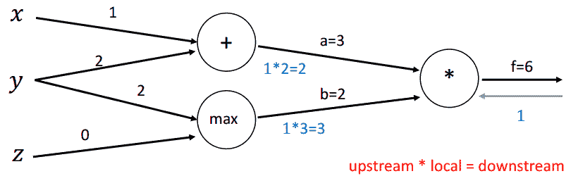

**回传第三步（****max****）：**

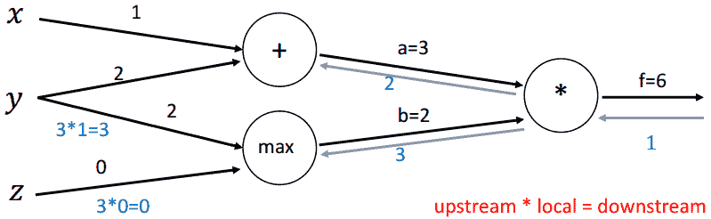

**回传第四步（****+****）：**

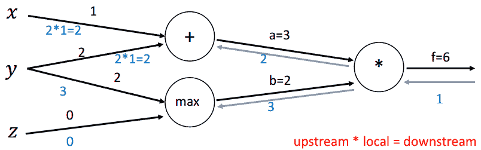

**计算最终梯度：**

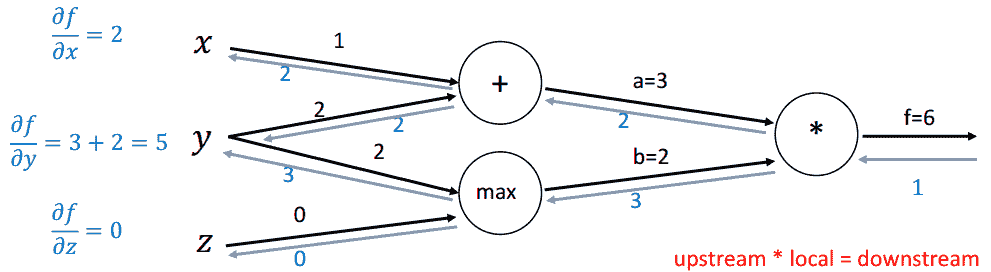

# **词表示：****Word2Vec**

**Word2Vec：**可以学到一些语义内涵，捕捉到语言学上的一些规律

## **Word2Vec**

**Word2vec**使用浅层神经网络将单词与分布式表示相关联

它可以捕获许多语言规则，**例如:**

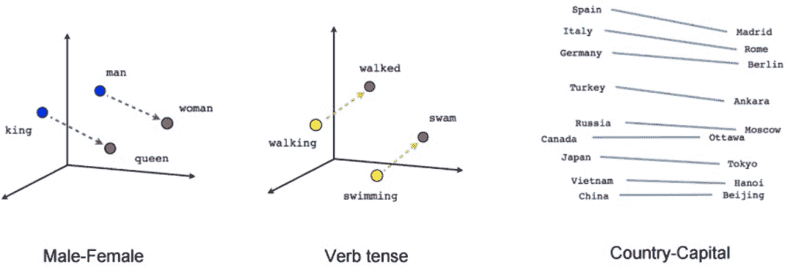

Word2vec可以利用两种架构来生成单词的分布式表示：

+   Continuous bag-of-words (CBOW)

+   Continuous skip-gram

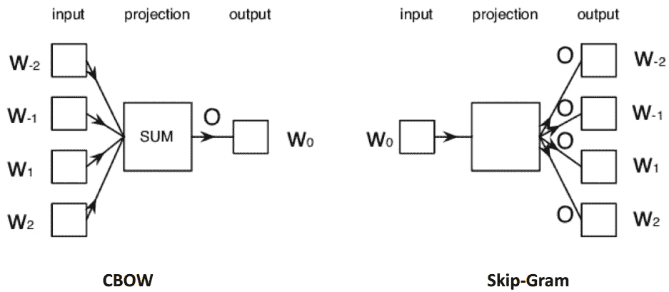

## **滑动窗口**

**Word2vec**使用一个固定大小的滑动窗口沿着句子移动

+   在每个窗口中，中间的单词是目标单词，其他单词是上下文单词

+   给定上下文单词，CBOW预测目标单词的概率

+   当给定目标词时，skip-gram预测上下文词的概率

**滑动窗口大小为5**

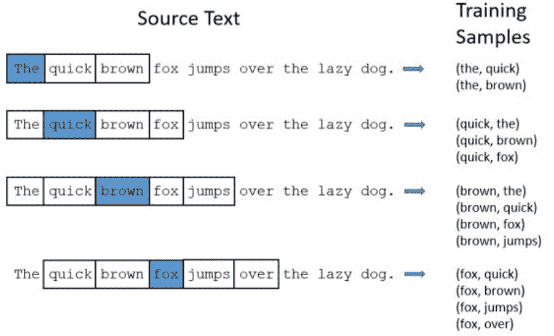

## CBOW（Continuous Bag-of-Words）

在CBOW架构中，该模型给出一个周围上下文词的窗口来预测目标词

+   根据词袋假设：上下文词的顺序不影响预测

+   假设窗口大小为5，Never too late to learn

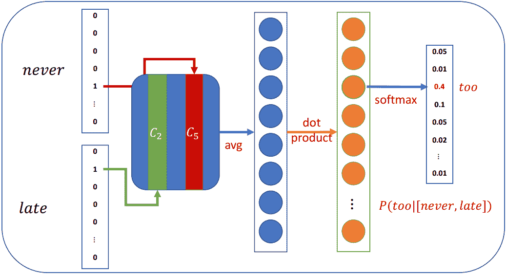

## Continuous Skip-Gram

在**skip-gram**架构中，该模型从目标词中**预测上下文词**

**假设窗口大小为5，**Never too late to learn

**Skip-gram**每步预测一个上下文词，训练样本为:

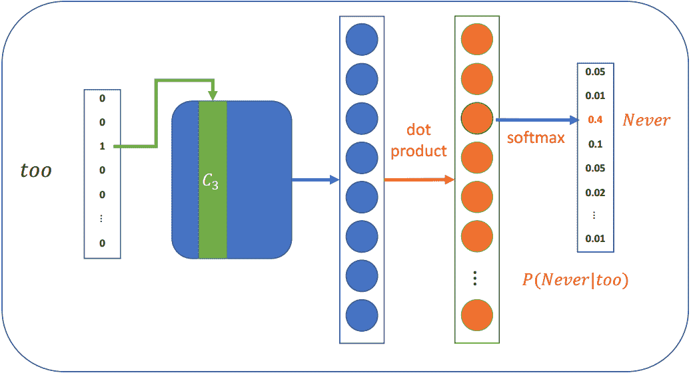

## **Softmax****存在问题**

> **当词汇量很大的时候**

+   Softmax对所有单词的每一步都依赖于大量的模型参数，这在计算上是不切实际的

+   我们需要提高计算效率

> **事实上，在word2vec**中我们并不需要一个完整的概率模型

> word2vec主要有两种改进方法:

1.  **负采样**

1.  **分层softmax**

## **负采样**

当词汇表非常大，这意味着模型每一步都有大量的权重需要更新

负抽样的思想是，**每一步只更新一小部分权重**

既然有词汇表并且知道上下文单词，可以按概率选择几个不在上下文单词列表中的单词：

其中， 为 的频次， 为经验值

相比于 ，这可以增加低频词出现的概率。

**假设我们只选取4个负采样词：**

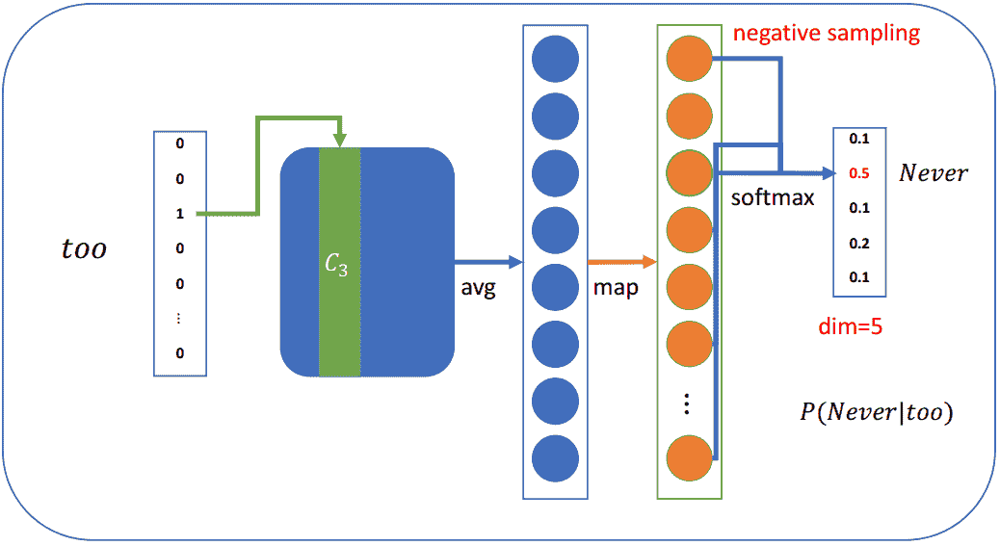

然后我们可以计算损失，并优化每一步的权重(不是所有的权重)

+   假设有一个大小为300×10,000的权重矩阵，输出大小为5

+   只需要更新300×5权重，这只占所有权重的0.05%

## **其他一些细节**

### **Sub-Sampling**

罕见的单**词可能更有可能携带不同的**信息，据此，Sub-Sampling有概率地丢弃单词:

其中， 为单词频率， 是一个可调节的阈值吗

### Soft sliding window

滑动窗口应该给较远的单词分配较少的权重

将滑动窗口最大的定义为 ，实际的滑动窗口大小在1和 之间随机选择

因此，那些靠近目标单词的单词更有可能出现在窗口中

# **通用神经网络**

## **RNN**

### **顺序记忆**

+   **RNN的关键概念：**处理序列数据时的顺序存储器

+   **定义：**一种让大脑更容易识别序列模式的机制

+   RNN递归地更新序列内存以建模序列数据

### **RNN**

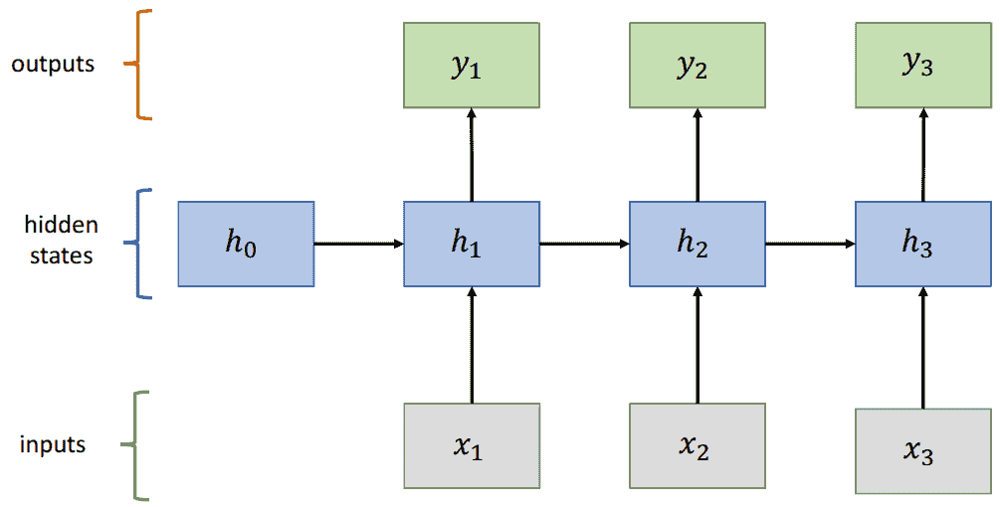

### **RNN单元**

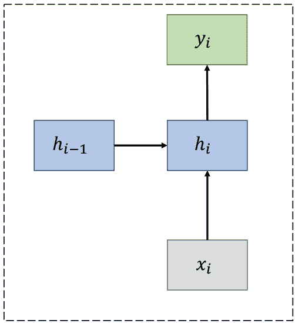

### **RNN语言模型**

参数是共享的

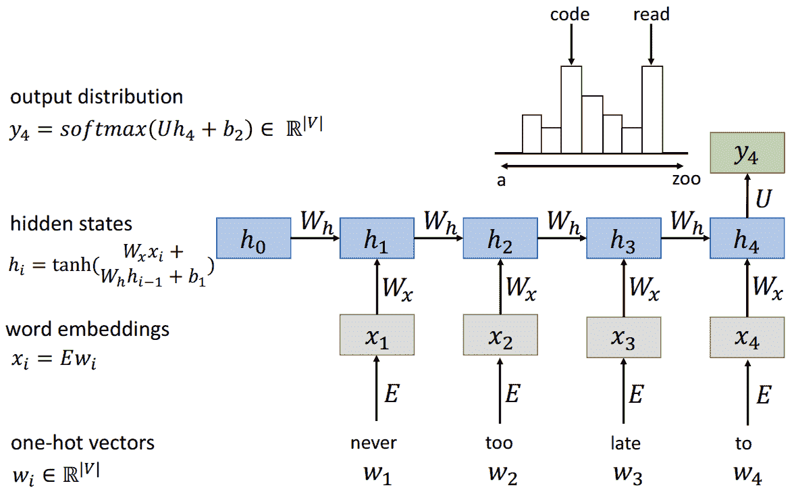

### **优缺点**

> **优点：**

+   可以处理任何长度的输入

+   模型尺寸不增加较长的输入

+   跨时间步共享权重

+   从许多后退步骤计算步骤

> **缺点：**

+   循环计算速度慢

+   在实践中，很难从许多步骤中获取信息

### **梯度问题**

RNN链比较长，**容易出现梯度消失或爆炸**

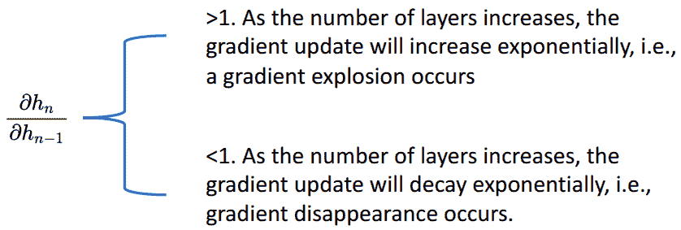

### **RNN变种**

梯度消失问题的主要解决方案是**在递归中使用更复杂的隐单元计算**

+   GRU

+   LSTM

**主要思想：****保持记忆，捕捉远距离的依赖**

## GRU（Gated Recurrent Unit）

Vanilla RNN在下一个时间步直接计算隐藏层：

在原始RNN中，增加门控机制，主要用于平衡过去的信息和输入之间的影响。主要有两个门控单元：

+   **更新门**（update gate）：z_{i}=\sigma\left(W_{x}^{(z)} x_{i}+W_{h}^{(z)} h_{i-1}+b^{(z)}\right)

+   **重置门**（reset gate）：r_{i}=\sigma\left(W_{x}^{(r)} x_{i}+W_{h}^{(r)} h_{i-1}+b^{(r)}\right)

+   **新的激活输出**  ：

+   **最后的隐藏单元输出** ：h_{i}=z_{i} * h_{i-1}+\left(1-z_{i}\right) * \tilde{h}_{i}

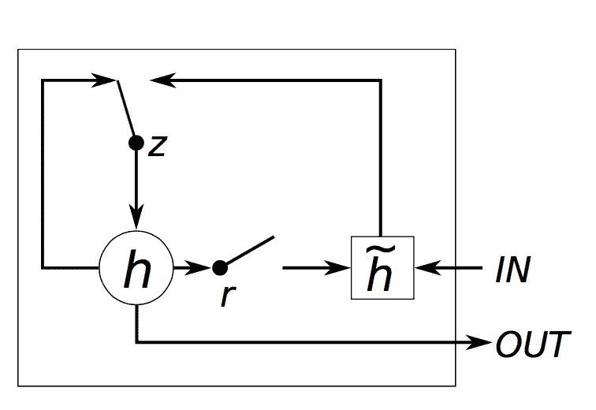

**示例**

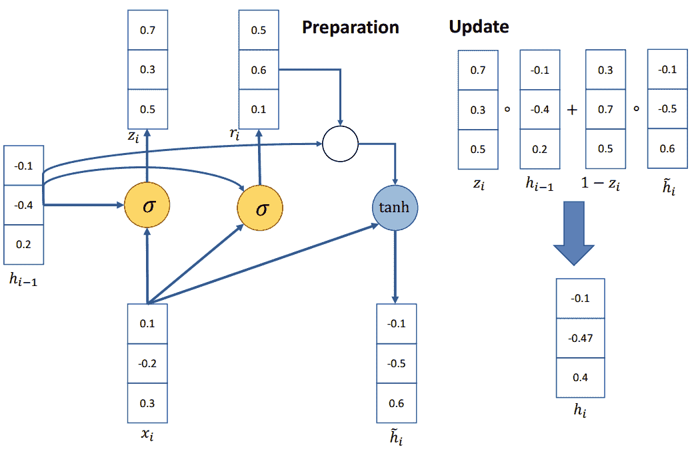

**如果重置门**** ****接近于0**

忽略先前的隐藏状态，这表明当前的激活与过去无关。

例如，在一篇新文章的开头，过去的信息对于当前的激活是无用的。

更新门 控制与当前激活相比，过去的状态有多少是重要的。

如果 接近于1，然后可以通过许多时间步骤复制该单元中的信息!

如果 接近于0，然后将信息放入该单元并完全取代历史信息

## **LSTM（Long Short-**Term Memory network）

**LSTM**是一种特殊的RNN，能够像GRU一样学习长期依赖关系

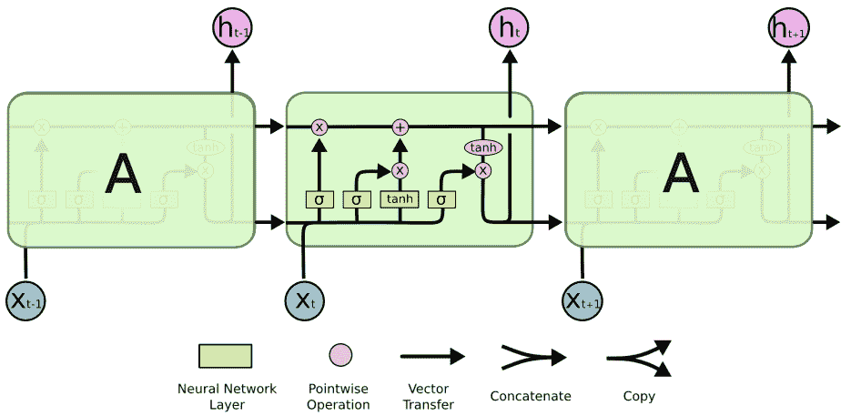

### **状态单元****C_t**

**LSTM**的关键是单元状态C_t

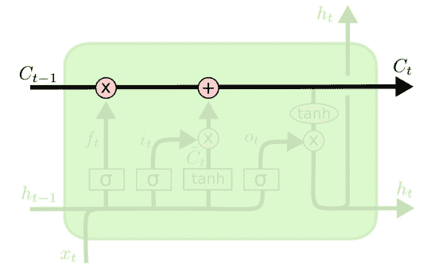

+   用于捕获长期依赖的额外向量

+   直接贯穿整个链条，只有少量的线性交互作用

+   易于删除或添加信息到细胞状态

### **（2）遗忘门****f_t**

**遗忘门：****决定从状态单元中丢弃哪些信息**

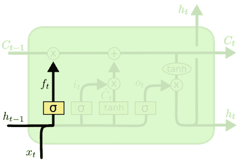

其中， 为拼接向量

如果 ，则直接遗忘过去的信息

### **输入门** **𝑖𝑡**

**输入门**：**决定在单元状态中存储什么信息**

输入门 和新的候选状态信息

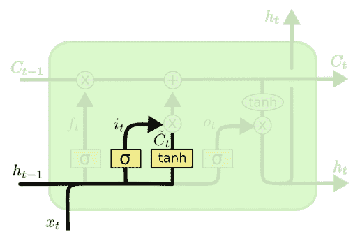

更新就的状态信息  ，结合前两步的结果

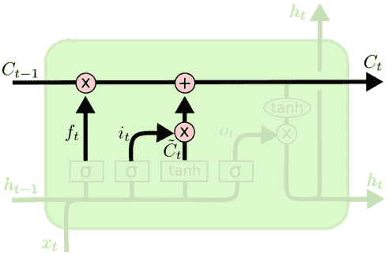

### **输出门****o_t**

**输出门：****决定输出什么信息**

为特定的单词表示调整句子信息

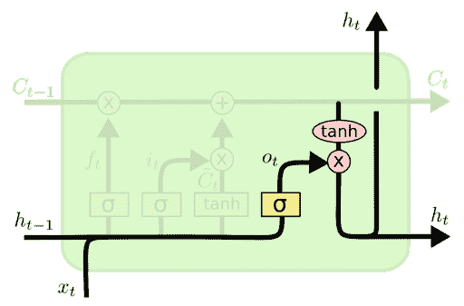

功能强大，特别是当堆叠和更深层时(每个隐藏层已经由深层内部网络计算)

如果你有大量的数据，非常有用

## **双向RNN**

在传统的RNN中，当前状态只捕获过去的信息

**问题：**在很多应用中，我们希望输出 依赖于整个输入序列

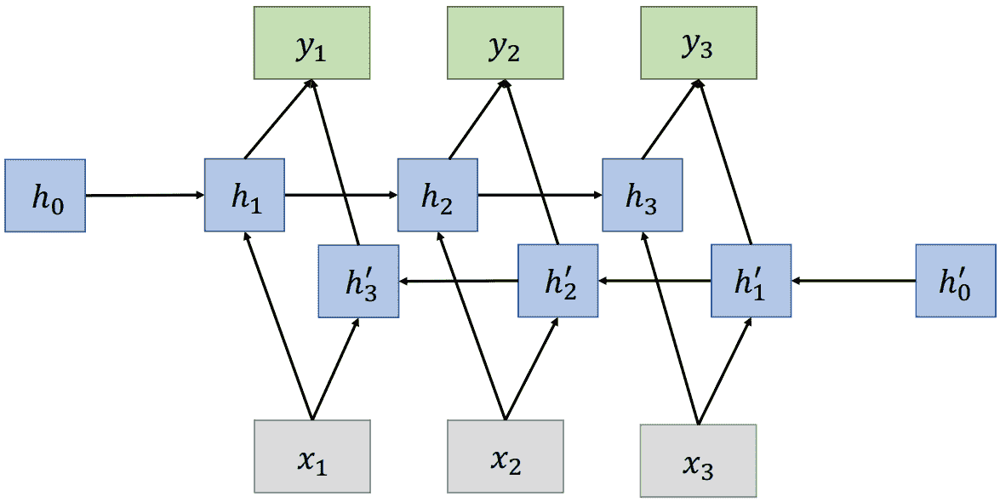

## **CNN**

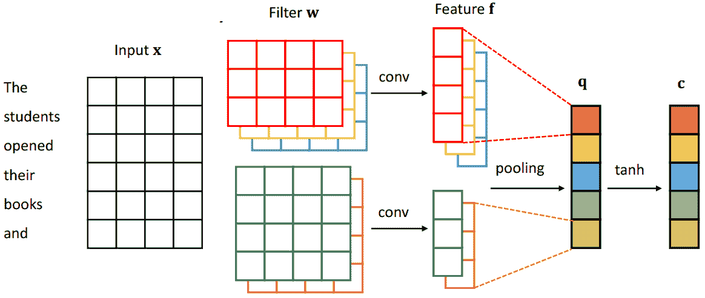

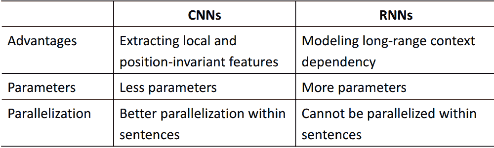