# 神经网络基础

> 来源：[https://qqs7y1hozd1.feishu.cn/docx/PpAGdX2CVoMbyrxPK15c5Vh9nmd](https://qqs7y1hozd1.feishu.cn/docx/PpAGdX2CVoMbyrxPK15c5Vh9nmd)

目前，深度学习（Deep Learning，简称DL）在算法领域可谓是大红大紫**，现在不只是互联网、人工智能，生活中的各大领域都能反映出**深度学习引领的巨大变革。要学习深度学习，那么首先要熟悉神经网络（Neural** Networks，简称NN）的一些基本概念。当然，这里所说的神**经网络不是生物学的神经网络，我们将其称之为人工神经网络（Artificial Neural Networks，简称ANN）貌似更为合理。神经网络最早是人工智能领域的一种算法或者说是模型，目前神经网络已经发展成为一类多学科交叉的学科领域，它也随着深度学习取得的进展重新受到重视和推崇

**为什么说是“重新”呢？**其**实，神经网络**最为一种算法模型很早就已经开始研究了，但是在取得一些进展后，神经网络的研究陷入了一段很长时间的低潮期，后来随着Hinton在深度学习上取得的进展，神经网络又再次受到人们的重视

# **神经元模型**

神经元是神经网络中最基本的结构，也可以说是神经网络的基本单元，它的设计灵感完全来源于生物学上神经元的信息传播机制。我们学过生物的同学都知道，神经元有两种状态：兴奋和抑制。一般情况下，大多数的神经元是处于抑制状态，但是一旦某个神经元收到刺激，导致它的电位超过一个阈值，那么这个神经元就会被激活，处于“兴奋”状态，进而向其他的神经元传播化学物质（其实就是信息）

下图为生物学上的神经元结构示意图：

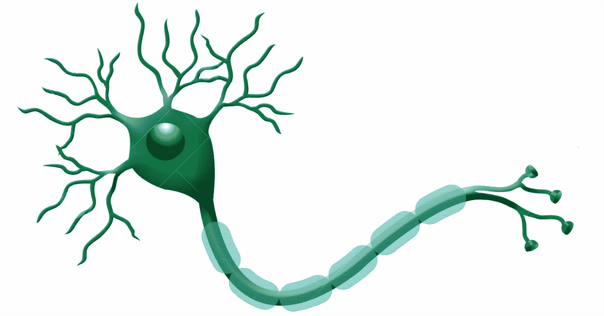

1**943年，McCul**loch和Pitts将上图的神经元结构用一种简单的模型进行了表示，构成了一种人工神经元模型，也就是我们现在经常用到的“M-P神经元模型”，如下图所示：

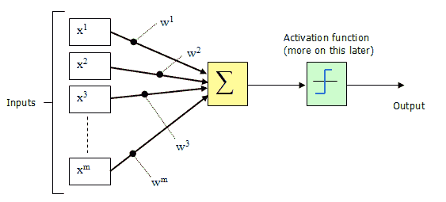

从上图**M-P神经元模型**可以看出，神经元的输出：

其中 为我们之前提到的神经元的激活阈值，函数 也被称为是激活函数。如上图所示，函数 可以用一个阶跃方程表示，大于阈值激活；否则则抑制。但是这样有点太粗暴，因为阶跃函数不光滑，不连续，不可导，因此我们更常用的方法是用sigmoid函数来表示函数函数

sigmoid函数的表达式和分布图如下所示：

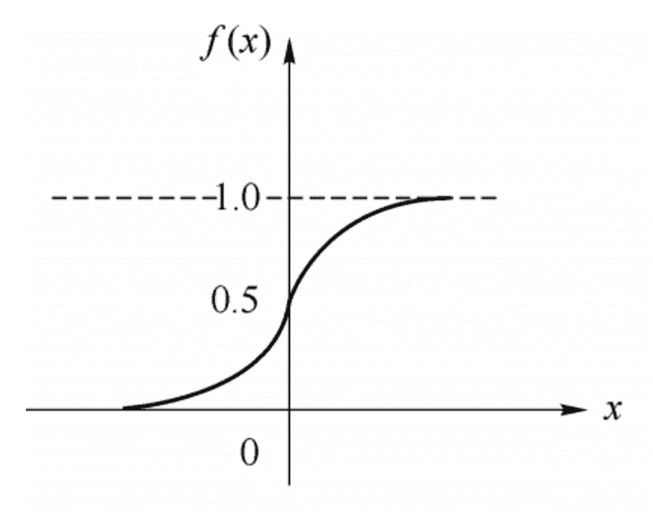

# **感知机和神经网络**

感**知****机（percep**tron）是由两层神经元组成的结构，输入层用于接受外界输入信号，输出层（也被称为是感知机的功能层）就是M-P神经元。下图表示了一个输入层具有三个神经元（分别表示为 ）的感知机结构：

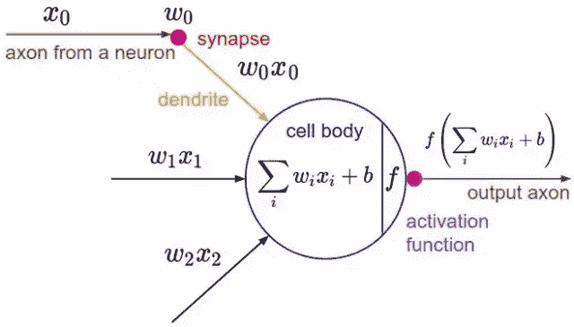

根据上图不难理解，感知机模型可以由如下公式表示：

其中，ww为感知机输入层到输出层连接的权重， 表示输出层的偏置。事**实上，感知机是一种判别式的线**性分类模型，可以解决与、或、非这样的简单的线性可分（linearly separable）问题，线性可分问题的示意图见下图：

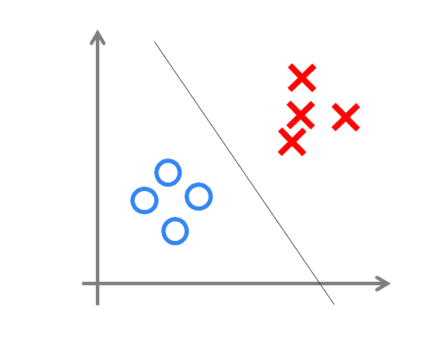

但是[由于它只有一层功能神经元，所以](http://blog.csdn.net/panda07100/article/details/38580993)学习能力非常有限。事实证明，单层感知机无法解决最简单的非线性可分问题——异或问题（有想了解异或问题或者是感知机无法解决异或问题证明的同学请移步这里《证：单层感知机不能表示异或逻辑》）

**关于感知机解决异或问题还有一段历史值得我们简单**去了解一下：感知器只能做简单的线性分类任务。但是当时的人们热情太过于高涨，并没有人清醒的认识到这点。于是，当人**工****智**能领域的巨擘Minsky指出这点时，事态就发生了变化。Minsky在1969年出版了一本叫《Perceptron》的书，里面用详细的数学证明了感知器的弱点，尤其是感知器对XOR（异或）这样的简单分类任务都无法解决。Minsky认为，如果将计算层增加到两层，计算量则过大，而且没有有效的学习算法。所以，他认为研究更深层的网络是没有价值的。由于Minsky的巨大影响力以及书中呈现的悲观态度，让很多学者和实验室纷纷放弃了神经网络的研究。神经网络的研究陷入了冰河期。这个时期又被称为“AI winter”。接近10年以后，对于两层神经网络的研究才带来神经网络的复苏

我们知道，我们日常生活中很多问题，甚至说大多数问题都不是线性可分问题，那我们要解决非线性可分问题该怎样处理呢？这就是这部分我们要引出的“多层”的概念。既然单层感知机解决不了非线性问题，那我们就采用多层感知机，下图就是一个两层感知机解决异或问题的示意图：

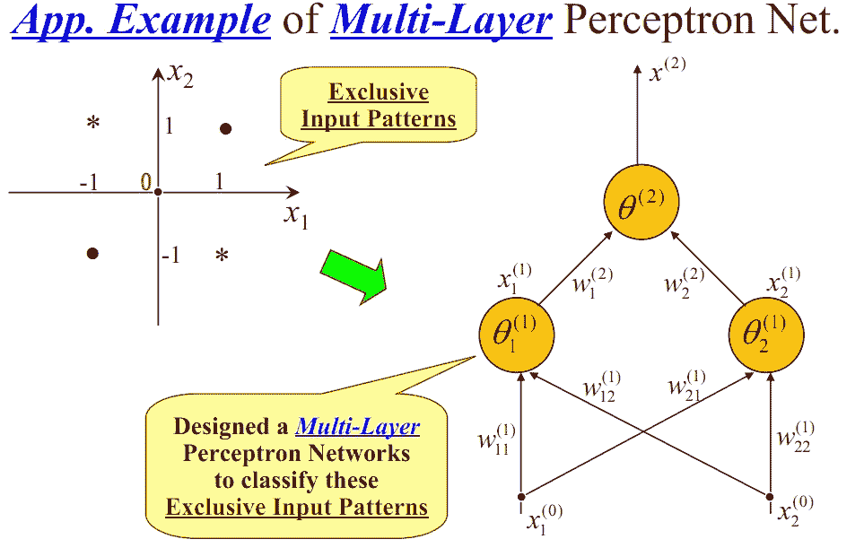

构建好上述网络以后，通过训练得到最后的分类面如下：

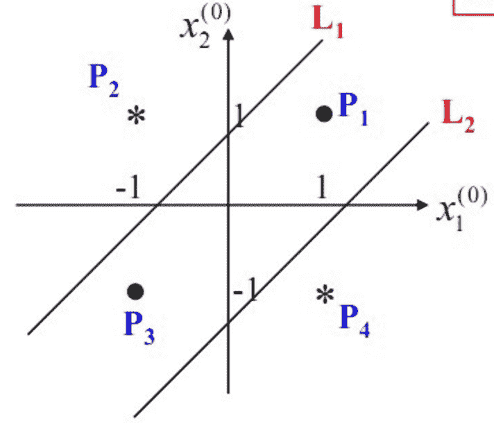

由此可见，多层感知机可以很好的解决非线性可分问题，我们通常将多**层感知机这样的多层结构称之为是神经网络。但是，正如Minsky之前所担心的，多层感知机虽然可以在理**论上可以解决非线性问题，但是实际生活中问题的复杂性要远不止异或问题这么简单，所以我们往往要构建多层网络，而对于多层神经网络采用什么样的学习算法又是一项巨大的挑战，如图所示的具有4层隐含层的网络结构中至少有33个参数（不计偏置bias参数），我们应该如何去确定呢？

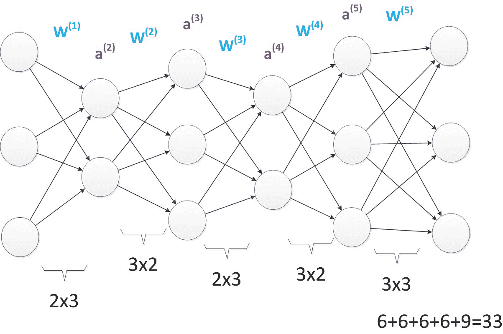

# **误差逆传播算法**

**所**谓神经网络的训练或者是学习，其主要目的在于通过学习算法得到神经网络解决指定问题所需的参数，这里的参数包括各层神经元之间的连接权重以及偏置等。因为作为算法的设计者（我们），我们通常是根据实际问题来构造出网络结构，参数的确定则需要神经网络通过训练样本和学习算法来迭代找到最优参数组。

**说起**神经网络的学习算法，不得不提其中最杰出、最成功的代表——误差逆传播（error BackPropagation，简称BP）算法。BP学习算法通常用在最为广泛使用的多层前馈神经网络中

> **BP算法**的主要流程可以总结如下：

> **输入**：训练集 ； 学习率

> **　　过程：**

1.  在(0, 1)范围内随机初始化网络中所有连接权和阈值

1.  repeat:

1.  for all

1.  根据当前参数计算当前样本的输出;

1.  计算输出层神经元的梯度项；

1.  计算隐层神经元的梯度项；

1.  更新连接权与阈值

1.  end for

1.  until 达到停止条件

> **输出**：连接权与阈值确定的多层前馈神经网络

> **　**备注：后续补充BP算法的公式推导

# **常见的神经网络模型**

## 4.1 Boltzmann机和受限Boltzmann机

**　神经网络中有一类模型是为网**络状态定义一个“能量”，能量最小化时网络达到理想状态，而网络的训练就是在最小化这个能量函数。Boltzmann（玻尔兹曼）机**就是**基于能量的模型，其神经元分为两层：显层和隐层。显层用于表示数据的输入和输出，隐层则被理解为数据的内在表达。Boltzmann机的神经元都是布尔型的，即只能取0、1值。标准的Boltzmann机是全连接的，也就是说各层内的神经元都是相互连接的，因此计算复杂度很高，而且难以用来解决实际问题。因此，我们经常使用一种特殊的Boltzmann机——受限玻尔兹曼机（Restricted Boltzmann Mechine，简称RBM），它层内无连接，层间有连接，可以看做是一个二部图。下图为Boltzmann机和RBM的结构示意图：

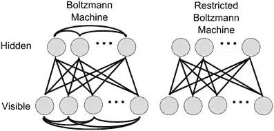

**RBM常常用对比散度（Constrastive D**ivergence，简称CD）来进行训练

## **4.2 RBF网络**

RBF（Radial Basis Function）径向基函数网络是一种单隐层前馈神经网络，它使用径向基函数作为隐层神经元激活函数，而输出层则是对隐层神经元输出的线性组合。下图为一个RBF神经网络示意图：

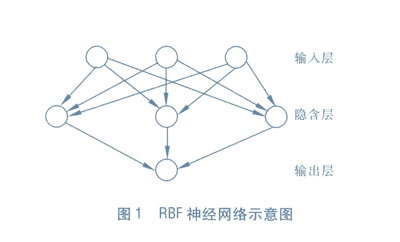

> **训练RBF网络通常采用两步：**

+   确定神经元中心，常用的方式包括随机采样，聚类等

+   确定神经网络参数，常用算法为BP算法

## **4.3 ART网络**

ART（Adaptive Resonance Theory）自适应谐振理论网络是竞争型学习的重要代表，该网络由比较层、识别层、识别层阈值和重置模块构成。ART比较好的缓解了竞争型学习中的“可塑性-稳定性窘境”（stability-plasticity dilemma），可塑性是指神经网络要有学习新知识的能力，而稳定性则指的是神经网络在学习新知识时要保持对旧知识的记忆。这就使得ART网络具有一个很重要的优点：可进行增量学习或在线学习

## **4.4 SOM网络**

SOM（Self-Organizing Map，自组织映射）网络是一种竞争学习型的无监督神经网络，它能将高维输入数据映射到**低维空间（通常为二维），同事保**持输入数据在高维空间的拓扑结构，即将高维空间中相似的样本点映射到网络输出层中的临近神经元。下图为SOM网络的结构示意图：

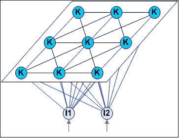

## **4.5 结构自适应网络**

我们前面提到过，一般的神经网络都是先指定好网络结构，训练的目的是利用训练样本来确定合适的连接权、阈值等参数。与此不同的是，结构自适应网络则将网络结构也当做学习的目标之一，并希望在训练过程中找到最符合数据特点的网络结构

## 4.6 递归神经网络以及Elman网络

与前馈神经网络不同，递归神经网络（Recurrent Neural Networks，简称RNN）允许网络中出现环形结构，从而可以让一些神经元的输出反馈回来作为输入信号，这样的结构与信息反馈过程，使得网络在tt时刻的输出状态不仅与tt时刻的输入有关，还与 时刻的网络状态有关，从而能处理与时间有关的动态变化

Elman网络是最常用的递归神经网络之一，其结构如下图所示：

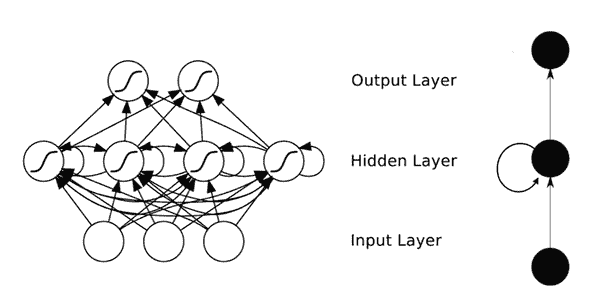

RNN一般的训练**算法采用推广的BP算法。值得一提的是，R**NN在（t+1）时刻网络的结果O(t+1)是该时刻输入和所有历史共同作用的结果，这样就达到了对时间序列建模的目的。因此，从某种意义上来讲，RNN被视为是时间深度上的深度学习也未尝不对

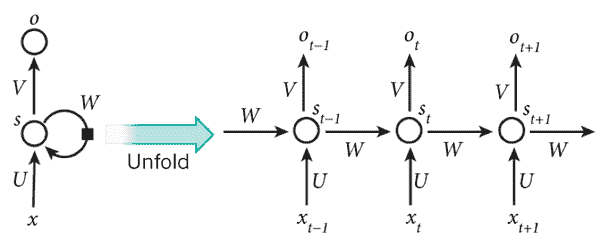

**RNN在（t+1）时刻网络的结果O(t+1**)是该时刻输入和所有历史共同作用的结果，这么讲其实也不是很准确，因为“梯度发散”同样也会发生在时间轴上，也就是说对于t时刻来说，它产生的梯度在时间轴上向历史传播几层之后就消失了，根本无法影响太遥远的过去。因此，“所有的历史”只是理想的情况。在实际中，这种影响也就只能维持若干个时间点而已。换句话说，后面时间步的错误信号，往往并不能回到足够远的过去，像更早的时间步一样，去影响网络，这使它很难以学习远距离的影响

为了解决上述时间轴上的梯度发散，机器学习领域发展出了长短时记忆单元（Long-Short Term Memory，简称LSTM），通过门的开关实现时间上的记忆功能，并防止梯度发散。其实除了学习历史信息，RNN和LSTM还可以被设计成为双向结构，即双向RNN、双向LSTM，同时利用历史和未来的信息

# **深度学习**

深度学习指的是深度神经网络模型，一般指网络层数在三层或者三层以上的神经网络结构

理论上而言，参数越多的模型复杂度越高，“容量”也就越大，也就意味着它能完成更复杂的学习任务。就像前面多层感知机带给我们的启示一样，神经网络的层数直接决定了它对现实的刻画能力。但是在一般情况下，复杂模型的训练效率低，易陷入过拟合，因此难以受到人们的青睐。具体来讲就是，随着神经网络层数的加深，优化函数越来越容易陷入局部最优解（即过拟合，在训练样本上有很好的拟合效果，但是在测试集上效果很差）。同时，不可忽略的一个问题是随着网络层数增加，“梯度消失”（或者说是梯度发散diverge）现象更加严重。我们经常使用sigmoid函数作为隐含层的功能神经元，对于幅度为1的信号，在BP反向传播梯度时，每传递一层，梯度衰减为原来的0.25。层数一多，梯度指数衰减后低层基本接收不到有效的训练信号

为了解决深层神经网络的训练问题，一种有效的手段是采取无监督逐层训练（unsupervised layer-wise training），其基本思想是每次训练一层隐节点，训练时将上一层隐节点的输出作为输入，而本层隐节点的输出作为下一层隐节点的输入，这被称之为“预训练”（pre-training）；在预训练完成后，再对整个网络进行“微调”（fine-tunning）训练。比如Hinton在深度信念网络（Deep Belief Networks，简称DBN）中，每层都是一个RBM，即整个网络可以被视为是若干个RBM堆叠而成。在使用无监督训练时，首先训练第一层，这是关于训练样本的RBM模型，可按标准的RBM进行训练；然后，将第一层预训练号的隐节点视为第二层的输入节点，对第二层进行预训练；... 各层预训练完成后，再利用BP算法对整个网络进行训练

**事实**上，“预训练+微调”的训练方式可被视为是将大量参数分组，对每组先找到局部看起来较好的设置，然后再基于这些局部较优的结果联合起来进行全局寻优。这样就在利用了模型大量参数所提供的自由度的同时，有效地节省了训练开销

另一种节省训练开销的做法是进行“权共享”（weight sharing），即让一组神经元使用相同的连**接权，这个策略在卷积神经网络**（Convolutional Neural Networks，简称CNN）中发挥了重要作用。下图为一个CNN网络示意图：

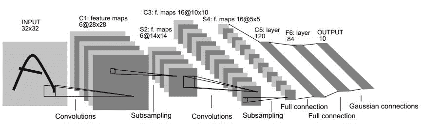

CNN可以用BP算法进行训练，但是在训练中，无论是卷积层还是采样层，其每组神经元（即上图中的每一个“平面”）都是用相同的连接权，从而大幅减少了需要训练的参数数目