# 使用Excel通俗易懂理解Transformer

> 来源：[https://qqs7y1hozd1.feishu.cn/docx/YLbrd63YSooplbxzuxPcQFKunMg](https://qqs7y1hozd1.feishu.cn/docx/YLbrd63YSooplbxzuxPcQFKunMg)

## 本文旨在通过最通俗易懂的过程来详解Transformer的每个步骤

假设我们在做一个从中文翻译到英文的过程，我们的词表很简单如下：

中文词表：`[机、器、学、习]` 英文词表`[deep、machine、learning、chinese]`

先来看一下Transformer的整个过程：

+ 接下来，我们将按顺序来讲解Transformer的过程，并配有配套的excel计算过程和tensorflow代码

先说明一下：本文的tensorflow代码中使用两条训练数据（因为实际场景中输入都是batch的），但excel计算只以第一条数据的处理过程为例

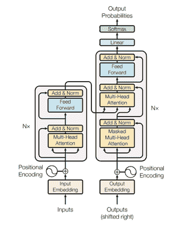

## Encoder输入

Encoder输入过程如下图所示：

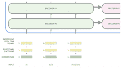

+ 首先输入数据会转换为对应的embedding

+ 然后会加上位置偏置，得到最终的输入

这里，为了结果的准确计算，我们使用常量来代表embedding，假设中文和英文词表对应的embedding值分别是：

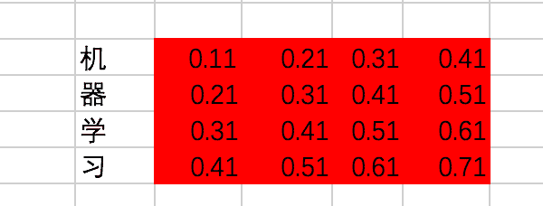

位置偏置position embedding使用下面的式子计算得出，注意这里位置偏置是包含两个维度的，不仅仅是encoder的第几个输入，同时embedding中的每一个维度都会加入位置偏置信息：

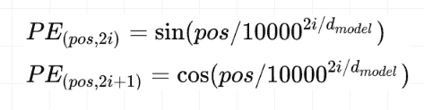

不过为了计算方便，我们仍然使用固定值代替：

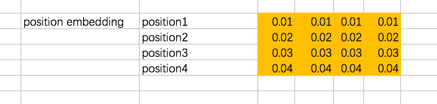

+ 假设我们有两条训练数据（Excel大都只以第一条数据为例）：

[机、器、学、习] -> [ machine、learning]

[学、习、机、器] -> [learning、machine]

encoder的输入在转换成id后变为`[[0,1,2,3],[2,3,0,1]]`

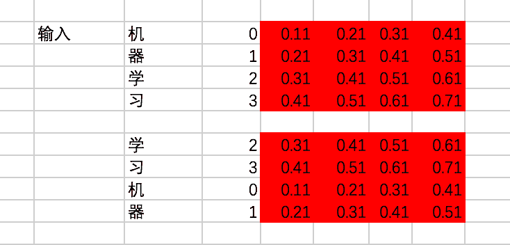

接下来，通过查找中文的embedding表，转换为embedding为：

对输入加入位置偏置，注意这里是两个向量的对位相加

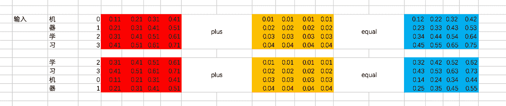

上面的过程是这样的，接下来咱们用代码来表示一下：

```
import tensorflow as tf

chinese_embedding = tf.constant([[0.11,0.21,0.31,0.41],
                         [0.21,0.31,0.41,0.51],
                         [0.31,0.41,0.51,0.61],
                         [0.41,0.51,0.61,0.71]],dtype=tf.float32)


english_embedding = tf.constant([[0.51,0.61,0.71,0.81],
                         [0.52,0.62,0.72,0.82],
                         [0.53,0.63,0.73,0.83],
                         [0.54,0.64,0.74,0.84]],dtype=tf.float32)


position_encoding = tf.constant([[0.01,0.01,0.01,0.01],
                         [0.02,0.02,0.02,0.02],
                         [0.03,0.03,0.03,0.03],
                         [0.04,0.04,0.04,0.04]],dtype=tf.float32)

encoder_input = tf.constant([[0,1,2,3],[2,3,0,1]],dtype=tf.int32)


with tf.variable_scope("encoder_input"):
    encoder_embedding_input = tf.nn.embedding_lookup(chinese_embedding,encoder_input)
    encoder_embedding_input = encoder_embedding_input + position_encoding


with tf.Session() as sess:
    sess.run(tf.global_variables_initializer())
    print(sess.run([encoder_embedding_input]))
```

结果为：

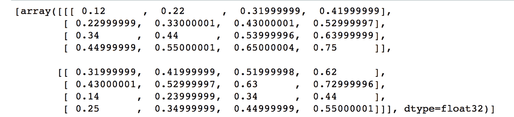

## Encoder Block

一个Encoder的Block过程如下：

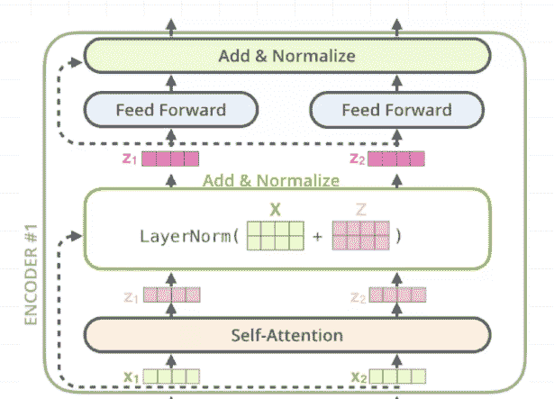

> 分为4步，分别是：

1. multi-head self attention

1. Add & Normalize

1. Feed Forward Network

1. Add & Normalize

咱们主要来讲multi-head self attention，在讲multi-head self attention的时候，先讲讲Scaled Dot-Product Attention，我有时候也称为single-head self attention

### Attention机制简单回顾

Attention其实就是计算一种相关程度，看下面的例子：

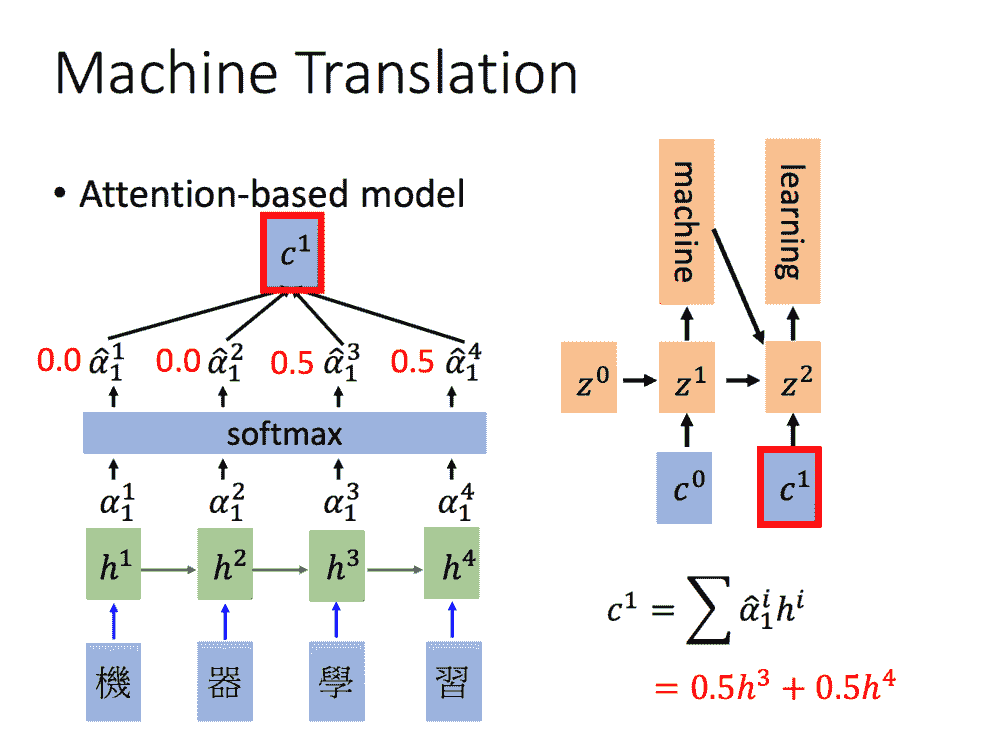

Attention通常可以进行如下描述，表示为将`query(Q)`和`key-value pairs`映射到输出上，其中`query`、`key`、`value`都是向量，输出是`V`中所有`value`的加权，其中权重是由`Query`和每个`key`计算出来的，计算方法分为三步：

1）计算比较`Q`和`K`的相似度，用`f`来表示：

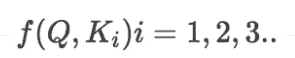

2）将得到的相似度进行`softmax`归一化：

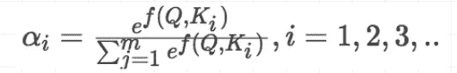

3）针对计算出来的权重，对所有的`value`进行加权求和，得到`Attention`向量：

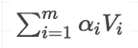

计算相似度的方法有以下4种：

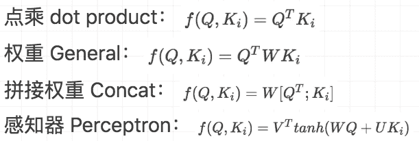

在本文中，我们计算相似度的方式是第一种

### Scaled Dot-Product Attention

咱们先说说`Q`、`K`、`V`

比如我们想要计算上图中machine和机、器、学、习四个字的attention，并加权得到一个输出，那么`Query`由machine对应的embedding计算得到，`K`和`V`分别由机、器、学、习四个字对应的embedding得到

在encoder的self-attention中，由于是计算自身和自身的相似度，所以`Q`、`K`、`V`都是由输入的embedding得到的，不过我们还是加以区分

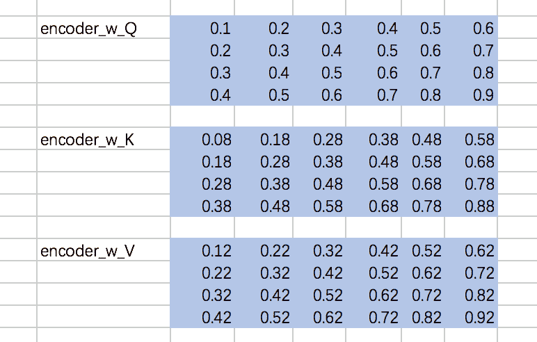

这里，`Q`、`K`、`V`分别通过一层全连接神经网络得到，同样，我们把对应的参数矩阵都写作常量

接下来，我们得到的到`Q`、`K`、`V`，我们以第一条输入为例：

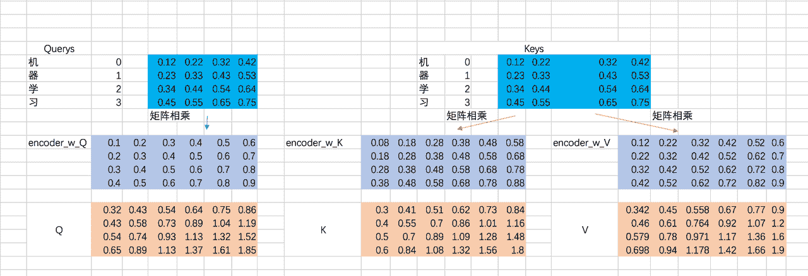

既然是一层全连接嘛，所以相当于一次矩阵相乘，excel里面的矩阵相乘如下：

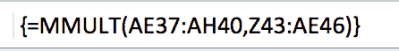

在Mac中，一定要先选中对应大小的区域，输入公式，然后使用command + shift + enter才能一次性得到全部的输出，如下图：

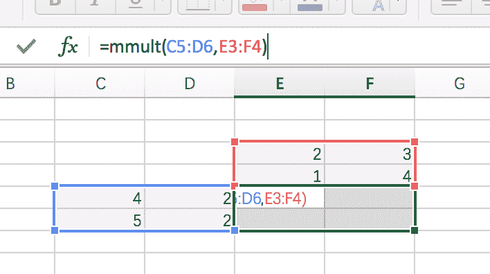

接下来，我们要去计算`Q`和`K`的相关性大小了，这里使用内积的方式，相当于`QKT`:

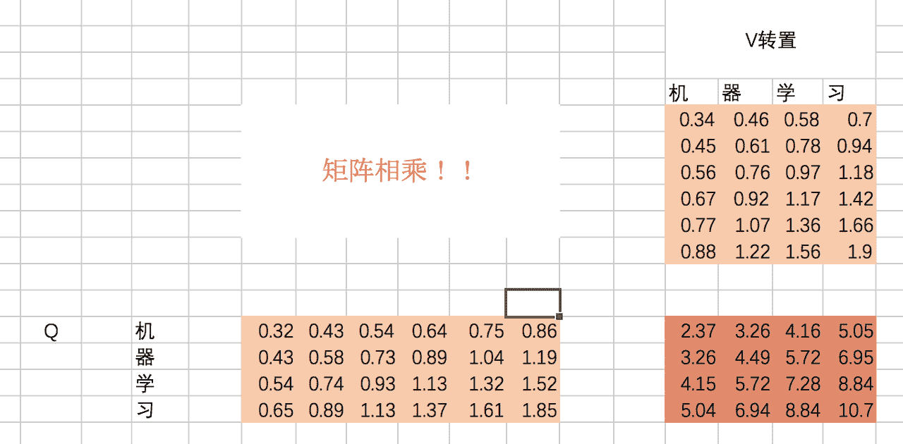

（上图中应该是`K`，不影响整个过程理解）同样，excel中的转置，也要选择相应的区域后，使用`transpose`函数，然后按住command + shift + enter一次性得到全部输出

我们来看看结果代表什么含义：

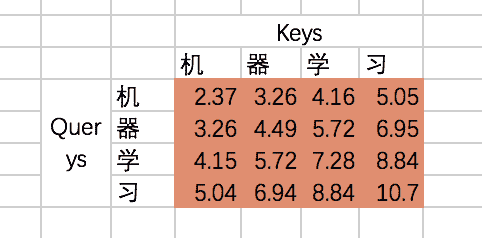

也就是说，机和机自身的相关性是2.37(未进行归一化处理),机和器的相关性是3.26，依此类推。我们可以称上述的结果为raw attention map。对于raw attention map，我们需要进行两步处理，首先是除以一个规范化因子，然后进行`softmax`操作，这里的规范化因子选择除以8，然后每行进行一个`softmax`归一化操作（按行做归一化是因为attention的初衷是计算每个`Query`和所有的`Keys`之间的相关性）：

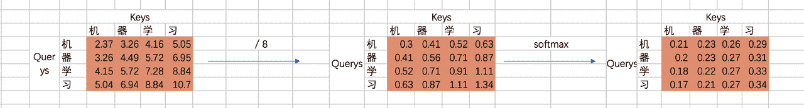

最后就是得到每个输入embedding 对应的输出embedding，也就是基于attention map对`V`进行加权求和，以“机”这个输入为例，最后的输出应该是`V`对应的四个向量的加权求和：

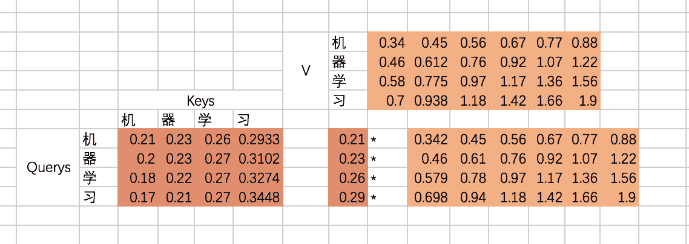

如果用矩阵表示，那么最终的结果是规范化后的attention map和`V`矩阵相乘，因此最终结果是：

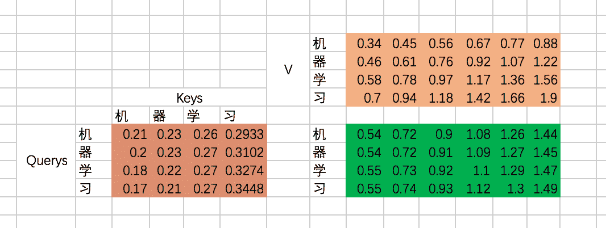

至此，我们的Scaled Dot-Product Attention的过程就全部计算完了，来看看代码吧：

```
with tf.variable_scope("encoder_scaled_dot_product_attention"):
    encoder_Q = tf.matmul(tf.reshape(encoder_embedding_input,(-1,tf.shape(encoder_embedding_input)[2])),w_Q)
    encoder_K = tf.matmul(tf.reshape(encoder_embedding_input,(-1,tf.shape(encoder_embedding_input)[2])),w_K)
    encoder_V = tf.matmul(tf.reshape(encoder_embedding_input,(-1,tf.shape(encoder_embedding_input)[2])),w_V)
    
    encoder_Q = tf.reshape(encoder_Q,(tf.shape(encoder_embedding_input)[0],tf.shape(encoder_embedding_input)[1],-1))
    encoder_K = tf.reshape(encoder_K,(tf.shape(encoder_embedding_input)[0],tf.shape(encoder_embedding_input)[1],-1))
    encoder_V = tf.reshape(encoder_V,(tf.shape(encoder_embedding_input)[0],tf.shape(encoder_embedding_input)[1],-1))
                          
                          
    attention_map = tf.matmul(encoder_Q,tf.transpose(encoder_K,[0,2,1]))
    attention_map = attention_map / 8
    attention_map = tf.nn.softmax(attention_map)


with tf.Session() as sess:
    sess.run(tf.global_variables_initializer())
    print(sess.run(attention_map))
    print(sess.run(encoder_first_sa_output))
```

第一条数据的`attention map`为：

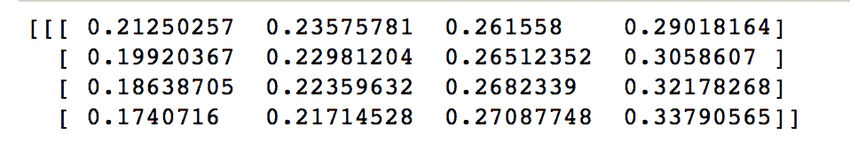

第一条数据的输出为：

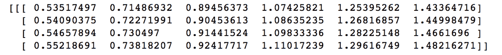

可以看到，跟我们通过excel计算得到的输出也是保持一致的

咱们再通过图片来回顾下Scaled Dot-Product Attention的过程：

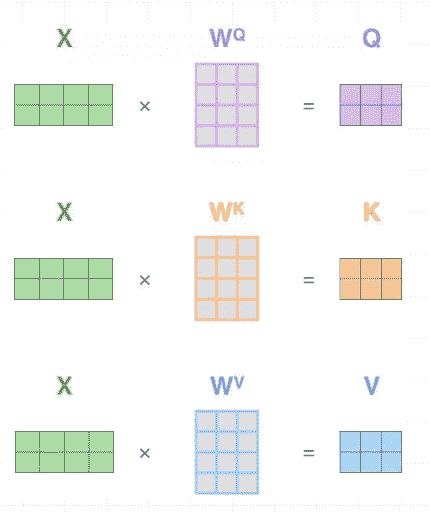

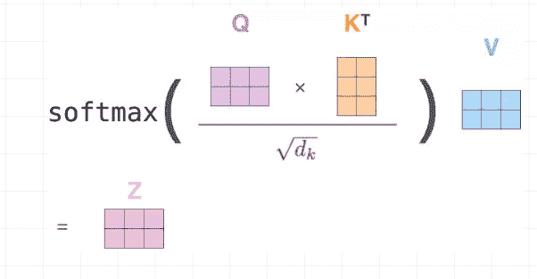

### multi-head self attention

Multi-Head Attention就是把Scaled Dot-Product Attention的过程做`H`次，然后把输出`Z`合起来

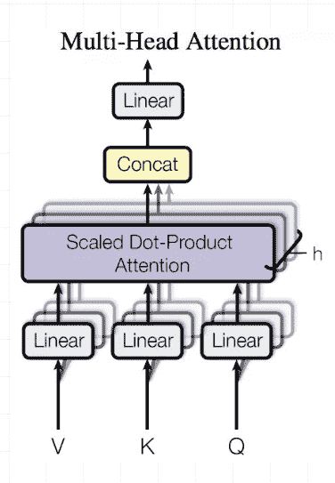

整个过程图示如下：

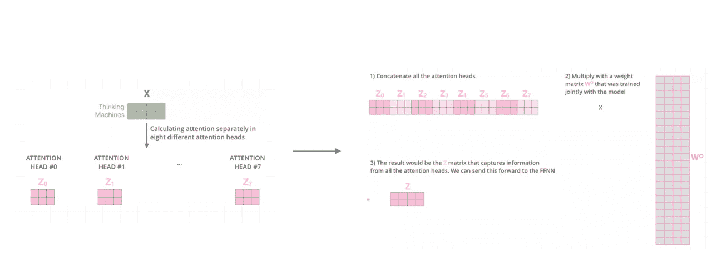

这里，我们还是先用excel的过程计算一遍。假设我们刚才计算得到的`Q`、`K`、`V`从中间切分，分别作为两个Head的输入：

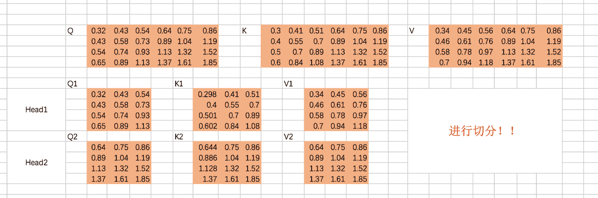

重复上面的Scaled Dot-Product Attention过程，我们分别得到两个Head的输出：

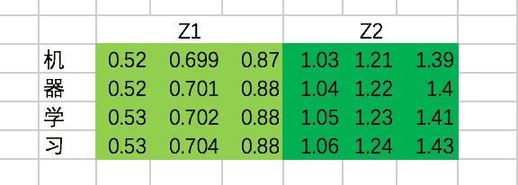

接下来，我们需要通过一个权重矩阵，来得到最终输出

为了我们能够进行后面的`Add`操作，我们需要把输出的长度和输入保持一致，即每个单词得到的输出embedding长度保持为4

同样，我们这里把转换矩阵`W`设置为常数：

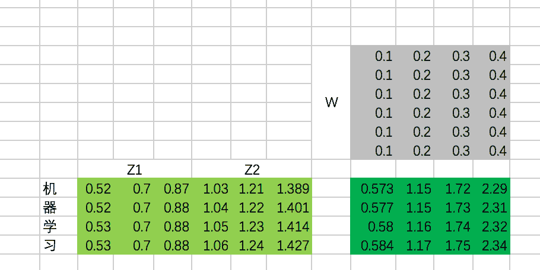

最终，每个单词在经过multi-head attention之后，得到的输出为：

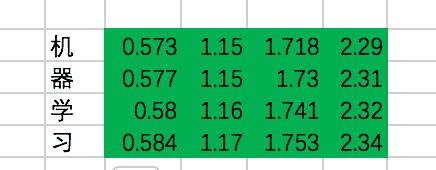

好了，开始写代码吧：


# Encoder Block

```
w_Z = tf.constant([[0.1,0.2,0.3,0.4],
                   [0.1,0.2,0.3,0.4],
                   [0.1,0.2,0.3,0.4],
                   [0.1,0.2,0.3,0.4],
                   [0.1,0.2,0.3,0.4],
                   [0.1,0.2,0.3,0.4]],dtype=tf.float32)

with tf.variable_scope("encoder_input"):
    encoder_embedding_input = tf.nn.embedding_lookup(chinese_embedding,encoder_input)
    encoder_embedding_input = encoder_embedding_input + position_encoding

with tf.variable_scope("encoder_multi_head_product_attention"):
    encoder_Q = tf.matmul(tf.reshape(encoder_embedding_input,(-1,tf.shape(encoder_embedding_input)[2])),w_Q)
    encoder_K = tf.matmul(tf.reshape(encoder_embedding_input,(-1,tf.shape(encoder_embedding_input)[2])),w_K)
    encoder_V = tf.matmul(tf.reshape(encoder_embedding_input,(-1,tf.shape(encoder_embedding_input)[2])),w_V)
    
    encoder_Q = tf.reshape(encoder_Q,(tf.shape(encoder_embedding_input)[0],tf.shape(encoder_embedding_input)[1],-1))
    encoder_K = tf.reshape(encoder_K,(tf.shape(encoder_embedding_input)[0],tf.shape(encoder_embedding_input)[1],-1))
    encoder_V = tf.reshape(encoder_V,(tf.shape(encoder_embedding_input)[0],tf.shape(encoder_embedding_input)[1],-1))
          
    encoder_Q_split = tf.split(encoder_Q,2,axis=2)
    encoder_K_split = tf.split(encoder_K,2,axis=2)
    encoder_V_split = tf.split(encoder_V,2,axis=2)
    
    encoder_Q_concat = tf.concat(encoder_Q_split,axis=0)
    encoder_K_concat = tf.concat(encoder_K_split,axis=0)
    encoder_V_concat = tf.concat(encoder_V_split,axis=0)
    
    attention_map = tf.matmul(encoder_Q_concat,tf.transpose(encoder_K_concat,[0,2,1]))
    attention_map = attention_map / 8
    attention_map = tf.nn.softmax(attention_map)
    
    weightedSumV = tf.matmul(attention_map,encoder_V_concat)
    
    outputs_z = tf.concat(tf.split(weightedSumV,2,axis=0),axis=2)
    
    outputs = tf.matmul(tf.reshape(outputs_z,(-1,tf.shape(outputs_z)[2])),w_Z)
    outputs = tf.reshape(outputs,(tf.shape(encoder_embedding_input)[0],tf.shape(encoder_embedding_input)[1],-1))

import numpy as np
with tf.Session() as sess:
#     print(sess.run(encoder_Q))
#     print(sess.run(encoder_Q_split))
    #print(sess.run(weightedSumV))
    #print(sess.run(outputs_z))
    print(sess.run(outputs))
```

结果的输出为：

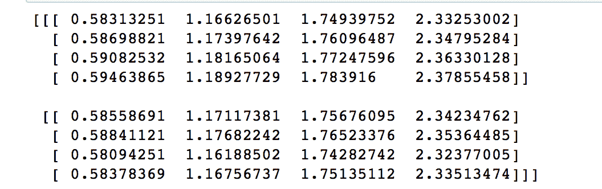

这里的结果其实和excel是一致的，细小的差异源于excel在复制粘贴过程中，小数点的精度有所损失。

这里我们主要来看下两个函数，分别是`split`和`concat`，理解这两个函数的过程对明白上述代码至关重要。

`split`函数主要有三个参数，第一个是要`split`的`tensor`，第二个是分割成几个`tensor`，第三个是在哪一维进行切分。也就是说，`encoder_Q_split = tf.split(encoder_Q,2,axis=2)`，执行这段代码的话，`encoder_Q`这个`tensor`会按照`axis=2`切分成两个同样大的`tensor`，这两个`tensor`的`axis=0`和`axis=1`维度的长度是不变的，但`axis=2`的长度变为了一半，我们在后面通过图示的方式来解释。

从代码可以看到，共有两次`split`和`concat`的过程，第一次是将`Q`、`K`、`V`切分为不同的`Head`：

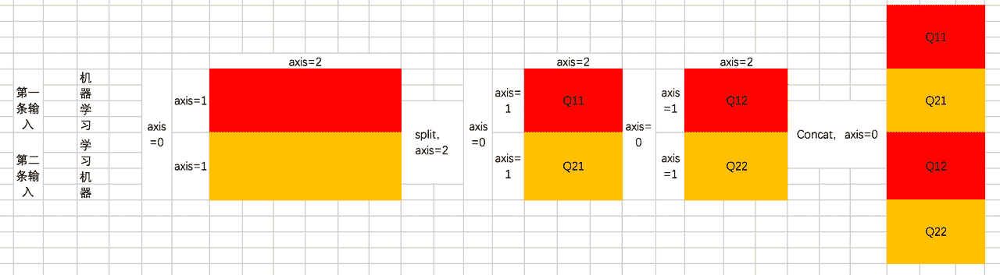

也就是说，原先每条数据的所对应的各`Head`的`Q`并非相连的，而是交替出现的，即【Head1-Q11,Head1-Q21,Head2-Q12,Head2-Q22】

第二次是最后计算完每个`Head`的输出`Z`之后，通过`split`和`concat`进行还原，过程如下：

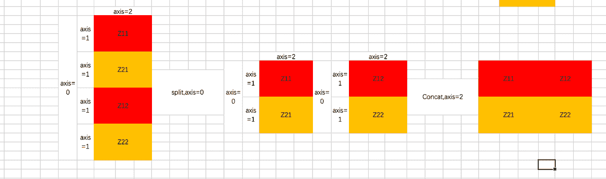

上面的图示咱们将三维矩阵操作抽象成了二维，我加入了`axis`的说明帮助你理解

如果不懂的话，单步执行下代码就会懂啦

## Add & Normalize & FFN

后面的过程其实很多简单了，我们继续用excel来表示一下，这里，我们忽略`BN`的操作（大家可以加上，这里主要是比较麻烦哈哈）

第一次`Add & Normalize`：

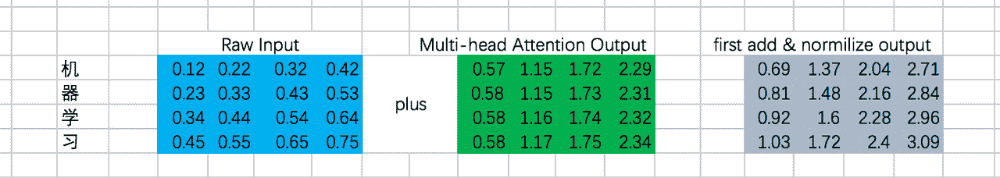

接下来是一个`FFN`，我们仍然假设是固定的参数，那么`output`是：

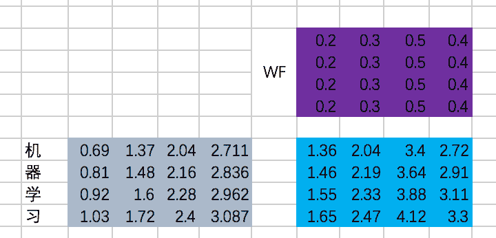

第二次`Add & Normalize`：

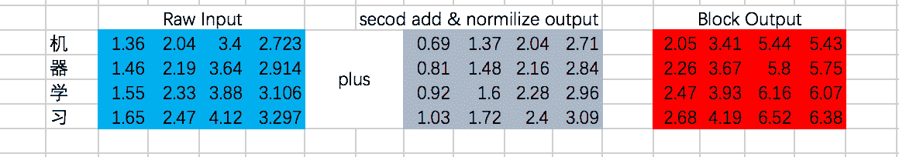

我们终于在经过一个`Encoder`的`Block`后得到了每个输入对应的输出，分别为：

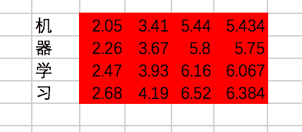

让我们把这段代码补充上去吧：

```
with tf.variable_scope("encoder_block"):
    encoder_Q = tf.matmul(tf.reshape(encoder_embedding_input,(-1,tf.shape(encoder_embedding_input)[2])),w_Q)
    encoder_K = tf.matmul(tf.reshape(encoder_embedding_input,(-1,tf.shape(encoder_embedding_input)[2])),w_K)
    encoder_V = tf.matmul(tf.reshape(encoder_embedding_input,(-1,tf.shape(encoder_embedding_input)[2])),w_V)
    
    encoder_Q = tf.reshape(encoder_Q,(tf.shape(encoder_embedding_input)[0],tf.shape(encoder_embedding_input)[1],-1))
    encoder_K = tf.reshape(encoder_K,(tf.shape(encoder_embedding_input)[0],tf.shape(encoder_embedding_input)[1],-1))
    encoder_V = tf.reshape(encoder_V,(tf.shape(encoder_embedding_input)[0],tf.shape(encoder_embedding_input)[1],-1))
          
    encoder_Q_split = tf.split(encoder_Q,2,axis=2)
    encoder_K_split = tf.split(encoder_K,2,axis=2)
    encoder_V_split = tf.split(encoder_V,2,axis=2)
    
    encoder_Q_concat = tf.concat(encoder_Q_split,axis=0)
    encoder_K_concat = tf.concat(encoder_K_split,axis=0)
    encoder_V_concat = tf.concat(encoder_V_split,axis=0)
    
    attention_map = tf.matmul(encoder_Q_concat,tf.transpose(encoder_K_concat,[0,2,1]))
    attention_map = attention_map / 8
    attention_map = tf.nn.softmax(attention_map)
    
    weightedSumV = tf.matmul(attention_map,encoder_V_concat)
    
    outputs_z = tf.concat(tf.split(weightedSumV,2,axis=0),axis=2)
    
    sa_outputs = tf.matmul(tf.reshape(outputs_z,(-1,tf.shape(outputs_z)[2])),w_Z)
    sa_outputs = tf.reshape(sa_outputs,(tf.shape(encoder_embedding_input)[0],tf.shape(encoder_embedding_input)[1],-1))

    sa_outputs = sa_outputs + encoder_embedding_input
    
    # todo :add BN
    W_f = tf.constant([[0.2,0.3,0.5,0.4],
                       [0.2,0.3,0.5,0.4],
                       [0.2,0.3,0.5,0.4],
                       [0.2,0.3,0.5,0.4]])
    
    ffn_outputs = tf.matmul(tf.reshape(sa_outputs,(-1,tf.shape(sa_outputs)[2])),W_f)
    ffn_outputs = tf.reshape(ffn_outputs,(tf.shape(sa_outputs)[0],tf.shape(sa_outputs)[1],-1))
    
    encoder_outputs = ffn_outputs + sa_outputs
    # todo :add BN

import numpy as np
with tf.Session() as sess:
#     print(sess.run(encoder_Q))
#     print(sess.run(encoder_Q_split))
    #print(sess.run(weightedSumV))
    #print(sess.run(outputs_z))
    #print(sess.run(sa_outputs))
    #print(sess.run(ffn_outputs))
    print(sess.run(encoder_outputs))
```

输出为：

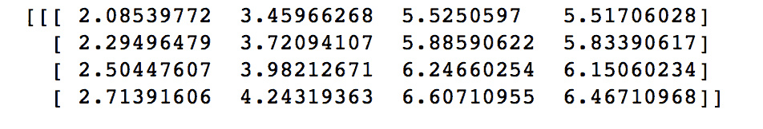

与excel计算结果基本一致

当然，`encoder`的各层是可以堆叠的，但我们这里只以单层的为例，重点是理解整个过程

# Decoder Block

一个`Decoder`的`Block`过程如下：

+   相比`Encoder`，这里的过程分为6步，分别是 masked multi-head self attention、`Add & Normalize`、`encoder-decoder attention`、`Add & Normalize`、`Feed Forward Network`、`Add & Normalize`

+   咱们还是重点来讲`masked multi-head self attention`和`encoder-decoder attention`

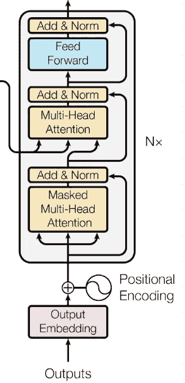

## Decoder输入

这里，在`excel`中，咱们还是以第一条输入为例，来展示整个过程：

[机、器、学、习] -> [ machine、learning]

因此，`Decoder`阶段的输入是：

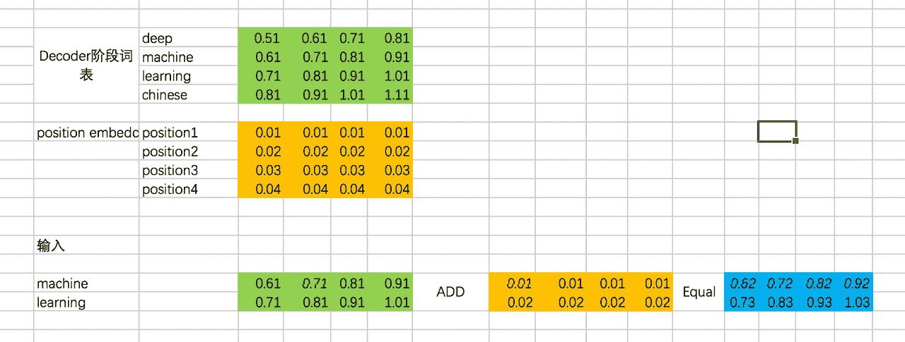

对应的代码如下：

```
english_embedding = tf.constant([[0.51,0.61,0.71,0.81],
                         [0.61,0.71,0.81,0.91],
                         [0.71,0.81,0.91,1.01],
                         [0.81,0.91,1.01,1.11]],dtype=tf.float32)


position_encoding = tf.constant([[0.01,0.01,0.01,0.01],
                         [0.02,0.02,0.02,0.02],
                         [0.03,0.03,0.03,0.03],
                         [0.04,0.04,0.04,0.04]],dtype=tf.float32)

decoder_input = tf.constant([[1,2],[2,1]],dtype=tf.int32)

with tf.variable_scope("decoder_input"):
    decoder_embedding_input = tf.nn.embedding_lookup(english_embedding,decoder_input)
    decoder_embedding_input = decoder_embedding_input + position_encoding[0:tf.shape(decoder_embedding_input)[1]]
```

## masked multi-head self attention

这个过程和`multi-head self attention`基本一致，只不过对于`decoder`来说，得到每个阶段的输出时，我们是看不到后面的信息的

举个例子：我们的第一条输入是：[机、器、学、习] -> [ machine、learning] ，`decoder`阶段两次的输入分别是`machine`和`learning`，在输入`machine`时，我们是看不到`learning`的信息的，因此在计算`attention`的权重的时候，`machine`和`learning`的权重是没有的

+   我们还是先通过`excel`来演示一下，再通过代码来理解

计算`Attention`的权重矩阵是：

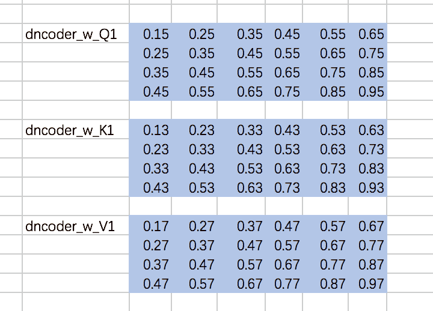

仍然以两个`Head`为例，计算`Q`、`K`、`V`：

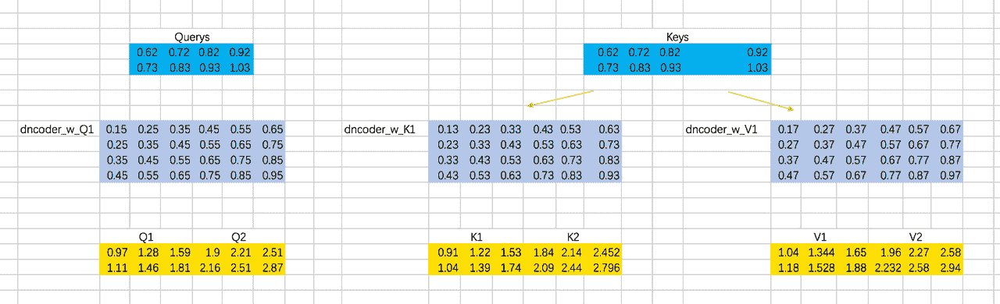

分别计算两个`Head`的`attention map`：

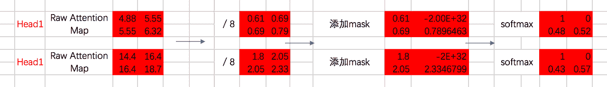

咱们先来实现这部分的代码，`masked` `attention map`的计算过程：

先定义下权重矩阵，同`encoder`一样，定义成常数：


# Decoder Self-Attention 实现

## 初始化 Q、K、V 权重矩阵

```
w_Q_decoder_sa = tf.constant([[0.15,0.25,0.35,0.45,0.55,0.65],
                   [0.25,0.35,0.45,0.55,0.65,0.75],
                   [0.35,0.45,0.55,0.65,0.75,0.85],
                   [0.45,0.55,0.65,0.75,0.85,0.95]],dtype=tf.float32)

w_K_decoder_sa = tf.constant([[0.13,0.23,0.33,0.43,0.53,0.63],
                   [0.23,0.33,0.43,0.53,0.63,0.73],
                   [0.33,0.43,0.53,0.63,0.73,0.83],
                   [0.43,0.53,0.63,0.73,0.83,0.93]],dtype=tf.float32)

w_V_decoder_sa = tf.constant([[0.17,0.27,0.37,0.47,0.57,0.67],
                   [0.27,0.37,0.47,0.57,0.67,0.77],
                   [0.37,0.47,0.57,0.67,0.77,0.87],
                   [0.47,0.57,0.67,0.77,0.87,0.97]],dtype=tf.float32)
```

## 计算 Mask 之前的 Attention Map

随后，计算添加 `mask` 之前的 attention map：

```
with tf.variable_scope("decoder_sa_block"):
    decoder_Q = tf.matmul(tf.reshape(decoder_embedding_input,(-1,tf.shape(decoder_embedding_input)[2])),w_Q_decoder_sa)
    decoder_K = tf.matmul(tf.reshape(decoder_embedding_input,(-1,tf.shape(decoder_embedding_input)[2])),w_K_decoder_sa)
    decoder_V = tf.matmul(tf.reshape(decoder_embedding_input,(-1,tf.shape(decoder_embedding_input)[2])),w_V_decoder_sa)
    
    decoder_Q = tf.reshape(decoder_Q,(tf.shape(decoder_embedding_input)[0],tf.shape(decoder_embedding_input)[1],-1))
    decoder_K = tf.reshape(decoder_K,(tf.shape(decoder_embedding_input)[0],tf.shape(decoder_embedding_input)[1],-1))
    decoder_V = tf.reshape(decoder_V,(tf.shape(decoder_embedding_input)[0],tf.shape(decoder_embedding_input)[1],-1))
          
    decoder_Q_split = tf.split(decoder_Q,2,axis=2)
    decoder_K_split = tf.split(decoder_K,2,axis=2)
    decoder_V_split = tf.split(decoder_V,2,axis=2)
    
    decoder_Q_concat = tf.concat(decoder_Q_split,axis=0)
    decoder_K_concat = tf.concat(decoder_K_split,axis=0)
    decoder_V_concat = tf.concat(decoder_V_split,axis=0)
    
    decoder_sa_attention_map_raw = tf.matmul(decoder_Q_concat,tf.transpose(decoder_K_concat,[0,2,1]))
    decoder_sa_attention_map = decoder_sa_attention_map_raw / 8
```

## 添加 Mask 到 Attention Map

随后，对 attention map 添加 `mask`：

```
diag_vals = tf.ones_like(decoder_sa_attention_map[0,:,:])
tril = tf.contrib.linalg.LinearOperatorTriL(diag_vals).to_dense()
masks = tf.tile(tf.expand_dims(tril,0),[tf.shape(decoder_sa_attention_map)[0],1,1])
paddings = tf.ones_like(masks) * (-2 ** 32 + 1)
decoder_sa_attention_map = tf.where(tf.equal(masks,0),paddings,decoder_sa_attention_map)
decoder_sa_attention_map = tf.nn.softmax(decoder_sa_attention_map)
```

这里我们首先构造一个全 1 的矩阵 `diag_vals`，这个矩阵的大小同 attention map。随后通过 `tf.contrib.linalg.LinearOperatorTriL` 方法把上三角部分变为 0，该函数的示意如下：

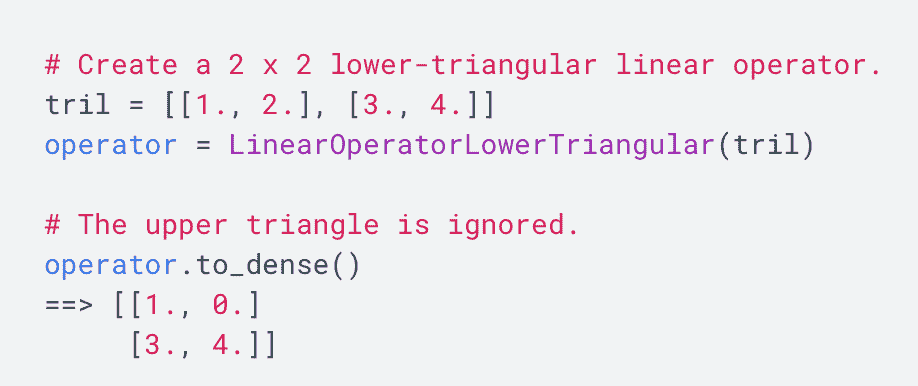

基于这个函数生成的矩阵 `tril`，我们便可以构造对应的 `mask` 了。不过需要注意的是，对于我们要加 `mask` 的地方，不能赋值为 0，而是需要赋值一个很小的数，这里为 `-2^32 + 1`。因为我们后面要做 `softmax`，`e^0 = 1`，是一个很大的数啦

### 运行上面的代码

```
import numpy as np
with tf.Session() as sess:
    print(sess.run(decoder_sa_attention_map))
```

### 观察第一条数据对应的结果

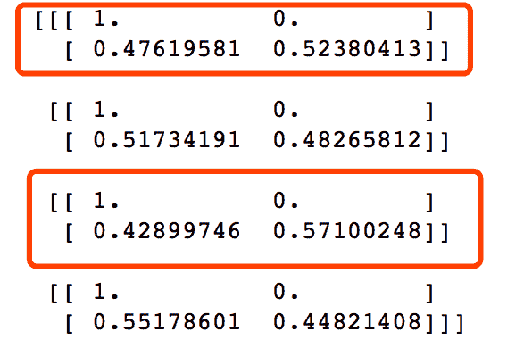

与我们 Excel 计算结果相吻合

## Masked Multi-Head Self Attention 结果

后面的过程我们就不详细介绍了，我们直接给出经过 masked multi-head self attention 的对应结果：

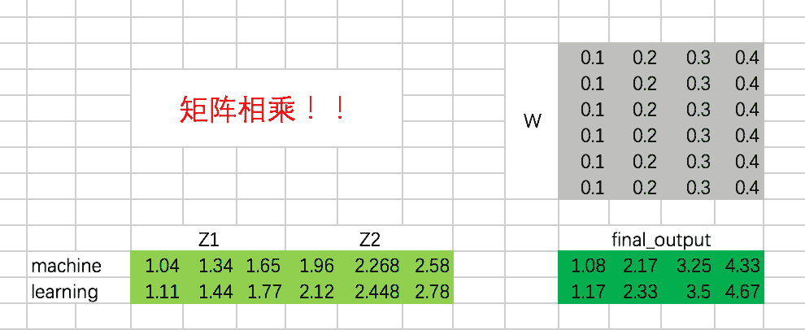

对应的代码如下：

```
weightedSumV = tf.matmul(decoder_sa_attention_map,decoder_V_concat)
    
decoder_outputs_z = tf.concat(tf.split(weightedSumV,2,axis=0),axis=2)
    
decoder_sa_outputs = tf.matmul(tf.reshape(decoder_outputs_z,(-1,tf.shape(decoder_outputs_z)[2])),w_Z_decoder_sa)
    
decoder_sa_outputs = tf.reshape(decoder_sa_outputs,(tf.shape(decoder_embedding_input)[0],tf.shape(decoder_embedding_input)[1],-1))


with tf.Session() as sess:
    print(sess.run(decoder_sa_outputs))
```

### 输出

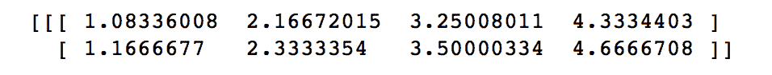

与 Excel 保持一致！

## Encoder-Decoder Attention

在 encoder-decoder attention 之间，还有一个 Add & Normalize 的过程，同样，我们忽略 Normalize，只做 Add 操作：


接下来，就是 encoder-decoder 了，这里跟 multi-head attention 相同，但是需要注意的一点是，我们这里想要做的是，计算 decoder 的每个阶段的输入和 encoder 阶段所有输出的 attention，所以 `Q` 的计算通过 decoder 对应的 embedding 计算，而 `K` 和 `V` 通过 encoder 阶段输出的 embedding 来计算：


接下来，计算 Attention Map，注意，这里 attention map 的大小为 2 * 4 的，每一行代表一个 decoder 的输入，与所有 encoder 输出之间的 attention score。同时，我们不需要添加 `mask`，因为 decoder 的输入是可以看到所有 encoder 的输出信息的。得到的 attention map 结果如下：


哈哈，这里数是我瞎写的，结果不太好，不过不影响对整个过程的理解

接下来，我们得到整个 encoder-decoder 阶段的输出为：


接下来，还有 Add & Normalize、Feed Forward Network、Add & Normalize 过程，咱们这里就省略了。直接上代码吧：


```
w_Q_decoder_sa2 = tf.constant([[0.2,0.3,0.4,0.5,0.6,0.7],
                   [0.3,0.4,0.5,0.6,0.7,0.8],
                   [0.4,0.5,0.6,0.7,0.8,0.9],
                   [0.5,0.6,0.7,0.8,0.9,1]],dtype=tf.float32)

w_K_decoder_sa2 = tf.constant([[0.18,0.28,0.38,0.48,0.58,0.68],
                   [0.28,0.38,0.48,0.58,0.68,0.78],
                   [0.38,0.48,0.58,0.68,0.78,0.88],
                   [0.48,0.58,0.68,0.78,0.88,0.98]],dtype=tf.float32)

w_V_decoder_sa2 = tf.constant([[0.22,0.32,0.42,0.52,0.62,0.72],
                   [0.32,0.42,0.52,0.62,0.72,0.82],
                   [0.42,0.52,0.62,0.72,0.82,0.92],
                   [0.52,0.62,0.72,0.82,0.92,1.02]],dtype=tf.float32)

w_Z_decoder_sa2 = tf.constant([[0.1,0.2,0.3,0.4],
                   [0.1,0.2,0.3,0.4],
                   [0.1,0.2,0.3,0.4],
                   [0.1,0.2,0.3,0.4],
                   [0.1,0.2,0.3,0.4],
                   [0.1,0.2,0.3,0.4]],dtype=tf.float32)


with tf.variable_scope(&quot;decoder_encoder_attention_block&quot;):
    
    decoder_sa_outputs = decoder_sa_outputs + decoder_embedding_input
    
    encoder_decoder_Q = tf.matmul(tf.reshape(decoder_sa_outputs,(-1,tf.shape(decoder_sa_outputs)[2])),w_Q_decoder_sa2)
    encoder_decoder_K = tf.matmul(tf.reshape(encoder_outputs,(-1,tf.shape(encoder_outputs)[2])),w_K_decoder_sa2)
    encoder_decoder_V = tf.matmul(tf.reshape(encoder_outputs,(-1,tf.shape(encoder_outputs)[2])),w_V_decoder_sa2)
    
    encoder_decoder_Q = tf.reshape(encoder_decoder_Q,(tf.shape(decoder_embedding_input)[0],tf.shape(decoder_embedding_input)[1],-1))
    encoder_decoder_K = tf.reshape(encoder_decoder_K,(tf.shape(encoder_outputs)[0],tf.shape(encoder_outputs)[1],-1))
    encoder_decoder_V = tf.reshape(encoder_decoder_V,(tf.shape(encoder_outputs)[0],tf.shape(encoder_outputs)[1],-1))
          
    encoder_decoder_Q_split = tf.split(encoder_decoder_Q,2,axis=2)
    encoder_decoder_K_split = tf.split(encoder_decoder_K,2,axis=2)
    encoder_decoder_V_split = tf.split(encoder_decoder_V,2,axis=2)
    
    encoder_decoder_Q_concat = tf.concat(encoder_decoder_Q_split,axis=0)
    encoder_decoder_K_concat = tf.concat(encoder_decoder_K_split,axis=0)
    encoder_decoder_V_concat = tf.concat(encoder_decoder_V_split,axis=0)
    
    encoder_decoder_attention_map_raw = tf.matmul(encoder_decoder_Q_concat,tf.transpose(encoder_decoder_K_concat,[0,2,1]))
    encoder_decoder_attention_map = encoder_decoder_attention_map_raw / 8
    
    encoder_decoder_attention_map = tf.nn.softmax(encoder_decoder_attention_map)
    
    weightedSumV = tf.matmul(encoder_decoder_attention_map,encoder_decoder_V_concat)
    
    encoder_decoder_outputs_z = tf.concat(tf.split(weightedSumV,2,axis=0),axis=2)
    
    encoder_decoder_outputs = tf.matmul(tf.reshape(encoder_decoder_outputs_z,(-1,tf.shape(encoder_decoder_outputs_z)[2])),w_Z_decoder_sa2)
    
    encoder_decoder_attention_outputs = tf.reshape(encoder_decoder_outputs,(tf.shape(decoder_embedding_input)[0],tf.shape(decoder_embedding_input)[1],-1))
    
    encoder_decoder_attention_outputs = encoder_decoder_attention_outputs + decoder_sa_outputs
    
    # todo :add BN
    W_f = tf.constant([[0.2,0.3,0.5,0.4],
                       [0.2,0.3,0.5,0.4],
                       [0.2,0.3,0.5,0.4],
                       [0.2,0.3,0.5,0.4]])
    
    decoder_ffn_outputs = tf.matmul(tf.reshape(encoder_decoder_attention_outputs,(-1,tf.shape(encoder_decoder_attention_outputs)[2])),W_f)
    decoder_ffn_outputs = tf.reshape(decoder_ffn_outputs,(tf.shape(encoder_decoder_attention_outputs)[0],tf.shape(encoder_decoder_attention_outputs)[1],-1))
    
    decoder_outputs = decoder_ffn_outputs + encoder_decoder_attention_outputs
    # todo :add BN

with tf.Session() as sess:
    print(sess.run(decoder_outputs))
```

# 全连接层及最终输出

最后的全连接层很简单了，对于`decoder`阶段的输出，通过全连接层和`softmax`之后，最终得到选择每个单词的概率，并计算交叉熵损失：


**这里，我们直接给出代码：**

```
W_final = tf.constant([[0.2,0.3,0.5,0.4],
                       [0.2,0.3,0.5,0.4],
                       [0.2,0.3,0.5,0.4],
                       [0.2,0.3,0.5,0.4]])

logits = tf.matmul(tf.reshape(decoder_outputs,(-1,tf.shape(decoder_outputs)[2])),W_final)
logits = tf.reshape(logits,(tf.shape(decoder_outputs)[0],tf.shape(decoder_outputs)[1],-1))

logits = tf.nn.softmax(logits)

y = tf.one_hot(decoder_input,depth=4)

loss = tf.nn.softmax_cross_entropy_with_logits(logits=logits,labels=y)

train_op = tf.train.AdamOptimizer(learning_rate=0.0001).minimize(loss)
```

整个文章下来，咱们不仅通过excel实现了一遍`transorform`的正向传播过程，还通过`tf`代码实现了一遍。放两张excel的抽象图，就知道是多么浩大的工程了：


好了，文章最后，咱们再来回顾一下整个`Transformer`的结构


