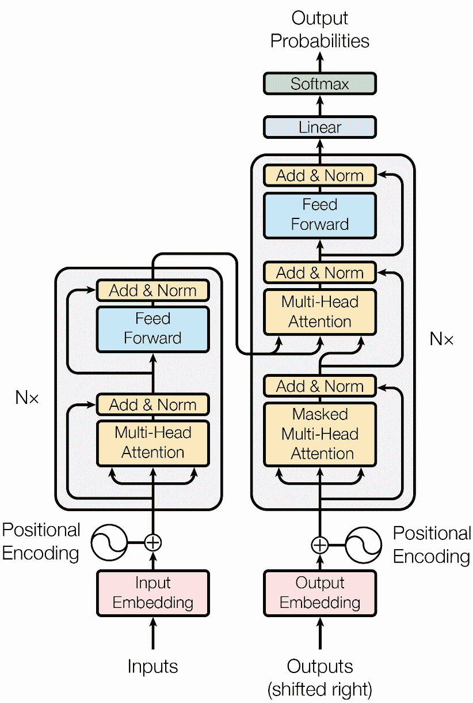
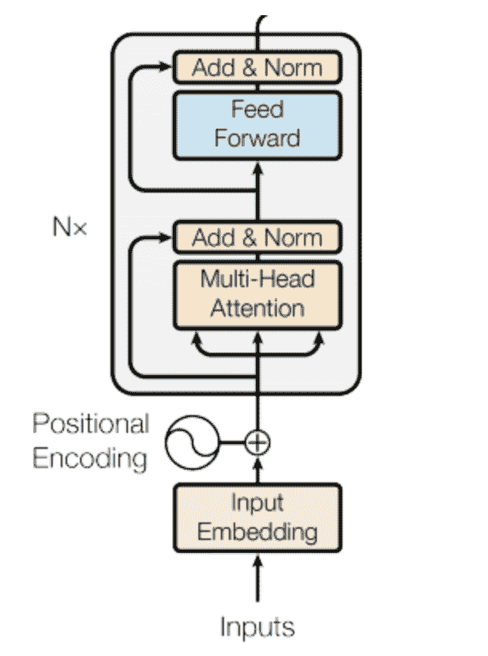
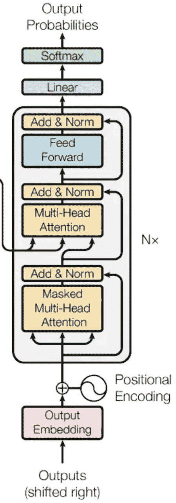
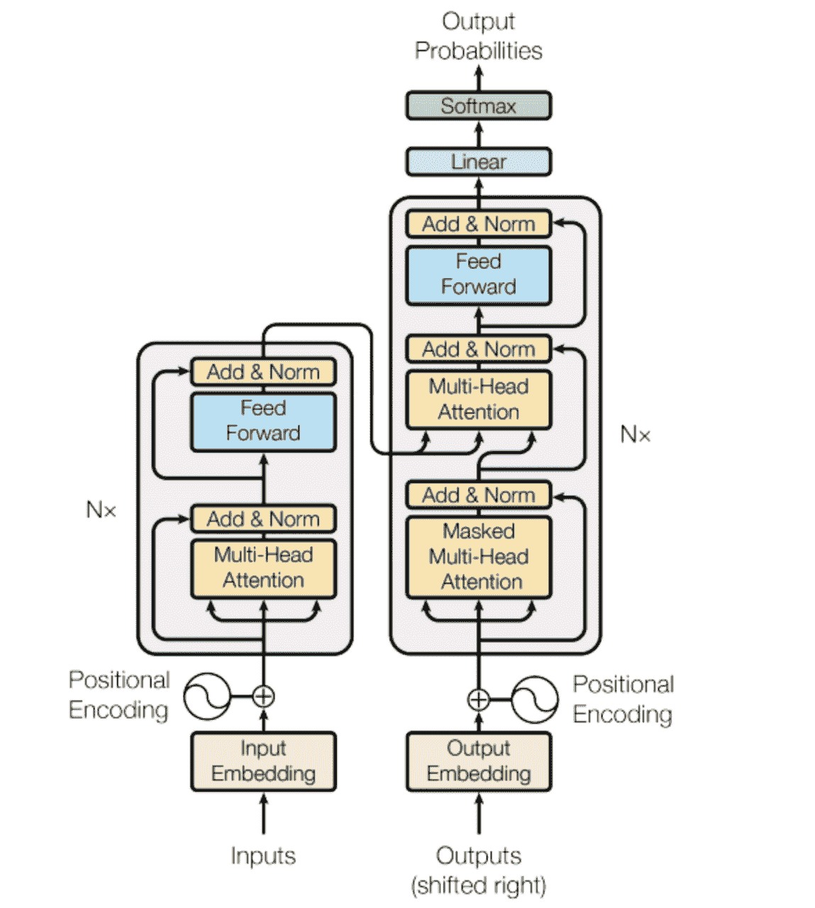

# PyTorch从零开始实现Transformer

> 来源：[https://qqs7y1hozd1.feishu.cn/docx/D5JPd5euto1GC6xSNhTcWilznel](https://qqs7y1hozd1.feishu.cn/docx/D5JPd5euto1GC6xSNhTcWilznel)

# 自注意力

## 计算公式

```

class SelfAttention(nn.Module):
    def __init__(self, embed_size, heads):
        super(SelfAttention, self).__init__()
        self.embed_size = embed_size
        self.heads = heads
        self.head_dim = embed_size // heads

        assert (self.head_dim * heads == embed_size),  &quot;Embed size needs  to  be div by heads&quot;
        self.values = nn.Linear(self.head_dim, self.head_dim, bias=False)
        self.keys = nn.Linear(self.head_dim, self.head_dim, bias=False)
        self.queries = nn.Linear(self.head_dim, self.head_dim, bias=False)
        self.fc_out = nn.Linear(heads*self.head_dim, embed_size)

    def forward(self, values, keys, query, mask):
        N = query.shape[0] # the number of training examples
        value_len, key_len, query_len = values.shape[1], keys.shape[1], query.shape[1]

        # Split embedding into self.heads pieces
        values = values.reshape(N, value_len, self.heads, self.head_dim)
        keys = keys.reshape(N, key_len, self.heads, self.head_dim)
        queries = query.reshape(N, query_len, self.heads, self.head_dim)

        values = self.values(values)
        keys = self.keys(keys)
        queries = self.queries(queries)

        energy = torch.einsum(&quot;nqhd,nkhd-&gt;nhqk&quot;, [queries, keys]) # 矩阵乘法，使用爱因斯坦标记法
        # queries shape: (N, query_len, heads, heads_dim)
        # keys shape: (N, key_len, heads, heads_dim)
        # energy shape: (N, heads, query_len, key_len)

        if mask is not None:
            energy = energy.masked_fill(mask==0, float(&quot;-1e20&quot;)) 
            #Fills elements of self tensor with value where mask is True

        attention = torch.softmax(energy / (self.embed_size ** (1/2)), dim=3)
        out = torch.einsum(&quot;nhql, nlhd-&gt;nqhd&quot;, [attention, values]).reshape(
            N, query_len, self.heads*self.head_dim
        ) # 矩阵乘法，使用爱因斯坦标记法einsum
        # attention shape: (N, heads, query_len, key_len)
        # values shape: (N, value_len, heads, head_dim)
        # after einsum (N, query_len, heads, head_dim) then flatten last two dimensions

        out = self.fc_out(out)
        return out

```

# Transformer块

+   我们把[Transfomer](https://qqs7y1hozd1.feishu.cn/wiki/Xi6ewDFzwiVdxdkS7gtcrxL9n9c?from=from_copylink)块定义为如下图所示的结构

+   这个Transformer块在编码器和解码器中都有出现过



**代码实现**

```
class TransformerBlock(nn.Module):
    def __init__(self, embed_size, heads, dropout, forward_expansion):
        super(TransformerBlock, self).__init__()
        self.attention = SelfAttention(embed_size, heads)
        self.norm1 = nn.LayerNorm(embed_size)
        self.norm2 = nn.LayerNorm(embed_size)
        self.feed_forward = nn.Sequential(
            nn.Linear(embed_size, forward_expansion*embed_size),
            nn.ReLU(),
            nn.Linear(forward_expansion*embed_size, embed_size)
        )
        self.dropout = nn.Dropout(dropout)

    def forward(self, value, key, query, mask):
        attention = self.attention(value, key, query, mask)

        x = self.dropout(self.norm1(attention + query))
        forward = self.feed_forward(x)
        out = self.dropout(self.norm2(forward + x))
        return out
```

# 编码器

编码器结构如图所示

Inputs经过Input Embedding 和Positional Encoding之后，通过多个Transformer块



**代码实现**

```
class Encoder(nn.Module):
    def __init__(self, 
                 src_vocab_size,
                 embed_size,
                 num_layers,
                 heads,
                 device,
                 forward_expansion,
                 dropout,
                 max_length
                 ):
        super(Encoder, self).__init__()
        self.embed_size = embed_size
        self.device = device
        self.word_embedding = nn.Embedding(src_vocab_size, embed_size)
        self.position_embedding = nn.Embedding(max_length, embed_size)

        self.layers = nn.ModuleList(
            [
                TransformerBlock(
                    embed_size,
                    heads,
                    dropout=dropout,
                    forward_expansion=forward_expansion
                )
            for _ in range(num_layers)]
        )
        self.dropout = nn.Dropout(dropout)

    def forward(self, x, mask):
        N, seq_lengh = x.shape
        positions = torch.arange(0, seq_lengh).expand(N, seq_lengh).to(self.device)
        out = self.dropout(self.word_embedding(x) + self.position_embedding(positions))

        for layer in self.layers:
            out = layer(out, out, out, mask)

        return out
```

# 解码器块

解码器块结构如图所示



**代码实现**

```
class DecoderBlock(nn.Module):
    def __init__(self, embed_size, heads, forward_expansion, dropout, device):
        super(DecoderBlock, self).__init__()
        self.attention = SelfAttention(embed_size, heads)
        self.norm = nn.LayerNorm(embed_size)
        self.transformer_block = TransformerBlock(embed_size, heads, dropout, forward_expansion)
        self.dropout = nn.Dropout(dropout)

    def forward(self, x, value, key, src_mask, trg_mask):
        attention = self.attention(x, x, x, trg_mask)
        query = self.dropout(self.norm(attention + x))
        out = self.transformer_block(value, key, query, src_mask)
        return out
```

# 解码器

解码器块加上**word embedding**和positional embedding之后构成解码器


**代码实现**

```
class Decoder(nn.Module):
    def __init__(self, 
                 trg_vocab_size, 
                 embed_size, 
                 num_layers, 
                 heads, 
                 forward_expansion, 
                 dropout, 
                 device, 
                 max_length):
        super(Decoder, self).__init__()
        self.device = device
        self.word_embedding = nn.Embedding(trg_vocab_size, embed_size)
        self.position_embedding = nn.Embedding(max_length, embed_size)

        self.layers = nn.ModuleList(
            [DecoderBlock(embed_size, heads, forward_expansion, dropout, device)
             for _ in range(num_layers)]
        )
        self.fc_out = nn.Linear(embed_size, trg_vocab_size)
        self.dropout = nn.Dropout(dropout)

    def forward(self, x, enc_out, src_mask, trg_mask):
        N, seq_length = x.shape
        positions = torch.arange(0, seq_length).expand(N, seq_length).to(self.device)
        x = self.dropout((self.word_embedding(x) + self.position_embedding(positions)))

        for layer in self.layers:
            x = layer(x, enc_out, enc_out, src_mask, trg_mask)

        out = self.fc_out(x)
        return out
```

# 整个Transformer



**代码实现**

```
class Transformer(nn.Module):
    def __init__(self,
                 src_vocab_size, 
                 trg_vocab_size,
                 src_pad_idx,
                 trg_pad_idx,
                 embed_size=256,
                 num_layers=6,
                 forward_expansion=4,
                 heads=8,
                 dropout=0,
                 device=&quot;cuda&quot;,
                 max_length=100
                 ):
        super(Transformer, self).__init__()
        self.encoder = Encoder(
            src_vocab_size,
            embed_size,
            num_layers,
            heads,
            device,
            forward_expansion,
            dropout,
            max_length
        )

        self.decoder = Decoder(
            trg_vocab_size,
            embed_size,
            num_layers,
            heads,
            forward_expansion,
            dropout,
            device,
            max_length
        )
        self.src_pad_idx = src_pad_idx
        self.trg_pad_idx = trg_pad_idx
        self.device = device

    def make_src_mask(self, src):
        src_mask = (src != self.src_pad_idx).unsqueeze(1).unsqueeze(2)
        #(N, 1, 1, src_len)
        return src_mask.to(self.device)
    
    def make_trg_mask(self, trg):
        N, trg_len = trg.shape
        trg_mask = torch.tril(torch.ones((trg_len, trg_len))).expand(
            N, 1, trg_len, trg_len
        )
        return trg_mask.to(self.device)
    
    def forward(self, src, trg):
        src_mask = self.make_src_mask(src)
        trg_mask = self.make_trg_mask(trg)
        enc_src = self.encoder(src, src_mask)
        out = self.decoder(trg, enc_src, src_mask,  trg_mask)
        return out
```

# 全部代码（可直接运行）

```
import torch
import torch.nn as nn

class SelfAttention(nn.Module):
    def __init__(self, embed_size, heads):
        super(SelfAttention, self).__init__()
        self.embed_size = embed_size
        self.heads = heads
        self.head_dim = embed_size // heads

        assert (self.head_dim * heads == embed_size),  &quot;Embed size needs  to  be div by heads&quot;
        self.values = nn.Linear(self.head_dim, self.head_dim, bias=False)
        self.keys = nn.Linear(self.head_dim, self.head_dim, bias=False)
        self.queries = nn.Linear(self.head_dim, self.head_dim, bias=False)
        self.fc_out = nn.Linear(heads*self.head_dim, embed_size)

    def forward(self, values, keys, query, mask):
        N = query.shape[0] # the number of training examples
        value_len, key_len, query_len = values.shape[1], keys.shape[1], query.shape[1]

        # Split embedding into self.heads pieces
        values = values.reshape(N, value_len, self.heads, self.head_dim)
        keys = keys.reshape(N, key_len, self.heads, self.head_dim)
        queries = query.reshape(N, query_len, self.heads, self.head_dim)

        values = self.values(values)
        keys = self.keys(keys)
        queries = self.queries(queries)

        energy = torch.einsum(&quot;nqhd,nkhd-&gt;nhqk&quot;, [queries, keys])
        # queries shape: (N, query_len, heads, heads_dim)
        # keys shape: (N, key_len, heads, heads_dim)
        # energy shape: (N, heads, query_len, key_len)

        if mask is not None:
            energy = energy.masked_fill(mask==0, float(&quot;-1e20&quot;)) 
            #Fills elements of self tensor with value where mask is True

        attention = torch.softmax(energy / (self.embed_size ** (1/2)), dim=3)
        out = torch.einsum(&quot;nhql, nlhd-&gt;nqhd&quot;, [attention, values]).reshape(
            N, query_len, self.heads*self.head_dim
        )
        # attention shape: (N, heads, query_len, key_len)
        # values shape: (N, value_len, heads, head_dim)
        # after einsum (N, query_len, heads, head_dim) then flatten last two dimensions

        out = self.fc_out(out)
        return out


class TransformerBlock(nn.Module):
    def __init__(self, embed_size, heads, dropout, forward_expansion):
        super(TransformerBlock, self).__init__()
        self.attention = SelfAttention(embed_size, heads)
        self.norm1 = nn.LayerNorm(embed_size)
        self.norm2 = nn.LayerNorm(embed_size)
        self.feed_forward = nn.Sequential(
            nn.Linear(embed_size, forward_expansion*embed_size),
            nn.ReLU(),
            nn.Linear(forward_expansion*embed_size, embed_size)
        )
        self.dropout = nn.Dropout(dropout)

    def forward(self, value, key, query, mask):
        attention = self.attention(value, key, query, mask)

        x = self.dropout(self.norm1(attention + query))
        forward = self.feed_forward(x)
        out = self.dropout(self.norm2(forward + x))
        return out
    
class Encoder(nn.Module):
    def __init__(self, 
                 src_vocab_size,
                 embed_size,
                 num_layers,
                 heads,
                 device,
                 forward_expansion,
                 dropout,
                 max_length
                 ):
        super(Encoder, self).__init__()
        self.embed_size = embed_size
        self.device = device
        self.word_embedding = nn.Embedding(src_vocab_size, embed_size)
        self.position_embedding = nn.Embedding(max_length, embed_size)

        self.layers = nn.ModuleList(
            [
                TransformerBlock(
                    embed_size,
                    heads,
                    dropout=dropout,
                    forward_expansion=forward_expansion
                )
            for _ in range(num_layers)]
        )
        self.dropout = nn.Dropout(dropout)

    def forward(self, x, mask):
        N, seq_lengh = x.shape
        positions = torch.arange(0, seq_lengh).expand(N, seq_lengh).to(self.device)
        out = self.dropout(self.word_embedding(x) + self.position_embedding(positions))

        for layer in self.layers:
            out = layer(out, out, out, mask)

        return out

class DecoderBlock(nn.Module):
    def __init__(self, embed_size, heads, forward_expansion, dropout, device):
        super(DecoderBlock, self).__init__()
        self.attention = SelfAttention(embed_size, heads)
        self.norm = nn.LayerNorm(embed_size)
        self.transformer_block = TransformerBlock(embed_size, heads, dropout, forward_expansion)
        self.dropout = nn.Dropout(dropout)

    def forward(self, x, value, key, src_mask, trg_mask):
        attention = self.attention(x, x, x, trg_mask)
        query = self.dropout(self.norm(attention + x))
        out = self.transformer_block(value, key, query, src_mask)
        return out
    
class Decoder(nn.Module):
    def __init__(self, 
                 trg_vocab_size, 
                 embed_size, 
                 num_layers, 
                 heads, 
                 forward_expansion, 
                 dropout, 
                 device, 
                 max_length):
        super(Decoder, self).__init__()
        self.device = device
        self.word_embedding = nn.Embedding(trg_vocab_size, embed_size)
        self.position_embedding = nn.Embedding(max_length, embed_size)

        self.layers = nn.ModuleList(
            [DecoderBlock(embed_size, heads, forward_expansion, dropout, device)
             for _ in range(num_layers)]
        )
        self.fc_out = nn.Linear(embed_size, trg_vocab_size)
        self.dropout = nn.Dropout(dropout)

    def forward(self, x, enc_out, src_mask, trg_mask):
        N, seq_length = x.shape
        positions = torch.arange(0, seq_length).expand(N, seq_length).to(self.device)
        x = self.dropout((self.word_embedding(x) + self.position_embedding(positions)))

        for layer in self.layers:
            x = layer(x, enc_out, enc_out, src_mask, trg_mask)

        out = self.fc_out(x)
        return out

class Transformer(nn.Module):
    def __init__(self,
                 src_vocab_size, 
                 trg_vocab_size,
                 src_pad_idx,
                 trg_pad_idx,
                 embed_size=256,
                 num_layers=6,
                 forward_expansion=4,
                 heads=8,
                 dropout=0,
                 device=&quot;cuda&quot;,
                 max_length=100
                 ):
        super(Transformer, self).__init__()
        self.encoder = Encoder(
            src_vocab_size,
            embed_size,
            num_layers,
            heads,
            device,
            forward_expansion,
            dropout,
            max_length
        )

        self.decoder = Decoder(
            trg_vocab_size,
            embed_size,
            num_layers,
            heads,
            forward_expansion,
            dropout,
            device,
            max_length
        )
        self.src_pad_idx = src_pad_idx
        self.trg_pad_idx = trg_pad_idx
        self.device = device

    def make_src_mask(self, src):
        src_mask = (src != self.src_pad_idx).unsqueeze(1).unsqueeze(2)
        #(N, 1, 1, src_len)
        return src_mask.to(self.device)
    
    def make_trg_mask(self, trg):
        N, trg_len = trg.shape
        trg_mask = torch.tril(torch.ones((trg_len, trg_len))).expand(
            N, 1, trg_len, trg_len
        )
        return trg_mask.to(self.device)
    
    def forward(self, src, trg):
        src_mask = self.make_src_mask(src)
        trg_mask = self.make_trg_mask(trg)
        enc_src = self.encoder(src, src_mask)
        out = self.decoder(trg, enc_src, src_mask,  trg_mask)
        return out
    
if __name__ == &quot;__main__&quot;:
    device = torch.device(&quot;cuda&quot; if torch.cuda.is_available() else &quot;cpu&quot;)
    print(device)

    x = torch.tensor([[1, 5, 6, 4, 3, 9, 5, 2, 0], [1, 8, 7, 3, 4, 5, 6, 7, 2]]).to(
        device
    )
    trg = torch.tensor([[1, 7, 4, 3, 5, 9, 2, 0], [1, 5, 6, 2, 4, 7, 6, 2]]).to(device)

    src_pad_idx = 0
    trg_pad_idx = 0
    src_vocab_size = 10
    trg_vocab_size = 10
    model = Transformer(src_vocab_size, trg_vocab_size, src_pad_idx, trg_pad_idx, device=device).to(device)
    out = model(x, trg[:, :-1])
    print(out.shape)
```