# NLP&大模型基础

> 来源：[https://qqs7y1hozd1.feishu.cn/docx/PQ5zdLGZxoQRxmxzhGUcfgMDn7o](https://qqs7y1hozd1.feishu.cn/docx/PQ5zdLGZxoQRxmxzhGUcfgMDn7o)

# **自然语言处理**

## **基础与应用**

### **（1）图灵测试**

**原名：****Imitation Game**

采用一种行为注意的手段，尝试定义人工智能是不是具备人类智能的水平

+   1997年，人工智能在象棋方面战胜人类

+   2011年，IBM Watson DeepQA在问答节目上战胜所有人类。

+   2016年，Alpha go 在围棋方面战胜人类

### **（2）NLP任务**

**基础任务：**

+   **词性标注**

+   **命名实体识别**

+   **共指消解：用代词代替实体**

+   **句法关系：互相依存关系**

+   **中文自动分词**

## **词表示**

### **（1）词表示**

**目的：****将单词转换为机器可以理解的符号**

**目标：**

+   词之间相似度的计算

+   词之间语义的关系

### **（2）用一组相关的词表示**

**近义词，上位词**；

**问题：**

1.  词语之间的较小差异无法区分

1.  词义会发生变化，出现新的词义

1.  主观性的问题，受限于词典的标注

1.  数据稀疏问题

1.  大量的人工去构建、维护词典

### **（3）****one-hot****表示**

+   **把每个词表示成独立的符号**

+   和词表一样长的向量去找一维跟这个词相对应，整个向量的维度跟词表的长度是相当的

+   **用来表示文档时非常有效**，能较好地完成两个文档之间的相似度计算

**但是，在表示词的时候会有问题：**

会假设词根词之间的向量任意之间都是正交的，导致任意两个词之间进行相似度计算都是0

### **（4）上下文表示**

一个词的词义由他经常出现在的位置的上下文有密切的关系

任何一个词都可以用他出现的维度或者重要性去进行表示，可以得到关于每一个词的稠密向量，就可以在这个空间里面利用稠密向量来计算两个词之间的相似度

> **问题：**

1.  词表变大，存储需求也会变大

1.  有些词出现频度特别少，上下文少，这种方法不好表示

### **（5）词嵌入**

建立低维的稠密的向量空间，尝试把每一个词都学到这个空间里，用这个空间里的某一个位置所对应的向量来表示这个词，在这个空间里我们可以自动的学习出来词与词之间可能存在的相对比较稳定的一些关系

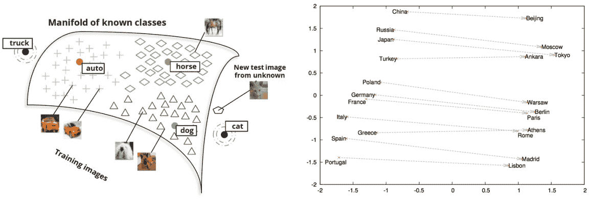

## **语言模型**

**目的：****根据前文，预测下一个词**

+   **计算一个**词的序列成为一句合法的话的概率，联合概率：P(W)=P\left(w_{1}, w_{2}, \cdots, w_{n}\right)

+   **根据前面**说过的话，预测下一个词是什么，条件概率：P\left(w_{n} \mid w_{1}, w_{2}, \cdots, w_{n-1}\right)

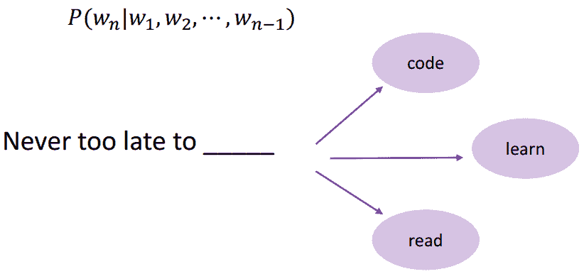

**基本假设：**一个未来的词只会受到他前面的词的影响

**语言模型：**一个句子的联合概率=里面的每一个词基于前面已经出现的词的条件概率之积

## ** N-gram Model**

**每一个词是一个单独的符号**

**4-gram****只会考虑相邻的4个词**，也就是前面出现的**三个词来预测下一个词**

**Bigram****就是****2-gram**，考虑连续出现的两个词，相当于只考虑前面出现的一个词，预测下一个词是什么

**Trigram****就是****3-gram**

**在一个大规模数据里统计连续出现的序列的频**度，在深度学习出现之前一个非常重要的技术

遵守**Markov的假设**，只考虑前面的有限的几个词

> **问题：**

1.  考虑的长度通常短，N多是2或者3，那上下文是1或2？

1.  背后还是会**假设所有词相互之间都是独立的**，上下文基于符号去做统计，不能理解词与词之间的相似度造成了什么？

## **神经语言模型**

**每一个词是一个低维的向量**

用分布式的表示建构前文和当前词的预测条件概率

+   把词表示成低维的向量

+   把低维的向量拼在一起，形成一个更高的上下文的向量

+   经过非线性的转换，用向量去预测下一个词是什么

通过对上下文的表示完成。

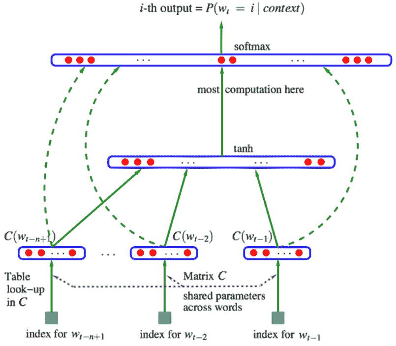

**N-gram Model**中每一个词是一个单独的符号，在Neural language Model中每一个词会被表示为一个向量。相似的词会有一个相似的向量，就有可能在语境中发挥相似的作用。

# **大模型基础**

## **大模型之旅**

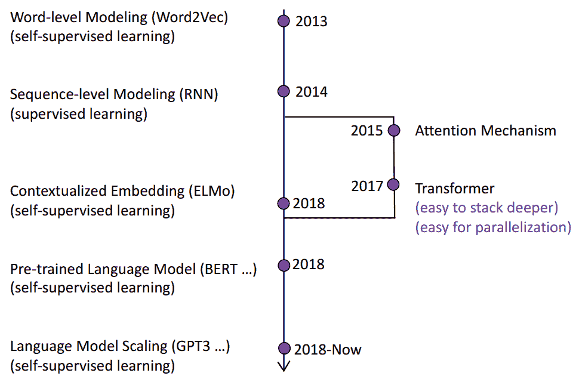

### **（1）预训练大模型****PLM**

**GLUE**上预训练的语言模型的结果优于人类的表现，反映了语言理解的能力

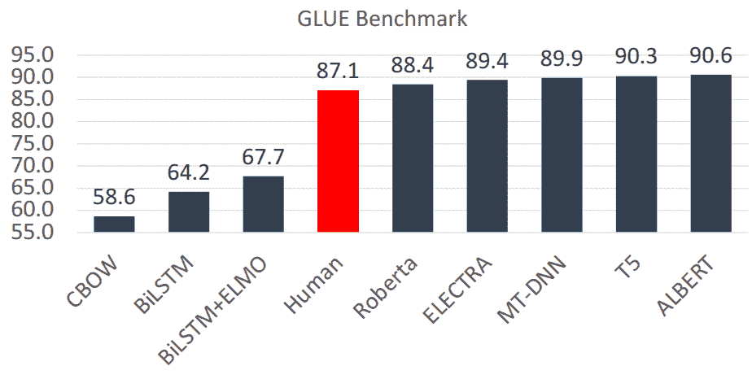

### **（2）大模型的特点**

2018年以后，**预训练大模型有以下三个特点：**

+   参数量越来越大

+   数据越来越多

+   计算资源越来越大

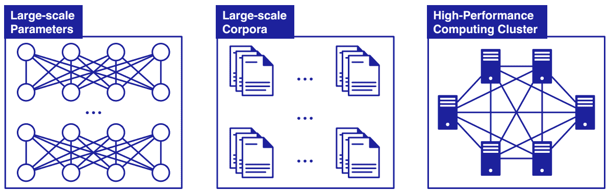

近两年来，参数尺度以每年10倍左右的速度增长；数据量也随之增长，计算成本也越来越高

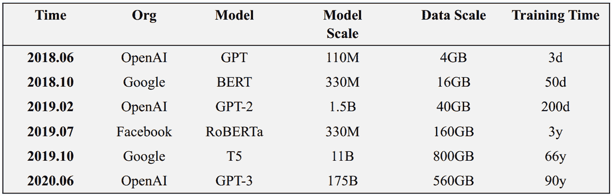

## **大模型背后的范式**

### **（1）预训练 + 微调**

在**预训练**阶段，预训练的语言模型从大规模的未标记数据中获取丰富的知识

然后，我们可以使用**特定****任务的训练数据对预训**练的语言模型进行微调，以适应预训练的知识

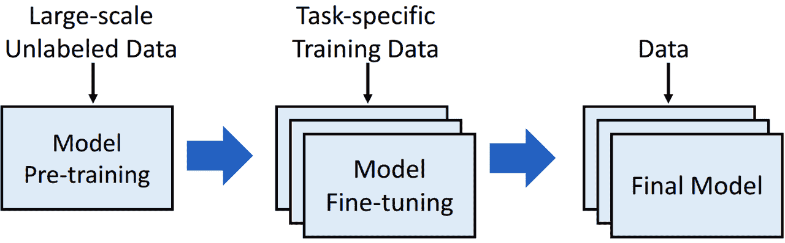

**预训练和**微调的基本范例可以追溯到迁移学习

人类可以应用以前学到的知识来更快地处理新问题，我们希望机器也有类似的能力

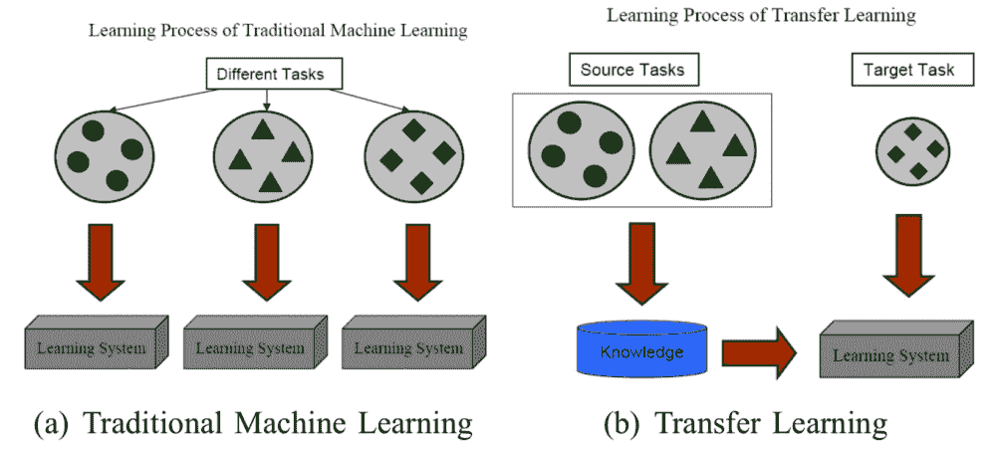

**迁移学习使用“预训练，然后微调”**的框架来实现“知识获取，然后知识转移”。

**在预训练模型的后续工作中，使**用了特征-表征-迁移和参数-迁移

### **（2）词嵌入Word2Vec**

**Word2Vec****使用两种主要的技术：**

+   CBOW（Continuous Bag of Words）

+   **Skip-gram**

**两者均通过优化一**个神经网络来训练词向量，但目标函数略有不同。

CBOW (Continuous Bag of Words)：CBOW模型预测的是目标词（中心词），而根据的是上下文词（周围的词）。具体来说，给定一个词的上下文，CBOW试图预测该词。

**Skip-gram**：Skip-gram与CBOW恰好相反。它的输入是中心词，输出则是上下文词。换句话说，它根据某个词来预测其周围的词。

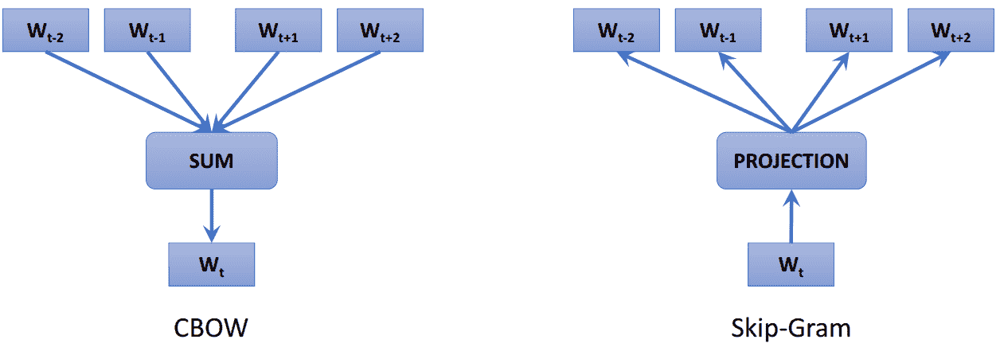

### **（3）解决一词多义：****ELMo**

+   使用RNN对大规模未标记数据进行语言建模

+   使用预训练的RNN生成**上下文词嵌入**

**特定于任务的模型：**

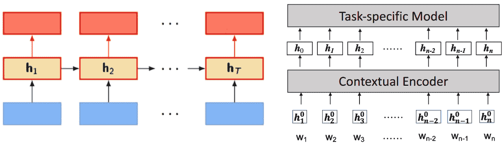

### **（4）Transformer**

**在Transformer的基础上，开发了一系列**深度预训练模型，取代了更强大的浅层RNN

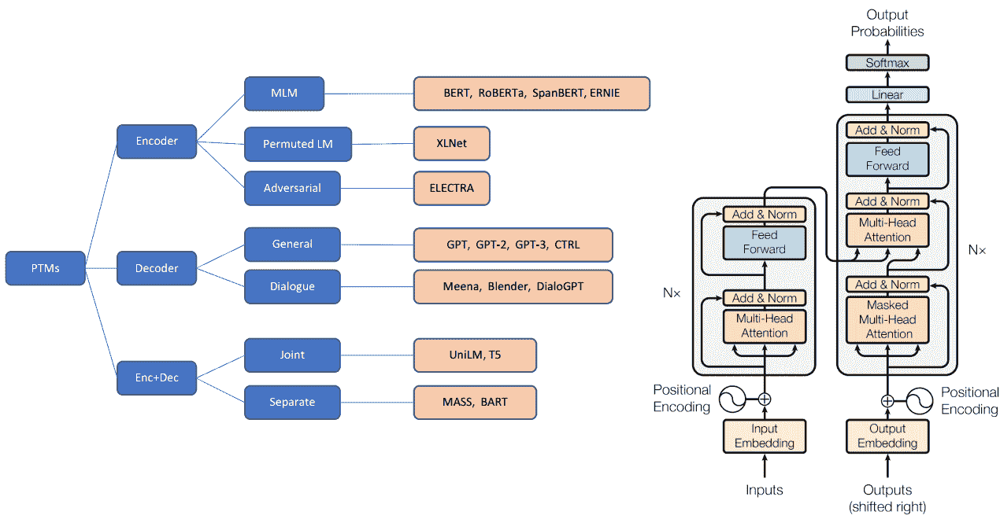