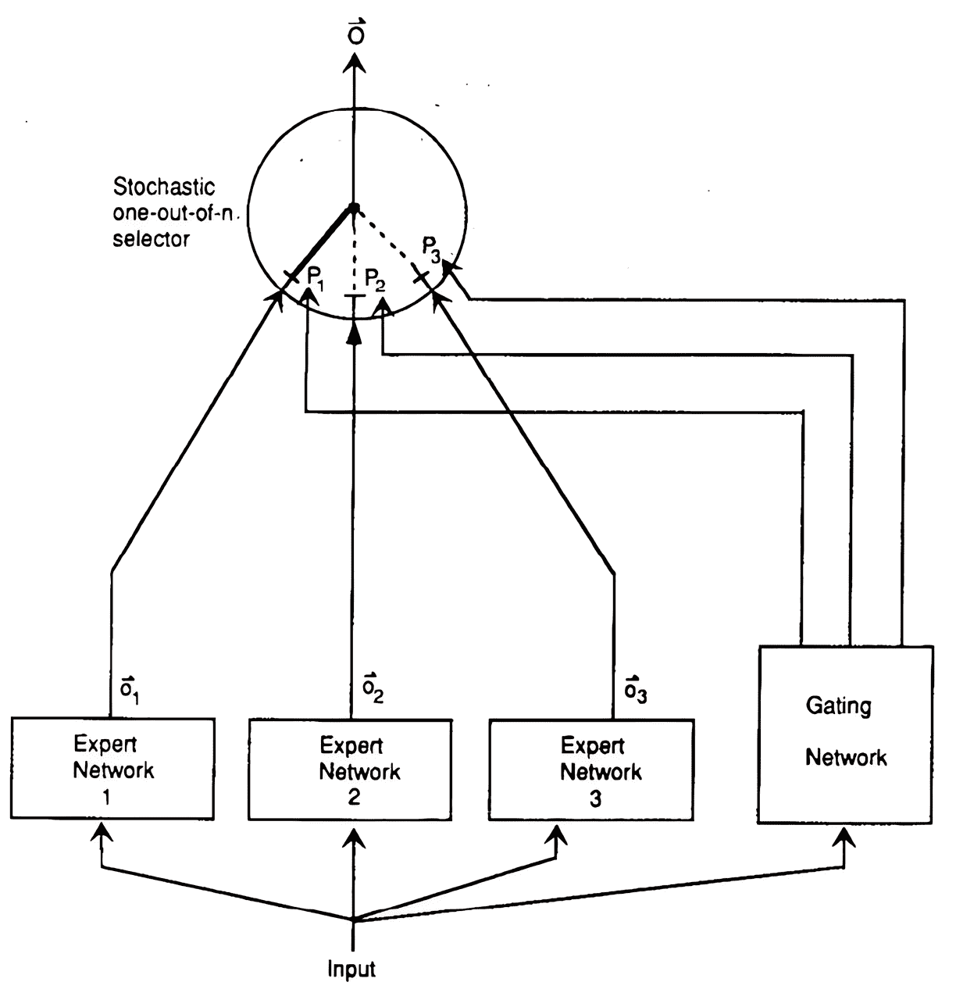
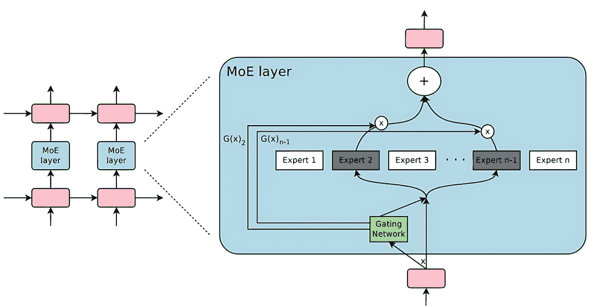
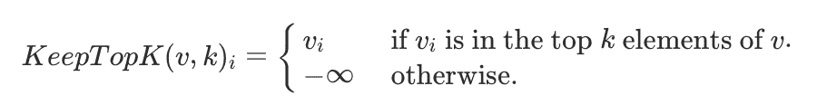
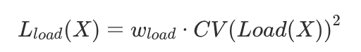
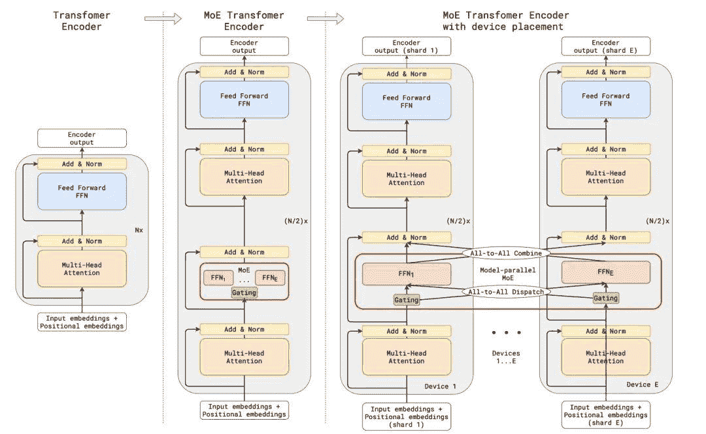
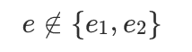
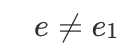
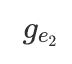
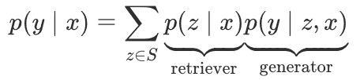
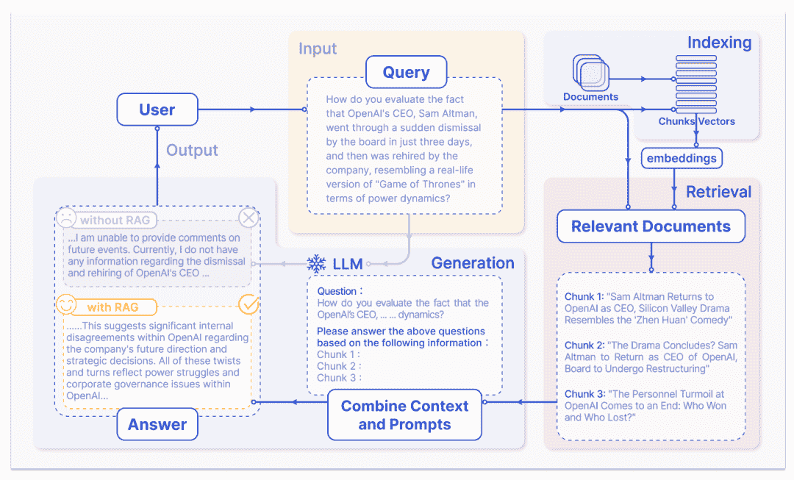

# MoE和RAG的基本概念和原理

> 来源：[https://qqs7y1hozd1.feishu.cn/docx/UdaidzjTOoBsGDxgLV3c24fYnFf](https://qqs7y1hozd1.feishu.cn/docx/UdaidzjTOoBsGDxgLV3c24fYnFf)

# **前言**

在**当前信息时代，大型语言模型（Larg**e** **Language Models，LLMs）的发展速度和影响力日益显著。随着技术进步，我们见证了从基本的Transformer架构到更为复杂和高效的模型架构的演进，如Mixture of Experts (MOE) 和Retrieval-Augmented Generation (RAG)。这些进步不仅推动了人工智能领域的边界，也对理解和应用这些技术提出了新的要求。

随**着时间**的**推移，**大模型的研究**和应用领域继续迅速发展，促使我们对已有知识的理**解进行更新和深化。因此，基于自己的学习成果，进一步讲解和深化对MOE和RAG内容的理解。这份笔记不仅反映了当前大模型研究的最新动态，也体现了深入学习和掌握这些复杂架构的重要性。

通过本文你将能够获得对**MOE**和**RAG**架构更为**深入的理解**，掌握它们的设计原理、优势及应用场景。我希望这份笔记能够为广大学习者提供价值，促进对大模型理论基础知识的深入学习和应用，同时激发更多的创新和探索。

# **MoE****&****RAG**

+   混合专家模型（Mixture of Experts, MoE）：创建一组专家，每个输入仅激活一小部分专家

+   由专家组成的顾问委员会，每个专家都有不同的背景（例如历史、数学、科学）

+   **检索增强生成（Retrieval-Augment****ed Generation, RA**G）：存储原始数据，给定一个新的输入，检索存储库的相关部分，并使用它们来预测输出

+   开卷考试，根据题目翻阅参考资料，找到相关内容并依此作答

## **MoE**

### **理念起源**

**MoE**的理念起源于**1991年的论文Adaptive Mixt****ure of Local Experts。考**虑到多任务场景下训练同一模型，在某场景更新权重时会影响到模型对其他场景的表现，干扰效应强，会造成学习缓慢和泛化不良

**在这种情况下，给定训练样本：**

+   如果能够事先知道其对应于哪个子任务，那么可以使用由几个不同的“专家”网络组成的系统以及使用一个门控网络来决定每个训练样本应该使用哪个专家

+   **如果输出不正确**，权重变化将定位到所选专家(和门控网络)，不会干扰到其他专家在其他情况下的权重

> **专家是局部的（对应英文****local****）**

+   **一方面专家之间的权重解耦**

+   另一方面每个专家只处理输入向量空间的一个小局部区域

通过对误差函数的巧妙设计，使得给定训练样本，局部专**家的目标不会受到其他**专家权重的直接影响，但仍存在一些间接耦合

**如果采用梯度下降法训练门控网络和局部专家**，则系统倾向于每个训练样本只分配一个专家

### **稀疏性**

**在20**10至**2**015年间，条件计算领域的研究为MoE的后续发展做出了显著贡献。条件计算会基于输入token动态激活或停用网络组件，在理论上它能够在不增加计算量的情况下显著增加模型容量，但实践中存在重大的算法和性能挑战。面对这些挑战，Shazeer等人提出引入稀疏门控MoE层，在MoE层有很多专家网络以及一个可训练的门控网络，每个专家都是一个简单的前馈神经网络，门控网络选择专家的稀疏组合来处理每个输入

基于**Softmax**门控网络，**稀疏门控网络的计算中添加了稀疏性以**减少计算量，添加了噪声项以有助于负载平衡。

具体而言，在**Softmax**之前，添加可调高斯噪声，然后仅保留前

个值，其余设置为：

### **平衡问题**

> **如果token总是被发送到少数几个受欢迎的专家，**那么训练效率将会降低，也会导致负载不平衡

+   **一方面：**前期表现好的专家会更容易被门控网络选择，导致最终只有少数的几个专家真正起作用，专家不平衡

+   **另一方面：**即使保证了专家们的同等重要性，它们可能仍会收到数量非常不同的样本，例如，一位专家可能会收到权重较大的几个样本，而另一位专家可能会收到许多权重较小的样本，这可能会导致分布式设备出现内存和性能问题

Shazeer等考虑使用**辅助损失**来缓解这一问题

对于专家不平衡问题，将“专家相对于一批训练样本

的重要性”定义为“该批所有样本的门控值之和”，计算此项的变异系数，乘上可手动调整的

得到

，该项附加损失鼓励所有专家都具有同等的重要性

对于专家接收训练样本数量不同问题，定义平滑估计

表示在批量

中分配给每个专家的样本数量，可通过该估计反向传播梯度，定义

为

不为零的概率（给定元素

新的噪声随机选择但在其他元素上保留已采样的噪声选择），则有：

### **MoE****+****Transformer**

Transformer是NLP领域的大杀**器**，其前馈层对于每个token是独立的。Gshard将Transformer中的原始前馈层转变为MoE前馈层，MoE前馈层每隔一个block替换一次Transformer前馈层，结构如下图（解码器类似）

> **可以看到：**

+   标准Transformer的编码器是一堆自注意力层和前馈层，交错着残差连接和层归一化

+   通过用**MoE****层隔b**lock替换前馈层，得到了MoE+Transformer Encoder的模型结构

+   当扩展到多个设备时，**MoE**层被跨设备分片，而所有其他层都会被复制

Gshard使用top-2专家近似门控函数，

由门控网络计算，每个token被分配到至多两个专家，其对应的

非零。

**top-2专家近似门控函数**

+   计算第一个专家：

+   计算第二个专家：

+   始终保留第一个专家，并随机保留第二个专家：

设

在概率为

的情况下，

。对于其他专家

，

在概率为

的情况下，

。对于

，

为保持负载平衡和规模高效，Gshard还引入如下方法：

+   **专家容量：**强制要求每位专家处理的token数低于某一统一阈值。如果token所选择的两个专家都已超出其容量，则该token通过残差连接传递到下一层

+   **本地组调度：**将一个训练批次的所有token均分成多组，所有组独立并行处理，在组级别保证专家容量

+   **辅助损失：**尽可能使得每个专家被分配到的token数接近一致

+   **随机****路由****：**始终选择第1个专家，以正比于

概率选择第2个专家。如果

非常小，可将其忽略以节省专家容量

### **RAG**

**基于检索的模型的工作流程：**

1.  建立存储库

，它是一组序列（通常是文档或段落）的集合

1.  基于输入

，检索相关序列

1.  给定检索序列

和输入

，生成输出

在形式上可定义为

> **在大模型时代，****RAG**工作流程可简要概括为三个关键步骤：

+   将语料库划分为离散的块并构建向量索引

+   根据查询和索引块的向量相似性来识别和检索块

+   模型根据查询以及检索块中收集到的上下文信息来生成响应

**具体而言：**

**Indexing**：**清洗和提取原始数据**，将**各种**文件格**式（如 PDF、HTML、Word 和 Ma**rkdown）转换为标准化的纯文本。为适应语言模型的上下文窗口限制，需要将文本分割成更小、更易于管理的块。这些块随后通过嵌入模型转换为向量表示。最后，创建索引，将这些文本块及其向量嵌入存储为键值对，从而实现高效且可扩展的搜索功能

**Retrieval**：在收到用户查询后，使用与索引阶段相同的嵌入模型，将查询转换为向量表示，然后计算查询向量与“索引语料库”中的向量块之间的相似性分数。系统会优先处理并检索与查询相似度最高的前

个块。这些块随后被用作用户查询的上下文

**Generation**：查询和选定的文档被合成一个**prompt**，输入LLM**生成回答。在**正在进行的对话中，任何现有的对话历史记录都可以集成到prompt中，使模型能够有效地进行多轮对话交互

**可能存在的问题**：**检**索质量可能存在精度低、检索到的块未对齐以及幻觉等潜在问题，还可能会出现低召回率，无法检索到所有相关块，从而影响LLM生成综合响应。

过时的信息可能会产生不准确的检索结果，会进一步加剧该问题。同时，响应生成质量存在幻觉挑战，即模型没有基于所检索到的上下文来生成答案，以及模型输出可能存在潜在毒性或偏差问题。增强过程的挑战在于能否有效地将检索到的段落中的上下文与当前生成任务相结合，这可能导致脱节或不连贯的输出。生成内容也可能存在冗余和重复，尤其是当检索到的多个段落包含相似的信息时。同时，如何衡量检索到的内容对生成任务的重要性和相关性、如何调和写作风格和语气的差异以确保输出的一致性也很重要。此外，存在生成模型过度依赖增强信息的风险，这可能导致输出仅重复检索到的内容，而没有提供新的价值或综合信息

针对上述问题，也存在一些改进方案：

Pre-Retrieval Process：优化数据索引，提高被索引内容的质量。这涉及的主要策略有：增强数据粒度、优化索引结构、添加元数据、对齐优化和混合检索

+   增强数据粒度旨在提升文本标准性、一致性、事实准确性和上下文的丰富性。这包括删除不相关的信息、消除实体和术语中的歧义、确认事实准确性、维护上下文以及更新过时的文档

+   优化索引结构包括调整块的大小以捕获相关上下文，跨多个索引路径进行查询，以及通过利用图数据索引中节点之间的关系来合并图结构中的信息以捕获相关上下文

+   添加元数据信息涉及将引用的元数据（如日期和用途）集成到块中以进行筛选，合并元数据（如参考文献的章节和小节）以提高检索效率

+   对齐优化通过在文档中引入“假设问题”来解决文档之间的对齐问题和差异

+   混合检索是指结合基于关键词的传统搜索（tf-idf或BM25）和”现代“的语义搜索或向量搜索进而生成检索结果

**Retrieval****：在检索阶段，重点是计**算查询和索引块之间的相似性来识别上下文。嵌入模型是此过程的核心，可以考虑微调嵌入模型或者使用动态嵌入

**Post-Retrieval Process：检索**到有价值的上下文后，需要将其与查询合并作为 LLM 的输入。一次性向 LLM 提交所有相关文档可能会超出上下文窗口限制、引入噪音并阻碍对关键信息的关注。要解决这些问题，需要对检索到的内容进行额外处理

+   **Re-Ranking**：对检索到的信息进行重新排序以重新定位最相关的内容

+   Prompt Compression：压缩不相关的上下文，突出显示关键段落，并减少整体上下文长度

随着**RAG****领域的**发展和行业需求的不断挖掘，模块化的RAG结构提供了更大的多功能性和灵活性。