# 激活函数

> 来源：[https://qqs7y1hozd1.feishu.cn/docx/EAQ2dZcQ8oFmR5xQlDLcBCzBnGg](https://qqs7y1hozd1.feishu.cn/docx/EAQ2dZcQ8oFmR5xQlDLcBCzBnGg)

# **激活函数作用**

神经网络是线性的，无法解决非线性的问题

加入**激活函数**就是给模型**引入非线性能力**

不同的激活函数，特点和作用不同：

+   Sigmoid和tanh的特点是将输出限制在(0,1)和(-1,1)之间，说明Sigmoid和tanh适合做概率值的处理，例如LSTM中的各种门；而ReLU就不行，因为ReLU无最大值限制，可能会出现很大值。

+   ReLU适合用于深层网络的训练，而Sigmoid和tanh则不行，因为它们会出现梯度消失。

# **梯度爆炸和梯度消失**

模型中的**梯度爆炸和梯度消失**问题：

+   激活函数导致的梯度消失，像 sigmoid 和 tanh 都会导致梯度消失；

+   矩阵连乘也会导致梯度消失，这个原因导致的梯度消失无法通过更换激活函数来避免。直观的说就是在反向传播时，梯度会连乘，当梯度都小于1.0时，就会出现梯度消失；当梯度都大于1.0时，就会出现梯度爆炸。

如何解决梯度爆炸和梯度消失问题：

+   上述第一个问题只需要使用像**ReLU**这种激活函数就可以解决

+   上述第二个问题没有能够完全解决的方法，目前**有一些****方法可以很大程度上进行缓解该问题。比如：对梯度做截断解决梯度爆炸问题、残差连接、normali**ze。由于使用了残差连接和 normalize 之后梯度消失和梯度爆炸已经极少出现了，所以目前可以认为该问题已经解决了。

# **Sigmoid**

**Sigmoid函数公式：**

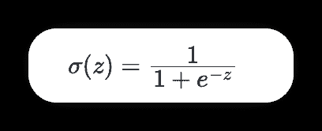

**导数公式：**

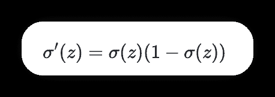

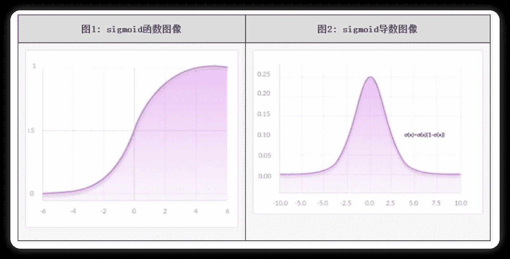

> **优点：**

+   **平滑，易于求导**

+   取值范围是(0, 1)，可直接用于**求概率值的问题或者分类问题**；比如 LSTM 中的门，二分类或者多标签分类问题

> **缺点：**

+   **计算量大**，包含幂运算，以及除法运算；

+   sigmoid 导数的取值范围是 [0, 0.25]，最大值都是小于 1 的，反向传播时又是"链式传导"，经过几次相乘之后很容易就会出现梯度消失的问题；

+   sigmoid 的输出的均值不是0（即zero-centered），这会导致当前层接收到上一层的非0均值的信号作为输入，随着网络的加深，会改变数据的原始分布

# **Tanh**

**Tanh的函数公式为：**

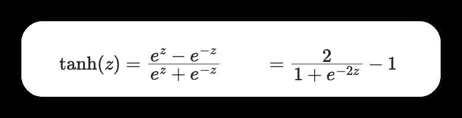

从上述公式的第二行可以看出，**tanh函数**可以由**sigmoid函数**经过平移和拉伸得到。

tanh 函数的取值范围是（-1, 1）

**导数公式：**

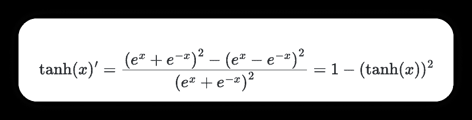

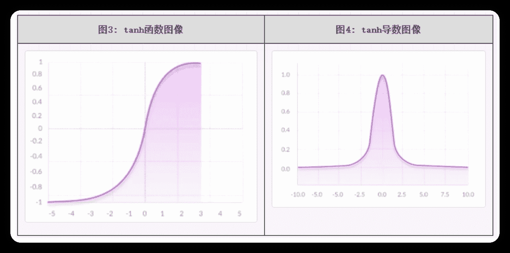

**tanh函数**可以理解为是基于 sigmoid 函数的一种改进的激活函数，所以对于sigmoid函数的缺点，它能够解决一部分。但是 tanh 函数依然有着不少的缺点。

**tanh 函数的特点如下：**

+   它的输出范围是(-1, 1)，解决了 sigmoid 函数输出的均值不是0（zero-centered）的问题

+   tanh 的导数取值范围是(0, 1)，可以看出其在**反向传播**的"链式传导"过程中的梯度消失问题要比 sigmoid 函数要好一些，但是其依然存在着梯度消失问题

+   **幂运算依然存在，计算量比较大**

# **ReLU****系列**

## **ReLU**

ReLU**全称为 Rect**ified Linear Unit，即修正线性单元函数

该函数的公式比较简单，相应的公式和图像如下表所示：

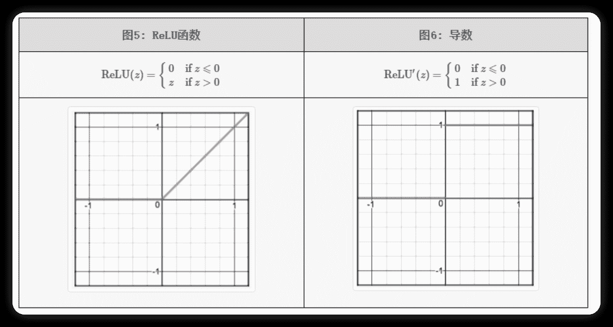

**相比于 ****sigmoid****、****tanh ****这两个激活函数，****ReLU ****激活函数的优缺点如下：**

+   **当 ****z>0** 时，ReL**U激活函数的导**数恒**为常数1**，这**就避免了sigmo**id和 ta**nh会在**神经网络层数比较深的时候出现的梯度消失的问题；

+   计算复杂度低，不再含有幂运算，只需要一**个阈值**就能够得到其导数；

+   经过实际实验发现，**使用ReLU作****为****激活函数****，**模型收敛的速度比sigmoid和tanh快；

+   当 z<0时，ReLU 激活函数的导数恒为常数0，这既带来了一些有利的方面，也导致了一些坏的方面，分别进行描述。

+   **有利的方面：**

在深度学习中，目标是从**大量数据中学习到关键特征**，也就是把密集矩阵转化为**稀疏矩阵****，保留数据的关键信息，****去除噪**音，这样的模型就有了鲁棒性。ReLU激活函数中将 z<0的部分置为0，就是产生稀疏矩阵的过程。

+   **坏的方面：**

将 z<0的部分梯度直接置为0会导致 Dead Re**LU Problem(神经元坏死现象)。可能会导致**部分神经元不再对输入数据做响应，无论输入什么数据，该部分神经元的参数都不会被更新。（这个问题是一个非常严重的问题，后续不少工作都是在解决这个问题）

+   ReLU 有可能会导致梯度爆炸问题，解决方法是梯度截断；

+   **ReLU 的输**出不是 0 均值的，这个和sigmoid类似。（后续的优化工作ELU在该问题上解决的比较好，ELU的输出是近似为0的）

## **Leaky ReLU**

为了解决** ReLU**的**Dead ReLU**问题，提出了渗漏整流线**性单元(Leaky **ReLU)，该方法是ReLU 的一个变体。

其在z>0的部分与ReLU一样保持不变；在z<0的部分，采用一个非常小的斜率0.01

**其图像如下所示**：

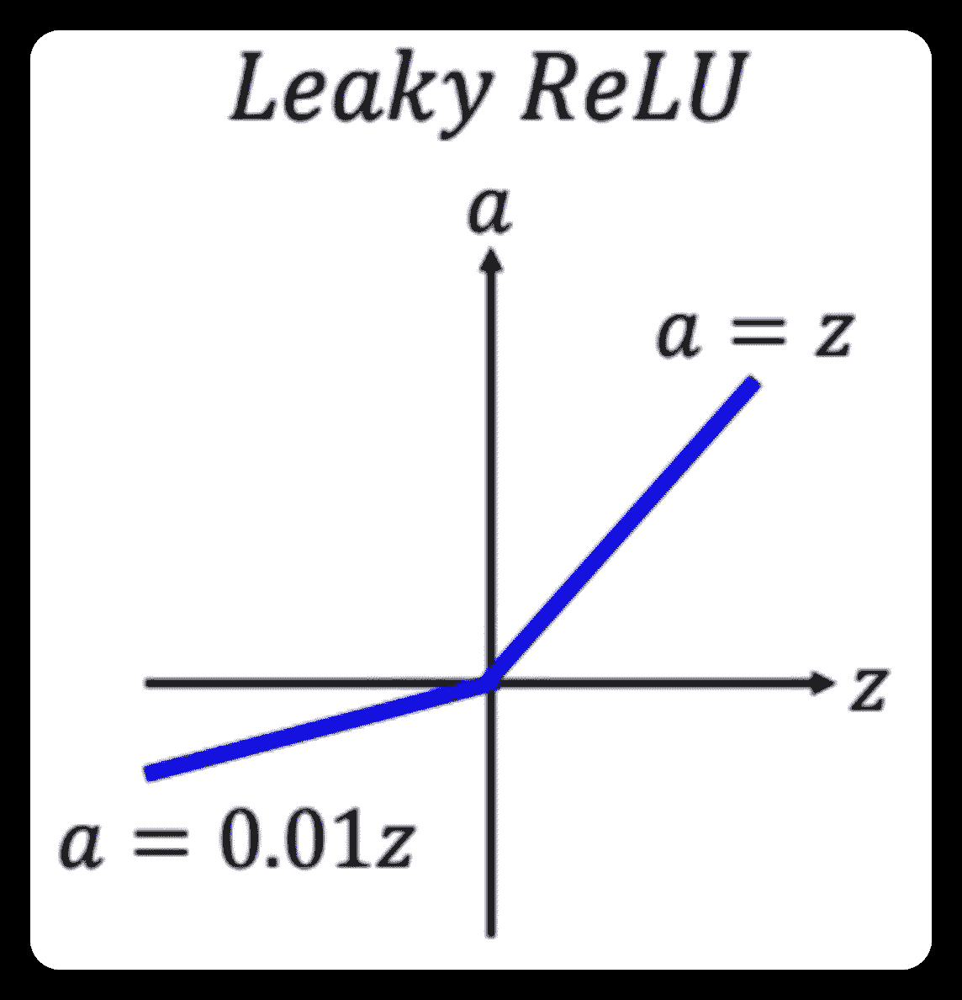

该方法是ReLU的一个变体，能够在一定程度上解决 De**ad ReL**U 问题，但是该方法的缺点是效果并不稳定，所以实际实验中使用该方法的并不多。

## **PReLU****, ****RReLU**

**PReLU 的全称为 Parametric Relu；PRe**LU 的全称为 Random ReLU。

**这两个方法和 Lea**ky ReLU类似，都是 ReLU的变体，也都是为了解决 Dead ReLU 问题而提出来的。

> **Leaky ReLU是在****z<0**时**，设置了一个较小的常数0.**01作为斜率。由于这种常数值的斜率并不好，所以PReLU提出了可学习的斜率，RReLU 提出了随机的斜率

这里的 𝛼是从一个高斯分布中随机产生的，在训练过程中每次这个 𝛼 都是不相同的

在推理时会将这个alpha都是不相同的；在推理时会将这个

PReLU 和 RReLU 的图像如下所示：

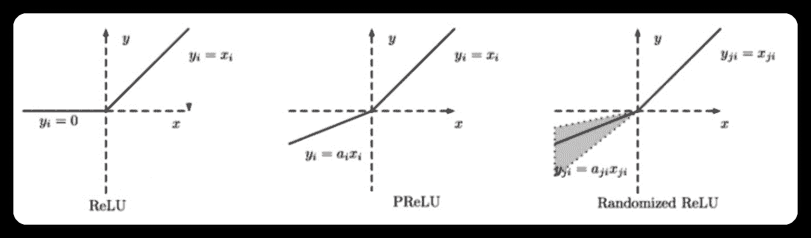

## **ELU****（指数线性单元）**

**E**LU 的提出也解决了 ReLU 的问题。与 ReLU 相比，ELU 有负值，这会使激活的平均值接近零，让模型学习得更快。

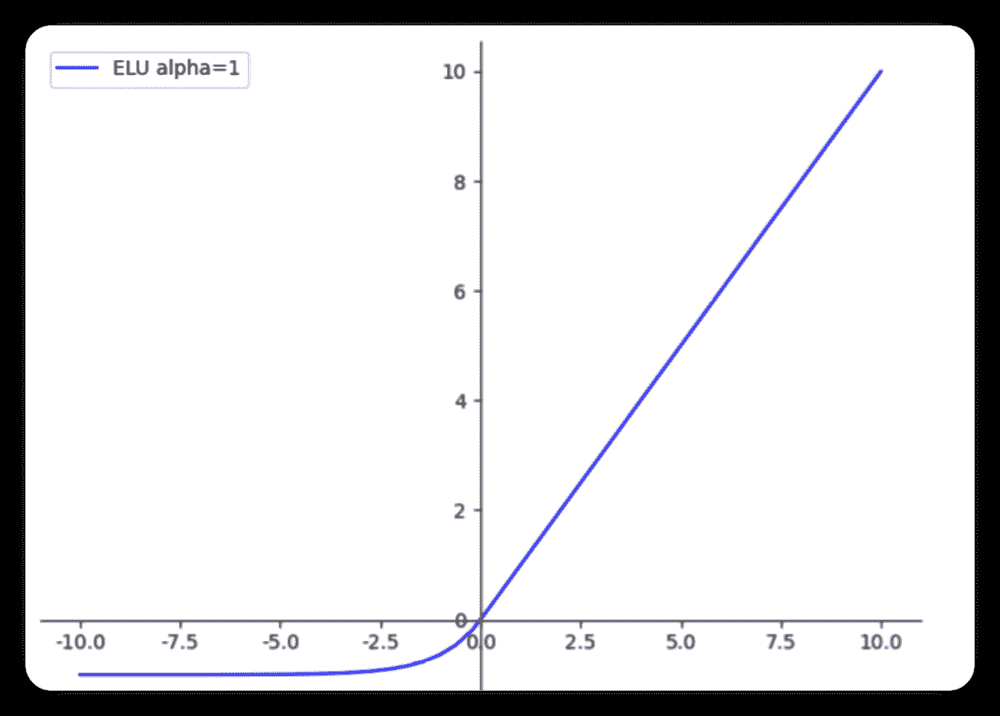

其中 𝛼不是固定的，是通过**反向传播学**习**出来的。ELU的**一个小问题是需要exp计算，运算量会更大一些。

+   **融合了sigmoid和ReLU**，**左侧具有软饱和性，右侧无饱和性**。

+   右侧线性部分使得**ELU能够缓解梯度消失**，而左侧软饱能够让**ELU对输入变化或噪声更鲁棒**。

+   ELU的输出均值接近于零，所以收敛速度更快。

# **GeLU**

## **6.1 介绍**

先看一下 ReLU 激活函数是怎样做的，该函数中包含两种映射：

+   一个是恒等映射（identity mapping），当输入值大于零时就是恒等映射

+   一个是置零映射（zero mapping），当输入值小于等于零时就是置零映射

**参考ReLU激活函数**，设计另外一个包含恒等映射和置零映射的激活函数，并且参考ReLU函数来看，新激活函数应该有如下性质：

1.  **在输入 ****x**** 满足某些条件时，为恒等映射**

1.  **在输入 ****x** 满足另外一些条件时，为置零映射

1.  **在输入 ****x**** **是一个较大的正值时，更希望为恒等映射；在输入 x 为一个较小的负值时，更希望是一个置零映射

以上就是想要新设计的激活函数的性质。

下面的**图7和图8**是标准正态分布的概率密度函数和累积分布函数的图像

接下来根据**下图8**中的累积分布函数设计一个新的函数。

> **符**号定义：输入值用 𝑥 表示，$ϕ(⋅)$表示下图8中的正态分布的累积分布函数，$f(⋅)$表示新设计的函数。

> **设计的新函数：给定输入值 𝑥，函数 𝑓(𝑥)的输出值以 𝜙(𝑥)的概率**采用恒等映射，以 1−𝜙(𝑥)的概率采用置零映射。也就是下述公式：

𝑓(𝑥)=𝑥⋅𝜙(𝑥)+0⋅(1−𝜙(𝑥)) =𝑥⋅𝜙(𝑥)

然后看一下，新设计的这个公式是否满足上述的激活函数性质。前两条是肯定满足的，主要看一下第3条性质：

+   当输入 𝑥 是一个较大的正值时，从图8中可以看出 𝜙(𝑥)的函数图像逐渐趋近于1，由于函数 𝑓(𝑥)的输出值以 𝜙(𝑥)的概率采用恒等映射，所以有接近于1的概率采用恒等映射；

+   当输入 𝑥 是一个较小的负值时，$ϕ(x)$趋近于0，由于函数 𝑓(𝑥)以 1−𝜙(𝑥)的概率采用置零映射，所以有接近于1的概率采用置零映射；

可以看出新设计的这个函数是满足上述激活函数的性质的。

为了更直观描述设计该函数时的直觉，上述都是采用图8进行描述的

上述公式如果使用图7中的概率密度函数就是如下形式：

**其中$x$表示实际的输入值，$X$表示随机变量。到此**就得到了GELU的常见形式，公式如下所示：

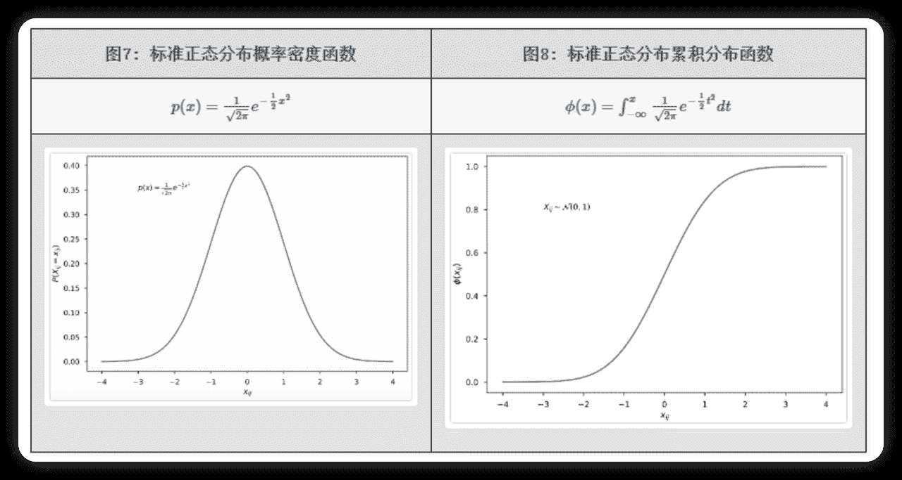

**这里描**述的设计 GELU 函数的直觉思路是非常简化的版本，只是为了易于理解。实际在设计这个函数时还需要考虑更多的因素，比如该函数的那几条性质和 ReLU 很像，已经有了 ReLU 为什么还要设计这个函数，这个函数在理论上是否能够解决 ReLU 的存在的 Dead ReLU 等问题

## **函数及导数**

GeLU公式为：

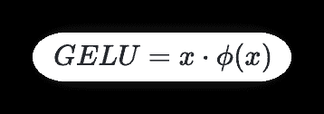

使用该函数作为激活函数时，需要求解其导数，对其求导可得：

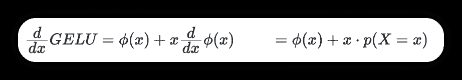

**其中$X$**是随机变量，$p(X=x)$是图7中的标准正态分布概率密度函数中，随机变量取值为$x$时的值。

GELU 函数及其导数的图像如下所示。可以看出其函数图像和 ReLU 非常相似，其导数图像也和 ReLU 的导数图像非常相似，不过该图像是连续的。

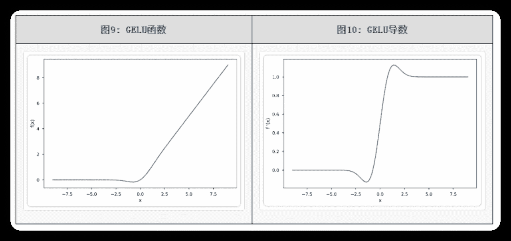

> **GELU激活函数的优缺点：**

+   从其函数图像可以看出，在负值区域，不再全为0，这解决了Dead ReLU问题

+   GELU 函数是处处连续、光滑可导的

## **精确计算**

对于 GeLU 的加速计算有两种方法。

+   第一种方法是精确求解。有一个函数为 Gauss Error function (gef)，由于使用率非常高所以在常见的库（比如TensorFlow、PyTorch）中都有针对该函数的优化，该函数的公式如下。

所以如果能够先求解出$erf(\cdot)$，再由该函数求解出 𝜙(𝑥)，那么可以加快计算。下面省略具体的推导过程，直接给出计算公式：

+   另一种方法是不精确求解，而是求解其近似值。为了加速计算，还可以使用近似计算的方式。GELU 的近似公式如下所示：

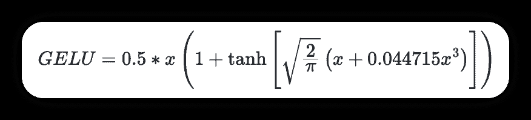

# **Swish**

**该激活函数的公式为：**

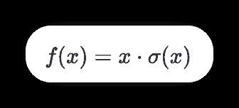

**Swish导数：**

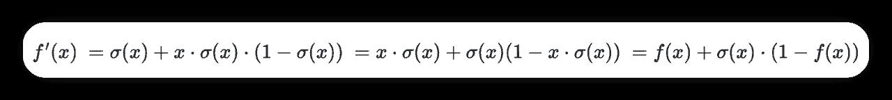

**该激活函数的图像为：**

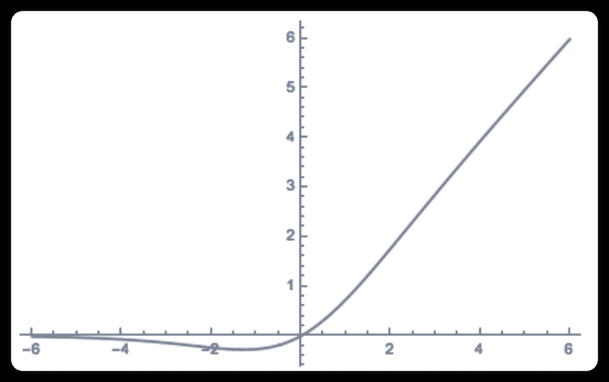

> **Swish特点：**

+   和ReLU一样，没有上边界，因此不会出现梯度饱和现象

+   有下边界，可以产生更强的正则化效果（x左半轴慢慢趋近于0）

+   **非单调**

+   **处处连续且可到，更容易训练**

> **关于正则化效果：****x**[**轴越靠**](https://so.csdn.net/so/search?q=%E6%AD%A3%E5%88%99%E5%8C%96&spm=1001.2101.3001.7020)**近左半**轴，纵坐标的值越小，甚至接近于0，如果x值是-10，那么经过激活之后的值接近于0，那么就可以一定程度上过滤掉一部分信息，起到正则化的效果。

# **GLU**

PaLM 和 LLaMA 中都使用 SwiGLU 替换了 FFN

GLU 全称为Ga**ted Line**ar Unit，即门控线性单元函数。

参考ReLU激活函数，激活函数GLU的公式为如下公式的形式：

> **这**里有一个新符号 𝑔(𝑥)表示的是向量$x$经过一层MLP或者卷积，$⊗$表示两个向量逐元素相乘，$σ$ 表示sigmoid函数。

> **当$\sigma(g(x))$趋近于0时表示对$x$进行阻断，当$\s**igma(g(x))$趋近于1时表示允许$x$通过，以此实现门控激活函数的效果。