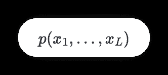
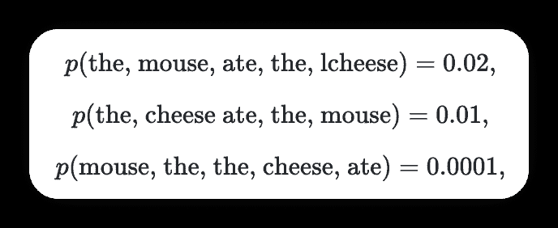
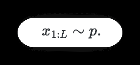
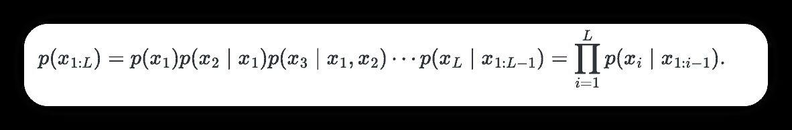
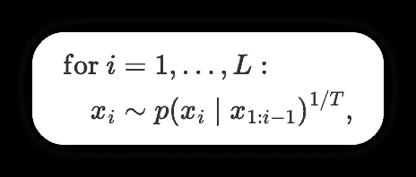
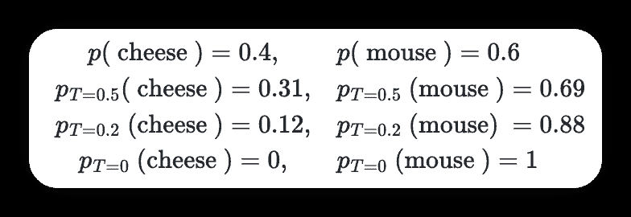
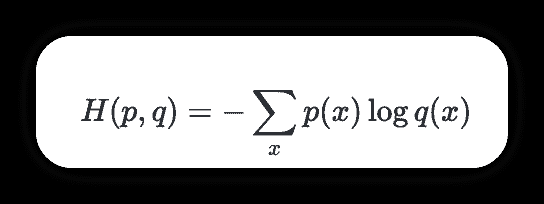
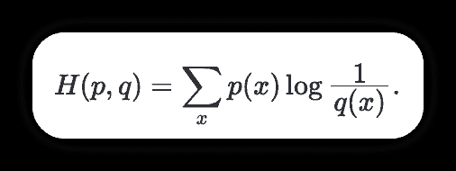
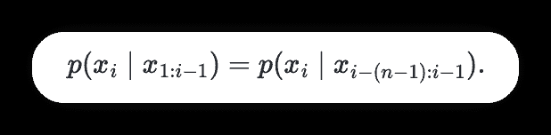

# 语言模型

> 来源：[https://qqs7y1hozd1.feishu.cn/docx/Y2madykYxoPJ9Mx2Kx0c4h8nnwc](https://qqs7y1hozd1.feishu.cn/docx/Y2madykYxoPJ9Mx2Kx0c4h8nnwc)

# **什么是语言模型**

**语言模型（LM）**的经典定义是一种对令牌序列(token)的概率分布。

> **假设有一个令牌集的词汇表𝑉 **

> **语言模型p为每个令牌序列 **𝑥1,...,𝑥𝐿 ∈ 𝑉 分配一个概率（介于0和1之间的数字）

> **概率直观地告诉**我们一个标记序列有多“好（good）”

> 例如，如果词汇表为{ate, ball, cheese, mouse, the}，语言模型可能会分配以下概率（演示）

从数学上讲，语言模型是一个**非常简单而又美妙**的对象。

**但是这种简单是具有欺骗性的：****赋予所有序列以（有意义的）概率的能力，该能力要求语言模型具**有非凡的（但是隐含的）语言能力和世界知识。

> 例如，语言模型应该隐含地赋予**"𝗆𝗈𝗎𝗌𝖾 𝗍𝗁𝖾 𝗍𝗁𝖾 𝖼𝗁𝖾𝖾𝗌𝖾 𝖺𝗍𝖾"**一个非常低的概率，**因为它在语法上是不正确的**（句法知识）。由于**世界知识**的存在，语言模型应该隐含地赋予**"𝗍𝗁𝖾 𝗆𝗈𝗎𝗌𝖾 𝖺𝗍𝖾 𝗍𝗁𝖾 𝖼𝗁𝖾𝖾𝗌𝖾"**比**"𝗍𝗁𝖾 𝖼𝗁𝖾𝖾𝗌𝖾 𝖺𝗍𝖾 𝗍𝗁𝖾 𝗆𝗈𝗎𝗌𝖾"**更高的概率。**这**是因为两个句子在句法上是相同的，但在语义上却存在差异，而语言模型需要具备卓越的语言能力和世界知识，才能准确评估序列的概率。

语言模型也可以做生成任务。

如定义所示，语言模型p接受一个序列并返回一个概率来评估其好坏。

**我们也可以根据语言模**型生成一个序列。最纯粹的方法是从语言模型p中以概率p(x_{1:L})进行采样，表示为：

如何在计算上高效地实现这一点**取决于语言模型p的形式**。

实**际上，我**们通常不直接从语言**模型中进**行采样，这既因为真实语言模型的限制，也因为我们有时希望获得的不是一个“平均”的序列，而是更接近“最佳”序列的结果。

## **自回归语言模型(Autoregress**ive language models)

将序列 **𝑥1:𝐿 的联**合分布 𝑝(**𝑥1:𝐿) 的常见写**法是使用概率的链式法则：

**这里有一个基于文本的例子：**

𝑝(𝑡ℎ𝑒,𝑚𝑜𝑢𝑠𝑒,𝑎𝑡𝑒,𝑡ℎ𝑒,𝑐ℎ𝑒𝑒𝑠𝑒)=,𝑝(𝑡ℎ𝑒)  𝑝(𝑚𝑜𝑢𝑠𝑒∣𝑡ℎ𝑒) 𝑝(𝑎𝑡𝑒∣𝑡ℎ𝑒,𝑚𝑜𝑢𝑠𝑒)  𝑝(𝑡ℎ𝑒∣𝑡ℎ𝑒,𝑚𝑜𝑢𝑠𝑒,𝑎𝑡𝑒) 𝑝(𝑐ℎ𝑒𝑒𝑠𝑒∣𝑡ℎ𝑒,𝑚𝑜𝑢𝑠𝑒,𝑎𝑡𝑒,𝑡ℎ𝑒).

特别地，需要理解 𝑝(𝑥𝑖∣𝑥1:𝑖−1**) 是一个给定前面**的记号 𝑥1:𝑖−1 后，下一个记号 𝑥𝑖 的条件概率分布。

+   在数学上，任何联合概率分布都可以通过这种方式表示。然**而，自回归语**言模型的特点是它可以利用例如前馈神经网络等方法有效计算出每个条件概率分布 p(x_{i}∣x_{1:i−1})。

+   在自回归语言模型 **𝑝 中**生成整个序列 𝑥**1:𝐿 ，我**们需要一次生**成一个令牌(token)，该**令牌基于之前以生成的令牌进行计算获得：

其中 𝑇≥0 是一个控制我们希望从语言模型中得到多少随机性的温度参数：

+   T=0：确定性地在每个位置 i 选择最可能的令牌 𝑥𝑖

+   T=1：从纯语言模型“正常（normally）”采样

+   T=∞：从整个词汇表上的均匀分布中采样

然而，如果我们仅将概率提高到** 1/𝑇 **的次方，概**率分布可能不会加和到 1。**

我们可以通过重新标准化分布来解决这个问题。

我们将标准化版本 **𝑝𝑇(𝑥𝑖∣𝑥1:𝑖−1)∝𝑝(𝑥𝑖∣𝑥1**:𝑖**−1)1/𝑇称为****退**火条件概率分布。 例如：

> 具体来说，这个**温度参数会应**用于每一步的条件概率分布𝑝(𝑥𝑖∣𝑥1:𝑖−1) ，将其幂变为 1/𝑇 。

> 这意味着**当** **𝑇 **值较高时，**我**们**会获**得更平均的概率分布，生成的结果更具随机性；反之，当 𝑇 值较低时，模型会更倾向于生成概率较高的令牌。

然而，有一个重要的注意事项：对于每一步的条件概率分布应用温度参数 𝑇 ，并进行迭代采样，这种方法并不等同于（除非 𝑇=1 ）从整个长度为 L 的序列的"退火"分布中一次性采样。换句话说，这两种方法在 𝑇≠1 时会产生不同的结果。

"**退火"这**个**术语来源于冶金学，其中热的金**属会逐渐冷却以改变其物理性质。在这里，它类比的是对概率分布进行调整的过程。"退火"分布是通过将原始概率分布的每个元素都取幂 1/𝑇 ，然后重新标准化得到的新分布。

当 𝑇≠1 时，这个过程会改变原始概率分布，因此从"退火"分布中采样得到的结果可能与对每一步的条件分布应用 T 并进行迭代采样的结果不同。

对于非自回归的条件生成，更一般地，我们可以通过指定某个前缀序列 𝑥1:𝑖（称为提示）并采样其余的 𝑥𝑖+1:𝐿 （称为补全）来进行条件生成。

**例如，生成 𝑇=0 的产生的：**

如果我们将温度改为 𝑇=1 ，我们可以得到更多的多样性（演示），例如，"its house" 和 "my homework"。$∂$我们将很快看到，条件生成解锁了语言模型通过简单地更改提示就能解决各种任务的能力。

## **总结**

+   语言模型是序列 𝑥1:𝐿 的概率分布 p

+   直观上，一个好的语言模型应具有语言能力和世界知识

+   **自回归语言模型允许有效地生成给定提示 **𝑥1:𝑖 的补全 𝑥𝑖+1:𝐿

+   **温度可以用来控制生成中的变异量**

# **大模型相关历史回顾**

## 信息理论、英语的熵、n-gram模型

**语言模型的发展**可以追溯到**克劳德·香农****，他在1948年的**具有里程碑意义的论文《通信的数学理论》中奠定了信息理论的基础。

**在这篇论文中，他引入**了用于度量概率分布的熵（Entropy） 的概念：

𝐻(𝑝)=∑𝑥𝑝(𝑥)log⁡1𝑝(𝑥).

**熵实际上是一个衡量将样本𝑥∼𝑝编码（即压**缩）成比特串所需要的预期比特数的度量。

举例来说，"the mouse ate the cheese" 可能会被编码成 "0001110101"

熵的值越小，表明序列的结构性越强，编码的长度就越短

直观地理解，\log \frac{1}{p(x)}可以视为用于表示出现概率为 𝑝(𝑥) 的元素 𝑥 的编码的长度。

> **例**如，如果 𝑝(𝑥)=1/8 ，我们就需要分配 𝑙𝑜𝑔2(8)=3 个比特（或等价地， 𝑙𝑜𝑔(8)=2.08 个自然单位）。

> **需**要注意的是，实际上达到香农极限（Shannon limit）是非常具有挑战性的（例如，低密度奇偶校验码），这也是编码理论研究的主题之一。

### **英语的熵**

香农特别对**测量英语的熵感兴趣**，将其表示为一系列的字母。

这意味着我们想象存在一个“真实”的分布p（这种存在是有问题的，但它仍然是一个有用的数学抽象），它能产生英语文本样本x∼p。

**香农还定义了交叉熵：**

这测量了需要多少比特（nats）来编码样本x∼p，使用由模型q给出的压缩方案（用长度为1/q(x)的代码表示x）。

**通过语言模型****估计熵。****一个关键****的**属性是，交叉熵H(p,q)上界是熵H(p)：

这意味着我们可以通过构建一个只有来自真实数据分布p的样本的（语言）模型q来估计H(p,q)，而H(p)通常无法访问，如果p是英语的话。

所以我们**可以通过构建更好的模型q来得到熵**H(p)的更好的估计，由H(p,q)衡量。

**香农游戏（人类语言模型）**香农首先在1948年使用**n-gram**模型作为q，但在他1951年的论文《打印英语的预测和熵》中，他引入了一个巧妙的方案（称为香农游戏），其中q是由人提供的：

"the mouse ate my ho_"

人们不擅长提供任意文本的校准概率，所以在香农游戏中，人类语言模型会反复尝试猜测下一个字母，然后我们会记录猜测的次数。

### **用于下游应用的N-gram模型**

语言模型首先被用于需要生成文本的实践应用：

+   1970年代的语音识别（输入：声音信号，输出：文本）

+   1990年代的机器翻译（输入：源语言的文本，输出：目标语言的文本）

**噪声信道模型。当时解决这些任务的**主要模型是噪声信道模型。以语音识别为例：

+   我们假设有一些从某个分布p中抽取的文本

+   这些文本被转换为语音（声音信号）

+   然后给定语音，我们希望恢复（最有可能的）文本

**这可以通过贝叶斯定理实现：**

语音识别和机器翻译系统使用了**基于词的n-gram语言模型**（最早由香农引入，但针对的是字符）

**N-**gram**模型在一个n-gra**m**模型中，**关**于𝑥𝑖**的预**测只依赖于最后的** 𝑛−1 个字符 𝑥𝑖−(𝑛−1):𝑖−1 ，而不是整个历史：

例如，一个trigram（n=3）模型会定义：

这些概率是基于各种**n-gram**（例如，𝖺𝗍𝖾 𝗍𝗁𝖾 𝗆𝗈𝗎𝗌𝖾和𝖺𝗍𝖾 𝗍𝗁𝖾 𝖼𝗁𝖾𝖾𝗌𝖾）在大量文本中出现的次数计算的，并且适当地平滑以避免过拟合（例如，Kneser-Ney平滑）

将**n-gram**模型拟合到数据上非常便宜且可扩展。因此，n-gram模型被训练在大量的文本上

例如，[Brants等人（2007）](https://aclanthology.org/D07-1090.pdf)**在2万亿**个tokens上训练了一个5-gram模型用于机器翻译。

相比之下，GPT-3只在3000亿个tokens上进行了训练。然而，n-gram模型有其根本的限制。

**想象以下的前缀：**

**𝖲𝗍𝖺**𝗇𝖿𝗈𝗋𝖽 𝗁𝖺𝗌 𝖺 𝗇𝖾𝗐 𝖼𝗈𝗎𝗋𝗌𝖾 𝗈𝗇 𝗅𝖺𝗋𝗀𝖾 𝗅𝖺𝗇𝗀𝗎𝖺𝗀𝖾 𝗆𝗈𝖽𝖾𝗅𝗌. 𝖨𝗍 𝗐𝗂𝗅𝗅 𝖻𝖾 𝗍𝖺𝗎𝗀𝗁𝗍 𝖻𝗒 ___

如果n太小，那么模型将无法捕获长距离的依赖关系，下一个词将无法依赖于𝖲𝗍𝖺𝗇𝖿𝗈𝗋𝖽。

然而，如果n太大，统计上将无法得到概率的好估计（即使在“大”语料库中，几乎所有合理的长序列都出现0次）：

𝑐𝑜𝑢𝑛𝑡(𝖲𝗍𝖺𝗇𝖿𝗈𝗋𝖽,𝗁𝖺𝗌,𝖺,𝗇𝖾𝗐,𝖼𝗈𝗎𝗋𝗌𝖾,𝗈𝗇,𝗅𝖺𝗋𝗀𝖾,𝗅𝖺𝗇𝗀𝗎𝖺𝗀𝖾,𝗆𝗈𝖽𝖾𝗅𝗌)=0

因此，语言模型被限制在如语音识别和机器翻译等任务中，其中声音信号或源文本提供了足够的信息，只捕获局部依赖关系（而无法捕获长距离依赖关系）并不是一个大问题。

### **神经语言模型**

语言模型的一个重要进步是神经网络的引入。

[Bengio等人](https://www.jmlr.org/papers/volume3/bengio03a/bengio03a.pdf)在2003年首次提出了神经语言模型，其中 𝑝(𝑥𝑖∣𝑥𝑖−(𝑛−1):𝑖−1) 由神经网络给出：

𝑝(𝑐ℎ𝑒𝑒𝑠𝑒∣𝑎𝑡𝑒,𝑡ℎ𝑒)=𝑠𝑜𝑚𝑒−𝑛𝑒𝑢𝑟𝑎𝑙−𝑛𝑒𝑡𝑤𝑜𝑟𝑘(𝑎𝑡𝑒,𝑡ℎ𝑒,𝑐ℎ𝑒𝑒𝑠𝑒)

> **注意，**上下文长度仍然受到n的限制，但现在对更大的n值估计神经语言模型在统计上是可行的。

> 然而，主要的挑战是训练神经网络在计算上要昂贵得多。他们仅在1400万个词上训练了一个模型，并显示出它在相同数据量上优于n-gram模型。但由于n-gram模型的扩展性更好，且数据并非瓶颈，所以n-gram模型在至少接下来的十年中仍然占主导地位。

自2003年以来，神经语言建模的两个关键发展包括：

+   R**ecurrent Neural Networks（RNNs），包括长短期记忆（**LSTMs），使得一个令牌x_{i}的条件分布可以依赖于整个上下文 𝑥1:𝑖−1 （有效地使 𝑛=∞ ），但这些模型难以训练。

+   **Transformers****是一**个较新的架构（于2017年为机器翻译开发），再次返回固定上下文长度n，但更易于训练（并利用了GPU的并行性）。此外，n可以对许多应用程序“足够大”（GPT-3使用的是n=2048）

## **总结**

+   **语言模型最初**是在信息理论的背景下研究的，可以用来估计英语的熵。

+   **N-gram**模型在计算上极其高效，但在统计上效率低下。

+   **N-gram**模型在短上下文长度中与另一个模型（用于语音识别的声学模型或用于机器翻译的翻译模型）联合使用是有用的。

+   神经语言模型在统计上是高效的，但在计算上是低效的。

+   **随着时间的推移，训练大型神经网络已经变得足够**可行，神经语言模型已经成为主导的模型范式。