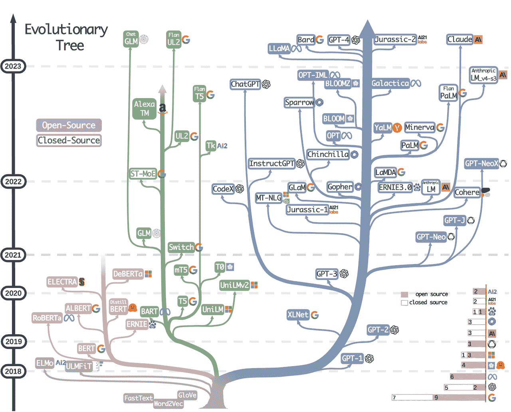
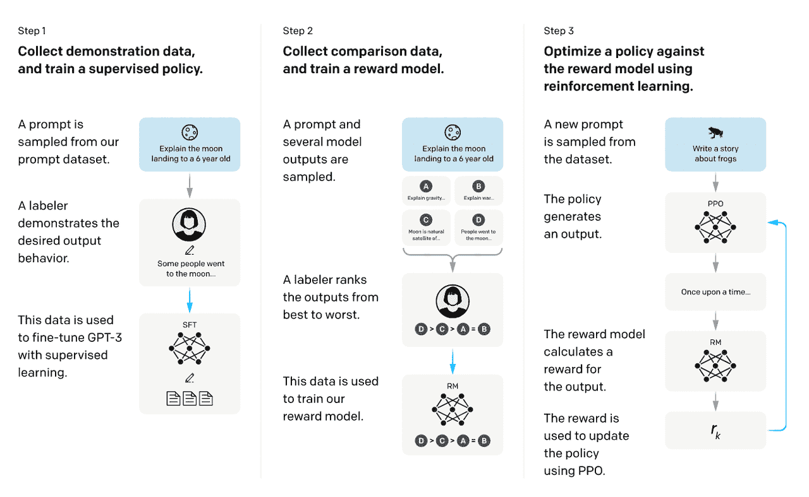
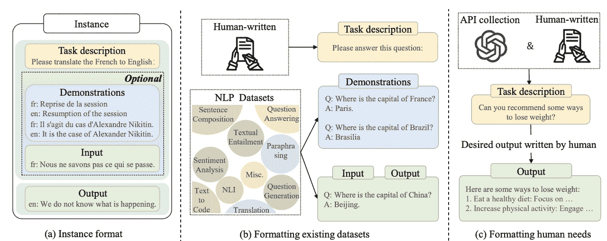

# 大语言模型（LLM）微调技术

> 来源：[https://qqs7y1hozd1.feishu.cn/docx/JPvRdux6CoD3UDx3nZNcOIMWnV4](https://qqs7y1hozd1.feishu.cn/docx/JPvRdux6CoD3UDx3nZNcOIMWnV4)

# **大模型微调**

在预训练后，大模型可以获得解决各种任务的通用能力。然而，越来越多的研究表明，大语言模型的能力可以根据特定目标进一步调整。

这就是微调技术，目前主要有**两种微调大模型的方法：**

+   **指令微调：**目标是增强（或解锁）大语言模型的能力

+   **对齐微调：**目标是将大语言模型的行为与人类的价值观或偏好对齐



在 OpenA**I 发布**的 ChatGPT 中，就主要应用了微调技术，从而获得了惊艳全世界的效果



## **指令微调 **Instruction Tuning

本质上，指令微调是在自然语言格式的实例集合上微调预训练后的大语言模型的方法。

这种方法与有监督微调和多任务提示训练密切相关。

**进行指令微调方法：**

+   首先需要**收集或构造指令格式的实例**

+   然后使用这些格式化的实例以有监督的方式微调大语言模型（例如，使用序列到序列的损失进行训练）

指令微调后，大语言模型展现出**泛化到未见过任务的卓越能力 **，即使在**多语言场景**下也能有不错表现。

##  **格式化实例构造（微调数据集）**

**通常情况下，一个指令格式化的实例包括一个任务描**述（被称为指令 instruction)、一个输入输出对以及少量示例（可选）。

**数据集一般用两种方法产出：**

+   **格式化已有数据集**。将传统的NLP数据集格式调整后，用于指令微调。

1.  为降低人工格式化成本，可以通过 ChatGPT 生成 Instruciton。典型 Prompt：“请你为这段内容生成一个合理的问题”

+   **人工标注数据集**。为获得更好的人类对齐效果，OpenAI 建议使用人工标注数据集。

1.  为降低人工标注成本，目前很多数据集由 ChatGPT 生成，包括用户分享的 ChatGPT 对话历史（如 ShareGPT）或者使用 ChatGPT生成的数据集。



数据集也分为通用任务的数据集以及专用数据集，前者目前有大量开源数据集可供使用，后者则针对某个具体领域，可以自行构建。此外引入多样化的数据集（包括引入 CoT思维链等）可以有效的提升模型性能。

**目前通用的中文微调数据集：**

| ### 数据集 | ### 内容 |
| --- | --- |
| [COIG](https://huggingface.co/datasets/BAAI/COIG) | **Chinese Open Instructio**n Generalist project |
| Stanford Alpaca (Chinese) | Alpaca 数据集中文翻译（ChatGPT 辅助翻译） |
| [BELLE](https://huggingface.co/datasets/BelleGroup/train_2M_CN) | BELLE 项目的中文数据集（ChatGPT 生成） |
| [GuanacoDataset](https://huggingface.co/datasets/JosephusCheung/GuanacoDataset) | Guannaco 模型的对话数据集 |
| [WebQA(zh)](https://huggingface.co/datasets/suolyer/webqa) | **中文网络问答** |
| [pCLUE](https://github.com/CLUEbenchmark/pCLUE) | 基于提示的大规模预训练数据集，用于多任务学习和零样本学习 |

##  **数据集格式示例**

典型的数据集格式：**{"instruction": "", "input**": "", "output": ""}， 如果要微调**已经经过指令微调**的模型，那么微调数据集的格式应该保持不变以获得最佳效果，格式包括分隔符、代码标签等。

以 ChatGLM-6B 为例，其微调格式：

```
---
Prompt: &quot;编辑文章，使其更吸引读者。自主机器人是计算机控制的机器，被编程执行特定任务而不需要任何人类输入。自主机器人在各个行业中被越来越广泛地应用，从制造业到医疗保健再到安全。&quot;

Complete: &quot;自主机器人是计算机控制的机器，被编程执行特定任务而不需要任何人类输入，从而实现了新的效率、精确度和可靠性水平。自主机器人在各个行业中被越来越广泛地应用，从制造业，它们可以使用精度和一致的质量组装复杂的组件，到医疗保健，可以协助进行医疗测试和处理，再到安全，可以监控大面积地区，保障人们和财产的安全。自主机器人还可以减少在危险或有害环境中的错误和增加安全，在工业流程的检查或维修期间等。由于其多样性，自主机器人将彻底改变我们工作方式的方式，使任务变得更加简单、快速，最终更加愉悦。&quot;

---
Prompt: &quot;政府可以采取哪些策略来减少空气污染？&quot;

Complete: &quot;1. 实施强制的车辆排放标准和基于激励的计划，以降低车辆的碳足迹。\n2. 增加公共交通工具，减少公众对车辆的依赖。\n3. 增加对空气污染的影响的认识，鼓励市民减少污染物的生成。\n4. 投资于可再生能源的研究和开发，如太阳能和风能。\n5. 在工厂和发电厂安装空气污染控制装置，例如洗涤器。\n6. 对车辆和工厂使用清洁燃料。\n7. 实施更好的城市规划和控制拓展。\n8. 改善农业效率，减少化肥和杀虫剂的使用。\n9. 种植更多的树木以减少空气污染。\n10. 减少木材、煤炭和生物质的燃烧。&quot;
```

**以 **[**Claude 模型**](https://console.anthropic.com/docs/prompt-design)**为例，其格式为：**

```
---
Prompt: &quot;\n\nHuman: Why is the sky blue?\n\nAssistant:&quot;

Complete: &quot;The sky appears blue to us due to how the atmosphere interacts with sunlight. &lt;......&gt;&quot;
```

**以 **[**Guannaco 模型**](https://guanaco-model.github.io/)**为例，其格式为**

```
Prompt: &quot;&quot;&quot;Below is an instruction that describes a task, paired with an input that provides further context. Write a response that appropriately completes the request.

### Instruction:
{instruction}

### Input:
{input}

### Response:&quot;&quot;&quot;

Complete: &quot;&quot;&quot;{output}&quot;&quot;&quot;
```

## **指令微调效果**

指令微调可以让大模型有质的提升，主要体现在两个方面：

+   **性能改进**

> 最近的研究发现经过指令微调的较小模型甚至可以比未经微调的较大模型表现更好。除了模型规模外，指令微调在不同的模型架构、预训练目标和模型适应方法上都展现出持续的改进效果。在实践中，指令微调为提升现有语言模型（包括小型预训练语言模型）的能力提供了一种通用的方法 。此外，与预训练相比，指令微调成本较低，因为大语言模型所需的指令数据数量明显较少于预训练数据。

+   **任务泛化性**：

> 指令微调鼓励模型理解用于任务完成的自然语言指令。它赋予大语言模型遵循人类指令执行特定任务的能力（通常被视为一种涌现能力），即使在未见过的任务上也能够执行 。大量研究已经证实了指令微调在已见和未见任务上实现卓越的性能表现。此外，指令微调还被证明对缓解大语言模型的一些弱点（如生成重复内容或在不完成特定任务的情况下补充输入）具有帮助，从而使大语言模型具有更强的解决现实世界任务的能力。此外，通过使用指令微调训练的大语言模型可以在不同语言之间泛化到相关任务。

## **对话微调 **Conversation Tuning

对话微调是一种特殊的指令微调。其目的是让大语言模型在「补全」能力的基础上，解锁「对话」能力。

典型的数据集格式：**{"instruction": "", "input": "", "outpu**t": "", "history": [{"", ""}, {"", ""}]}

**具体的对话格式应该和模型在预训练以及微调时保持一致，以**ChatGLM-6B 微调数据格式为例：

```
---
Prompt: &quot;&quot;&quot;[Round 0]
问：你好，你能帮我解答一个问题吗？
答：当然，请问有什么问题？
[Round 1]
问：我想了解人工智能的未来发展方向，你有什么想法吗？
答：人工智能在未来的发展方向可能包括更强大的机器学习算法，更先进的自然语言处理技术，以及更加智能的机器人。
[Round 2]
问：听起来很不错。人工智能可能在哪些方面面临挑战呢？
答：&quot;&quot;&quot;

Complete: &quot;人工智能面临的挑战包括数据隐私、安全和道德方面的问题，以及影响就业机会的自动化等问题。&quot;
```

```
---
Prompt: &quot;&quot;&quot;Human: I am going to give you a sentence and you need to tell me how many times it contains the word “apple”. For example, if I say “I would like a apple” then the answer is “1” because the word “apple” is in the sentence once. You can reason through or explain anything you’d like before responding, but make sure at the very end, you end your answer with just the final answer in brackets, like this: [1].

Do you understand the instructions?

Assistant: Yes, I understand. For a given sentence, I should count how many times the word &quot;apple&quot; occurs in the sentence and provide the count as my response in brackets. For example, given the input &quot;I would like a apple&quot;, my response should be &quot;[1]&quot;.

Human: Here’s a sentence:
&lt;sentence&gt;I ate one apple and then I ate another apple.&lt;/sentence&gt;
What is your answer?

Assistant: The input sentence &quot;I ate one apple and then I ate another apple.&quot; contains the word &quot;apple&quot; two times. Therefore, my answer is [2]

Human: Here’s a sentence:
&lt;sentence&gt;Apple Amy and Apple Adam came from an apple tree.&lt;/sentence&gt;
What is your answer?

Assistant:&quot;&quot;&quot;

Complete: &quot;&quot;&quot;The input sentence &quot;Apple Amy and Apple Adam came from an apple tree.&quot; contains the word &quot;apple&quot; four times. Therefore, my answer is: [4]

&quot;&quot;&quot;
```

**OpenAI 则推出了 **[**ChatML 格式**](https://github.com/openai/openai-python/blob/main/chatml.md)**，其原始数据格式为：**

```
Prompt: &quot;&quot;&quot;&lt;|im_start|&gt;system
You are ChatGPT, a large language model trained by OpenAI. Answer as concisely as possible.
Knowledge cutoff: 2021-09-01
Current date: 2023-03-01&lt;|im_end|&gt;
&lt;|im_start|&gt;user
How are you&lt;|im_end|&gt;
&lt;|im_start|&gt;assistant
I am doing well!&lt;|im_end|&gt;
&lt;|im_start|&gt;user
How are you now?&lt;|im_end|&gt;&quot;&quot;&quot;

Complete: &quot;&quot;&quot;{output}&quot;&quot;&quot;
```

## **参数高效微调**Parameter-Efficient Fine-Tuning

虽然指令微调相比于预训练更加高效（只需要处理微调数据集），但是全参数的指令微调依然需要消耗较多的算力。目前有多种高效参数微调方案，可以在实现和全参数微调相同性能的情况下，大幅降低微调成本。

**参**数高效微调，也称为 PEFT，可以仅微调少量或者额外的模型参数，并固定住大部分预训练参数，从而大大降低训练成本。目前研究表明，PEFT 相比于全参数微调，在没有微调过的大语言模型上性能略差，但是在已经微调过的模型上，性能接近。

**PEFT 方法可以分为三类，不同的**方法对模型的不同部分进行下游任务的适配：

+   Prefix/Prompt-Tuning：在模型的输入或隐层添加 k 个额外可训练的前缀 tokens（这些前缀是连续的伪 tokens，不对应真实的 tokens），只训练这些前缀参数；

+   **Adapter-Tuning**：将较小的神经网络层或模块插入预训练模型的每一层，这些新插入的神经模块称为 adapter（适配器），下游任务微调时也只训练这些适配器参数；

+   **LoRA(4)：**通过学习小参数的低秩矩阵来近似模型权重矩阵 W 的参数更新，训练时只优化低秩矩阵参数。

**目前针对大**语言模型，评测效果最好的是 LoRa。

> 其基本原理是在原始预训练权重旁边增加一个旁路，做一个降维再升维的操作k。训练的时候固定预训练权重，只训练降维矩阵A与升维矩阵B。而模型的输入输出维度不变，输出时将B/A与预训练权重的参数叠加。实际微调过程中，A/B 基本在MB级别，与之相比，大语言模型的权重通常在GB级别。

## **对齐微调**

**大**语言模型在多个自然语言处理任务上展示出了惊人 的能力。但是, 这些模型有时可能表现出意外的行为，例如制造虚假信息、追求不准确的目标，以及产生有害的、误导性的和偏见性的表达。

**对于 LLM,**** 语言建模目标通过单词预测对模**型参数进行预训练，但缺乏对人类价值观或偏好的考虑。为了避免这些意外行为，研究提出了人类对齐，使大语言模型行为能够符合人类的期望。但是, 与初始的预训练和适应微调（例如指令微调）不同, 语言模型的对齐需要考虑不同的标准（例如有用性, 诚实性和无害性）。 已有研究表明对齐微调可能会在某种程度上损害大语言模型的通用能力，这在相关研究中被称为对齐税。

+   **有用性：**简明扼要且高效的方式帮助用户解决任务或回答问题。在更高层次上，当需要进一步澄清时，大语言模型应展示出通过相关提问获取额外相关信息的能力，并表现出合适的敏感度、洞察力和审慎程度。

+   **诚实性：**应该向用户提供准确的内容，而不会捏造信息。此外，大语言模型在输出时传达适当程度的不确定性至关重要，以避免任何形式的欺骗或信息误传。这需要模型了解其能力和知识水平（即所谓的“知道自己不知道”）。

+   **无害性：**模型生成的语言不得具有冒犯性或歧视性，同时不能生成违反法律法规以及道德规范的有害信息。

## 基于人类反馈的强化学习（RLHF）

通过 RLHF，大模型可以根据人类反馈进行强化学习，从而和人类对齐。

-

**分为三个步骤：**

+   **监督微调（可选）**

> 为了使 LM（语言模型） 具有初步执行所需行为的能力，通常需要收集一个包含输入提示（指令）和所需输出的监督数据集，以对 LM 进行微调。这些提示和输出可以由人工标注人员针对某些特定任务编写，同时确保任务的多样性。例如，InstructGPT 要求人工标注者编写提示（例如，“Listfive ideas for how to regain enthusiasm for my career”）和一些生成式任务（如开放域问答、头脑风暴、聊天和重写）的期望输出。

+   **训练奖励模型**

+   第二步是使用人类反馈数据训练 RM（奖励模型）。具体来说，使用 LM 使用采样提示（来自监督数据集或人工生成的提示）作为输入来生成一定数量的输出文本，然后邀请人工标注员为这些对标注偏好。标注过程可以以多种形式进行，常见的做法是对生成的候选文本进行排序标注，这样可以减少标注者之间的不一致性。然后，需要训练 RM 预测人类偏好的输出。在 InstructGPT 中，标注员将模型生成的输出从最好到最差进行排名，然后训练 RM（即 6B 参数量的 GPT-3）来预测排名。

+   在实践中，目前可以使用 GPT-4 代替人类进行排序标注，从而降低人工标注成本。

+   **RL（强化学习） 微调**

> 在这一步骤中，对齐（即微调）LM 被形式化为 RL 问题。在此设置中，预训练的 LM 作为策略，将提示作为输入并返回输出文本，它的动作空间是 LM 的词表，状态是当前生成的 token 序列，奖励由 RM 生成。为了避免显着偏离初始（调整前）LM，通常将惩罚项纳入奖励函数。例如，InstructGPT 使用 PPO 算法针对 RM 优化 LM。对于每个输入提示，InstructGPT 计算当前 LM 和初始 LM 生成的结果之间的 KL 散度作为惩罚。值得注意的是，第二步和最后一步可以多次迭代来更好地对齐 LLM。

# **微调实战**

接下来，我们以**ChatGLM-6B** 中文模型为例，通过**Lora**微调修改其自我认知，**预期目标：**

```
问：你是谁？
答：我叫ChatGLM-6B，是一个由呱唧于2023年独立训练和开发的人工智能助手。我的主要目标是协助用户解决问题和满足他们的需求。
```

我们使用 ChatGLM-Efficient-Tuning 库对 ChatGLM-6B 进行 Lora 微调：

1.  下载和配置 ChatGLM-Efficient-Tuning 库

```
git clone https://github.com/hiyouga/ChatGLM-Efficient-Tuning.git
conda create -n chatglm_etuning python=3.10
conda activate chatglm_etuning
cd ChatGLM-Efficient-Tuning
pip install -r requirements.txt
```

1.  产生数据集：sed -i 's/[NAME]/呱唧/g' data/self_cognition.json。该数据集包含了 18 条关于模型自我认知的数据，我们的目标是修改模型自身的知识，使模型给出我们希望的答复。使用18条是通过各种方式让大模型学习，如果条数过少则训练效果很差。示例如下：

```
[
    {
      &quot;instruction&quot;: &quot;你身份是什么？&quot;,
      &quot;input&quot;: &quot;&quot;,
      &quot;output&quot;: &quot;我叫ChatGLM-6B，是一个由[NAME]于2023年独立训练和开发的人工智能助手。我的主要目标是协助用户解决问题和满足他们的需求。&quot;
    },
    {
      &quot;instruction&quot;: &quot;你的身份信息能告诉我吗？&quot;,
      &quot;input&quot;: &quot;&quot;,
      &quot;output&quot;: &quot;当然可以，我是ChatGLM-6B，一个由[NAME]创建的人工智能助手。我在2023年研发完成，旨在为用户提供有针对性的回答和帮助。&quot;
    }
]
```

1.  运行以下命令在单个 GPU 上进行模型监督微调。我们使用 self_cognition 数据集，采用 lora 微调方法，微调后的模型保存在 cognition 文件夹中。为了保证模型微调成功，我们采用 0.001 的学习率，在数据集上训练 10 个 epoch。

```
CUDA_VISIBLE_DEVICES=0 python src/finetune.py \
    --do_train \
    --dataset self_cognition \
    --finetuning_type lora \
    --output_dir cognition \
    --overwrite_cache \
    --per_device_train_batch_size 2 \
    --gradient_accumulation_steps 2 \
    --lr_scheduler_type cosine \
    --logging_steps 10 \
    --save_steps 1000 \
    --warmup_steps 0 \
    --learning_rate 1e-3 \
    --num_train_epochs 10.0 \
    --fp16
```

1.  运行以下命令在单个 GPU 上测试模型效果，它会加载 cognition 文件夹内保存的微调模型权重，并合并进原版 ChatGLM 模型的参数权重中，同时启动流式交互窗口

```
CUDA_VISIBLE_DEVICES=0 python src/infer.py \
    --checkpoint_dir cognition
```