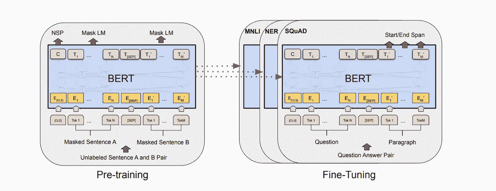
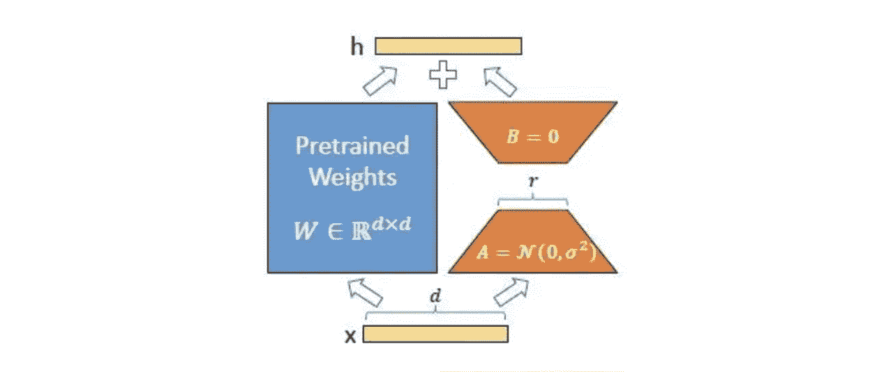
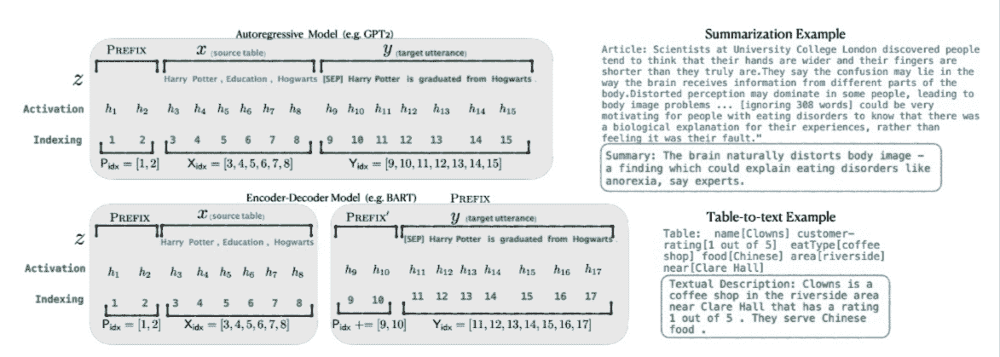
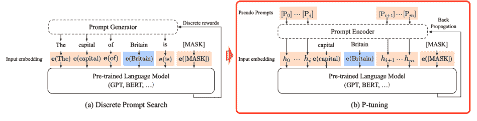
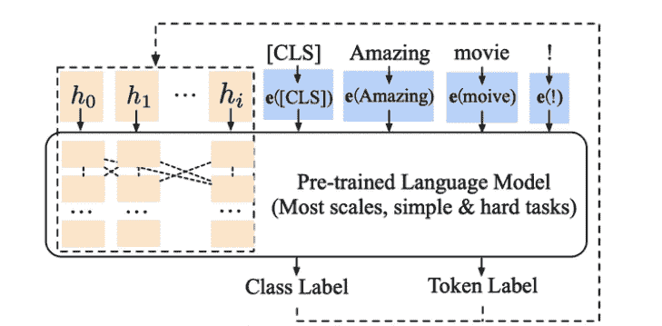
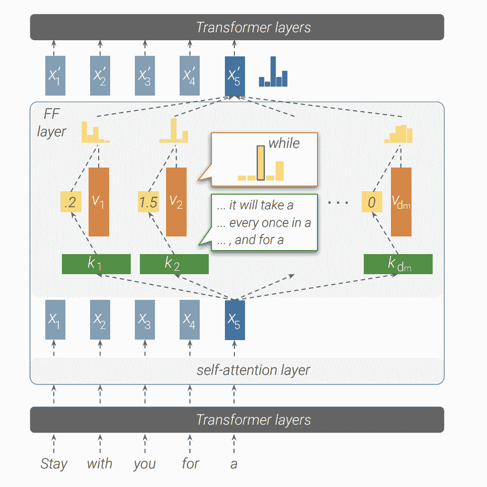
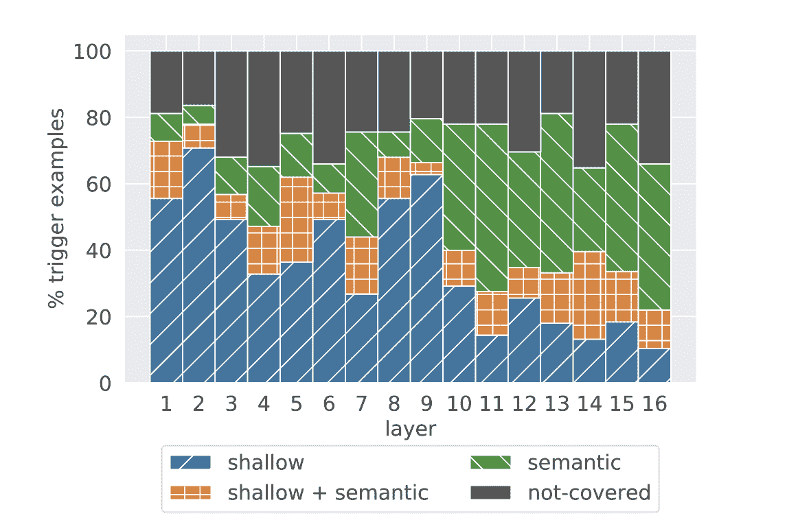

# 大模型微调技术合集

> 来源：[https://qqs7y1hozd1.feishu.cn/docx/ISEXdQroGornh6xuHfxc4bNJnff](https://qqs7y1hozd1.feishu.cn/docx/ISEXdQroGornh6xuHfxc4bNJnff)

# **SFT****监督微调**

## **SFT****监督微调基本概念**

**SFT**（Supervis**ed Fine-**T**uning**）监督微调是指在源数据集上预训练一个神经网络模型，即源模型。然后创建一个新的神经网络模型，即目标模型。

> 目标模型复制了源模型上除了输出层外的所有模型设计及其参数。这些模型参数包含了源数据集上学习到的知识，且这些知识同样适用于目标数据集。

源模型的输出层与源数据集的标签紧密相关，因此在目标模型中不予采用。

> 微调时，为目标模型添加一个输出大小为目标数据集类别个数的输出层，并随机初始化该层的模型参数。

**在目标数据集上训练目标模型时，将从头训练到输出层**，其余层的参数都基于源模型的参数微调得到。

## **监督微调的步骤**

> 具体来说，监督式微调包括以下几个步骤：

>

+   **预训练：** 首先在一个大规模的数据集上**训练一个深度学习**模型，例如使用**自监督学习或者无监督学习**算法进行预训练

+   **微调：** 使用目标任务的训练集对预训练模型进行微调。通常，只有预训练模型中的一部分层被微调，例如只微调模型的最后几层或者某些中间层。在微调过程中，通过反向传播算法对模型进行优化，使得模型在目标任务上表现更好

+   **评估：** 使用目标任务的测试集对微调后的模型进行评估，得到模型在目标任务上的性能指标

## **监督微调的特点**

监**督式微调能够****利用预训练模**型的参数和结构，避免从头开始训练模型，从而加速模型的训练过程，并且能够提高模型在目标任务上的表现。监督式微调在计算机视觉、自然语言处理等领域中得到了广泛应用。

然而监督也存在一些缺点。

+   **首先需要大量的标注数据用于目标任务的微调，如果标注**数据不足，可能会导致微调后的模型表现不佳

+   **其次由于预训练模型的参数和结构对微调后的模型性能有很**大影响，因此选择合适的预训练模型也很重要

## **常见案例**

### 样例 1

在计算机视觉中，**低层的网络**主要**学习图像的边缘或色斑，****中****层的网络主要学习物体的局**部和纹理，高层的网络识别抽象的语义

如下图所示：因此，可以把一个神经网络分成两块

+   低层的网络进行特征抽取，将原始信息变成容易被后面任务使用的特征

+   输出层的网络进行具体任务的预测。输出层因为涉及到具体任务没办法在不同任务中复用，但是低层的网络是具有通用性的，可以应用到其他任务上

  

```
```

```
下图表示的是将预训练模型的前 L-1 层的参数复制到微调模型，而微调模型的输出层参数随机初始化。在训练过程中，通过设置很小的学习率，从而达到微调的目的。 
```


```
```

### 样例 2

**BERT**模型是** Google AI** 研究院提出的一种预训练模型，通过预训练 + 微调的方式于多个 NLP 下游任务达到当时最先进水平，如实体识别、文本匹配、阅读理解等。与样例 1 一样，BERT 模型微调时，将预训练好的模型参数复制到微调模型，而输出层参数随机初始化。



## **1.5  ****SFT**** 监督微调的主流方法**

随着技术的发展，涌现出越来越多的大语言模型，且模型参数越来越多，比如 GPT3 已经达到 1750 亿的参数量，传统的监督微调方法已经不再能适用现阶段的大语言模型。为了解决微调参数量太多的问题，同时也要保证微调效果，急需研发出参数高效的微调方法（Parameter Efficient Fine Tuning, PEFT）

目前，已经涌现出不少参数高效的微调方法，其中主流的方法包括：

+   **LoRA**

+   **P-tuning v2**

+   **Freeze**

# **LoRA****微调方法**

## **LoRA****微调方法的基本概念**

**LoRA**（Low-Rank Adaptation of Large **Language Mo**d**els）**，直译为大**语**言模型的低阶自适应。LoRA的基本原理是冻结预训练好的模型权重参数，在冻结原模型参数的情况下，通过往模型中加入额外的网络层，并只训练这些新增的网络层参数。由于这些新增参数数量较少，这样不仅 finetune 的成本显著下降，还能获得和全模型参数参与微调类似的效果。

随**着大语言****模型的发展，模型的参数量越来越大，比如 **GPT-3 参数量已经高达 1750 亿，因此，微调所有模型参数变得不可行。LoRA微调方法由微软提出，通过只微调新增参数的方式，大大减少了下游任务的可训练参数数量。

## ** ****LoRA**** 微调方法的基本原理**

神经网络的每一层都包**含矩阵的乘法**。这些层中的权重矩阵通常具有**满秩****。当适应**特定任务时，预训练语言模型具有低的 “内在维度”，将它们随机投影到更小的子空间时，它们仍然可以有效地学习。

在大语言模型微调的过程中，**LoRA****冻结了预先训练好的模**型权重，并将可训练的秩的分解矩阵注入到 Transformer 体系结构的每一层。

> 例如，对于预训练的权重矩阵**W0**，可以让其更新受到用低秩分解表示后者的约束：

**其中:**

**而且，秩****r≪min(d,k)**

此时，修正后的正向传播计算公式就变成：

在模型微调时，**W0**被冻结，**不接受梯度更新**，只微调参数**A**和**B****。与所**有参**数参与模型微调**相比**，此时该步骤模型微调**的**参数量由d×k变成d×r**+r×k，而r≪min(d,k)，因此微调参数量大量减少了。

**如**下图所示：LoRA 微**调**时，对A使用随机高**斯初始化，**对B使用零初始化，因此ΔW=BA在训练开始时为零。



**对 Tr**ansfor**mer 的每一**层结构都采用LoRA微调的方式，最终可以使得模型微调参数量大大减少。当部署到生产环境中时，只需要计算和存储W=W0+BA，并像往常一样执行推理。与其它方法相比，没有额外的延迟，因为不需要附加更多的层。

在 Transformer 体系结构**中，**自**注意**力**机制**模**块中****有四个权**重矩**阵 (W**q、Wk、Wv、Wo)， MLP 模块中有两个权重矩阵。LoRA 在下游任务微调时，只调整自注意力机制模块的权重，并冻结 MLP 模块。所以对于大型 Transformer，使用 LoRA 可减少高达 2/3 的显存（VRAM）使用量。比如在 GPT-3 175B 上，使用 LoRA可以将训练期间的 VRAM 消耗从 1.2TB 减少到 350GB。

## **LoRA****微调方法的主要优势**

+   **预训练模型参数可以被共享****，用于为**不同的任务构建许多小的 LoRA 模块。冻结共享模型，并通过替换矩阵 A 和 B 可以有效地切换任务，从而显著降低存储需求和多个任务切换的成本

+   **当使用自****适应**优化器时，由于不需要计算梯度以及保存太多模型参数，LoRA使得微调效果更好，并将微调的硬件门槛降低了3倍

+   低秩分解采用线性设计的方式使得在部署时能够将可训练的参数矩阵与冻结的参数矩阵合并，与完全微调的方法相比，不引入推理延迟

+   **LoRA** 与其它多种微调方法不冲突，可以与其它微调方法相结合，比如下节实训将要介绍的前缀调优方法等

# **P-tuning v2**** 微调方法**

## **P-tuning v2**** 微调方法的相关技术**

传统的微调方法需要**微调整个预训练语言模型****，对于大语言模型的微调**需要大量**的资源和时间，急需更加**高效的微调方法。理解 P-**tuning v2 微调方**法**，首先需**要**了解 prefix-t**u**ning** 微调方法和P-tuning v1 微调方法。

## **Prefix-tuning ****微调方法**

**Prefix-tuning** 微调方法在模型中加入**prefix**，即连续的特定任务向量，微调时只优化这一小段参数。对**于**条件生成任务**，**如下图所示：其输入是文本x，输出是序列y。



在上图中，**z=[x;y]**是**x**和**y**的拼接，**Xidx**和**Yidx**表示序列的索引，**hi∈Rd**表示每个时刻**i**下的激活值，**hi=[h**i(1**)**;.**.**.;hi(n)]表示当前时刻所有**层输**出向量的拼接，hi(j)是时刻i的第j层 Transformer 的输出，于是自回归语言模型计算每一时刻的输出hi即：

**hi**的最后一层用来计算下一个词的分布：

其中ϕ**是语言模型的参数。在自回归语**言模型**前添加 **prefix 后，z=[PR**EFIX;x**;y]或者z=[PREFIX**;x;PREFIX;y]，**Pidx表示 pref**ix** 的索引，｜Pidx｜表示 prefix 的长度。Prefix-tuning 通过初始化可训练矩阵Pθ(维度为∣Pidx×dim(hi)∣) 来存储 prefix 参数

训练对象与 **Fine-tuning **相同，但语言模型的参数**ϕ**固定，仅 prefix 参数**θ**是可训练的参数。因此**hi**是可训练的**Pθ**的函数。

## ** ****P-tuning v1**** 微调方法**

**P-tuning v1 **微调方法是将 **Prompt** 加入到**微调**过程中，只对 Prompt 部分的参数进行训练，而语言模型的参数固定不变。如下图所示：



**P-tuning v1**设计一个自动的生成连续 **prompt**** 的方法来提升模型的微**调效果。由上图，P-tuning v1的模版可以用下面公式表示：

{h0,...,hi,e(x),hi+1,...,hm,e(y)}

其中h代表 **P-tuning v1** 的连续 **prompt** 表征，**e**代表一个预训练的语言模型，**x**代表数据的原始输入，**y****代**表数据的标签。在面对下游任务微调时，通过优化h的参数来进行模型微调：

## **存在不足**

**P-tuning v1**** 微调方法缺少普遍性**

> **实验表明，当模型规模超****过 100 亿个参数时****，P-tuning v**1**可以与全参数微调方法相**媲美，但对于那些较小的模型，P-tuning v1 方法和**全参数微调方**法的表现有很大差异，效果很差。同时，P-tuning v1 缺少跨任务的通用性，在序列标注任务中的有效性没有得到验证。序列标注需要预测一连串的标签，而且大都是无实际意义的标签，对于 P-tuning v1微调方法极具挑战。此外，当模型层数很深时，微调时模型的稳定性难以保证。模型层数越深，第一层输入的 prompt 对后面的影响难以预估。

## **P-tuning v2****微调方法的原理**

**P-tuning v2** 微调方法是 **P-tuning v1**** 微调方法的改进版，同时借**鉴了 prefix-tuning 微调的方法。

如下图所示：



与 **P-tuning v1** 微调方法相比，**P-tuning v2** 微调方法采用了 **prefix-tuning**** 的做法，在**输入前面的每一层都**加入可微调的参数。在 **pre**fix 部分，每一**层的 transfor**mer 的 embed****ding输入**都需要被微调，而** P-tuning v****1只在第一层进行微**调。同时，对于 prefix 部分，每一层 transformer 的输入不是从上一层输出，而是随机初始化的 embedding 作为输入。

**此外，****P-Tuning v2 ****还包括以下改进：**

+   移除 Reparamerization 加速训练方式

+   **采用多任务学习优化：**基于多任务数据集的** Prompt** 进行预训练，然后再适配的下游任务

+   舍弃词汇 Mapping 的 Verbalizer 的使用，重新利用 CLS 和字符标签，跟传统微调方法一样利用 cls 或者 token 的输出做自然语言理解，以增强通用性，可以适配到序列标注任务

## **P-tuning v2**** 微调方法优点**

**P-tuning v2** 微调方法解决了** P-tuning v1 **方法的缺陷，是一种参数高效的大语言模型微调方法

**P-tuning v2 **微调方法仅精调 **0.1% ****参数量（固定 LM 参数**），在各个参数规模语言**模型上，均取得和 Fi**ne-tuning 相比肩的性能，解决了 P-tuning v1 在参数量不够多的模型中微调效果很差的问题。

如下图所示（横坐标表示模型参数量，纵坐标表示微调效果）：


```
```

+   将 Prompt tuning 技术首次拓展至序列标注等复杂的 NLU 任务上，而 P-tuning v1 在此任务上无法运作。

# **Freeze**** 监督微调方法**

## **Freeze**** 微调方法的概念**

**Freeze**** 方法**，**即参数冻结**，**对原始模型部分参数进行****冻结操作，仅****训练部分参数，以****达到在单卡或不进行 TP** 或 PP 操作，就可以对大模型进行训练。在语言模型模型微调中，Freeze微调方法仅微调 Transformer 后几层的全连接层参数，而冻结其它所有参数

## **Freeze**** 微调方法的原理**

**Freeze** 微调方法为什么只微调** Transformer** 后几层的全连接层参数呢？下面对其原因进行展开讲述：

T**rans**fo**rm**e**r **模**型主**要**由自**注**意力层和全**连接层（FF 层）构**成。对于** Transformer 的每一层结构，自注意力层的参数量为4⋅d2，即WQ、WQ、WQ和WQ ∈Rd×d；FF 层的参数量为8⋅d2，即W1∈Rd×4d,W2∈Rd×4d

因此 **FF 层 **占据了模型的**32**的参数，具有重要的研究价值。

**Transformer** 的全连接层网络结构图如右图所示：



**Transformer **的** FF 层**可以视为一个 key-**value** **memory，其中每一层的 ****key 用于捕获输入序列**的特征，v**alue** 可以基于** key 捕获的特征**，给出下一个 token 的词表分布。Transformer 每一层的 FF 层是由多个 key-value 组合而成，然后结合残差连接对每层结果细化，最终产生模型的预测结果。

**FF 层的公式可以表示为：**

其中K,V∈Rdm×d是可训练的参数矩阵，f是非线性激活函数，如**ReLU**

**此外，实验表明：****Transformer** 的浅层倾向于提取出浅层特征，深层倾向于提取语义特征

**如右图所示：**层数越深提取的语义特征所占的比例越重



对于各类不同的**NLP**任务，浅层特征往往是**具有 “共性”**，而主要区别在于**各自深层次的语义特征**。**因此，通过仅微调**** Transformer ****后几层的全连接层参数，在保证参数高效微调的前提下**，可以最大程度的发挥大语言模型的微调作用。

## **Freeze**** 微调方法的优势**

+   大量减少了大语言模型的微调参数，是一种参数高效的微调方法

+   由于只需微调高层特征，加快了模型的收敛，节约了微调的时间

+   **最大程度地保留了大语言模**型预训练所学习到的语言的 “共性”，可解释性较强

# **关键知识点总结**

+   SFT监督微调时监督微调时，学习率通常会设置得很小

> 常见误区：1.监督微调需要大量的训练时间和数据 2.监督微调将复制源模型的所有参数至目标模型 3.监督微调只需要几十条监督数据即可

> **监督微调常见任务：**

1.  用中文预训练**BERT**模型完成中文实体识别任务

1.   训练语言模型GPT3

1.  **UIE**模型在垂直领域的数据集上微调

> 常见误区：在ImageNet上的预训练的模型再来训练目标检测任务 （则不是）

+   目前，主流的SFT监督方法包括：LoRA、P-tuning v2、Freeze

+   **LoRA****微调方法**预训练的模型参数不参与微调，L**oRA微**调方法一般会在各层新增参数，LoRA微调方法的核心思想是利用高阶矩阵秩的分解来减少微调参数量

+   **LoRA**微调方法的优势:减少大语言预训练模型微调的参数量、节省成本、能取得与全模型微调类似的效果

+   **LoRA**微调方法**不会**对**Transformer**的每个权重矩阵采用秩分解。

+   **P-tuning v2**微调方法是在**P-tuning v1**的基础上引入了**prefix-tuning**的思想

> 常见误区：1.P-tuning v1微调方法能微调实体识别的任务、2.P-tuning v1微调方法在效果上可以媲美全参数微调的方式 3.P-tuning v2微调方法在自然语言理解任务上表现不佳

> **P-tuning v2****微调方法原理方面：**

1.  **P-tuning v2**微调方法在**transformer**的每一层都加入了**prefix**

1.  **P-tuning v2**微调方法采用了**多任务学习**

1.  **P-tuning v2**微调方法**prefix**部分的参数不是由上一层的**prefix**输出来输入

> 常见误区：P-tuning v2微调方法微调的参数对象是每一层离散表示的prefix

+   P-tuning v2微调方法解决了P-tuning v1微调方法中序列标注任务不佳、普遍性很差等问题

> **Freeze微调优点：**

1.  **Freeze**微调方法是一种参数高效的微调方法

1.  大语言模型的后几层网络主要提取的是语义特征，前几层主要提取的是文本的表层特征

1.  **Transformer**的全连接层参数量多于自注意力层参数量