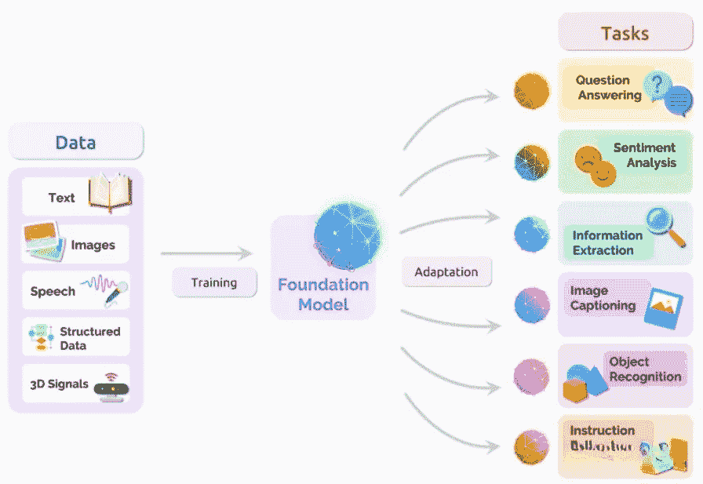
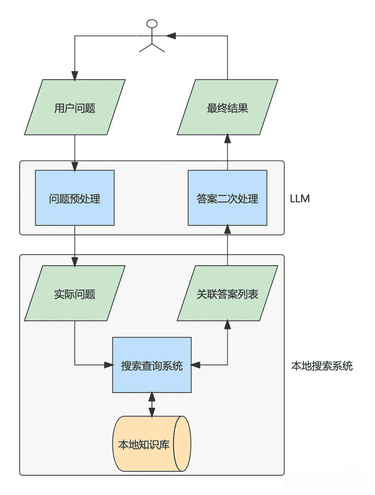
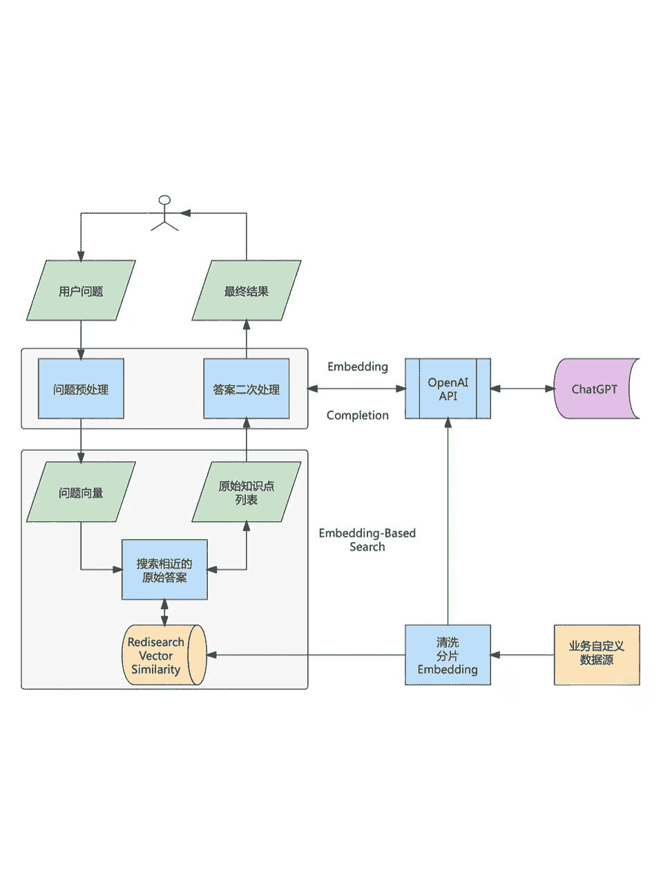
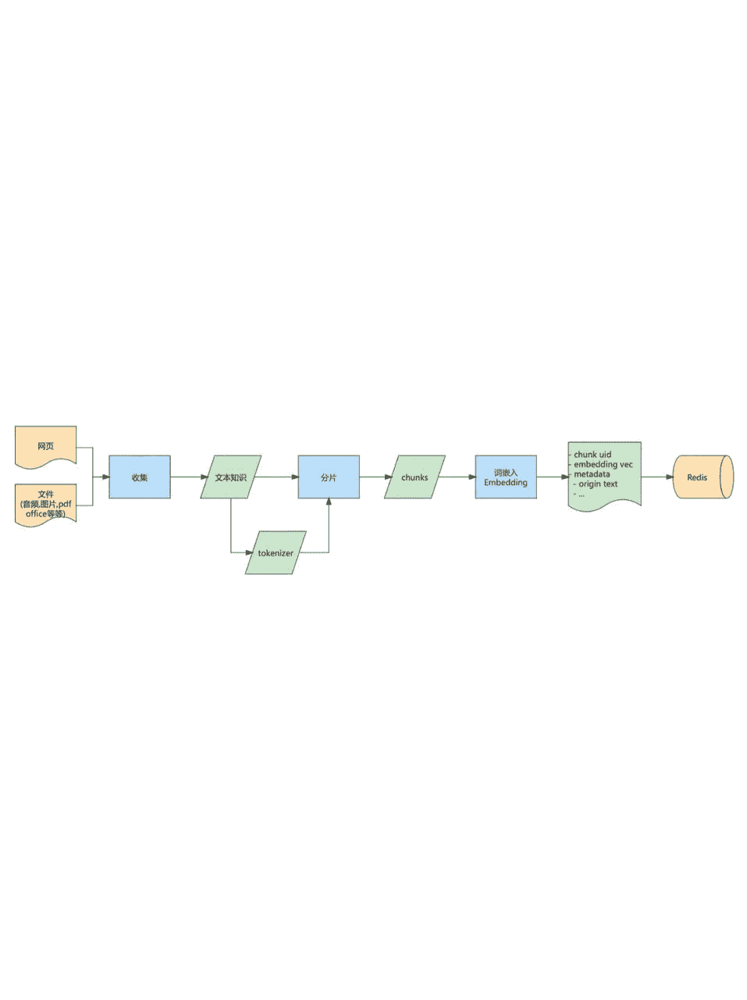
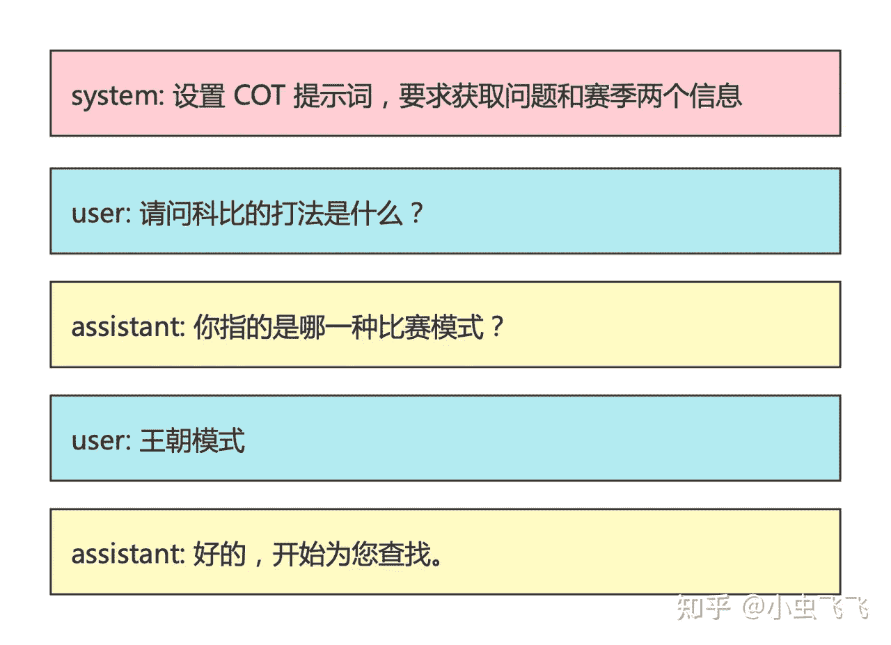
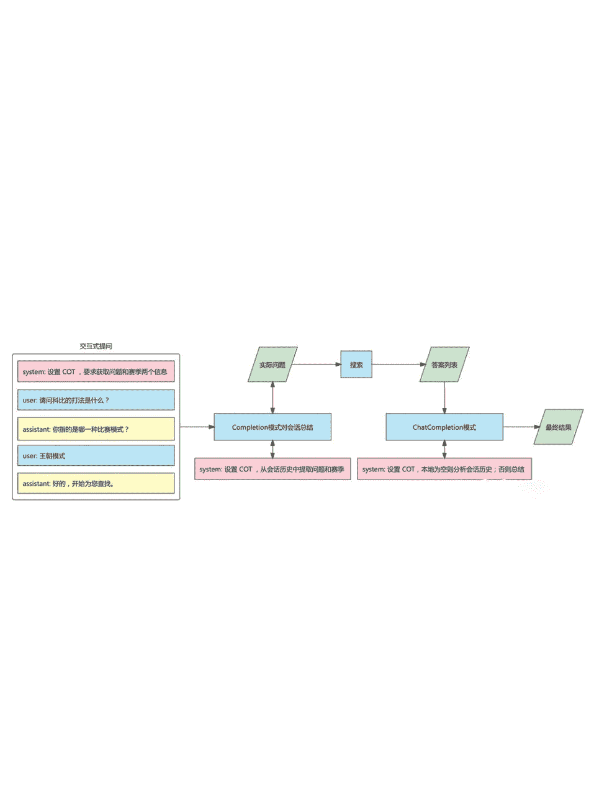
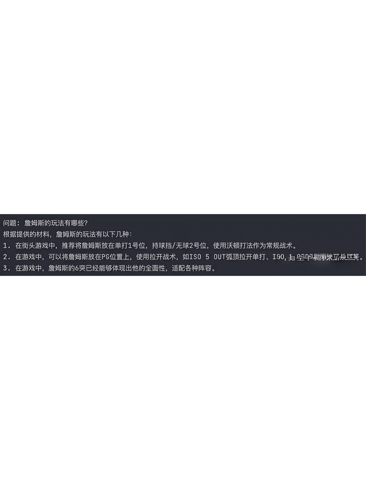
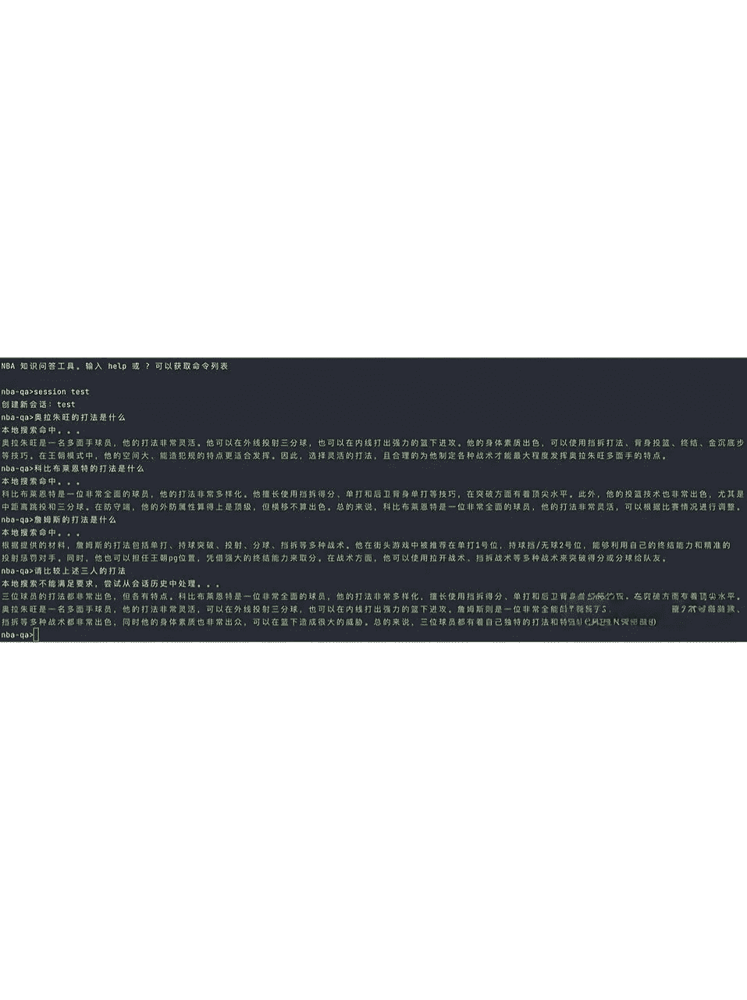

# 基于LLM构建知识问答系统

> 来源：[https://qqs7y1hozd1.feishu.cn/docx/Z0tQdXS5TovPytxysbIcj1vGnsu](https://qqs7y1hozd1.feishu.cn/docx/Z0tQdXS5TovPytxysbIcj1vGnsu)

# **1.****需求描述**

> 打造**特定领域知识**（Domain-specific Knowledge）问答系统，具体需求有：

+   通过自然语言问答的形式，和**用户交互**，同时支持中文和英文

+   理解用户不同形式的问题，找到与之匹配的答**案；可以对**答案进行二次处理，比如将关联的多个知识点进行去重、汇总等

+   **支持上下文。有些**问题可能比较复杂，或者原始知识不能覆盖，需要从历史会话中提取信息

+   准确。不要出现似是而非或无意义的回答

从大语言模型（**LLM**）角度而言，上面的需求是在两阶段训练模式下，面向下游场景进行适配的问题

> 基础模型，面向特定领域不能直接应用，因为领域知识不在预训练的数据集中，比如：

+   **较新的内容**

> 同一个知识点不断变更：修改、删除、添加

+   **未公开的、未联网的内容**

# **2.****方案分析**

基于 LLM 搭建问答系统的解决方案有以下几种：

1.  **Fine-Tuning**

1.  基于 Prom**pt Engin**eering，比如 Few-Shot方式

1.  与普通搜索结合，使用**基础模型**对搜索结果加工

## **2.1 ****Fine-Tuning**

使用下游特定领域的知识对基础模型进行微调，**改变神经网络中**参数的权重。业界已经不少 chatgpt的平替方案都支持微调。

> 微调方式比较适合特化的任务或风格，但也存在一些问题：

1.  没有解决事实性问答可靠性的问题

1.  消耗的资源量虽然相对大模型预训练减少，但还是不容小觑的

> 比如Alpaca 的微调，据作者介绍他们使用8 个 显存80GB A100 ，花费了 3 个小时。如果领域支持频繁更新，且需要需要较高的实时性，显然是无法满足要求的

1.  **需要构建特定领域微调的训练语料**

> 可以参考Dataset Engineering for LLM finetuning。如果想要获得较好的结果，高质量训练数据集的构建需要精心设计，开销也是不容忽视的

1.  **微调的结果不一定符合预期**

> 比如：在尝试使用ADGEN数据集对 ChatGLM-6B 模型微调后，模型对“广告词生成”任务的确变好，但其他任务的回答均不如原始模型

## **2.2 ****基于 Prompt**

将特定领域的知识作为输入消息提供给模型。类似于短期记忆，容量有限但是清晰

举个例子给 ChatGPT 发送请求，将特定的知识放在请求中，让 ChatGPT 对消息中蕴含的知识进行分析，并返回处理结果：

+   **优势—正确性和精度高**

+   劣势—一次可以处理的文本量有限制，如果知识库较大，无论从可行性还是效率而言都是不合适的

**Chatgpt **的限制如下表所示：

|  |  |
| --- | --- |
| Model | Maximum text length |
| gpt-3.5-turbo | 4,096(~5 pages) |
| gpt-4 | 8,192(~10 pages) |
| gpt-4-32k | 32,768(~40 pages) |

## **2.3 ****与搜索结合**

Fine-Tuning 和基于 Prompt 方式均存在缺陷，比如效率低下、数据不够精确、不能支持大规模数据量等问题

这里提出第三种方法，尝试克服这些困难，基本思想是

1.  使用传统搜索技术构建基础➕知识库查询

+   问答可控性更高一些

+   无论是数据规模、查询效率、更新方式都可以满足常见知识库应用场景的需要

+   技术栈➕成熟，探索风险低

1.  使用LLM作为用户和搜索系统间沟通的介质，发挥其强大的自然语言处理能力

+   对用户请求进行纠错、提取关键点等预处理实现 “理解”

+   对输出结果在保证正确性的基础上二次加工，比如——概括、分析、推理等

1.  **LLM****；主要功能有以下几点：**

+   完成对用户问题的预处理。纠正语法错误，提取关键点，通过交互方式引导用户补充问题足够多的信息等

+   **对****本地搜索****系统的原始答案进行二次处理**。比如内容过多，可以进行概括；也可以进行简单推理

+   提供上下文交互的能力。一个常见的例子是 “比较”，比如游戏中贩售道具，倚天剑和屠龙刀。原始知识系统只会提供两件兵器的基础属性，但不会提供各属性的对比和总体评价

**提问的过程可以是：**

+   玩家咨询倚天剑的属性

+   玩家咨询屠龙刀的属性

+   玩家要求比较倚天剑和屠龙刀；这里 LLM 已经获取两件兵器的属性，使用既有的推理能力进行对比

在同一个会话过程中，可以让 LLM 从会话历史中提取信息并分析

+   本地搜索系统。解决查询匹配的问题，有三种基本方式：

+   Lexical-based search

通过归一化、拼写纠错、扩展、翻译等方式对查询请求中的词进行替换。性能好、可控性强，尽管存在一些语义鸿沟问题，但仍被广泛的应用在现有的搜索引擎架构中

+   Graph-based search

以图的形式描述知识点以及相互间的关系，然后通过图搜索算法寻找与查询请求匹配的结果

+   Embedding-based search

将文字形式的查询请求，编码为数值向量的形式，体现潜在的关系

# **3.****方案实现**

+   本文的实现，参考了** OpenAI **提供的样例，主要理由是 ChatGPT 对外提供了良好的 API 以及中英文支持

+   但从框架角度而言，不会绑死在OpenAI 上，每一个具体实现都可以由业务结合自己的需求进行替换

上节提到的方案落地到 ChatGPT 上特化为：

> **说明如下：**

1.  使用 OpenAI 的 Embedding 接口将专业领域知识转化为向量，连同原始材料一并保存在 Redis 中

1.  用户提问的搜索处理

1.  使用 OpenAI API对用户的问题进行 Embedding，获得向量

1.  使用问题向量在 Redis 中搜索，找到与之最匹配的若干记录，将这些记录的原始材料返回

1.  使用OpenAI 的 Completion API 对这些原始材料进行加工完善，并将最终结果返回

## **3.1 ****领域知识入库**

该过程的主要目的是：将原始知识库分拆为若干知识点，并生成与之对应的字典

+   **key** 是知识点Embedding 之后生成的向量

+   **value** 是知识点的原始记录

该字典的作用是用户提问时，通过**Embedding** 之后的向量比对，实现问题和答案的匹配

具体过程涉及以下几点，如图所示：

1.  本地文本文件**（****技术文档****、设计稿）**或者数据库（业务自己维护的 UGC，比如用户帖子、评论等），采用合适的方式收集这些数据并整理为纯文本的格式

> 这里提供一个python 库textract，支持从多种类型文件中提取文字信息，普通文本文件自不必说，其它各种常用格式文件也都支持，比如：Microsoft 全家桶 docx, xlsx；图像gif, jpg等；音频文件mp3, ogg等

1.  生成分词器 **tokenizer**，将文本分成一个个词元，保证各个词元拥有相对完整和独立的语义，以供后续任务比如 Embedding 使用

> tiktoken是一种 Byte Pair Encoding(BPE) 分词器，有多种编码方法可选，如：r50k_base, p50k_base, cl100k_base等。面向 OpenAI 的gpt-4, gpt-3.5-turbo和text-embedding-ada-002模型通常使用cl100k_base编码方法

1.  **分片。**

将原始知识库拆分为若干个独立、**较短的知识点**。每个知识点会作为问答的最小记录，与问题进行匹配。

1.  在实际使用过程中有以下几点建议：

1.  原始内容在编写、组织时最好原子化、正交化。对于树状结构的知识点，可以按层级关系表示，最好不要混为一谈。比如倚天剑可能基础属性，也有适合的打法，偏向的英雄天赋，那么三者应该独立描述，而不要混杂在一起。

1.  **可以在原始语料**中设计明确的分片标记，简化处理过程。对于 html、markdown 等类型的文档而言，天然结构化处理会简单一些。

1.  **基本的分片方**式。粒度从细到粗可以使用，标点符号、段落、章节等进行区分。分片粒度过细，知识点会比较零碎影响了相互间的关系；分片粒度过粗，在匹配时可能会携带冗余信息，另外对 Embedding、处理、索引的效率也有影响。

1.  分**片要使用 toke**nizer，原始文本经过分词然后再进行 embedding，分片大小需要考虑分词之后生成的 token 数量。基本目标是：分片不能破坏知识点的完整性，生成的分片对应的 token 数量应该在预设范围内，不要过小或过大。

1.  **词嵌入****(Embedding)**

使用 OpenAI API 对每个分片后的每个知识点进行处理，获得向量化的结果。这里需要调用 openai.Embedding.create 接口

1.  **存储。将 Embe**ddings 生成的向量连同原始分片（知识点），以 kv 形式存储，便于后续快速匹配索引。专业的解决方案是 vector database，但实际上很多传统的数据库或存储中间件也已经提供了支持，比如：

+   RediSearch 提供的 Vector Similarity ，支持使用向量字段和向量相似性查询。它可以加载、索引和查询存储在 Redis 哈希或 JSON 文档（通过与 RedisJSON 模块集成）中的向量。Vector Similarity 提供了实时向量索引、实时向量更新/删除、K-最近邻（KNN）搜索和范围过滤等功能。

+   pgvector基于 PostgresQL，提供了类似的向量索引支持。和 Redis 的基本功能差不多，在向量距离计算方面，也提供了：L2、点积和 COSINE 这三种方法。

**使用 Redis 比较简单高效，接口和文**档非常丰富，如果没有特别要求可以直接使用

## **3.2 ****搜 索**

> **搜索的核心流程包含两步：**

1.  将用户的问题通过 OpenAI API openai.Embedding.create进行 embedding 得到向量

1.  向 redis 发起查询获得与之最匹配（距离最近、相似度最高）的若干答案

> 除此外，也可以利用 LLM对用户的问题进行预处理，常见的方式有：

+   简化概括用户的问题

+   利用思维链(Chain-Of-Thought, COT)提示的能力，提供范本，让 LLM按样例和用户进行交互，将问题逐步完善，直到获取足够的信息为止

以游戏 NBA2K为例，球员的打法在不同比赛模式中是不同的，比如王朝 5v5和街头 3v3就不一样。

用户可能并未意识到这一点，希望LLM 能够自动和玩家交互直到获得：

问题和比赛模式两个信息，**再进行处理**。这里仅提供一个示例，告知 ChatGPT 使用案例中的样式和玩家交互

> 你是一个游戏客服。你需要在和用户的交流过程中提取一个问题和比赛模式这两个信息。 请按照下面的方式一步步思考：

+   玩家问了一个问题

+   如果问题中没有包含比赛模式，你需要请他提供比赛模式信息，比如可以问他：你指的是哪一种比赛模式？

+   一旦你获得了比赛模式，那么说：好的，开始为您查找。

> 例子：

> User：请问科比的打法是什么？

> Assistant：你指的是哪一种比赛模式？

> User: 王朝模式

> Assistant: 好的，开始为您查找

-

对于 ChatGPT 而言，上述这种预设对话行为来引导用户的方式称之为 ChatCompletion，可以 openai.ChatCompletion.create api，将多轮会话的上下文整合起来，对提问和回答过程提供更加强大、灵活的定制能力。比如：

+   要求用户的提问必须提供足够的指定类型的信息

+   为用户提供的多轮信息进行进行总结

**交互式会话中， 提供了三种不同的角色(role)：u**ser，system，assistant

+   user 代表用户，记录用户的提问

+   system 用于向 chatgpt 发出指令，定义其应答行为

+   assistant 代表 chatgpt 返回的结果

## **3.3 ****结果整合**

> **结果整合**的主要作用是将本地搜索系统返回的结果进行二次加工，比如发挥LLM的：

+   总结、概括

+   格式整理

+   去重、翻译

+   从会话历史中，提取上下文，进行分析处理等能力

**实现的方法还是基于 ****ChatCompletion**** ，方式很多，业务完全可以****结合场景自由发**挥。这里提供一个在 NBA2K Online2中实现的方式：

+   首先交互式提问完成后，对会话历史进行总结，让 ChatGPT 用一句话概括，须包含问题和赛季信息

+   基于该问题，进行** Embedding **并在本地搜索，搜索的结果可能有多条，也可能没找到。如果找不到则返回特殊语言标记，比如：本地知识库找不到

+   以 ChatCompletion 的方式和 OpenAI 交互，让 ChatGPT 基于本地搜索结果和历史会话，进行总结整理。需要以 system 的身份，注入 Prompt 定义 ChatGPT 的应答行为。

**具体方法是：**

1.  基于用户的请求 user_query 触发本地搜索，获得答案 search result

1.  将答案以 system role 的身份插入 conversation history 中，要求对于用户发出的请求 user_query 使用 search result 回复

1.  将包含本地搜索答案的 system 指令和用户问题依次推入 conversation history

1.  交给 chatgpt 的 ChatCompletion 处理

+   另外一个比较特殊的情况是，本地搜索的结果不满足要求比如相似度过低，那么尝试基于会话历史让 chatgpt 进行处理

# **4.****应用效果**

上述方案在测试过程中，以 NBA2K Online2 官网的攻略信息为基础进行尝试，基于 OpenAI API，搭建简单的 CLI 的应用。效果如下所示（为了简化过程，一律省略多轮交互问答的过程）

## **基础能力**

**对问题在****本地进行搜**索，找到多条匹配语料，然后自动整合使用无序列表的形式返回

+   **问题：**关于詹姆斯的打法

+   本地 Redis 搜索命中的关联度最大的若干条答案：

**整合后的反馈：**

## **4.1****基于会话历史的问答**

**知识库中仅保存了：**

奥拉朱旺、科比、詹姆斯三人各自的打法信息，并没有直接提供三者的比较。

> 所以如果仅通过一个问题要求比较三人的打法差异，**是无法在 Redis** 中直接匹配命中的。但是可以使用会话历史，当本地无法命中时，让 ChatGPT 基于过往的信息自动进行整合。

**如下所示：**

# 5.总结

本文针对特定领域知识问答系统的问题，进行方案比较和选型

**不难发现：**传统的搜索模式、LLM 的 Fine-Tuning、Prompt Engineer 等方式均存在不同程度的缺陷

经过分析比较后，决定探索 LLM +搜索 的方式进行处理，并在 NBA2K Online2 攻略应用场景进行验证。

**该方法：**

+   将本地知识通过传统搜索框架进行处理，并作为答案的基础数据源，这保证了答案的精准和可靠

+   同时基于 Prompt Engineering 激发 LLM 的自然语言理解、生成和简单推理能力，对用户的问题预处理、对原始答案进行加工。从而提供了更加智能和友好的交互方式