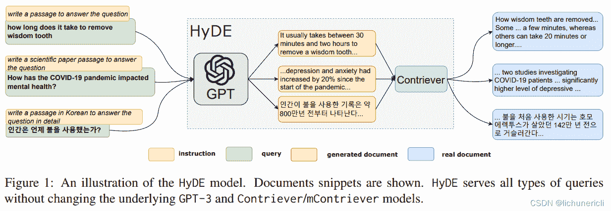
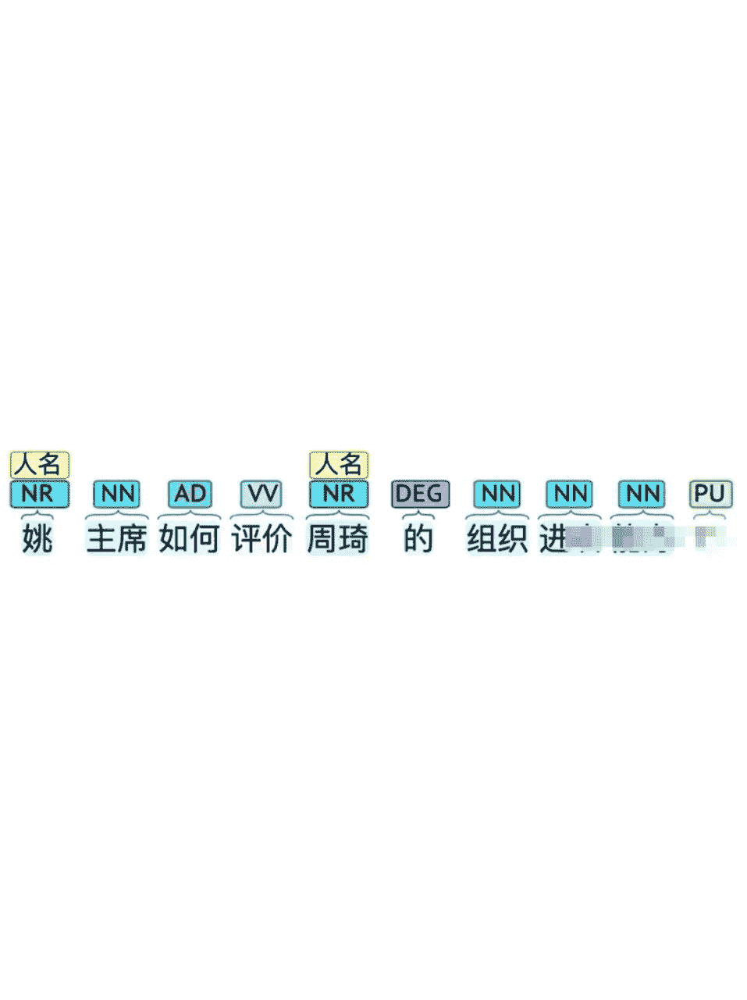
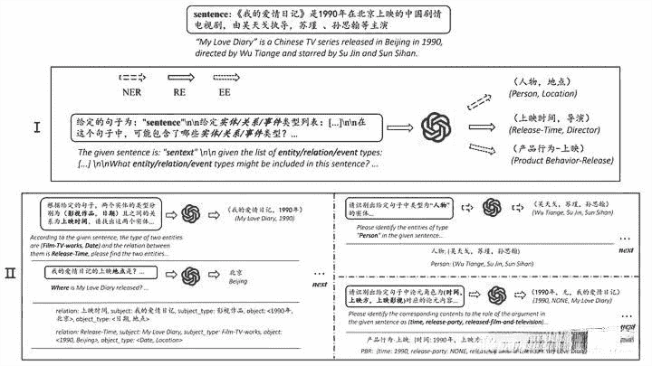
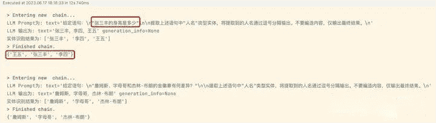
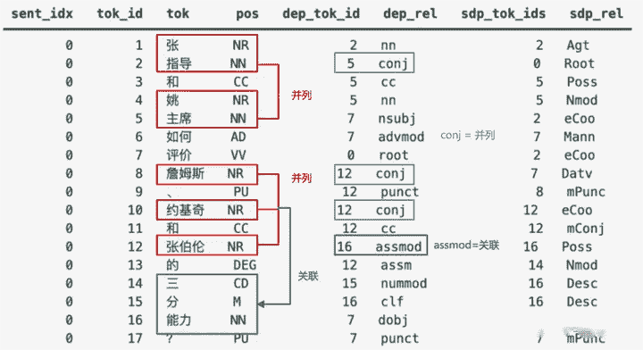
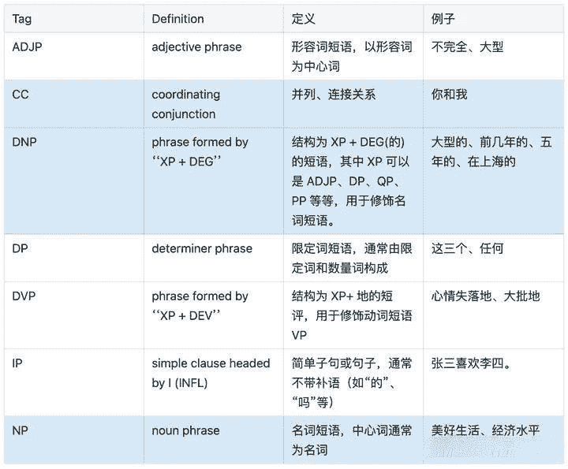
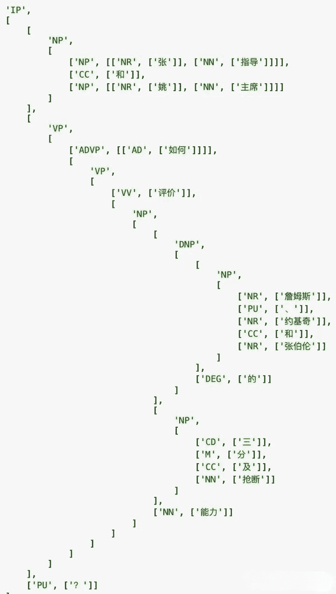
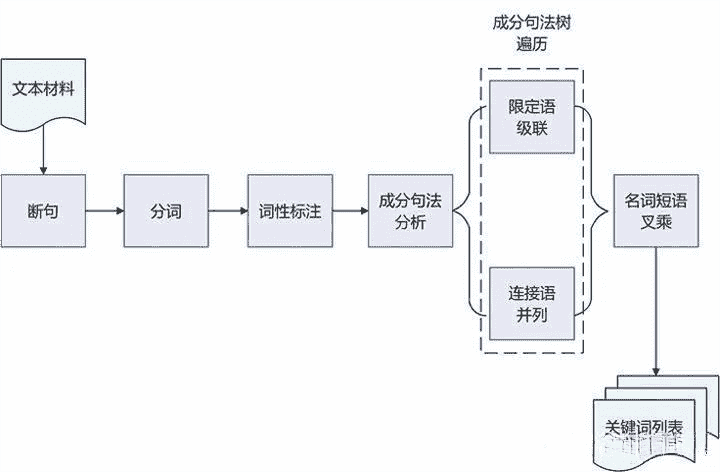
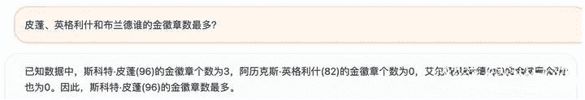

# LLM+Embedding构建问答系统的优化方案

> 来源：[https://qqs7y1hozd1.feishu.cn/docx/VE6edCldXojGqvxLsX4cv0U5nUd](https://qqs7y1hozd1.feishu.cn/docx/VE6edCldXojGqvxLsX4cv0U5nUd)

> **在利用大型语言模型****LLM****构建知识问答系统的过程中，****首先要确定了两个核心步骤：**

1.  **将用户提出的问题和**知识库中的信息转换成嵌入向量Embedding，然后利用向量相似度技术来检索最相关的知识条目

1.  利用**LLM**来识别用户问题的意图，并对检索到的原始答案进行加工和整合，以提供更加精准和有用的回答

> 然而，这种方法在实际应用中遇到了一些挑战：

1.  上层应用与模型基础的紧耦合导致灵活性受限

+   每当需要更换或升级语言模型时，上层的应用逻辑也必须进行大量的调整。在LLM技术迅速发展的今天，由于成本、许可、技术热点和性能等多方面的考量，模型的变更几乎是不可避免的

1.  处理环节的不完善和高开发成本也是一个问题

+   例如，嵌入向量的存储和搜索、LLM的提示词生成、以及数据链路的处理（包括导入、分片和加工）等，如果这些环节都需要从头开发，将耗费大量的时间和资源

1.  **缺乏标准化工具和组件**

+   为了能够根据不同场景灵活地组装和调整系统，需要的是一个像“乐高”一样的标准化组件库

# 局限性分析

+   **多知识点聚合处理场景下，****Embedding-**Search 召回精度较低的问题

> **典型应用范式是：**

1.  一个仓库有 N 条记录，每个记录有 M 个属性

1.  用户希望对 x 条记录的y 个属性进行查询、对比、统计等处理

**这种场景在游戏攻略问答中很常见，以体育**游戏 NBA2K Online2 为例：

```
# 多知识点——简单查询
Q: 皮蓬、英格利什和布兰德的身高、体重各是多少？

# 多知识点——筛选过滤
Q: 皮蓬、英格利什和布兰德谁的第一位置是 PF？

# 多知识点——求最值
Q: 皮蓬、英格利什和布兰德谁的金徽章数最多？
```

# **Embedding**缺 陷

> **原始的****Embedding Sea****rch在面对多**知识点聚合处理时，存在几个问题：

1.  **本地知识建立索引时**，通常对单个知识点进行Embedding；通常不会为不同知识点的排列组合分别制作索引，所有组合都建立索引的开销是巨大的

1.  原始问题直接 **Embedding** ，**和单条知识点的向量相似**度比较低。为了避免召回结果有遗漏，就需要降低相似度评分下限(vector similarity score threshold)，同时提高召回结果数量上限(top k)。这会产生不好的副效应：

+   **召回结果，有效信息密度大幅降低**；score threshold 过高或 top k 过低，会导致某些有效知识点无法命中；反之则很多无效知识点或噪声会被引入。且由于总 token 数量的限制，导致本地知识点被截断，遗漏相似度较低但有效的知识点

+   **召回结果的膨胀，增加了和 LLM 交互的 to**ken 开销和 LLM 处理的时间复杂度

+   给 LLM 的分析处理带来额外噪声，影响最终答案的正确性

# 方案分析

#### 想要更加精准的回答问题，需要从两个层面入手

## 问题理解—准确识别用户意图

> 为了准确理解用户的意图，问答系统需要能够：

+   **解析用户问题：**系统需要通过分析用户的提问来识别他们的意图

+   **制定计划：**根据识别的意图，系统需要拆分问题为多个步骤，并为每个步骤选择合适的工具或方法

+   **多轮交互：**使用Agents和Chains等工具，系统可以通过多轮对话来逐步明确用户的需求

**在****LangChain****框架中，****Agents****可以帮助系统规划并执行这些步骤**

> 例如，Plan-and-Execute Agents可以用来制定动作计划，而Action Agents则负责执行这些动作

+   **HyDE**

> Precise Zero-Shot Dense Retrieval without Relevance Labels 是面向 Zero-Shot场景下的稠密检索。它使用基础模型在训练过程中已经掌握的相关语料，面向用户问题，生成虚构的文档。这些文档的作用，不是输出最终结果，而是通过LLM（大型语言模型）对问题的理解能力，生成与之相关的内容。这相当于自动化生成相关性标签，避免外部输入。生成虚构文档后，再使用无监督检索器进行Embedding；然后将生成的向量在本地知识库中进行相似性检索，寻找最终结果



> HyDE 要求与用户问题相关的知识，已经存在于 LLM 基础模型中。但专业领域知识，可能本来就是未联网、未公开的；LLM 生成的虚构文档，可能包含很多噪音，所以效果不一定很明显；另外生成文档的额外交互，进一步增加了时间开销。目前，LangChain 提供了 HyDE Chain，LlamaIndex 也提供了类似的能力；面对中文可能需要自定义 Prompt Template

+   **意图识别**

通过命名实体识别和槽位填充实现，概括来说就是：

+   在为用户提供服务的预设场景下，细分用户各种意图的类别，定制对应的语义槽，每个槽位可以视为在语义层面体现意图的基本单位

+   **通过深度学习、统计学习，甚至 LL**M ，理解用户问题提取语义槽中需要的内容。在基于大语言模型构建知识问答系统一文中给过例子：通过 System Role 告知LLM 需要提取槽位信息，让 LLM通过多轮对话引导用户给出所有槽位信息。还是以游戏攻略为例，玩家咨询球员的打法，那么必须提供：球员姓名，年代（比如2020/2022 年），比赛模式。对应的语义槽可以定义为：

```
    &quot;球员打法&quot; : {
        &quot;球员名称&quot; : ____,
        &quot;年代&quot; : ____,
        &quot;比赛模式&quot;: ____,
    }
```

## 搜索召回—提升精度

**在****问答系统中，将用户****的诉求转化为语义槽可以显著提升**搜索的精度，因为这样可以更准确地捕捉用户的问答意图。在建立知识点的索引时，除了使用原始的Embedding方法，还可以采取以下优化措施：

+   **增加关键词、主题词检索**

> 主题词是由权威机构定义和发布的规范词汇，通常包括专有名词或名词短语。主题词检索能够返回包括检索词的近义词、同义词以及同一概念词的不同书写形式等结果，这样可以大大减少漏检和误检的情况

> 关键词可以是作者自定义的，也可以通过自动分析提取，它们通常能够高度概括文章的主题。使用关键词搜索可以找到与特定主题方向更为明确相关的文章

+   **对相同知识点建立多级索引**

> 同一知识点可能涉及多个维度，因此建立多级索引可以让其在不同维度的查询中都能发挥作用。例如，对于球员信息，可以建立包括姓名、球队、年龄、进攻、防守、荣誉等多项属性的索引。这样，在查询时可以高效地检索到指定的属性数据，而不必每次都提取所有内容

+   **把原始知识库转化为知识图谱**

> 知识图谱由实体、属性和关系组成的三元组构成。实体代表现实世界中的事物或对象，属性描述这些事物或对象的特征，关系则表示实体之间的相互联系。知识图谱可以帮助人们更好地理解和组织知识，并支持推理和问题解决。在问答系统中，可以通过提示词引导LLM从用户的问题中提取知识三元组，然后在知识图谱数据库中进行查询

## 解决思路

+   **意图识别和召回优化**是提升问答系统精度的两个关键方面

知识图谱虽然相对于**Embedding**方式在搜索层面具有更高的加工成本，但在遵循奥卡姆剃刀原则（即“如无必要，勿增实体”）的前提下， 可以探索一些性价比更高的解决方案

> 意图识别和召回均可用 关键词/主题词 表示。那么问题可以转变为：

+   **关键词/主题词提取**

+   面向知识点，提取的结果作为索引入口

+   面向问题，提取的结果作为语义槽内容

+   **复用 Embedding 框架**


> 这种方式怎么解决原始 Embedding 存在的几个局限呢？

+   **多知识点聚合处理局限**

> 在关键词提取过程中，可以将并列的关键词短语拆分，平铺后分别检索。这样就可以降低Embedding的噪音，提高命中精度。最后将生成不同关键词短语召回的结果组合即可。例如，对于语句“姚明和奥尼尔的内线与三分能力”，提取的关键词可以按照从属关系叉乘，得到“姚明内线”、“姚明三分”、“奥尼尔内线”和“奥尼尔三分”

+   减少LLM过度依赖导致的性能开销

> 通过关键词短语召回已经可以大大提升命中精度，因此不必设置较低的score threshold或者较大的top k，这本身就过滤了很多无关词条。另外，如果关键词提取可以不依赖于LLM，而是使用传统的NLP技术，那么可以避免与LLM的多轮交互，从而节省响应时间。这对于大量的知识点文档来说尤为重要

**基于这样的思路，下文将主要描述关键词提取的实现方法和效果，以**及如何通过这种方式提升问答系统的整体性能

# 关键词提取

关键词提取是信息抽取（**IE**）的一个重要组成部分，**特别是在知识问答场景中**

**IE****通常涉及三类任务：**实体关系三元组抽取(RE, Relation Extraction )

> 三元组(triples)即 (主体, 关系, 客体) ，用英文表示为 (S**ubject**, Relation, Object) 关系抽取，即实体三元组抽取，涉及两件事：

+   识别文本中的主体、客体，即实体识别任务

+   判断这两个实体属于哪种关系，即关系分类

> 命名实体识别(NER, Name-Entity Recognition)。又称作专名识别、命名实体，是指识别文本中具有特定意义的实体，主要包括人名、地名、机构名、专有名词等，以及时间、数量、货币、比例数值等文字。指的是可以用专有名词（名称）标识的事物，命名实体一般代表具体事物个体，包括人名、地名等。

> 事件抽取(EE, Event Extraction)。指的是若干与特定矛盾相关的事物，在某一时空内的运动，从自然语言角度通过“主谓宾”等语义单元体现。事件抽取就是从半结构化、非结构化数据中，识别一个与目标相关的事件的重要元素识别出来。

**为了简化这些任务， 可**以将它们归纳为两个主要过程：名词短语提取和谓语分析

1.  **名词短语提取：**这包括识别文本中的主语和宾语，通常由名词及其限定词或修饰词组成。例如，在问句“姚主席如何评价周琦的组织进攻能力？”中，“姚主席”是主语，“周琦的组织进攻能力”是宾语

1.  **谓语分析：**谓语体现了名词短语之间的事件或关系。在许多场景中，谓语可以是“比较”、“查询”、“过滤”、“统计”等，这些可能需要动态计算或处理。即使忽略谓语，仅通过名词短语的组合也可以获得完备的知识。谓语所代表的事件可以交给LLM处理

在关键词提取方面， 可以专注于名词短语，将它们作为知识点的索引用于召回。事件则体现了不同知识点的关系，重点在于事件关联者。获取事件关联者对应的语料后，可以通过LLM理解事件进行处理。知识点通常不是按照事件组织的，而是按实体组织的，因此索引建立和关键词抽取应该以名词短语为主要目标

在处理主语和宾语之间的并列和限定关系时， 可以将限定关系按级联方式处理，同一名词短语内如果存在并列关系则与其他部分叉乘。例如，在处理“姚主席如何评价周琦的组织进攻能力？”这个问题时， 可以通过分词、词性标注、NER识别和名词间关系分析，得到应该搜索的关键词列表：[姚主席, 周琦, 组织进攻能力]



1.  **分词**

1.  **词性标注(Part-Of-Speech Tagging, Penn Chinese Treebank)，用于识别名词短语。**比如：NR 表示人名、机构、地名等专有名词；NT 表示时间名词，NOI表示汉字顺序颠倒产生的噪声，NN 表示其它类型名词

1.  **NER 识别。比如姚，周琦等**

1.  然后还需要考虑语义间的依存关系，确定名词间的关系，比如：

+   并列

+   修饰。比如：“组织进攻能力”

+   从属、限定等等。比如：[周琦, 组织进攻能力]

这样不难得到应该搜索的关键词列表：[姚主席, 周琦, 组织进攻能力]；下面来看看这种思路究竟如何实现，还是分为两大类：LLM、传统 NLP

# **基于****LLM****提取**

LLM天然具备NLU和NLG能力，业界已经有尝试，比如 Zero-Shot Information Extraction via Chatting with ChatGPT 提出两阶段多轮问答信息提取方式



在该思想的启发下，可以使用 langchain 开发信息提取 Chain，LLM 使用的是 ChatGLM-6B本地部署，提取部分测试片段如下所示



> 从结果李四和王五的出现，可以看出即使 Prompt 已经添加了“不要编造内容”的说明，LLM在信息提取时仍可能但无济于事。总体而言，使用 LLM 提取信息效果如下：

+   可以支持部分程度的 NER；对非专业名词、或业务自定义术语识别不好，需要Fine-Tuning

+   可以提取名词短语，但无法做精确的语义分析，大量测试案例下总是存在不少偏差

+   即使明确了输出格式，但还是频繁出错

+   耗时较长。提取 6 条测试案例耗时 12s

# 传统**NLP**方法提取

> 在处理自然语言处理（NLP）任务时，特别是当大型语言模型（LLM）效果不佳时，可以回归使用传统的NLP技术。这些技术包括但不限于分词、词性标注、命名实体识别（NER）等。业界已经开发了许多传统NLP工具，如spaCy、CoreNLP和HanLP等，以应对不同的语言处理需求

**spaCy**是一个流行的NLP库，但在某些中文语境下，它的表现可能不尽人意

> 例如，在处理“请比较詹姆斯和麦迪的属性”这样的句子时，spaCy可能无法识别出任何人名。同样，对于“詹姆斯、字母哥和杰林.布朗的金徽章有何差异？”这样的句子，spaCy可能只能识别出“布朗”，而将“杰林”遗漏

在进行了一系列的测试比较后，HanLP工具因其对中文的良好支持、较少的依赖性、开箱即用的便利性、完备的基础工具和整洁的接口，而被选为最终的基础NLP工具。HanLP在处理上述提到的句子时，能够正确地进行词性标注和命名实体识别

> **为了解决多****知识点聚合查询的问题，Han**LP的核心处理步骤可以分为三步：

1.  **词性标注：**对文本中的每个词进行词性标注，如名词、动词、形容词等，为后续分析提供基础

1.  **名词短语关系分析：**分析名词短语之间的关系，包括修饰关系、限定关系、并列关系等。这一步骤有助于理解句子中各元素之间的相互关系

1.  **名词短语重新组织****：**根据名词短语之间的关系，重新组织文本内容。例如，将修饰和限定关系进行级联，并列关系与其他部分进行叉乘，以更清晰地表达句子的含义

**通过上述步骤，可以有效地处理复杂的**中文语言结构，提高文本处理的准确性和效率

+   **spacy**

+   **CoreNLP**

+   **HanLP**

## **名词短语提取与整合**

**名词短语提取与整合是信息抽取中的关键步骤，特别是在处理复**杂句子时；以下是一个复杂例子的分析过程：

### **分词与词性标注**

首先对句子进行分词，然后为每个分词添加词性标注。例如，在处理“张指导、姚主席如何评价詹姆斯、约基奇、张伯伦的三分及抢断能力？”这个问题时， 首先进行分词和词性标注


### 依存分析

[获取到词性后](https://zhuanlan.zhihu.com/p/51186364)，接下来是提取句子中单词与单词之间的语法关系，即 依存句法分析；例如，使用 Stanford Dependencies Chinese (SDC) 标准进行分析，并将结果转化为Pandas DataFrame的形式，以便于查看和分析



> **在自然语言处理中，依****赖关系****分析是理解句子**结构的关键部分；dep_tok_id 和 dep_rel 是依存句法分析中使用的两个重要概念：

+   dep_tok_id 表示当前分词所依赖的中心词的ID

> 例如，在句子“指导主席”中，“指导”的中心词ID可能是5，这取决于具体分析工具如何分配ID

+   dep_rel 表示当前分词和中心词之间的关系

> 例如，“指导”和中心词“主席”之间的关系可能是 conj（并列），这意味着“指导”和“主席”是并列关系。在另一个例子中，“张伯伦”的中心词是“能力”，关系为 assmod（修饰限定），表明“张伯伦”修饰或限定“能力”

+   sdp_tok_ids 和 sdp_rel

> 是在**依存句法分析的基础上，进一步提供 语义依存分析，旨**在分析一个句子中单词与单词之间的语义关系(sdp_rel)，并将其表示为图结构的任务。不同于依存句法分析的地方是：图结构中每个节点可以有任意个目标节点。在本例当中，特别需要关注的是：Agt（施事者），Poss（领事者），eCoo（并列关系）等

**通过分析 DataFrame 中提供的依**赖关系， 可以直观地获取名词短语。例如：

+   主体：并列关系 [张指导, 姚主席]

+   客体：[三分能力]，其中“三分”和“能力”是修饰关系

+   客体还存在三个并列的领事关系（所属关系）：[詹姆斯, 约基奇, 张伯伦]

因此，实际的客体应该是将并列的领事关系和本体叉乘后平铺的结果，即：

+   [詹姆斯三分能力, 约基奇三分能力, 张伯伦三分能力]

使用这三个关键词进行 Embedding 并在本地知识库中搜索，可以显著提高搜索的准确性。然而，语义依存分析可能存在不准确的情况，例如：

+   “指导”一词的 sdp_rel 被识别为 root，即动词作为语义树的根部

+   “和”与“主席”被错误地识别为领事关系

这种语义偏差的原因在于，同一个词可能有多种语义，容易产生混淆。例如，“指导”可以是名词也可以是动词。中文的多义词和复杂语境可能导致语义依存分析出现误判。

解决这个问题的传统方法是使用有监督的训练方式对基础语义依存分析模型进行微调（Fine-Tuning）。然而，这种方法成本较高。幸运的是，词性标注和依存句法分析的准确率通常高于语义依存分析。因此，可以考虑以下方法：

+   基于正确的词性标注，构建语法树，从语法角度提取名词短语。

这种方法可以减少对复杂语义分析的依赖，同时提高名词短语提取的准确性。通过这种方式，可以在不进行有监督训练的情况下，有效地解决名词短语提取的问题。

### 成分句法分析

为了解决语义依存分析中可能出现的误差，可以基于正确的词性标注构建语法树，从语法角度提取名词短语。成分句法分析可以帮助 理解句子在语法上的递归构成；分析句子在语法上的递归构成，在 NLU 领域是经典的 成分句法分析问题

**下面罗列 Chinese Treebank 标准片段，描述对分**词单元类型的定义，请大家关注蓝色背景内容



> 再次回顾 要解决的多知识点聚合处理的目标：

+   名词短语(Noun Phrase)提取。即提取 NP;

+   处理好修饰名词短语间的修饰限定问题。比如：DNP 等

+   处理好并列、连接关系。比如：CC 等

+   将修饰关系的名词短语级联；将并列关系的NP和修饰关系的NP 叉乘

基于该思路，上文提到实例，可以转化为下面的成分句法分析树：



> **这是典型的树结构：**

+   顶层的 NP 有两个：分别是主体和客体。客体是VP(动词短语)，表示主体的施事对象，和施事行为

+   每个 NP 是颗子树。变种很多，但核心有三种形式：

1.  **并列**。比如：[张指导, 姚主席]通过明确的连接词 "和" 建立关系；[詹姆斯, 约基奇, 张伯伦] 则通过非终结的标点服务建立关系

1.  **堆叠**。由修饰词和名词联合形成一个名词短语

1.  **从属**。通过"的"这样 DEG 词性的结构，明确表示前后两个短语间的从属关系。比如："三分及抢断"，隶属于"詹姆斯"

> **这样来看，NP 的提取非常简单，通过递归****方式对三种基础形**式的树结构进行识别即可，提取时注意区分：

+   主体、客体

+   NP 子树中各个单元的组织关系。并列单元在和其它单元组合时，需要叉乘输出；其它邻接单元直接合并即可

在上述算法下，样例中提取的名词短语列表最终如下所示：

```
extract np from sentence 0［&#x27;张指导&quot;，“姚主席&#x27;］［&#x27;詹姆斯三分能力’，〝詹姆斯抢断能力’，，约基奇三分能力’，！约基奇抢断能力’，「张伯伦三分能力’，！张伯伦抢断能力&quot;］
```

+   主语列表：[张指导, 姚主席]

+   宾语列表：[詹姆斯三分能力, 约基奇三分能力, 张伯伦三分能力]等

+   **在性能****方面，**单条语句处理方式是 5ms；之前基于 LLM 的方式处理 6 条语句，需要 12s；性能相差数百倍

通过以上步骤， 可以有效地提取和整合名词短语，从而提高知识问答系统的精度和效率。完整的处理流程包括分词、词性标注、依存分析、成分句法分析和名词短语提取。



# 应用效果

**关键词提取实现后，配合前文提到的召回方法，应用**到文章开始的几个示例问题，结果如下所示：




> 解决多知识点聚合处理问题的方案：

1.  基于传统NLP的成分句法分析：利用成分句法分析从用户问题中提取名词短语，然后通过分析短语间的依存关系，生成关键词列表

1.  从完整语句的Embedding切换到关键词Embedding：在知识库构建时，对单个知识点进行入库，同时提取关键词列表进行Embedding，以便于后续的检索。在查询时，对用户的问题进行关键词提取和Embedding，然后从本地知识库中检索出多条相关记录

1.  多知识点拆解与检索：将用户单次提问中的多个知识点拆解开来分别进行检索，然后将召回的多条记录交付给LLM进行整合和回答

> 这种方法的优势主要体现在以下几个方面：

1.  **提升召回精准度：**与传统的方法相比，基于关键词Embedding的检索方式能够大幅提升召回的精准度。

1.  **支持多知识点聚合处理：**用户可以在单次交互中提出包含多个知识点的问题，而不需要分别查询单个知识点，然后由LLM对会话历史中的信息进行汇总。

1.  **专项问题处理精度和性能：**在处理特定问题时，传统NLP方法相比LLM提供了更好的精度和性能。

1.  **减少LLM交互频次：**通过减少与LLM的交互次数，提升了交付给LLM的有效信息密度，从而大大提升了问答系统的交互速度