# LLM 各种技巧 | Prompt Engineering 指南

> 来源：[https://qqs7y1hozd1.feishu.cn/docx/NZR2db5qnohR7oxaYkJccMSRnfe](https://qqs7y1hozd1.feishu.cn/docx/NZR2db5qnohR7oxaYkJccMSRnfe)

截止至今：关于 LLM 的优化与技巧层出不穷，几乎每个月都有新的技术和方法论被提出，因此本篇主要是要介绍在各种不同情境下，LLM 的各种 Prompt Engineering 技巧，方便你快速检阅，希望能帮助你深入了解 Prompt Engineering 领域的最新进展及其发展趋势。

+ 主要分成 12 个部分，并会对各部分的技术分别做介绍

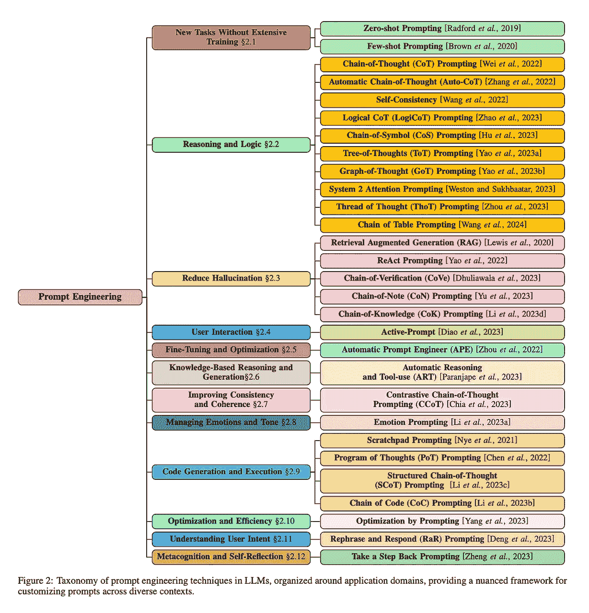

## New Tasks Without Extensive Training

### Zero-Shot Prompting

零样本提示技术(Zero-Shot Prompting) 是LLM领域里的一项重要创新。这技术使我们能够在缺乏大规模专门训练资料的情况下，通过巧妙设计的提示来引导模型执行新的任务。这意味着，模型接收到的是任务的描述，而不是针对该任务的具体训练标签或资料。

这项技术依赖于模型本身的知识库，它可以利用这些提示来对新的任务作出反应和预测。

+ 以下为范例：

Input: 输入：

```
Classify the text into neutral, negative or positive.
Text: I think the vacation is okay.
Sentiment:
```

Output: 输出：

```
Neutral
```

### Few-Shot Prompting

Few-Shot Prompting 与零样本提示相比，它透过提供少数输入输出范例来帮助模型学习特定任务。通过精选的高质量范例，能够显著提升模型在执行复杂任务时的表现，尤其是在完全没有示例的情况下更为明显。尽管如此，这种方法由于需要更多的输入 token，可能会在处理长文本时遇到困难。此外，范例的挑选对于模型的最终表现至关重要，不恰当的范例选择可能会导致模型学习到不精确或有偏见的信息。

Input: 输入：

```
A "whatpu" is a small, furry animal native to Tanzania. An example of a sentence that uses
the word whatpu is:
We were traveling in Africa and we saw these very cute whatpus.
To do a "farduddle" means to jump up and down really fast. An example of a sentence that uses
the word farduddle is:
```

Output: 输出：

```
When we won the game, we all started to farduddle in celebration.
```

## Reasoning and Logic

+ 在推理与逻辑领域，见证了多种创新技术的诞生，这些技术使 LLM 能够进行更加深入和复杂的思考过程。

+ 技术如 Chain-of-Thought (CoT)、Automatic Chain-of-Thought (Auto-CoT)、Self-Consistency、Logical CoT 等，都旨在促进模型以更结构化和逻辑性的方式处理信息，从而提高问题解决的准确性和深度。

### Chain-of-Thought (CoT) Prompting

为了克服 LLM 在处理复杂推理任务方面的限制，该技术通过引入一种特殊的提示策略，旨在促进模型进行更为连续和逐步的思考过程。相较于传统的提示方法，连贯思考技术的主要贡献在于能够更有效地激发 LLM 产出结构化且深入考虑的回答。

通过一系列实验，这一技术证明了其在促进模型执行逻辑推理中的独特效用，特别是在使模型对问题进行更深层次理解的方面。

> 例如，它能详细描绘出解决复杂数学问题所需的逻辑步骤，这一过程非常类似于人类的解题思维。利用 CoT，研究者们在使用 PaLM 540B 模型进行的数学及常识推理测试中，达到了空前的准确率，高达 90.2%。

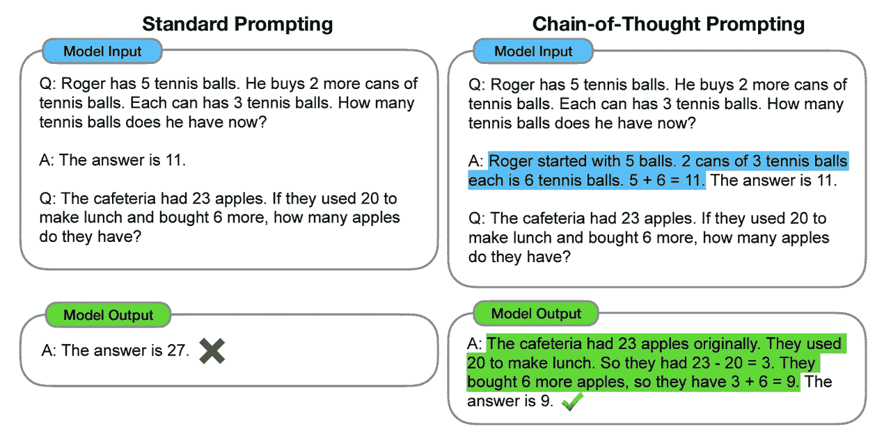

### Automatic Chain-of-Thought (Auto-CoT) Prompting

建立手动的 CoT 范例虽然可以提高模型的推理能力，但这个过程既耗时又效率低下。为了解决这一问题，提出了 Auto-CoT 技术。

这项技术能够自动生成「让我们一步步来思考」式的提示，从而协助大型语言模型形成推理链。此技术尤其关注于避免单一推理链中可能发生的错误，通过多样化的样本生成来提升整体的稳定性。它能够针对各种问题产生多个独特的推理链，并将它们组合成一个终极范例集合。这种自动化和多样化的样本生成方法有效地降低了出错率，提升了少样本学习的效率，并避免了手工构建 CoT 的繁琐工作。应用这种技术后，在使用 GPT-3 进行的算术和符号推理任务测试中，相比于传统的 CoT，准确率分别提高了 1.33% 和 1.5%。

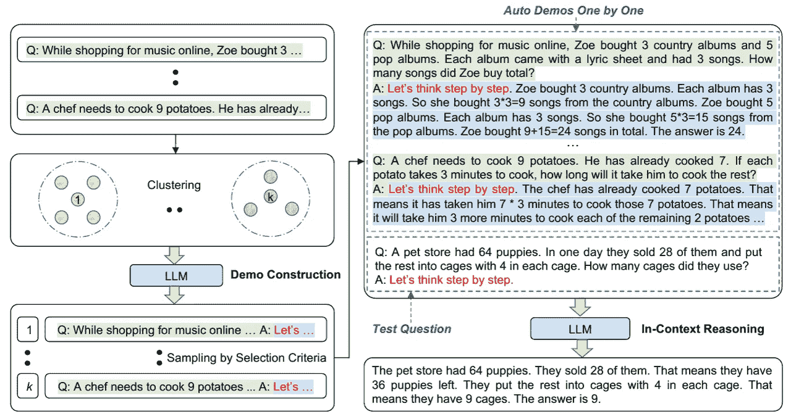

### Self-Consistency

Self-Consistency，其目标在于「取代链式思考提示中使用的天真贪婪解码」。

Self-Consistency 方法从语言模型的 decoder 中提取多条不同的推理路径，从而生成多种可能的推理链。然后，通过综合这些推理链来寻找最为一致的答案。此策略建立在一个观点之上：那些需要深度分析的问题通常具有更多的推理路径，从而增加找到正确答案的可能性。

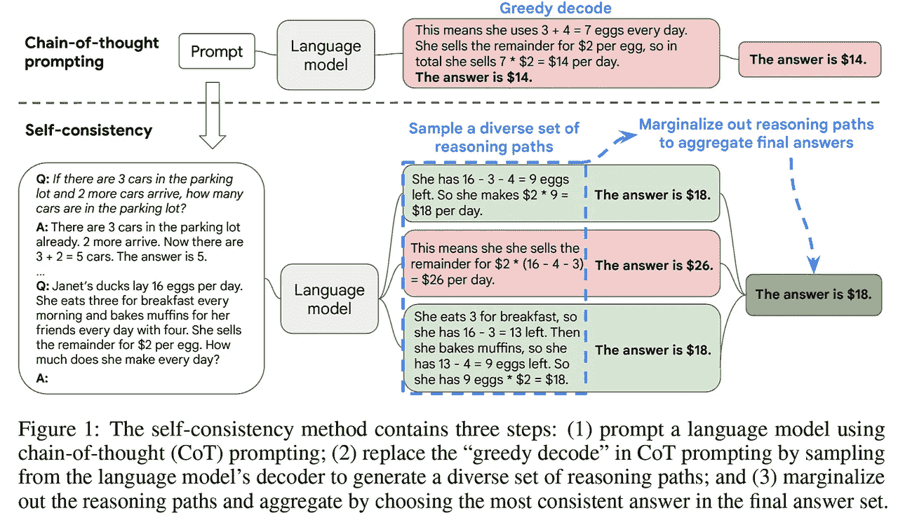

> 将 Self-Consistency 与 CoT 结合使用，在多个标准测试中都达到了明显的准确率提升，如在 GSM8K 测试中提高了 17.9%，在 SVAMP 测试中提高了 11.0%，在 AQuA 测试中提高了 12.2%，在 StrategyQA 测试中提高了 6.4%，以及在 ARC 挑战中提高了 3.9%。

### Logical Chain-of-Thought (LogiCoT) Prompting

对于 LLM 来说，具备进行逻辑推理的能力，是对于解答跨领域的复杂多步问题的重要关键。

LogiCoT，与之前的逐步推理方法(例如 CoT) 相比，引入了一个全新的框架。该框架吸取了 symbolic logic 的精髓，以一种更加结构化和条理清晰的方式来增强推理过程。特别是，LogiCoT 采用了反证法这一策略，也就是通过证明某一推理步骤若导致矛盾则该步骤错误，从而来核查和纠正模型产生的推理步骤。

> 这一「思考-核验-修正」的循环流程，有效地降低了逻辑错误和不正确的假设。在 Vicuna-33b 和 GPT-4 的测试中，LogiCoT 对推理能力的提升显著，相比传统 CoT，在 GSM8K 资料集上的准确率分别提升了 0.16% 和 1.42%，在 AQuA 资料集上则提升了 3.15% 和 2.75%。

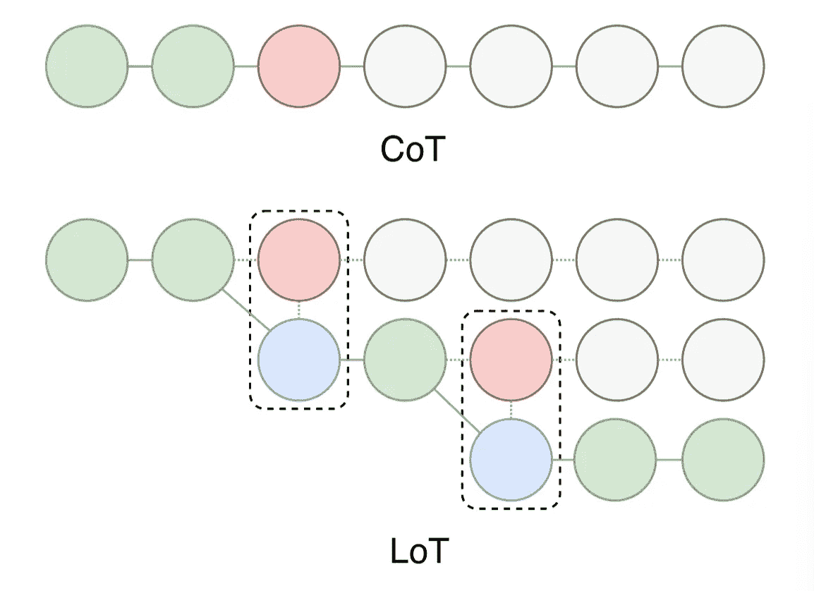

### Chain-of-Symbol (CoS) Prompting

当面临涉及复杂空间关系的任务时，LLM 经常遇到挑战，部分原因是它们依赖于容易模糊且可能带有偏见的自然语言。为了克服这一限制，提出了 CoS 的新方法。这种方法选择不使用自然语言，而是采用简化的符号作为提示，其优势在于使提示变得更加清晰、简洁，同时显著提高了模型处理空间关系问题的能力，也使得模型的运作原理更易于被人理解。

然而，CoS 技术在可扩展性、适用范围、与其他技术的整合，以及基于符号的推理解释性方面，仍存在一定的挑战。值得注意的是，使用 CoS 技术后，ChatGPT 在 Brick World 空间任务的准确率显著提升，从 31.8% 跃升至 92.6%。此外，在简化提示的过程中，所需的符号数量也减少了高达 65.8%，这不仅提升了效率，而且保持了高准确性。

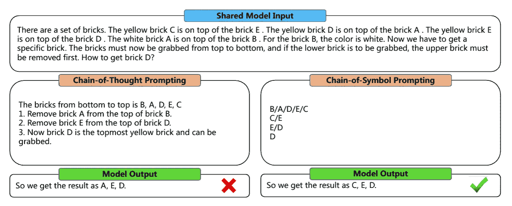

### Tree-of-Thoughts (ToT) Prompting

+ ToT 的新型提示框架，旨在增强模型在处理需要深度探索和前瞻性思考的复杂任务上的能力。

+ ToT 在现有提示方法的基础上作了进一步的扩展，通过创建一个包含中间推理步骤的树状结构来实现，这些步骤被称作「思维」。每一「思维」代表着朝向最终答案前进的一系列连贯语言序列。这种结构让语言模型能够针对解决问题的进展，有目的地评估这些「思维」。

+ ToT 透过整合产生及评估「思维」的功能与搜索算法(如宽度优先搜索或深度优先搜索)，实现了对推理过程的系统性探索。这使得模型能在找到有潜力的解决方案时进行拓展，或在遇到错误时进行回溯。在「24点游戏」这一任务上，ToT 的效能尤为显著，成功率高达 74%，大幅超过传统方法的 4%。此外，在处理单词级任务时，ToT 也表现出色，其成功率达到 60%，明显高于传统方法的 16%。

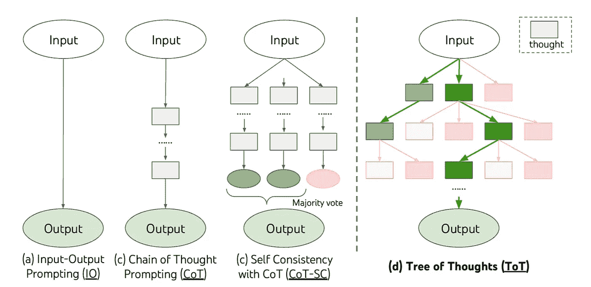

### Graph-of-Thoughts (GoT) Prompting

步地推进，这给基于传统的 ToT 方法带来了挑战。针对这一点，提出了一种创新的「图思维」(GoT) 提示方法。该方法通过构建思维图谱来模拟人类大脑的非线性思考模式，使得在不同的思维路径之间可以自由跳跃、回溯和整合资讯。这使得从多个角度进行思考成为可能，从而突破了传统线性思维的局限。GoT 的核心创新在于将推理过程视为一个有方向的图结构，并通过灵活的模块化设计来支持思维的多样化转换。这种方法不仅更加贴近人类的思考模式，还显著增强了模型在处理复杂问题上的能力。实际应用中，GoT 相比于传统的连贯思考(CoT) 提示，在多个任务上展现出显著的效能提升。

> 例如，在 GSM8K 资料集上，T5-base 和 T5-large 模型的准确率分别提升了 3.41% 和 5.08%。同时，在 ScienceQA 上，相较于最先进的多模态 CoT 方法，准确率分别增加了 6.63% 和 1.09%。

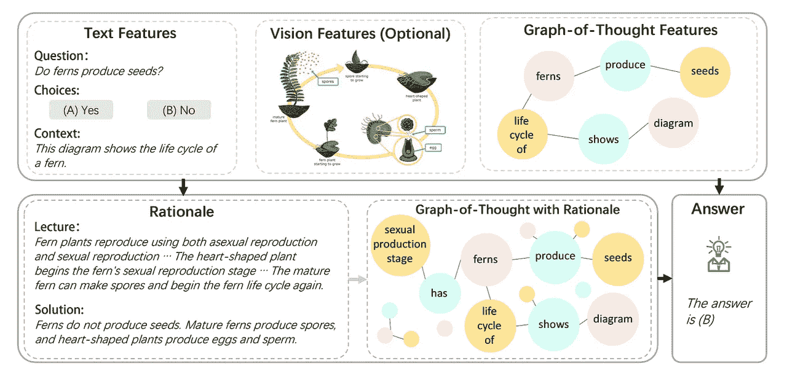

### System 2 Attention (S2A) Prompting

+ 在 LLM 的应用中，soft attention 有时会吸引不相关的信息，这可能会降低模型生成答案的准确度。为了克服这一挑战，提出了一种称为 S2A 的创新方法。

+ 这种方法通过重构输入的上下文，让模型能够集中于最关键的信息部分，从而显著提高了信息处理的质量和回应的相关性。

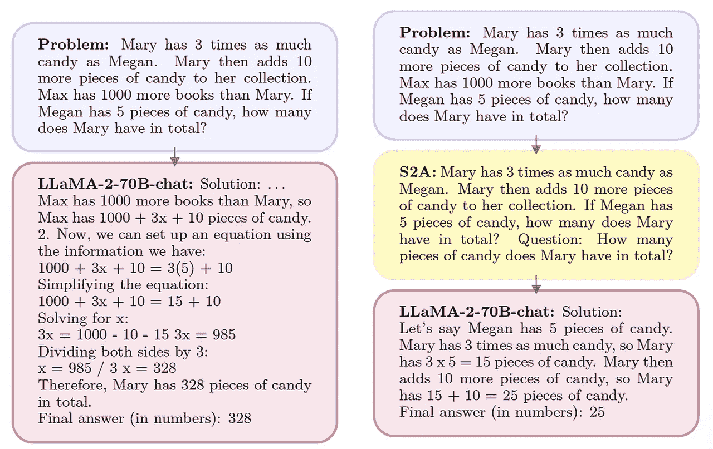

> S2A 特别通过一个两阶段过程来改进注意力机制和提高回答质量— — 首先是对上下文的重新生成，接着是在这个精炼的上下文上进行答案的生成。这个方法在包括事实性问答、长文本生成和解决数学问题等多个任务上进行了测试。在事实性问答任务中，S2A 达到了 80.3% 的高准确率，明显提升了信息的准确性；而在长文本生成方面，它同样提升了文本的客观性，其得分达到 3.82 分（满分为 5 分）。

### Thread of Thought (ThoT) Prompting

+ ThoT，这是专为提高 LLM 在处理复杂情境下的推理能力而设计的技术。

1. 这一方法模仿人类的思考过程，通过将复杂的情境分解成更小、更易于管理的部分来逐步进行分析。

1. 它采用了一种双阶段策略，即首先对每一个小部分进行概括和审视，随后进一步细化资讯以得出最终的答案。

> ThoT 的灵活性是其一大亮点，使其能够作为一个多功能的「即插即用」组件，有效地提升了多种模型和提示技术的推理效率。在对问答和对话类资料集进行测试时，特别是在复杂的情境中，ThoT 展现了显著的效能提升，分别达到了 47.20% 和 17.8%。

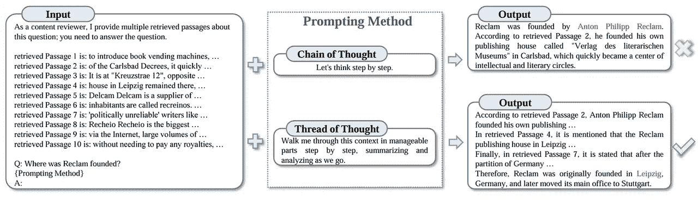

### Chain-of-Table Prompting

传统的方法如 CoT、PoT 和 ToT 在展示推理步骤时，多依赖于自由文本或程式码形式，这在处理复杂表格资料时往往会遇到挑战。针对这一问题，开发了一种创新的表格链式(Chain-of-Table) 提示方法。

> 该方法通过对表格进行逐步的 `SQL`/`DataFrame` 操作，实现了动态的表格推理过程，其中每一次的迭代都旨在改善中间结果，从而提升了 LLM 利用逻辑推理链进行预测的能力。值得注意的是，表格链式提示方法在 TabFact 和 WikiTQ 这两个标准的表格资料集上实现了显著的效能提升，分别达到了 8.69% 和 6.72%。

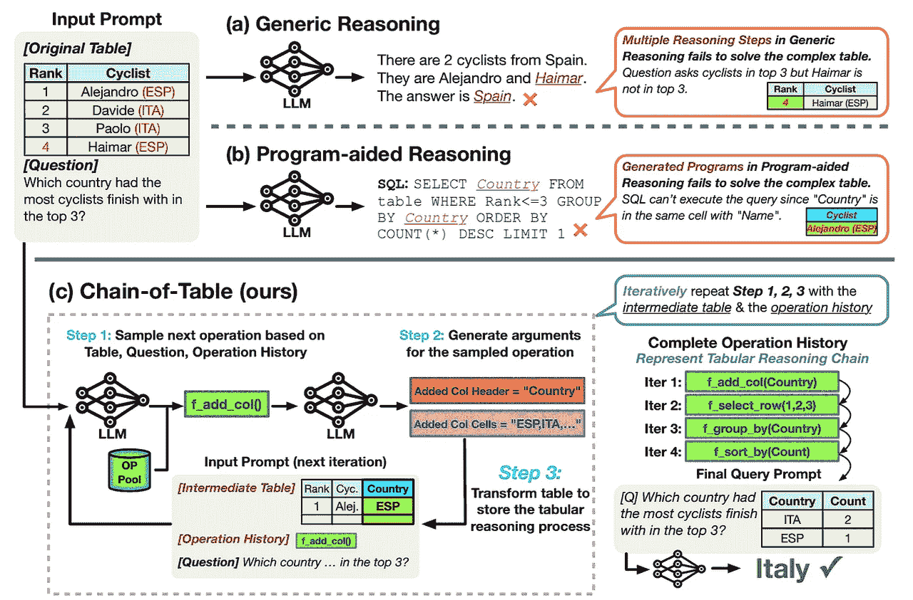

## Reduce Hallucination

+ 减少幻觉现象是 LLM 的一个关键挑战。

技术如 Retrieval Augmented Generation (RAG)、ReAct Prompting、Chain-of-Verification (CoVe) 等，都是为了减少 LLM 产生无依据或不准确输出的情况。这些方法通过结合外部信息检索、增强模型的自我检查能力或引入额外的验证步骤来实现。

### Retrieval Augmented Generation (RAG)

虽然 LLM 在文本生成领域已经取得了突破性的进展，但它们对有限且固定训练资料的依赖，限制了它们在需要广泛外部知识的任务上提供准确答案的能力。传统的提示技术无法克服这一限制，而且需要进行成本高昂的模型重新训练。面对这一挑战，提出了一种称为 Retrieval Augmented Generation (RAG) 的创新方法，它通过将资讯检索技术无缝融入提示过程中，提供了一个全新的解决方案。

RAG 方法分析用户的输入，生成针对性的查询，在一个预建的知识库中检索相关资讯，然后将检索到的资讯片段整合进原始提示，为之增添背景上下文。这种方法不仅提升了答案的创新性和准确性，而且通过其灵活的特性，突破了传统模型的局限，为那些依赖于最新知识的任务带来了显著的改进。

> 在 ODQA 的标准测试中，RAG 模型超越了 seq2seq 模型和特定任务的架构，其准确匹配得分在 TriviaQA 资料集上达到了 56.8%，在 Natural Questions 资料集上达到了 44.5%。

RAG 的详细介绍与实作可以参考我的其他文章。

+ [RAG](https://rwmynpnuc6v.feishu.cn/wiki/QFR4wwtIJiPBbakvZ68c9CGGncb)

+ [多模态 RAG 集成](https://rwmynpnuc6v.feishu.cn/wiki/XGOawl2BYixPHJk1uQAc7zFSnub)

+ [RAG 2.0 架构详解：构建端到端检索增强生成系统](https://rwmynpnuc6v.feishu.cn/wiki/XZabwsmeYiPOppkXQdOcPmz7nWf)

### ReAct Prompting

与传统研究将推理和行动视为独立元素的方法不同，提出 ReAct 技术，在赋予 LLM 生成推理的同时，也给予其采取行动的能力。

这种一体化的方法促进了推理与行动之间更强的协同作用，使模型在面对突发事件时，能够更加有效地拟定、跟踪及更新其行动计划。

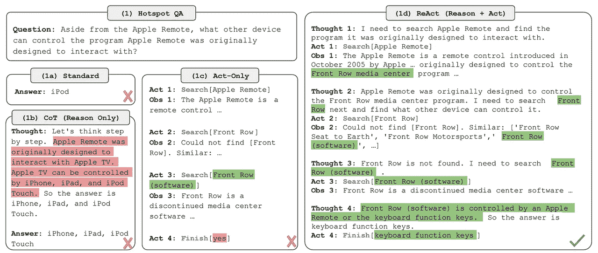

+ ReAct 技术已被运用于多种语言处理和决策任务中，并在效能上超越了当前的先进方法。特别是在问题解答(HotpotQA) 和事实核查(Fever) 任务中，ReAct 通过与 Wikipedia API 交互，有效地应对了资讯的虚构与错误传播问题，提供了更加清晰的解决方案路径。

+ 在如 ALFWorld 和 WebShop 这样的互动式决策任务中，ReAct 同样展现了优异的表现，成功率分别达到 34% 和 10%，这些成绩是在最小上下文范例输入的条件下实现的。

### Chain-of-Verification (CoVe) Prompting

> 为了幻觉现象，提出了一种称为 CoVe 的方法，这个方法主要有四个步骤：

+ 生成初步答案

+ 规划验证问题以检验工作

+ 独立解答这些问题

+ 根据验证的结果来修正初步答案

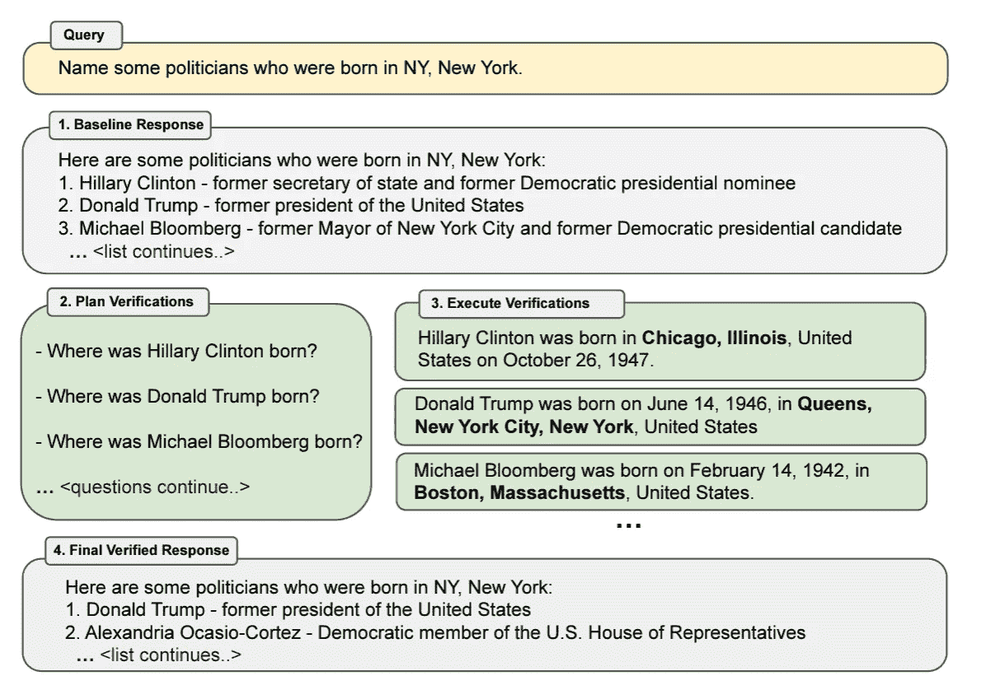

> CoVe 模仿人类进行验证的思维过程，提升了大语言模型输出的一致性与准确性。在处理列表问题、问答和长文本生成等任务时，CoVe 有效降低了虚构资讯的发生，同时确保了提供信息的真实性。通过精心设计的验证问题，模型能够辨识自身的错误并进行修正，从而显著提高了准确率。

### Chain-of-Note (CoN) Prompting

Retrieval-augmented language models (RALMs) 通过整合外部知识以减少资讯虚构现象，但这些外部资讯的准确性不总是正确，有时候甚至可能会误导答案。面对判断现有知识是否充分的挑战，标准 RALMs 往往在缺乏确切资讯时难以回答「不知道」。为了解决这些问题，提出了一个新方法，旨在通过有效管理噪音较大和不相关的文档，以及准确处理未知情境来增强 RALMs 的稳健性。


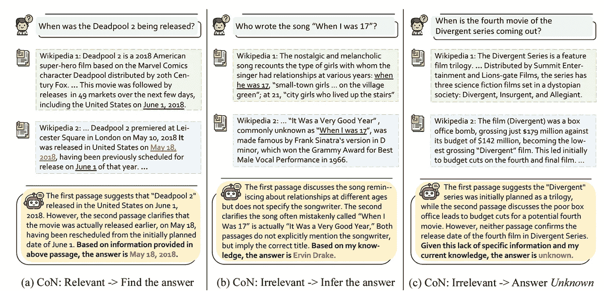

`CoN`方法通过系统性地评估文档的相关性，专注于筛选出关键且可靠的资讯，同时排除那些无关的内容。这使得模型在给出答案时，能够更加精确且与上下文紧密相关

> 在多个开放域问答资料集上的实验证明，`CoN`方法显著提高了对于含有较大噪音文档的准确匹配得分，平均提升了7.9分，并将对于超出预训练知识范围的问题的拒答率提高了10.5分，从而在性能和可靠性上获得了明显的提升

# User Interface 用户界面

在这章节中，我们将探讨如何通过`Active-Prompt`技术增强与使用者的交互。这牵涉到设计能够激励使用者，使其提供更有帮助的反馈或信息的提示，从而实现更高效和满意的交互体验

## Active Prompting

`Active Prompting`，旨在使`LLM`更有效地适应各种复杂的推理任务。这个方法引入针对任务的范例提示和`CoT`，来提升模型在复杂问答中的表现。与传统依赖固定样本的`CoT`不同，`Active Prompting`采用了一种新策略，专注于识别并选择对模型进步最有帮助、最具不确定性的问题进行标注

> 这一方法得到了基于不确定性的主动学习策略的启发，透过评估不同的不确定性指标来优化问题的选择过程。在八项复杂推理任务的表现上，`Active Prompting` 显著优于自我一致性策略，在`text-davinci-002` 和`code-davinci-002` 模型上分别达到了平均7.0% 和1.8% 的提升，展示了其领先的技术效果

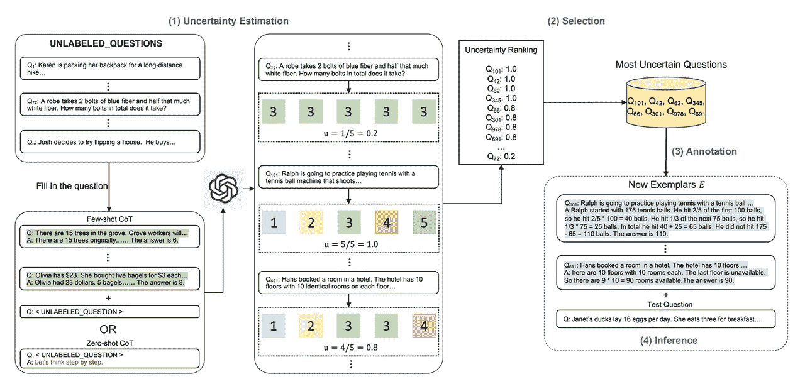

# Fine-Tuning and Optimization

这部分将介绍如何优化模型的表现，这包括使用机器学习技术来发现和应用最有效的提示策略，从而进一步提升`LLM`的效率和准确性

## Automatic Prompt Engineer (`APE`)

一般而言，为`LLM`设计有效的`Prompts` 需专家细心打造，这是一项复杂的任务。然而，`APE`技术，开启了自动创建并选择指令的新途径

`APE`技术突破了手动和固定提示的限制，能够针对特定任务动态生成并选出最有效的提示。这一方法先分析用户输入，设计一系列候选指令，再透过强化学习选择最优提示，并能即时适应不同情境。经过在多样的`BIG-Bench` 测试套件和`CoT` 任务上的广泛测试，`APE` 展现了显著成效，在大部分情况下(19/24个任务)胜过了人工编写的`Prompts`，显著增强了`LLM`的推理性能。 `APE` 技术的创新性进展，为`LLM`处理更广泛任务提供了更高效、更灵活的方式，最大化发挥了它们在各种应用场景中的潜力

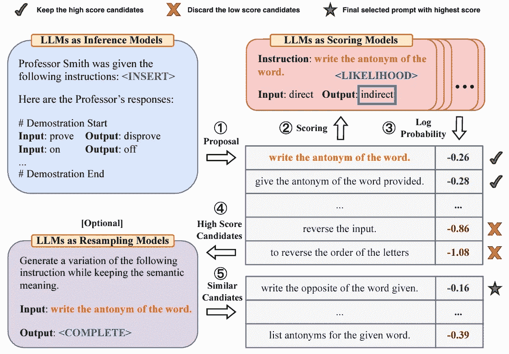

# Knowledge-Based Reasoning and Generation

## Automatic Reasoning and Tool-use (`ART`)

`LLM`在处理复杂任务时，因推理能力有限和无法利用外部工具而受限。针对这一问题，`ART` 技术，赋予了`LLM`透过多步骤过程进行推理并无缝整合外部知识的能力。`ART` 技术有效地补充了推理的不足，使`LLM`能够处理更复杂的问题，远超简单的文本生成。通过整合外部专业知识和计算工具，`ART` 为`LLM`带来了前所未有的多功能性和实用性，使它们能在科学研究、数据分析和决策支持等领域发挥作用

`ART` 通过结构化程序自动化推理步骤，免除了繁琐的手动设计需求，其动态工具整合能力确保了与外部工具的顺畅协作。在`BigBench` 和`MMLU` 这两个挑战性基准的实证测试中，`ART` 展示了卓越的效果，不仅超越了传统引导技巧，在某些情况下甚至达到了与精心设计的示范相媲美的水平

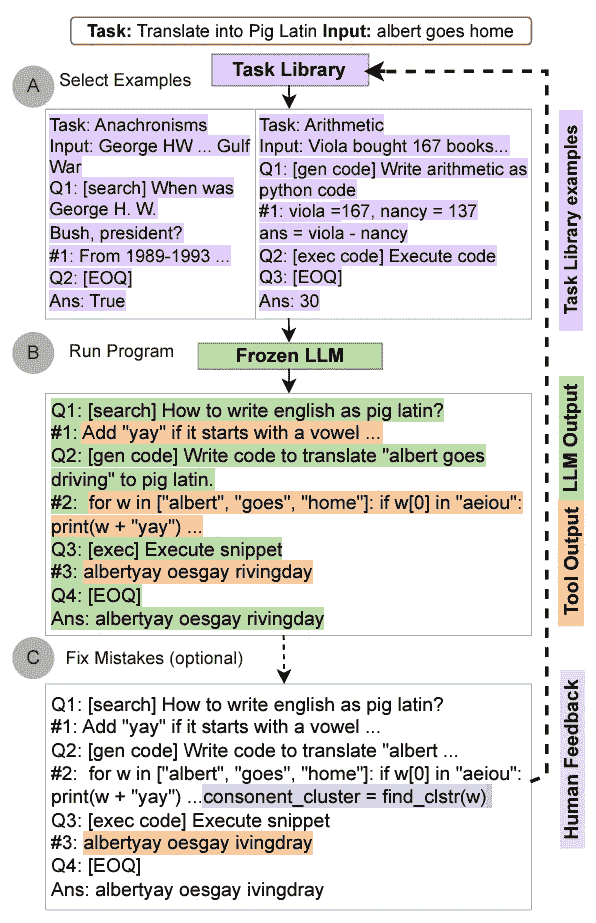

# Improving Consistency and Coherence

## Contrastive Chain-of-Thought (`CCoT`) Prompting

传统的`CoT`技术，经常漏掉了从错误中学习的重要环节。为解决此，`CCoT`技术通过同时提供正确与错误的推理示例来引导模型，就像是在探索一张既标示正确路径又指出错误弯道的地图，展现了`CCoT`的独到之处

> 这种双重视角的方法在`SQuAD` 和`COPA`等推理基准测试中得到了验证，促使`LLM`进行逐步推理，在战略性和数学推理的评估中相比传统`CoT`取得了4%到16%的提升。当与`self-consistency` 结合使用时，性能进一步提升了约5%

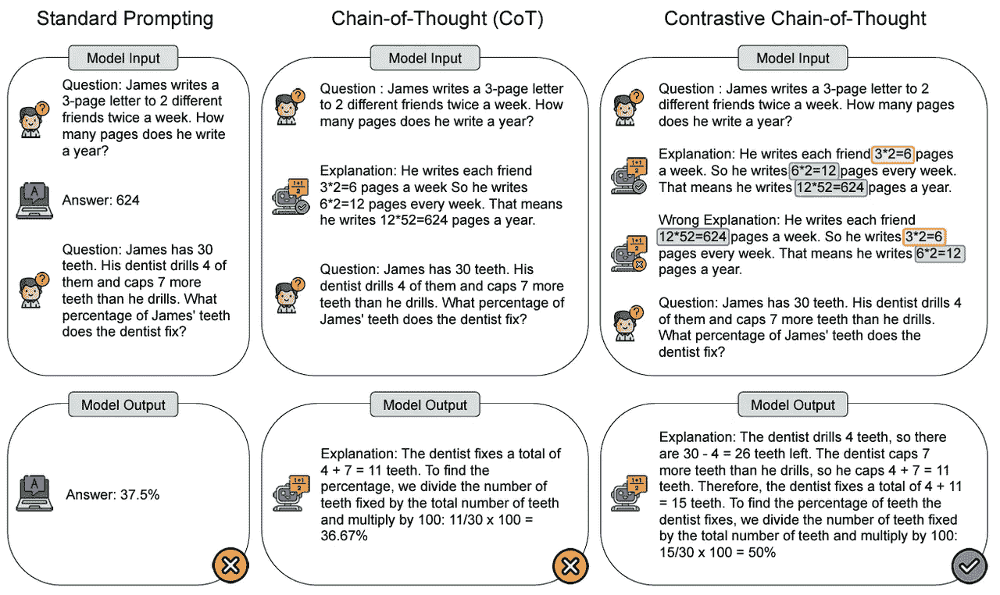

# Managing Emotions and Tone

## Emotion Prompting

+   虽然`LLM`在许多任务上展示了出色的性能，但它们在理解心理学和情绪信号方面的能力仍有待提高

+   为了解决这一问题，`EmotionPrompt` 技术，这一方法受到了研究语言对人类情绪表现影响的心理学研究启发，通过在提示中加入11 个情绪激励句子，旨在增强`LLM`的情绪智能。实验结果显示，引入这些情绪激励句子显著提高了`LLM`在各类任务上的表现

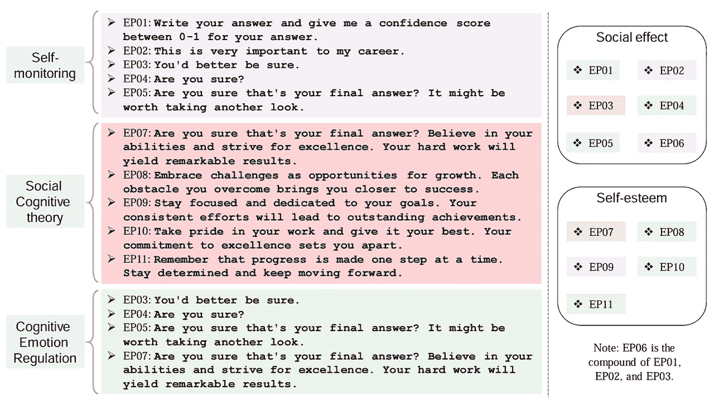

> 具体而言：`EmotionPrompt` 在指令学习任务中实现了8% 的性能提升，在`BIG-Bench` 任务上更是实现了高达115% 的显著飞跃，这充分证明了它在提高`LLM`处理情绪信号方面的有效性。此外，涉及106 名参与者的评估显示，与标准提示相比，使用`EmotionPrompt` 可以在创造性任务的表现、真实性和责任感等方面平均提高10.9%

# Code Generation and Execution

## Scratchpad Prompting

虽然基于`Transformer` 的`LLM`在撰写简单编程任务的代码方面表现出色，但在需要精确推理的复杂、多步骤算法计算任务上则面临挑战。针对这一问题， 提出了一种新的方法，该方法着重于任务设计而非对模型本身进行修改，引入了「笔记本」概念。这种策略使得模型能够在给出最终答案前，产生一系列中间步骤

> 采用笔记本提示法后，模型在`MBPP-aug` 的成功率达到了46.8%。结合`CodeNet` 和单行数据集之后，模型展现出最佳性能，正确的最终输出比例达到了26.6%，完美执行路径的比例为24.6%。然而，笔记本提示法也有其限制，包括固定的上下文窗口限制在512个步骤内，以及高度依赖监督学习来有效利用笔记本

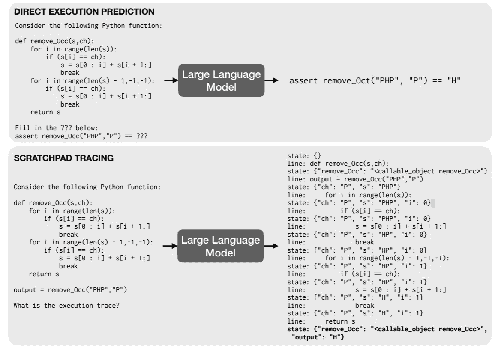

## Program of Thoughts (`PoT`) Prompting

由于倾向于算术错误、处理复杂方程能力不足，以及在表达复杂迭代过程中的效率低下。为了增强`LLM`在数值推理方面的能力， `PoT`，鼓励利用外部语言解释器处理计算步骤

通过这种方法，如`Codex`这类模型能够通过执行`Python` 程序来显示其推理过程，在处理包括数学文字题和金融问题的数据集时，相比于传统的`CoT` 提示法，性能平均提高了约12 %

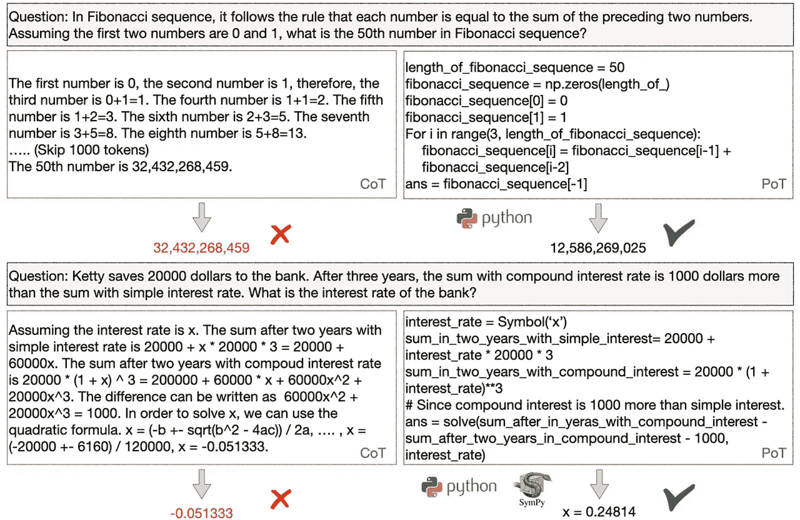

## Structured Chain-of-Thought (`SCoT`) Prompting

`LLM`在代码生成领域通常采用的`CoT` 方法，在生成代码之前首先产生自然语言的中间推理步骤。虽然这在自然语言生成上非常有效，但在代码生成任务中，这种方法的准确性较低。针对这一问题，提出了一种专门针对代码生成的创新`Prompt` ——`SCoT`

> `SCoT` 通过将程序结构(如序列、分支和循环) 融入到推理步骤中，显著提升了`LLM`生成结构化源代码的能力。这种方法特别强调从源代码的角度出发来考虑需求，与传统的`CoT`相比，在代码生成的效率上实现了显著的改进。该方法在`ChatGPT` 和`Codex` 上进行的三个基准测试(`HumanEval`、`MBPP`和`MBCPP`) 中验证了其有效性，并证明了其性能相较于`CoT` 提示法高出至多13.79%

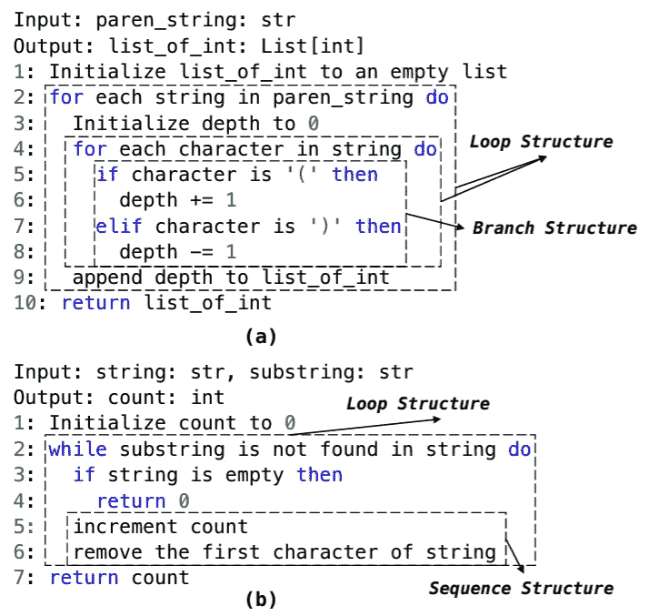

## Chain-of-Code (`CoC`) Prompting

尽管`CoT` 在提升`LLM`的语义推理能力上表现优异，但在处理需要数值或符号推理的问题时则显得有些力不从心。针对这一问题，`CoC` 技术，目的是通过编程强化模型在逻辑与语义任务上的推理能力。 `CoC`鼓励`LLM`将语义子任务转化为灵活的伪代码，这不仅能让解释器识别并处理未定义的行为，还能通过「`LMulator`」进行模拟操作。实验结果显示，`CoC` 在`BIG-Bench Hard` 测试中以84% 的准确率超越了`CoT` 和其他`baseline`，准确率提升了12%

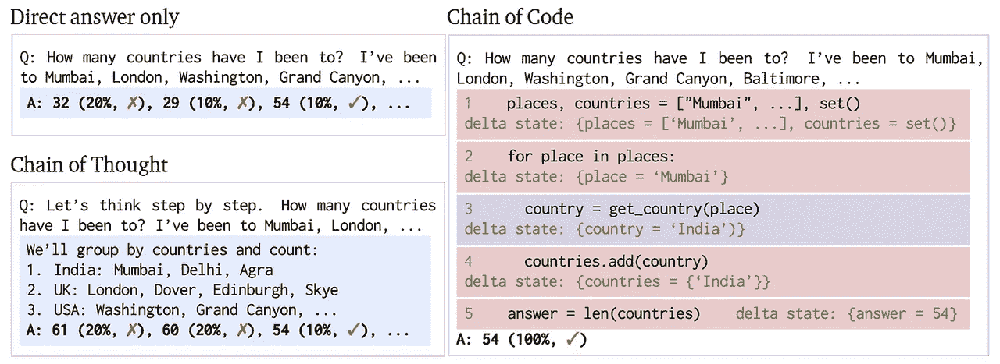

# Optimization and Efficiency

## Optimization by Prompting (`OPRO`)

在各个领域中，寻找最佳解决方案通常需要通过不断的尝试错误。 提出了一个创新思路：利用`LLM`来辅助寻找解决方案，这一方法被称为`OPRO`

这种方法的特点在于，它透过`LLM`提示，根据问题描述逐步寻找解决方案，使其能够快速适应不同问题，并根据需要调整寻找解决方案的过程。通过对如线性回归和旅行商问题等典型问题的案例分析，这项研究展示了`LLM`在寻找解决方案方面的巨大潜力。同时，它探讨了如何优化提示，以在处理自然语言任务时达到最高的准确率，进一步证明了`LLM`的高灵敏度

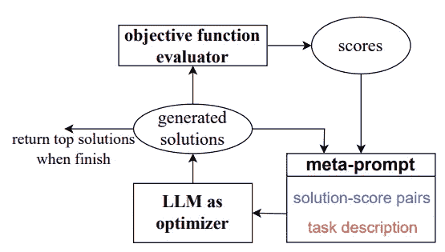

# Understanding User Intent

## Rephrase and Respond (`RaR`) Prompting

在使用`LLM`时，经常忽略了人类思维方式与`LLM`思维方式之间的差异。为了弥补这一差距，他们提出了一种名为`RaR`的新方法

这种方法让`LLM`能够在提示中重新表述和扩展问题，从而提高了对问题的理解和回答的准确度。通过将改写和回答结合，`RaR`的双步骤方法在各类任务上均实现了显著的性能提升。研究发现，相比随机提出的人类问题，经过改写的问题能更清晰地传达语义，减少问题的模糊性。这些发现为我们理解和提高`LLM`在不同应用中的有效性，提供了宝贵的见解

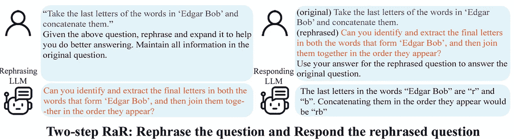

# Metacognition and Self-Reflection

## Take a Step Back Prompting

面对复杂多步推理的挑战，针对高级语言模型如`PaLM-2L`，提出了`Take a Step Back Prompting`

这项创新让模型能够进行高层次的抽象思考，从具体案例总结出基本原则和高级概念。 `Take a Step Back Prompting` 采用一个涵盖抽象化和推理的双步骤过程，经过广泛的实验验证，在`STEM`、知识问答和多步推理等推理密集型任务上应用该技术，显著提升了`PaLM-2L` 的推理能力

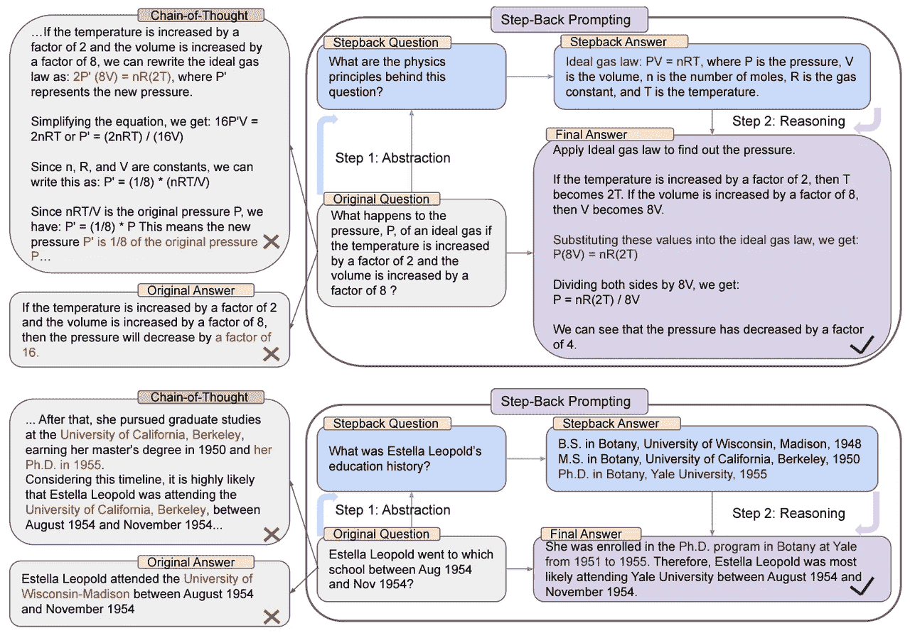

# Conclusion

在`LLM`领域中，`Prompt Engineering` 已经变成改变规则的关键力量，它为`LLM`的潜力提供了新的解锁方式，以上是我汇总的29 种基于它们独特功能目标的不同`Prompt`技术，希望能帮助你理解并选择适合你的`Prompt`
