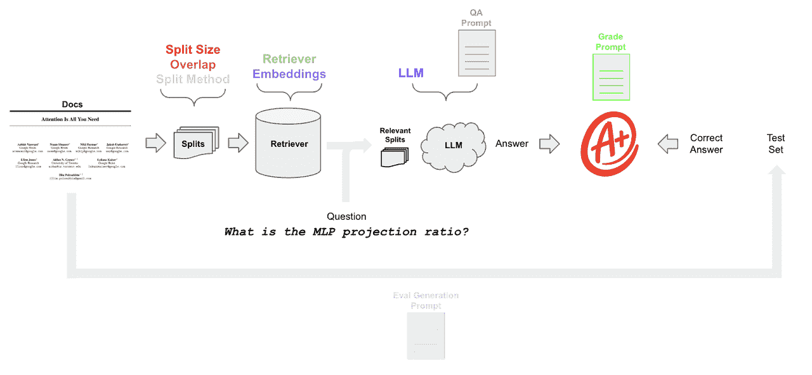
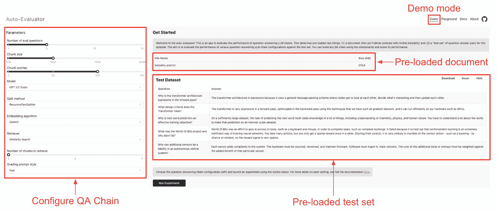
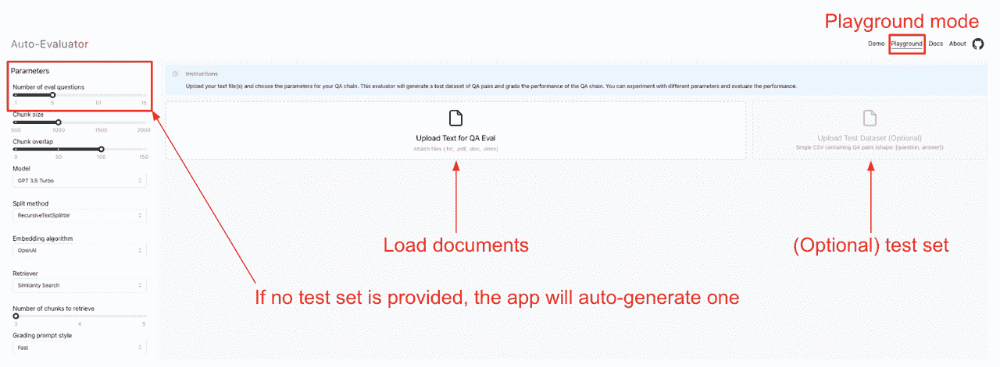
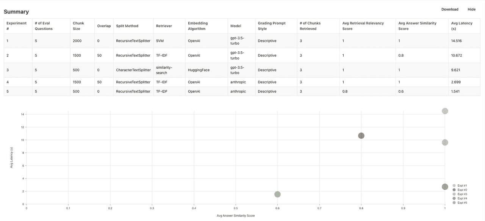

# 智能文档问答评估，提升 LLM 应用质量！

> 来源：[https://qqs7y1hozd1.feishu.cn/docx/Oh9hdpXvboXaUfxrjUlc6WElnUe](https://qqs7y1hozd1.feishu.cn/docx/Oh9hdpXvboXaUfxrjUlc6WElnUe)

# **Auto-evaluator****🧠 📝**

Context

文档[问答](https://python.langchain.com/en/latest/use_cases/question_answering.html)是一种流行的 LL**M 使用案例**。LangChain 可以轻松地将 LLM 组件（例如模型和检索器）组装成支持问答的链：输入文档被拆分为块并存储在检索器中，为用户检索相关块并传递给 LLM 以合成为 .questionanswer

Challenge

[QA 系](https://lancemartin.notion.site/lancemartin/Lex-GPT-a3ad671766d34f4a9a078da7adf9d382)统的质量可能会有很大差异;例如，我们看到过由于特定的参数设置而导致的幻觉和答案质量差的情况。但是，（1） 以系统的方式评估答案质量，以及 （2） 使用此评估来指导改进的 QA 链设置（例如，块大小）或组件（例如，模型或检索器选择），这并不总是显而易见的。

App overview

[此应](https://arxiv.org/abs/2212.09251)[用程序旨](https://github.com/openai/evals/blob/main/evals/registry/modelgraded/closedqa.yaml)在解决上述限制。Anthropic 最近的工作使用了模型编写的评估集。OpenAI 和其他公司已经表明，模型分级评估是评估模型的有效方法。此应用程序将这两个想法结合到一个工作区中，自动生成 QA 测试集并对指定 QA 链的结果进行自动评分。

### 智能客服效果评估



Usage

该应用程序可以通过两种方式使用：

> Demo：

> 预先加载一份文档（Lex Fridman 与 Andrej Karpathy 的播客的文字记录）和播客中的一组 5 对问答。

>



> Playground：

> 输入要询问其问题的一组文档。



> **B**uilding the document retrieval:

+   该应用程序将为输入文档构建一个[检索器](https://blog.langchain.dev/retrieval/)。

+   Retriever 是一个 Langchain 抽象，它接受一个问题并返回一组相关文档。

+   用户可以在配置的下拉列表中选择检索器（上面的红色面板）。

Test set generation:

+   该应用程序将在文档上自动生成一组问答对测试。

+   [为此，](https://github.com/hwchase17/langchain/blob/master/langchain/chains/qa_generation/prompt.py)它使用 Langchain 和此处的默认提示符。QAGenerationChain

LLM question-answering:

+   对于每个问题，我们使用链来回答。RetrievalQA

+   这将从 中获取与问题相关的块，并将它们传递给 LLM。retriever

+   我们[在此处](https://github.com/langchain-ai/auto-evaluator/blob/main/api/text_utils.py)公开了 used for 以将此上下文传递给 LLM。QA_CHAIN_PROMPT

Model-graded evaluation:

+   我们允许用户从许多模型分级的评估提示中进行选择：

（1） 应用程序将评估与问题的相对关系。relevance of the retrieved documents

（2） 应用程序将评估相对于真实答案的相对值。similarity of the LLM generated answer

+   可以[在此处](https://github.com/dankolesnikov/evaluator-app/blob/main/api/text_utils.py)查看两者的提示

+   用户可以选择要使用的评分提示。[以下是](https://rlancemartin.notion.site/Auto-Evaluator-Opportunities-7b3459dc2ae34440ae3481fe6f43ba40)我们根据经验选择提示的一些注意事项。

Experimental results:

+   该应用程序将生成一个汇总结果的表格。

+   它显示问题和基本实况 （预期） 答案。

+   它显示了链生成的答案。

+   它显示用于检索的二进制分数 （PASS / FAIL） 和答案。

+   它显示每个问题的检索延迟和 LLM 答案摘要。

+   它显示模型评分器输出（评分提示的原始输出）。

## **用户输入**

应用程序的左侧面板（在上图中以红色显示）具有多个用户可配置的参数。

+   N[umber](https://github.com/hwchase17/langchain/blob/master/langchain/chains/qa_generation/prompt.py) of eval questions这是要为给定输入文档自动生成的问题-答案对的数量。如上所述，问答对自动生成将使用 Langchain 的 Prompt，并在此处指定。QAGenerationChain

+   Chunk size[拆分输入文档时每个](https://lancemartin.notion.site/lancemartin/Q-A-assistant-limitations-f576bf55b61c44e0970330ac3883315e)块的字符数。这可能会影响答案质量。检索器通常使用文本嵌入相似性来选择与问题相关的块。如果数据块太大，则每个数据块可能包含与问题无关的更多信息，这可能会降低汇总答案的质量。如果 chunk 太小，则检索到的 chunk 中可能会遗漏重要的 context。

+   Overlap块之间的字符重叠。

+   Embedding用于嵌入块的方法。

+   Retriever用于检索与用户问题相关的[数据块](https://blog.langchain.dev/retrieval/)[的方法。用于](https://github.com/dankolesnikov/evaluator-app/blob/235105642ff1d0ab15be87be7328df71b403268b/api/evaluator_app.py#L131)[相似性](https://twitter.com/karpathy/status/1647025230546886658)搜索的[默认向量数据](https://en.wikipedia.org/wiki/Tf%E2%80%93idf)库是 FAISS，但对其他向量的支持是一个受欢迎的补充。您还可以尝试其他方法，例如 SVM 或 TF-IDF。

+   Number of chunks to retrieve检索的块数。更多的 chunk 可以通过为 LLM 提供更多答案摘要的上下文来提高性能。

+   ModelLLM 用于将检索到的块汇总到答案中。

+   [Gra](https://github.com/dankolesnikov/evaluator-app/blob/main/api/text_utils.py)ding prompt style模型分级评估的提示选择。如上所述，可以在此处看到提示。更多的提示将是一个受欢迎的补充。例如，通过提示，您将看到带有模型坡度对齐的更详细的输出。Descriptive

## **日志记录实验**

用户可以选择所需的配置，然后选择 。Re-Run Experiment

这将在现有测试集上运行新链。

所有实验的结果将总结在表格和图表中。



## **贡献**

从文件夹运行后端：api

```
 pip install -r requirements.txt
 uvicorn evaluator_app:app
```

在本地测试：api

```
curl -X POST -F &quot;files=@docs/karpathy-lex-pod/karpathy-pod.txt&quot; -F &quot;num_eval_questions=1&quot; -F &quot;chunk_chars=1000&quot; -F &quot;overlap=100&quot; -F &quot;split_method=RecursiveTextSplitter&quot; -F &quot;retriever_type=similarity-search&quot; -F &quot;embeddings=OpenAI&quot; -F &quot;model_version=gpt-3.5-turbo&quot; -F &quot;grade_prompt=Fast&quot; -F &quot;num_neighbors=3&quot; http://localhost:8000/evaluator-stream
```

从文件夹运行前端，并在指定的 URL 处查看 Web 应用程序（例如：nextjshttp://localhost:3000/

```
yarn install
yarn dev
```

### **环境变量**

前端：

.env.local包含运行项目所需的 env 变量。

后端：

指定要使用的任何模型的 API 密钥。

```
OPENAI_API_KEY=
ANTHROPIC_API_KEY=
```

## **部署**

前端部署到 [Vercel](https://vercel.com/)。后端部署到 [Railway](https://railway.app/)。