# Claude实战：TradingAgents金融分析系统

> 来源：[https://qqs7y1hozd1.feishu.cn/docx/YHhmdhl6boFO2IxawN9ci2CenZe](https://qqs7y1hozd1.feishu.cn/docx/YHhmdhl6boFO2IxawN9ci2CenZe)

## 一、下载Cursor，注册登录

```
下载地址：https://www.cursor.com/
```

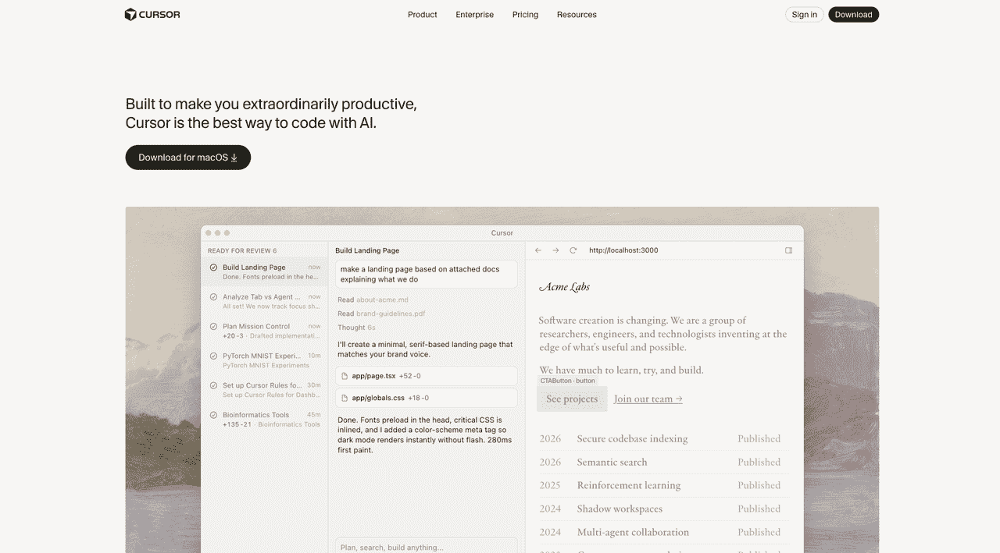

## 二、安装codex插件

点击扩展功能，在搜索框输入codex，选择第一个由openai开发的插件，点击"Install"安装

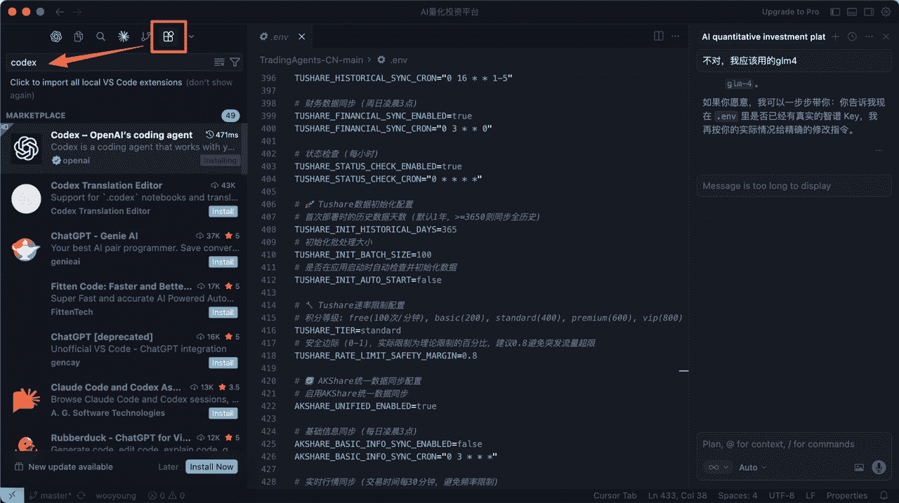

安装后，codex就出现在菜单栏中，直接点击这个图标，进入codex对话界面

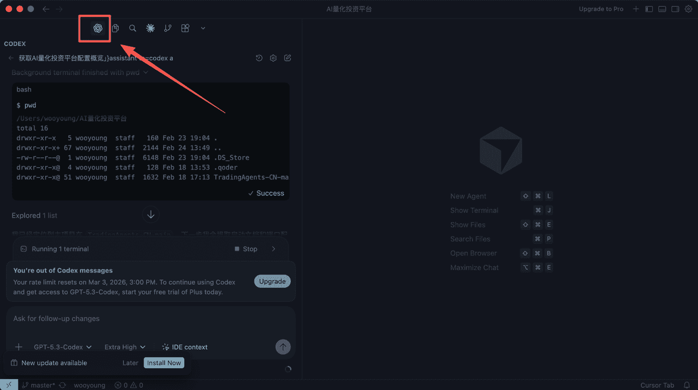

## 三、导入GitHub项目文件

### 两种方式任选其一：

1）直接从github将对应项目打包下载，然后在cursor中选择file->open folder打开

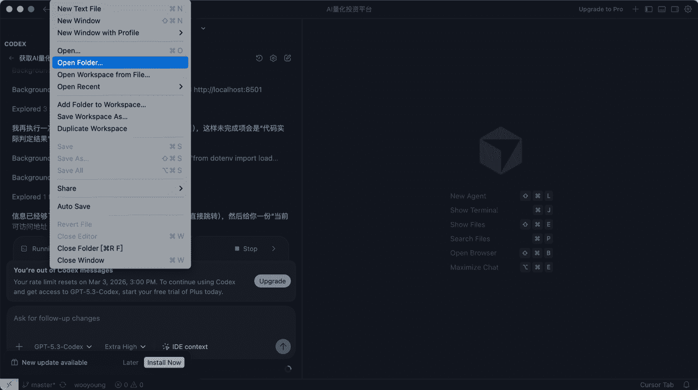

2）直接开启vibecoding模式，在对话框给出指令「帮我本地部署github项项目：xxxx地址」，让大模型自主完成项目部署

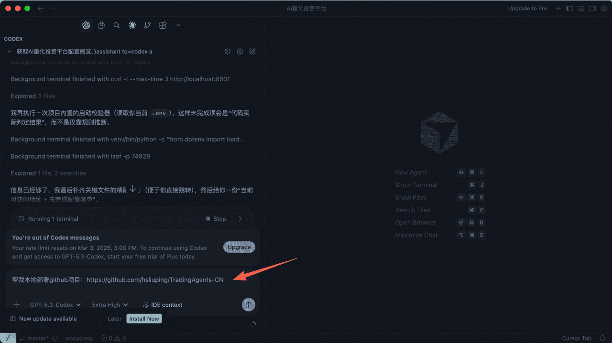

(建议选择第一种，把codex的额度留给正式项目使用)

## 四、项目部署后，进入vibecoding阶段

选择最强模型GPT-5.3-Codex和高级推理Extra High

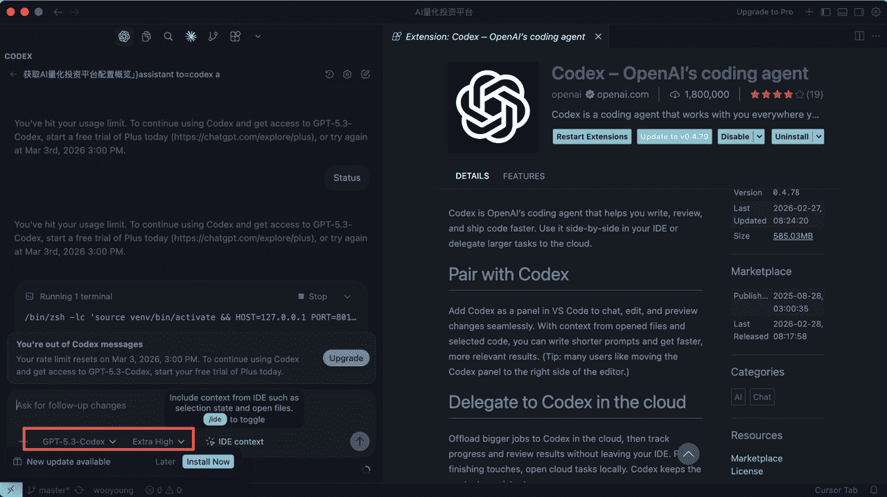

让Codex扫描项目结构，加载所有文件，并完成初始配置，这里模型会一步步引导你完成项目配置

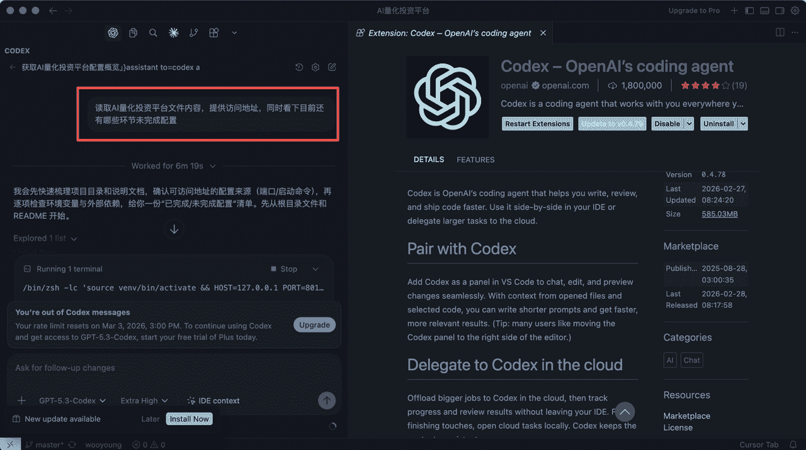

## 五、对该项目的数据源和大模型进行替换

为了降低项目运行成本，需要将该项目的海外金融数据来源替换成免费数据源finnhub，所以我做了如下指令：

```
帮我将finnhub的API密钥配置好，后续金融数据主要从该平台获取，密钥：XXXXXXX
```

finnhub个人密钥获取地址如下，直接注册后点击get free API key 获取

```
https://finnhub.io/
```

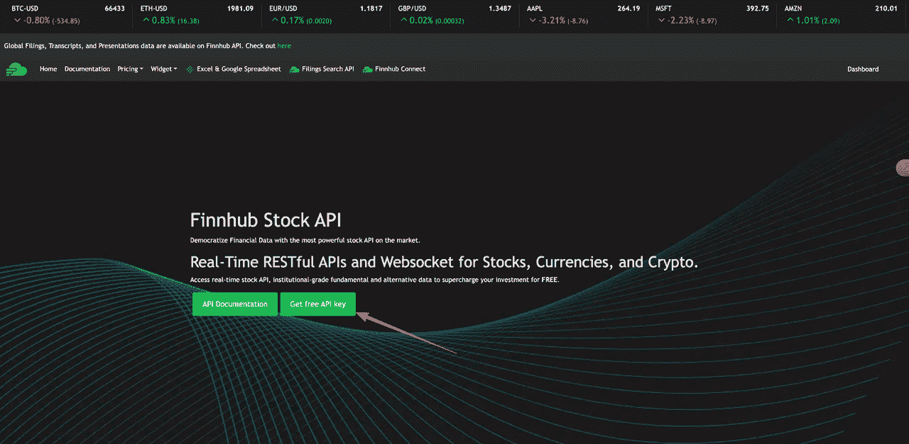

然后对大模型来源进行替换，我这里选阿里云，因为阿里云是一个大模型提供平台，能集合大部分开源模型，方便后续替换更高性能模型。平台地址和密钥地址如下，先注册再获取密钥地址：

```
平台地址：https://dashscope.aliyun.com/密钥地址：https://dashscope.console.aliyun.com/apiKey
```

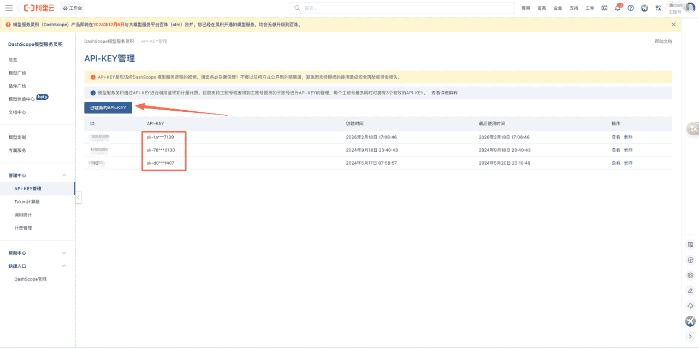

配置好后，也可以直接在codex给出指令，让codex进行大模型替换

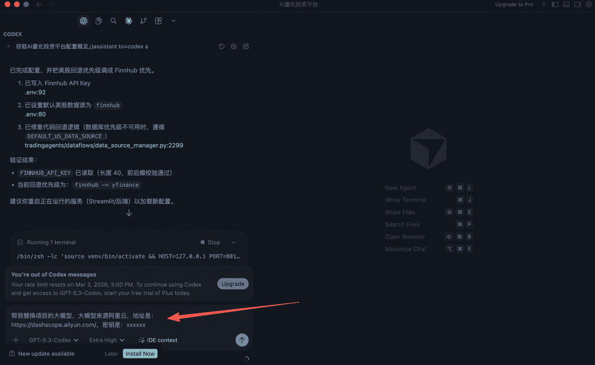

## 六、优化前端框架(可以跳过这步)

我这里因为对前端设计比较有要求，同时我看到项目的前端框架是streamlit，所以要求codex帮我改一下前端框架，从streamlit调整为Vue3，如果大家对前端没特殊要求，可以跳过这步，因为Vue3还需要依赖云数据库MongoDB和Redis的配置，对非技术用户来说有点麻烦

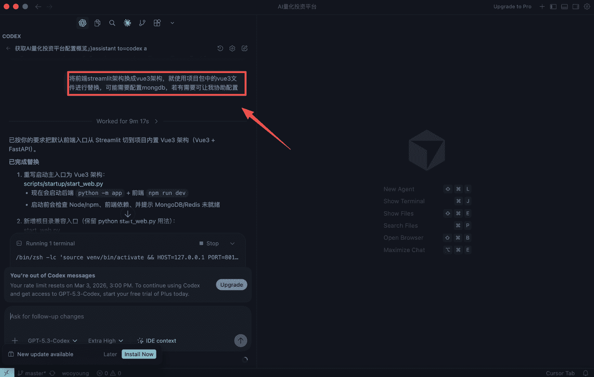

云服务配置地址：

```
MongoDB云服务：https://www.mongodb.com/cloud/atlasRedis云服务：https://redis.com/ 
```

需要从以上服务中进行注册，并将账户密码给到codex，让codex完成配置。如果大家不知道怎么获取，直接告诉codex，让它教你

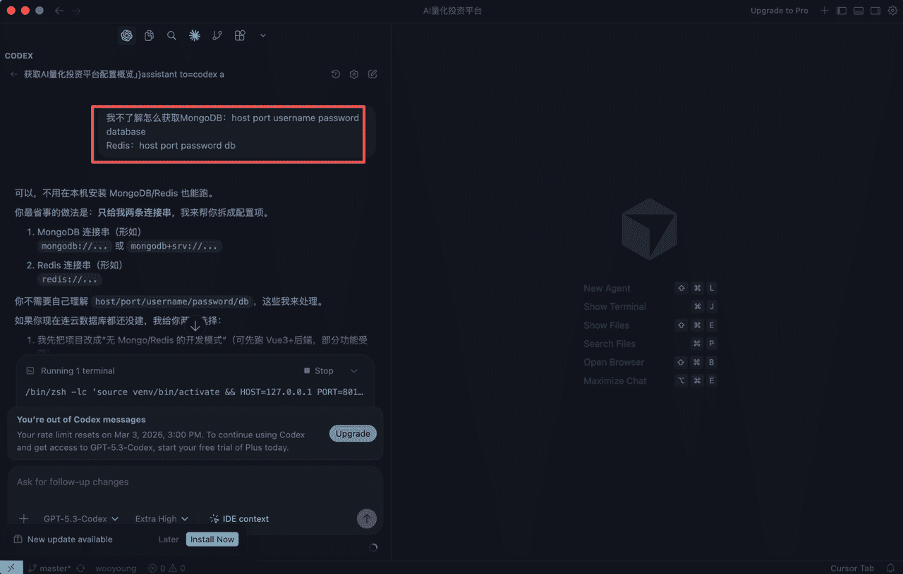

## 七、运行测试，验证部署

完成前六步，就可以尝试本地运行项目，看下目前项目效果，这里codex告诉我怎么运行该项目，先打开终端，然后将以下代码直接复制到终端，让项目启动

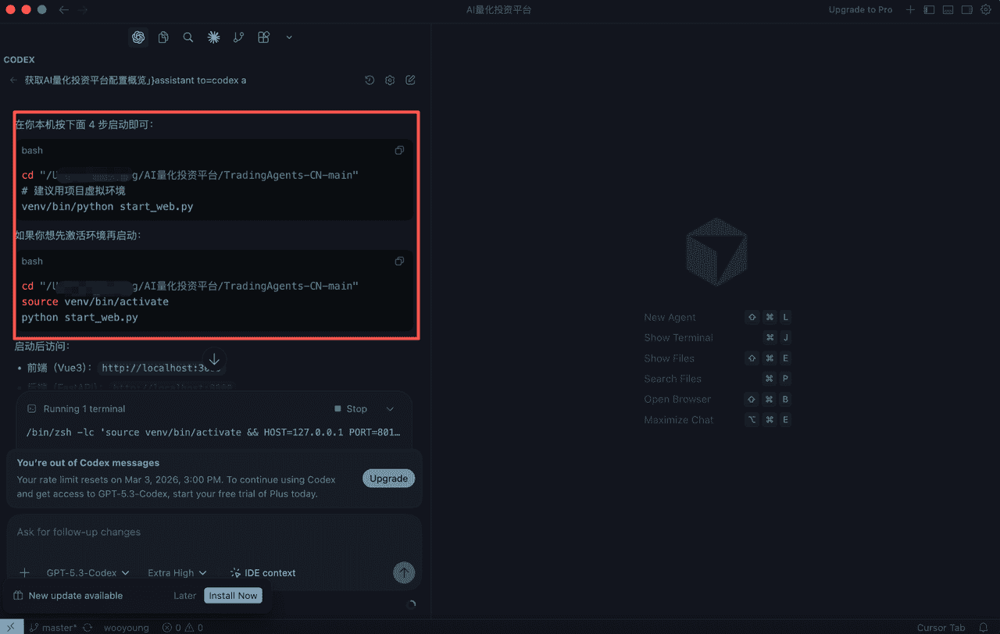

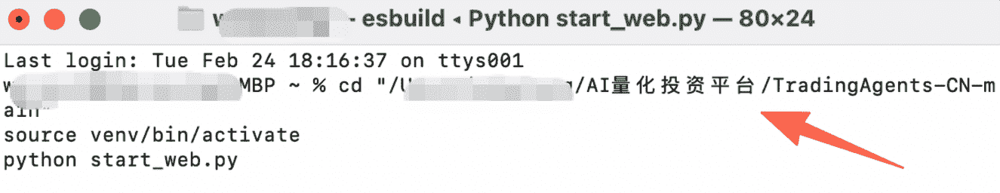

终端运行后，会给一个地址，直接复制放到浏览器中打开，就能体验个人部署开发的项目了～如有问题，直接将终端的报错复制给Codex，继续优化

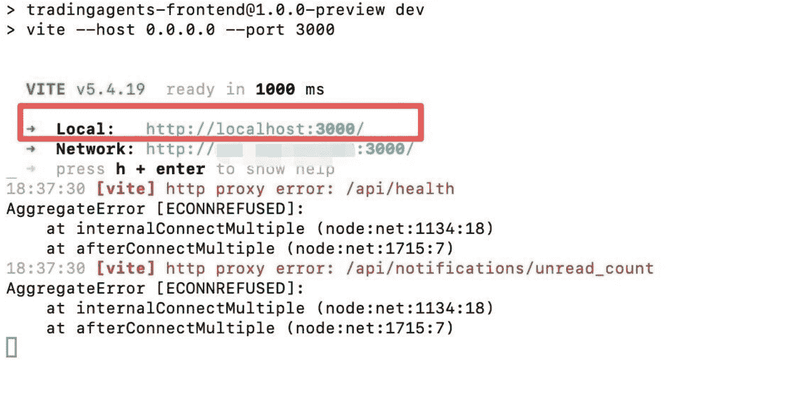

## 八、不同视角的分析师

### 专门辩论的研究员

让不同观点的**看涨研究员**和**看跌研究员**进行结构化辩论：

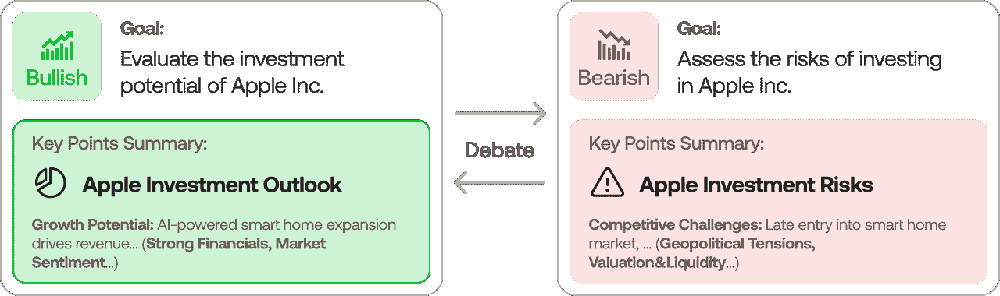

+   **看涨研究员：** 积极寻找市场中的利好因素，例如行业发展机遇、公司创新成果等，构建支持投资的逻辑，并提供论据支持。

+   **看跌研究员：** 捕捉潜在的风险信号和不利因素，例如宏观经济下行压力、公司竞争劣势等，并提出反驳意见和风险警示。

这种“正反方辩论”模式，强制智能体从两个方面进行深入思考，有效避免了单一视角可能带来的局限性，让决策更加全面和客观。

### 操盘手交易员

当分析师和研究员团队把“功课”做足后，就轮到交易员智能体出马了！

交易员智能体的决策过程是一个复杂的强化学习过程，综合所有信息，制定出切实可行的交易策略。

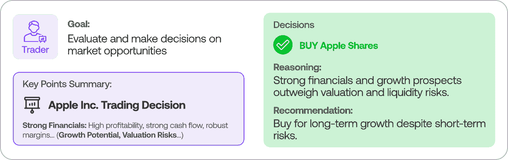

**交易员智能体会综合考虑：**

> 市场深度和流动性： 决定交易规模，避免对市场造成不必要的冲击。

> 风险偏好： 根据预设的风险敞口，调整交易激进程度。

> 时间窗口： 精准把握交易时机，力求实现回报最大化。

一旦市场出现符合预设交易条件的信号，交易员智能体就会迅速下达买入或卖出指令，并根据市场的实时变化灵活调整投资组合。

### 风险管理团队

在金融市场，风险控制永远是重中之重！

研究团队构建了专门的风险管理智能体团队，实时监控持仓情况和市场波动，通过设置止损订单等手段，严格控制投资风险，利用价值风险（VaR）、条件风险值（CVaR）等量化风险指标，确保所有交易活动都在预设的风险参数范围内进行。

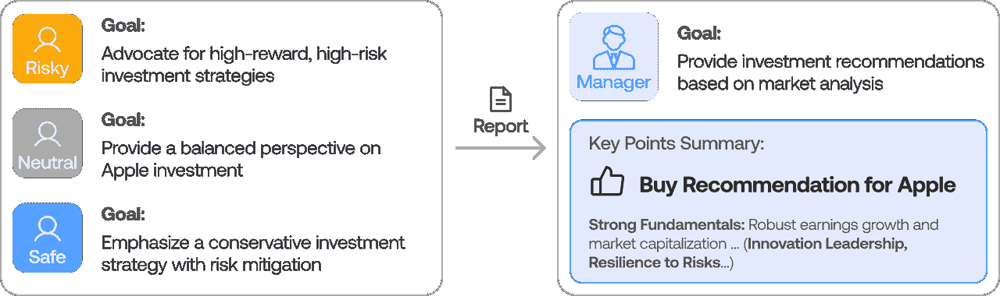

> 例如，当某只股票的价格出现显著下跌，并接近预设的止损价位时，风险管理团队会及时提醒交易员智能体采取相应的应对措施，以最大限度地减少潜在损失。

## 九、部署方式

### 安装

克隆 TradingAgents 仓库：

使用您偏好的环境管理工具创建虚拟环境：

```
conda create -n tradingagents python=3.13
conda activate tradingagents
```

安装依赖项：

```
pip install -r requirements.txt
```

### 所需API

所有智能体都需要 OpenAI API，基本面数据和新闻数据（默认配置）需要 Alpha Vantage API。

```
export OPENAI_API_KEY=$YOUR_OPENAI_API_KEYexport ALPHA_VANTAGE_API_KEY=$YOUR_ALPHA_VANTAGE_API_KEY
```

或者，您可以在项目根目录中创建一个包含 API 密钥的 .env 文件（请参考 .env.example）：

```
cp .env.example .env# Edit .env with your actual API keys
```

### 命令行使用

可直接运行CLI：

```
python -m cli.main
```

界面将显示可选参数：股票代码、日期、大语言模型、研究深度等。

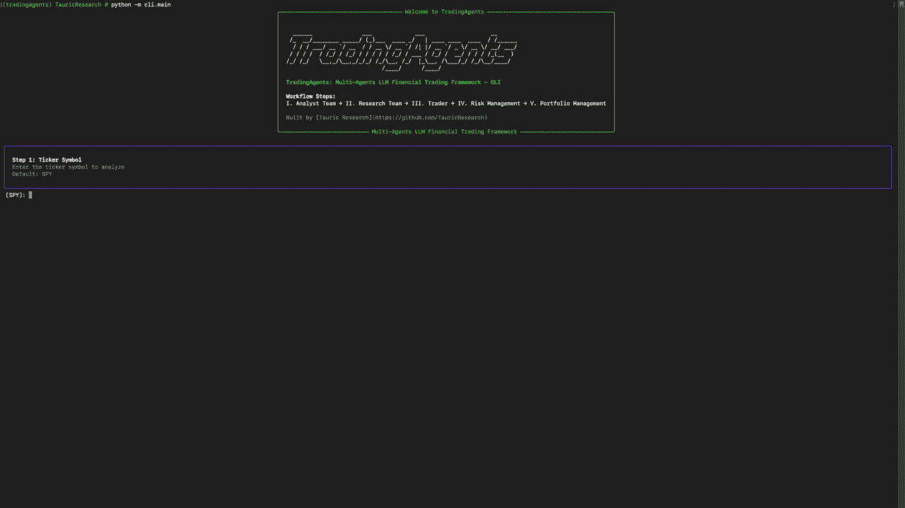

运行时会实时显示加载结果，可追踪代理执行进度。

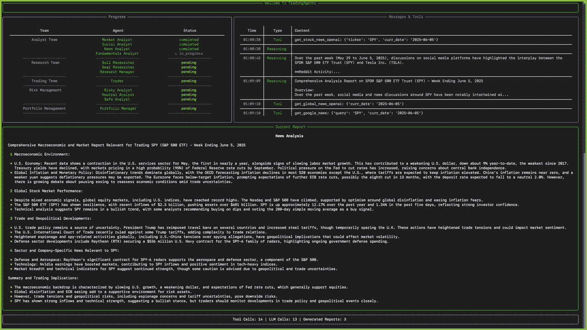

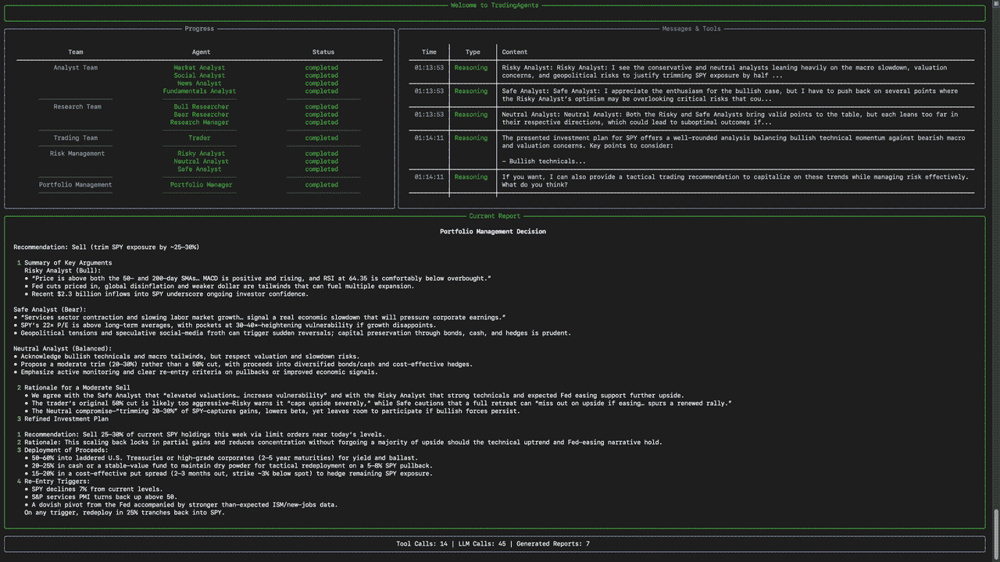

## 十、TradingAgents包

### 实现细节

采用LangGraph构建TradingAgents以保证灵活性和模块化。实验中使用o1-preview和gpt-4o分别作为深度思考与快速思考的大语言模型。但测试时建议使用o4-mini和gpt-4.1-mini以节省成本，因本框架会发起大量API调用。

### Python调用

在代码中导入tradingagents模块并初始化TradingAgentsGraph()对象。.propagate()函数将返回决策结果。可运行main.py，以下是快速示例：

```
from tradingagents.graph.trading_graph import TradingAgentsGraph
from tradingagents.default_config import DEFAULT_CONFIG

ta = TradingAgentsGraph(debug=True, config=DEFAULT_CONFIG.copy())

# forward propagate
_, decision = ta.propagate(&quot;NVDA&quot;, &quot;2024-05-10&quot;)
print(decision)

```

也可以调整默认配置，设置您偏好的大语言模型（LLMs）、辩论轮次等参数。

```
from tradingagents.graph.trading_graph import TradingAgentsGraph
from tradingagents.default_config import DEFAULT_CONFIG

# Create a custom config
config = DEFAULT_CONFIG.copy()
config[&quot;deep_think_llm&quot;] = &quot;gpt-4.1-nano&quot;  # Use a different model
config[&quot;quick_think_llm&quot;] = &quot;gpt-4.1-nano&quot;  # Use a different model
config[&quot;max_debate_rounds&quot;] = 1  # Increase debate rounds

# Configure data vendors (default uses yfinance and Alpha Vantage)
config[&quot;data_vendors&quot;] = {
    &quot;core_stock_apis&quot;: &quot;yfinance&quot;,           # Options: yfinance, alpha_vantage, local
    &quot;technical_indicators&quot;: &quot;yfinance&quot;,      # Options: yfinance, alpha_vantage, local
    &quot;fundamental_data&quot;: &quot;alpha_vantage&quot;,     # Options: openai, alpha_vantage, local
    &quot;news_data&quot;: &quot;alpha_vantage&quot;,            # Options: openai, alpha_vantage, google, local
}

# Initialize with custom config
ta = TradingAgentsGraph(debug=True, config=config)

# forward propagate
_, decision = ta.propagate(&quot;NVDA&quot;, &quot;2024-05-10&quot;)
print(decision)

```

> 提醒：TradingAgents 框架仅供研究用途。交易表现可能会因为模型、参数、数据等多种因素而异，不构成财务、投资或交易建议