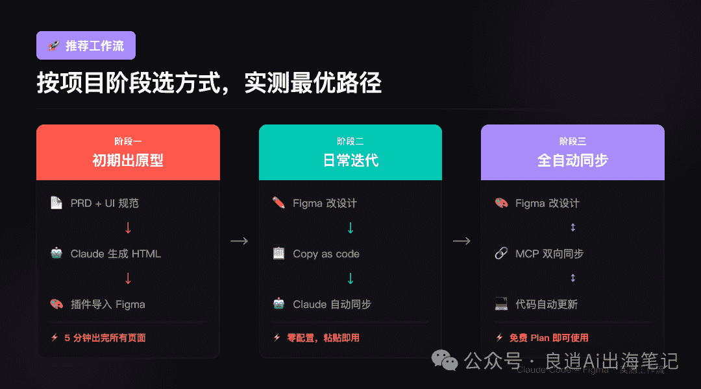
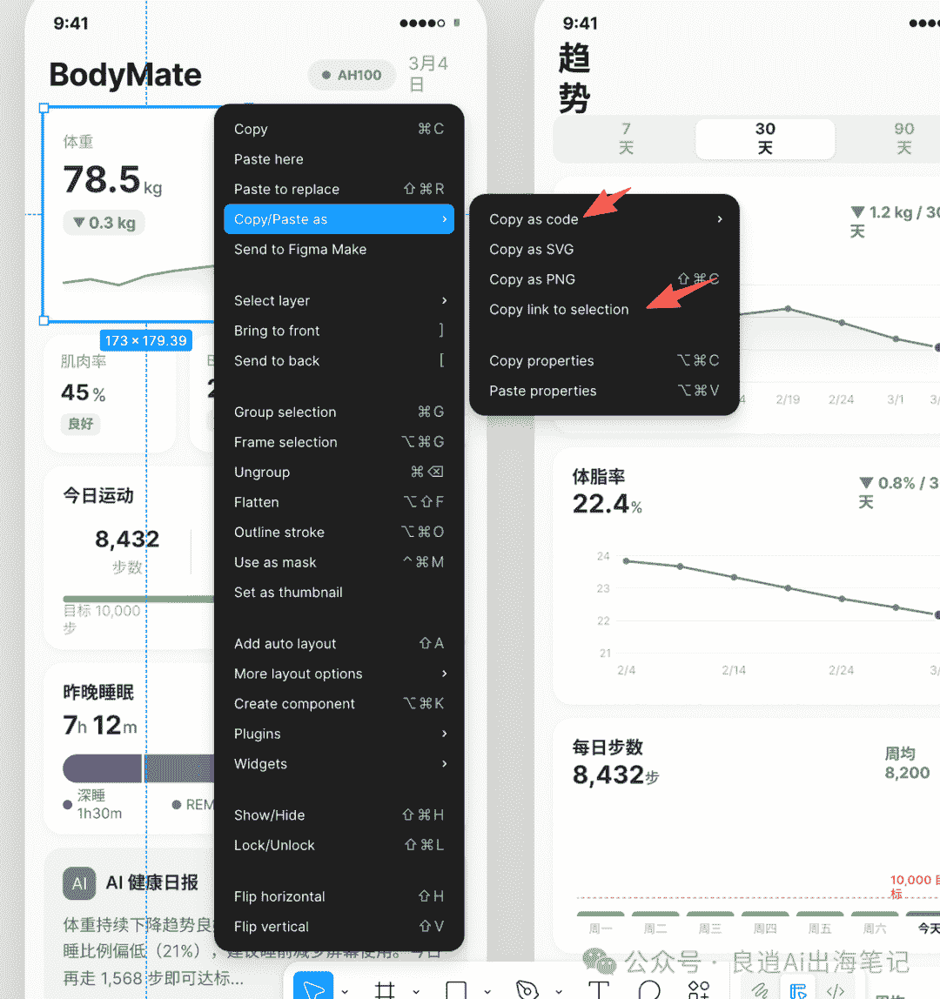
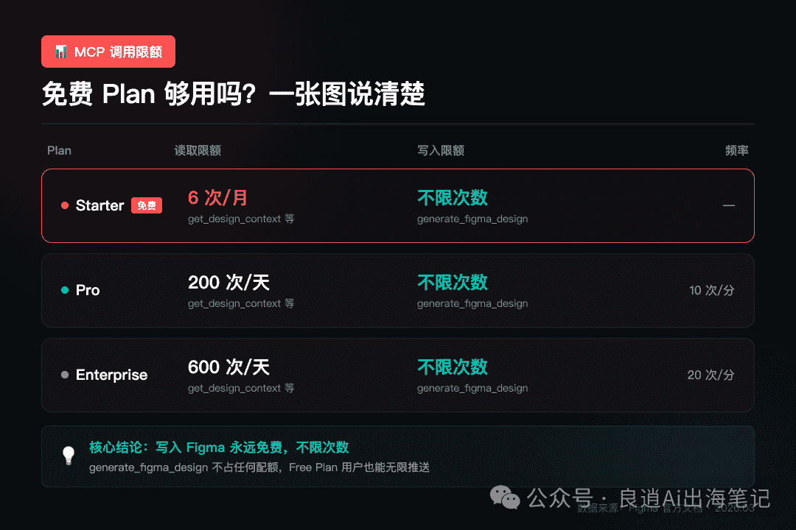

# Claude Code + Figma：AI 画原型完整教程，从 PRD 到设计稿只要 5 分钟

> 来源：[https://qqs7y1hozd1.feishu.cn/docx/Db7idBIXyofs2TxehoMcIohpnah](https://qqs7y1hozd1.feishu.cn/docx/Db7idBIXyofs2TxehoMcIohpnah)

## 3 种方式，按需选择

**Figma 和 **Claude Code 之间有 3 种协作方式，适合不同阶段：

> **三种方式都不需要付费。** MCP Server 免费 Plan 就能连通，generate_figma_design（推代码到 Figma）甚至不限次数。

下面逐个展开，每种都给操作步骤。

---

## 方式一：AI 生成 HTML 原型 → 导入 Figma（推荐起步用）

> 这是从零开始最快的 AI 画原型方式——让 Claude Code 根据你的 PRD 生成 HTML，再一键导入 Figma。

第一步：让 Claude Code 生成 HTML 原型

> 把你的 PRD 和 UI 设计规范丢给 Claude Code，一句话搞定：

> "根据 PRD 和 UI 设计规范，帮我把所有页面的原型画在一个 HTML 文件里"

> Claude 会生成一个包含所有屏幕的 HTML 文件，每个屏幕是一个 390×844 的 iPhone 框架，并排排列。

第二步：导入 Figma（两种方式任选）

HTML 生成后，有两种方式导入 Figma：

> 方式 A：用 MCP 自动推送（推荐）

> 如果已经连通了 Figma MCP（配置方法见方式三），直接告诉 Claude Code：

> "启动本地服务器，把这个 HTML 捕捉到我的 Figma 文件里"

> Claude Code 会自动启动服务器、打开浏览器、捕捉页面、推送到 Figma，全程自动化。

> 方式 B：用 Figma 插件手动导入

1.  启动本地服务器（Claude Code 会自动帮你启动）

1.  **打开 Figma → 运行插**件 html.to.design（Builder.io 出品，在 Figma 插件市场搜索安装）

1.  输入本地服务器地址

1.  点击 Import，所有屏幕变成可编辑的 Figma Frame

一个 HTML 文件，5 个屏幕，一键全部导入 Figma。

### 导入方式对比

**建议：** 初期用手动导入，追求还原度。等工作流跑顺了、再考虑 MCP 自动捕捉。

#### 适合什么情况

+   项目初期，从 PRD 快速出原型，不想在 Figma 里一个个拖组件

+   想让 AI 理解你的设计规范后自动排版

+   独立开发者没有设计师，需要 AI 辅助设计出图

---

## 方式二：Figma Copy as code（日常最实用）

这是设计改完后同步到代码最顺手的方式，不需要配置 MCP，零门槛。

### 操作步骤

第一步：在 Figma 里复制设计信息

选中你改过的组件，右键：

**Copy/Paste as → Copy as code →** CSS（或选 iOS/Android）

Figma 会把该组件的样式属性（尺寸、圆角、颜色、字体等）导出为结构化的代码格式。

第二步：粘贴给 Claude Code

把复制的内容粘贴给 Claude Code，告诉它要更新哪个组件就行。Claude 会自动识别设计属性，把设计稿的改动同步到代码。

### 进阶用法：Copy link to selection

如果已经配置了 Figma MCP（方式三），还可以用更快的方式：

> 选中组件 → 右键 → **Copy/Paste as → Co**py link to selection

> 得到一个带 node-id 的链接。把这个链接粘贴给 Claude Code，AI 会自动通过 MCP 读取该节点的完整设计数据

### 适合什么情况

+   产品改了 Figma，开发需要同步到代码

+   微调某个组件的样式

+   不想折腾 MCP 配置，粘贴就能用

---

## 方式三：Figma MCP Server（全自动双向同步）

> **这是 Figma 官方 **2026 年初发布的 AI 集成方案，支持设计和代码双向同步。

### 两种 MCP Server 的区别

### 各 Plan 调用限额

这是很多人关心的问题，实测后整理了一下：

> **重点：**generate_figma_design（把代码推送到 Figma）不受配额限制。

> 免费用户也能无限次使用。每月 6 次的限制主要影响读取类工具（如 get_design_context），日常够用了。

### MCP 配置教程

配置 Remote Server（推荐先试这个）

在 Claude Code 终端里运行一行命令就行，首次使用会弹出 Figma OAuth 授权页面，在浏览器打开链接登录允许即可。整个过程不超过 1 分钟。

> 配置 Desktop Server

1.  打开 Figma 桌面端

1.  切换到 Dev Mode → Enable desktop MCP server

1.  在 Claude Code 终端添加本地 MCP 服务器地址

### 连通后能做什么

**配置好 Fig**ma MCP 后，Claude Code 获得 13 个工具，核心分两类：

+   **读取设计** — get_design_context（获取样式和布局）、get_screenshot（截图）、get_metadata（节点结构）等，帮你把 Figma 设计数据提取给 AI

+   **写入 Figma** — generate_figma_design，把 HTML/代码界面推送回 Figma（不限次数）

> 用起来很简单——把 Figma 设计链接丢给 Claude Code。

> 它会通过 MCP 自动读取设计数据，然后帮你实现对应的代码。反过来，代码改了 UI 之后，也可以让 Claude Code 自动捕捉界面推回 Figma。

### 踩坑记录（重要）

实测过程中遇到了 3 个坑，提前避开能省很多时间：

坑 1：VSCode 扩展里 OAuth 可能不弹出

Remote Server 在 VSCode Claude Code 扩展里可能无法完成 OAuth 认证流程。

**解决方案：** 先在终端 claude 里完成认证，再回 VSCode 就正常了。

坑 2：第三方 MCP 和官方 MCP 容易搞混

npm 上的 figma-developer-mcp 是第三方包（Framelink 出品），只能读不能写，还需要手动配 API Token。Figma 官方的 Remote MCP 地址是 mcp.figma.com/mcp，用 OAuth 认证，功能完整——别装错了。

坑 3：免费 Plan 完全够用

**一开始以为 MCP 需要 Pr**o，实测发现 Free Plan 就能连通。generate_figma_design（推代码到 Figma）不受配额限制；读取类工具每月 6 次，日常够用。

---

## 我的推荐工作流（经过实测）

根据项目阶段选择不同的 AI 画原型方式：

### 初期：快速出原型

> **P**RD + UI 规范 → Claude Code 生成 HTML 原型 → html.to.design 插件导入 Figma

### 日常：设计改完同步代码

> **Figma 改设计 → Copy as code → 粘贴**给 Claude Code → 自动同步

### 进阶：全自动双向同步（MCP 连通后，免费即可）

> **设计改了 → MCP 自动读取 → 代码同步 → 代码改了 U**I → 自动推回 Figma（不限次数）

---

## 实用技巧：建立设计-代码映射表

在项目里维护一份映射关系表，AI 看到就知道该改哪个文件：

这样不管用哪种方式，告诉 Claude Code"改体重卡片"，它就能精准定位到对应的 Figma 设计和代码文件。

---

## 总结

2026 年，AI 辅助原型图绘制的链路已经完全跑通了：

+   **三种方式都免费：** HTML 原型、Copy as code、MCP Server 都不需要 Pro

+   **MCP 免费版限制很少：**generate_figma_design 不限次数，读取类工具每月 6 次，日常够用

+   **核心思路：** 让 AI 理解你的设计规范，而不是一个个像素去抠

工具在进化，但思路比工具重要——先把 PRD 和设计规范写清楚，AI 才能帮你高效干活。