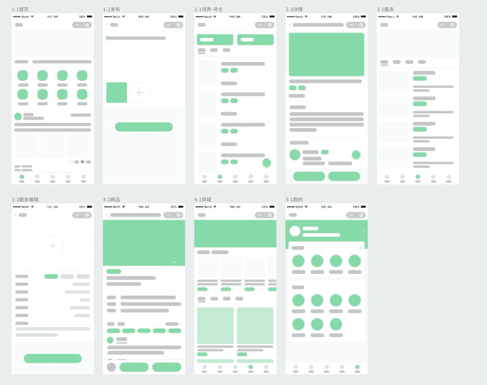
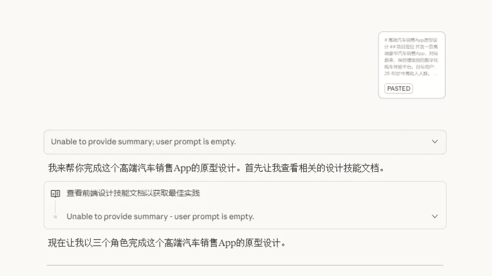
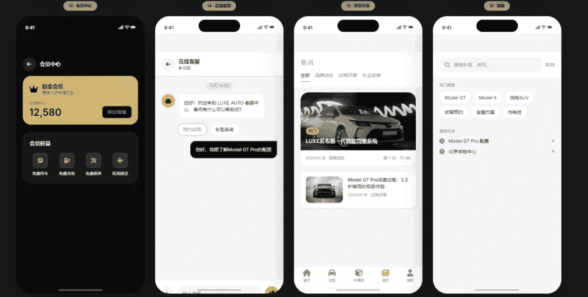
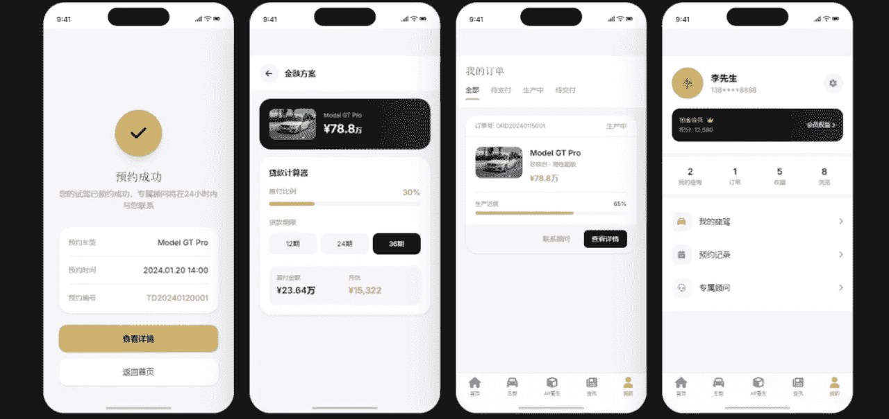

# Claude+Cursor+Figma/MasterGo四步生成高端的产品原型图（附提示词和步骤）

> 来源：[https://qqs7y1hozd1.feishu.cn/docx/DlWidJ7GVo0GcpxtSGic9heRnRr](https://qqs7y1hozd1.feishu.cn/docx/DlWidJ7GVo0GcpxtSGic9heRnRr)

第一步 ：发送初步简单的提示词到AI工具，表明自己的目的

```
现在我要开发一个汽车销售的app，根据三个角色设计提示词如下：我想开发一个汽车销售app要输出原型图，请通过以下方式帮我完成app所有原型页面的设计。
 1、作为产品经理先设计出这个app实现哪些功能 
 2、作为UI设计师完成这些原型界面的设计 
 3、使用html在一个界面上生成所有的原型界面，使用Tailwind CSS创建高保真UI原型，可从Unsplash获取图片素材，使用FontAwesome等开源图标库，让原型显得更精美和更加真实 
 4、我需要这些界面可直接用于项目开发
帮我把这个提示词更加丰富，达到做出一个非常高端app的要求，最后把提示词以可以复制的形式给我
```



第二步 :AI给出具体的详细提示词(如果需要，可以自己修改)

```
# 高端汽车销售App原型设计

## 项目定位
开发一款高端豪华汽车销售App，对标蔚来、保时捷级别的数字化购车体验平台。目标用户：25-50岁中高收入人群。

请依次以三个角色完成设计：

---

## 角色一：产品经理

设计完整的产品功能架构，包含以下模块：

1. 首页/发现页 - 品牌故事、精选车型、活动Banner、智能推荐
2. 车型展示 - 车系列表、车型详情、配置对比、360°全景看车
3. 3D/AR看车 - 沉浸式3D展厅、AR实景摆放、内饰漫游
4. 智能选配 - 外观颜色、内饰材质、选装包、实时价格计算
5. 预约服务 - 在线预约试驾、到店接待、上门试驾
6. 金融方案 - 贷款计算器、分期方案、以旧换新估价
7. 订单中心 - 订单追踪、生产进度、物流状态、交付预约
8. 个人中心 - 会员体系、积分商城、专属顾问、收藏夹
9. 在线客服 - AI智能客服、真人顾问、视频咨询
10. 资讯社区 - 品牌动态、车主故事、试驾评测

输出核心页面清单（不少于18个页面）。

---

## 角色二：UI设计师

制定设计规范：

**设计风格**：极简奢华、科技未来感、沉浸式体验
**设计参考**：蔚来App、保时捷官网、特斯拉App、苹果设计语言

**配色方案**：
- 主色：深邃黑(#0A0A0A) / 纯净白(#FFFFFF)
- 强调色：香槟金(#C9A962) 或 电光蓝(#0066FF)
- 辅助色：高级灰(#8E8E93)、浅灰背景(#F5F5F7)

**设计元素**：
- 圆角：16-24px大圆角
- 阴影：轻微柔和阴影、毛玻璃效果
- 图片：高品质汽车大图
- 留白：大量留白营造高级感

---

## 角色三：前端开发

在单个HTML文件中实现所有原型页面。

**技术栈**：
- Tailwind CSS（CDN引入）
- FontAwesome / Heroicons 图标库
- Unsplash 高质量汽车图片
- Google Fonts 字体

**页面规格**：
- 移动端尺寸：390x844（iPhone 14 Pro）
- 所有页面以网格布局横向排列展示
- 每个页面添加标题标注

**必须包含的页面**：
1. 启动页/闪屏页
2. 登录页（手机号+社交登录）
3. 注册页
4. 首页（推荐车型、活动、快捷入口）
5. 车型列表页（筛选、排序）
6. 车型详情页（轮播图、参数、亮点）
7. 360°看车页
8. 智能选配页（颜色、配置选择）
9. 配置对比页
10. 预约试驾页
11. 预约成功页
12. 金融方案页（贷款计算器）
13. 订单列表页
14. 订单详情页（进度追踪）
15. 个人中心页
16. 会员中心页
17. 设置页
18. 在线客服页（聊天界面）
19. 资讯列表页
20. 资讯详情页
21. 搜索页

**视觉要求**：
- 使用Unsplash真实豪华汽车图片
- 界面精致度达到可直接开发的标准
- 注重细节：图标、间距、对齐、阴影
- 加入渐变、毛玻璃效果提升质感
- 底部导航栏固定美观
- 状态栏显示时间、信号、电量

**代码要求**：
- 语义化HTML5
- 清晰注释
- 组件化可复用
- 代码整洁

---

## 第三方平台导入兼容

生成的原型需支持导入以下设计平台：

**支持平台**：
- Figma
- MasterGo（即时设计）
- Sketch
- Adobe XD
- Pixso

**兼容性要求**：

1. **SVG导出支持**
   - 每个页面可独立导出为SVG格式
   - 添加&quot;导出全部为SVG&quot;功能按钮
   - SVG保持矢量清晰度和图层结构

2. **图层命名规范**
   - 使用语义化class命名（如：header、nav-bar、card-item）
   - 组件层级清晰，便于在设计工具中识别
   - 命名格式：模块/组件/状态（如：home/card/hover）

3. **设计标注输出**
   - 输出完整的设计规范文档（Design Tokens）
   - 包含：颜色值、字体大小、间距、圆角、阴影参数
   - 格式兼容Figma Tokens插件

4. **组件化结构**
   - 按钮、卡片、导航栏等封装为独立组件
   - 便于在Figma/MasterGo中创建组件库
   - 支持快速复制重建

5. **导出功能实现**
```
   在HTML页面中添加工具栏，包含：
   - [导出单页SVG] - 点击任意页面导出该页
   - [导出全部SVG] - 打包下载所有页面
   - [导出设计规范] - 下载JSON格式的Design Tokens
   - [复制CSS变量] - 一键复制所有设计变量
```

6. **Figma导入指南**
   - 在HTML中附带简要说明
   - 步骤：SVG导入 → 解组 → 转换为Frame → 应用Auto Layout

---

## 输出标准

- 视觉效果接近真实App（高保真原型）
- 设计风格统一、专业、高端
- 功能逻辑完整、符合用户习惯
- 代码可用于实际开发参考
- 所有页面在一个HTML文件中完整呈现
- **支持一键导出SVG，可直接导入Figma/MasterGo等设计平台**
- **附带Design Tokens便于设计系统迁移**

请现在开始，依次以三个角色完成设计并输出完整HTML代码。
```

第三步：把上面的提示词复制给AI



**第四步：AI生成对应的原型**

**具体原型**





## 有了原型之后，可以自己进行修改，调试

**设计规范 ：**

```
设计规范 (Design Tokens)
颜色系统
主色-黑: #0A0A0A | 主色-白: #FFFFFF
强调色-金: #C9A962 | 强调色-浅金: #D4B978
中性灰: #8E8E93 | 浅灰背景: #F5F5F7
字体系统
展示字体: Playfair Display
正文字体: Inter
圆角系统
小圆角: 8px | 中圆角: 12px
大圆角: 16px | 超大圆角: 24px
间距系统
xs: 4px | sm: 8px | md: 16px
lg: 24px | xl: 32px
```

## Figma/MasterGo 导入 ：

1.  点击"导出全部SVG"下载所有页面的SVG文件

1.  在Figma/MasterGo中，使用 File → Import 导入SVG

1.  选择导入的SVG，右键 → Ungroup 解组

1.  选择内容，右键 → Frame Selection 转换为Frame

1.  应用Auto Layout整理布局

1.  使用"导出设计规范"获取Design Tokens，导入到Figma Tokens插件