# Claude Code + Mermaid 一键生成架构图、时序图、流程图

> 来源：[https://qqs7y1hozd1.feishu.cn/docx/AGF6dEjKbolQDTxJ5rocwcSynGc](https://qqs7y1hozd1.feishu.cn/docx/AGF6dEjKbolQDTxJ5rocwcSynGc)

本文将手把手教你如何用Claude Code生成Mermaid代码，并在Mermaid、draw.io、ProcessOn等工具中渲染成精美图表。

# 用Claude Code生成Mermaid代码

使用的工具是 Cursor + Claude Code，在Claude Code中输入结构化提示词，让它生成总体架构图，输出Mermaid代码。

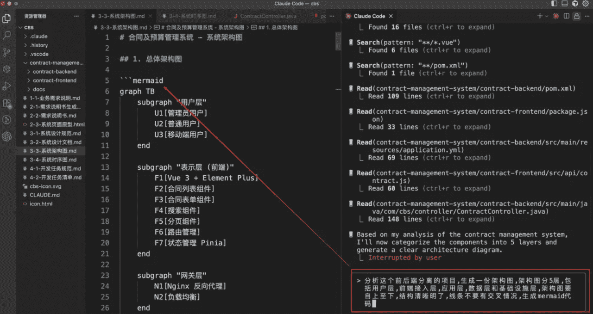

# **生成时序图、流程图**

有了Mermaid代码，那么生成时序图、流程图等图表也是同样的简单

# 使用Mermaid工具渲染图表（最快捷）

打开Mermaid官网，在Dashboard页面，选择新建图表

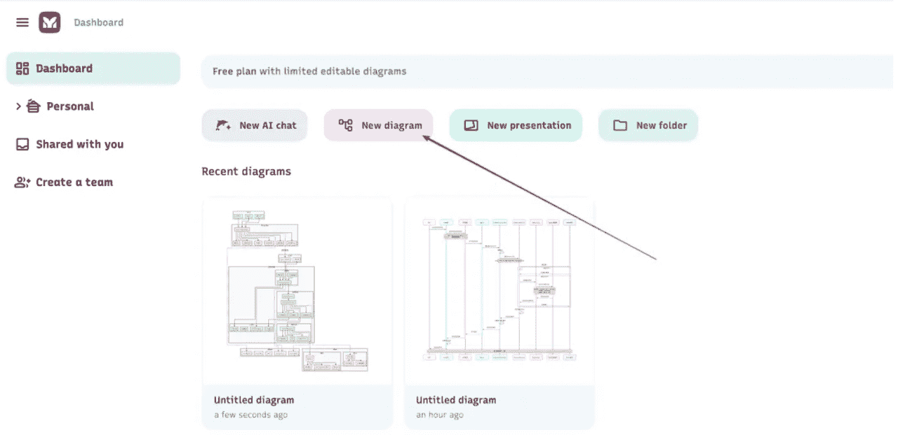

将Mermaid代码复制到左侧的CODE位置，右侧自动会生成架构图表，可以使用工具进行架构图风格的调整

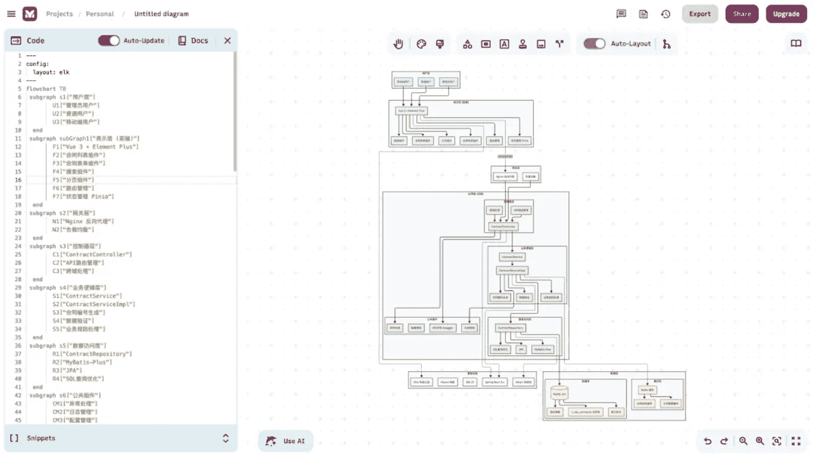

# **使用draw.io工具渲染图表**

打开draw.io网站，点击“+”--->Mermaid...，将Mermaid代码粘贴到弹框中，点击“插入”即可生成架构图，可以使用工具进行架构图风格的调整

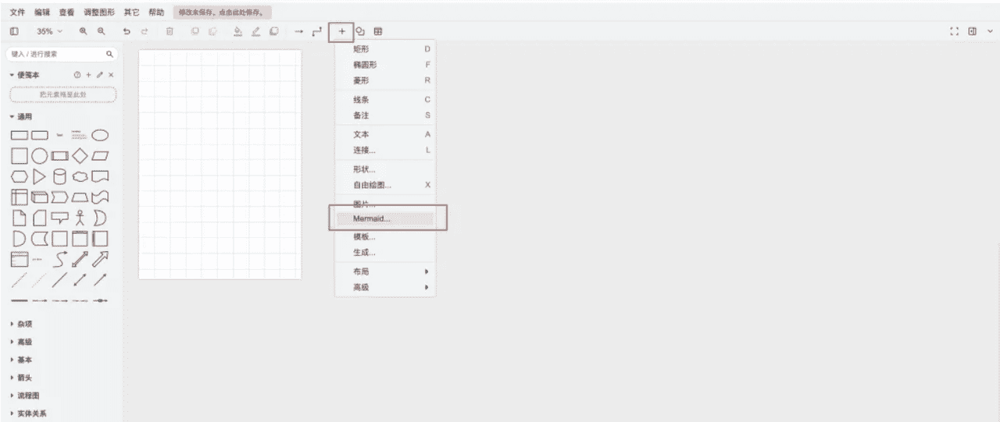

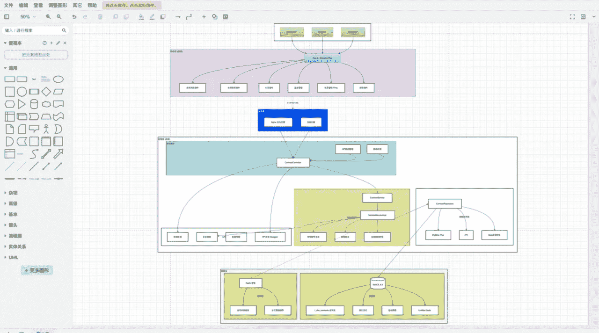

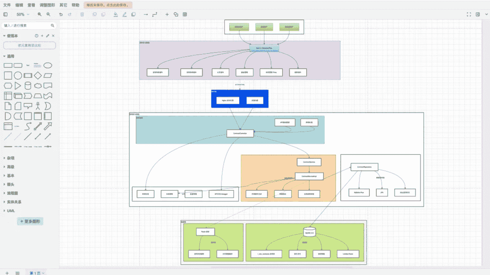

# 使用ProcessOn工具渲染图表（国内用户首选）

打开rocessOn网站，点击“新建”--->Mermaid，将Mermaid代码粘贴到页面左侧，则自动生成Mermaid图表，有条件的可以进行“图形化编辑”

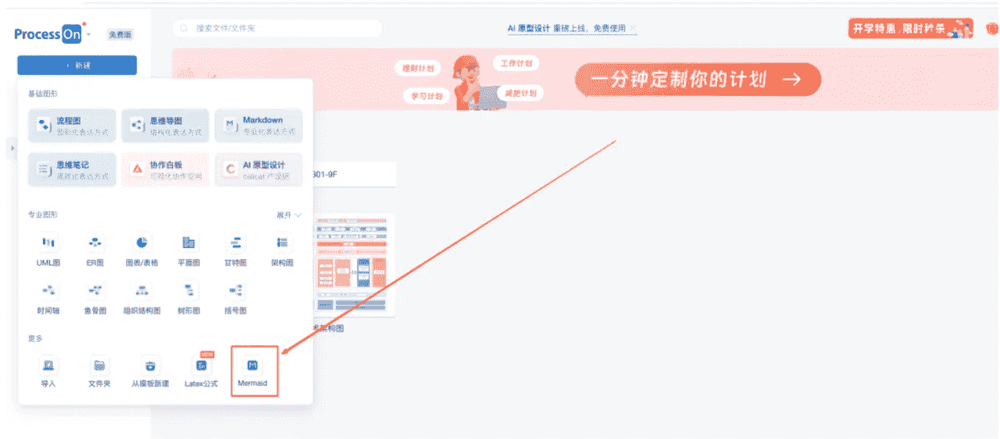

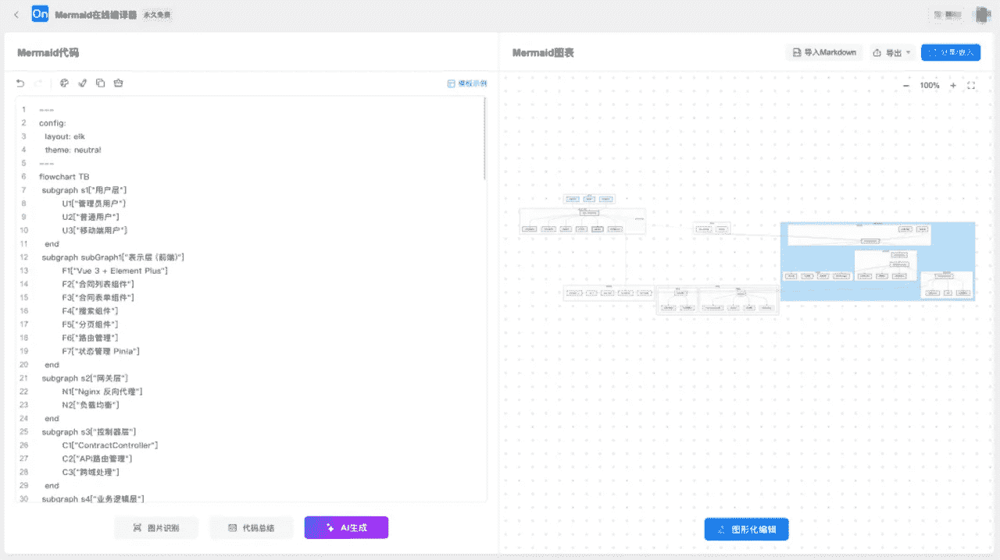

# **生成时序图、流程图**

有了Mermaid代码，那么生成时序图、流程图等图表也是同样的简单

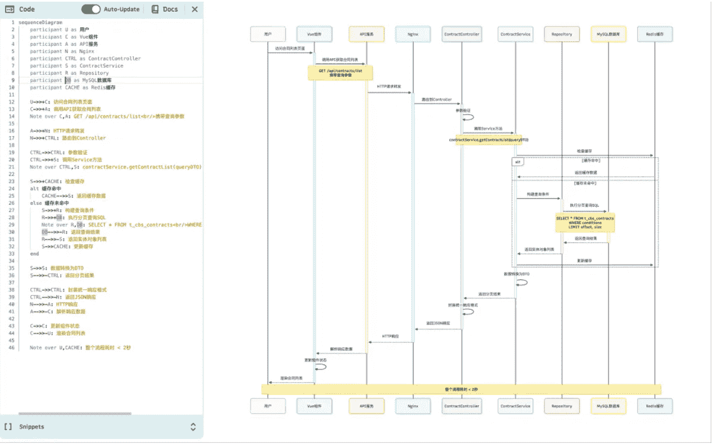

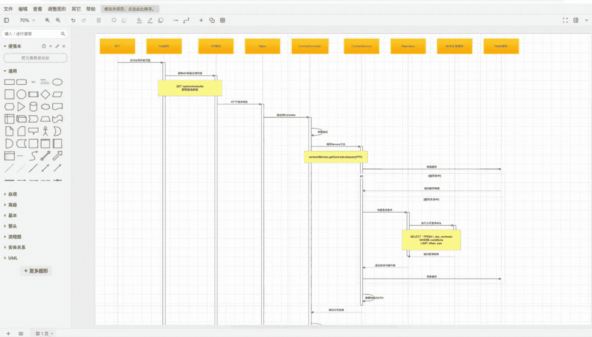

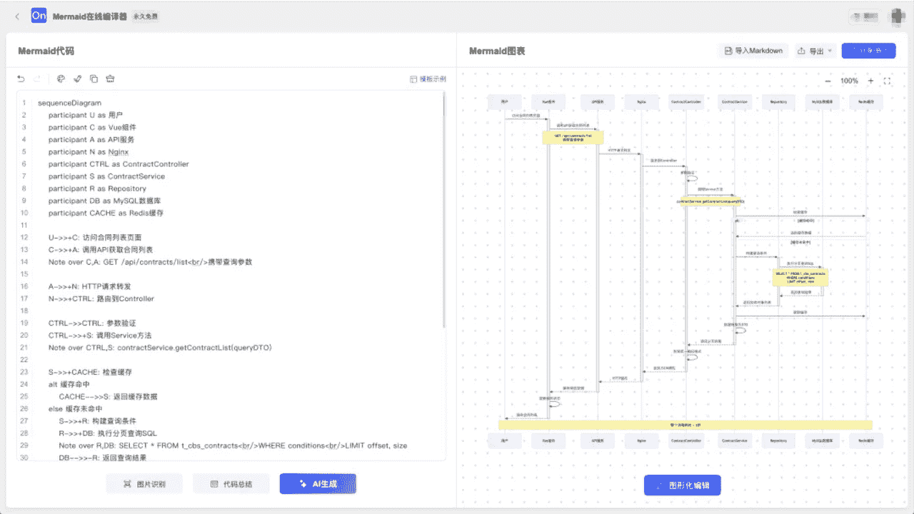

# **总    结**

通过Claude + Mermaid的组合，我们实现了：

+   **效率提升：**从小时级到分钟级的图表生成速度

+   **质量提升：**专业统一的图表风格

+   **维护便捷：**文本格式方便迭代和版本管理

现在就开始你的AI绘图之旅吧！生成架构图、时序图、流程图、甘特图、状态图，你必须记住这个高效工作流：

**描述需求 → 生成Mermaid**代码 → 粘贴到渲染工具 → 精细化调整