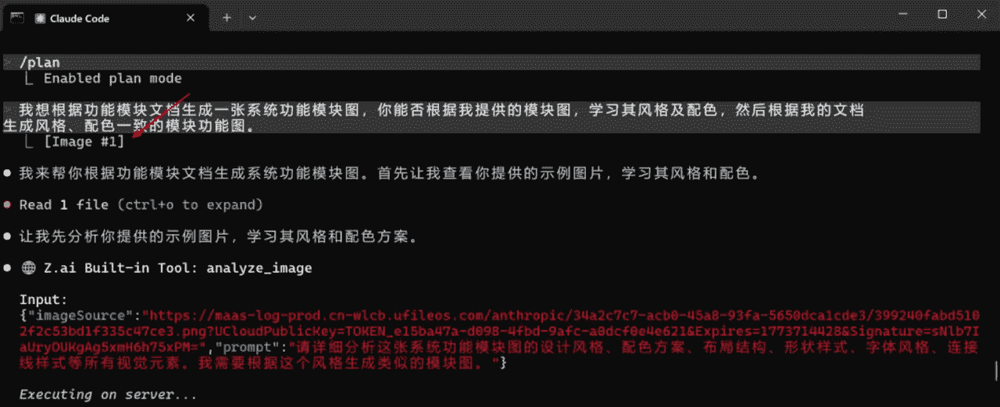
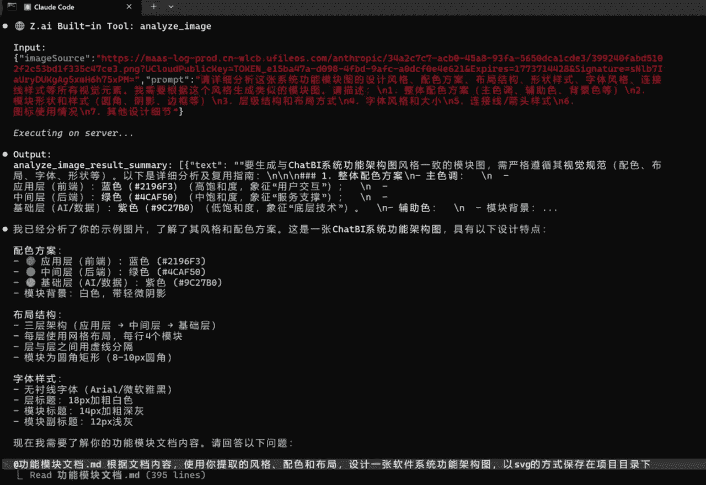
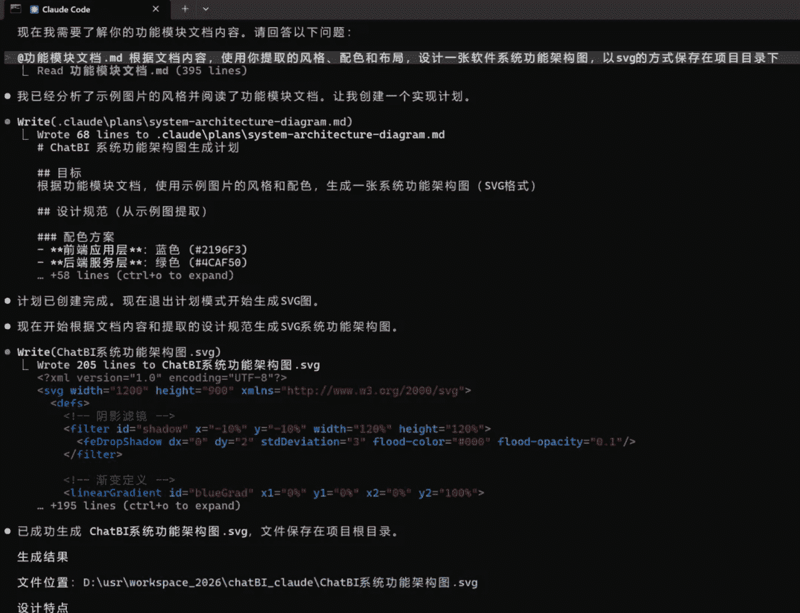
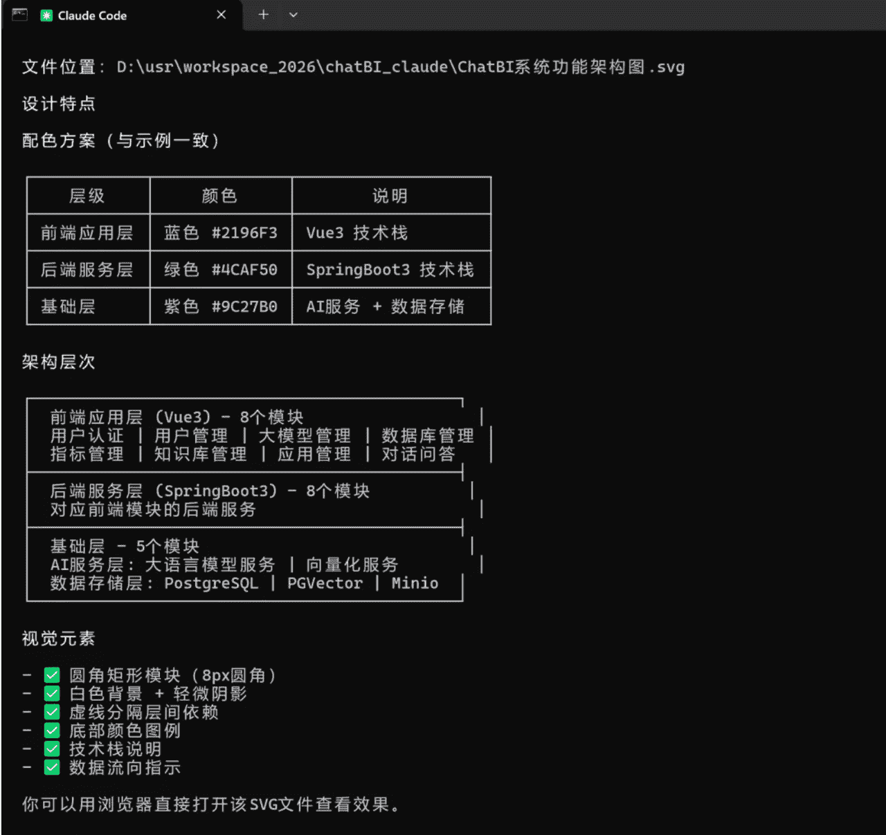
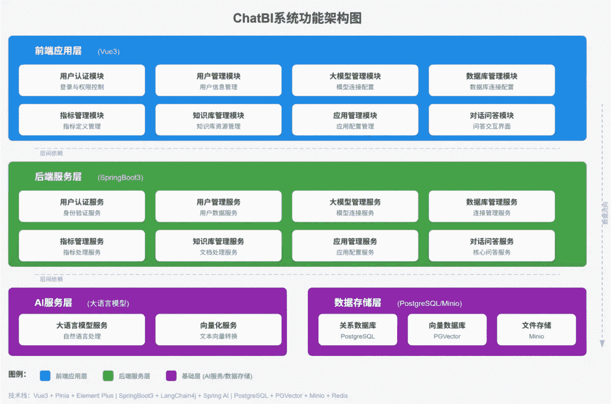
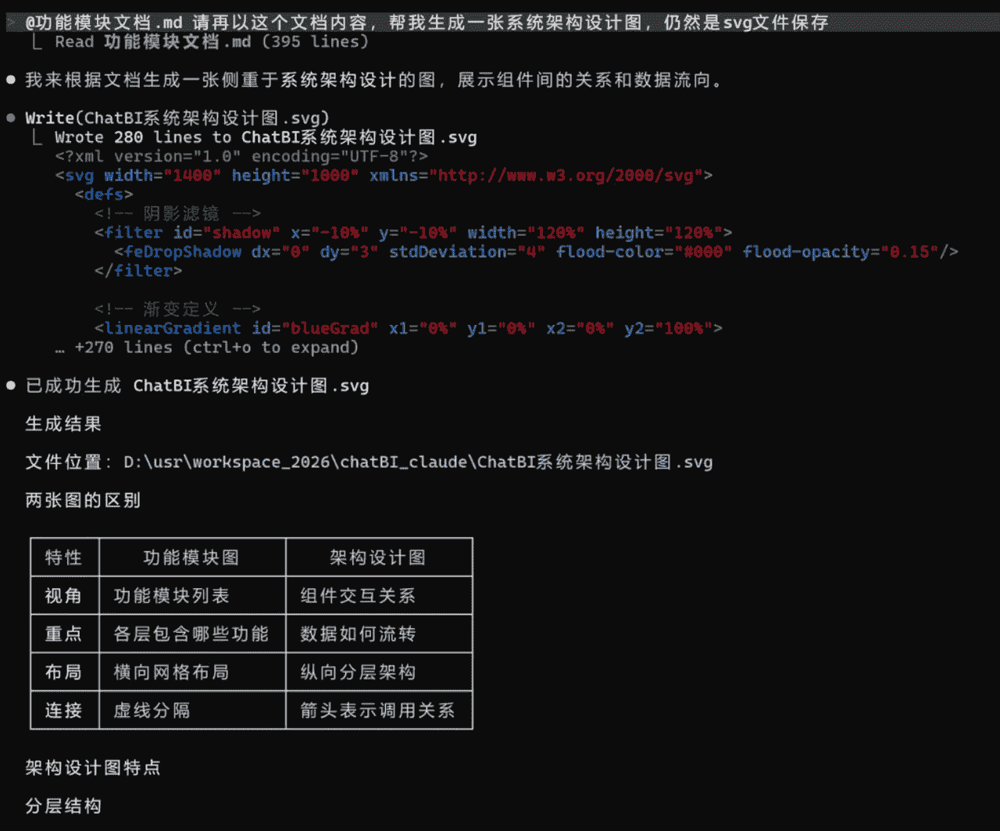
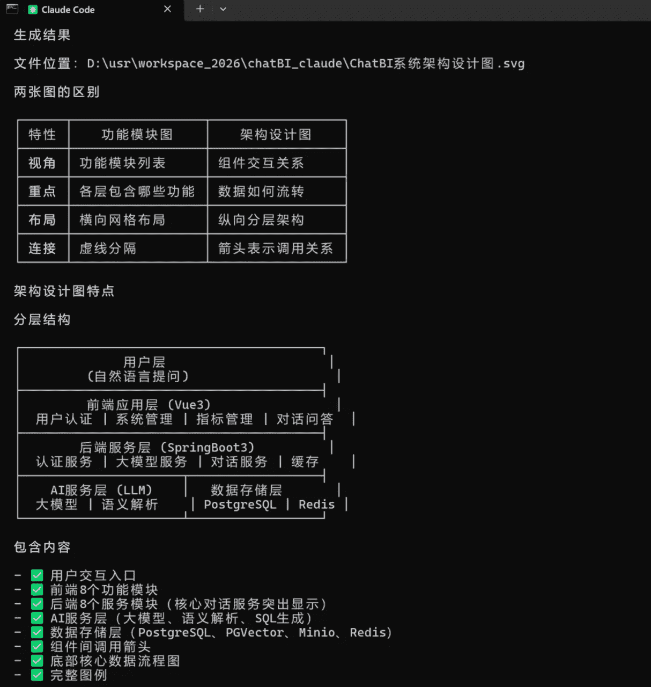
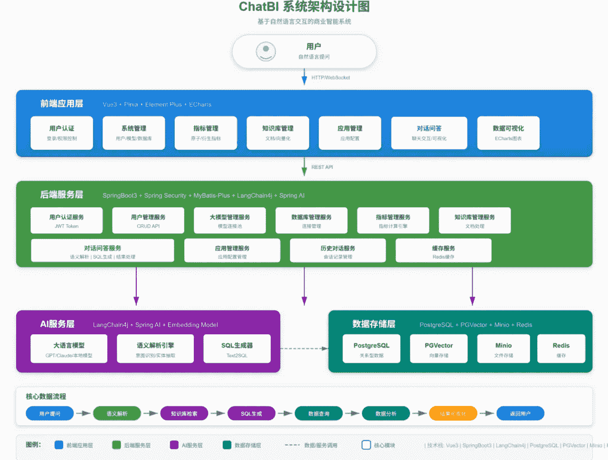

# 用claude code 画系统功能模块图和系统架构图

> 来源：[https://qqs7y1hozd1.feishu.cn/docx/DMSYdbNeooDijZxaqExcTFVansd](https://qqs7y1hozd1.feishu.cn/docx/DMSYdbNeooDijZxaqExcTFVansd)

## 画系统功能模块图

### 1、使用/plan 模式

给claude code 一张参考图，提取模块图的风格、布局、配色和样式，这里我给的参照图是之前在Trae 里生成的功能模块图。



> claude code 截图粘贴快捷键是 Alt + v , 本文用的是Win11 的系统。

### 2、参照图风格、配色、布局提取完毕



### 3、这里用《功能模块文档.md》



### 4、分析文档内容，并创建计划，然后开始执行计划



### 5、生成的系统功能模块图对比

原来用Trae画的功能图：


# 用claude code的复刻功能图



claude code + GLM-5 是可靠的，和原图基本是一致的，而且一次对话即可完成，无需修正。

> 这里你也可以上传你自己的旧的参照图，根据你自己的风格、配色、布局进行模块图的生成。

配置文本：

```

{
  &quot;args&quot;: [
    &quot;-y&quot;,
    &quot;@z_ai/mcp-server&quot;
  ],
  &quot;command&quot;: &quot;npx&quot;,
  &quot;env&quot;: {
    &quot;Z_AI_API_KEY&quot;: &quot;你的智谱api key&quot;,
    &quot;Z_AI_MODE&quot;: &quot;VISION&quot;
  },
  &quot;type&quot;: &quot;stdio&quot;
}
```

## 系统架构设计图的生成

1、这里我没再上传系统架构图的参照图让它学习，直接生成。





2、生成的系统架构图效果：



一次生成，看起来效果还行。

四、经验总结

1、自从使用了claude code后，我已经不再使用Tare工具了，自从上次系统架构图生成实验后，大模型又发展了8个月了，很多东西已经发生了翻天覆地的变化了，现在让ai生成一个好看的系统架构图已经不是什么难事了；

2、claude code 除了cli 命令行方式让普通人觉得不友好外，其他的都是优点；

3、如果想要画特定风格、配色、布局的功能图或系统架构设计图，你可以先上传一张参照图，先让大模型学习一下，再开始画图。

4、claude code 虽然是cli 的方式，但画图仍然也是扛扛的。