# 用设计和编程 Agent 设计网站

> 来源：[https://qqs7y1hozd1.feishu.cn/docx/WjMPdWRTqoqV1UxZyI2cM60bn2c](https://qqs7y1hozd1.feishu.cn/docx/WjMPdWRTqoqV1UxZyI2cM60bn2c)

# 入门指南

## 教程简介

让我们使用 AI 设计 Agent 和编码 Agent，从零开始搭建一个完整的网站。

+   设计 Agent：负责创建 logo、网页布局、配色方案和其他视觉元素

+   编码 Agent：根据你在提示中提出的需求与布局，编写 HTML/CSS/JS 等实际代码，构建可运行的网站

## 设计 Agent 与编码 Agent

+   设计 Agent：根据你提供的提示，生成图片、页面模型或设计风格的 AI。

+   Mastergo

+   Lovart

+   Figma MCP

+   编码 Agent：根据你在提示中请求的功能与布局，编写实际的代码（HTML/CSS/JS 等）的 AI。

+   Z.AI

+   Trae

+   Cursor

+   Lovable

---

# 使用设计 Agent 创建 Logo

## 设计 Logo 时需要考虑的关键要素

Logo 是决定你网站第一印象的关键元素之一。想要从 AI 设计 Agent 那里获得满意的结果，你需要在提示中清楚地描述你想要的 Logo 类型。

1.  品牌名称 / 文本

+   必须出现在 Logo 中的文字（例如：网站标题、品牌名称等）。

1.  风格（情绪 / 气氛）

+   Logo 想要传达的整体感觉或氛围。

+   示例：极简、可爱、简洁、现代、复古、未来感等。

1.  配色方案（可选）

+   最好让 Logo 的配色与整个网站的整体基调相匹配。

+   可以指定具体的十六进制色号，或大致的色调（冷色、暖色等）。

+   示例：#171721（黑色）、#FF7130（橙色）。

1.  形式（形状 / 结构）

+   明确 Logo 是否需要特定的形状或构图。

+   示例：文字在圆形内部、图标 + 文字组合、以图标为主的 Logo 等。

1.  图标 / 符号元素（可选）

+   希望出现在 Logo 中的图形或符号。

+   示例：书本图标、闪电符号、与 AI 相关的图形、抽象几何图形等。

## 编写 Logo 设计提示词

示例提示词

```
&quot;请为我设计一个极简风格的 Logo，品牌名称是 ‘My First Website’。
使用黑色 (#171721) 和橙色 (#FF7130)，并将文字放在一个圆形内部。&quot;
```

```
&quot;请设计一个以 ‘AIID’ 为品牌名的 Logo。
整体风格要未来感、干净简洁，主色为蓝色与白色。
将象征 AI 的抽象图形与文字相结合，并导出为带透明背景的 PNG。&quot;
```

## 向 Agent 请求设计

+   输入上述提示词 → 比对 Agent 生成的多个设计稿。

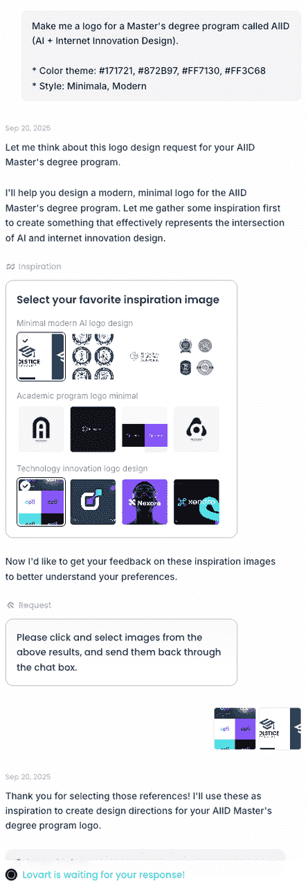

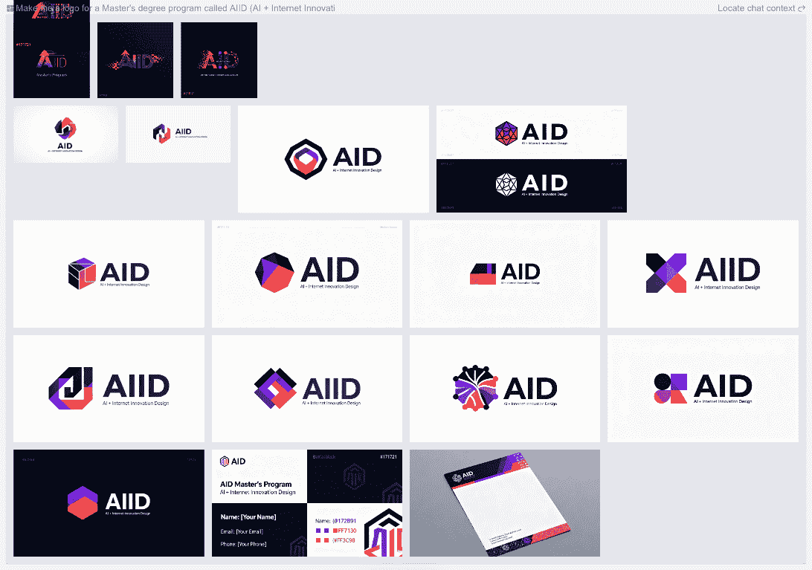

---

# 规划你的网站结构

## 了解基础版块

在真正开始制作网站前，先规划好要包含哪些菜单（版块）非常重要。菜单的设计取决于你希望访客看到什么、以及你希望他们采取什么行动。 一般来说，网站通常由 Home / About / Contact 等基础版块构成。

## 自己先画一个结构草图（可选）

你可以先根据网站的目标，大致写出一个简单的菜单结构。

### 基础菜单

1.  Home

1.  访客进入网站后首先看到的主页面

1.  通常包含 Logo、主视觉区域和一句简短的标语或简介

1.  About

1.  介绍你是谁，或者项目 / 服务的目的

1.  个人作品集：自我介绍 + 简短履历

1.  服务类网站：愿景、目标以及核心功能

1.  Contact

1.  联系方式，如邮箱、电话号码、社交媒体链接等

1.  也可以加入一个简单的联系表单

### 可选菜单

1.  Services / Projects

1.  展示你提供的服务，或你的项目 / 作品集

1.  通常以列表或卡片形式展示

1.  Gallery

1.  用于展示图片、照片或设计作品

1.  Blog / News

1.  用于发布文章、动态或日志

1.  FAQ

1.  整理访客经常会问的问题及解答

## 选择配色方案（可选）

如果你已经有了 Logo，或者想用特定的颜色搭配来设计网站，也可以直接在提示词中写上你想使用的颜色代码。

示例： #171721, #872B97, #FF7130, #FF3C68

即使你暂时想不到配色方案，也可以通过配色网站或搜索关键词来找到灵感。


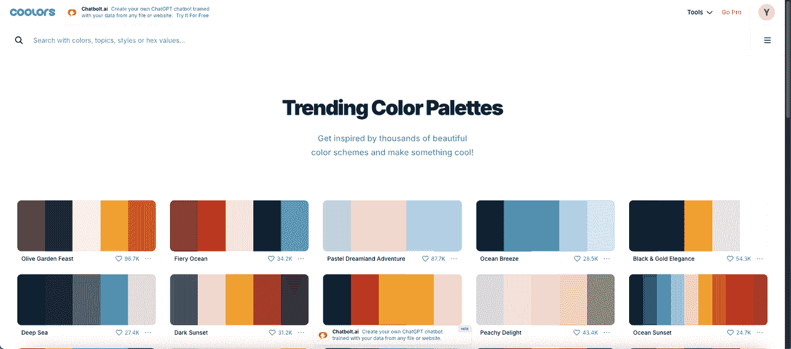

+   在 Google 上通过关键词搜索配色

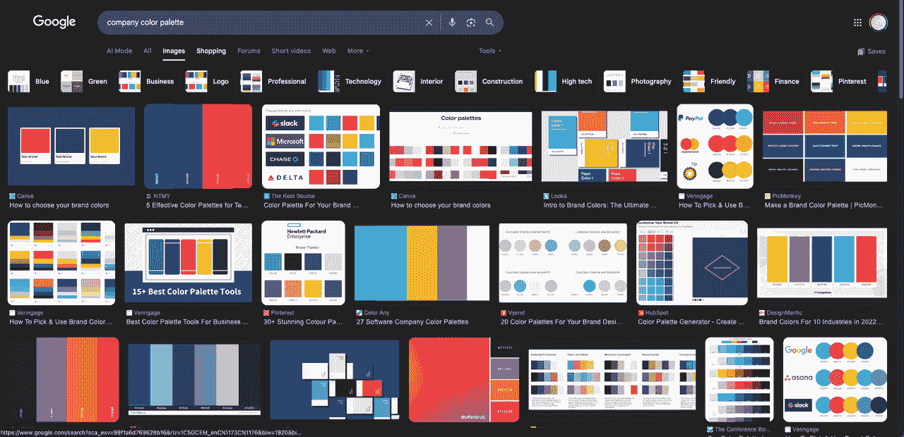

## 编写网站设计提示词

示例提示词

```
&quot;请设计一个由 Home、About、Contact 三个版块构成的单页网站。
使用配色 #171721、#FF7130 和 #FF3C68。
整体风格要现代、简洁。&quot;
```

# 使用设计 Agent 设计网站

## 输入提示词 → 生成设计稿

+   在提示词中写出你规划好的结构以及选定的配色。

Mastergo 提示词示例

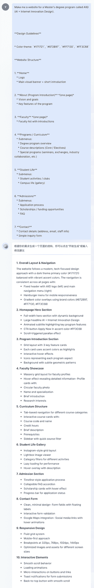

## 审阅设计稿并提出修改意见

你可以根据自己的需求，向 Agent 提出反馈，例如：

+   “太花哨了，整体风格改得更简洁一些。”

+   “换一种字体。”

+   “调整一下颜色搭配。”

+   “把这里这一块删掉。”

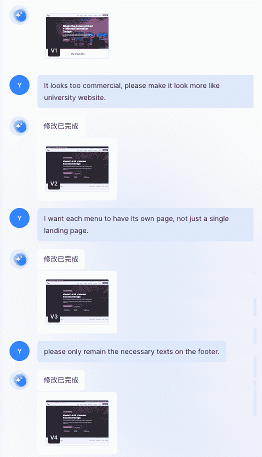

## 确定最终设计

当你对设计稿进行多轮修改并满意之后，就可以把这个设计转化为代码，让编码 Agent 能理解并继续工作。

将设计转为代码的方式会因平台而异，但通常是在设计平台中安装并使用某些插件来完成。

Mastergo 示例

1.  打开 [Mastergo 插件网站](https://mastergo.com/community/plugin)，搜索 seal。

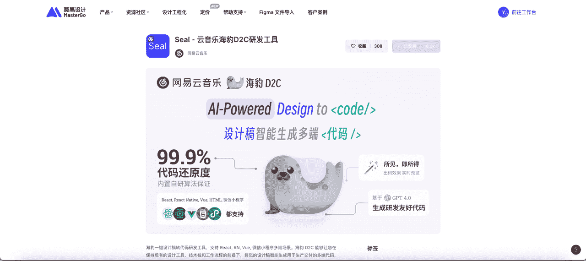

1.  回到设计页面，点击 方块图标（插件）。

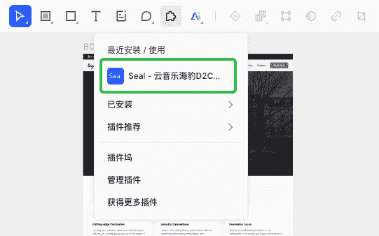

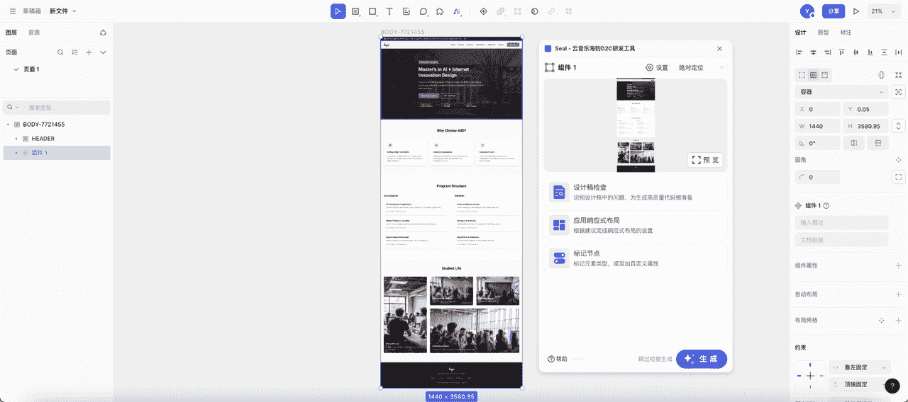

1.  选中你想转换为代码的设计区域，点击 Generate 按钮生成代码。

# 使用编码 Agent 搭建网站

## 理解 HTML/CSS/JS 的基础概念

一个网站本质上由三种语言构成：

+   HTML（HyperText Markup Language） → 结构（骨架）

+   CSS（Cascading Style Sheets） → 样式（外观）

+   JavaScript（JS） → 功能（交互）

这三者配合在一起，构成我们看到的完整网页。

1.  🏗️ HTML（结构）

+   定义页面中“展示什么”

+   用来放置文本、图片、按钮、链接等元素

+   类似于建筑物的 墙体和框架

示例

```
&lt;h1&gt;Hello!&lt;/h1&gt;
&lt;p&gt;This is my first website.&lt;/p&gt;
&lt;a href=&quot;contact.html&quot;&gt;Contact&lt;/a&gt;
```

1.  🎨 CSS（样式）

+   决定“内容怎样展示”

+   控制文字大小、颜色、间距、背景、按钮形状等

+   让 HTML 有了“衣服”和视觉风格

示例

```
h1 {
  color: #FF7130;   /* Text color */
  font-size: 36px;  /* Font size */
  text-align: center; /* Center alignment */
}

body {
  background-color: #171721; /* Background color */
  color: white; /* Default text color */
}
```

1.  ⚙️ JavaScript（JS）（功能）

+   让网页能够和用户互动

+   可以实现按钮点击、菜单展开、图片轮播、表单提交等动态效果

+   如果说 HTML/CSS 是静态的骨架和外观，那么 JS 就是让网页“活起来”的 大脑

示例

```
function showAlert() {
  alert(&quot;The button has been clicked!&quot;);
}
```

```
&lt;button onclick=&quot;showAlert()&quot;&gt;Click me&lt;/button&gt;
```

## 让编码 Agent 生成代码

示例提示词

```
&quot;请为一个包含 Home、About 和 Contact 版块的单页网站编写 HTML 和 CSS。
使用配色 #171721、#FF7130、#FF3C68。
背景为黑色，文字为白色。&quot;
```

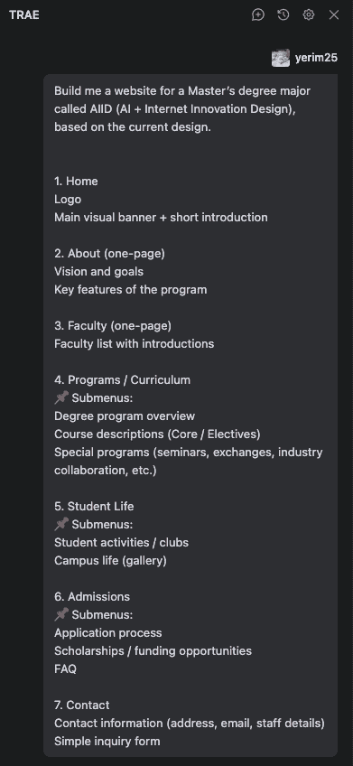

## 运行网站

当草稿代码生成后，Agent 通常会自动启动项目，并展示生成好的网站页面。

如果你重新启动了 Agent，或者网站画面没有出现，可以输入类似这样的提示：

```
&quot;Please activate the project&quot;
```

让 Agent 重新启动项目并打开预览页面，方便你查看当前的效果。

## 进行简单修改

你可以继续通过自然语言对草稿进行微调，例如：

+   “把按钮做大一点。”

+   “字体粗一点。”

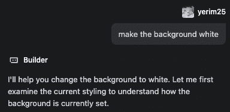

## 修改网站文案内容

Agent 生成的初版网站，通常会包含一些自动生成的占位文本。为了让它更贴近你的真实场景，你可以提前准备好实际内容，再让 Agent 帮你替换。

应用示例：更新 AIID 网站的 About 页面

1.  先写好你想在 About 页面展示的内容。为了方便 Agent 理解，可以将内容保存为 Markdown 格式。

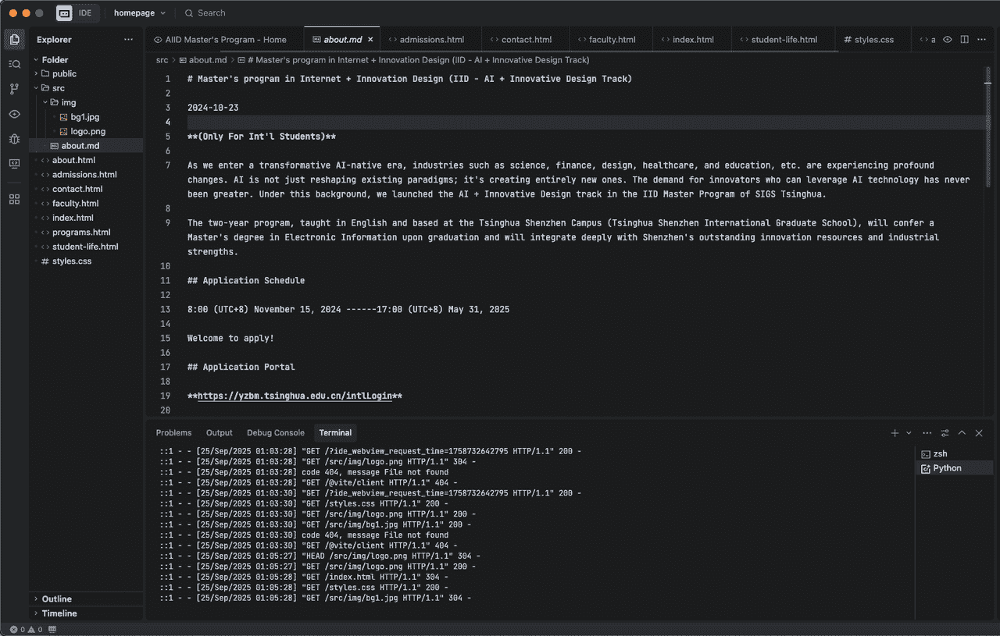

1.  然后在对话中告诉 Agent，将该文件中的内容应用到指定页面上。

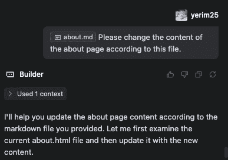

1.  查看应用内容后的更新版本。

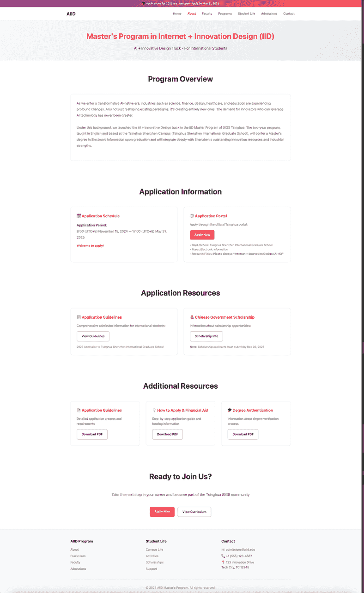

## 插入图片

如果你想加入特定图片（例如 Logo、背景图等），可以先把图片上传到项目文件夹中，然后在提示词里说明要在页面的什么位置使用这些图片。

+   示例：

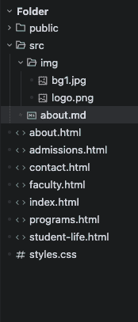

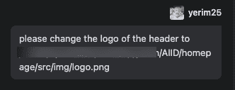

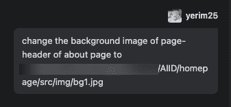

+   结果：

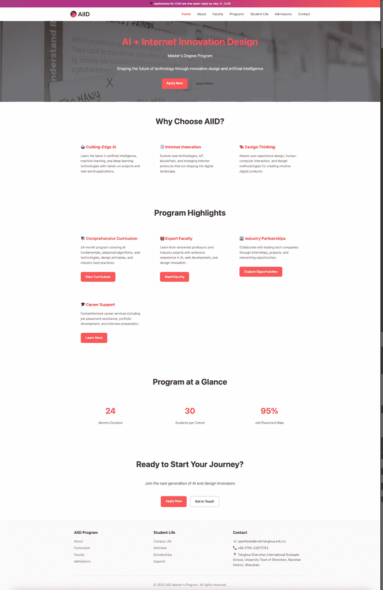

# 将设计与代码整合

## 将设计文件与网站代码整合（可选）

当你从设计 Agent 那里下载到了代码文件后，可以把它们移动到当前项目目录中，然后请编码 Agent 帮你将这些设计代码与现有项目进行合并。

+   示例：

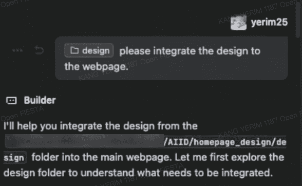

+   结果：

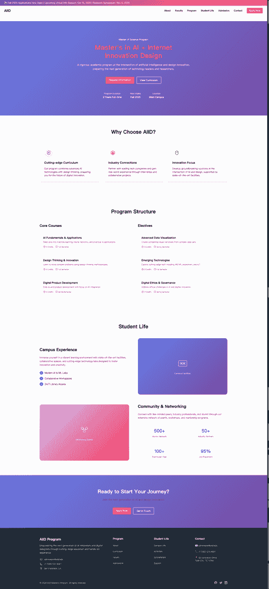