# 用 Codex 免费打通 Figma，自动生成全套设计规范，1 分钟把UI设计稿变成网页

> 来源：[https://qqs7y1hozd1.feishu.cn/docx/JMXIdhA1HoVLVLxixgEcaPACn7x](https://qqs7y1hozd1.feishu.cn/docx/JMXIdhA1HoVLVLxixgEcaPACn7x)

#  一、安装与配置

### **第一步：下载Codex**

mac下载地址：https://openai.com/zh-Hans-CN/codex/

windows下载地址：https://apps.microsoft.com/detail/9plm9xgg6vks?hl=zh-CN&gl=CN

下载完成后，需要先把下图中的【完全访问限制】选上，不然老是问你要权限比较麻烦。

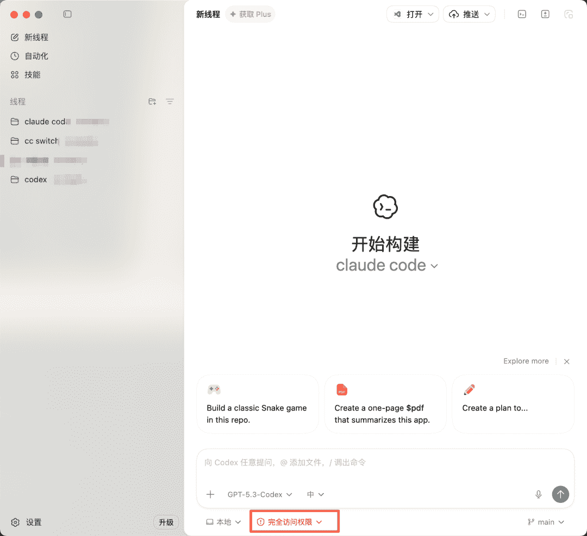

### 第二步：让 Codex 自己改配置文件

直接复制下面这段话，粘贴到 Codex 的输入框中，然后按回车发送：

```
请利用你的本地访问权限，帮我找到 Codex 的本地配置文件（通常在 ~/.codex/config.toml），并在里面加上 Figma 官方的 MCP 服务配置。配置内容为：[mcp_servers.figma] url = &#x27;https://mcp.figma.com/mcp&#x27;。修改完成后请告诉我。
```

Codex 会自动读取并修改它自己的配置文件，修改成功后它会回复你。

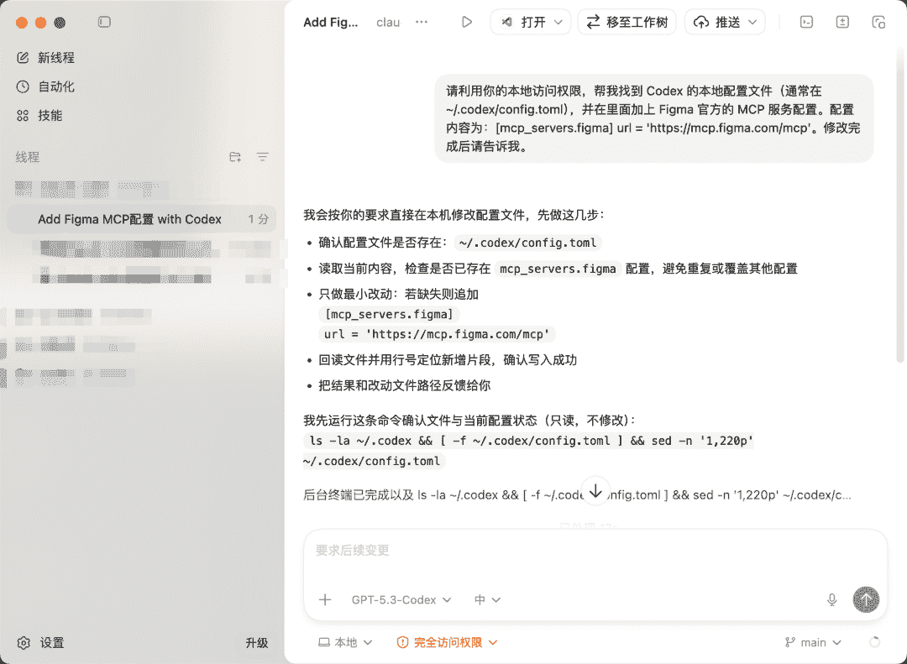

如果过程中遇到问题或报错，直接把问题发给codex，让它解决。

### 第三步：让 Codex 帮你调出授权链接

配置文件改好后，还需要授权。继续在输入框里发送下面这段话：

```
配置好了的话，请帮我在终端中执行命令：codex mcp login figma ，并把终端输出的浏览器授权登录链接直接发给我。
```

它就会发一个链接或者自动弹出浏览器，你直接点击【Agree Allow Access】点击授权就可以了。

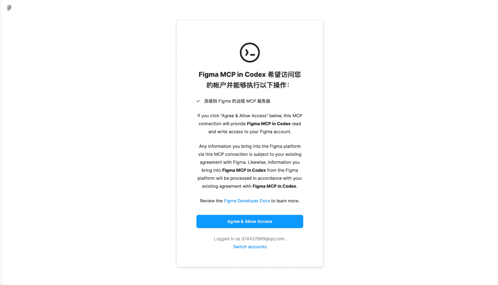

授权完成后，你就可以直接在刚才的输入框里把 Figma 的设计稿链接丢给它了。

#  二、Codex打通Figma能做什么？

## **案例一：一键设计稿转代码**

我找到了我几年前做的UI设计稿链接发给Codex，直接复制figma链接：

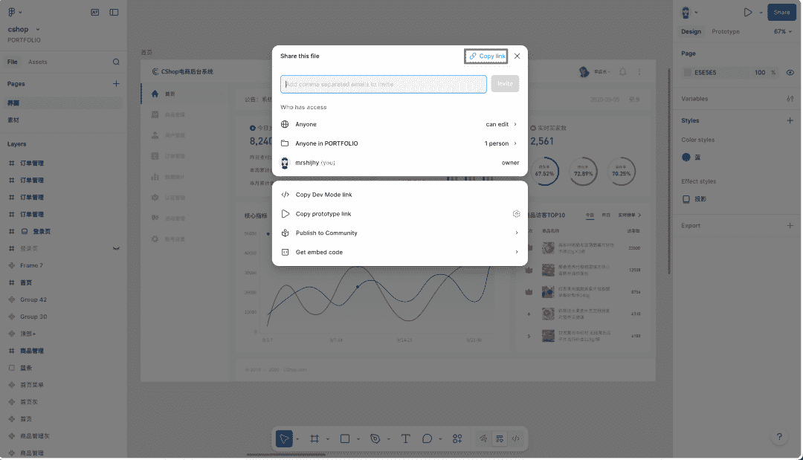

然后输入下面这段提示词：

```
请读取这个figma链接：[你的figma链接]。帮我把这个设计稿变成一个真网页。你不用管用什么技术，只要能让我在电脑浏览器里打开看，并且按钮有点击效果就行。请直接帮我把文件建好。
```

它就会给你发一个链接而且自动在浏览器弹出这个链接，你也可以直接复制查看。

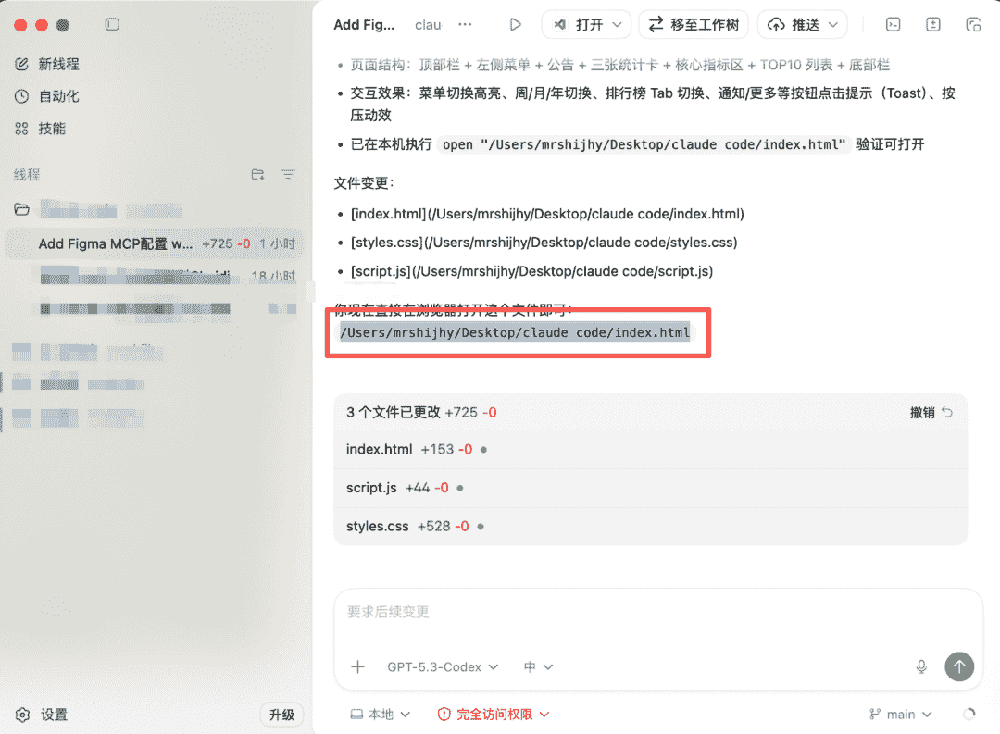

看一下生成前后的一个对比，还是蛮多细节没有还原到位的。不知道是不是我的提示词没写好。不过大家也可以试下让他改到好为止。


## **案例二：自动提取设计规范**

我找了一个设计规范的参考图发给Codex，让他根据我在figma设计的UI生成设计规范，并设计到figma中，参考图可以在花瓣随便找一张图试试，提示词如下：

```
请读取这个figma链接：【这里是你的figma链接】，帮我整理这个figma里的UI视觉设计规范，比如颜色、字体等，就像我发给你的图片，生成代码图片，并放在figma中
```

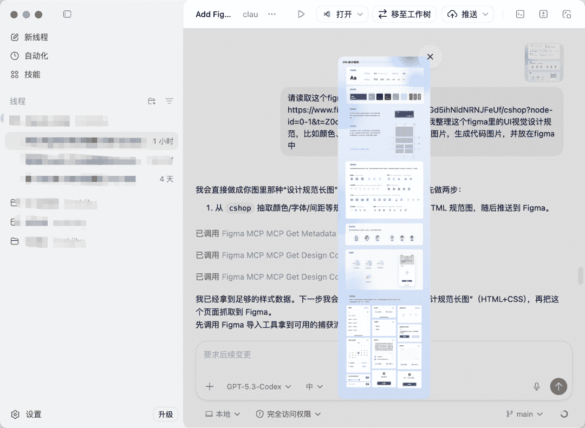

结果他真的在同一个figma文件上面做了份设计规范，这个设计规范还能修改。

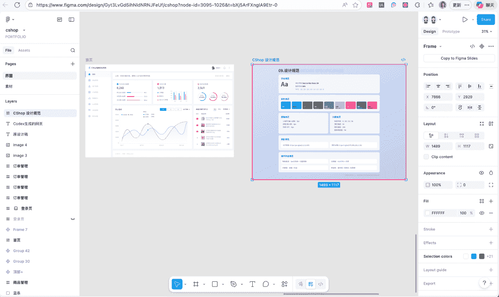

还做了个网页，太牛了。

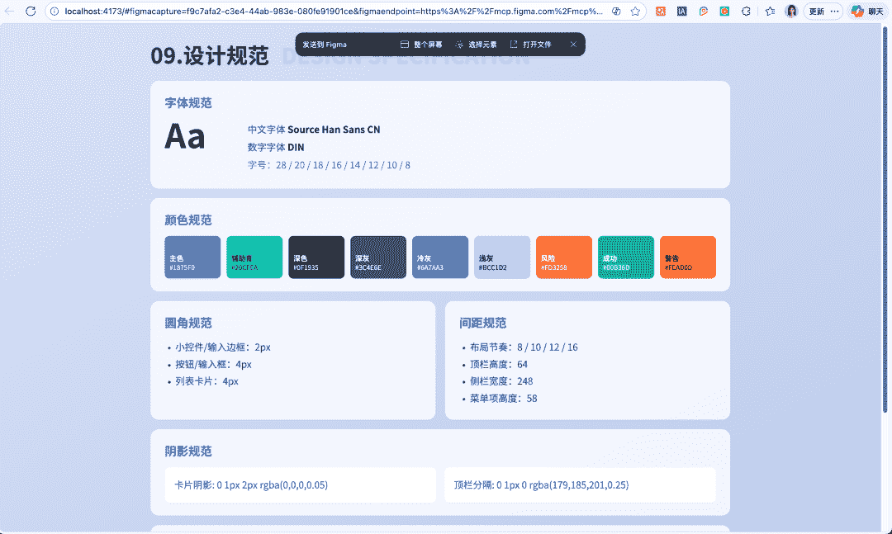

你看他给你写了字体、颜色、圆角、间距等等的规范。就是可能没那么好看，不过我觉得第一版做成这样很完美了。

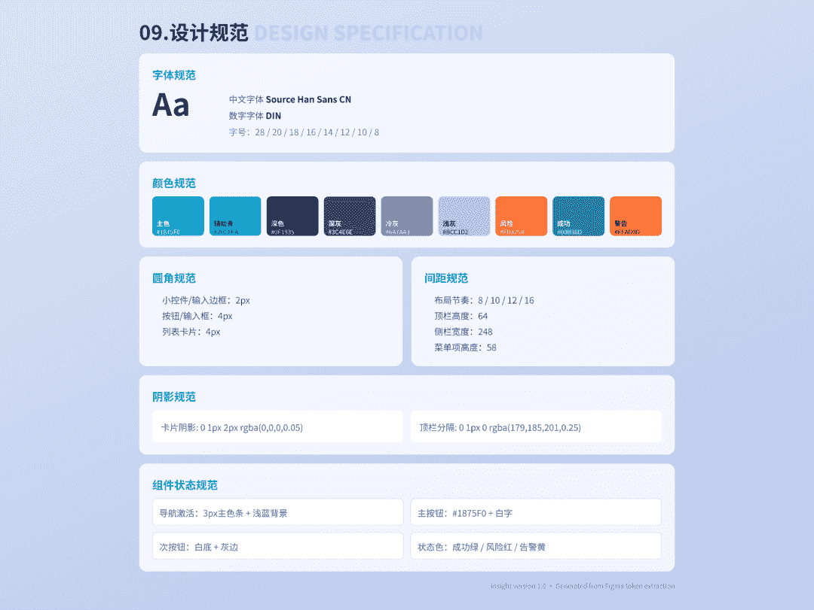

## **案例三：读取设计规范生成UI**

我把字节跳动的设计规范发给Codex，让他根据设计规范生成页面，看看效果怎么样。设计规范我知识库里面有，需要的直接在我知识库里面找。

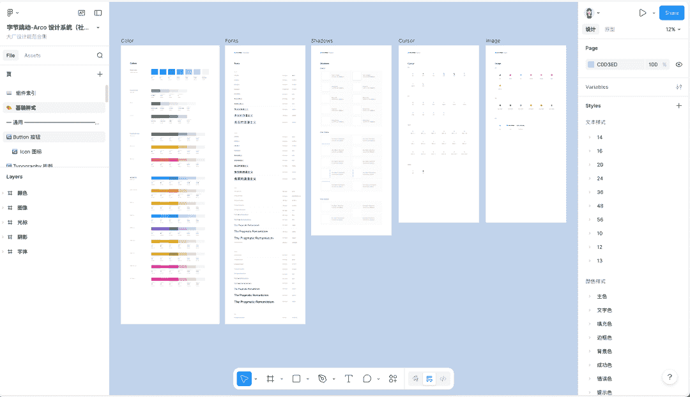

直接发下面这段提示词：

```
请深度分析这个字节跳动设计规范的 Figma 链接：【这里是你的设计规范链接】。我需要你严格按照里面定义的颜色（特别是品牌主色、背景灰色、文字的主次灰度）、字体排版规范和间距等规范，帮我生成一个【SaaS 后台数据概览页面】，生成代码图片，并放在figma中。
```

然后他就会根据规范生成页面了，还是有点字节跳动的设计风格的，很不错。

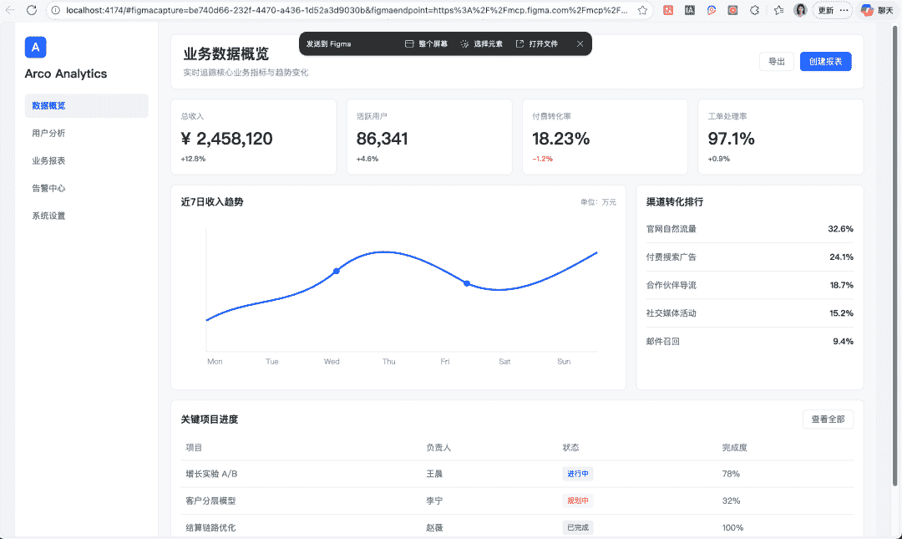

也是给你弄到figma文件中，你想改就改一下。

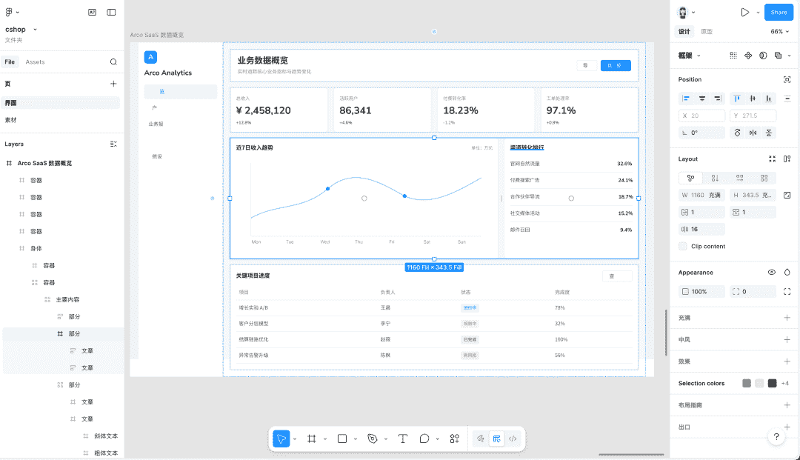

至于文字的一些缺失， 直接改成本地的字体就能解决。


还有很多玩法，大家可以自行探索哦，很有意思！

#  三、Codex和Claude Code连Figma Mcp有什么区别？

**1、拿到的数据完全一致**不管**你是用 Codex** 还是 Claude Code 连 Figma MCP，在Figma 的数据没有任何区别。看到的都是一样的图层结构、一样的颜色、一样的 Auto Layout 参数。2、写的代码不一样这是最核心的差异。Cl**aude Code（Cl**aude 3.5/3.7 Sonnet）：Claude 目前口碑极佳。它对 UI 还原度、CSS 细节、特别是 Tailwind 和复杂 React 组件拆分的理解，它写出来的 UI 代码成功率很高，微调少。Codex（GPT 系列模型）：它的逻辑能力极强，但在视觉 UI 风格的生成上，会比较规矩或者相对平庸一点。不过，如果你让它结合后端的复杂业务逻辑（比如“照着这个 Figma 写个页面，顺便把连接数据库的 API 一起写了”），它的全栈统筹能力非常出色。3、Codex免费额度多我感觉我用了蛮多的了，但是这里的免费额度还有55%这么多，用起来蛮爽的。

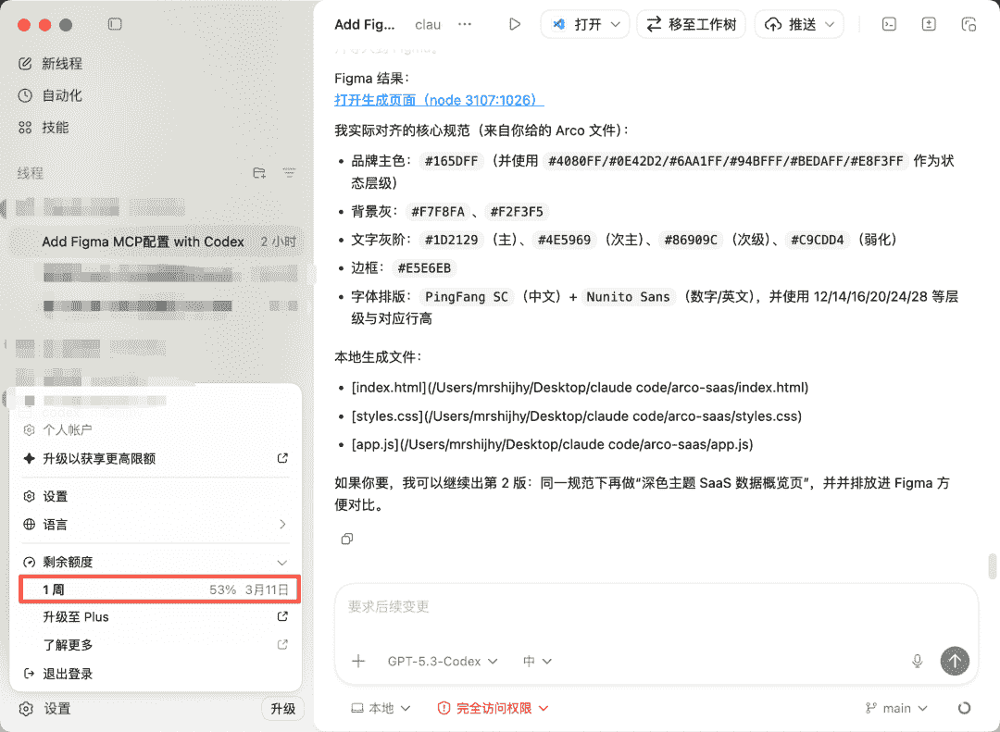

这两年，每次出个什么 AI 神器，总有人喊“设计师又要失业了”。但今天完整跑完这套 Figma + MCP + 大模型的流程，我反而没那么焦虑了。为什么？

因为你会发现，当画图的动作门槛被 AI 无限拉低时，我们身上真正值钱的东西反而浮出水面了——那就是产品思维、业务理解和审美标准。AI 可以一键给你生成，但它不知道你的真实业务逻辑有多奇葩；它可以帮你提取 UI 规范，但它决定不了你产品的灵魂。以前我们是被工具裹挟的执行者，现在，我们终于可以退一步，成为发号施令的导演。