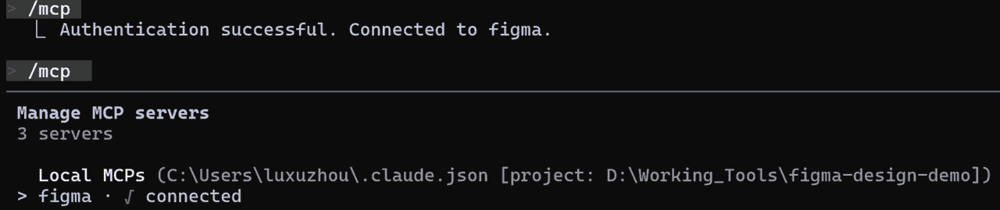
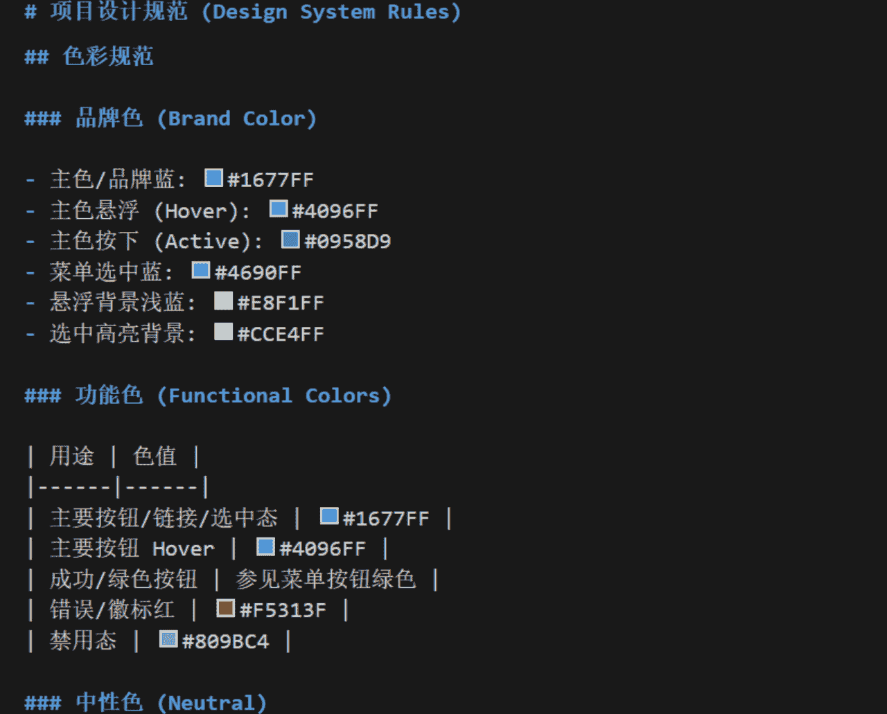
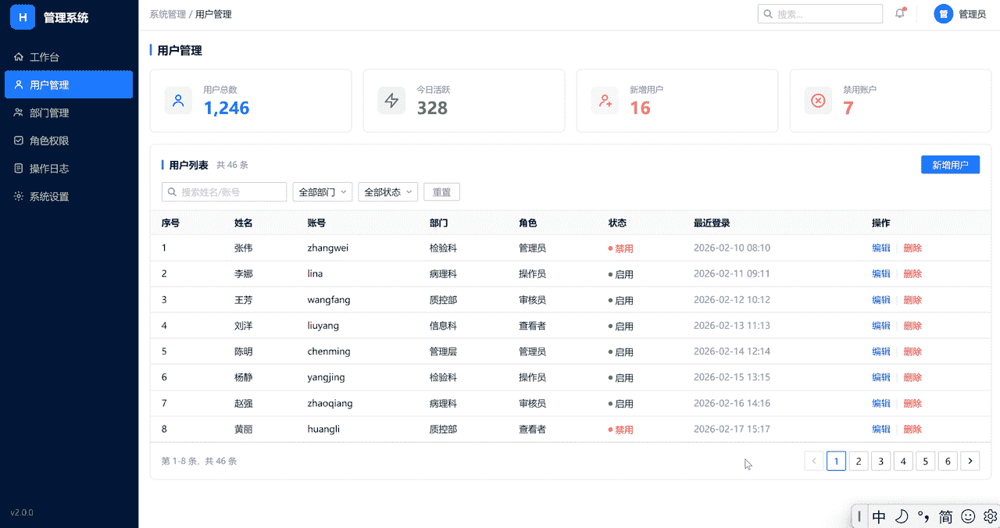
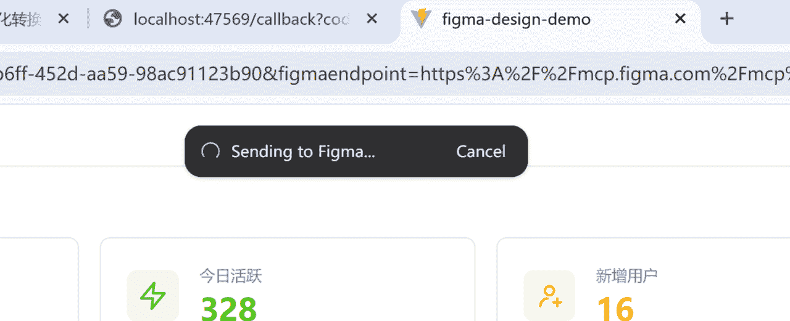
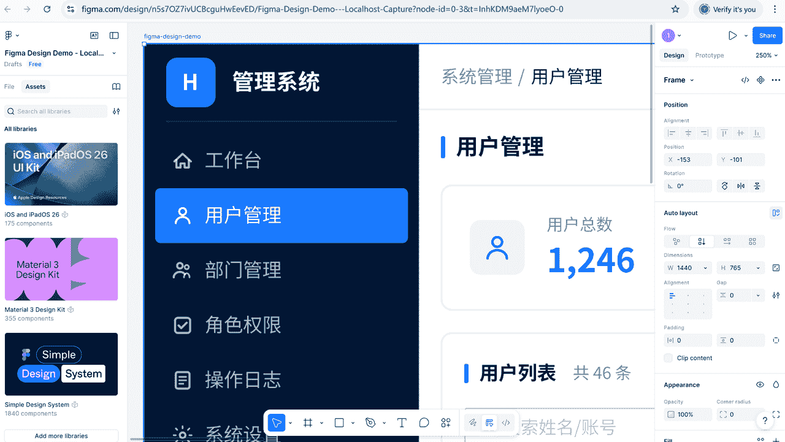

# Claude Code + Figma，10分钟让AI按公司规范出设计稿

> 来源：[https://qqs7y1hozd1.feishu.cn/docx/T99SdpnUCoPNqfx9elhc2ikwnLR](https://qqs7y1hozd1.feishu.cn/docx/T99SdpnUCoPNqfx9elhc2ikwnLR)

推荐给你如下的工具组合：Claude Code + Figma MCP。

下面是完整的操作步骤。

### **第一步，装好工具。**

需要三样东西：Claude Code、Figma MCP 连接、一个前端项目。

Claude Code 是 Anthropic 官方的命令行工具，需要 Max 订阅或者 API Key。安装很简单，终端里一行命令：

```
npm install -g @anthropic-ai/claude-code
```

Figma MCP 是让 Claude Code 能跟 Figma 通信的桥梁。配置方法是在 Claude Code 的全局设置文件里加一段：

打开 ~/.claude/settings.json，加入：

```
{  &quot;mcpServers&quot;: {    &quot;figma&quot;: {      &quot;url&quot;: &quot;https://mcp.figma.com/mcp&quot;    }  }}
```

保存后重启 Claude Code，首次使用时会弹出 Figma 的 OAuth 授权窗口，点击授权就行。

配置完成可以用/mcp查看状态。



最后，创建一个 React + Tailwind CSS 的项目，用来承载生成的页面代码：

```
npm create vite@latest design-demo -- --template react-tscd design-demonpm installnpm install tailwindcss @tailwindcss/vite
```

Tailwind CSS 在 Vite 配置里注册一下插件，index.css 里加一行 @import "tailwindcss"，就可以了。

项目结构不重要，重要的是接下来这一步。

### 第二步，让 Claude 吃透公司的设计规范。

把 PDF 丢给 Claude Code，让它提取所有的设计规则。

指令大概是这样：

> 请阅读项目根目录下的设计规范 PDF，提取其中的所有设计规范信息，然后生成一份 CLAUDE.md 文件，作为后续所有代码生成的约束规则。

提取出来的规范非常细，你还可以在这个基础上进行编辑修改：



不需要每次都提醒它"用 #1677FF"——它已经知道了。

### **第三步，一句话生成页面。**

让 Claude Code 生成一个"用户管理后台"页面，指令很简单：

> 根据 CLAUDE.md 中的设计规范，生成一个用户管理后台页面。包含侧边栏导航、顶部栏、数据统计卡片和用户列表表格。所有样式严格遵循设计规范。

npm run dev 启动本地服务器，浏览器打开一看——



深色侧边栏，#001737 背景，选中菜单项 #1677FF 高亮。顶部栏 48px 高度，面包屑导航、搜索框、用户头像一应俱全。四张数据统计卡片横排，用户总数、今日活跃、新增用户、禁用账户，配色各不相同。

下面是一张完整的用户列表表格。表头 #FAFAFA 背景，正文 13px，搜索筛选和分页器都有。悬浮行变蓝底，按钮 26px 高、2px 圆角。

我特意拿 PDF 里的色值对了一遍。品牌蓝、文字色、边框色、分割线颜色——全都对上了。

13px 正文字号这个容易出错的点，也没翻车。

### **第四步，推送到 Figma。**

页面在浏览器里跑起来之后，最后一步是把它变成 Figma 可编辑的设计稿。

在 Claude Code 的对话里说一句：

> 把当前运行在 localhost:5173 的页面发送到 Figma

Claude Code 调用 Figma MCP 的 generate_figma_design 工具，自动截取浏览器中的渲染结果，推送到 Figma 文件里。



打开 Figma 一看，页面已经在画布上了。

不是截图，是**真正的可编辑图层**。文字可以双击修改，颜色可以在属性面板里调整，布局带 auto-layout，设计师可以直接在这个基础上做精细调整。



如果 MCP 推送遇到问题，还有个备选方案——用 Chrome 插件 html.to.design。在浏览器里点一下插件按钮，再去 Figma 里打开对应插件粘贴，效果一样，多一步手动操作而已。

到这里，整个流程就走完了。

回头看一下时间线：提取规范大概 5 分钟，生成页面 2-**3 分钟，推送到 Figma 1 **分钟。从拿到 PDF 到拿到一份可编辑的 Figma 设计稿，大概 10 分钟。

说说传统流程要多久。

产品经理先写需求文档，1-2 天。设计师拿到需求后翻设计规范 PDF，反复确认每个色值、每个字号、每个间距——光这一步就够磨人的了。然后在 Figma 里从零开始画，一个后台管理页面画个 1-3 天不夸张。

画完之后设计评审。

"这个蓝色不对，应该是 #1677FF。" "这个按钮高度应该是 26 不是 32。" "间距不是 4 的倍数。"

改一轮。再评审。再改一轮。

设计规范合规性这件事，占了设计师大量的时间和精力，而且很枯燥。

新流程不是替代设计师。是帮设计师跳过"从零画一个合规页面"这个最重复的部分，直接从一份 80 分的合规底稿开始做精细设计。

设计师的时间应该花在交互细节、动效打磨、用户体验这些真正需要人来判断的地方，而不是花在"确认这个蓝是不是 #1677FF"上。

最后说几句实话。

**这个方案不是万能的。它适合**的场景是标准化程度高的后台管理页面——表格、表单、列表、卡片这类组件化的东西，AI 能生成得又快又准。

复杂的交互逻辑、品牌情感表达、需要创意发挥的营销页——这些还得靠设计师。AI 目前做不了"让人眼前一亮"的设计，它只能做"让人挑不出毛病"的规范执行。

但反过来想，一个产品系统里，80% 的页面其实就是这种标准化的后台页面。

把这 80% 的工作从"手工画"变成"AI 生成 + 人工微调"，设计师就能把精力集中在那 20% 真正需要创造力的地方。

这可能才是 AI 辅助设计最务实的切入点——不追求"AI 替代设计师"，而是让 AI 替设计师干那些最机械、最容易出错的活。