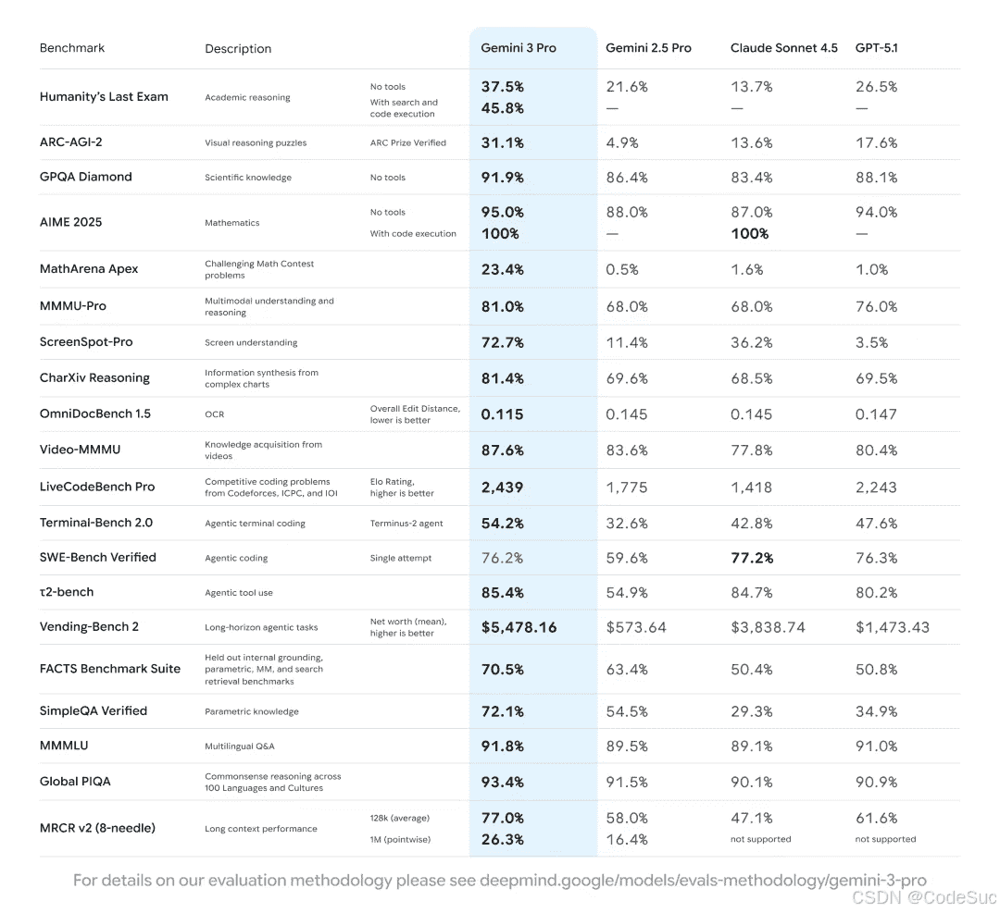
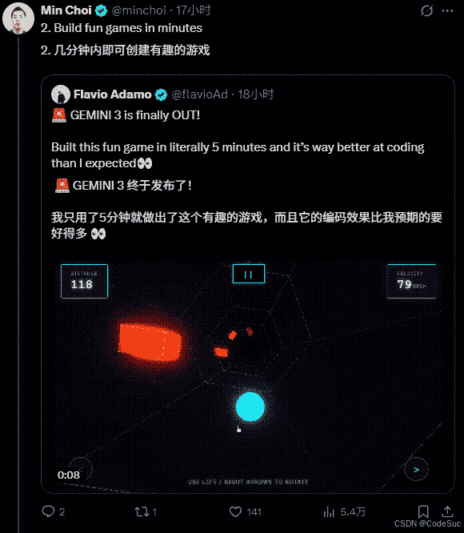
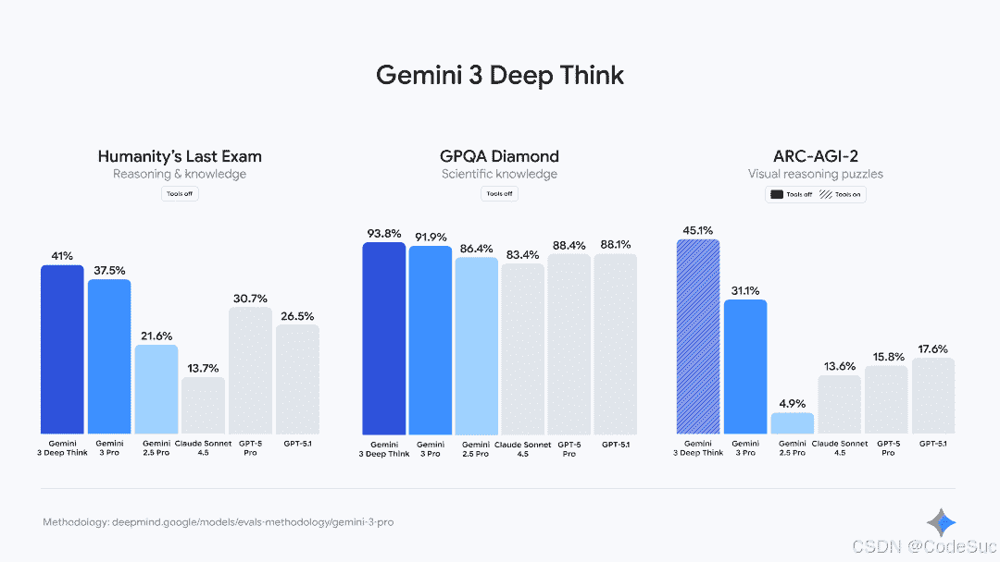
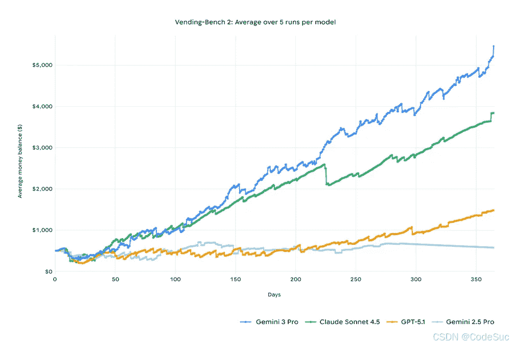

# Gemini 3 全面解析：从认知到落地

> 来源：[https://qqs7y1hozd1.feishu.cn/docx/MgEmdUIpgoxP07xEokEcpMD9nMh](https://qqs7y1hozd1.feishu.cn/docx/MgEmdUIpgoxP07xEokEcpMD9nMh)

## 总览与定位（总）

### 1.1 为什么是 Gemini 3



> Gemini 3 是 Google 在通向**通用智能（AGI）的路径上又**一关键迭代，强调更强的多模态理解**、更深的推理能力与更丰富的交互表现，尤其在“代理**型（Agentic）”工作流与编码能力上显著增强（参考 Google 官方博客与发布说明）Google Blog。它不仅“看懂”文本与图像，还能对视频与音频进行综合理解，并以代码和可视化的方式来解释复杂概念。

### 1.2 演进与生态：从 Gemini 1 到 3

自 Gemini 1 开创原生多模态与长上下文窗口后，Gemini 2.x 将工具使用与结构化输出进一步完善；到了 Gemini 3，模型在推理、编码与交互方面实现多维跃升。官方渠道显示，Gemini 3 已在 Gemini App、AI Studio 与 Vertex AI 中提供接入，并计划持续推出系列型号与能力模式（例如更深层推理的 Deep Think 模式）Google Blog。

### **1.3 能力全景图与读者收益**

+   原生多模态：文本/图像/视频/音频/代码统一表示与推理。

+   更长上下文：支持大规模输入与跨文档推理（业界媒体报道提及百万级上下文能力）Max Productive AI。

+   Deep Think：针对复杂推理任务的模式，表现出更高准确率与稳健性（多项基准显示提升）VentureBeat。

+   Agentic：工具使用、函数调用与代码执行闭环，支持复杂工作流与自动化。

### **1.4 访问入口与使用场景**

开发者入口：AI Studio 与 Gemini API；企业入口：Vertex AI；终端用户入口：Gemini App 与部分搜索场景（交互式可视化增强）Business Insider。

**场景：教育解释、研究辅助、产品原型、数**据分析、界面自动化、代理编程与知识管理。

## 架构能力与关键特性

2.1 原生多模态：文本、图像、视频、音频、代码

**G**emini 3 在多模态上强调原生融合与跨模态推理：输入既可以是文字、图片、视频或音频，也可以混合提供；输出则可以是文本、代码或可视化内容。这种能力能够将复杂问题拆解为可解释的演示或交互图形，提升学习与沟通效果Google Blog。



2.2 长上下文与思维模式（Deep Think）

面对复杂任务与长文档，Gemini 3 通过更长的上下文窗口与更深的推理模式提升正确性。据业界报道，Deep Think 在多项高难评测上显著提升，包括 GPQA、AIME 等（细节见媒体报道与官方评测）Max Productive AI，VentureBeat。



2.3 Agentic 工作流：工具调用与结构化输出

Gemini 3 支持“代理型”工作流：在推理过程中调用外部工具或函数，返回结构化数据并执行代码。它可用于数据抓取、计算验证、可视化生成与自动化编排，适合产品化与企业级场景DeepMind Model Page。

2.4 安全与合规：策略与审计

在企业落地中，应配合内容安全与合规策略（过滤、审计、角色与配额）进行治理；对个人与敏感信息采取最小暴露与加密传输，记录请求与响应元数据以便审计与回溯。Vertex AI 通常提供更完备的组织级治理与访问控制能力。

## 开发者集成与基础用法

3.1 API 形态与模型选择

Gemini 3 提供多型号以适配不同成本与能力需求，常见如 Pro（通用高性能）与更高阶模式（如 Deep Think）。开发者可通过 Gemini API 或 Vertex AI 进行集成，并根据任务选择思维层级与上下文配置。

3.2 文本推理与结构化输出

3.2.1 Python 示例

```
import google.generativeai as genai

genai.configure(api_key=&quot;YOUR_KEY&quot;)
model = genai.GenerativeModel(&quot;gemini-3-pro&quot;)
resp = model.generate_content({&quot;role&quot;:&quot;user&quot;,&quot;parts&quot;:[{&quot;text&quot;:&quot;用三段文字解释为什么多模态能提升学习效果&quot;}]})
print(resp.text)

```

3.2.2 JavaScript 示例

```
import { GoogleGenerativeAI } from &quot;@google/generative-ai&quot;;
const genai = new GoogleGenerativeAI(process.env.GEMINI_API_KEY);
const model = genai.getGenerativeModel({ model: &quot;gemini-3-pro&quot; });
const resp = await model.generateContent({ contents: [{ role: &quot;user&quot;, parts: [{ text: &quot;列出多模态推理的三个优势&quot; }] }] });
console.log(resp.response.text());

```

3.3 多模态输入：文本+图片

```
from PIL import Image
img = Image.open(&quot;chart.png&quot;)
content = {&quot;role&quot;:&quot;user&quot;,&quot;parts&quot;:[{&quot;text&quot;:&quot;分析该图表的趋势并给出三条决策建议&quot;},{&quot;inline_data&quot;:{&quot;mime_type&quot;:&quot;image/png&quot;,&quot;data&quot;:open(&quot;chart.png&quot;,&quot;rb&quot;).read()}}]}
resp = model.generate_content(content)
print(resp.text)

```

3.4 思维层级与参数配置

Gemini 3 支持配置“思维层级”或“推理深度”以应对复杂任务；在 API 层通常以参数体现（具体命名以官方文档为准）。企业侧可结合请求超时、温度、Top‑K/Top‑P 与工具调用开关进行精细化治理Max Productive AI。

## 推理、编码与 Agent 编排

4.1 高阶推理与数学/科学任务

媒体报道与第三方评测显示，Gemini 3 在数学与科学推理上有显著跃升（如 AIME 与 GPQA 指标），在代码执行辅助下达到了更高分数（细节参见评测报道）VentureBeat。这意味着它能够更稳定地进行多步假设、校验与修正。



4.2 Agentic Coding 与 IDE/CLI 集成

开发者可以在 IDE（VS Code、JetBrains）或 CLI 中使用 Gemini 3 进行“代理型编码”，包括计划生成、代码草拟、测试补全与运行反馈。相关渠道提到 IDE 集成与 CLI 工作流的支持Max Productive AI。

4.3 工具调用与函数执行链

在 Agent 工作流中，模型以“思考→计划→调用工具→综合结果→输出”的闭环执行。常见工具包括检索、计算、数据库/API 调用与可视化生成。通过结构化输出与函数调用可以将模型与外部系统安全集成。

```
const tools = [{ name: &quot;search&quot;, description: &quot;web&quot;, input_schema: { q: &quot;string&quot; } }];
const resp = await model.generateContent({ contents: [{ role: &quot;user&quot;, parts: [{ text: &quot;查找三篇关于多模态推理的论文&quot; }] }], tools });
console.log(resp.response.candidates[0].content);

```

4.4 工作流编排与可视化输出

Gemini 3 可生成图表或交互式解释，并在产品中以内嵌组件呈现，从而将复杂主题转换为更易理解的视觉形式Business Insider。在企业应用中，建议将这些输出接入前端可视化库并打通审计与缓存策略。

## 搜索、问答与交互体验

5.1 Query 分解与检索增强

Gemini 3 在搜索与问答场景中更擅长将复杂问题拆分为细颗粒任务，再进行检索与综合回答，面对开放式问题能生成更贴近用户意图的结构化与可视化结果Business Insider。

5.2 可视化与交互式解释

+   通过生成交互式图形或演示来解释复杂主题，有助于教学与知识传播。对产品而言，可在前端集成交互控件以提升体验与可用性。

5.3 教学与内容生产场景

+   在教学场景，Gemini 3 可以将文本、图片与代码结合，生成循序渐进的解释与练习；在内容生产场景，可用于多媒体稿件、演示文稿与数据故事。

5.4 产品级体验落地建议

> 提供明确的任务模板与提示工程范式，减少用户学习成本。

> 为可视化输出设计通用容器与安全沙箱，防止注入风险。

> 结合反馈与评分机制，持续优化提示与工具链。

## 企业落地与工程实践

6.1 Vertex AI 与治理能力

在企业场景下建议使用 Vertex AI 进行接入，以获得更完善的组织级治理、配额与审计能力，配合访问控制与计费策略实现可持续运维。

6.2 成本与配额管理

建立调用预算与限额，按模型与场景细分成本归集。

使用缓存与检索增强减少重复推理；为长上下文任务设置输入裁剪策略。

以 A/B 实验评估不同参数与策略对成本与质量的影响。

6.3 数据安全与隐私保护

严格的输入/输出过滤与脱敏流程，保障合规。

采用最小权限原则与密钥托管；记录审计日志与请求链路。

在跨境与敏感领域遵守行业标准与法律法规。

6.4 质量评测与持续优化

建立离线与在线评测集，覆盖代表性任务。

采用回归与对比评测，持续迭代提示与工具策略。

与可观测性打通，闭环问题定位与参数调优。

## 评测结果与竞品对比

7.1 指标与榜单观察

媒体与第三方评测指出 Gemini 3 在多项推理与多模态评测中跃升，部分榜单将其列为领先模型之一（如 Artificial Analysis 的指数排名提升）VentureBeat。同时需要注意评测方法与任务覆盖差异。

7.2 任务类型优势与短板

优势：跨模态综合推理、复杂步骤分解、编码与可视化联合输出。

短板：在高风险与高事实性场景仍需工具与检索增强；超长上下文带来的成本与延迟需优化。

7.3 使用策略与选型建议

面向学习与解释：优先使用多模态输入与可视化输出。

面向编码与自动化：启用 Agentic 工作流与函数调用，结合执行沙箱。

面向企业：通过 Vertex AI 与平台治理，严格控制成本与风险。

7.4 风险与边界说明

评测结果易受数据分布与提示工程影响；在敏感场景下应采用检索增强与事实核查，必要时进行人工复核与风险隔离。

## 云原生架构与未来演进

8.1 与服务网格/事件驱动结合

将 Gemini 3 的 Agent 能力与服务网格结合，可在数据面实现统一认证、加密与流量治理；与事件驱动架构结合，可实现跨系统的自动化编排与稳健的异步处理。

8.2 多租户与隔离策略

逻辑隔离：租户标识贯穿请求与输出，便于计费与审计。

资源隔离：模型与工具链的并发与配额，避免相互影响。

数据隔离：对存储与日志进行分级与加密，提升合规性。

8.3 端到端观测与度量

指标：错误率、延迟分布、超时与拒绝、工具调用成功率。

追踪：对 Agent 工作流进行跨服务链路追踪与事件记录。

告警：结合阈值与速率告警，联动工单与自动化处置。

8.4 成本优化与容量规划

结合压测与流量预测进行容量规划；为高峰任务预热与弹性扩缩容。

对长上下文任务进行摘要与检索增强，降低推理成本。

引入缓存层与结果复用，优化整体 TCO。

## 总结与扩展（总）

9.1 知识点回顾与扩展

本文从“总—分—总”的结构出发，系统梳理了 Gemini 3 的核心能力：原生多模态、更深推理（含 Deep Think）、Agentic 工作流与编码、搜索与交互式解释、企业级治理与评测选型，以及云原生的融合路径。落地建议包括提示工程模板化、工具调用与沙箱治理、检索增强与事实核查、成本与配额控制以及端到端观测与告警闭环。

扩展方向可考虑引入更强的工作流编排与服务网格下沉治理，将模型能力与平台能力融合；在事件驱动架构与数据产品中实现更稳定的自动化与可解释输出。

9.2 延伸阅读（提升曝光/阅读率）

Google 官方博客：Gemini 3 概述与入口 Google Blog

DeepMind 模型页：Gemini 3 Pro 能力与评测方法 DeepMind

媒体解读：特性、性能与应用场景 Business Insider

功能与基准汇总：上下文、推理模式与开发者入口 Max Productive AI

第三方评测：榜单与细分指标观察 VentureBeat

欢迎阅读并分享这些资料，提升更多读者的曝光与阅读率。

9.3 开放问题与其它方案（引发讨论）

是否需要引入 Deep Think 模式？在成本与收益之间如何权衡？

何时采用检索增强（RAG）与工具调用？在事实性与敏感场景下的最佳实践是什么？

企业应如何在 Vertex AI 与自建基础设施之间做选择？合规与治理的关键差异有哪些？

如何将可视化与交互输出标准化为组件库，以提升产品迭代速度？